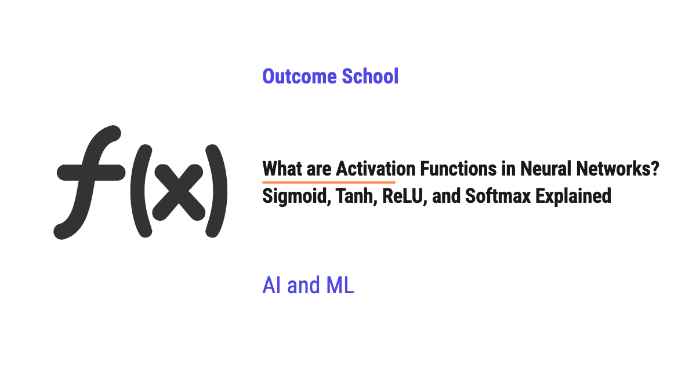

# What are Activation Functions in Neural Networks? Sigmoid, Tanh, ReLU, and Softmax Explained

> Archived from <https://outcomeschool.com/blog/activation-functions> on 2026-11-25.

Activation Functions are math functions that take the number calculated inside a neuron and change it into the final output of that neuron, which allows a neural network to learn curved, complex patterns instead of only straight lines. Sigmoid, Tanh, ReLU, and Softmax are the most common ones.

In this blog, we will learn about Activation Functions in Neural Networks. We will also see where an activation function sits inside a neuron, why a neural network needs non-linearity, how Sigmoid, Tanh, ReLU, and Softmax work with small worked numbers, the problems of vanishing gradients and dying ReLU, and which activation function to use in which layer.

We will cover the following:
<ul><li>What is an Activation Function?</li><li>Where does the Activation Function sit inside a Neuron?</li><li>Why do we need Non-Linearity?</li><li>Sigmoid</li><li>Tanh</li><li>ReLU</li><li>Softmax</li><li>Which Activation Function goes where?</li><li>Comparison of Activation Functions</li></ul>
I am <strong>Amit Shekhar</strong>, Founder @ <a target="_blank" rel="noopener noreferrer" href="https://outcomeschool.com">Outcome School</a>, I have taught and mentored many developers, and their efforts landed them high-paying tech jobs, helped many tech companies in solving their unique problems, and created many open-source libraries being used by top companies. I am passionate about sharing knowledge through open-source, blogs, and videos.

I teach <a target="_blank" rel="noopener noreferrer" href="https://outcomeschool.com/program/ai-and-machine-learning">AI and Machine Learning</a> at Outcome School.

Let&#x27;s get started.
<h2 id="what-is-an-activation-function">What is an Activation Function?</h2>
<strong>An Activation Function is a function that takes the number calculated inside a neuron and converts it into the output of that neuron.</strong>

A <a target="_blank" rel="noopener noreferrer" href="neural-network.md">neural network</a> is made of many small units called neurons, arranged in layers. Each neuron takes some numbers as input, does a small calculation, and passes a number to the next layer. The activation function is the last step of that calculation.

Let&#x27;s say a light dimmer is connected to a bulb. The electricity comes in, and the dimmer decides how bright the bulb glows: fully off, a little on, or fully on. The activation function does the same job for a neuron. The calculated number comes in, and the activation function decides how strongly the neuron &quot;fires&quot;.
<h2 id="where-does-the-activation-function-sit-inside-a-neuron">Where does the Activation Function sit inside a Neuron?</h2>
The best way to learn this is by taking an example.

Let&#x27;s say a neuron receives two inputs: <code>x1 = 2</code> and <code>x2 = 3</code>. The neuron has one weight for each input, <code>w1 = 0.5</code> and <code>w2 = 0.25</code>, and one bias, <code>b = -0.25</code>. Weights and <a target="_blank" rel="noopener noreferrer" href="bias-in-artificial-neural-network.md">bias</a> are the numbers that the network learns during training.

<strong>Step 1:</strong> The neuron calculates the weighted sum. We call this number <code>z</code>.

<strong>z = (w1 * x1) + (w2 * x2) + b</strong>

Putting our numbers:

z = (0.5 * 2) + (0.25 * 3) + (-0.25) = 1 + 0.75 - 0.25 = 1.5

<strong>Step 2:</strong> The neuron passes <code>z</code> through the activation function. Let&#x27;s use Sigmoid here. We will learn about it in detail soon.

sigmoid(1.5) = 0.818

So, the output of this neuron is <code>0.818</code>, and this number goes to the next layer.

Let&#x27;s see this as a diagram:

<pre><code class="language-text code-highlight">┌──────────────────┐  ┌──────────────────┐
│ x1 * w1          │  │ x2 * w2          │
│ 2 * 0.5 = 1      │  │ 3 * 0.25 = 0.75  │
└────────┬─────────┘  └────────┬─────────┘
         └──────────┬──────────┘
                    ↓
┌────────────────────────────────────────┐
│ Weighted sum + bias                    │
│ z = 1 + 0.75 + (-0.25) = 1.5           │
└───────────────────┬────────────────────┘
                    ↓
┌────────────────────────────────────────┐
│ Activation function                    │
│ sigmoid(1.5) = 0.818                   │
└───────────────────┬────────────────────┘
                    ↓
┌────────────────────────────────────────┐
│ Output 0.818 goes to the next layer    │
└────────────────────────────────────────┘
</code></pre>

Here, we can see that the activation function sits right after the weighted sum. Every neuron in a layer does these two steps: first the weighted sum, then the activation function.

To learn Neural Networks, Feed Forward Neural Networks (FFNNs), and Activation Functions from the ground up, check out our <a target="_blank" rel="noopener noreferrer" href="https://outcomeschool.com/program/ai-and-machine-learning">AI and Machine Learning Program</a> at Outcome School.
<h2 id="why-do-we-need-non-linearity">Why do we need Non-Linearity?</h2>
Now, the question is: why can we not just pass <code>z</code> directly to the next layer? Why do we need this extra step at all?

The answer is non-linearity.

The weighted sum is a <strong>linear</strong> calculation. Linear means that if we draw it on a graph, it is always a straight line. It only multiplies and adds.

Here comes the problem. If we stack two linear calculations, we still get a linear calculation.

Let&#x27;s say layer 1 does <code>y = 2x + 1</code> and layer 2 does <code>out = 3y + 4</code>. If we put the first into the second:

out = 3 * (2x + 1) + 4 = 6x + 7

This is again a straight line. Even if we stack 100 such layers, the result is still one straight line. Means, without an activation function, a deep neural network is no more powerful than a single layer.

But real-world patterns are not straight lines. Recognizing a cat in a photo, understanding a sentence, or predicting house prices needs curves, bends, and complex shapes.

So, here comes the activation function to the rescue. It is a <strong>non-linear</strong> function, which means its graph is not a straight line. When we put a non-linear function after every layer, stacking layers finally adds real power. Each layer can bend the pattern a little more, and many layers together can learn very complex patterns.

<strong>Planning your move into AI?</strong>

No matter which tech domain you work in today, with your effort, you can transition to these roles:
<ul><li>AI Engineer</li><li>Forward Deployed Engineer</li><li>AI Agent Engineer</li><li>Harness Engineer</li><li>Voice AI Engineer</li><li>AI Architect</li><li>LLM Engineer</li><li>LLM Inference Engineer</li><li>Gen AI Engineer</li><li>MLOps Engineer</li><li>ML Engineer</li><li>Deep Learning Engineer</li></ul>
Our <a target="_blank" rel="noopener noreferrer" href="https://outcomeschool.com/program/ai-and-machine-learning">AI and Machine Learning Program</a> at Outcome School takes you there.

Now, let&#x27;s learn the most common activation functions one by one.
<h2 id="sigmoid">Sigmoid</h2>
<strong>Sigmoid is an activation function that squeezes any number into a value between 0 and 1.</strong>

The formula is:

<strong>sigmoid(z) = 1 / (1 + e^(-z))</strong>

Here, <code>e</code> is a fixed math number, about 2.718.

Let&#x27;s see some values:
<table><thead><tr><th>z</th><th>sigmoid(z)</th></tr></thead><tbody><tr><td>-10</td><td>0.00005</td></tr><tr><td>-2</td><td>0.119</td></tr><tr><td>0</td><td>0.5</td></tr><tr><td>2</td><td>0.881</td></tr><tr><td>10</td><td>0.99995</td></tr></tbody></table>
Here, we can notice that a very negative number goes close to 0, a very positive number goes close to 1, and 0 becomes exactly 0.5. The graph looks like a smooth &quot;S&quot; shape.

Since the output is always between 0 and 1, we can read it as a probability. For example, 0.881 can mean &quot;88.1% chance that this email is spam&quot;.

<strong>Advantage:</strong>
<ul><li>The output is between 0 and 1, so it works well as a probability for a yes/no answer.</li></ul>
<strong>Disadvantage: Vanishing Gradients</strong>

Before jumping into this problem, we must know one thing about training. During training, the network finds out how much each weight must change to reduce the error. This value is called the <strong>gradient</strong>. A big gradient means a big change. A tiny gradient means almost no change, so the weight almost stops learning.

The gradient passes backward through every layer, and at each layer it gets multiplied by the slope of the activation function at that point, along with the weights. We have a detailed blog on <a target="_blank" rel="noopener noreferrer" href="math-behind-backpropagation.md">Backpropagation</a> that explains how the gradient flows backward step by step.

The slope of sigmoid is at most 0.25 (at z = 0). At z = 10, the slope is only about 0.00005, because the curve is almost flat there.

Now, let&#x27;s say the gradient passes through 10 layers, and each sigmoid gives its best slope of 0.25:

0.25 * 0.25 * ... (10 times) = 0.00000095

Let&#x27;s see this as a diagram:

<pre><code class="language-text code-highlight">┌────────────────────────────────┐
│ Gradient at the output         │
│ gradient = 1                   │
└────────────────┬───────────────┘
                 ↓
              * 0.25
                 ↓
┌────────────────────────────────┐
│ After 1 sigmoid layer          │
│ gradient = 0.25                │
└────────────────┬───────────────┘
                 ↓
              * 0.25
                 ↓
┌────────────────────────────────┐
│ After 2 sigmoid layers         │
│ gradient = 0.0625              │
└────────────────┬───────────────┘
                 ↓
              * 0.25
                 ↓
┌────────────────────────────────┐
│ After 3 sigmoid layers         │
│ gradient = 0.015625            │
└────────────────┬───────────────┘
                 ↓
         * 0.25, 7 more times
                 ↓
┌────────────────────────────────┐
│ After 10 sigmoid layers        │
│ gradient = 0.00000095          │
└────────────────────────────────┘
</code></pre>

Here, we can see that the gradient becomes 4 times smaller at every sigmoid layer, and it is almost zero by the time it reaches the early layers. So, the early layers almost stop learning. This is called the <strong><a target="_blank" rel="noopener noreferrer" href="vanishing-and-exploding-gradients.md">vanishing gradient</a></strong> problem.

Another small issue is that sigmoid outputs are always positive, never centered around 0. This makes training a little slower.

<strong>Where it is used:</strong> Sigmoid is mostly used in the <strong>output layer</strong> for a yes/no (binary) classification, such as spam or not spam. It is rarely used in <a target="_blank" rel="noopener noreferrer" href="multilayer-perceptron-mlp.md">hidden layers</a> today.

This was all about Sigmoid. Now, let&#x27;s move to Tanh.
<h2 id="tanh">Tanh</h2>
<strong>Tanh (Hyperbolic Tangent) is an activation function that squeezes any number into a value between -1 and 1.</strong>

The formula is:

<strong>tanh(z) = (e^z - e^(-z)) / (e^z + e^(-z))</strong>

Let&#x27;s see some values:
<table><thead><tr><th>z</th><th>tanh(z)</th></tr></thead><tbody><tr><td>-10</td><td>almost -1</td></tr><tr><td>-2</td><td>-0.964</td></tr><tr><td>0</td><td>0</td></tr><tr><td>2</td><td>0.964</td></tr><tr><td>10</td><td>almost 1</td></tr></tbody></table>
Here, we can see that tanh also has an &quot;S&quot; shape, just like sigmoid. The difference is that the output goes from -1 to 1, and 0 stays 0.

<strong>Advantages:</strong>
<ul><li>The output is centered around 0. Negative inputs give negative outputs and positive inputs give positive outputs. This usually makes training faster than with sigmoid.</li><li>The slope at z = 0 is 1, which is 4 times bigger than the best slope of sigmoid.</li></ul>
<strong>Disadvantage:</strong>
<ul><li>Tanh still becomes flat for large positive or large negative numbers. At z = 3, the slope is already about 0.0099. So, deep networks with tanh still suffer from <strong>vanishing gradients</strong>.</li></ul>
<strong>Where it is used:</strong> Tanh is used in <strong>hidden layers</strong> of smaller networks and inside older sequence models like <a target="_blank" rel="noopener noreferrer" href="recurrent-neural-network.md">RNNs</a> and <a target="_blank" rel="noopener noreferrer" href="lstm-and-gru.md">LSTMs</a>. It is also used in an output layer when the answer must be between -1 and 1.

<strong>A quick note for you</strong>

No matter which tech domain you work in, get familiar with these topics:
<ul><li>LLM</li><li>RAG</li><li>MCP</li><li>Agent</li><li>Fine-tuning</li><li>Quantization</li></ul>
We put it all together in one video:

<a target="_blank" rel="noopener noreferrer" href="https://www.youtube.com/watch?v=lnfWvX66FUk">AI Engineering Explained: LLM, RAG, MCP, Agent, Fine-Tuning, and Quantization</a>

No need to stop reading - bookmark it and watch later when you get time. Future you will thank you.

Now, let&#x27;s get back to the topic.

Now, it&#x27;s time to learn about the most popular one: ReLU.
<h2 id="relu">ReLU</h2>
<strong>ReLU (Rectified Linear Unit) is an activation function that keeps a positive number as it is and turns a negative number into 0.</strong>

The formula is:

<strong>relu(z) = max(0, z)</strong>

Let&#x27;s see some values:
<table><thead><tr><th>z</th><th>relu(z)</th></tr></thead><tbody><tr><td>-10</td><td>0</td></tr><tr><td>-2</td><td>0</td></tr><tr><td>0</td><td>0</td></tr><tr><td>2</td><td>2</td></tr><tr><td>10</td><td>10</td></tr></tbody></table>
If the number is negative, the output is 0. Otherwise, the number passes through unchanged.

Even though each half is a straight line, the bend at 0 makes ReLU non-linear. And many ReLU neurons together, each bending at a different place, can build very complex shapes.

<strong>Advantages:</strong>
<ul><li>For positive numbers, the slope is always exactly 1. It never becomes flat on the positive side, so ReLU does not shrink the gradient while it passes backward through many layers. This is one of the main reasons why very deep networks became much easier to train.</li><li>It is very fast to calculate. There is no <code>e</code> and no division, just a comparison with 0.</li><li>Many neurons output exactly 0, so only some neurons are active at a time. This is called <strong>sparsity</strong>, and it makes the network simpler and more efficient.</li></ul>
<strong>Disadvantage: Dying ReLU</strong>

For negative numbers, the output is 0 and the slope is also 0.

Now, let&#x27;s say during training, the weights of a neuron change in such a way that its <code>z</code> becomes negative for every input. Then, the neuron always outputs 0, and its gradient is always 0. Since the gradient is 0, its weights never change again. The neuron is stuck and stops learning. This is called the <strong>dying ReLU</strong> problem.

So, how can we solve this? The answer is <strong>Leaky ReLU</strong>. Instead of giving 0 for negative numbers, it gives a tiny value:

<strong>leaky_relu(z) = max(0.01 * z, z)</strong>

For z = -2, Leaky ReLU gives -0.02 instead of 0. The slope for negative numbers is now 0.01, not 0, so the neuron can still learn and become active again.

<strong>Where it is used:</strong> ReLU and its variants are the default choice for <strong>hidden layers</strong> in most modern neural networks. Many modern LLMs use smoother relatives of ReLU, such as <a target="_blank" rel="noopener noreferrer" href="feed-forward-networks-in-llms.md">GELU and SwiGLU</a>, which follow the same central idea.

If we want to go deep into Backpropagation, Gradient Descent, and Loss Functions, and build a Neural Network from scratch, we can check out our <a target="_blank" rel="noopener noreferrer" href="https://outcomeschool.com/program/ai-and-machine-learning">AI and Machine Learning Program</a> at Outcome School.

This was all about ReLU. Now, let&#x27;s move to Softmax.
<h2 id="softmax">Softmax</h2>
<strong>Softmax is an activation function that converts a list of numbers into a list of probabilities that add up to 1.</strong>

Sigmoid, Tanh, and ReLU work on one number at a time. Softmax is different. It works on the whole list of numbers in the output layer together.

The formula is:

<strong>softmax(z_i) = e^(z_i) / (sum of e^(z_j) for all j)</strong>

Here, <code>z_i</code> is the score of one class. We take <code>e</code> to the power of that score, and divide it by the total of <code>e</code> to the power of every score in the list. This makes every output positive, and all the outputs add up to 1.

Let&#x27;s say a network must decide whether an image is a cat, a dog, or a bird. The output layer gives three raw scores: <code>[2.0, 1.0, 0.1]</code>. These raw scores are called <a target="_blank" rel="noopener noreferrer" href="logits-in-machine-learning.md"><strong>logits</strong></a>.

<strong>Step 1:</strong> We take <code>e</code> to the power of each score: e^2.0 = 7.389, e^1.0 = 2.718, and e^0.1 = 1.105.

<strong>Step 2:</strong> We add them up: 7.389 + 2.718 + 1.105 = 11.212.

<strong>Step 3:</strong> We divide each one by the total. For Cat, 7.389 / 11.212 = 0.659.

After softmax:
<table><thead><tr><th>Class</th><th>Score (logit)</th><th>Probability</th></tr></thead><tbody><tr><td>Cat</td><td>2.0</td><td>0.659</td></tr><tr><td>Dog</td><td>1.0</td><td>0.242</td></tr><tr><td>Bird</td><td>0.1</td><td>0.099</td></tr></tbody></table>
Here, we can see that the probabilities add up to 0.659 + 0.242 + 0.099 = 1.0, and the biggest score gets the biggest probability. We have a detailed blog on <a target="_blank" rel="noopener noreferrer" href="math-behind-cross-entropy-loss.md">Cross-Entropy Loss</a> that explains how these probabilities are used to measure the error during training.

<strong>Where it is used:</strong> Softmax is used in the <strong>output layer</strong> when the network must pick one answer from many classes. An LLM also uses softmax to turn its scores into probabilities for every token in its vocabulary, and then <a target="_blank" rel="noopener noreferrer" href="how-do-top-k-and-top-p-sampling-work.md">picks the next token</a> from them. We have a detailed blog on the <a target="_blank" rel="noopener noreferrer" href="softmax-function.md">Softmax Function</a> that covers temperature and the numerical stability trick end to end.

Now, let&#x27;s see all four functions in code.

<pre><code class="code-highlight language-python">import numpy as np

def sigmoid(z):
    return 1 / (1 + np.exp(-z))

def tanh(z):
    return np.tanh(z)

def relu(z):
    return np.maximum(0, z)

def softmax(z):
    e = np.exp(z)
    return e / e.sum()

z = np.array([-2.0, 0.0, 2.0])
print(&quot;sigmoid:&quot;, np.round(sigmoid(z), 3))
print(&quot;tanh:   &quot;, np.round(tanh(z), 3))
print(&quot;relu:   &quot;, relu(z))
print(&quot;softmax:&quot;, np.round(softmax(np.array([2.0, 1.0, 0.1])), 3))
</code></pre>

Here, we have written each formula as a small Python function using NumPy. We pass the same three numbers <code>-2</code>, <code>0</code>, and <code>2</code> to sigmoid, tanh, and relu. For softmax, we pass the three logits of our cat, dog, and bird example.

It will print the following:

<pre><code class="language-text code-highlight">sigmoid: [0.119 0.5   0.881]
tanh:    [-0.964  0.     0.964]
relu:    [0. 0. 2.]
softmax: [0.659 0.242 0.099]
</code></pre>

These are exactly the numbers that we calculated in the tables above.

<strong>Stay updated:</strong> Subscribe to our <a target="_blank" rel="noopener noreferrer" href="https://outcomeschool.substack.com/subscribe">newsletter</a> to get our latest AI and Machine Learning blogs straight to your inbox.
<h2 id="which-activation-function-goes-where">Which Activation Function goes where?</h2>
Now, the next big question is: which activation function must we use in which layer?

A neural network has three kinds of layers:
<ul><li><strong>Input layer:</strong> It receives the raw data. It has no activation function.</li><li><strong>Hidden layers:</strong> These are the layers in the middle that learn the patterns.</li><li><strong>Output layer:</strong> It gives the final answer.</li></ul>
For hidden layers, the job of the activation function is to add non-linearity and let the gradient flow well. For the output layer, the job is to give the answer in the right form.

Let&#x27;s see this as a diagram:

<pre><code class="language-text code-highlight">┌──────────────────────────────────┐
│ Input layer                      │
│ raw data, no activation          │
└────────────────┬─────────────────┘
                 ↓
┌──────────────────────────────────┐
│ Hidden layer 1                   │
│ ReLU (default choice)            │
└────────────────┬─────────────────┘
                 ↓
┌──────────────────────────────────┐
│ Hidden layer 2                   │
│ ReLU (default choice)            │
└────────────────┬─────────────────┘
                 ↓
┌──────────────────────────────────┐
│ Output layer                     │
│ activation depends on the task   │
└────────────────┬─────────────────┘
     ┌───────────┼───────────┐
     ↓           ↓           ↓
┌─────────┐ ┌─────────┐ ┌─────────┐
│ Spam?   │ │ Cat/Dog │ │ Price   │
│ Sigmoid │ │ Softmax │ │ None    │
└─────────┘ └─────────┘ └─────────┘
</code></pre>

Here, we can see that the hidden layers use ReLU, and the output layer uses the activation function that matches the type of answer:
<ul><li><strong>Yes or no</strong> (spam or not spam): Sigmoid, which gives one probability between 0 and 1.</li><li><strong>One of many classes</strong> (cat, dog, or bird): Softmax, which gives probabilities that add up to 1.</li><li><strong>Any number</strong> (the price of a house): no activation function, so the output can be any value.</li></ul><h2 id="comparison-of-activation-functions">Comparison of Activation Functions</h2>
Let me tabulate the differences between Sigmoid, Tanh, ReLU, and Softmax for your better understanding.
<table><thead><tr><th>Feature</th><th>Sigmoid</th><th>Tanh</th><th>ReLU</th><th>Softmax</th></tr></thead><tbody><tr><td>Formula</td><td>1 / (1 + e^(-z))</td><td>(e^z - e^(-z)) / (e^z + e^(-z))</td><td>max(0, z)</td><td>e^(z_i) / sum of e^(z_j)</td></tr><tr><td>Output range</td><td>0 to 1</td><td>-1 to 1</td><td>0 to infinity</td><td>0 to 1, all add up to 1</td></tr><tr><td>Centered at 0</td><td>No</td><td>Yes</td><td>No</td><td>No</td></tr><tr><td>Works on</td><td>One number</td><td>One number</td><td>One number</td><td>Whole list of numbers</td></tr><tr><td>Main limitation</td><td>Vanishing gradients</td><td>Vanishing gradients</td><td>Dying ReLU</td><td>Not for hidden layers</td></tr><tr><td>Speed</td><td>Slower (uses e)</td><td>Slower (uses e)</td><td>Very fast (one comparison)</td><td>Slower (uses e)</td></tr><tr><td>Mostly used in</td><td>Output layer, yes/no</td><td>Hidden layers, RNNs</td><td>Hidden layers (default)</td><td>Output layer, many classes</td></tr></tbody></table>
Now we must have understood what activation functions are, why a neural network needs non-linearity, and where to use Sigmoid, Tanh, ReLU, and Softmax.
<h2 id="frequently-asked-questions">Frequently Asked Questions</h2><h3 id="can-a-neural-network-work-without-an-activation-function">Can a neural network work without an activation function?</h3>
It can run, but it cannot learn complex patterns. Without an activation function, every layer is a linear calculation, and stacking linear calculations still gives one straight line. So, even a deep network with 100 layers would be no more powerful than a single layer.
<h3 id="why-is-relu-preferred-over-sigmoid-in-hidden-layers">Why is ReLU preferred over Sigmoid in hidden layers?</h3>
ReLU is preferred because its slope is always exactly 1 for positive numbers, so it does not shrink the gradient as it passes backward through many layers. Sigmoid has a slope of at most 0.25, so the gradient becomes tiny and the early layers almost stop learning. ReLU is also very fast to calculate.
<h3 id="what-is-the-difference-between-relu-and-leaky-relu">What is the difference between ReLU and Leaky ReLU?</h3>
ReLU turns every negative number into 0, so a neuron whose input is always negative gets a gradient of 0 and stops learning. Leaky ReLU gives a tiny value instead, 0.01 times the input, for negative numbers. Its slope on the negative side is 0.01, so the neuron can still learn and become active again.
<h3 id="do-llms-use-activation-functions">Do LLMs use activation functions?</h3>
Yes. Many modern LLMs use smoother relatives of ReLU, such as GELU and SwiGLU, which follow the same central idea. An LLM also uses softmax to turn its scores into probabilities for every token in its vocabulary, and then picks the next token from them.
<h3 id="why-is-there-no-activation-function-in-the-output-layer-when-predicting-a-price">Why is there no activation function in the output layer when predicting a price?</h3>
When the network must predict any number, such as the price of a house, the output must not be squeezed into a fixed range. Sigmoid would force it between 0 and 1, and ReLU would block negative values. So, we use no activation function, and the output can be any value.

That&#x27;s it for now.

Thanks

<strong>Amit Shekhar</strong> Founder @ <a target="_blank" rel="noopener noreferrer" href="https://outcomeschool.com">Outcome School</a>

You can connect with me on:
<ul><li><a target="_blank" rel="noopener noreferrer" href="https://x.com/amitiitbhu">X</a></li><li><a target="_blank" rel="noopener noreferrer" href="https://www.linkedin.com/in/amit-shekhar-iitbhu">LinkedIn</a></li><li><a target="_blank" rel="noopener noreferrer" href="https://github.com/amitshekhariitbhu">GitHub</a></li></ul>
Follow Outcome School on:
<ul><li><a target="_blank" rel="noopener noreferrer" href="https://x.com/outcome_school">X</a></li><li><a target="_blank" rel="noopener noreferrer" href="https://youtube.com/@OutcomeSchool">YouTube</a></li><li><a target="_blank" rel="noopener noreferrer" href="https://www.linkedin.com/company/outcomeschool">LinkedIn</a></li><li><a target="_blank" rel="noopener noreferrer" href="http://github.com/OutcomeSchool">GitHub</a></li></ul>
<a target="_blank" rel="noopener noreferrer" href="https://outcomeschool.com/blog"><strong>Read all of our high-quality blogs here.</strong></a>

