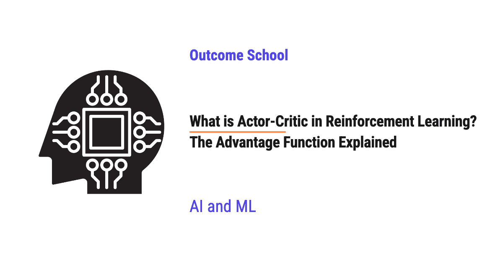

# What is Actor-Critic in Reinforcement Learning? The Advantage Function Explained

> Archived from <https://outcomeschool.com/blog/actor-critic> on 2026-11-25.

Actor-Critic is a way of training an AI agent where one part, the Actor, picks the actions, and another part, the Critic, judges how good each action was right after it happens. This judgment is called the advantage, and it tells the Actor how much better or worse an action was than usual.

In this blog, we will learn about Actor-Critic in Reinforcement Learning and the Advantage Function. We will also see the problem with REINFORCE that Actor-Critic solves, what the Actor and the Critic are, what the advantage function means with real numbers, how the TD error estimates the advantage, how the full update loop works step by step in code, and why it works better and where it is used today.

We will cover the following:
<ul><li>The problem with REINFORCE</li><li>What is Actor-Critic?</li><li>What is the Advantage Function?</li><li>Advantage with real numbers</li><li>TD Error: estimating the advantage in one step</li><li>The Actor-Critic update loop</li><li>Actor-Critic in code</li><li>Why Actor-Critic works better</li><li>Where Actor-Critic is used</li></ul>
I am <strong>Amit Shekhar</strong>, Founder @ <a target="_blank" rel="noopener noreferrer" href="https://outcomeschool.com">Outcome School</a>, I have taught and mentored many developers, and their efforts landed them high-paying tech jobs, helped many tech companies in solving their unique problems, and created many open-source libraries being used by top companies. I am passionate about sharing knowledge through open-source, blogs, and videos.

I teach <a target="_blank" rel="noopener noreferrer" href="https://outcomeschool.com/program/ai-and-machine-learning">AI and Machine Learning</a> at Outcome School.

Let&#x27;s get started.
<h2 id="the-problem-with-reinforce">The problem with REINFORCE</h2>
Before jumping into Actor-Critic, we must know the problem it solves.

In <a target="_blank" rel="noopener noreferrer" href="reinforcement-learning.md">Reinforcement Learning</a>, an <strong>agent</strong> looks at a <strong>state</strong> (the current situation), picks an <strong>action</strong>, and gets a <strong>reward</strong> (a number that says how good the result was). The rule the agent uses to pick actions is called the <strong>policy</strong>.

<strong><a target="_blank" rel="noopener noreferrer" href="policy-gradient-reinforce.md">REINFORCE</a></strong> is a simple method to train the policy. In its simplest form, the agent plays one full episode (one complete game from start to end), adds up the rewards, and then makes the actions in that episode more likely if the total was high, or less likely if the total was low.

This has two problems:
<ul><li><strong>It waits until the end.</strong> The agent learns nothing until the full episode is over. If an episode has 1,000 steps, all 1,000 steps go by with zero learning.</li><li><strong>High variance.</strong> The total reward changes a lot from one episode to another, even for the same actions, because of luck. One good action inside a bad episode gets punished. One bad action inside a lucky episode gets rewarded. So, the learning signal is very noisy, and the training is slow and shaky.</li></ul>
Let&#x27;s see this as a diagram:

<pre><code class="language-text code-highlight">┌───────────────────────────────────┐
│ Step 1, Step 2, ..., Step 1000    │
│ (no learning yet)                 │
└───────────────────────────────────┘
                  ↓
┌───────────────────────────────────┐
│ Episode ends: total reward = 40   │
└───────────────────────────────────┘
                  ↓
┌───────────────────────────────────┐
│ All 1000 actions get the same     │
│ score of 40, good or bad          │
└───────────────────────────────────┘
</code></pre>

Here, we can see that every action gets judged by one number that arrives only at the end. The agent cannot tell which of the 1,000 actions actually helped.

What we need is someone who can judge each action right after it happens. Here comes the Actor-Critic into the picture.
<h2 id="what-is-actor-critic">What is Actor-Critic?</h2>
<strong>Actor-Critic is a Reinforcement Learning method that uses two parts: an Actor that decides which action to take, and a Critic that estimates how good the current state is and uses it to judge each action.</strong>
<ul><li><strong>The Actor</strong> is the policy. It looks at the state and gives the probability of each action. For example, &quot;jump: 70%, wait: 30%&quot;.</li><li><strong>The Critic</strong> is a <a target="_blank" rel="noopener noreferrer" href="value-function-and-q-learning.md">value function</a>. It looks at the state and predicts a single number: the total future reward the agent usually gets from this state. This number is written as <strong>V(s)</strong>, the value of state <code>s</code>.</li></ul>
Both are usually <a target="_blank" rel="noopener noreferrer" href="neural-network.md">neural networks</a>, and both learn at the same time.

Let&#x27;s say a young cricket player is practicing batting with a coach standing next to him. The player plays the shots. That is the Actor. The coach watches every shot and immediately says &quot;that was better than your usual&quot; or &quot;that was worse than your usual&quot;. That is the Critic. The player does not have to wait for the final score of the match to know which shot was good.

Now, the question is: how does the Critic say &quot;better than usual&quot; as a number? The answer is the advantage function.
<h2 id="what-is-the-advantage-function">What is the Advantage Function?</h2>
Before jumping into the advantage, we need two values:
<ul><li><strong>V(s)</strong>: the value from the Critic, which means the total future reward we usually get from state <code>s</code>. It is the average result from this state.</li><li><strong>Q(s, a)</strong>: the total future reward we expect if we are in state <code>s</code>, take the specific action <code>a</code> first, and then follow our policy as usual.</li></ul>
The <strong>advantage function</strong> is the difference between these two:

<strong>A(s, a) = Q(s, a) - V(s)</strong>

Means, the advantage tells us <strong>how much better (or worse) action <code>a</code> is compared to what we usually get from state <code>s</code>.</strong>
<ul><li>If A(s, a) is <strong>positive</strong>, the action is better than usual. The Actor must make it <strong>more</strong> likely.</li><li>If A(s, a) is <strong>negative</strong>, the action is worse than usual. The Actor must make it <strong>less</strong> likely.</li><li>If A(s, a) is <strong>zero</strong>, the action is just as good as usual. Its probability stays about the same.</li></ul>
REINFORCE asks &quot;was the total reward high?&quot;. The advantage asks &quot;was this action better than what we normally get here?&quot;. The second question removes the luck of the state itself. If the agent is in a great state, everything looks good there, and the advantage takes that out by subtracting V(s).

<strong>Planning your move into AI?</strong>

No matter which tech domain you work in today, with your effort, you can transition to these roles:
<ul><li>AI Engineer</li><li>Forward Deployed Engineer</li><li>AI Agent Engineer</li><li>Harness Engineer</li><li>Voice AI Engineer</li><li>AI Architect</li><li>LLM Engineer</li><li>LLM Inference Engineer</li><li>Gen AI Engineer</li><li>MLOps Engineer</li><li>ML Engineer</li><li>Deep Learning Engineer</li></ul>
Our <a target="_blank" rel="noopener noreferrer" href="https://outcomeschool.com/program/ai-and-machine-learning">AI and Machine Learning Program</a> at Outcome School takes you there.
<h2 id="advantage-with-real-numbers">Advantage with real numbers</h2>
The best way to learn this is by taking an example.

Suppose our agent is playing a simple game, and it is in some state <code>s</code>. The Critic says:

<strong>V(s) = 10</strong>

Means, from this state, the agent usually collects 10 points in total.

Now, the agent has two actions: <strong>jump</strong> and <strong>wait</strong>. Assume that we know the Q-values:
<ul><li>Q(s, jump) = 14</li><li>Q(s, wait) = 7</li></ul>
Let&#x27;s calculate the advantage of each action:

<strong>A(s, jump) = 14 - 10 = +4</strong>

<strong>A(s, wait) = 7 - 10 = -3</strong>

Jump gives 4 points more than usual, and wait gives 3 points less than usual. Let&#x27;s see this as a diagram:

<pre><code class="language-text code-highlight">┌────────────────────┐   ┌────────────────────┐
│ Action: jump       │   │ Action: wait       │
│ Q(s, jump) = 14    │   │ Q(s, wait) = 7     │
└────────────────────┘   └────────────────────┘
          ↓                        ↓
┌────────────────────┐   ┌────────────────────┐
│ minus V(s) = 10    │   │ minus V(s) = 10    │
└────────────────────┘   └────────────────────┘
          ↓                        ↓
┌────────────────────┐   ┌────────────────────┐
│ A = +4             │   │ A = -3             │
│ make jump more     │   │ make wait less     │
│ likely             │   │ likely             │
└────────────────────┘   └────────────────────┘
</code></pre>

Here, we can see that V(s) = 10 acts as the baseline for both actions. We judge each action against this baseline, not against zero. So, the Actor increases the probability of jump and decreases the probability of wait.

To calculate the advantage, we need both Q(s, a) and V(s). Keeping two separate networks for Q and V is extra work. So, how can we get the advantage using only V? The answer is the TD error.
<h2 id="td-error-estimating-the-advantage-in-one-step">TD Error: estimating the advantage in one step</h2>
<strong>TD</strong> stands for <strong>Temporal Difference</strong>. Temporal means &quot;related to time&quot;. The TD error is the difference between what the Critic predicted before a step and what it sees after that step.

After the agent takes action <code>a</code> in state <code>s</code>, it gets a reward <code>r</code> and lands in a new state <code>s&#x27;</code>. Now, we can estimate Q(s, a) as below:

<strong>Q(s, a) is approximately r + gamma * V(s&#x27;)</strong>

Means, the value of taking action <code>a</code> is the reward we got right now, plus the value of the state where we landed.

Here:
<ul><li><code>r</code> is the reward we just got.</li><li><code>V(s&#x27;)</code> is the Critic&#x27;s prediction of the future reward from the new state.</li><li><code>gamma</code> is the <strong>discount factor</strong>, a number between 0 and 1 (for example, 0.9). It makes future rewards count a bit less than the reward we get right now.</li></ul>
Now, we put this into the advantage formula, A(s, a) = Q(s, a) - V(s), and we get the TD error, written as <code>delta</code>:

<strong>delta = r + gamma * V(s&#x27;) - V(s)</strong>

This <code>delta</code> is our estimate of the advantage. And we need only the Critic (V) to calculate it.

Let&#x27;s take an example with numbers.

<strong>Example 1 (positive):</strong> The Critic says V(s) = 9. The agent takes the action jump and gets a reward r = 2. It lands in a new state where the Critic says V(s&#x27;) = 10. We use gamma = 0.9.

<strong>delta = 2 + 0.9 * 10 - 9 = 2 + 9 - 9 = 2</strong>

The TD error is +2. Means, things went 2 points better than the Critic expected. So, the action gets a positive advantage.

<strong>Example 2 (negative):</strong> Same state, V(s) = 9. This time, the agent takes the action wait, gets a reward r = 0, and lands in a bad state where V(s&#x27;) = 5.

<strong>delta = 0 + 0.9 * 5 - 9 = 0 + 4.5 - 9 = -4.5</strong>

The TD error is -4.5. Means, things went 4.5 points worse than expected. So, the action gets a negative advantage.

Here, we can notice that we got this judgment right after one step, without waiting for the end of the episode.

<strong>A quick note for you</strong>

No matter which tech domain you work in, get familiar with these topics:
<ul><li>LLM</li><li>RAG</li><li>MCP</li><li>Agent</li><li>Fine-tuning</li><li>Quantization</li></ul>
We put it all together in one video:

<a target="_blank" rel="noopener noreferrer" href="https://www.youtube.com/watch?v=lnfWvX66FUk">AI Engineering Explained: LLM, RAG, MCP, Agent, Fine-Tuning, and Quantization</a>

No need to stop reading - bookmark it and watch later when you get time. Future you will thank you.

Now, let&#x27;s get back to the topic.
<h2 id="the-actor-critic-update-loop">The Actor-Critic update loop</h2>
Now, let&#x27;s put everything together. At every step, the agent follows this loop.

<strong>Step 1:</strong> The agent looks at the current state <code>s</code>.

<strong>Step 2:</strong> The Actor gives the probability of each action, and the agent picks an action <code>a</code> based on these probabilities.

<strong>Step 3:</strong> The environment (the game or world the agent lives in) returns a reward <code>r</code> and the new state <code>s&#x27;</code>.

<strong>Step 4:</strong> The Critic calculates the TD error: delta = r + gamma * V(s&#x27;) - V(s). This is the advantage estimate.

<strong>Step 5:</strong> The Critic updates itself so that V(s) moves closer to r + gamma * V(s&#x27;). In simple form: V(s) = V(s) + <code>alpha_critic</code> * delta, where <code>alpha_critic</code> is the learning rate, a small number like 0.1 that controls how big each update is.

<strong>Step 6:</strong> The Actor updates itself using the same delta. If delta is positive, it increases the probability of action <code>a</code> in state <code>s</code>. If delta is negative, it decreases it. The bigger the size of delta, the bigger the change.

<strong>Step 7:</strong> The new state <code>s&#x27;</code> becomes the current state, and we go back to Step 1.

Let&#x27;s see this loop as a diagram:

<pre><code class="language-text code-highlight">┌─────────────────────────────┐
│ State s                     │
└─────────────────────────────┘
               ↓
┌─────────────────────────────┐
│ Actor (policy)              │
│ jump: 50%, wait: 50%        │
└─────────────────────────────┘
               ↓
┌─────────────────────────────┐
│ Action a = jump             │
└─────────────────────────────┘
               ↓
┌─────────────────────────────┐
│ Environment                 │
│ reward r = 2, new state s&#x27;  │
└─────────────────────────────┘
               ↓
┌─────────────────────────────┐
│ Critic (value function)     │
│ V(s) = 9, V(s&#x27;) = 10        │
└─────────────────────────────┘
               ↓
┌─────────────────────────────┐
│ Advantage (TD error)        │
│ delta = 2 + 0.9 * 10 - 9    │
│       = +2                  │
└─────────────────────────────┘
               ↓
┌─────────────────────────────┐
│ Update both                 │
│ Critic: V(s) 9 -&gt; 9.2       │
│ Actor: jump 50% -&gt; 55%      │
└─────────────────────────────┘
               ↓
┌─────────────────────────────┐
│ s&#x27; becomes the new state s  │
│ (back to the top)           │
└─────────────────────────────┘
</code></pre>

Here, we can see that one number, the TD error, drives both updates. The Critic uses it to fix its own prediction, and the Actor uses it to decide which way to change the action probabilities.

<strong>Stay updated:</strong> Subscribe to our <a target="_blank" rel="noopener noreferrer" href="https://outcomeschool.substack.com/subscribe">newsletter</a> to get our latest AI and Machine Learning blogs straight to your inbox.
<h2 id="actor-critic-in-code">Actor-Critic in code</h2>
Let&#x27;s see the code for one step of this loop, using the numbers from Example 1. For the sake of understanding, the Critic is a simple table of values, and the Actor has just two actions.

<pre><code class="code-highlight language-python">import numpy as np

gamma = 0.9
V = {&quot;s&quot;: 9.0, &quot;s_next&quot;: 10.0}   # Critic&#x27;s predictions
r = 2.0                          # reward from the environment

delta = r + gamma * V[&quot;s_next&quot;] - V[&quot;s&quot;]
print(&quot;TD error:&quot;, round(delta, 2))

V[&quot;s&quot;] = V[&quot;s&quot;] + 0.1 * delta    # Critic update
print(&quot;Critic&#x27;s new V(s):&quot;, round(V[&quot;s&quot;], 2))

logits = np.array([0.0, 0.0])    # Actor&#x27;s scores for [jump, wait]
probs = np.exp(logits) / np.exp(logits).sum()
grad = -probs
grad[0] += 1                     # we took action 0 (jump)
logits = logits + 0.1 * delta * grad   # Actor update
probs = np.exp(logits) / np.exp(logits).sum()
print(&quot;Actor&#x27;s new probabilities:&quot;, probs.round(2))
</code></pre>

This will print the following:

<pre><code class="language-text code-highlight">TD error: 2.0
Critic&#x27;s new V(s): 9.2
Actor&#x27;s new probabilities: [0.55 0.45]
</code></pre>

Here, we have:
<ul><li>Calculated the TD error as 2.0, same as Example 1.</li><li>Moved the Critic&#x27;s V(s) from 9 to 9.2, a little closer to the target r + gamma * V(s&#x27;) = 2 + 0.9 * 10 = 11.</li><li>Stored the Actor as two raw scores (logits), one per action, and turned them into probabilities with <a target="_blank" rel="noopener noreferrer" href="softmax-function.md">softmax</a>. Both start at 0, so each action is at 50%.</li><li>Calculated <code>grad</code>, which is the direction that raises the probability of the action we took. For softmax, it is [1, 0] (because we chose jump) minus the current probabilities [0.5, 0.5], which gives [0.5, -0.5].</li><li>Moved the scores along <code>grad</code>, scaled by delta and a small learning rate of 0.1. The score of jump went up, the score of wait went down, and the probability of jump went from 50% to 55%.</li></ul>
If delta were negative, the same lines would push the probability of jump down instead. In a real system, the Actor and the Critic are neural networks, and delta scales the updates to their weights in the same way.

To master Reinforcement Learning and how the Actor and the Critic learn together from rewards, check out our <a target="_blank" rel="noopener noreferrer" href="https://outcomeschool.com/program/ai-and-machine-learning">AI and Machine Learning Program</a> at Outcome School, where we cover it in depth.
<h2 id="why-actor-critic-works-better">Why Actor-Critic works better</h2>
Now, let&#x27;s understand why this works better than REINFORCE.
<ul><li><strong>Lower variance.</strong> REINFORCE judges an action by the full noisy total of the episode. Actor-Critic judges an action by the advantage, which compares it with the usual value of that state. This removes a lot of the luck, so the learning signal is much more stable.</li><li><strong>Learns at every step.</strong> Actor-Critic does not wait for the episode to end. It updates after every step, so it learns faster and also works for very long or never-ending tasks.</li></ul>
<strong>Note:</strong> The Critic&#x27;s predictions are not perfect, especially at the start of training, so the TD error has some bias. In practice, this bias is a good trade for the large drop in variance.
<h2 id="where-actor-critic-is-used">Where Actor-Critic is used</h2>
Actor-Critic is the base of many popular Reinforcement Learning algorithms:
<ul><li><strong>A2C (Advantage Actor-Critic)</strong>: the Actor-Critic method we learned in this blog, usually run on many copies of the environment at the same time, with updates that wait for all copies.</li><li><strong>A3C (Asynchronous Advantage Actor-Critic)</strong>: many workers run their own copies of the environment and update the shared networks on their own, without waiting for each other.</li><li><strong><a target="_blank" rel="noopener noreferrer" href="proximal-policy-optimization-ppo.md">PPO (Proximal Policy Optimization)</a></strong>: an Actor-Critic method that also limits how much the Actor can change in one update, so that training stays stable. It is one of the most used Reinforcement Learning algorithms.</li></ul>
PPO is also used in <strong><a target="_blank" rel="noopener noreferrer" href="reinforcement-learning-from-human-feedback-rlhf.md">RLHF (Reinforcement Learning from Human Feedback)</a></strong>, one of the methods used to train <a target="_blank" rel="noopener noreferrer" href="large-language-model-llm.md">LLMs (Large Language Models)</a> to give helpful answers. Here:
<ul><li>The <strong>Actor</strong> is the LLM itself. Its action is the next token it generates.</li><li>The <strong>reward</strong> comes from a <a target="_blank" rel="noopener noreferrer" href="reward-model.md">reward model</a>, which scores the full answer.</li><li>The <strong>Critic</strong> is a separate network called the <strong>value model</strong>. It predicts how good the answer is going to be from the tokens generated so far.</li></ul>
With the help of the value model, we get an advantage for every token, so the LLM learns which parts of its answer made it better or worse than usual.

We have a detailed blog on <a target="_blank" rel="noopener noreferrer" href="group-relative-policy-optimization-grpo.md">Group Relative Policy Optimization (GRPO)</a> that explains how an LLM can be trained without a value model at all.

Now we must have understood what Actor-Critic is, what the advantage function means, how the TD error estimates it, and how both the Actor and the Critic learn together at every step.
<h2 id="frequently-asked-questions">Frequently Asked Questions</h2><h3 id="what-is-the-difference-between-the-actor-and-the-critic">What is the difference between the Actor and the Critic?</h3>
The Actor is the policy. It looks at the state and gives the probability of each action. The Critic is a value function. It looks at the state and predicts the total future reward the agent usually gets from that state. Both are usually neural networks, and both learn at the same time.
<h3 id="what-does-a-negative-advantage-mean">What does a negative advantage mean?</h3>
A negative advantage means the action was worse than what the agent usually gets from that state. So, the Actor makes that action less likely. A positive advantage means the action was better than usual, and the Actor makes it more likely. A zero advantage means the action was just as good as usual.
<h3 id="why-does-actor-critic-not-need-a-separate-q-network">Why does Actor-Critic not need a separate Q network?</h3>
Actor-Critic estimates the advantage with the TD error, which needs only the Critic&#x27;s values. The TD error is the reward we just got, plus the discounted value of the new state, minus the value of the current state. Keeping two separate networks for Q and V would be extra work, so the TD error removes the need for Q.
<h3 id="is-the-td-error-a-perfect-estimate-of-the-advantage">Is the TD error a perfect estimate of the advantage?</h3>
No. The Critic&#x27;s predictions are not perfect, especially at the start of training, so the TD error has some bias. In practice, this bias is a good trade for the large drop in variance compared to REINFORCE, which judges every action by the full noisy total of the episode.
<h3 id="what-are-a2c-and-a3c">What are A2C and A3C?</h3>
Both are Actor-Critic algorithms. A2C (Advantage Actor-Critic) usually runs on many copies of the environment at the same time, with updates that wait for all copies. A3C (Asynchronous Advantage Actor-Critic) uses many workers that run their own copies of the environment and update the shared networks on their own, without waiting for each other.

That&#x27;s it for now.

Thanks

<strong>Amit Shekhar</strong> Founder @ <a target="_blank" rel="noopener noreferrer" href="https://outcomeschool.com">Outcome School</a>

You can connect with me on:
<ul><li><a target="_blank" rel="noopener noreferrer" href="https://x.com/amitiitbhu">X</a></li><li><a target="_blank" rel="noopener noreferrer" href="https://www.linkedin.com/in/amit-shekhar-iitbhu">LinkedIn</a></li><li><a target="_blank" rel="noopener noreferrer" href="https://github.com/amitshekhariitbhu">GitHub</a></li></ul>
Follow Outcome School on:
<ul><li><a target="_blank" rel="noopener noreferrer" href="https://x.com/outcome_school">X</a></li><li><a target="_blank" rel="noopener noreferrer" href="https://youtube.com/@OutcomeSchool">YouTube</a></li><li><a target="_blank" rel="noopener noreferrer" href="https://www.linkedin.com/company/outcomeschool">LinkedIn</a></li><li><a target="_blank" rel="noopener noreferrer" href="http://github.com/OutcomeSchool">GitHub</a></li></ul>
<a target="_blank" rel="noopener noreferrer" href="https://outcomeschool.com/blog"><strong>Read all of our high-quality blogs here.</strong></a>

