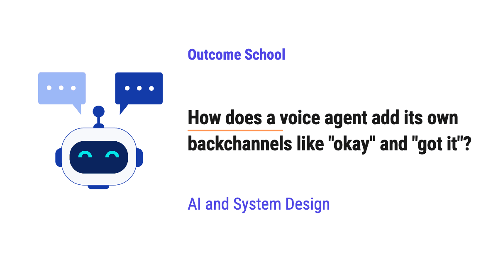

# How does a voice agent add its own backchannels like "okay" and "got it"?

> Archived from <https://outcomeschool.com/blog/agent-side-backchannels> on 2026-11-25.

A voice agent adds its own backchannels like &quot;okay&quot; and &quot;got it&quot; by running a fast, separate system next to the main conversation, which predicts the short moments where a listener would say &quot;mm-hmm&quot; and plays a short pre-recorded sound without taking the turn. It also says a quick &quot;got it&quot; right after the user finishes, so that the user knows they were heard while the real answer is still being prepared.

In this blog, we will learn about how a voice agent adds its own backchannels like &quot;okay&quot; and &quot;got it&quot;. We will also see why a silent agent feels broken, the two kinds of backchannels an agent uses, how the agent decides the right moment and the right sound, how it plays the sound without interrupting itself, how full-duplex models do it, and where it works well and where it fails.

We will cover the following:
<ul><li>What is a backchannel?</li><li>Why does a silent voice agent feel broken?</li><li>The two kinds of backchannels a voice agent uses</li><li>The parts of a voice agent</li><li>How the agent decides when to say &quot;mm-hmm&quot;</li><li>How the agent picks the right sound</li><li>How the agent plays the sound without stopping its listening</li><li>How the agent avoids interrupting itself</li><li>How the agent says &quot;got it&quot; after the user finishes</li><li>How full-duplex models do it in a different way</li><li>Where it works well and where it fails</li></ul>
I am <strong>Amit Shekhar</strong>, Founder @ <a target="_blank" rel="noopener noreferrer" href="https://outcomeschool.com">Outcome School</a>, I have taught and mentored many developers, and their efforts landed them high-paying tech jobs, helped many tech companies in solving their unique problems, and created many open-source libraries being used by top companies. I am passionate about sharing knowledge through open-source, blogs, and videos.

I teach <a target="_blank" rel="noopener noreferrer" href="https://outcomeschool.com/program/ai-and-machine-learning">AI and Machine Learning</a> at Outcome School.

Let&#x27;s get started.
<h2 id="what-is-a-backchannel">What is a backchannel?</h2>
<strong>A backchannel is a short sound or word that a listener says while the other person is still talking, to show that they are listening, without trying to take the turn.</strong>

Some common backchannels are &quot;mm-hmm&quot;, &quot;uh-huh&quot;, &quot;yeah&quot;, &quot;okay&quot;, &quot;right&quot;, and &quot;got it&quot;.

Let&#x27;s say we are telling a friend about our weekend on a phone call. While we are talking, our friend says &quot;mm-hmm&quot; and &quot;yeah&quot; every few seconds. Our friend is not trying to take over the conversation. Our friend is only telling us: &quot;I am here, I am following you, please continue.&quot;

A backchannel is not a turn. After a backchannel, the speaker keeps talking. The listener does not start a full reply.

We have a detailed blog on <a target="_blank" rel="noopener noreferrer" href="backchannels-in-voice-agents.md">backchannels and why &quot;mm-hmm&quot; should not stop the agent</a> that explains how a voice agent handles the backchannels that the user says.
<h2 id="why-does-a-silent-voice-agent-feel-broken">Why does a silent voice agent feel broken?</h2>
Let&#x27;s say we call a <a target="_blank" rel="noopener noreferrer" href="design-a-real-time-voice-ai-agent.md">voice agent</a> and explain a long problem:

&quot;So, I ordered a phone last week, and the box arrived yesterday, but when I opened it, the screen was cracked, and I also noticed that the charger was missing...&quot;

We talk for 15 seconds, and during these 15 seconds, the agent says nothing.

We start to wonder whether the call dropped, and we often stop in the middle and ask &quot;Hello? Are you there?&quot;

A phone call has no face and no nodding, so the only way to show listening is with small sounds. Without them, the silence feels like a dead line.

So, here comes the backchannel to the rescue. If the agent says a soft &quot;mm-hmm&quot; after &quot;the box arrived yesterday&quot; and an &quot;okay&quot; after &quot;the screen was cracked&quot;, we feel heard, and we keep talking naturally.
<h2 id="the-two-kinds-of-backchannels-a-voice-agent-uses">The two kinds of backchannels a voice agent uses</h2>
A voice agent uses backchannels at two different moments, and they are built in different ways.

<strong>Kind 1: While the user is still talking.</strong> These are sounds like &quot;mm-hmm&quot;, &quot;uh-huh&quot;, and &quot;okay&quot; in the middle of the user&#x27;s speech. They mean &quot;I am listening, please continue.&quot; Researchers call sounds like &quot;mm-hmm&quot; and &quot;uh-huh&quot; <strong>continuers</strong>, because they ask the speaker to continue.

<strong>Kind 2: Right after the user finishes.</strong> This is a short acknowledgment like &quot;Got it.&quot; or &quot;Okay, let me check that.&quot; at the start of the agent&#x27;s reply. It means &quot;I heard you, my answer is coming.&quot; Strictly speaking, this is an acknowledgment and not a pure backchannel, because the agent <a target="_blank" rel="noopener noreferrer" href="what-is-turn-taking-in-a-voice-ai-agent.md">takes the turn</a>.

Let me tabulate the differences between the two kinds for your better understanding.
<table><thead><tr><th>Property</th><th>While the user is talking</th><th>After the user finishes</th></tr></thead><tbody><tr><td>Example</td><td>&quot;mm-hmm&quot;, &quot;uh-huh&quot;, &quot;okay&quot;</td><td>&quot;Got it.&quot;, &quot;Okay, let me check.&quot;</td></tr><tr><td>Meaning</td><td>Please continue</td><td>I heard you, answer is coming</td></tr><tr><td>Who keeps the turn?</td><td>The user</td><td>The agent takes the turn</td></tr><tr><td>Volume and length</td><td>Soft and very short</td><td>Normal voice, short phrase</td></tr><tr><td>Main challenge</td><td>Timing without interrupting</td><td>Covering the waiting time</td></tr></tbody></table>
We will learn how the agent builds each of them in detail.

<strong>Planning your move into AI?</strong>

No matter which tech domain you work in today, with your effort, you can transition to these roles:
<ul><li>AI Engineer</li><li>Forward Deployed Engineer</li><li>AI Agent Engineer</li><li>Harness Engineer</li><li>Voice AI Engineer</li><li>AI Architect</li><li>LLM Engineer</li><li>LLM Inference Engineer</li><li>Gen AI Engineer</li><li>MLOps Engineer</li><li>ML Engineer</li><li>Deep Learning Engineer</li></ul>
Our <a target="_blank" rel="noopener noreferrer" href="https://outcomeschool.com/program/ai-and-machine-learning">AI and Machine Learning Program</a> at Outcome School takes you there.
<h2 id="the-parts-of-a-voice-agent">The parts of a voice agent</h2>
Before jumping into how the agent adds backchannels, we must know the basic parts of a voice agent.

Many voice agents follow a chain of steps like below:

<pre><code class="code-highlight">User speaks
     ↓
Speech-to-Text (turns audio into text)
     ↓
LLM (decides what to reply)
     ↓
Text-to-Speech (turns reply text into audio)
     ↓
Agent speaks
</code></pre>

Here, we can see that the main answer has to travel through all the steps, and <a target="_blank" rel="noopener noreferrer" href="voice-agent-latency-budget.md">each step takes some time</a>. But, a backchannel cannot wait for this full chain. A &quot;mm-hmm&quot; that comes two seconds late sounds strange. Hence, the agent adds a fast, separate path only for backchannels. This path runs next to the main chain, all the time, while the user is talking.

The backchannel path has three jobs:
<ul><li>Decide <strong>when</strong> to say something.</li><li>Decide <strong>what</strong> to say.</li><li><strong>Play</strong> it without disturbing the main conversation.</li></ul>
Now, let&#x27;s understand each job one by one.
<h2 id="how-the-agent-decides-when-to-say-mm-hmm">How the agent decides when to say &quot;mm-hmm&quot;</h2>
The first job is timing. The agent must find the small openings in the user&#x27;s speech where a listener would naturally say &quot;mm-hmm&quot;.

When we finish a small piece of information, our voice gives clues without us thinking about it:
<ul><li>Our pitch drops a little at the end of a phrase.</li><li>We take a very short pause, often shorter than half a second.</li><li>We finish a complete piece of meaning, like &quot;and the box arrived yesterday&quot;.</li></ul>
The agent uses a small model called a <strong>backchannel predictor</strong> to catch these clues. This model listens to the user&#x27;s audio continuously, and for every small slice of time, it gives a score between 0 and 1. The score answers one question: &quot;Is this a good moment for a backchannel?&quot;

Let&#x27;s say the user says: &quot;I ordered a phone last week, and the box arrived yesterday, but...&quot;

The predictor gives scores like below (the numbers are just for the sake of understanding):

<pre><code class="code-highlight">&quot;I ordered a phone&quot;        → score 0.05
&quot;last week,&quot;               → score 0.40
&quot;and the box&quot;              → score 0.08
&quot;arrived yesterday,&quot;       → score 0.82
&quot;but&quot;                      → score 0.03
</code></pre>

Here, we can notice that the score jumps to 0.82 right after &quot;arrived yesterday&quot;, where the pitch drops and a small pause appears. The agent has a threshold, for example 0.7. When the score crosses the threshold, the agent decides: &quot;Now is a good moment.&quot;

The predictor learns this from many recorded human conversations, where we already know exactly where real listeners said &quot;mm-hmm&quot;. It learns to connect the voice clues just before those moments with the backchannel that followed. Some models are trained to predict who will be speaking in the next couple of seconds, and a short burst of listener speech in that prediction means a backchannel moment.

But, a high score alone is not enough. The agent also follows a few simple rules on top of the score:
<ul><li><strong>Do not repeat too often.</strong> If the agent said &quot;mm-hmm&quot; in the last few seconds, it waits.</li><li><strong>Do not backchannel too early.</strong> If the user has spoken only for one or two seconds, the agent stays quiet.</li><li><strong>Do not backchannel at the end of a question.</strong> If the user asks &quot;Can you check my order?&quot;, the user expects a real answer, not a &quot;mm-hmm&quot;.</li></ul><h2 id="how-the-agent-picks-the-right-sound">How the agent picks the right sound</h2>
The second job is choosing the sound. Not every backchannel fits every moment.

Let&#x27;s see a few examples:
<ul><li>The user is telling a long story: &quot;mm-hmm&quot; or &quot;uh-huh&quot; fits well, because it only means &quot;continue&quot;.</li><li>The user gives an important fact like &quot;my order number is 4 5 7 2&quot;: &quot;okay&quot; or &quot;got it&quot; fits better, because it means &quot;I have noted it&quot;.</li><li>The user shares bad news like &quot;the gift is ruined&quot;: a soft &quot;oh, I see&quot; fits better than a cheerful &quot;okay&quot;.</li></ul>
So, the agent picks the sound based on what the user just said. A simple way is to look at the latest words from Speech-to-Text and follow rules. For example, when the user just said a number or a name, pick &quot;got it&quot;. Otherwise, pick &quot;mm-hmm&quot;. Some systems use a small classifier model that looks at the recent words and the tone of voice, and picks a category like &quot;continue&quot;, &quot;noted&quot;, or &quot;sympathy&quot;. Some research models even predict the timing and the type together, at every small slice of time.

Now, the next big question is: where does the sound itself come from?

The agent does not send &quot;mm-hmm&quot; through the full LLM and Text-to-Speech chain, because that is too slow. Instead, the agent keeps a small set of <strong>pre-recorded clips</strong> ready, generated earlier with the same Text-to-Speech voice that the agent uses for its replies. For example:

<pre><code class="code-highlight">continue  → &quot;mm-hmm&quot; (3 versions), &quot;uh-huh&quot; (2 versions)
noted     → &quot;okay&quot; (3 versions), &quot;got it&quot; (2 versions)
sympathy  → &quot;oh, I see&quot; (2 versions)
</code></pre>

Here, we have more than one version of each sound, so that the agent does not play the same clip again and again. These clips are very short and already in memory, so the agent can play one instantly.

<strong>A quick note for you</strong>

No matter which tech domain you work in, get familiar with these topics:
<ul><li>LLM</li><li>RAG</li><li>MCP</li><li>Agent</li><li>Fine-tuning</li><li>Quantization</li></ul>
We put it all together in one video:

<a target="_blank" rel="noopener noreferrer" href="https://www.youtube.com/watch?v=lnfWvX66FUk">AI Engineering Explained: LLM, RAG, MCP, Agent, Fine-Tuning, and Quantization</a>

No need to stop reading - bookmark it and watch later when you get time. Future you will thank you.

Now, let&#x27;s get back to the topic.
<h2 id="how-the-agent-plays-the-sound-without-stopping-its-listening">How the agent plays the sound without stopping its listening</h2>
The third job is playing the sound, and here a backchannel is very different from a normal reply.

When the agent gives a normal reply, the turn switches: the user stops, and the agent speaks. But, when the agent says &quot;mm-hmm&quot;, the turn must not switch. The user keeps the turn. The agent keeps listening.

So, the agent plays the backchannel clip with a few special rules:
<ul><li><strong>Listening never stops.</strong> Speech-to-Text and the backchannel predictor keep running while the clip plays.</li><li><strong>The turn does not change.</strong> The agent&#x27;s main logic still believes &quot;the user is speaking&quot;. The clip does not start a reply.</li><li><strong>The volume is low.</strong> The clip is often played a little softer than the normal voice, so that it sits under the user&#x27;s speech instead of covering it.</li><li><strong>It is usually not added to the LLM conversation.</strong> Adding every &quot;mm-hmm&quot; would only fill the conversation history with noise.</li></ul><h2 id="how-the-agent-avoids-interrupting-itself">How the agent avoids interrupting itself</h2>
Many voice agents support <a target="_blank" rel="noopener noreferrer" href="what-is-barge-in-in-a-voice-ai-agent.md"><strong>barge-in</strong></a>. Barge-in means that if the user starts speaking while the agent is talking, the agent stops talking and listens. To do this, the agent watches the incoming audio for speech whenever it plays any audio, and that includes a backchannel clip.

But, the agent&#x27;s own &quot;mm-hmm&quot; also comes out of the user&#x27;s speaker. If the user is on a speakerphone, the microphone picks up that &quot;mm-hmm&quot; again. Now, the agent hears a voice and can <a target="_blank" rel="noopener noreferrer" href="interruption-vs-background-noise.md">wrongly think that the user has started speaking</a>.

So, how can we solve this? The answer is a mix of a few tools:
<ul><li><strong>Echo cancellation.</strong> This <a target="_blank" rel="noopener noreferrer" href="overlapping-speech-in-voice-agents.md">removes the agent&#x27;s own audio from the microphone signal</a>. The agent knows exactly what sound it just played, so it can subtract that sound from what the microphone hears.</li><li><strong>Ignoring its own clips.</strong> The agent marks the time window when a backchannel clip is playing. During that window, the agent raises the bar for what counts as new user speech, so that its own clip does not trigger barge-in.</li><li><strong>Not counting the clip as speech in the transcript.</strong> If Speech-to-Text writes &quot;mm-hmm&quot; into the user&#x27;s text at the exact time the same clip was playing, the agent removes it, because the user did not say it.</li></ul>
To master Multimodal AI and how to Design a Real-Time Voice AI Agent, we can explore our <a target="_blank" rel="noopener noreferrer" href="https://outcomeschool.com/program/ai-and-machine-learning">AI and Machine Learning Program</a> at Outcome School.
<h2 id="how-the-agent-says-got-it-after-the-user-finishes">How the agent says &quot;got it&quot; after the user finishes</h2>
Now, it&#x27;s time to learn about the second kind: the quick acknowledgment after the user finishes.

Let&#x27;s say the user says: &quot;Can you check the status of my order 4572?&quot;

Now, the agent must turn the speech into text, send it to the LLM, look up the order in the order system, and then turn the reply into speech. This can take two or three seconds, or even more. That much silence after a question feels long on a phone call.

We have a detailed blog on <a target="_blank" rel="noopener noreferrer" href="filler-phrases-in-voice-agents.md">how filler phrases hide latency in a voice agent</a> that covers this end to end.

So, the agent says &quot;Got it, let me check that for you.&quot; almost immediately. Then, while this short line is playing, the real work continues in the background. When the result is ready, the agent continues: &quot;Your order was shipped yesterday and will reach you on Friday.&quot;

There are two common ways to build this:

<strong>Way 1: A fixed phrase from a small list.</strong> As soon as the system <a target="_blank" rel="noopener noreferrer" href="endpointing-in-voice-agents.md">detects that the user has finished their turn</a>, it plays a short pre-recorded phrase like &quot;Okay.&quot; or &quot;Got it.&quot; Later, when the LLM recommends an order lookup and the agent starts running it, the agent can play another short phrase like &quot;Let me check that.&quot; to <a target="_blank" rel="noopener noreferrer" href="slow-tool-calls-in-voice-agents.md">cover the waiting time of the lookup</a>.

<strong>Way 2: Ask the LLM to start with a short acknowledgment.</strong> We can instruct the LLM to begin its reply with a short phrase. Since the LLM produces its reply <a target="_blank" rel="noopener noreferrer" href="how-does-token-streaming-work.md">token by token</a>, and <a target="_blank" rel="noopener noreferrer" href="streaming-tts.md">Text-to-Speech can start speaking as soon as the first few words arrive</a>, the user hears &quot;Sure, let me check.&quot; while the rest of the reply is still being generated.

<strong>The acknowledgment must never promise something that is not true.</strong> If the agent says &quot;Got it&quot; but then asks the user to repeat the order number, the &quot;Got it&quot; was wrong. Hence, it is safer to keep the acknowledgment neutral, like &quot;Okay, one moment&quot;, when the agent is not yet sure that it understood the request.
<h2 id="how-full-duplex-models-do-it-in-a-different-way">How full-duplex models do it in a different way</h2>
Everything we discussed so far is for the <a target="_blank" rel="noopener noreferrer" href="cascaded-vs-speech-to-speech.md">chain of steps</a>. In this setup, backchannels need a separate path, because the main chain handles one turn at a time.

There is another kind of voice model called a <a target="_blank" rel="noopener noreferrer" href="half-duplex-vs-full-duplex-voice-agents.md"><strong>full-duplex model</strong></a>. Full-duplex means both sides can speak and listen at the same time, just like a normal phone call between two humans.

A full-duplex model works directly on audio. It listens to the user&#x27;s audio stream and produces its own audio stream at the same time, in small time steps. For example, Moshi, a full-duplex model from Kyutai, models the user&#x27;s audio and its own audio as two parallel streams.

In such a model, a backchannel is not a separate feature. At every small time step, the model decides what to put in its own audio stream: silence, a soft &quot;mm-hmm&quot;, or real speech. Since it is trained on many real two-person conversations, where listeners say &quot;mm-hmm&quot; naturally, it learns to produce backchannels on its own, without a separate predictor.

<strong>Advantage:</strong> The timing and tone of the backchannel come from the same model that understands the conversation, so they often sound more natural.

<strong>Disadvantage:</strong> It is harder to control. With a separate backchannel path, we can set clear rules, like &quot;not more than once every 4 seconds&quot;. With a full-duplex model, the behavior comes from training, and changing it often means more training.

<strong>Stay updated:</strong> Subscribe to our <a target="_blank" rel="noopener noreferrer" href="https://outcomeschool.substack.com/subscribe">newsletter</a> to get our latest AI and Machine Learning blogs straight to your inbox.
<h2 id="where-it-works-well-and-where-it-fails">Where it works well and where it fails</h2>
<strong>Where it works well:</strong>
<ul><li>Long user explanations, where soft &quot;mm-hmm&quot; sounds keep the user talking with confidence.</li><li>Collecting details like <a target="_blank" rel="noopener noreferrer" href="unfinished-input-in-voice-agents.md">order numbers and addresses</a>, where an &quot;okay&quot; after each part shows that the agent is keeping up.</li><li>Slow requests that need a lookup, where a quick &quot;Got it, let me check.&quot; fills the silence.</li></ul>
<strong>Where it fails:</strong>
<ul><li><strong>Wrong timing.</strong> If the predictor fires in the middle of a sentence, the &quot;mm-hmm&quot; sounds like an interruption, and the user often stops talking.</li><li><strong>Too many backchannels.</strong> An agent that says &quot;mm-hmm&quot; every two seconds sounds fake.</li><li><strong>Wrong sound for the moment.</strong> A cheerful &quot;okay&quot; after bad news sounds rude.</li><li><strong>Echo problems.</strong> Without good echo cancellation, the agent hears its own &quot;mm-hmm&quot; and treats it as the user&#x27;s speech.</li><li><strong>Thinking pauses.</strong> When the user <a target="_blank" rel="noopener noreferrer" href="long-pauses-in-voice-agents.md">pauses to think</a>, both a separate predictor and a full-duplex model can wrongly backchannel or even take the turn too early.</li><li><strong>False acknowledgments.</strong> Saying &quot;Got it&quot; and then asking the user to repeat everything makes the user lose trust.</li></ul>
Now we must have understood how a voice agent adds its own backchannels like &quot;okay&quot; and &quot;got it&quot;, how it decides the right moment and the right sound, how it plays them without stopping its listening, and where it works well and where it fails.
<h2 id="frequently-asked-questions">Frequently Asked Questions</h2><h3 id="does-a-voice-agent-send-its-mm-hmm-through-the-llm">Does a voice agent send its &quot;mm-hmm&quot; through the LLM?</h3>
No. A &quot;mm-hmm&quot; sent through the full LLM and Text-to-Speech chain would come too late and sound strange. Instead, the agent keeps a small set of pre-recorded clips, generated earlier with the same Text-to-Speech voice, and plays one instantly when the backchannel predictor finds a good moment.
<h3 id="should-a-voice-agents-backchannels-be-added-to-the-conversation-history">Should a voice agent&#x27;s backchannels be added to the conversation history?</h3>
No. The agent&#x27;s own &quot;mm-hmm&quot; and &quot;okay&quot; are usually not added to the LLM conversation. They do not change the turn, and the user keeps speaking. Adding every backchannel to the history would only fill it with noise.
<h3 id="how-often-should-a-voice-agent-say-mm-hmm">How often should a voice agent say &quot;mm-hmm&quot;?</h3>
Not too often. If the agent said &quot;mm-hmm&quot; in the last few seconds, it waits, and it also stays quiet when the user has spoken for only one or two seconds. An agent that says &quot;mm-hmm&quot; every two seconds sounds fake.
<h3 id="why-should-a-voice-agent-say-okay-one-moment-instead-of-got-it">Why should a voice agent say &quot;Okay, one moment&quot; instead of &quot;Got it&quot;?</h3>
Because the acknowledgment must never promise something that is not true. If the agent says &quot;Got it&quot; but then asks the user to repeat the order number, the &quot;Got it&quot; was wrong. A neutral line like &quot;Okay, one moment&quot; is safer when the agent is not yet sure that it understood the request.

That&#x27;s it for now.

Thanks

<strong>Amit Shekhar</strong> Founder @ <a target="_blank" rel="noopener noreferrer" href="https://outcomeschool.com">Outcome School</a>

You can connect with me on:
<ul><li><a target="_blank" rel="noopener noreferrer" href="https://x.com/amitiitbhu">X</a></li><li><a target="_blank" rel="noopener noreferrer" href="https://www.linkedin.com/in/amit-shekhar-iitbhu">LinkedIn</a></li><li><a target="_blank" rel="noopener noreferrer" href="https://github.com/amitshekhariitbhu">GitHub</a></li></ul>
Follow Outcome School on:
<ul><li><a target="_blank" rel="noopener noreferrer" href="https://x.com/outcome_school">X</a></li><li><a target="_blank" rel="noopener noreferrer" href="https://youtube.com/@OutcomeSchool">YouTube</a></li><li><a target="_blank" rel="noopener noreferrer" href="https://www.linkedin.com/company/outcomeschool">LinkedIn</a></li><li><a target="_blank" rel="noopener noreferrer" href="http://github.com/OutcomeSchool">GitHub</a></li></ul>
<a target="_blank" rel="noopener noreferrer" href="https://outcomeschool.com/blog"><strong>Read all of our high-quality blogs here.</strong></a>

