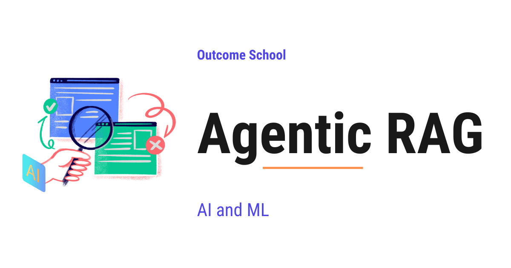

# What is Agentic RAG? How It Works and When to Use It

> Archived from <https://outcomeschool.com/blog/agentic-rag> on 2026-11-25.

Agentic RAG is a type of RAG where an AI Agent decides how to search for information, step by step, instead of doing just one fixed search before answering.

In this blog, we will learn about Agentic RAG - what it is, why standard RAG falls short, the agentic RAG loop, the three building blocks, the common patterns, when to use it, and the limitations to keep in mind.

A hard question often needs more than one search. Some of those searches need different sources. Some depend on what the previous search found. Standard RAG cannot do any of this. Agentic RAG can.

<strong>Agentic RAG = Agentic + RAG</strong>

We will cover the following in this blog:
<ul><li>The Big Picture</li><li>A Quick Recap of RAG</li><li>A Quick Recap of AI Agent</li><li>Why Standard RAG Falls Short</li><li>What is Agentic RAG?</li><li>The Agentic RAG Loop</li><li>The Three Building Blocks</li><li>A Walkthrough with a Real Example</li><li>Common Patterns of Agentic RAG</li><li>Standard RAG vs Agentic RAG</li><li>When to Use Agentic RAG</li><li>Limitations of Agentic RAG</li><li>Quick Summary</li></ul>
I am <strong>Amit Shekhar</strong>, Founder @ <a target="_blank" rel="noopener noreferrer" href="https://outcomeschool.com">Outcome School</a>, I have taught and mentored many developers, and their efforts landed them high-paying tech jobs, helped many tech companies in solving their unique problems, and created many open-source libraries being used by top companies. I am passionate about sharing knowledge through open-source, blogs, and videos.

I teach <a target="_blank" rel="noopener noreferrer" href="https://outcomeschool.com/program/ai-and-machine-learning">AI and Machine Learning</a> at Outcome School.

Let&#x27;s get started.
<h2 id="the-big-picture">The Big Picture</h2>
Before we go into the details, let&#x27;s understand the big picture.

The best way to think about this is with a real-world analogy. Suppose we want to find an answer in a big library.

<strong>Standard RAG is like a librarian who fetches one book.</strong> We hand over the question. The librarian picks the book that matches the words best, gives it to us, and the LLM reads it to write the answer. One shot. Done.

<strong>Agentic RAG is like a researcher.</strong> The researcher reads the question, thinks about where to look, picks a section, reads it, and decides whether the answer is in there. If not, the researcher goes back, picks a different shelf, runs a follow-up search, and keeps going until the answer is found.

The librarian flow is fast but cannot adapt to the question. The researcher flow is slower but can handle questions that need many steps.

This is exactly the difference between Standard RAG and Agentic RAG. Agentic RAG turns the one-shot retrieval into a loop driven by an <a target="_blank" rel="noopener noreferrer" href="ai-agent.md">AI Agent</a> that keeps working until it can answer well.

In simple words:

<strong>Agentic RAG = RAG + an AI Agent that controls the retrieval steps.</strong>
<h2 id="a-quick-recap-of-rag">A Quick Recap of RAG</h2>
Before jumping into Agentic RAG, we must quickly recall what RAG is.

<strong><a target="_blank" rel="noopener noreferrer" href="retrieval-augmented-generation-rag.md">RAG</a></strong> stands for <strong>Retrieval-Augmented Generation</strong>. The flow is simple:
<ul><li>The user asks a question.</li><li>We convert the question into an <a target="_blank" rel="noopener noreferrer" href="what-are-embeddings.md">embedding</a>.</li><li>We search a <a target="_blank" rel="noopener noreferrer" href="how-does-a-vector-database-work.md">vector database</a> and pull the top relevant <a target="_blank" rel="noopener noreferrer" href="chunking-strategies-for-rag.md">chunks</a>.</li><li>We pass those chunks plus the question to the LLM.</li><li>The LLM generates the final answer.</li></ul>
One clever twist on the second step is <a target="_blank" rel="noopener noreferrer" href="how-does-hyde-work.md">HyDE</a>, where instead of embedding the raw question, we first ask the model to write a hypothetical answer and search with that - a trick that often retrieves better chunks.

We can see this flow as below:

<pre><code class="code-highlight">User Question
     |
     v
+------------------+
|     Embed        |
|   the question   |
+------------------+
     |
     v
+------------------+
|  Vector Search   |
|  (top-k chunks)  |
+------------------+
     |
     v
+------------------+
|       LLM        |
|  (generate)      |
+------------------+
     |
     v
  Final Answer
</code></pre>

Here, we can see that the flow is a straight line. There are no decisions in the middle. Retrieve once. Generate once. Return. This is the librarian flow.

In a production RAG system, a Reranker often sits between retrieval and the LLM to reorder those top chunks by true relevance. We have a detailed blog on <a target="_blank" rel="noopener noreferrer" href="how-does-a-reranker-work.md">how a Reranker works</a> that covers this step end to end.
<h2 id="a-quick-recap-of-ai-agent">A Quick Recap of AI Agent</h2>
Now, let&#x27;s recall what an AI Agent is.

An <a target="_blank" rel="noopener noreferrer" href="ai-agent.md">AI Agent</a> is a system that uses an LLM as its brain and runs in a loop. The LLM plans the next step, recommends a tool, observes the result, and decides what to do next. It is not a one-shot prompt. It is a thinking loop with access to tools. This is the researcher in our analogy.

<strong>Planning your move into AI?</strong>

No matter which tech domain you work in today, with your effort, you can transition to these roles:
<ul><li>AI Engineer</li><li>Forward Deployed Engineer</li><li>AI Agent Engineer</li><li>Harness Engineer</li><li>Voice AI Engineer</li><li>AI Architect</li><li>LLM Engineer</li><li>LLM Inference Engineer</li><li>Gen AI Engineer</li><li>MLOps Engineer</li><li>ML Engineer</li><li>Deep Learning Engineer</li></ul>
Our <a target="_blank" rel="noopener noreferrer" href="https://outcomeschool.com/program/ai-and-machine-learning">AI and Machine Learning Program</a> at Outcome School takes you there.
<h2 id="why-standard-rag-falls-short">Why Standard RAG Falls Short</h2>
Standard RAG works for simple questions. But the moment the question gets harder, it breaks down. The reason is simple. Our librarian only knows how to match words. The librarian cannot think, cannot ask follow-up questions, and cannot decide where to look.

Let&#x27;s see the problems this causes.

<strong>Problem 1: Multi-hop questions.</strong>

Suppose the user asks:
<blockquote>
&quot;What was the Q4 revenue of the company that acquired Acme in 2023?&quot;
</blockquote>
To answer this, we first need to find out which company acquired Acme in 2023. Only after that, we can retrieve the Q4 revenue of that company. One single retrieval cannot do this. The librarian sees the long question and tries to find one matching book. There is no such book.

<strong>Problem 2: Ambiguous queries.</strong>

The user asks: &quot;What about the new policy?&quot;

The retrieval system has no idea which policy. Standard RAG will pull random chunks and the answer will be wrong. The librarian does not stop to ask &quot;which policy?&quot;. The librarian just matches words and hands over a book.

<strong>Problem 3: Multiple data sources.</strong>

Some questions need a SQL database. Some need a vector store. Some need a live web search. Standard RAG hits one source. It cannot pick the right one. Our librarian only knows one library. If the answer lives in a database, on the web, or in a graph of relationships, the librarian cannot reach it.

<strong>Problem 4: Bad retrieval quality.</strong>

Sometimes the top retrieved chunks are not relevant. Standard RAG does not know this. It just passes whatever it found to the LLM. The LLM then makes up the answer. The librarian hands over whatever matched the words best, without checking if the book actually has the answer.

Do you see the problem? Standard RAG is rigid. It cannot adapt.

So, here comes <strong>Agentic RAG</strong> to the rescue. We replace the librarian with a researcher.
<h2 id="what-is-agentic-rag">What is Agentic RAG?</h2>
<strong>Agentic RAG is a system where an AI Agent drives the retrieval process.</strong> Instead of one fixed retrieve-then-generate step, the agent decides every step in a loop.

The agent decides:
<ul><li>Does this question even need retrieval?</li><li>Which tool or data source should we use?</li><li>What should the search query look like?</li><li>Are the retrieved chunks good enough to answer?</li><li>Should we retrieve again with a better query?</li><li>Should we combine results from multiple sources?</li><li>When can we stop and write the final answer?</li></ul>
This is a big shift. The retrieval is no longer a fixed pipeline. It is a decision made by the agent at every step. The librarian has been replaced by the researcher.
<h2 id="the-agentic-rag-loop">The Agentic RAG Loop</h2>
Let&#x27;s see the loop.

<pre><code class="code-highlight">User Question
     |
     v
+------------------+
|    AI Agent      |
|   (the LLM)      |
+------------------+
     |
     | thinks: &quot;Do I need to retrieve?
     |          Which tool? What query?&quot;
     v
+------------------+
|  Retrieval Tool  |
|  (vector / SQL / |
|   web / graph)   |
+------------------+
     |
     | returns chunks
     v
+------------------+
|    AI Agent      |
|   evaluates:     |
|  &quot;Good enough?&quot;  |
+------------------+
     |
     +--- No  --&gt; retrieve again with a new query
     |
     +--- Yes --&gt; generate the final answer
</code></pre>

Here, we can see that the agent is in control. It loops until it has enough information.

<strong>A quick note for you</strong>

No matter which tech domain you work in, get familiar with these topics:
<ul><li>LLM</li><li>RAG</li><li>MCP</li><li>Agent</li><li>Fine-tuning</li><li>Quantization</li></ul>
We put it all together in one video:

<a target="_blank" rel="noopener noreferrer" href="https://www.youtube.com/watch?v=lnfWvX66FUk">AI Engineering Explained: LLM, RAG, MCP, Agent, Fine-Tuning, and Quantization</a>

No need to stop reading - bookmark it and watch later when you get time. Future you will thank you.

Now, let&#x27;s get back to the topic.
<h2 id="the-three-building-blocks">The Three Building Blocks</h2>
Agentic RAG has three building blocks. Let&#x27;s decode each one.

<strong>1. The Agent (The Brain)</strong>

This is the researcher&#x27;s mind. It is an LLM that does the thinking. It reads the question, plans the next step, recommends the tool, and evaluates the result.

<strong>2. The Tools (The Hands)</strong>

These are the resources our researcher can reach for. A real researcher uses different sources for different questions. The agent has the same options:
<ul><li><strong><a target="_blank" rel="noopener noreferrer" href="how-does-approximate-nearest-neighbor-ann-search-work.md">Vector search</a>:</strong> for finding text by meaning over documents</li><li><strong>Keyword search:</strong> for exact term matches</li><li><strong>SQL query:</strong> for structured data in a database</li><li><strong>Web search:</strong> for fresh information on the internet</li><li><strong>Knowledge graph query:</strong> for relationships between entities</li></ul>
The agent recommends the right tool based on the question, just like a researcher walks to the right shelf.

<strong>3. The Loop (The Workflow)</strong>

This is the back-and-forth between the researcher&#x27;s mind and the resources. The runtime that ties the agent and the tools together. It calls the agent, runs the tool the agent recommended, feeds the result back to the agent, and repeats.

Across the loop, the runtime keeps track of every past step - the actions the agent took and the results it saw. This running record is called the <strong>scratchpad</strong> or <a target="_blank" rel="noopener noreferrer" href="ai-agent-memory.md"><strong>agent memory</strong></a>. The agent reads this record on every step so it knows what it has already tried and what it has already learned.

<strong>Note:</strong> The LLM inside the agent does not call the tool itself. The LLM only outputs text - the name of the tool to use and the arguments. The runtime around the LLM is what actually calls the tool and feeds the result back. This distinction is important.

To build an AI Tutor from scratch - learning RAG, Tool use in Agents, Memory in Agents, and Vector Databases - check out our <a target="_blank" rel="noopener noreferrer" href="https://outcomeschool.com/program/ai-and-machine-learning">AI and Machine Learning Program</a> at Outcome School.
<h2 id="a-walkthrough-with-a-real-example">A Walkthrough with a Real Example</h2>
The best way to learn this is by taking an example.

Let&#x27;s say the user asks:
<blockquote>
&quot;What was the Q4 revenue of the company that acquired Acme in 2023?&quot;
</blockquote>
Here is how Agentic RAG handles it. Watch the agent act like a researcher.

<strong>Step 1:</strong> The agent reads the question. It thinks: &quot;This is a multi-hop question. I first need to find who acquired Acme in 2023.&quot;

<strong>Step 2:</strong> The agent recommends the <strong>web search</strong> tool with the query: <code>company that acquired Acme in 2023</code>.

<strong>Step 3:</strong> The web search returns: &quot;Globex acquired Acme in 2023.&quot;

<strong>Step 4:</strong> The agent updates its plan. Now it needs Globex&#x27;s Q4 2023 revenue.

<strong>Step 5:</strong> The agent recommends the <strong>vector search</strong> tool over the internal financial reports with the query: <code>Globex Q4 2023 revenue</code>.

<strong>Step 6:</strong> The vector search returns chunks from Globex&#x27;s Q4 financial report.

<strong>Step 7:</strong> The agent evaluates the chunks: &quot;Yes, these chunks contain the revenue number. I have enough.&quot;

<strong>Step 8:</strong> The agent generates the final answer using the gathered information.

<strong>Note:</strong> In practice, the web search returns several noisy snippets. The agent reads them and pulls out the answer. We have shown a clean answer above just for the sake of understanding.

Sometimes, the agent combines results from two sources in a single step. For example, it pulls a definition from a vector store and fresh news from a web search before answering.

Standard RAG could not do this. It would have made one retrieval with the original question and failed. Agentic RAG broke the question into two steps, used two different tools, and answered correctly. The researcher did the job that the librarian could not.

Problem solved. This is the power of Agentic RAG.

The same reasoning can also replace the vector search itself. We have a detailed blog on <a target="_blank" rel="noopener noreferrer" href="vectorless-rag.md">Vectorless RAG</a> that explains how an LLM walks the structure of a document instead of matching vectors.
<h2 id="common-patterns-of-agentic-rag">Common Patterns of Agentic RAG</h2>
Agentic RAG is a general idea. Over time, a few specific patterns have become popular. Let&#x27;s quickly look at three of them.

<strong>ReAct-style RAG.</strong> The agent follows a <a target="_blank" rel="noopener noreferrer" href="ai-agent-loop.md">&quot;think, act, observe&quot; loop</a>. It thinks about what to do, takes an action like a retrieval, observes the result, and repeats. Our walkthrough above is a ReAct-style flow. We have a detailed blog on <a target="_blank" rel="noopener noreferrer" href="react-agent.md">ReAct Agent</a> that explains this pattern in depth.

<strong>Self-RAG.</strong> The agent grades its own retrievals on two things - <strong>relevance</strong> (are the chunks about the question?) and <strong>support</strong> (do the chunks actually back up the answer?). If not, the agent skips or trusts them less before generating. Self-RAG is about quality control on what the agent fetches.

<strong>Corrective RAG (also called CRAG).</strong> The agent recommends a fallback source when the main retrieval is bad. For example, if the vector search returns nothing useful, the agent falls back to a live web search. CRAG is about robustness when the main source fails.

All three share the same core idea. The agent decides what happens at every step. They differ in what they focus on - reasoning style, quality control, or robustness.

If we want to go deep into the ReAct pattern, and end-to-end evaluation of agents, we have a complete program on this - check out our <a target="_blank" rel="noopener noreferrer" href="https://outcomeschool.com/program/ai-and-machine-learning">AI and Machine Learning Program</a> at Outcome School.
<h2 id="standard-rag-vs-agentic-rag">Standard RAG vs Agentic RAG</h2>
Let me tabulate the differences between Standard RAG and Agentic RAG for your better understanding so that you can decide which one to use based on your use case.
<table><thead><tr><th>Aspect</th><th>Standard RAG</th><th>Agentic RAG</th></tr></thead><tbody><tr><td>Flow</td><td>Fixed pipeline</td><td>Dynamic loop</td></tr><tr><td>Number of retrievals</td><td>One</td><td>Many, as needed</td></tr><tr><td>Tools used</td><td>One (usually vector search)</td><td>Many (vector, SQL, web, and etc.)</td></tr><tr><td>Query rewriting</td><td>No</td><td>Yes</td></tr><tr><td>Quality check on retrieved chunks</td><td>No</td><td>Yes</td></tr><tr><td>Multi-hop questions</td><td>Cannot handle</td><td>Can handle</td></tr><tr><td>Latency</td><td>Low</td><td>Higher</td></tr><tr><td>Cost</td><td>Low</td><td>Higher</td></tr><tr><td>Complexity to build</td><td>Simple</td><td>More complex</td></tr></tbody></table><h2 id="when-to-use-agentic-rag">When to Use Agentic RAG</h2>
Use Agentic RAG when:
<ul><li>The user asks <strong>multi-hop questions</strong> that need information from more than one search.</li><li>The data lives in <strong>multiple sources</strong> (vector DB, SQL, web, files).</li><li>The questions are <strong>ambiguous</strong> and need <a target="_blank" rel="noopener noreferrer" href="how-do-query-rewriting-and-multi-query-retrieval-work.md">rewriting</a> before retrieval.</li><li>The <strong>quality of retrieval matters more than latency</strong>, like in research, legal, or medical use cases.</li><li>The system needs to <strong>decide if retrieval is even needed</strong>. For greetings or small talk, no retrieval is needed.</li></ul>
Use Standard RAG when:
<ul><li>The questions are simple and direct.</li><li>The data lives in one place.</li><li>Latency and cost matter more than depth.</li></ul>
<strong>Stay updated:</strong> Subscribe to our <a target="_blank" rel="noopener noreferrer" href="https://outcomeschool.substack.com/subscribe">newsletter</a> to get our latest AI and Machine Learning blogs straight to your inbox.
<h2 id="limitations-of-agentic-rag">Limitations of Agentic RAG</h2>
A researcher takes more time and costs more than a librarian. The same is true for Agentic RAG. It is powerful, but it has trade-offs.
<ul><li><strong>Higher latency.</strong> Each loop step is one or more LLM calls. The user waits longer.</li><li><strong>Higher cost.</strong> Each loop step is one LLM call, and the tool results are fed back into the next prompt. More steps mean more tokens, which means a higher API bill.</li><li><strong>Harder to debug.</strong> The agent&#x27;s decisions are not fixed. The same question can take different paths on different runs.</li><li><strong>Can loop too long.</strong> Without a stopping rule, the agent can keep retrying and never stop. Common stopping rules are: the LLM signals it is done, the agent&#x27;s confidence in the answer is high enough, or a max step count is hit.</li><li><strong>More moving parts.</strong> We need to design tools, prompts, <a target="_blank" rel="noopener noreferrer" href="ai-agent-evaluation.md">evaluation steps</a>, and stopping rules. A simple system becomes a complex one.</li></ul>
We must keep these trade-offs in mind while designing the system.
<h2 id="quick-summary">Quick Summary</h2>
Let&#x27;s recap what we have learned:
<ul><li><strong>Standard RAG</strong> is a fixed pipeline: retrieve once, generate once.</li><li><strong>Agentic RAG</strong> is a loop where an AI Agent drives every step of retrieval.</li><li>The agent decides when to retrieve, what to retrieve, from where, and whether to retrieve again.</li><li>It has three parts: the <strong>agent</strong>, the <strong>tools</strong>, and the <strong>loop</strong>, with a <strong>scratchpad</strong> that tracks the past steps.</li><li>Common patterns are <strong>ReAct-style RAG</strong>, <strong>Self-RAG</strong>, and <strong>Corrective RAG (CRAG)</strong>.</li><li>It shines on <strong>multi-hop questions, multiple data sources, and ambiguous queries</strong>.</li><li>The trade-offs are <strong>higher latency, higher cost, and more complexity</strong>.</li></ul>
Standard RAG is the librarian who fetches one book. Agentic RAG is the researcher who keeps digging until the answer is found. We use Agentic RAG when Standard RAG is not enough.
<h2 id="frequently-asked-questions">Frequently Asked Questions</h2><h3 id="is-agentic-rag-always-better-than-standard-rag">Is Agentic RAG always better than standard RAG?</h3>
No. Agentic RAG is not always the better choice. It has higher latency, higher cost, and more complexity to build. When the questions are simple and direct, the data lives in one place, and latency and cost matter more than depth, standard RAG is the better fit.
<h3 id="does-the-llm-in-agentic-rag-call-the-search-tools-itself">Does the LLM in Agentic RAG call the search tools itself?</h3>
No. The LLM only outputs text, which is the name of the tool to use and its arguments. The runtime around the LLM actually calls the tool and feeds the result back to the agent. This distinction is important when we design the system.
<h3 id="how-does-an-agentic-rag-agent-know-when-to-stop-searching">How does an Agentic RAG agent know when to stop searching?</h3>
The agent stops when a stopping rule is met. Common stopping rules are that the LLM signals it is done, the agent&#x27;s confidence in the answer is high enough, or a max step count is hit. Without a stopping rule, the agent can keep retrying and never stop.
<h3 id="does-every-question-need-retrieval-in-agentic-rag">Does every question need retrieval in Agentic RAG?</h3>
No. The agent first decides whether the question even needs retrieval. For greetings or small talk, no retrieval is needed, so the agent can answer directly. This is one of the reasons to use Agentic RAG over a fixed pipeline that always searches.
<h3 id="what-is-the-difference-between-self-rag-and-corrective-rag">What is the difference between Self-RAG and Corrective RAG?</h3>
Self-RAG is about quality control, and Corrective RAG is about robustness. In Self-RAG, the agent grades its own retrievals on relevance and support before generating. In Corrective RAG, the agent falls back to another source, like a live web search, when the main retrieval is bad.

That&#x27;s it for now.

Thanks

<strong>Amit Shekhar</strong> Founder @ <a target="_blank" rel="noopener noreferrer" href="https://outcomeschool.com">Outcome School</a>

You can connect with me on:
<ul><li><a target="_blank" rel="noopener noreferrer" href="https://x.com/amitiitbhu">X</a></li><li><a target="_blank" rel="noopener noreferrer" href="https://www.linkedin.com/in/amit-shekhar-iitbhu">LinkedIn</a></li><li><a target="_blank" rel="noopener noreferrer" href="https://github.com/amitshekhariitbhu">GitHub</a></li></ul>
Follow Outcome School on:
<ul><li><a target="_blank" rel="noopener noreferrer" href="https://x.com/outcome_school">X</a></li><li><a target="_blank" rel="noopener noreferrer" href="https://youtube.com/@OutcomeSchool">YouTube</a></li><li><a target="_blank" rel="noopener noreferrer" href="https://www.linkedin.com/company/outcomeschool">LinkedIn</a></li><li><a target="_blank" rel="noopener noreferrer" href="https://github.com/OutcomeSchool">GitHub</a></li></ul>
<a target="_blank" rel="noopener noreferrer" href="https://outcomeschool.com/blog"><strong>Read all of our high-quality blogs here.</strong></a>

