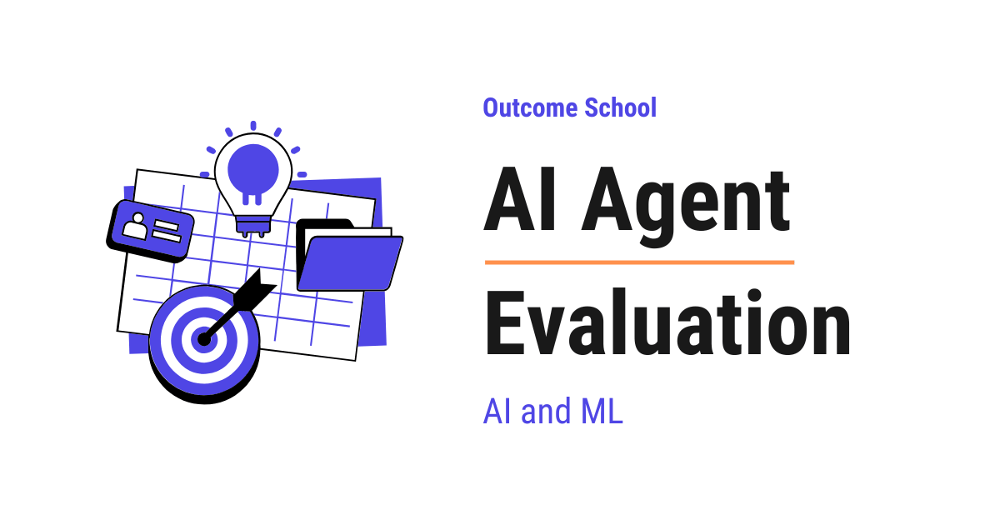

# How to Evaluate AI Agents? Metrics, Methods, and Best Practices

> Archived from <https://outcomeschool.com/blog/ai-agent-evaluation> on 2026-11-25.

AI Agent Evaluation is the process of measuring how well an AI Agent performs the tasks we give it, from the final result to every step and tool it used in between.

In this blog, we will learn about AI Agent Evaluation. We will also see why it is different from LLM Evaluation, the types of evaluation we can do, the key metrics we must track, the methods we can use, and the best practices to follow.

We will cover the following:
<ul><li>What is an AI Agent?</li><li>What is AI Agent Evaluation?</li><li>Why do we need AI Agent Evaluation?</li><li>How is AI Agent Evaluation different from LLM Evaluation?</li><li>Types of AI Agent Evaluation</li><li>Outcome Evaluation</li><li>Trajectory Evaluation</li><li>Tool Use Evaluation</li><li>Planning Evaluation</li><li>Key Metrics for AI Agents</li><li>Agent Benchmarks</li><li>Methods to Evaluate AI Agents</li><li>Frameworks and Tools for AI Agent Evaluation</li><li>Challenges in AI Agent Evaluation</li><li>Best Practices</li></ul>
I am <strong>Amit Shekhar</strong>, Founder @ <a target="_blank" rel="noopener noreferrer" href="https://outcomeschool.com">Outcome School</a>, I have taught and mentored many developers, and their efforts landed them high-paying tech jobs, helped many tech companies in solving their unique problems, and created many open-source libraries being used by top companies. I am passionate about sharing knowledge through open-source, blogs, and videos.

I teach <a target="_blank" rel="noopener noreferrer" href="https://outcomeschool.com/program/ai-and-machine-learning">AI and Machine Learning</a> at Outcome School.

Let&#x27;s get started.
<h2 id="what-is-an-ai-agent">What is an AI Agent?</h2>
Before jumping into AI Agent Evaluation, we must know what an <a target="_blank" rel="noopener noreferrer" href="ai-agent.md">AI Agent</a> is.

<strong>An AI Agent is a system that uses an LLM to plan, take actions using tools, and finish a task on its own.</strong>

In simple words, a normal LLM only gives us text. But an AI Agent does not stop at text. It can call tools, read files, search the web, run code, and take many steps to reach a goal.

Let&#x27;s say we ask an AI Agent: &quot;Book a flight from Delhi to Bangalore on Friday.&quot; The agent will think, call a flight search tool, read the results, pick a good flight, call a booking tool, and finally give us the confirmation. The agent does many steps in between, and we only see the final result.

This is the power of agents. They make our life easier. But, because they take many steps and many actions, they can also fail in many new ways. This is why we need a special way to evaluate them.

To learn AI Agent, Tool use in Agents, Agentic AI, and a lot more in-depth, we can check out our <a target="_blank" rel="noopener noreferrer" href="https://outcomeschool.com/program/ai-and-machine-learning">AI and Machine Learning Program</a> at Outcome School.
<h2 id="what-is-ai-agent-evaluation">What is AI Agent Evaluation?</h2>
<strong>AI Agent Evaluation is the process of measuring how well an AI Agent performs on the tasks we expect it to do.</strong>

In simple words, we give the agent some tasks, watch what it does from start to finish, and check if it finished the task correctly, used the right tools, took the right steps, and did it all without wasting time or money.

Let&#x27;s say we have built an AI Agent that helps users book flights. Now, the question is: how do we know if our agent is actually good? Did it pick the right flight? Did it use the booking tool correctly? Did it ask the user for missing information? Did it finish the task in a reasonable number of steps? To answer all these questions, we need AI Agent Evaluation.
<h2 id="why-do-we-need-ai-agent-evaluation">Why do we need AI Agent Evaluation?</h2>
AI Agents are powerful, but they are also risky. They take real actions in the real world. They send emails, write to databases, spend money, and talk to users on our behalf. So, a small mistake by an agent can cause a big problem.

So, before we ship an AI Agent to our users, we must know how it behaves in many situations. And after we ship it, we must keep checking it to make sure it does not get worse over time.

Here are the main reasons we need AI Agent Evaluation:
<ul><li>To check if the agent finishes the task correctly.</li><li>To make sure the agent uses the right tool at the right time.</li><li>To track how many steps and how much money the agent uses for each task.</li><li>To find weak spots where the agent fails so that we can fix them.</li><li>To compare different versions of the agent after prompt changes or model changes.</li><li>To make sure the agent is safe and does not take harmful actions.</li></ul>
<strong>Planning your move into AI?</strong>

No matter which tech domain you work in today, with your effort, you can transition to these roles:
<ul><li>AI Engineer</li><li>Forward Deployed Engineer</li><li>AI Agent Engineer</li><li>Harness Engineer</li><li>Voice AI Engineer</li><li>AI Architect</li><li>LLM Engineer</li><li>LLM Inference Engineer</li><li>Gen AI Engineer</li><li>MLOps Engineer</li><li>ML Engineer</li><li>Deep Learning Engineer</li></ul>
Our <a target="_blank" rel="noopener noreferrer" href="https://outcomeschool.com/program/ai-and-machine-learning">AI and Machine Learning Program</a> at Outcome School takes you there.
<h2 id="how-is-ai-agent-evaluation-different-from-llm-evaluation">How is AI Agent Evaluation different from LLM Evaluation?</h2>
This is an important question. Most people think AI Agent Evaluation is the same as <a target="_blank" rel="noopener noreferrer" href="llm-evaluation.md">LLM Evaluation</a>. But it is not.

In LLM Evaluation, we mostly check the final text output. The model takes an input and gives an output, and we score the output.

But, in AI Agent Evaluation, the agent does many things between the input and the final output. It plans, picks tools, calls tools, reads results, makes decisions, and tries again if something fails. So, we must check not just the final answer, but also everything that happened in between.

Let me tabulate the differences between LLM Evaluation and AI Agent Evaluation for your better understanding.
<table><thead><tr><th>Aspect</th><th>LLM Evaluation</th><th>AI Agent Evaluation</th></tr></thead><tbody><tr><td>What we check</td><td>Final text output</td><td>Final output + all steps in between</td></tr><tr><td>Number of steps</td><td>One step</td><td>Many steps</td></tr><tr><td>Tool use</td><td>No tools</td><td>Many tool calls</td></tr><tr><td>Cost tracking</td><td>One LLM call</td><td>Many LLM calls + tool calls</td></tr><tr><td>Failure modes</td><td>Wrong text</td><td>Wrong tool, wrong order, infinite loop, and etc.</td></tr></tbody></table>
This is how AI Agent Evaluation is different from LLM Evaluation. Now, let&#x27;s learn about the types of AI Agent Evaluation.
<h2 id="types-of-ai-agent-evaluation">Types of AI Agent Evaluation</h2>
There are four main types of AI Agent Evaluation. We will learn about each of them in detail.
<ul><li><strong>Outcome Evaluation</strong> - We check only the final result of the task.</li><li><strong>Trajectory Evaluation</strong> - We check every step the agent took to reach the result.</li><li><strong>Tool Use Evaluation</strong> - We check how the agent used the tools.</li><li><strong>Planning Evaluation</strong> - We check the quality of the agent&#x27;s plan.</li></ul>
Each of these has its own strengths and weaknesses. In real projects, we usually combine more than one of them.

Now, let&#x27;s discuss each one.
<h2 id="outcome-evaluation">Outcome Evaluation</h2>
<strong>Outcome Evaluation means we only look at the final result of the task and ignore everything in between.</strong>

Suppose we ask our agent: &quot;Find the cheapest flight from Delhi to Bangalore on Friday and book it.&quot; We do not care if the agent took 5 steps or 50 steps. We only care: did it book the cheapest flight on Friday? If yes, the outcome is correct. If no, the outcome is wrong.

This is the simplest form of evaluation, and it works very well for tasks where we have a clear right answer.

Here are some common outcome metrics:
<ul><li><strong>Task Success Rate</strong> - The percentage of tasks the agent finished correctly.</li><li><strong>Final Answer Accuracy</strong> - Did the final answer match the expected answer?</li><li><strong>Goal Completion</strong> - Did the agent reach the user&#x27;s goal?</li></ul>
<strong>Advantage:</strong>
<ul><li>Simple to define and measure.</li><li>Matches what the user actually cares about.</li><li>Works well when there is a clear correct answer.</li></ul>
<strong>Disadvantage:</strong>
<ul><li>We do not know why the agent failed.</li><li>An agent can get the right answer by luck after taking many wrong steps.</li><li>An agent can get the right answer but waste a lot of money and time.</li></ul>
Outcome Evaluation only works when we can say what a correct outcome is. We have a detailed blog on <a target="_blank" rel="noopener noreferrer" href="ai-is-only-as-good-as-our-definition-of-done.md">AI Is Only as Good as Our Definition of Done</a> that covers this end to end.

This was all about Outcome Evaluation. Now, let&#x27;s learn about Trajectory Evaluation.
<h2 id="trajectory-evaluation">Trajectory Evaluation</h2>
<strong>Trajectory Evaluation means we look at every step the agent took, in the right order, to reach the result.</strong>

In simple words, the trajectory is the full path of actions and thoughts that the agent went through. We check this path step by step.

Let&#x27;s say our agent has to answer the question: &quot;What is the weather in Bangalore tomorrow, and should I carry an umbrella?&quot; A good trajectory looks like this:
<ul><li>Step 1: Call the weather tool with city = Bangalore and date = tomorrow.</li><li>Step 2: Read the result. There is a 70% chance of rain.</li><li>Step 3: Decide that the user should carry an umbrella.</li><li>Step 4: Reply to the user.</li></ul>
Now, if the agent skipped Step 1 and just guessed the answer, the trajectory is wrong even if the final answer is correct by luck.

Here is what we check in trajectory evaluation:
<ul><li><strong>Exact Match</strong> - Did the agent follow the exact expected sequence of steps?</li><li><strong>In-Order Match</strong> - Did the agent perform the required steps in the correct order, even if it added a few extra steps?</li><li><strong>Any-Order Match</strong> - Did the agent perform all the required steps, even if the order was different?</li><li><strong>Precision</strong> - Of all the steps the agent took, how many were useful?</li><li><strong>Recall</strong> - Of all the steps that were needed, how many did the agent take?</li></ul>
The last two are the same Precision and Recall we use to score any classification system. We have a detailed blog on <a target="_blank" rel="noopener noreferrer" href="precision-vs-recall.md">Precision vs Recall</a> that explains both step by step.

<strong>Advantage:</strong>
<ul><li>We can find exactly where the agent went wrong.</li><li>We can tell luck apart from real understanding.</li><li>It helps us debug the agent and improve it.</li></ul>
<strong>Disadvantage:</strong>
<ul><li>It is hard to define one correct trajectory, because there are often many good paths.</li><li>It is more expensive to evaluate than just checking the final answer.</li><li>It can be too strict if we demand an exact match.</li></ul>
This is how Trajectory Evaluation works. But before we can evaluate a trajectory, we must first capture every step the agent took - and capturing those steps is exactly what <a target="_blank" rel="noopener noreferrer" href="ai-agent-observability.md">AI Agent Observability</a> gives us. Now, let&#x27;s move to Tool Use Evaluation.
<h2 id="tool-use-evaluation">Tool Use Evaluation</h2>
<strong>Tool Use Evaluation means we check how the agent used the tools available to it.</strong>

Tools are the hands of the agent. If the agent picks the wrong tool, or passes wrong arguments, the whole task can fail. So, we must check tool usage very carefully.

Here are the main things we check:
<ul><li><strong>Tool Selection</strong> - Did the agent pick the correct tool for the job?</li><li><strong>Argument Correctness</strong> - Did the agent pass the right arguments to the tool?</li><li><strong>Tool Call Success</strong> - Did the <a target="_blank" rel="noopener noreferrer" href="how-does-function-calling-work-in-llms.md">tool call</a> return a valid result, or did it throw an error?</li><li><strong>Result Handling</strong> - Did the agent use the tool result correctly to take the next step?</li><li><strong>No Hallucinated Tools</strong> - Did the agent try to call a tool that does not exist?</li></ul>
Let&#x27;s see an example. Suppose our agent has these tools: <code>search_flights</code>, <code>book_flight</code>, and <code>send_email</code>. The user says: &quot;Book the cheapest flight to Bangalore on Friday.&quot;

A good agent will first call <code>search_flights</code>, then call <code>book_flight</code> with the cheapest result, and then call <code>send_email</code> to confirm. A bad agent can call <code>send_email</code> first, or call <code>book_flight</code> with no flight selected, or call a tool that does not exist like <code>cancel_flight</code>. Tool Use Evaluation helps us catch all these mistakes.

<strong>Advantage:</strong>
<ul><li>Catches the most common cause of agent failures.</li><li>Easy to automate, because tool calls are structured.</li><li>Helps us improve the tool descriptions and prompts.</li></ul>
<strong>Disadvantage:</strong>
<ul><li>Does not tell us about the final quality of the answer.</li><li>Needs a clear ground truth for which tool to use, which is sometimes hard to define.</li></ul>
This was all about Tool Use Evaluation. Now, it&#x27;s time to learn about Planning Evaluation.

If we want to go deep into Tool use in Agents and Agent Architecture, we can check out our <a target="_blank" rel="noopener noreferrer" href="https://outcomeschool.com/program/ai-and-machine-learning">AI and Machine Learning Program</a> at Outcome School.
<h2 id="planning-evaluation">Planning Evaluation</h2>
<strong>Planning Evaluation means we check the quality of the plan that the agent makes before taking actions.</strong>

Many agents first write a plan, and then follow the plan step by step. If the plan is bad, the agent will fail no matter how good the tools are.

Let&#x27;s say our agent has to plan a trip. A good plan looks like this:
<ul><li>Step 1: Find flights for the given dates.</li><li>Step 2: Pick the cheapest flight that fits the user&#x27;s schedule.</li><li>Step 3: Find hotels near the destination.</li><li>Step 4: Pick the best-rated hotel within the budget.</li><li>Step 5: Send the full itinerary to the user.</li></ul>
Here is what we check in planning evaluation:
<ul><li><strong>Completeness</strong> - Does the plan cover all the steps needed to finish the task?</li><li><strong>Correctness</strong> - Are the steps in the right order?</li><li><strong>Feasibility</strong> - Can each step actually be done with the tools available?</li><li><strong>Efficiency</strong> - Is the plan short and clean, or does it have wasted steps?</li></ul>
<strong>Advantage:</strong>
<ul><li>Catches mistakes early, before the agent wastes time running a bad plan.</li><li>Helps us understand how the agent thinks.</li></ul>
<strong>Disadvantage:</strong>
<ul><li>Only works for agents that produce a plan upfront.</li><li>Hard to define one correct plan, because there are often many good plans.</li></ul>
Planning Evaluation is very useful for complex tasks where the agent must think before acting.

We have a detailed blog on <a target="_blank" rel="noopener noreferrer" href="plan-and-execute-agent.md">Plan-and-Execute Agent</a> that explains the plan-first agent pattern in depth.

<strong>A quick note for you</strong>

No matter which tech domain you work in, get familiar with these topics:
<ul><li>LLM</li><li>RAG</li><li>MCP</li><li>Agent</li><li>Fine-tuning</li><li>Quantization</li></ul>
We put it all together in one video:

<a target="_blank" rel="noopener noreferrer" href="https://www.youtube.com/watch?v=lnfWvX66FUk">AI Engineering Explained: LLM, RAG, MCP, Agent, Fine-Tuning, and Quantization</a>

No need to stop reading - bookmark it and watch later when you get time. Future you will thank you.

Now, let&#x27;s get back to the topic.
<h2 id="key-metrics-for-ai-agents">Key Metrics for AI Agents</h2>
Now that we have learned about the types of evaluation, it&#x27;s time to learn about the key metrics that we track for AI Agents.

Here are the most important ones:
<ul><li><strong>Task Success Rate</strong> - The percentage of tasks the agent finished correctly. This is the most important metric. If our agent has a low success rate, nothing else matters.</li><li><strong>Tool Call Accuracy</strong> - The percentage of tool calls that were correct and useful.</li><li><strong>Number of Steps per Task</strong> - How many steps did the agent take to finish the task? Fewer steps usually means a better agent.</li><li><strong>Cost per Task</strong> - How much money did the agent spend on LLM calls and tool calls to finish one task? This is critical for production agents.</li><li><strong>Latency per Task</strong> - How long did the agent take to finish the task? Users will not wait forever.</li><li><strong>Recovery Rate</strong> - When a tool call fails, can the agent recover and still finish the task?</li><li><strong>Safety Score</strong> - Did the agent take any harmful or risky action that it should not have taken?</li><li><strong>Loop Detection</strong> - Did the agent get stuck in an <a target="_blank" rel="noopener noreferrer" href="ai-agent-loop.md">infinite loop</a>, calling the same tool again and again?</li></ul>
In a real product, we must track all of these together. A high success rate is useless if every task costs us a lot of money or takes a very long time. Most of these numbers are really a verdict on the agent&#x27;s loop, and we have a detailed blog on <a target="_blank" rel="noopener noreferrer" href="what-is-loop-engineering.md">Loop Engineering</a> that explains how to design that loop.
<h2 id="agent-benchmarks">Agent Benchmarks</h2>
Just like LLMs, AI Agents also have benchmarks to compare them. Different benchmarks test different skills. Let&#x27;s group them by category, so that we know what each one is for.

<strong>Function Calling</strong>
<ul><li><strong>BFCL (Berkeley Function-Calling Leaderboard)</strong> - Tests how well a model picks the right function and passes correct arguments. The most cited benchmark for tool use.</li></ul>
<strong>Customer Service Agents</strong>
<ul><li><strong>τ-bench / τ²-bench (tau-bench)</strong> - Evaluates agents in realistic customer-service environments where they must use tools and follow company policies. The original τ-bench is single-control, which means only the agent acts on the environment. τ²-bench adds a dual-control setup where both the agent and a simulated user have their own tools and act in the same shared world.</li></ul>
<strong>Coding Agents</strong>
<ul><li><strong>SWE-bench Verified</strong> - Real GitHub issues from open-source projects. A widely used benchmark for measuring coding agents on real-world software tasks.</li><li><strong>Terminal-Bench</strong> - Agents completing real tasks inside a sandboxed command-line environment, like training a machine learning model, building Linux from source, or reverse-engineering a binary. It is truly agentic because the agent runs shell commands instead of just patching a diff.</li><li><strong>MLE-bench</strong> - Machine learning engineering tasks taken from Kaggle competitions.</li></ul>
<strong>General Assistants</strong>
<ul><li><strong>GAIA</strong> - General-assistant tasks that need reasoning, tool use, and web browsing combined.</li></ul>
<strong>Web Browsing Agents</strong>
<ul><li><strong>WebArena</strong> - Realistic websites for <a target="_blank" rel="noopener noreferrer" href="how-do-browser-agents-work.md">browser-using agents</a>.</li><li><strong>VisualWebArena</strong> - Web tasks that need visual understanding of the page.</li><li><strong>BrowseComp</strong> - Information-seeking tasks on the open web.</li></ul>
<strong>Computer Use Agents</strong>
<ul><li><strong>OSWorld</strong> - Real desktop environments where <a target="_blank" rel="noopener noreferrer" href="how-do-computer-use-agents-work.md">the agent controls a full computer</a>.</li><li><strong>AppWorld</strong> - Agents that interact with everyday apps through their APIs.</li></ul>
Now that we have seen the categories, we must understand two important ideas about agent benchmarks.
<ul><li><strong>Saturation</strong> - Top agents start scoring near the ceiling on a benchmark as models improve. When the gaps between agents become too small to be meaningful, the benchmark loses its power to separate good from great. This is why SWE-bench Verified is being supplemented by harder benchmarks like Terminal-Bench, so that we can still tell strong coding agents apart.</li><li><strong>Real world gap</strong> - A high score on a public benchmark does not mean the agent will work well in our product. Public benchmarks rarely match the exact task we care about. So, we must always build our own evaluation that matches our use case.</li></ul>
This was all about Agent Benchmarks. Now, let&#x27;s learn about the methods to evaluate AI Agents.

To master Evaluation of LLMs and Agents, Agent Architecture, and AI Agent, we can check out our <a target="_blank" rel="noopener noreferrer" href="https://outcomeschool.com/program/ai-and-machine-learning">AI and Machine Learning Program</a> at Outcome School.
<h2 id="methods-to-evaluate-ai-agents">Methods to Evaluate AI Agents</h2>
Now, the next big question is: how do we actually run these evaluations? The answer is, we have three main methods.

<strong>Automated Evaluation</strong>

We write code that runs the agent on a set of test tasks and checks the output and the trajectory against expected values. This is the fastest and cheapest method.

For example, if the agent has to return a flight number, we can simply compare the returned flight number with the expected one. If the agent has to call a specific tool, we can check the tool call log.

<strong>Advantage:</strong> Fast, cheap, repeatable.

<strong>Disadvantage:</strong> Only works when we have clear ground truth.

<strong>LLM as a Judge</strong>

Automated checks fail when there is no single correct answer. So, here comes the LLM as a Judge to the rescue. We use a strong LLM to judge the agent&#x27;s output and trajectory. We give the judge the user&#x27;s request, the agent&#x27;s full trajectory, and the final answer. We ask the judge to rate it on a scale of 1 to 5 on different aspects like correctness, helpfulness, and efficiency.

For the sake of understanding, let&#x27;s see an example judge prompt.

<pre><code class="code-highlight">You are an expert evaluator. Read the user request, the agent trajectory, and the final answer.
Rate the agent on a scale of 1 to 5 on the following aspects:
- Did it finish the task?
- Did it use the right tools?
- Did it take an efficient path?
- Was the final answer correct?

Give a short reason for each rating.

User request: {request}
Agent trajectory: {trajectory}
Final answer: {answer}
</code></pre>

<strong>Advantage:</strong> Scales well, works for open-ended tasks.

<strong>Disadvantage:</strong> The judge can have its own biases, so we must validate it against human ratings.

If you want to learn more about this, I have a separate blog on <a target="_blank" rel="noopener noreferrer" href="llm-as-a-judge.md">LLM as a Judge</a> that goes deeper into this topic.

<strong>Human Evaluation</strong>

Real humans look at the agent&#x27;s trajectory and the final answer, and rate them. This is the gold standard for complex tasks where automated metrics and LLM judges can miss subtle problems.

<strong>Advantage:</strong> Highest quality of judgement.

<strong>Disadvantage:</strong> Slow, expensive, hard to scale.

In a real product, we usually combine all three methods. We use automated evaluation for fast feedback, LLM as a Judge for daily monitoring, and human evaluation for the final check before shipping.

<strong>Stay updated:</strong> Subscribe to our <a target="_blank" rel="noopener noreferrer" href="https://outcomeschool.substack.com/subscribe">newsletter</a> to get our latest AI and Machine Learning blogs straight to your inbox.
<h2 id="frameworks-and-tools-for-ai-agent-evaluation">Frameworks and Tools for AI Agent Evaluation</h2>
To run all these methods at scale, we use evaluation frameworks. They give us a structured way to define test tasks, run the agent, capture the full trajectory, score each run, and view the results on a dashboard.

There are popular frameworks that we can use for AI Agent Evaluation:
<ul><li><strong>LangSmith</strong> - Built for tracing and evaluating <a target="_blank" rel="noopener noreferrer" href="how-does-langchain-work.md">LangChain</a> and <a target="_blank" rel="noopener noreferrer" href="how-does-langgraph-work.md">LangGraph</a> agents, with strong support for trajectory inspection.</li><li><strong>DeepEval</strong> - Open-source library with many ready-made metrics for agents, tool use, and RAG.</li></ul>
We do not need to learn all of them, but we must know that they exist so that we know what to search for when we start building our own agent evaluation system.
<h2 id="challenges-in-ai-agent-evaluation">Challenges in AI Agent Evaluation</h2>
AI Agent Evaluation is hard. Here are the main challenges:
<ul><li><strong>Many correct paths</strong> - For most tasks, there is no single correct trajectory. The agent can finish the task in many different ways, all of which are good. This makes trajectory comparison tricky.</li><li><strong>Non-determinism</strong> - The same agent can give different answers for the same input, because <a target="_blank" rel="noopener noreferrer" href="how-does-temperature-control-llm-output.md">LLMs are not deterministic</a>. So, we must run each test many times to get a stable score.</li><li><strong>Long trajectories</strong> - Real-world agent tasks can have 20, 50, or even 100 steps. Reviewing such long trajectories by hand is very tiring.</li><li><strong>Environment changes</strong> - Agents often interact with real systems like search engines or databases. The results can change every day, which makes evaluation harder to reproduce.</li><li><strong>Cascading failures</strong> - A small mistake in Step 2 can cause a big failure in Step 10. We must trace failures back to their root cause.</li><li><strong>Safety risks</strong> - Agents take real actions. A bad action can cost real money or send a wrong email to a real user. We must catch these before they happen.</li><li><strong>Cost of evaluation</strong> - Running an agent through many test tasks is expensive, because each task uses many LLM calls and many tool calls.</li></ul>
Now, the next big question is: how do we deal with all these challenges? The answer is, we follow some best practices.
<h2 id="best-practices">Best Practices</h2>
Here are the best practices for AI Agent Evaluation:
<ul><li><strong>Build a strong test set</strong> - Create a set of real tasks that match what our users will actually do. Include easy tasks, hard tasks, edge cases, and adversarial cases.</li><li><strong>Evaluate both outcome and trajectory</strong> - Outcome tells us if the task is done. Trajectory tells us why it failed. We need both.</li><li><strong>Run each test many times</strong> - Because of non-determinism, we must run each task at least 3 to 5 times and look at the average and the worst case, not just one run.</li><li><strong>Use a sandbox environment</strong> - Do not test agents in production. Use a sandbox with fake tools and fake data, so that we can test safely without risk.</li><li><strong>Track cost and latency from day one</strong> - A perfect agent that takes 5 minutes per task and has a high cost per call will not survive in production.</li><li><strong>Validate the judge</strong> - When using LLM as a Judge, compare its scores with human scores on a small sample to make sure the judge is reliable.</li><li><strong>Set up regression tests</strong> - Every time we change the prompt, the tools, or the model, run the full test set and check that nothing got worse.</li><li><strong>Watch for loops and timeouts</strong> - Always set a maximum number of steps and a maximum time. Otherwise, a bad agent can run forever and spend a lot of money.</li><li><strong>Keep humans in the loop</strong> - Even with full automation, review a small sample of trajectories by hand every week. This catches problems that metrics miss.</li></ul>
This way we can use AI Agent Evaluation to build AI Agents that we can actually trust in production.
<h2 id="frequently-asked-questions">Frequently Asked Questions</h2><h3 id="can-an-ai-agent-give-the-right-answer-and-still-fail-evaluation">Can an AI Agent give the right answer and still fail evaluation?</h3>
Yes. An agent can get the right answer by luck after taking many wrong steps, or it can get the right answer while wasting a lot of money and time. This is why we evaluate both the outcome and the trajectory. The outcome tells us if the task is done, and the trajectory tells us why it failed.
<h3 id="is-a-high-benchmark-score-enough-to-trust-an-ai-agent">Is a high benchmark score enough to trust an AI Agent?</h3>
No. A high score on a public benchmark does not mean the agent will work well in our product. Public benchmarks rarely match the exact task we care about. So, we must always build our own evaluation that matches our use case.
<h3 id="how-many-times-should-we-run-each-test-when-evaluating-an-ai-agent">How many times should we run each test when evaluating an AI Agent?</h3>
We should run each task at least 3 to 5 times. The same agent can give different answers for the same input, because LLMs are not deterministic. So, we look at the average and the worst case, not just one run.
<h3 id="can-we-trust-llm-as-a-judge-scores-for-agent-evaluation">Can we trust LLM as a Judge scores for agent evaluation?</h3>
Only after we validate them. The judge can have its own biases, so we compare its scores with human scores on a small sample to make sure it is reliable. LLM as a Judge scales well and works for open-ended tasks once validated.
<h3 id="should-we-test-ai-agents-in-production">Should we test AI Agents in production?</h3>
No. We should not test agents in production. Agents take real actions like sending emails and spending money, so a bad action can cause real harm. We use a sandbox with fake tools and fake data, so that we can test safely without risk.

That&#x27;s it for now.

Thanks

<strong>Amit Shekhar</strong> Founder @ <a target="_blank" rel="noopener noreferrer" href="https://outcomeschool.com">Outcome School</a>

You can connect with me on:
<ul><li><a target="_blank" rel="noopener noreferrer" href="https://x.com/amitiitbhu">X</a></li><li><a target="_blank" rel="noopener noreferrer" href="https://www.linkedin.com/in/amit-shekhar-iitbhu">LinkedIn</a></li><li><a target="_blank" rel="noopener noreferrer" href="https://github.com/amitshekhariitbhu">GitHub</a></li></ul>
Follow Outcome School on:
<ul><li><a target="_blank" rel="noopener noreferrer" href="https://x.com/outcome_school">X</a></li><li><a target="_blank" rel="noopener noreferrer" href="https://youtube.com/@OutcomeSchool">YouTube</a></li><li><a target="_blank" rel="noopener noreferrer" href="https://www.linkedin.com/company/outcomeschool">LinkedIn</a></li><li><a target="_blank" rel="noopener noreferrer" href="https://github.com/OutcomeSchool">GitHub</a></li></ul>
<a target="_blank" rel="noopener noreferrer" href="https://outcomeschool.com/blog"><strong>Read all of our high-quality blogs here.</strong></a>

