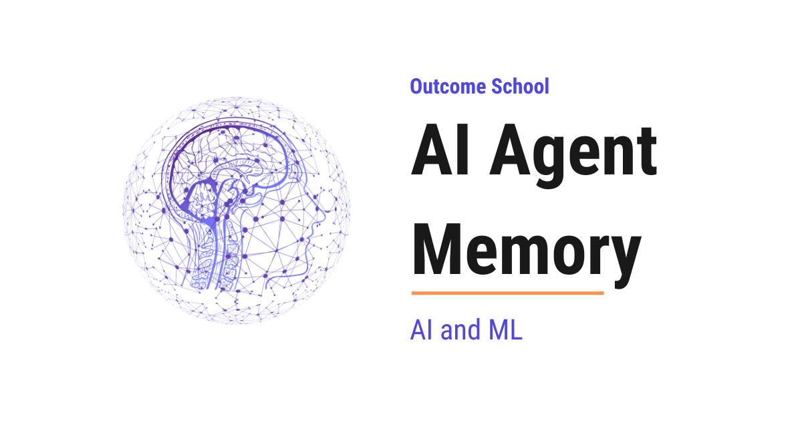

# How Does AI Agent Memory Work? The Memory Stack Explained

> Archived from <https://outcomeschool.com/blog/ai-agent-memory> on 2026-11-25.

AI Agent Memory is the system that we build around an LLM so that it can remember things across messages, sessions, and users, even though the LLM itself remembers nothing between calls.

In this blog, we will learn about AI Agent Memory - why agents need it, the memory stack, the four core operations (write, read, update, forget), how memory flows at runtime, and the common mistakes.

We will cover the following:
<ul><li>The Big Picture</li><li>Why AI Agents Need Memory</li><li>The Memory Stack</li><li>The Four Core Operations</li><li>How Memory Flows at Runtime</li><li>What to Store and What Not to Store</li><li>Common Mistakes and How to Fix Them</li><li>Quick Summary</li></ul>
I am <strong>Amit Shekhar</strong>, Founder @ <a target="_blank" rel="noopener noreferrer" href="https://outcomeschool.com">Outcome School</a>, I have taught and mentored many developers, and their efforts landed them high-paying tech jobs, helped many tech companies in solving their unique problems, and created many open-source libraries being used by top companies. I am passionate about sharing knowledge through open-source, blogs, and videos.

I teach <a target="_blank" rel="noopener noreferrer" href="https://outcomeschool.com/program/ai-and-machine-learning">AI and Machine Learning</a> at Outcome School.

Let&#x27;s get started.
<h2 id="the-big-picture">The Big Picture</h2>
Before we go into the details, let&#x27;s understand the big picture.

An LLM by itself is <strong>stateless</strong>. Every time we call it, it is like talking to someone who has never met us before. It does not remember our name, our last conversation, or what task it helped us with yesterday. <strong>AI Agent Memory</strong> is everything we build around the LLM to give it the feeling of remembering. The LLM does not actually remember. The agent remembers on its behalf.

In simple words:

<strong>AI Agent Memory = The system that lets a stateless LLM act like it remembers across turns, sessions, and users.</strong>

Think of an <a target="_blank" rel="noopener noreferrer" href="ai-agent.md">AI agent</a> like a brilliant assistant who forgets everything the moment every meeting ends. Without memory, they cannot learn our preferences, recall past decisions, or build on yesterday&#x27;s work. Memory is the notebook, the filing cabinet, and the personal diary that keeps them useful from one day to the next.
<h2 id="why-ai-agents-need-memory">Why AI Agents Need Memory</h2>
Before we go deeper, let&#x27;s understand why memory matters so much. Without memory, an agent has four big problems:

<strong>No continuity.</strong> The agent cannot remember what the user said 30 seconds ago once the current call ends - the next call starts fresh, with nothing carried over unless we explicitly pass it in.

<strong>No personalization.</strong> The agent cannot remember that the user prefers short answers, writes in Python, or lives in Bangalore. It treats every user the same.

<strong>No learning.</strong> The agent cannot remember what worked and what did not. It will make the same mistakes again and again.

<strong>No long tasks.</strong> Multi-step tasks that take hours or days become impossible. The agent forgets the plan halfway through and has to start over. Designing the agent&#x27;s repeating cycle so this does not happen is <a target="_blank" rel="noopener noreferrer" href="what-is-loop-engineering.md">Loop Engineering</a>.

So, here comes <strong>AI Agent Memory</strong> to the rescue. It solves all four problems by giving the agent a place to store information and a way to bring it back when needed.

<strong>Planning your move into AI?</strong>

No matter which tech domain you work in today, with your effort, you can transition to these roles:
<ul><li>AI Engineer</li><li>Forward Deployed Engineer</li><li>AI Agent Engineer</li><li>Harness Engineer</li><li>Voice AI Engineer</li><li>AI Architect</li><li>LLM Engineer</li><li>LLM Inference Engineer</li><li>Gen AI Engineer</li><li>MLOps Engineer</li><li>ML Engineer</li><li>Deep Learning Engineer</li></ul>
Our <a target="_blank" rel="noopener noreferrer" href="https://outcomeschool.com/program/ai-and-machine-learning">AI and Machine Learning Program</a> at Outcome School takes you there.

Now, let&#x27;s understand what memory actually looks like inside an agent.
<h2 id="the-memory-stack">The Memory Stack</h2>
AI Agent Memory is not a single thing. It is a <strong>stack of layers</strong>, each with a different lifespan and a different purpose. Let&#x27;s decode each layer.

<pre><code class="code-highlight">+--------------------------------------------+
|              AI Agent Memory               |
|                                            |
|  Layer 1: Context Window (in the prompt)   |
|     - In the current prompt                |
|     - Lost when context overflows          |
|                                            |
|  Layer 2: Short-Term Memory (session)      |
|     - Scratchpad, current task state       |
|     - Lost when the session ends           |
|                                            |
|  Layer 3: Long-Term Memory (persistent)    |
|     - Facts about the user                 |
|     - Past conversations                   |
|     - Learned preferences                  |
|                                            |
|  Layer 4: External Knowledge (tools/RAG)   |
|     - Documents, databases, APIs           |
|     - Queried, not maintained by agent     |
+--------------------------------------------+
</code></pre>

<strong>Layer 1 - Context Window.</strong> This is the text the LLM sees in a single call. It is the fastest memory because the LLM reads it directly. But it is also the smallest. Once it is full, older messages have to be dropped or summarized. For tasks where the input itself is too large to fit, we have a detailed blog on <a target="_blank" rel="noopener noreferrer" href="recursive-language-models.md">Recursive Language Models (RLMs)</a> that keeps the main context small by recursively splitting the input across sub-model calls.

<strong>Layer 2 - Short-Term Memory.</strong> This is the scratchpad the agent uses during one task or session. It holds the plan, the current step, and the intermediate results. When the session ends, this memory is usually gone.

<strong>Layer 3 - Long-Term Memory.</strong> This is the persistent memory that survives across conversations and sessions. It stores user facts, preferences, past conversation summaries, and learned behaviors. This is what makes the agent feel like it &quot;knows&quot; the user. We have a detailed blog on <a target="_blank" rel="noopener noreferrer" href="how-does-chatgpt-remember-you.md">How does ChatGPT remember you?</a> that shows this layer inside a real product.

<strong>Layer 4 - External Knowledge.</strong> This is everything the agent can query but does not maintain - documents, databases, APIs, the web. The agent reads from these sources but does not write back to them as its own memory, even when the sources belong to the same company. Some frameworks classify this as a type of long-term memory; others keep it separate. From the agent&#x27;s point of view, it looks the same either way - the agent asks, and information comes back.

All four layers work together. The <a target="_blank" rel="noopener noreferrer" href="context-window.md">context window</a> is the LLM&#x27;s desk. Short-term memory is the notepad next to the desk. Long-term memory is the personal diary in the drawer. External knowledge is the library across the street. We want to keep our desk clean, our notepad organized, our diary trustworthy, and the library indexed.

<strong>Note on terminology:</strong> Some frameworks use &quot;short-term memory&quot; to mean the context window itself, not a separate layer. Here we keep them as two layers because the context window is what the LLM literally reads in one call, while the short-term scratchpad is the session-scoped store the agent maintains between calls and loads back into the context window each turn.

<strong>Note:</strong> Within Long-Term Memory, there are further sub-types - <strong>episodic</strong> (past experiences), <strong>semantic</strong> (facts and concepts), and <strong>procedural</strong> (how to do things). We will cover these in future posts.

To learn agent memory, context engineering, RAG, and vector databases, check out our <a target="_blank" rel="noopener noreferrer" href="https://outcomeschool.com/program/ai-and-machine-learning">AI and Machine Learning Program</a> at Outcome School.
<h2 id="the-four-core-operations">The Four Core Operations</h2>
Now that we have seen the layers, let&#x27;s look at what we actually do with them. No matter how many layers we have, every memory system does only four things. Let&#x27;s decode each one.

<strong>1. Write.</strong> Save new information. When something important happens - a user preference, a task result, a key fact - we write it to memory. Example: after the user says &quot;I prefer code in Go&quot;, we write &quot;preferred language: Go&quot; to long-term memory.

<strong>2. Read.</strong> Pull relevant information back when needed. This is usually the hardest part. We do not want everything, only what matters right now. Example: if the user asks &quot;Write me a function to reverse a string&quot;, we pull up &quot;preferred language: Go&quot; before calling the LLM - but we do not pull up their shipping address.

<strong>3. Update.</strong> Modify existing memories when new information contradicts them. If the user&#x27;s favorite language was Python last month and is now Go, the memory must be updated.

<strong>4. Forget.</strong> Remove memories that are stale, wrong, or no longer relevant. Without forgetting, the memory store grows forever and retrieval gets worse. Example: a note like &quot;user is debugging login right now&quot; should be dropped once the session ends.

<strong>Memory System = Write + Read + Update + Forget.</strong>

If any one of these is broken, the whole memory system breaks. An agent that writes but never reads is a waste of disk space. An agent that reads but never updates will keep acting on outdated facts. An agent that never forgets will eventually drown in its own history. All four operations must work together.

<strong>A quick note for you</strong>

No matter which tech domain you work in, get familiar with these topics:
<ul><li>LLM</li><li>RAG</li><li>MCP</li><li>Agent</li><li>Fine-tuning</li><li>Quantization</li></ul>
We put it all together in one video:

<a target="_blank" rel="noopener noreferrer" href="https://www.youtube.com/watch?v=lnfWvX66FUk">AI Engineering Explained: LLM, RAG, MCP, Agent, Fine-Tuning, and Quantization</a>

No need to stop reading - bookmark it and watch later when you get time. Future you will thank you.

Now, let&#x27;s get back to the topic.
<h2 id="how-memory-flows-at-runtime">How Memory Flows at Runtime</h2>
Now, let&#x27;s put all the parts together to see how memory flows through an agent at runtime.

Here is the flow as a picture:

<pre><code class="code-highlight">                   User Message
                        |
                        v
          +----------------------------+
          |        READ Memory         |
          |  - Long-Term (user facts,  |
          |    preferences, summaries) |
          |  - Short-Term (plan,       |
          |    recent steps)           |
          +-------------+--------------+
                        |
                        v
          +----------------------------+
          |       Build Prompt         |
          |  (system prompt +          |
          |   retrieved memories +     |
          |   user message)            |
          +-------------+--------------+
                        |
                        v
          +----------------------------+    +---------------------+
          |            LLM             |&lt;--&gt;| External Knowledge  |
          |    (reasons, replies)      |    | (tools, RAG, APIs)  |
          +-------------+--------------+    +---------------------+
                        |
                        v
          +----------------------------+
          |        WRITE Memory        |
          |  - Short-Term (new step)   |
          |  - Long-Term (if worth     |
          |    keeping)                |
          +-------------+--------------+
                        |
                        v
                     Response
</code></pre>

Now, let&#x27;s walk through each step on every user turn:

<strong>Step 1:</strong> The user sends a message.

<strong>Step 2:</strong> The agent searches <strong>long-term memory</strong> for anything relevant to this message. It pulls out a handful of useful facts - maybe the user&#x27;s name, their preferred language, and a past conversation summary.

<strong>Step 3:</strong> The agent also reads its <strong>short-term memory</strong> for the current session - the plan so far, recent actions, and intermediate results.

<strong>Step 4:</strong> The agent builds the prompt for the LLM by combining: the <a target="_blank" rel="noopener noreferrer" href="system-prompt.md">system prompt</a>, the retrieved long-term memories, the short-term scratchpad, and the current user message. This all goes into the <strong>context window</strong>.

<strong>Step 5:</strong> The LLM reasons and responds. The agent may call tools, which use <strong>external knowledge</strong> (like <a target="_blank" rel="noopener noreferrer" href="retrieval-augmented-generation-rag.md">RAG</a> on documents or a database query). The agent can call tools multiple times in <a target="_blank" rel="noopener noreferrer" href="ai-agent-loop.md">a loop</a> before producing its final response.

<strong>Step 6:</strong> The agent writes new information to memory. Short-term memory gets the new step. If something important was learned, it gets written to long-term memory too.

<strong>Step 7:</strong> The response is sent to the user.

The same flow in pseudocode:

<pre><code class="code-highlight">while user_active:
    user_message = receive_message()

    # READ
    long_term_context = search_long_term_memory(user_id, user_message)
    short_term_context = read_short_term_memory(session_id)

    # BUILD PROMPT (retrieved memories are formatted into text and
    # injected into the system prompt, not sent as separate messages)
    messages = [system_prompt_with(long_term_context, short_term_context), user_message]

    # LLM LOOP (may call tools multiple times before the final answer)
    while True:
        response = call_llm(messages, tools)
        if response.is_tool_call:
            tool_result = call_tool(response.tool_name, response.tool_args)
            messages.append(response)
            messages.append(tool_result)
        else:
            break

    # WRITE
    write_short_term_memory(session_id, user_message, response)
    if is_worth_keeping(user_message, response):
        write_long_term_memory(user_id, user_message, response)

    send_to_user(response)
</code></pre>

This full flow happens on every single turn. Read -&gt; Build prompt -&gt; Respond -&gt; Write, on every turn. The agent is constantly pulling memory in and pushing new memory out. From the user&#x27;s point of view, it just feels like the agent remembers.

<strong>Note:</strong> In production, the long-term memory write is often done asynchronously after the response is sent, so the user does not pay the latency cost.

The best way to learn this is by taking an example. Let&#x27;s see this with a short one.

<strong>User turn 1:</strong> &quot;My name is Priya and I code in Go.&quot;
<ul><li>Long-term memory is empty. Nothing to retrieve.</li><li>The LLM responds: &quot;Nice to meet you, Priya.&quot;</li><li>The agent writes to long-term memory: &quot;User&#x27;s name is Priya. Preferred language: Go.&quot;</li></ul>
<strong>User turn 2 (a week later):</strong> &quot;Help me write a function that reverses a string.&quot;
<ul><li>The agent searches long-term memory for context about this user. It retrieves: &quot;Priya, prefers Go.&quot;</li><li>The prompt becomes: System prompt + &quot;User is Priya, prefers Go&quot; + &quot;Help me write a function that reverses a string.&quot;</li><li>The LLM responds with a Go function, addressed to Priya.</li></ul>
That&#x27;s the beauty of AI Agent Memory. The second turn feels personal even though it happened a week later. The LLM itself remembers nothing. The agent did all the remembering for it.

If we want to go deep into building agents with memory, tool use, and RAG end to end, we have a complete program on this - check out our <a target="_blank" rel="noopener noreferrer" href="https://outcomeschool.com/program/ai-and-machine-learning">AI and Machine Learning Program</a> at Outcome School.
<h2 id="what-to-store-and-what-not-to-store">What to Store and What Not to Store</h2>
Now, a natural question arises - if we have a memory system, should we store everything? The answer is no. One of the biggest mistakes is storing too much. Memory is valuable only if retrieval works well, and retrieval works well only if the memory store is not full of junk.

<strong>Store this:</strong>
<ul><li>Stable user facts (name, role, language, timezone).</li><li>Strong preferences (prefers short answers, wants code in Python).</li><li>Outcomes of past tasks (what worked, what failed).</li><li>Decisions that shape future work (architecture choices, policies, constraints).</li></ul>
<strong>Do not store this:</strong>
<ul><li>Every single message. The context window already has the live conversation.</li><li>Low-signal chit-chat (&quot;hi&quot;, &quot;thanks&quot;, &quot;ok&quot;).</li><li>Temporary state that is already in short-term memory.</li><li>Sensitive data we do not have consent to keep.</li></ul>
In simple words:

<strong>Store what will matter next week. Skip what only matters for the next minute.</strong>

<strong>Very important:</strong> Before writing anything to long-term memory, ask one simple question: &quot;Will this be useful in a future conversation?&quot; If the answer is no, do not write it.

There is also knowledge that does not belong in one agent&#x27;s memory at all. Facts about our company&#x27;s data and systems, like what a table means or which rows count as a sale, are better written down once as files that every agent and every tool can read. We have a detailed blog on <a target="_blank" rel="noopener noreferrer" href="what-is-okf-open-knowledge-format.md">What is OKF (Open Knowledge Format)?</a> that explains this open standard from the ground up.

<strong>Stay updated:</strong> Subscribe to our <a target="_blank" rel="noopener noreferrer" href="https://outcomeschool.substack.com/subscribe">newsletter</a> to get our latest AI and Machine Learning blogs straight to your inbox.
<h2 id="common-mistakes-and-how-to-fix-them">Common Mistakes and How to Fix Them</h2>
Even a well-designed memory system can fail in specific ways. Let&#x27;s decode each one.

<strong>1. Context window overflow.</strong> The prompt becomes too long and either fails or gets truncated. The agent loses the oldest (and sometimes most important) information.

<strong>How to fix:</strong> Summarize old turns into a <a target="_blank" rel="noopener noreferrer" href="how-does-context-compaction-work.md">compact summary</a>. Drop tool outputs that are no longer needed. Put only the most relevant retrieved memories in the prompt, not everything.

<strong>2. Retrieval misses the important memory.</strong> The agent has the memory stored, but the retrieval step does not find it, so the LLM answers as if it never knew.

<strong>How to fix:</strong> Use <a target="_blank" rel="noopener noreferrer" href="how-does-semantic-search-work.md">semantic search</a> (embeddings) instead of keyword match. Store memories with good titles and descriptions. Retrieve more candidates than we need and let the LLM pick. At scale, that similarity search is powered by <a target="_blank" rel="noopener noreferrer" href="how-does-approximate-nearest-neighbor-ann-search-work.md">Approximate Nearest Neighbor (ANN) search</a>, which finds the closest memory vectors fast without scanning every one.

<strong>3. Outdated memories.</strong> The agent keeps acting on old facts. The user&#x27;s job changed, but the agent still thinks they are a student.

<strong>How to fix:</strong> On every write, check if an existing memory contradicts it. If yes, update or replace it. Do not just append.

<strong>4. Memory bloat.</strong> The memory store grows forever and retrieval gets slow and noisy.

<strong>How to fix:</strong> Add a forget policy. Delete memories that have not been used in a long time, or that are superseded by newer ones.

<strong>5. Privacy leaks.</strong> The agent remembers sensitive information and surfaces it in the wrong context - for example, mentioning one user&#x27;s data while helping another user.

<strong>How to fix:</strong> Scope every memory to a user ID. Never mix memories across users. For sensitive data, encrypt both at rest and in transit, and require explicit consent before writing.

<strong>6. Confusing short-term and long-term.</strong> The agent writes ephemeral state to long-term memory, or keeps stable facts only in short-term memory and loses them on session end.

<strong>How to fix:</strong> Be deliberate about which layer each write goes to. If it is useful only for this task, keep it short-term. If it will matter later, promote it to long-term. When in doubt, prefer short-term - we can always promote later.

A production memory system is mostly about handling these failure modes well. The happy path is easy. The edge cases are where the real engineering happens.

<strong>Very important:</strong> Most of these mistakes are silent. The agent does not crash - it just gives subtly wrong answers. That is why we must add logging, <a target="_blank" rel="noopener noreferrer" href="ai-agent-observability.md">monitoring</a>, and regular audits of the memory store. Without that, we will only find out when a user complains.

Those audits guard against one more failure that is not an accident at all. If an attacker can get their own text into what the agent stores, the bad instruction comes back in every future session. We have a detailed blog on <a target="_blank" rel="noopener noreferrer" href="prompt-injection-in-llms.md">Prompt Injection in LLMs</a> that explains how that attack works and how we defend against it.

Now, we have understood how AI Agent Memory works end to end. Let&#x27;s wrap up with a quick recap.
<h2 id="quick-summary">Quick Summary</h2>
Let&#x27;s recap what we have decoded:
<ul><li><strong>AI Agent Memory</strong> is the system that lets a stateless LLM act like it remembers across turns, sessions, and users.</li><li><strong>The memory stack</strong> has four layers: the context window, short-term memory, long-term memory, and external knowledge. Each has a different lifespan and purpose.</li><li><strong>The four core operations</strong> are Write, Read, Update, and Forget. Break any one of them, and the whole memory system breaks.</li><li><strong>The runtime flow</strong> on every turn is: retrieve relevant memories, build the prompt, call the LLM, write new memories, respond. Read -&gt; Build prompt -&gt; Respond -&gt; Write, on every turn.</li><li><strong>Store what will matter next week.</strong> Skip what only matters for the next minute. Most memory systems fail from storing too much, not too little.</li><li><strong>Common mistakes</strong> include context overflow, retrieval misses, outdated memories, memory bloat, privacy leaks, and confusing the memory layers. Handling these is the real work.</li><li>Memory is what turns an LLM from a clever but forgetful answerer into an agent that truly knows us and improves over time. Every serious AI agent, from coding assistants to customer support bots to personal assistants, has memory at its core.</li></ul><h2 id="frequently-asked-questions">Frequently Asked Questions</h2><h3 id="does-the-llm-itself-remember-anything-in-an-ai-agent">Does the LLM itself remember anything in an AI agent?</h3>
No. The LLM is stateless and does not actually remember anything. Every call starts fresh. The agent remembers on its behalf by storing information and bringing the relevant parts back into the prompt on every turn.
<h3 id="what-is-the-difference-between-short-term-and-long-term-memory-in-an-ai-agent">What is the difference between short-term and long-term memory in an AI agent?</h3>
Short-term memory is the scratchpad for one task or session, holding the plan, the current step, and intermediate results. It is usually gone when the session ends. Long-term memory survives across conversations and sessions, storing user facts, preferences, past conversation summaries, and learned behaviors.
<h3 id="is-rag-the-same-as-agent-memory">Is RAG the same as agent memory?</h3>
Not exactly. RAG over documents or databases is external knowledge, which the agent can query but does not maintain or write back to as its own memory. Some frameworks classify it as a type of long-term memory, while others keep it separate.
<h3 id="should-we-store-every-message-in-long-term-memory">Should we store every message in long-term memory?</h3>
No. Storing too much is one of the biggest mistakes, because retrieval works well only if the memory store is not full of junk. We store stable user facts, strong preferences, past task outcomes, and key decisions. We skip low-signal chit-chat and anything that only matters for the next minute.
<h3 id="does-writing-to-long-term-memory-slow-down-the-agents-response">Does writing to long-term memory slow down the agent&#x27;s response?</h3>
Not necessarily. In production, the long-term memory write is often done asynchronously after the response is sent. This way, the user does not pay the latency cost of saving new memories.

That&#x27;s it for now.

Thanks

<strong>Amit Shekhar</strong> Founder @ <a target="_blank" rel="noopener noreferrer" href="https://outcomeschool.com">Outcome School</a>

You can connect with me on:
<ul><li><a target="_blank" rel="noopener noreferrer" href="https://x.com/amitiitbhu">X</a></li><li><a target="_blank" rel="noopener noreferrer" href="https://www.linkedin.com/in/amit-shekhar-iitbhu">LinkedIn</a></li><li><a target="_blank" rel="noopener noreferrer" href="https://github.com/amitshekhariitbhu">GitHub</a></li></ul>
Follow Outcome School on:
<ul><li><a target="_blank" rel="noopener noreferrer" href="https://x.com/outcome_school">X</a></li><li><a target="_blank" rel="noopener noreferrer" href="https://youtube.com/@OutcomeSchool">YouTube</a></li><li><a target="_blank" rel="noopener noreferrer" href="https://www.linkedin.com/company/outcomeschool">LinkedIn</a></li><li><a target="_blank" rel="noopener noreferrer" href="https://github.com/OutcomeSchool">GitHub</a></li></ul>
<a target="_blank" rel="noopener noreferrer" href="https://outcomeschool.com/blog"><strong>Read all of our high-quality blogs here.</strong></a>

