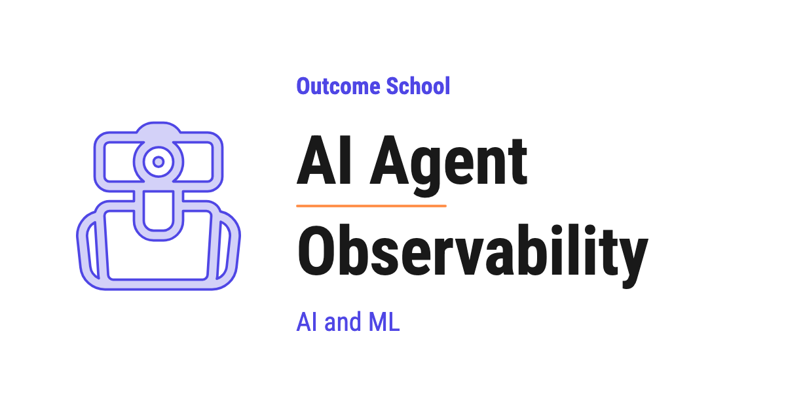

# What is AI Agent Observability? Traces, Spans, and Metrics Explained

> Archived from <https://outcomeschool.com/blog/ai-agent-observability> on 2026-11-25.

AI Agent Observability is the practice of recording everything an AI Agent does inside, step by step, so that we can see why it behaved the way it did.

In this blog, we will learn about AI Agent Observability. We will also see why we need it, how it is different from normal software monitoring, what we must observe inside an agent, the key concepts like traces and spans, the metrics we must track, the tools we can use, and the best practices to follow.

We will cover the following:
<ul><li>What is an AI Agent?</li><li>What is Observability?</li><li>What is AI Agent Observability?</li><li>Why do we need AI Agent Observability?</li><li>How is AI Agent Observability different from traditional Observability?</li><li>The Three Pillars of Observability</li><li>Traces and Spans</li><li>What should we observe inside an AI Agent?</li><li>Key Metrics for AI Agent Observability</li><li>How AI Agent Observability works</li><li>Tools and Frameworks for AI Agent Observability</li><li>Observability vs Evaluation</li><li>Challenges in AI Agent Observability</li><li>Best Practices</li></ul>
I am <strong>Amit Shekhar</strong>, Founder @ <a target="_blank" rel="noopener noreferrer" href="https://outcomeschool.com">Outcome School</a>, I have taught and mentored many developers, and their efforts landed them high-paying tech jobs, helped many tech companies in solving their unique problems, and created many open-source libraries being used by top companies. I am passionate about sharing knowledge through open-source, blogs, and videos.

I teach <a target="_blank" rel="noopener noreferrer" href="https://outcomeschool.com/program/ai-and-machine-learning">AI and Machine Learning</a> at Outcome School.

Let&#x27;s get started.
<h2 id="what-is-an-ai-agent">What is an AI Agent?</h2>
Before jumping into AI Agent Observability, we must know what an <a target="_blank" rel="noopener noreferrer" href="ai-agent.md">AI Agent</a> is.

<strong>An AI Agent is a system that uses an LLM to plan, take actions using tools, and finish a task on its own.</strong>

In simple words, an LLM (Large Language Model) only gives us text. But an AI Agent does not stop at text. It can think, call tools, read files, search the web, run code, and take many steps to reach a goal.

Let&#x27;s say we ask an AI Agent: &quot;Find me the cheapest flight from Delhi to Bangalore on Friday and book it.&quot; The agent will think about what to do, call a flight search tool, read the results, pick the cheapest flight, call a booking tool, and finally give us the confirmation.

The agent does many steps in between, and we only see the final result.

This is the power of agents. They make our life easier. But, because they take many steps and many actions, a lot of things happen inside that we cannot see from outside. This is exactly why we need observability.
<h2 id="what-is-observability">What is Observability?</h2>
Let us first understand the word.

<strong>Observability = Observe + Ability</strong>

So, observability is the ability to observe what is happening inside a system by looking at the data it produces.

In simple words, observability means we can answer the question: &quot;What is happening inside my system right now, and why?&quot;

Let&#x27;s say our car is making a strange noise. We open the dashboard and look at the speed, the fuel level, and the engine temperature. From these signals, we can understand what is going on inside the engine without opening the whole engine.

That dashboard gives us observability into the car.

A doctor does the same thing with the human body. The doctor cannot directly see inside us, so the doctor uses an X-ray, a blood test, and a heartbeat monitor. From these signals, the doctor understands what is happening inside.

Observability is the same idea for software. We collect signals from a running system, and from those signals, we understand its internal state.
<h2 id="what-is-ai-agent-observability">What is AI Agent Observability?</h2>
<strong>AI Agent Observability is the practice of recording and understanding everything an AI Agent does internally, step by step, so that we can see why it behaved the way it did.</strong>

In simple words, an AI Agent takes many hidden steps before giving us the final answer. Observability opens up these hidden steps so that we can see each thought, each <a target="_blank" rel="noopener noreferrer" href="how-does-function-calling-work-in-llms.md">tool call</a>, and each decision the agent made.

Let&#x27;s go back to our flight booking agent. From outside, we only see the final message: &quot;Your flight is booked.&quot; But inside, many things happened:
<ul><li>The agent thought about the task.</li><li>The agent called the flight search tool with some input.</li><li>The flight search tool returned a list of flights.</li><li>The agent picked one flight.</li><li>The agent called the booking tool.</li><li>The booking tool returned a confirmation.</li></ul>
AI Agent Observability records all of these hidden steps. So, when something goes wrong, we do not have to guess. We can simply open the record and see exactly what happened at each step.

Think of it like a black box flight recorder in an airplane. The black box records everything during the flight. If something goes wrong, we open the black box and understand exactly what happened. AI Agent Observability is the black box for our agent.
<h2 id="why-do-we-need-ai-agent-observability">Why do we need AI Agent Observability?</h2>
AI Agents are powerful, but they are also unpredictable. The same agent can take different paths for the same task. It calls real tools, spends real money, sends real emails, and talks to real users.

So, when an agent fails, the failure is hidden somewhere in the middle of many steps. Without observability, we are completely blind.

Let&#x27;s say a user complains: &quot;The agent booked the wrong flight.&quot; Now, where is the mistake?
<ul><li>Did the LLM misunderstand the user?</li><li>Did the agent call the search tool with the wrong dates?</li><li>Did the search tool return wrong data?</li><li>Did the agent pick the wrong flight from a correct list?</li><li>Did the booking tool fail and the agent ignored it?</li></ul>
Without observability, we cannot answer any of these questions. We can only guess, and guessing is not engineering.

Here are the main reasons we need AI Agent Observability:
<ul><li>To see every step the agent took, from start to finish.</li><li>To find the exact step where the agent went wrong.</li><li>To track how much money and how many tokens each task is costing us.</li><li>To track how slow or fast our agent is.</li><li>To catch errors, retries, and failed tool calls.</li><li>To understand why the agent made a certain decision.</li><li>To monitor the agent live in production and get alerts when something breaks.</li><li>To collect real data that we can later use to improve the agent.</li></ul>
There is one more reason. Not every wrong step is an accident. When an attacker hides an instruction inside a page or an email that our agent reads, the trace is often the only place that shows what really happened. We have a detailed blog on <a target="_blank" rel="noopener noreferrer" href="prompt-injection-in-llms.md">Prompt Injection in LLMs</a> that covers this attack end to end.
<h2 id="how-is-ai-agent-observability-different-from-traditional-observability">How is AI Agent Observability different from traditional Observability?</h2>
We have been doing observability for normal software for many years. So, the question arises: why do we need a special kind of observability for AI Agents?

The answer is that AI Agents behave very differently from normal software.

In normal software, the same input always gives the same output. If we call a function with <code>2 + 2</code>, it always returns <code>4</code>. The path is fixed. The behavior is predictable.

But an AI Agent is <strong>non-deterministic</strong>. This means the same input can give different outputs and follow different paths each time. The agent can take 3 steps today and 6 steps tomorrow for the same task. It can call a tool in one run and skip it in another.

Also, in normal software, an error is usually clear. The program either works or crashes with an error message.

But an AI Agent can fail silently. It can give an answer that looks perfect but is completely wrong. There is no crash, no red error. The output is just quietly incorrect.

Let me tabulate the differences between Traditional Observability and AI Agent Observability for your better understanding so that you can decide what extra things you need to track.
<table><thead><tr><th>Traditional Observability</th><th>AI Agent Observability</th></tr></thead><tbody><tr><td>Same input gives same output</td><td>Same input can give different outputs</td></tr><tr><td>Fixed path of execution</td><td>Path changes on every run</td></tr><tr><td>Errors are clear crashes</td><td>Failures can be silent and look correct</td></tr><tr><td>We track CPU, memory, requests</td><td>We also track tokens, cost, tool calls, reasoning</td></tr><tr><td>We mainly check &quot;did it run?&quot;</td><td>We also check &quot;was the answer good?&quot;</td></tr><tr><td>Logs are simple text lines</td><td>We also capture prompts, responses, and decisions</td></tr></tbody></table>
So, AI Agent Observability includes everything from traditional observability, plus a lot of new things that are special to agents.

<strong>Planning your move into AI?</strong>

No matter which tech domain you work in today, with your effort, you can transition to these roles:
<ul><li>AI Engineer</li><li>Forward Deployed Engineer</li><li>AI Agent Engineer</li><li>Harness Engineer</li><li>Voice AI Engineer</li><li>AI Architect</li><li>LLM Engineer</li><li>LLM Inference Engineer</li><li>Gen AI Engineer</li><li>MLOps Engineer</li><li>ML Engineer</li><li>Deep Learning Engineer</li></ul>
Our <a target="_blank" rel="noopener noreferrer" href="https://outcomeschool.com/program/ai-and-machine-learning">AI and Machine Learning Program</a> at Outcome School takes you there.
<h2 id="the-three-pillars-of-observability">The Three Pillars of Observability</h2>
Observability stands on three classic pillars. These three pillars come from traditional software, and they apply to AI Agents too.

<strong>1. Logs</strong>

Logs are simple text records of events that happened. For an agent, a log can be a line like: &quot;Agent called the flight search tool with Delhi to Bangalore on Friday.&quot;

<strong>2. Metrics</strong>

Metrics are numbers that we measure over time. For an agent, a metric can be the number of tokens used, the cost per task, or the average time taken.

<strong>3. Traces</strong>

Traces show the full journey of one request as it moves through the system, step by step. For an agent, a trace shows every thought, every tool call, and every LLM call for one single task.

For AI Agents, <strong>traces are the most important pillar</strong>. This is because an agent does so many steps internally that we must see the full journey to understand its behavior. So, let&#x27;s understand traces in detail.
<h2 id="traces-and-spans">Traces and Spans</h2>
These two words, <strong>trace</strong> and <strong>span</strong>, are the heart of AI Agent Observability. So, let&#x27;s understand them with a simple example.

<strong>A span is a record of one single step or operation inside the agent.</strong>

<strong>A trace is the complete record of one full run of the agent, made up of many spans.</strong>

In simple words, a span is one step, and a trace is the whole story made of many steps.

Let&#x27;s go back to our flight booking agent. When a user asks the agent to book a flight, one full run happens. That full run is one <strong>trace</strong>.

Inside that trace, each small step is a <strong>span</strong>:
<ul><li>Span 1: The agent receives the user request.</li><li>Span 2: The LLM thinks and decides to search for flights.</li><li>Span 3: The agent calls the flight search tool.</li><li>Span 4: The agent reads the search results.</li><li>Span 5: The LLM picks the cheapest flight.</li><li>Span 6: The agent calls the booking tool.</li><li>Span 7: The agent returns the final confirmation.</li></ul>
So, this one trace has seven spans. Each span records useful details like the input, the output, the time taken, and any error.

Spans can also be nested inside each other. For example, a &quot;planning&quot; span can contain an &quot;LLM call&quot; span inside it. This nesting forms a tree, and that tree shows us the full structure of the agent&#x27;s work.

When we design the agent as a graph of small steps in the first place, every node gives us one clean span for free. We have a detailed blog on <a target="_blank" rel="noopener noreferrer" href="what-is-graph-engineering.md">Graph Engineering</a> that explains this step by step.

We can picture one trace like below:

<pre><code class="code-highlight">TRACE: Book a flight from Delhi to Bangalore
│
├── SPAN: Receive user request
├── SPAN: Plan the task
│       └── SPAN: LLM call (decide to search flights)
├── SPAN: Tool call (flight search)
│       ├── input:  Delhi -&gt; Bangalore, Friday
│       └── output: list of 12 flights
├── SPAN: Pick the cheapest flight
│       └── SPAN: LLM call (choose flight)
├── SPAN: Tool call (booking)
│       └── output: booking confirmed
└── SPAN: Return final confirmation
</code></pre>

Here, we can see that the trace is the full tree, and each branch is a span. Some spans hold smaller spans inside them. By looking at this tree, we understand the whole journey of the agent in one glance.

Here, we can also see that a trace is like a complete medical report of one visit, and each span is like one individual test inside that report. Together, they tell us the full story.

One more thing to notice. When a user has a long conversation with the agent, that whole conversation can have many traces, one for each request the user sends. We group all these traces together into a <strong>session</strong>. So, the full picture is simple: a session contains many traces, and each trace contains many spans.

We can picture this hierarchy like below:

<pre><code class="code-highlight">SESSION  (one full user conversation)
│
├── TRACE 1  (request: &quot;find flights&quot;)
│       ├── SPAN: LLM call
│       └── SPAN: tool call (search)
│
└── TRACE 2  (request: &quot;book the first flight&quot;)
        ├── SPAN: LLM call
        └── SPAN: tool call (booking)
</code></pre>

Here, we can see that the session is the biggest box, the traces sit inside it, and the spans sit inside each trace.

<strong>A quick note for you</strong>

No matter which tech domain you work in, get familiar with these topics:
<ul><li>LLM</li><li>RAG</li><li>MCP</li><li>Agent</li><li>Fine-tuning</li><li>Quantization</li></ul>
We put it all together in one video:

<a target="_blank" rel="noopener noreferrer" href="https://www.youtube.com/watch?v=lnfWvX66FUk">AI Engineering Explained: LLM, RAG, MCP, Agent, Fine-Tuning, and Quantization</a>

No need to stop reading - bookmark it and watch later when you get time. Future you will thank you.

Now, let&#x27;s get back to the topic.
<h2 id="what-should-we-observe-inside-an-ai-agent">What should we observe inside an AI Agent?</h2>
Now that we understand traces and spans, the next question is: what exactly should we capture inside each span?

An AI Agent has many moving parts. We must observe each of them. Let&#x27;s go through them one by one.

<strong>1. LLM calls</strong>

This is the most important part. Every time the agent talks to the LLM, we must capture the full prompt we sent, the full response we got back, the model name, the <a target="_blank" rel="noopener noreferrer" href="how-does-temperature-control-llm-output.md">temperature setting</a> that controls how creative the answers are, the number of input tokens, the number of output tokens, and the cost.

This helps us understand what the agent was thinking and how much it cost.

<strong>2. Tool calls</strong>

Agents use tools to take actions. For every tool call, we must capture which tool was called, what input was passed to it, what output it returned, and whether it succeeded or failed.

Most of the time, agents fail because they call the wrong tool or pass the wrong input. So, this data is very valuable.

<strong>3. Reasoning and planning steps</strong>

Agents often think before they act. We must capture this reasoning so that we can understand why the agent chose a certain action.

<strong>4. Memory and context</strong>

Many agents use <a target="_blank" rel="noopener noreferrer" href="ai-agent-memory.md">memory</a> to remember past steps or past conversations. We must observe what the agent read from memory and what it wrote to memory.

<strong>5. Retries and errors</strong>

Sometimes a tool fails and the agent retries. We must capture every retry and every error so that we know where the agent is struggling.

<strong>6. The final output</strong>

Finally, we must capture the final answer that the agent gave to the user, so that we can check if it was correct and helpful.

When we capture all of these, we get a complete picture of the agent. Nothing stays hidden.

To learn how agents use tools, manage memory, and reason through a task step by step, check out our <a target="_blank" rel="noopener noreferrer" href="https://outcomeschool.com/program/ai-and-machine-learning">AI and Machine Learning Program</a> at Outcome School.
<h2 id="key-metrics-for-ai-agent-observability">Key Metrics for AI Agent Observability</h2>
Capturing traces tells us the full story of each run. But we also need numbers that we can track over time. These numbers are called metrics. Let&#x27;s look at the key metrics we must track.

<strong>Latency</strong>

This is the time the agent takes to finish a task. We must track the total time and also the time for each step. A slow tool or a slow LLM call can make the whole agent slow.

<strong>Token Usage</strong>

This is the number of tokens the agent uses for each task. Tokens are the small pieces of text that the LLM reads and writes. More tokens means more cost.

<strong>Cost</strong>

This is the money we spend for each task. Since agents make many LLM calls, the cost can grow very fast. So, we must watch it closely.

<strong>Number of Steps</strong>

This is how many steps the agent took to finish the task. If an agent takes too many steps, it is wasting time and money, or it is <a target="_blank" rel="noopener noreferrer" href="ai-agent-loop.md">stuck in a loop</a>.

<strong>Tool Call Success Rate</strong>

This is the percentage of tool calls that succeeded. A low success rate means something in our tools or our agent is broken somewhere.

<strong>Error Rate</strong>

This is how often the agent runs into errors. A rising error rate is an early warning that something is going wrong.

<strong>Task Success Rate</strong>

This is the most important metric. It tells us how often the agent actually finishes the task correctly.

So, now we know the key metrics. By watching these over time, we can quickly notice when our agent starts getting worse.
<h2 id="how-ai-agent-observability-works">How AI Agent Observability works</h2>
Now, let&#x27;s understand how observability actually works in practice. The process has a few simple parts.

<strong>Step 1: Instrumentation</strong>

First, we add <strong>instrumentation</strong> to our agent. Instrumentation means adding small pieces of code that record what the agent is doing at each step.

In simple words, we place tiny sensors at every important point in the agent. These sensors note down the input, the output, the time, and any error.

The best part is that most modern agent frameworks already have this instrumentation built in, so we do not have to write much code ourselves.

<strong>Step 2: Collecting the data</strong>

As the agent runs, the instrumentation produces traces, spans, and metrics. This data is collected and sent to an observability platform.

<strong>Step 3: Storing and connecting the data</strong>

The platform stores all the spans and connects them into full traces. So, all the steps of one run are grouped together into one clear story.

<strong>Step 4: Visualizing the data</strong>

The platform then shows us this data in a dashboard. We can see each trace as a tree of spans. We can click on any span to see the exact prompt, response, tool input, and tool output.

<strong>Step 5: Alerting</strong>

Finally, we set up alerts. So, if the cost suddenly jumps, or the error rate rises, or the agent becomes slow, we get notified right away.

We can picture this whole flow like below:

<pre><code class="code-highlight">AI AGENT  (with instrumentation)
│   records each step
▼
Traces, Spans, and Metrics
│   sent to
▼
OBSERVABILITY PLATFORM
(stores and connects spans into full traces)
│
├───────────────────┐
▼                   ▼
DASHBOARD           ALERTS
(see every step)    (notify us on high
                     cost, errors, slowness)
</code></pre>

Here, we can notice that the whole flow is simple: record everything, collect it, connect it, show it, and alert on it.

A very important standard here is <strong>OpenTelemetry</strong>. OpenTelemetry is an open-source standard that defines how traces, metrics, and logs are collected in a common format. Because it is a common standard, we can collect the data once and send it to many different tools. This is why most observability tools support OpenTelemetry.

OpenTelemetry even has special <strong>GenAI conventions</strong> now. These give standard names for AI-specific things like the model name, the number of tokens, and the cost. So, every tool reads them in the same way, and we do not have to worry about each tool using a different name for the same thing.

We have a complete program on MLOps and LLMOps that covers Monitoring and Logging, Model Deployment, and Serving in depth - our <a target="_blank" rel="noopener noreferrer" href="https://outcomeschool.com/program/ai-and-machine-learning">AI and Machine Learning Program</a> at Outcome School.
<h2 id="tools-and-frameworks-for-ai-agent-observability">Tools and Frameworks for AI Agent Observability</h2>
Now, let&#x27;s look at some popular tools that help us with AI Agent Observability. We do not have to build everything from scratch. These tools give us tracing, dashboards, and alerts out of the box.
<ul><li><strong>LangSmith</strong> - An observability and evaluation platform built by the <a target="_blank" rel="noopener noreferrer" href="how-does-langchain-work.md">LangChain</a> team. It gives detailed traces of every agent step.</li><li><strong>Langfuse</strong> - An open-source observability platform for LLM apps and agents. It captures traces, costs, and metrics.</li><li><strong>Arize Phoenix</strong> - An open-source tool for tracing and evaluating LLM applications, built on OpenTelemetry.</li><li><strong>OpenTelemetry</strong> - The open standard for collecting traces, metrics, and logs in a common format.</li><li><strong>Laminar</strong> - An open-source, OpenTelemetry-native platform built specifically for tracing long-running agents, not just single LLM calls.</li><li><strong>Datadog and Grafana</strong> - Traditional observability platforms that now also support LLM and agent monitoring.</li></ul>
We can choose any of these based on our use case. Many of them support OpenTelemetry, so we are not locked into one tool.

<strong>Stay updated:</strong> Subscribe to our <a target="_blank" rel="noopener noreferrer" href="https://outcomeschool.substack.com/subscribe">newsletter</a> to get our latest AI and Machine Learning blogs straight to your inbox.
<h2 id="observability-vs-evaluation">Observability vs Evaluation</h2>
People often confuse observability with evaluation. So, let&#x27;s clear this up because they are different but they work together.

<strong>Observability tells us what the agent did. Evaluation tells us how good it was.</strong>

In simple words, observability records the full story of each run. Evaluation then judges whether that story was a good one.

Let&#x27;s say our flight agent booked a flight. Observability shows us every step it took to book that flight. Evaluation checks whether it picked the cheapest flight, used the right dates, and finished the task correctly.

So, observability comes first. It gives us the raw data. Then evaluation uses that data to score the agent.

Here, we can see that the two go hand in hand. Without observability, we have nothing to evaluate. And without evaluation, our observability data has no judgement on quality.

If you want to go deeper into how we measure the quality of agents, I will highly recommend reading about <a target="_blank" rel="noopener noreferrer" href="ai-agent-evaluation.md">AI Agent Evaluation</a> as the next step.
<h2 id="challenges-in-ai-agent-observability">Challenges in AI Agent Observability</h2>
AI Agent Observability is powerful, but it comes with a few challenges. We must be aware of them.
<ul><li><strong>High volume of data:</strong> Agents take many steps, so they produce a huge amount of trace data. Storing and searching all of it can become expensive.</li><li><strong>Sensitive data:</strong> Prompts and tool inputs can contain private user information. We must be careful to hide or mask this sensitive data.</li><li><strong>Non-deterministic behavior:</strong> Since the agent takes a different path each time, it is hard to compare two runs directly.</li><li><strong>Cost of observability itself:</strong> Recording everything adds some extra time and cost. We must balance how much we record.</li><li><strong>Connecting the steps:</strong> In a complex agent with many <a target="_blank" rel="noopener noreferrer" href="ai-subagents.md">sub-agents</a>, it is hard to connect all the spans into one clean trace. Good instrumentation is needed to keep the story complete.</li></ul><h2 id="best-practices">Best Practices</h2>
Finally, let&#x27;s look at some best practices for AI Agent Observability. These will help us get the most value.
<ul><li><strong>Trace everything from day one.</strong> Do not wait for a problem to add observability. Add it when you build the agent.</li><li><strong>Capture full prompts and responses.</strong> Do not just log &quot;LLM called.&quot; Log the actual input and output so that you can debug later.</li><li><strong>Use a common standard like OpenTelemetry.</strong> This keeps you flexible and avoids lock-in to one tool.</li><li><strong>Track cost and tokens for every run.</strong> Agent costs grow fast, so watch them from the start.</li><li><strong>Mask sensitive data.</strong> Always hide private user information before storing traces.</li><li><strong>Set up alerts.</strong> Let alerts notify you when something breaks.</li><li><strong>Connect observability with evaluation.</strong> Use the traces you collect to score and improve your agent.</li><li><strong>Keep traces for past runs.</strong> They help you find patterns and improve the agent over time.</li></ul>
If we follow these practices, we will always know what our agent is doing and why.

This is how AI Agent Observability helps us turn a mysterious black box agent into a clear, understandable system that we can trust, debug, and improve.

Now we must have understood AI Agent Observability, why we need it, what we must observe, the key concepts of traces and spans, the metrics we must track, and the tools we can use to do it well.
<h2 id="frequently-asked-questions">Frequently Asked Questions</h2><h3 id="do-we-need-to-write-instrumentation-code-ourselves">Do we need to write instrumentation code ourselves?</h3>
Mostly no. Most modern agent frameworks already have instrumentation built in, so we do not have to write much code ourselves. Instrumentation is the small pieces of code that record the input, the output, the time, and any error at each important step of the agent.
<h3 id="which-is-more-important-for-ai-agents-logs-metrics-or-traces">Which is more important for AI agents, logs, metrics, or traces?</h3>
Traces are the most important for AI agents. An agent does so many steps internally that we must see the full journey of one request to understand its behavior. A trace shows every thought, every tool call, and every LLM call for one single task.
<h3 id="what-is-a-session-in-ai-agent-observability">What is a session in AI agent observability?</h3>
A session is the group of all traces from one full user conversation. Each request the user sends creates its own trace, and each trace contains many spans. So, a session contains many traces, and each trace contains many spans.
<h3 id="when-should-we-add-observability-to-an-ai-agent">When should we add observability to an AI agent?</h3>
We should add it from day one, when we build the agent. We should not wait for a problem to show up first. Tracing everything from the start means we always have the full record of each run when something goes wrong.
<h3 id="is-it-safe-to-store-full-prompts-in-traces">Is it safe to store full prompts in traces?</h3>
Only if we mask sensitive data first. Prompts and tool inputs can contain private user information, so we must hide it before storing traces. We still capture full prompts and responses, because a line like &quot;LLM called&quot; is not enough to debug later.

That&#x27;s it for now.

Thanks

<strong>Amit Shekhar</strong> Founder @ <a target="_blank" rel="noopener noreferrer" href="https://outcomeschool.com">Outcome School</a>

You can connect with me on:
<ul><li><a target="_blank" rel="noopener noreferrer" href="https://x.com/amitiitbhu">X</a></li><li><a target="_blank" rel="noopener noreferrer" href="https://www.linkedin.com/in/amit-shekhar-iitbhu">LinkedIn</a></li><li><a target="_blank" rel="noopener noreferrer" href="https://github.com/amitshekhariitbhu">GitHub</a></li></ul>
Follow Outcome School on:
<ul><li><a target="_blank" rel="noopener noreferrer" href="https://x.com/outcome_school">X</a></li><li><a target="_blank" rel="noopener noreferrer" href="https://youtube.com/@OutcomeSchool">YouTube</a></li><li><a target="_blank" rel="noopener noreferrer" href="https://www.linkedin.com/company/outcomeschool">LinkedIn</a></li><li><a target="_blank" rel="noopener noreferrer" href="https://github.com/OutcomeSchool">GitHub</a></li></ul>
<a target="_blank" rel="noopener noreferrer" href="https://outcomeschool.com/blog"><strong>Read all of our high-quality blogs here.</strong></a>

