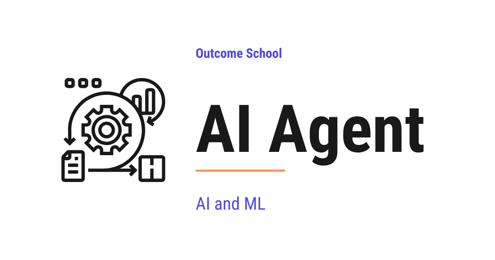

# What is an AI Agent? How It Works

> Archived from <https://outcomeschool.com/blog/ai-agent> on 2026-11-25.

An AI Agent is a system where an LLM takes a goal from us, decides the steps, uses tools, and keeps working until the goal is done.

In this blog, we will learn about the AI Agent. We will also see how it is different from a plain LLM, its five core parts, how it works end to end, the main types, and when to use one.

We will cover the following:
<ul><li>The Big Picture</li><li>What is an AI Agent?</li><li>AI Agent vs Plain LLM vs Chatbot</li><li>The Five Core Parts</li><li>How an AI Agent Works End to End</li><li>A Concrete Example: Research Agent</li><li>Types of AI Agents</li><li>What AI Agents Can Do Today</li><li>When to Use an AI Agent</li><li>Common Failure Modes</li><li>Quick Summary</li></ul>
I am <strong>Amit Shekhar</strong>, Founder @ <a target="_blank" rel="noopener noreferrer" href="https://outcomeschool.com">Outcome School</a>, I have taught and mentored many developers, and their efforts landed them high-paying tech jobs, helped many tech companies in solving their unique problems, and created many open-source libraries being used by top companies. I am passionate about sharing knowledge through open-source, blogs, and videos.

I teach <a target="_blank" rel="noopener noreferrer" href="https://outcomeschool.com/program/ai-and-machine-learning">AI and Machine Learning</a> at Outcome School.

Let&#x27;s get started.
<h2 id="the-big-picture">The Big Picture</h2>
Before we go into the details, let&#x27;s understand the big picture.

An <strong>AI Agent</strong> is a system that can take a goal from us, figure out the steps to achieve it, use tools when needed, and keep working until the goal is done. It is not just an <a target="_blank" rel="noopener noreferrer" href="large-language-model-llm.md">LLM</a> that answers one question. It is an LLM wrapped in <a target="_blank" rel="noopener noreferrer" href="ai-agent-loop.md">a loop</a>, with tools and memory, so it can actually get things done.

In simple words:

<strong>AI Agent = An LLM + Instructions + Tools + Memory + A loop that runs until the goal is achieved.</strong>

Think of an AI Agent like a new intern on their first day. They do not do the whole job in one go. They read the task, think about what to do first, use a tool (open a file, send a message, run a query), check the result, and decide the next step. They repeat this until the job is done. An AI Agent does the same thing - just faster and without breaks. Same shape of work. Different speed.
<h2 id="what-is-an-ai-agent">What is an AI Agent?</h2>
<strong>An AI Agent is a software system that uses an LLM to decide what to do, takes actions using tools, and keeps working in a loop until the goal is achieved.</strong>

Now that we have the big picture, let&#x27;s decompose the term itself.

<strong>AI Agent = AI + Agent</strong>

<strong>AI</strong> means the reasoning engine - almost always an LLM like Claude, GPT, or Gemini. <strong>Agent</strong> means something that can act on its own - that can perceive the world, decide what to do, and take actions to reach a goal.

Put these two together, and we get a software system where the <strong>LLM is the decision-maker</strong>. It does not just generate text. It decides what action to take, picks the right tool, reads the result that the loop feeds back, and plans the next move. A plain LLM gives us one answer and stops. An AI Agent keeps going - thinking, acting, observing, and thinking again - until the goal is reached.

So, here the AI Agent comes into the picture whenever a task is too big to solve in a single LLM call.
<h2 id="ai-agent-vs-plain-llm-vs-chatbot">AI Agent vs Plain LLM vs Chatbot</h2>
There is a lot of confusion between these three. Let&#x27;s clear it up.

<strong>Plain LLM.</strong> One request, one response. We send a prompt, we get text back. Nothing else happens.

<strong>Chatbot.</strong> A plain LLM with a memory of the current conversation. We can chat back and forth. In its classic form, each response is just text. It does not take real-world actions on its own.

<strong>AI Agent.</strong> A chatbot that can also use tools and run in a loop to complete tasks - or an LLM running in the background with the same setup, no chat surface needed. The defining property is tool use plus the loop, not the chat UI. It does not just talk - it can search the web, run code, send emails, update databases, and anything else we give it access to.

In simple words:

<strong>Plain LLM talks once. Chatbot talks many times. AI Agent talks AND acts, many times, until the task is done.</strong>

<strong>Note:</strong> Today, the line between a chatbot and an agent is blurring - once a chatbot gains tools and a loop, it becomes an agent. Products like ChatGPT and Claude.ai have already crossed that line.

That one difference - the ability to take actions and run in a loop - is what separates an AI Agent from a plain LLM or a classic chatbot.

<strong>Planning your move into AI?</strong>

No matter which tech domain you work in today, with your effort, you can transition to these roles:
<ul><li>AI Engineer</li><li>Forward Deployed Engineer</li><li>AI Agent Engineer</li><li>Harness Engineer</li><li>Voice AI Engineer</li><li>AI Architect</li><li>LLM Engineer</li><li>LLM Inference Engineer</li><li>Gen AI Engineer</li><li>MLOps Engineer</li><li>ML Engineer</li><li>Deep Learning Engineer</li></ul>
Our <a target="_blank" rel="noopener noreferrer" href="https://outcomeschool.com/program/ai-and-machine-learning">AI and Machine Learning Program</a> at Outcome School takes you there.
<h2 id="the-five-core-parts">The Five Core Parts</h2>
Now, let&#x27;s zoom in. Every AI Agent, no matter how complex, has the same five core parts. Let&#x27;s decode each one.

<pre><code class="code-highlight">+------------------------------------------------+
|                      Loop                      |
|                                                |
|   Instructions ---&gt;  +-------+                 |
|                      |       |                 |
|   Memory       ---&gt;  |  LLM  | &lt;-----+         |
|                      +-------+       |         |
|                          |           |         |
|                          | pick      | result  |
|                          v           |         |
|                      +-------+       |         |
|                      | Tools | ------+         |
|                      +-------+                 |
+------------------------------------------------+
</code></pre>

<strong>1. The LLM (the brain).</strong> This is the reasoning engine. It reads the current situation and decides the next action - either pick a tool for the loop to call, or return a final answer. Every meaningful decision in the agent goes through the LLM. The LLM does not call tools itself - it only recommends which tool to use and what inputs to pass. The loop is the one that actually calls the tool.

<strong>2. The Instructions (the <a target="_blank" rel="noopener noreferrer" href="system-prompt.md">system prompt</a>).</strong> This tells the LLM what its job is, what tools it has, and what rules to follow. Without good instructions, the agent is confused. With good instructions, the agent knows exactly what to do. Long procedures do not have to sit here permanently either - <a target="_blank" rel="noopener noreferrer" href="what-are-agent-skills.md">Agent Skills</a> keep each one in its own folder, and the agent loads it only when the task needs it.

<strong>3. The Tools (the hands).</strong> These are the actions the agent can take - search, calculate, read files, call APIs, send emails, run code. Each tool has a <strong>name</strong>, a <strong>description</strong>, and an <strong>input schema</strong>.

Here is what a tool definition looks like in practice, as below:

<pre><code class="code-highlight language-json">{
  &quot;name&quot;: &quot;web_search&quot;,
  &quot;description&quot;: &quot;Search the web for pages matching the query. Use this tool when the user asks for current information, news, or anything not available in the model&#x27;s training data.&quot;,
  &quot;input_schema&quot;: {
    &quot;type&quot;: &quot;object&quot;,
    &quot;properties&quot;: {
      &quot;query&quot;: {
        &quot;type&quot;: &quot;string&quot;,
        &quot;description&quot;: &quot;The search query to run.&quot;
      },
      &quot;max_results&quot;: {
        &quot;type&quot;: &quot;integer&quot;,
        &quot;description&quot;: &quot;Maximum number of results to return. Default is 5.&quot;
      }
    },
    &quot;required&quot;: [&quot;query&quot;]
  }
}
</code></pre>

Here, the LLM reads the <code>name</code> to identify the tool, the <code>description</code> to decide <strong>when</strong> to use it, and the <code>input_schema</code> to know <strong>what arguments</strong> to pass and in what format. The <code>description</code> is the most important field - every word matters, because this is what the LLM uses to pick between tools. A vague description leads to the wrong tool being picked. A precise description leads to the right one.

These tool definitions do not have to be hand-written for every application either. An open standard called MCP lets a server describe its own tools, so an agent can discover them the moment it connects. We have a detailed blog on <a target="_blank" rel="noopener noreferrer" href="what-is-mcp-model-context-protocol.md">What is MCP (Model Context Protocol)?</a> that covers this end to end.

<strong>4. The <a target="_blank" rel="noopener noreferrer" href="ai-agent-memory.md">Memory</a>.</strong> This is what lets the agent keep track of progress and avoid repeating work. There are two kinds. <strong>Short-term memory</strong> is the conversation history of the current run - every prompt, <a target="_blank" rel="noopener noreferrer" href="how-does-function-calling-work-in-llms.md">tool call</a>, and observation so far. It lives in the runtime, and the full history is fed back to the LLM on every call, because the LLM itself is stateless. <strong>Long-term memory</strong> is anything we want the agent to remember across runs - user preferences, past decisions, learned facts. It lives in an external store like a <a target="_blank" rel="noopener noreferrer" href="how-does-a-vector-database-work.md">vector database</a> or a user profile, and the agent retrieves from it when needed.

<strong>5. The Loop (the runtime).</strong> This is the code that keeps the agent going. Send prompt to LLM. Read the LLM&#x27;s response. If the LLM picked a tool, run that tool. Feed the result back. Repeat until the LLM says &quot;done.&quot; The loop is what makes it an agent, not just a chatbot. The loop is also where tool calls actually happen - the LLM only decides which tool to use. Shaping this loop on purpose - the step budget, the checks, and the exits - is <a target="_blank" rel="noopener noreferrer" href="what-is-loop-engineering.md">Loop Engineering</a>.

Going back to our intern analogy - the LLM is the intern&#x27;s brain, the Instructions are the job description the manager handed over, the Tools are the laptop and email and office systems they can use, the Memory is the notebook where they track progress, and the Loop is the workday itself that keeps them going from one task to the next.

All five parts work together. Remove any one, and it is no longer an AI Agent. Hence, every real AI Agent, from a simple chatbot-with-tools to an autonomous coding assistant, has all five.

To master AI Agents, tool use, agent memory, and agent architecture in depth, check out our <a target="_blank" rel="noopener noreferrer" href="https://outcomeschool.com/program/ai-and-machine-learning">AI and Machine Learning Program</a> at Outcome School.
<h2 id="how-an-ai-agent-works-end-to-end">How an AI Agent Works End to End</h2>
Now, let&#x27;s put all the parts together to see how an AI Agent actually runs.

Here is the shape of the loop:

<pre><code class="code-highlight">   +----------------+
   |  User&#x27;s Goal   |
   +----------------+
            |
            v
   +----------------+        +-------------+
   |      LLM       |-------&gt;|    Tool     |
   |  (decides:     |        +-------------+
   |   pick a tool  |              |
   |   or return    |              v
   |   final answer)|        +-------------+
   |                |&lt;-------| Observation |
   +----------------+        +-------------+
            |
            | when goal is achieved
            v
   +----------------+
   |  Final Answer  |
   +----------------+
</code></pre>

The goal comes in at the top. The LLM looks at it and decides one of two things - which tool the loop should call next, or the final answer directly. When the LLM picks a tool, the loop runs it and produces an observation, which is fed back to the LLM. The LLM then decides again. This little loop between the LLM, the Tool, and the Observation keeps running until the LLM decides the goal is achieved and returns the final answer.

Here is what happens on every request:

<strong>Step 1:</strong> The user gives the agent a goal - for example, &quot;Find me the 3 cheapest direct flights to Delhi tomorrow under 8000 rupees.&quot;

<strong>Step 2:</strong> The Loop sends the goal, the instructions, and any memory to the LLM.

<strong>Step 3:</strong> The LLM thinks and decides the next action. For example, &quot;First I need to search for flights.&quot;

<strong>Step 4:</strong> The Loop runs the tool the LLM asked for (the flight search tool).

<strong>Step 5:</strong> The tool returns a result. The Loop feeds it back to the LLM as an observation.

<strong>Step 6:</strong> The LLM reads the observation and decides the next action. Maybe filter by price. Maybe pick the top 3 cheapest.

<strong>Step 7:</strong> The Loop runs the next tool. The cycle repeats.

<strong>Step 8:</strong> When the LLM decides the goal is achieved, it returns a final answer to the user - &quot;Done. Here are the 3 cheapest direct flights - AI-123 at 6500 rupees, IX-201 at 7200 rupees, and SG-312 at 7800 rupees.&quot;

<strong>Note:</strong> Modern LLMs like Claude and GPT can output multiple tool calls in a single step, and a real runtime can run them in parallel to save time. The shape of the loop stays the same - the LLM decides, the tools run, the observations feed back - just with more than one action per turn when the LLM chooses to.

The whole thing is a loop. The LLM is the decision-maker. The tools are the hands. The memory holds the progress. The loop keeps it all going.

That&#x27;s the beauty of an AI Agent. Every decision comes from the LLM. Every action is executed by the tools. The loop keeps them going together until the job is done. The flow is not hardcoded - the agent figures it out as it goes.

<strong>A quick note for you</strong>

No matter which tech domain you work in, get familiar with these topics:
<ul><li>LLM</li><li>RAG</li><li>MCP</li><li>Agent</li><li>Fine-tuning</li><li>Quantization</li></ul>
We put it all together in one video:

<a target="_blank" rel="noopener noreferrer" href="https://www.youtube.com/watch?v=lnfWvX66FUk">AI Engineering Explained: LLM, RAG, MCP, Agent, Fine-Tuning, and Quantization</a>

No need to stop reading - bookmark it and watch later when you get time. Future you will thank you.

Now, let&#x27;s get back to the topic.
<h2 id="a-concrete-example-research-agent">A Concrete Example: Research Agent</h2>
The best way to learn this is by taking an example.

Suppose we tell an agent: &quot;Research the best laptop for video editing under $1500.&quot;

This is a Research Agent. Let&#x27;s see what it does behind the scenes.

The agent uses these tools:
<ul><li>A web search tool - to find pages about laptops and software</li><li>A web page reader - to read reviews, specs, and prices</li><li>A calculator - to compare numbers like RAM, storage, and price</li></ul>
The agent makes decisions:
<ul><li>Which laptops to investigate</li><li>What factors matter most - RAM, GPU, storage</li><li>Which sources are trustworthy</li></ul>
The agent takes multiple actions:
<ul><li>Searches for &quot;best video editing laptops 2026&quot; (the LLM decides to start with a broad search)</li><li>Reads the top results (the LLM picks which pages are worth opening)</li><li>Compares the specs of 5 laptops (the LLM extracts the factors that matter)</li><li>Checks prices on Amazon (the LLM verifies the budget constraint)</li><li>Reads user reviews (the LLM weighs real-world quality signals)</li><li>Creates a summary with pros and cons (the LLM drafts the shortlist)</li><li>Returns the top 3 recommendations with reasons (the LLM produces the final answer)</li></ul>
Here, the LLM is the decision-maker. The tools are the hands. The loop keeps it running until the final report is ready. Same five parts we decoded earlier, just wired for a real task.

Now, here is the important realization:

<strong>If we write code that takes the input, sends it to an LLM, executes the actions, and repeats this loop until the task is complete - our piece of code is an AI Agent.</strong>

That is all an AI Agent is. No magic. No black box. Just a loop, an LLM, some tools, and memory - all wired together in code.

Let&#x27;s see what this looks like in real Python code, as below. Here, <code>call_llm</code> is any function that sends the messages and the list of tools to the LLM of our choice - Claude, GPT, Gemini, or any other - and returns its response. And <code>call_tool</code> is any function that runs a tool by name with the given arguments and returns the result. The code below is independent of any specific provider.

<pre><code class="code-highlight language-python">async def run_agent(user_goal, tools, max_steps=10):
    messages = [{&quot;role&quot;: &quot;user&quot;, &quot;content&quot;: user_goal}]
    step = 0

    while True:
        # Safety stop: bail out if we hit the step limit
        if step &gt;= max_steps:
            return &quot;Reached step limit without completing the task.&quot;
        step += 1

        # Ask the LLM what to do next
        response = await call_llm(messages, tools)

        # If the LLM says &quot;I am done&quot;, stop the loop and return the final answer
        if response.is_done:
            return response.final_answer

        # Otherwise, run each tool the LLM picked and feed the result back
        for tool_call in response.tool_calls:
            result = await call_tool(tool_call.name, tool_call.arguments)
            messages.append({
                &quot;role&quot;: &quot;tool&quot;,
                &quot;name&quot;: tool_call.name,
                &quot;content&quot;: str(result),
            })
</code></pre>

Here, we have the entire AI Agent in about 20 lines of Python. Let&#x27;s walk through the important parts:
<ul><li><strong>The <code>while True</code> loop.</strong> This is the runtime of the agent. It keeps going until either the LLM says it is done or we hit the step limit.</li><li><strong>The step limit.</strong> We bail out after <code>max_steps</code> iterations. This protects us from infinite loops - one of the most common failure modes.</li><li><strong>The LLM call.</strong> We send the full conversation history along with the list of tools. The <code>await</code> is what makes this asynchronous - while the LLM is thinking, our program can do other work.</li><li><strong>The stop check.</strong> If <code>response.is_done</code> is <code>True</code>, the LLM is telling us <strong>&quot;I am done, here is the final answer.&quot;</strong> We return that answer and exit the loop.</li><li><strong>The tool-call branch.</strong> If the LLM picked one or more tools, we run each one with <code>call_tool</code> using the arguments the LLM gave, and feed the result back to the LLM on the next turn.</li></ul>
That is the complete skeleton of an AI Agent - a <code>while</code> loop, an LLM call inside it, a check for the stop signal, and a tool-call branch that feeds results back. Everything else we add on top - memory, parallel tool calls, retries, logging - is polish around this core loop.

If we want to build an AI Coding Agent from scratch, we have a complete program on this - check out our <a target="_blank" rel="noopener noreferrer" href="https://outcomeschool.com/program/ai-and-machine-learning">AI and Machine Learning Program</a> at Outcome School.
<h2 id="types-of-ai-agents">Types of AI Agents</h2>
Not all AI Agents look the same. Here are the main types we will see in practice. Each one is the same five core parts, just wired a little differently.

<strong><a target="_blank" rel="noopener noreferrer" href="react-agent.md">ReAct Agent</a>.</strong> The agent alternates between Thought, Action, and Observation at every step. The most common pattern.

<strong><a target="_blank" rel="noopener noreferrer" href="plan-and-execute-agent.md">Plan-and-Execute Agent</a>.</strong> The agent first creates a complete plan, then executes each step one by one. Good for long tasks.

<strong><a target="_blank" rel="noopener noreferrer" href="reflection-agent.md">Reflection Agent</a>.</strong> The agent writes a draft, critiques its own work, and revises. Good when quality matters more than speed.

<strong><a target="_blank" rel="noopener noreferrer" href="agentic-rag.md">Agentic RAG</a>.</strong> The agent decides when and how to retrieve documents, then uses them to answer. Good for knowledge-heavy tasks.

<strong><a target="_blank" rel="noopener noreferrer" href="multi-agent-systems.md">Multi-Agent System</a>.</strong> Several agents with different roles work together. One researches, another writes, another reviews.

<strong>Note:</strong> These are not mutually exclusive. A real system often combines patterns - for example, a ReAct agent that uses Agentic RAG for knowledge lookups, with a Reflection step at the end for quality.

To learn the ReAct Pattern, RAG, Multi-Agent Systems, and the full Agent Architecture, check out our <a target="_blank" rel="noopener noreferrer" href="https://outcomeschool.com/program/ai-and-machine-learning">AI and Machine Learning Program</a> at Outcome School.
<h2 id="what-ai-agents-can-do-today">What AI Agents Can Do Today</h2>
Let&#x27;s look at some real things AI Agents are doing right now. This is not theory - these are in production.

<strong>Coding agents.</strong> Read a repository, understand the code, make changes, run tests, and submit a pull request. Examples: <a target="_blank" rel="noopener noreferrer" href="how-does-claude-code-work.md">Claude Code</a>, <a target="_blank" rel="noopener noreferrer" href="how-does-cursor-work.md">Cursor</a>, GitHub Copilot agent mode.

<strong>Research agents.</strong> Search the web, read papers, synthesize findings, and produce a structured report. Examples: OpenAI Deep Research, Perplexity, Gemini Deep Research.

<strong>Customer support agents.</strong> Read a ticket, look up the user&#x27;s account, check order status, and reply with a fix - with <a target="_blank" rel="noopener noreferrer" href="human-in-the-loop-agents.md">handoff to a human</a> when needed.

<strong><a target="_blank" rel="noopener noreferrer" href="how-do-browser-agents-work.md">Browser agents</a>.</strong> Open a browser, navigate websites, fill forms, and complete tasks like booking or purchasing. Examples: Claude Code (<a target="_blank" rel="noopener noreferrer" href="how-do-computer-use-agents-work.md">Computer Use</a> is now in Claude Code), ChatGPT Agent.

<strong>Data analysis agents.</strong> Query databases, run calculations, create charts, and summarize the findings. Examples: ChatGPT data analysis, Claude&#x27;s code execution. These agents also need to know what our tables actually mean, otherwise they guess, and OKF is an open standard for writing that knowledge down in files an agent can read. We have a detailed blog on <a target="_blank" rel="noopener noreferrer" href="what-is-okf-open-knowledge-format.md">What is OKF (Open Knowledge Format)?</a> that explains this in depth.

<strong>Personal assistants.</strong> Manage calendar, read and draft emails, search files, and complete multi-step tasks on the user&#x27;s behalf. Examples: Apple Intelligence, Google Gemini assistant.

Every one of these is the same five-part structure. Only the tools and instructions change. Once we understand the five parts, we understand all AI Agents.

<strong>Stay updated:</strong> Subscribe to our <a target="_blank" rel="noopener noreferrer" href="https://outcomeschool.substack.com/subscribe">newsletter</a> to get our latest AI and Machine Learning blogs straight to your inbox.
<h2 id="when-to-use-an-ai-agent">When to Use an AI Agent</h2>
Now, a natural question arises - when should we actually build an AI Agent, and when is a simpler tool the better choice?

<strong>Use an AI Agent when:</strong>
<ul><li>The task needs more than one step to complete.</li><li>The next step depends on the result of the current step.</li><li>The task needs external information or real-world actions (not just knowledge from the model).</li><li>The path is not fixed - the agent has to decide what to do as it goes.</li></ul>
<strong>Do not use an AI Agent when:</strong>
<ul><li>A single LLM call can solve the task (like summarizing a paragraph).</li><li>The task is a fixed pipeline with no branching - a regular script is simpler.</li><li>Latency and cost matter more than flexibility, and the task is simple.</li><li>We cannot tolerate the non-determinism that comes with LLM decisions.</li></ul>
The rule of thumb is simple: if the task needs decisions and actions that depend on each other, an AI Agent is the right tool. If not, stick with a plain LLM call or a script. Using an agent when a script would do is over-engineering.
<h2 id="common-failure-modes">Common Failure Modes</h2>
AI Agents are powerful, but they fail in specific ways. Knowing these failures helps us build more reliable agents. Let&#x27;s decode each one.

<strong>1. Infinite loops.</strong> The agent keeps calling the same tool and never produces a final answer.

<strong>How to fix:</strong> Set a hard limit on the number of steps.

<strong>2. Wrong tool selection.</strong> The agent picks the wrong tool for the job.

<strong>How to fix:</strong> Write very clear tool descriptions. Every word in the description matters.

<strong>3. Hallucinated actions.</strong> The LLM picks a tool that does not exist or passes invalid arguments.

<strong>How to fix:</strong> Use native tool-use support from the LLM, and validate inputs in the loop before running the tool. Return a clear error as an observation if the input is invalid so the agent can self-correct.

<strong>4. Context overflow.</strong> The conversation history grows too large and no longer fits in the model&#x27;s <a target="_blank" rel="noopener noreferrer" href="context-window.md">context window</a>.

<strong>How to fix:</strong> <a target="_blank" rel="noopener noreferrer" href="how-does-context-compaction-work.md">Summarize older steps</a> or drop stale observations, and keep the goal at the start and the newest steps at the end so that nothing important gets <a target="_blank" rel="noopener noreferrer" href="lost-in-the-middle-problem-in-llms.md">lost in the middle</a>.

<strong>5. Premature stopping.</strong> The agent gives up before finishing the task.

<strong>How to fix:</strong> Make the instructions clear about when the task is truly complete.

<strong>Very important:</strong> Production-grade AI Agents are mostly about handling these failure modes well. The happy path is easy. The edge cases are where the real engineering happens. We have a detailed blog on <a target="_blank" rel="noopener noreferrer" href="ai-agent-evaluation.md">AI Agent Evaluation</a> that explains how to systematically measure outcome, trajectory, and tool use for AI Agents.

Now, we have understood what an AI Agent is, how it works, and when to use one. Let&#x27;s wrap up with a quick recap.
<h2 id="quick-summary">Quick Summary</h2>
Let&#x27;s recap what we have decoded:
<ul><li><strong>AI Agent = LLM + Instructions + Tools + Memory + Loop.</strong> The LLM is the decision-maker. The tools are the hands. The loop keeps it going until the goal is done.</li><li><strong>Not just a chatbot.</strong> An AI Agent talks AND acts. It takes real actions, not just produces text.</li><li><strong>Five core parts.</strong> LLM, Instructions, Tools, Memory, Loop. Remove any one, and it is no longer an AI Agent.</li><li><strong>End-to-end flow.</strong> The loop sends the prompt to the LLM -&gt; if the LLM picks a tool, the loop runs it and feeds the result back -&gt; if the LLM returns a final answer, the loop stops. Repeat until done.</li><li><strong>Types.</strong> ReAct, Plan-and-Execute, Reflection, Agentic RAG, and Multi-Agent Systems. Real systems often combine them.</li><li><strong>Use cases today.</strong> Coding, research, customer support, browsing, data analysis, personal assistance. Same five-part structure everywhere.</li><li><strong>When to use one.</strong> The task needs multiple steps, tool use, and adaptive decisions. Otherwise, stick with a plain LLM call or a script.</li><li><strong>Failure modes.</strong> Infinite loops, wrong tool selection, hallucinated actions, context overflow, premature stopping. Handling these is the real work.</li></ul>
AI Agents bring dynamic, goal-driven control flow into mainstream software - the program decides its own next step instead of following a fixed script. That is what makes them powerful, and what makes them hard. Every serious AI application going forward is moving in this direction.
<h2 id="frequently-asked-questions">Frequently Asked Questions</h2><h3 id="is-chatgpt-an-ai-agent">Is ChatGPT an AI Agent?</h3>
Yes, in its current form. The line between a chatbot and an agent is blurring, because once a chatbot gains tools and a loop, it becomes an agent. Products like ChatGPT and Claude.ai have already crossed that line.
<h3 id="does-an-ai-agent-need-a-chat-interface">Does an AI Agent need a chat interface?</h3>
No. The defining property of an AI Agent is tool use plus the loop, not the chat UI. An LLM running in the background with the same setup of instructions, tools, memory, and a loop is also an AI Agent, with no chat surface needed.
<h3 id="which-part-of-a-tool-definition-matters-most-for-an-ai-agent">Which part of a tool definition matters most for an AI Agent?</h3>
The description matters most. The LLM reads the name to identify the tool, the description to decide when to use it, and the input schema to know what arguments to pass. A vague description leads to the wrong tool being picked, while a precise one leads to the right tool.
<h3 id="can-we-combine-different-types-of-ai-agents-in-one-system">Can we combine different types of AI Agents in one system?</h3>
Yes. The agent types are not mutually exclusive. A real system often combines patterns, for example a ReAct agent that uses Agentic RAG for knowledge lookups, with a Reflection step at the end for quality.
<h3 id="what-should-an-ai-agent-do-when-the-llm-passes-invalid-tool-arguments">What should an AI Agent do when the LLM passes invalid tool arguments?</h3>
The loop should validate the inputs before running the tool. If the input is invalid, it returns a clear error as an observation so the agent can self-correct. Using native tool-use support from the LLM also helps avoid these hallucinated actions.

That&#x27;s it for now.

Thanks

<strong>Amit Shekhar</strong> Founder @ <a target="_blank" rel="noopener noreferrer" href="https://outcomeschool.com">Outcome School</a>

You can connect with me on:
<ul><li><a target="_blank" rel="noopener noreferrer" href="https://x.com/amitiitbhu">X</a></li><li><a target="_blank" rel="noopener noreferrer" href="https://www.linkedin.com/in/amit-shekhar-iitbhu">LinkedIn</a></li><li><a target="_blank" rel="noopener noreferrer" href="https://github.com/amitshekhariitbhu">GitHub</a></li></ul>
Follow Outcome School on:
<ul><li><a target="_blank" rel="noopener noreferrer" href="https://x.com/outcome_school">X</a></li><li><a target="_blank" rel="noopener noreferrer" href="https://youtube.com/@OutcomeSchool">YouTube</a></li><li><a target="_blank" rel="noopener noreferrer" href="https://www.linkedin.com/company/outcomeschool">LinkedIn</a></li><li><a target="_blank" rel="noopener noreferrer" href="https://github.com/OutcomeSchool">GitHub</a></li></ul>
<a target="_blank" rel="noopener noreferrer" href="https://outcomeschool.com/blog"><strong>Read all of our high-quality blogs here.</strong></a>

