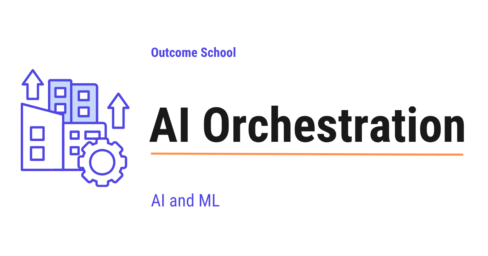

# What is AI Orchestration? How It Works and the Common Patterns

> Archived from <https://outcomeschool.com/blog/ai-orchestration> on 2026-11-25.

AI Orchestration is the process of coordinating many AI parts, like LLMs, tools, data sources, and agents, so that they work together to finish a complex task.

In this blog, we will learn about AI Orchestration. We will understand what it is, why we need it, how it is different from <a target="_blank" rel="noopener noreferrer" href="ai-agent.md">AI Agents</a>, and the common patterns we use to coordinate multiple LLMs, tools, and steps together to build real AI products.

We will cover the following:
<ul><li>What is AI Orchestration?</li><li>Why do we need AI Orchestration?</li><li>AI Orchestration vs AI Agents</li><li>Components of AI Orchestration</li><li>How AI Orchestration works</li><li>Patterns of AI Orchestration</li><li>Sequential Pattern</li><li>Parallel Pattern</li><li>Conditional Pattern</li><li>Loop Pattern</li><li>Orchestrator-Worker Pattern</li><li>Tools for AI Orchestration</li><li>Challenges in AI Orchestration</li><li>Best Practices</li></ul>
I am <strong>Amit Shekhar</strong>, Founder @ <a target="_blank" rel="noopener noreferrer" href="https://outcomeschool.com">Outcome School</a>, I have taught and mentored many developers, and their efforts landed them high-paying tech jobs, helped many tech companies in solving their unique problems, and created many open-source libraries being used by top companies. I am passionate about sharing knowledge through open-source, blogs, and videos.

I teach <a target="_blank" rel="noopener noreferrer" href="https://outcomeschool.com/program/ai-and-machine-learning">AI and Machine Learning</a> at Outcome School.

Let&#x27;s get started.
<h2 id="what-is-ai-orchestration">What is AI Orchestration?</h2>
<strong>AI Orchestration is the process of coordinating multiple AI components, such as LLMs, tools, data sources, and agents, to work together to finish a complex task.</strong>

In simple words, a single LLM call is not enough for most real-world tasks. We often need many LLM calls, many <a target="_blank" rel="noopener noreferrer" href="how-does-function-calling-work-in-llms.md">tool calls</a>, and many steps that depend on each other. AI Orchestration is the layer that decides which component runs, in what order, with what input, and what to do with the output.

Let&#x27;s say we have built an app that takes a user&#x27;s question, searches our company documents, summarizes the top results, generates a final answer, and then translates it into the user&#x27;s language. This is not one LLM call. This is many steps, and each step depends on the previous one. The system that coordinates all these steps is the AI Orchestration layer.

Think of it like a conductor in an orchestra. There are many musicians, each playing a different instrument. The conductor decides who plays when, who plays louder, and who stops. Without the conductor, the music will be a mess. In the same way, without AI Orchestration, our AI system will be a mess. So, here comes AI Orchestration to the rescue.
<h2 id="why-do-we-need-ai-orchestration">Why do we need AI Orchestration?</h2>
A single LLM call can answer simple questions. But, real products are not that simple. In a real product, we have many models, many tools, many data sources, and many steps. We need a way to connect all of these in a clean and reliable way.

Here are the main reasons we need AI Orchestration:
<ul><li>To break a complex task into many small steps that are easy to manage.</li><li>To pick the right model or tool for each step. A small model for easy steps, a big model for hard steps.</li><li>To pass the output of one step as the input of the next step in a clean way.</li><li>To run independent steps in parallel and save time.</li><li>To handle errors and retries when a step fails.</li><li>To add guardrails, logging, and monitoring at every step.</li><li>To control cost and latency by avoiding unnecessary model calls.</li><li>To make the whole system easy to test, debug, and improve.</li></ul>
Without AI Orchestration, we end up with messy code that nobody can maintain. With AI Orchestration, our AI system becomes clean, reliable, and ready for production.
<h2 id="ai-orchestration-vs-ai-agents">AI Orchestration vs AI Agents</h2>
This is an important question. Many people think AI Orchestration and AI Agents are the same. But they are not.

In AI Orchestration, the developer defines the steps and the flow. The system follows a fixed plan that the developer wrote. The LLM does the work inside the steps, but it does not decide the flow.

In AI Agents, the LLM itself decides what to do next. The agent picks the tools, picks the order, and decides when to stop. The flow is dynamic and depends on the LLM&#x27;s choices at runtime.

Let me tabulate the differences between AI Orchestration and AI Agents for your better understanding.
<table><thead><tr><th>Aspect</th><th>AI Orchestration</th><th>AI Agents</th></tr></thead><tbody><tr><td>Who controls the flow</td><td>The developer</td><td>The LLM</td></tr><tr><td>Flow type</td><td>Fixed, defined upfront</td><td>Dynamic, decided at runtime</td></tr><tr><td>Predictability</td><td>High</td><td>Low</td></tr><tr><td>Best for</td><td>Known workflows</td><td>Open-ended tasks</td></tr><tr><td>Cost control</td><td>Easier</td><td>Harder</td></tr><tr><td>Debugging</td><td>Easier</td><td>Harder</td></tr></tbody></table>
In real systems, we often use both together. We use AI Orchestration for the high-level flow, and AI Agents inside one of the steps when the task is open-ended. This is how AI Orchestration is different from AI Agents.

To learn AI Agent, Agentic AI, and Orchestration and Routing, we have a complete program on this - check out our <a target="_blank" rel="noopener noreferrer" href="https://outcomeschool.com/program/ai-and-machine-learning">AI and Machine Learning Program</a> at Outcome School.
<h2 id="components-of-ai-orchestration">Components of AI Orchestration</h2>
Before we learn how AI Orchestration works, we must know the main components that we orchestrate.
<ul><li><strong>LLMs</strong> - The language models that do the thinking, writing, and decision-making.</li><li><strong>Prompts</strong> - The instructions we give to the LLMs at each step.</li><li><strong>Tools</strong> - Functions that the system can call, like a search API, a database query, or a calculator.</li><li><strong>Memory</strong> - The place where we store past messages, results, and state across steps.</li><li><strong>Data Sources</strong> - <a target="_blank" rel="noopener noreferrer" href="how-does-a-vector-database-work.md">Vector databases</a>, knowledge bases, files, and APIs that give us information.</li><li><a target="_blank" rel="noopener noreferrer" href="how-do-llm-guardrails-work.md"><strong>Guardrails</strong></a> - Safety checks that block bad inputs and bad outputs.</li><li><strong>Routers</strong> - Logic that picks which step or which model to use next.</li><li><strong>Workflows</strong> - The <a target="_blank" rel="noopener noreferrer" href="what-is-graph-engineering.md">graph of steps</a> that defines how everything connects together.</li></ul>
These are the building blocks. AI Orchestration is the art of putting them together in the right way.

<strong>Planning your move into AI?</strong>

No matter which tech domain you work in today, with your effort, you can transition to these roles:
<ul><li>AI Engineer</li><li>Forward Deployed Engineer</li><li>AI Agent Engineer</li><li>Harness Engineer</li><li>Voice AI Engineer</li><li>AI Architect</li><li>LLM Engineer</li><li>LLM Inference Engineer</li><li>Gen AI Engineer</li><li>MLOps Engineer</li><li>ML Engineer</li><li>Deep Learning Engineer</li></ul>
Our <a target="_blank" rel="noopener noreferrer" href="https://outcomeschool.com/program/ai-and-machine-learning">AI and Machine Learning Program</a> at Outcome School takes you there.
<h2 id="how-ai-orchestration-works">How AI Orchestration works</h2>
Now, let&#x27;s understand how AI Orchestration actually works at a high level. The steps are:
<ul><li><strong>Step 1:</strong> The user sends a request to the system.</li><li><strong>Step 2:</strong> The orchestrator reads the request and picks the first step in the workflow.</li><li><strong>Step 3:</strong> The first step runs. It can call an LLM, a tool, or a data source.</li><li><strong>Step 4:</strong> The orchestrator stores the output of the first step in the shared memory.</li><li><strong>Step 5:</strong> The orchestrator picks the next step based on the workflow definition and the current state.</li><li><strong>Step 6:</strong> The next step runs and produces its output.</li><li><strong>Step 7:</strong> The orchestrator keeps running steps until the workflow reaches its end.</li><li><strong>Step 8:</strong> The orchestrator sends the final output back to the user.</li></ul>
At every step, the orchestrator can also log the input and output, check guardrails, retry on failure, and route to a different path based on the result. This is the power of AI Orchestration. It gives us full control over a complex AI system.

Now, it&#x27;s time to learn the common patterns of AI Orchestration.
<h2 id="patterns-of-ai-orchestration">Patterns of AI Orchestration</h2>
There are five main patterns that we use again and again in AI Orchestration. Do not worry, we will learn about each of them in detail.
<ul><li><strong>Sequential Pattern</strong> - Steps run one after another.</li><li><strong>Parallel Pattern</strong> - Many steps run at the same time.</li><li><strong>Conditional Pattern</strong> - The next step depends on the output of the previous step.</li><li><strong>Loop Pattern</strong> - A step or a group of steps runs again and again until a condition is met.</li><li><strong>Orchestrator-Worker Pattern</strong> - A main orchestrator splits work and gives it to many workers.</li></ul>
In real projects, we combine many of these patterns inside the same workflow. Now, let&#x27;s discuss each one.
<h2 id="sequential-pattern">Sequential Pattern</h2>
<strong>Sequential Pattern means the steps run one after another, in a fixed order, like a chain.</strong>

The best way to learn this is by taking an example. Let&#x27;s say we are building a system that turns a long meeting transcript into clean meeting notes. The steps are:
<ul><li>Step 1: Take the meeting transcript from the user.</li><li>Step 2: Use an LLM to summarize the meeting.</li><li>Step 3: Use an LLM to extract the action items from the summary.</li><li>Step 4: Use an LLM to format the final notes in a clean structure.</li><li>Step 5: Return the final notes to the user.</li></ul>
Here, each step depends on the previous one. We cannot extract the action items before the summary is ready. We cannot format the final notes before the action items are extracted. So, the sequential pattern is the right fit.

When each of these steps is an LLM prompt whose output feeds the next, this sequential pattern is exactly <a target="_blank" rel="noopener noreferrer" href="how-does-prompt-chaining-work.md">Prompt Chaining</a>.

<strong>Advantage:</strong>
<ul><li>Simple to design and understand.</li><li>Easy to debug, because we know exactly which step is running.</li></ul>
<strong>Disadvantage:</strong>
<ul><li>Slow, because every step waits for the previous one.</li><li>One failure can break the whole chain.</li></ul>
This was all about the Sequential Pattern. Now, let&#x27;s learn about the Parallel Pattern.
<h2 id="parallel-pattern">Parallel Pattern</h2>
<strong>Parallel Pattern means many steps run at the same time, and we wait for all of them to finish before moving on.</strong>

Let&#x27;s say we are building a research assistant. The user asks a question, and we want to search three sources at once: our internal documents, the web, and a research database. We do not need to wait for one search to finish before starting the next one. So, we run all three searches in parallel.

The steps look like this:
<ul><li>Step 1: Take the question from the user.</li><li>Step 2: Run three searches in parallel.</li><li>Step 3: Wait for all three results.</li><li>Step 4: Send all the results to an LLM to write the final answer.</li><li>Step 5: Return the final answer to the user.</li></ul>
Here, we have saved a lot of time by running the three searches in parallel.

<strong>Advantage:</strong>
<ul><li>Much faster than sequential when steps are independent.</li><li>Makes good use of compute and network.</li></ul>
<strong>Disadvantage:</strong>
<ul><li>Works only when steps do not depend on each other.</li><li>Harder to debug, because many things happen at once.</li></ul>
<strong>A quick note for you</strong>

No matter which tech domain you work in, get familiar with these topics:
<ul><li>LLM</li><li>RAG</li><li>MCP</li><li>Agent</li><li>Fine-tuning</li><li>Quantization</li></ul>
We put it all together in one video:

<a target="_blank" rel="noopener noreferrer" href="https://www.youtube.com/watch?v=lnfWvX66FUk">AI Engineering Explained: LLM, RAG, MCP, Agent, Fine-Tuning, and Quantization</a>

No need to stop reading - bookmark it and watch later when you get time. Future you will thank you.

Now, let&#x27;s get back to the topic.

This is how the Parallel Pattern works. Now, let&#x27;s move to the Conditional Pattern.
<h2 id="conditional-pattern">Conditional Pattern</h2>
<strong>Conditional Pattern means the next step depends on the output of the previous step.</strong>

In simple words, the system reads the output of one step and then decides which path to take next. This is also called branching or <a target="_blank" rel="noopener noreferrer" href="llm-routing.md">routing</a>.

Let&#x27;s say we are building a customer support bot. The user sends a message. The first step is to classify the message into one of three categories: billing, technical, or general. Based on the category, we route the message to a different path.
<ul><li>If the category is billing, go to the billing flow with billing-specific tools.</li><li>If the category is technical, go to the technical flow with technical tools.</li><li>If the category is general, go to a simple FAQ flow.</li></ul>
The conditional pattern saves us a lot of cost. We do not run heavy technical tools for a simple billing question.

The classification step itself does not need a full LLM. We have a detailed blog on <a target="_blank" rel="noopener noreferrer" href="jev-and-system-one-models-explained.md">Jev and System One Models</a> that explains how a model built only for decisions returns the category with a calibrated probability in a single pass.

<strong>Advantage:</strong>
<ul><li>Sends each request to the right path, which saves cost and time.</li><li>Lets us build smart systems that adapt to the input.</li></ul>
<strong>Disadvantage:</strong>
<ul><li>The routing decision can be wrong, which sends the request to the wrong path.</li><li>Adds complexity to the design.</li></ul>
This was all about the Conditional Pattern. Now, it&#x27;s time to learn about the Loop Pattern.
<h2 id="loop-pattern">Loop Pattern</h2>
<strong>Loop Pattern means a step or a group of steps runs again and again until a condition is met.</strong>

This is useful when we want to keep trying until we get a good result. For example, we want an LLM to write code, run the code, and if the code has errors, fix the errors and run again. This continues until the code works or until we hit a maximum number of tries.

Let&#x27;s say we are building a code-writing assistant. The steps are:
<ul><li>Step 1: Take the user&#x27;s request.</li><li>Step 2: Use an LLM to write the code.</li><li>Step 3: Run the code in a sandbox.</li><li>Step 4: If the code works, return it to the user.</li><li>Step 5: If the code fails, send the error back to the LLM and ask it to fix the code.</li><li>Step 6: Go back to Step 3 and try again.</li><li>Step 7: Stop after 5 tries even if it still fails.</li></ul>
This is the Loop Pattern. It is very powerful, but we must always set a maximum number of tries. Otherwise, the loop can run forever and waste a lot of money. Designing that repeat properly - the budget, the stop condition, and what carries forward - is <a target="_blank" rel="noopener noreferrer" href="what-is-loop-engineering.md">Loop Engineering</a>.

<strong>Advantage:</strong>
<ul><li>Lets the system improve its own output over many tries.</li><li>Handles tasks where the first answer is rarely perfect.</li></ul>
<strong>Disadvantage:</strong>
<ul><li>Can run forever if the stop condition is not set carefully.</li><li>Costs more money, because we call the LLM many times.</li></ul>
This is how the Loop Pattern works. Now, let&#x27;s learn about the Orchestrator-Worker Pattern.
<h2 id="orchestrator-worker-pattern">Orchestrator-Worker Pattern</h2>
<strong>Orchestrator-Worker Pattern means a main orchestrator splits a big task into many small tasks, gives each small task to a worker, and then combines the results.</strong>

This is the most powerful pattern, and it is used in big AI systems.

Let&#x27;s say we want to write a long research report on a topic. The steps are:
<ul><li>Step 1: The orchestrator reads the topic from the user.</li><li>Step 2: The orchestrator breaks the topic into five sub-topics.</li><li>Step 3: The orchestrator sends each sub-topic to a worker. Each worker is an LLM or a small agent that researches one sub-topic.</li><li>Step 4: All workers run in parallel and send their results back.</li><li>Step 5: The orchestrator combines all the results into one final report.</li><li>Step 6: The orchestrator sends the final report to the user.</li></ul>
Here, the orchestrator is the brain. The workers are the hands. Each worker can use a different model, a different prompt, and different tools, based on the sub-topic. This makes the system both fast and powerful.

Sakana&#x27;s Fugu is a real model built on this very pattern - it reads each question and routes it to the strongest frontier models, then combines their answers. We have a detailed blog on <a target="_blank" rel="noopener noreferrer" href="decoding-sakana-fugu.md">Sakana Fugu</a> that explains how it orchestrates a team of frontier models.

<strong>Advantage:</strong>
<ul><li>Scales very well for big tasks.</li><li>Each worker can be focused on one sub-task, so the prompts stay simple.</li><li>Workers can run in parallel for speed.</li></ul>
<strong>Disadvantage:</strong>
<ul><li>More complex to design.</li><li>The orchestrator must be smart enough to split and combine the work correctly.</li></ul>
This way we can use the Orchestrator-Worker Pattern to solve very complex problems in a clean and scalable way. We have a detailed blog on <a target="_blank" rel="noopener noreferrer" href="multi-agent-systems.md">Multi-Agent Systems</a> that explains how orchestrator and worker agents collaborate in real systems.

<strong>Stay updated:</strong> Subscribe to our <a target="_blank" rel="noopener noreferrer" href="https://outcomeschool.substack.com/subscribe">newsletter</a> to get our latest AI and Machine Learning blogs straight to your inbox.
<h2 id="tools-for-ai-orchestration">Tools for AI Orchestration</h2>
Now, the next big question is: how do we actually build AI Orchestration in code? The answer is, we have many open-source tools that make our life easier.

Here are the most popular ones:
<ul><li><strong><a target="_blank" rel="noopener noreferrer" href="how-does-langchain-work.md">LangChain</a></strong> - A popular framework that gives us building blocks for chains, tools, and memory.</li><li><strong><a target="_blank" rel="noopener noreferrer" href="how-does-langgraph-work.md">LangGraph</a></strong> - A graph-based orchestration framework on top of LangChain, which is good for complex workflows with loops and branches.</li><li><strong>LlamaIndex</strong> - A framework that is strong in data orchestration, especially for retrieval-augmented generation.</li><li><strong>Haystack</strong> - An open-source framework for building search and question-answering systems.</li><li><strong>CrewAI</strong> - A framework for orchestrating teams of AI agents that work together.</li><li><strong>Microsoft Semantic Kernel</strong> - A framework from Microsoft that mixes AI and traditional code.</li><li><strong>DSPy</strong> - A framework that lets us define the workflow as code and learn the best prompts automatically.</li></ul>
We do not have to pick just one. We can also write our own orchestration in plain code if our workflow is simple. The right choice depends on our use case.

To master Orchestration and Routing, LangChain, and LangGraph, check out our <a target="_blank" rel="noopener noreferrer" href="https://outcomeschool.com/program/ai-and-machine-learning">AI and Machine Learning Program</a> at Outcome School.
<h2 id="challenges-in-ai-orchestration">Challenges in AI Orchestration</h2>
Here are the main challenges:
<ul><li><strong>Latency</strong> - The more steps we add, the slower our system becomes. Each step adds delay.</li><li><strong>Cost</strong> - Every LLM call costs money. A workflow with ten LLM calls is ten times more expensive than one.</li><li><strong>Error handling</strong> - When one step fails, the whole workflow can break. We must plan for retries, fallbacks, and graceful failures.</li><li><strong>State management</strong> - We must keep track of the state across many steps. If the state is wrong, the next step will be wrong too.</li><li><strong><a target="_blank" rel="noopener noreferrer" href="ai-agent-observability.md">Observability</a></strong> - With many steps running in many directions, it becomes hard to know what is happening inside the system.</li><li><strong>Prompt drift</strong> - When we change one prompt, the output of that step changes, which can break the next step.</li><li><strong><a target="_blank" rel="noopener noreferrer" href="ai-agent-evaluation.md">Testing</a></strong> - It is hard to test a complex workflow end-to-end, especially when LLMs give different answers for the same input.</li><li><strong>Vendor lock-in</strong> - Some orchestration frameworks lock us into one vendor&#x27;s tools. We must pick carefully.</li></ul>
Now, the next big question is: how do we deal with all these challenges? The answer is, we follow some best practices.
<h2 id="best-practices">Best Practices</h2>
Here are the best practices for AI Orchestration:
<ul><li><strong>Start simple</strong> - Do not jump into a complex orchestration framework on day one. Start with plain code or a simple chain. Add complexity only when we really need it.</li><li><strong>Pick the right pattern</strong> - Match the pattern to the task. Use sequential for chains, parallel for independent steps, conditional for routing, and loops for iterative tasks.</li><li><strong>Use the smallest model that works</strong> - For easy steps, use a small model. For hard steps, use a big model. Do not use a big model everywhere, because it wastes money.</li><li><strong>Add timeouts and retries</strong> - Every step must have a timeout. Every step must have a retry policy. This makes the system reliable.</li><li><strong>Log everything</strong> - Log the input, the output, the time, and the cost of every step. We will need these logs to debug and improve the system.</li><li><strong>Keep prompts in one place</strong> - Do not scatter prompts all over the code. Keep them in one folder so that they are easy to update and version.</li><li><strong>Test step by step</strong> - Test each step alone before testing the whole workflow. This makes debugging much easier.</li><li><strong>Add guardrails at the boundaries</strong> - Check inputs at the start, and check outputs at the end. This keeps the system safe.</li><li><strong>Watch cost from day one</strong> - Track cost per request and cost per user. A workflow that works in testing can become very expensive in production.</li><li><strong>Keep <a target="_blank" rel="noopener noreferrer" href="human-in-the-loop-agents.md">humans in the loop</a> for critical steps</strong> - For high-stakes actions like sending an email or making a payment, ask for human approval before the action runs.</li></ul>
This way we can use AI Orchestration to build AI systems that are reliable, fast, and ready for production.
<h2 id="frequently-asked-questions">Frequently Asked Questions</h2><h3 id="can-we-use-ai-orchestration-and-ai-agents-together">Can we use AI Orchestration and AI Agents together?</h3>
Yes. In real systems, we often use both together. We use AI Orchestration for the high-level flow, where the developer defines the steps. Then we use an AI Agent inside one of those steps when the task is open-ended and the LLM needs to decide the flow itself.
<h3 id="do-we-need-a-framework-like-langchain-for-ai-orchestration">Do we need a framework like LangChain for AI Orchestration?</h3>
No. We do not have to start with a framework. If our workflow is simple, we can write our own orchestration in plain code. The best practice is to start simple and add complexity only when we really need it.
<h3 id="is-prompt-chaining-the-same-as-ai-orchestration">Is prompt chaining the same as AI Orchestration?</h3>
Not exactly. Prompt chaining is one form of the sequential pattern, where each step is an LLM prompt whose output feeds the next. AI Orchestration is broader. It also includes parallel, conditional, loop, and orchestrator-worker patterns, and it coordinates tools, data sources, and agents too.
<h3 id="how-can-ai-orchestration-reduce-cost">How can AI Orchestration reduce cost?</h3>
AI Orchestration reduces cost by avoiding unnecessary model calls. We can use a small model for easy steps and a big model only for hard steps. With the conditional pattern, we also avoid running heavy tools for simple requests, like a basic billing question.
<h3 id="should-every-step-in-an-orchestrated-workflow-run-automatically">Should every step in an orchestrated workflow run automatically?</h3>
No. For high-stakes actions like sending an email or making a payment, we should keep humans in the loop. The system asks for human approval before the action runs. This keeps critical steps safe.

That&#x27;s it for now.

Thanks

<strong>Amit Shekhar</strong> Founder @ <a target="_blank" rel="noopener noreferrer" href="https://outcomeschool.com">Outcome School</a>

You can connect with me on:
<ul><li><a target="_blank" rel="noopener noreferrer" href="https://x.com/amitiitbhu">X</a></li><li><a target="_blank" rel="noopener noreferrer" href="https://www.linkedin.com/in/amit-shekhar-iitbhu">LinkedIn</a></li><li><a target="_blank" rel="noopener noreferrer" href="https://github.com/amitshekhariitbhu">GitHub</a></li></ul>
Follow Outcome School on:
<ul><li><a target="_blank" rel="noopener noreferrer" href="https://x.com/outcome_school">X</a></li><li><a target="_blank" rel="noopener noreferrer" href="https://youtube.com/@OutcomeSchool">YouTube</a></li><li><a target="_blank" rel="noopener noreferrer" href="https://www.linkedin.com/company/outcomeschool">LinkedIn</a></li><li><a target="_blank" rel="noopener noreferrer" href="https://github.com/OutcomeSchool">GitHub</a></li></ul>
<a target="_blank" rel="noopener noreferrer" href="https://outcomeschool.com/blog"><strong>Read all of our high-quality blogs here.</strong></a>

