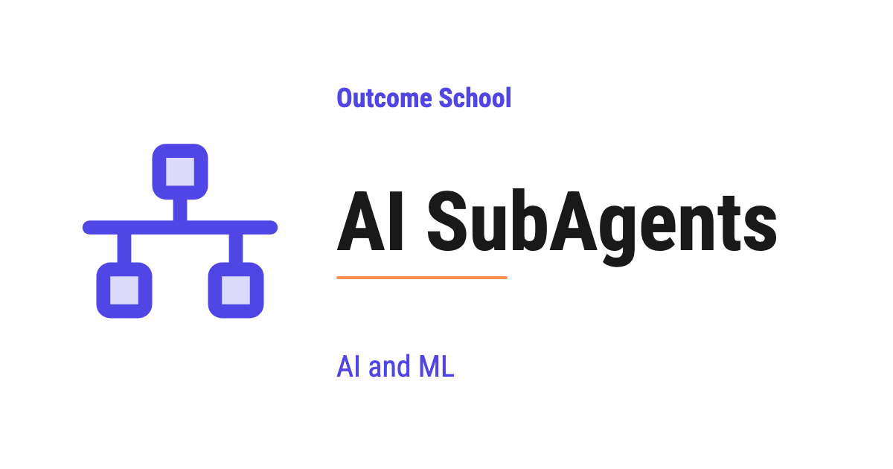

# What are AI SubAgents? Why We Need Them and How They Work

> Archived from <https://outcomeschool.com/blog/ai-subagents> on 2026-11-25.

An AI SubAgent is a smaller, specialized agent that works under a main agent to handle one specific part of a big task, just like a team member working under a manager.

In this blog, we will learn about AI SubAgents. We will understand what they are, why we need them, how they work, and how to use them to build AI systems that can handle big and complex tasks.

We will cover the following:
<ul><li>What is an AI Agent?</li><li>What are AI SubAgents?</li><li>Why do we need SubAgents?</li><li>How do SubAgents work?</li><li>Example use case</li><li>Benefits of using SubAgents</li><li>Challenges with SubAgents</li><li>Best practices</li></ul>
I am <strong>Amit Shekhar</strong>, Founder @ <a target="_blank" rel="noopener noreferrer" href="https://outcomeschool.com">Outcome School</a>, I have taught and mentored many developers, and their efforts landed them high-paying tech jobs, helped many tech companies in solving their unique problems, and created many open-source libraries being used by top companies. I am passionate about sharing knowledge through open-source, blogs, and videos.

I teach <a target="_blank" rel="noopener noreferrer" href="https://outcomeschool.com/program/ai-and-machine-learning">AI and Machine Learning</a> at Outcome School.

Let&#x27;s get started.
<h3 id="what-is-an-ai-agent">What is an AI Agent?</h3>
Before jumping into SubAgents, we must know what an <a target="_blank" rel="noopener noreferrer" href="ai-agent.md">AI Agent</a> is.

<strong>An AI Agent is a system that uses an LLM to think, plan, and take actions to complete a task on our behalf.</strong>

In simple words, we give the agent a goal, and the agent figures out the steps, calls the required tools, and gives us the final result.

Let&#x27;s say we ask an AI Agent: &quot;Find the latest news on AI and email me a summary.&quot; The agent will search the web, read the articles, write a summary, and send the email. We did not tell it each step. The agent planned everything on its own.

This is the power of an AI Agent.
<h3 id="what-are-ai-subagents">What are AI SubAgents?</h3>
Now, let&#x27;s move to the main topic.

<strong>An AI SubAgent is a smaller, specialized agent that works under a main agent to handle a specific part of a larger task.</strong>

In simple words, the main agent is like a manager, and the SubAgents are like team members. Each team member is an expert at one specific thing. The manager decides who should do what, and then collects the results.

Let&#x27;s say we have a main agent that helps us plan a trip. Planning a trip has many parts:
<ul><li>Find flights</li><li>Find hotels</li><li>Build a day-by-day itinerary</li><li>Check the weather</li></ul>
Instead of one agent doing all of this, the main agent can call four SubAgents. One SubAgent finds flights. Another finds hotels. Another builds the itinerary. Another checks the weather. Each SubAgent is focused on one job and does that job very well.

This is how AI SubAgents work.

This setup, a main agent coordinating many specialized SubAgents, is a form of <a target="_blank" rel="noopener noreferrer" href="multi-agent-systems.md">Multi-Agent System</a>, which we cover in a detailed blog.

<strong>Planning your move into AI?</strong>

No matter which tech domain you work in today, with your effort, you can transition to these roles:
<ul><li>AI Engineer</li><li>Forward Deployed Engineer</li><li>AI Agent Engineer</li><li>Harness Engineer</li><li>Voice AI Engineer</li><li>AI Architect</li><li>LLM Engineer</li><li>LLM Inference Engineer</li><li>Gen AI Engineer</li><li>MLOps Engineer</li><li>ML Engineer</li><li>Deep Learning Engineer</li></ul>
Our <a target="_blank" rel="noopener noreferrer" href="https://outcomeschool.com/program/ai-and-machine-learning">AI and Machine Learning Program</a> at Outcome School takes you there.
<h3 id="why-do-we-need-subagents">Why do we need SubAgents?</h3>
Now, the question is: why can a single agent not handle everything on its own?

The answer is, a single agent can try, but it will struggle as the task becomes bigger. Let&#x27;s see the reasons.

<strong>Reason 1: Context overload.</strong>

An LLM has a limited <a target="_blank" rel="noopener noreferrer" href="context-engineering.md">context window</a>. If a single agent tries to handle every step, every tool, and every piece of information, the context will get filled up very quickly. Once the context is full, the agent starts forgetting earlier steps, and the quality of the output drops.

<strong>Reason 2: Lack of focus.</strong>

When an agent has many tools and many responsibilities, it gets confused about which tool to use and when. A focused SubAgent with only a few tools makes better decisions.

<strong>Reason 3: Reusability.</strong>

A SubAgent built for one job can be reused in many different main agents. For example, a &quot;web search SubAgent&quot; can be used by a research agent, a news agent, and a shopping agent.

<strong>Reason 4: Parallel work.</strong>

Multiple SubAgents can work at the same time. While one SubAgent is finding flights, another can be checking hotels. This makes the whole task much faster.

So, here come the SubAgents to the rescue.

To learn how to design Subagents, manage Context Engineering, and handle Tool use in Agents in depth, check out our <a target="_blank" rel="noopener noreferrer" href="https://outcomeschool.com/program/ai-and-machine-learning">AI and Machine Learning Program</a> at Outcome School.
<h3 id="how-do-subagents-work">How do SubAgents work?</h3>
Let&#x27;s understand the flow step by step.

<strong>Step 1:</strong> The user gives a task to the main agent.

<strong>Step 2:</strong> The main agent reads the task and breaks it into smaller pieces.

<strong>Step 3:</strong> The main agent decides which SubAgent is right for each piece.

<strong>Step 4:</strong> The main agent sends each piece to the matching SubAgent.

<strong>Step 5:</strong> Each SubAgent works on its piece. It runs its own loop with its own budget, and it can use its own tools, <a target="_blank" rel="noopener noreferrer" href="ai-agent-memory.md">its own memory</a>, and even call other SubAgents if needed. Keeping the noisy intermediate steps inside a SubAgent like this is a core <a target="_blank" rel="noopener noreferrer" href="what-is-loop-engineering.md">Loop Engineering</a> technique.

<strong>Note:</strong> A SubAgent calling another SubAgent gives us a tree-like structure. This is very powerful but must be used carefully to avoid deep, costly chains.

<strong>Step 6:</strong> Each SubAgent returns the result back to the main agent.

<strong>Step 7:</strong> The main agent collects all the results, combines them, and gives the final answer to the user.

Here, we can see that the main agent is acting like a coordinator, and the SubAgents are doing the actual focused work.

We have a detailed blog on <a target="_blank" rel="noopener noreferrer" href="how-ai-agents-communicate.md">how AI agents communicate</a> that explains how the main agent and SubAgents pass messages back and forth.

This coordination of multiple agents, tools, and steps is called <a target="_blank" rel="noopener noreferrer" href="ai-orchestration.md">AI Orchestration</a>, and we have a detailed blog that explains it in depth.

<strong>A quick note for you</strong>

No matter which tech domain you work in, get familiar with these topics:
<ul><li>LLM</li><li>RAG</li><li>MCP</li><li>Agent</li><li>Fine-tuning</li><li>Quantization</li></ul>
We put it all together in one video:

<a target="_blank" rel="noopener noreferrer" href="https://www.youtube.com/watch?v=lnfWvX66FUk">AI Engineering Explained: LLM, RAG, MCP, Agent, Fine-Tuning, and Quantization</a>

No need to stop reading - bookmark it and watch later when you get time. Future you will thank you.

Now, let&#x27;s get back to the topic.
<h3 id="example-use-case">Example use case</h3>
The best way to learn this is by taking an example.

Let&#x27;s say we are building an AI assistant that helps a user prepare for a job interview. The user says: &quot;Help me prepare for an AI Engineer interview at a top tech company next week.&quot;

This is a big task. Let&#x27;s see how SubAgents can handle this.

The main agent will break the task as below:
<ul><li><strong>Research SubAgent:</strong> Find the common interview topics for AI Engineers at top tech companies.</li><li><strong>Question SubAgent:</strong> Generate a list of likely interview questions for each topic.</li><li><strong>Answer SubAgent:</strong> Write clear, simple answers for each question.</li><li><strong>Schedule SubAgent:</strong> Build a day-by-day study plan for the next 7 days.</li><li><strong>Mock Interview SubAgent:</strong> Run practice interviews with the user.</li></ul>
Each SubAgent does one thing very well. The main agent puts everything together and gives the user a full interview prep package.

This way we can use SubAgents to solve any problem in a very simple way.
<h3 id="benefits-of-using-subagents">Benefits of using SubAgents</h3>
Let&#x27;s see the key benefits.
<ul><li><strong>Better quality:</strong> Each SubAgent is focused on one job, so the output is more accurate.</li><li><strong>Cleaner context:</strong> Each SubAgent has its own context window, so nothing gets mixed up.</li><li><strong>Faster results:</strong> SubAgents can run in parallel, which saves time.</li><li><strong>Easier to maintain:</strong> We can update one SubAgent without touching the others.</li><li><strong>Reusable:</strong> The same SubAgent can be used in many different products.</li><li><strong>Scalable:</strong> We can add more SubAgents as the system grows, without rewriting the main agent.</li></ul>
This is the beauty of AI SubAgents.

<strong>Stay updated:</strong> Subscribe to our <a target="_blank" rel="noopener noreferrer" href="https://outcomeschool.substack.com/subscribe">newsletter</a> to get our latest AI and Machine Learning blogs straight to your inbox.
<h3 id="challenges-with-subagents">Challenges with SubAgents</h3>
SubAgents also bring their own challenges.
<ul><li><strong>Coordination cost:</strong> The main agent has to plan, send tasks, and combine results. This takes time and tokens.</li><li><strong>Communication errors:</strong> If the main agent gives a SubAgent the wrong input, the SubAgent will give a wrong output.</li><li><strong>Higher cost:</strong> More agents means more LLM calls, which means a higher bill.</li><li><strong>Debugging is harder:</strong> When something goes wrong, we have to check which SubAgent failed and why.</li><li><strong>Over-engineering risk:</strong> For a simple task, using many SubAgents is overkill. A single agent is enough.</li></ul>
We must keep these challenges in mind while designing our system.
<h3 id="best-practices">Best practices</h3>
A few important points to follow:
<ul><li>Use SubAgents only when the task is truly complex and can be split into clear parts.</li><li>Give each SubAgent a clear, narrow job. Do not make a SubAgent that does many unrelated things.</li><li>Keep the tool list of each SubAgent small and focused.</li><li>Let the main agent handle planning and combining. Let SubAgents handle focused work.</li><li>Run SubAgents in parallel whenever the work allows it.</li><li>Log the input and output of every SubAgent. This makes debugging much easier.</li><li>Test each SubAgent on its own before connecting it to the main agent.</li></ul>
This way we can use AI SubAgents to break big tasks into small focused pieces and build AI systems that produce better results.
<h2 id="frequently-asked-questions">Frequently Asked Questions</h2><h3 id="should-we-always-use-subagents-instead-of-a-single-agent">Should we always use SubAgents instead of a single agent?</h3>
No. For a simple task, using many SubAgents is overkill, and a single agent is enough. We use SubAgents only when the task is truly complex and can be split into clear parts. Otherwise, we pay extra coordination cost and a higher bill for no real gain.
<h3 id="does-each-subagent-share-the-main-agents-context-window">Does each SubAgent share the main agent&#x27;s context window?</h3>
No. Each SubAgent has its own context window, so nothing gets mixed up. This keeps the main agent&#x27;s context clean, because the noisy intermediate steps stay inside the SubAgent. The SubAgent only returns its result back to the main agent.
<h3 id="can-a-subagent-call-another-subagent">Can a SubAgent call another SubAgent?</h3>
Yes. A SubAgent can call other SubAgents if needed, which gives us a tree-like structure. This is very powerful, but we must use it carefully to avoid deep, costly chains.
<h3 id="are-subagents-the-same-as-a-multi-agent-system">Are SubAgents the same as a Multi-Agent System?</h3>
SubAgents are a form of Multi-Agent System. The setup has a main agent that acts like a coordinator, and many specialized SubAgents that do the focused work. The main agent plans, sends tasks, and combines the results.

That&#x27;s it for now.

Thanks

<strong>Amit Shekhar</strong> Founder @ <a target="_blank" rel="noopener noreferrer" href="https://outcomeschool.com">Outcome School</a>

You can connect with me on:
<ul><li><a target="_blank" rel="noopener noreferrer" href="https://x.com/amitiitbhu">X</a></li><li><a target="_blank" rel="noopener noreferrer" href="https://www.linkedin.com/in/amit-shekhar-iitbhu">LinkedIn</a></li><li><a target="_blank" rel="noopener noreferrer" href="https://github.com/amitshekhariitbhu">GitHub</a></li></ul>
Follow Outcome School on:
<ul><li><a target="_blank" rel="noopener noreferrer" href="https://x.com/outcome_school">X</a></li><li><a target="_blank" rel="noopener noreferrer" href="https://youtube.com/@OutcomeSchool">YouTube</a></li><li><a target="_blank" rel="noopener noreferrer" href="https://www.linkedin.com/company/outcomeschool">LinkedIn</a></li><li><a target="_blank" rel="noopener noreferrer" href="https://github.com/OutcomeSchool">GitHub</a></li></ul>
<a target="_blank" rel="noopener noreferrer" href="https://outcomeschool.com/blog"><strong>Read all of our high-quality blogs here.</strong></a>

