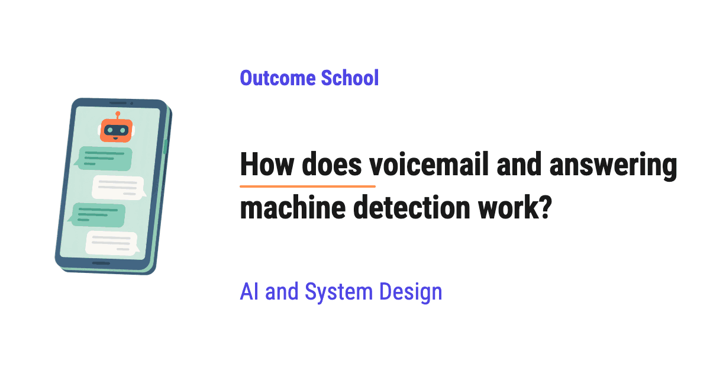

# How does voicemail and answering machine detection work?

> Archived from <https://outcomeschool.com/blog/answering-machine-detection> on 2026-11-25.

Voicemail and answering machine detection is a check that listens to the first few seconds of an outgoing phone call and decides whether a real person or a recorded greeting has answered. It looks at the pattern of speech and silence, listens for the beep, and sometimes reads the words, so that the caller knows whether to start talking or to leave a message.

In this blog, we will learn about how voicemail and answering machine detection works. We will also see why a calling system needs it, how a person and a machine sound different in the first few seconds, how simple timing rules catch many machines, how the beep is found, how AI models and transcripts make the decision more accurate, and where the detection works well and where it fails.

We will cover the following:
<ul><li>What is Answering Machine Detection?</li><li>Why do we need Answering Machine Detection?</li><li>How a person and a machine sound different</li><li>Approach 1: Timing rules on speech and silence</li><li>Finding the beep</li><li>Approach 2: An AI model that listens to the audio</li><li>Approach 3: Reading the words</li><li>Speed vs accuracy</li><li>Where it fails</li><li>How a voice agent uses it end to end</li></ul>
I am <strong>Amit Shekhar</strong>, Founder @ <a target="_blank" rel="noopener noreferrer" href="https://outcomeschool.com">Outcome School</a>, I have taught and mentored many developers, and their efforts landed them high-paying tech jobs, helped many tech companies in solving their unique problems, and created many open-source libraries being used by top companies. I am passionate about sharing knowledge through open-source, blogs, and videos.

I teach <a target="_blank" rel="noopener noreferrer" href="https://outcomeschool.com/program/ai-and-machine-learning">AI and Machine Learning</a> at Outcome School.

Let&#x27;s get started.
<h2 id="what-is-answering-machine-detection">What is Answering Machine Detection?</h2>
<strong>Answering Machine Detection, also called AMD, is the process of finding out, within the first few seconds of a call, whether the call was picked up by a live person or by a voicemail system.</strong>

A voicemail system answers the call when a person does not pick up, plays a recorded greeting, and then records a message. We all have heard such a greeting: &quot;Hi, you have reached Priya. I cannot take your call right now. Please leave a message after the beep.&quot;

From the sound alone, the detector gives one of a few answers:
<ul><li><strong>Human</strong>: a live person picked up.</li><li><strong>Machine</strong>: a voicemail greeting is playing.</li><li><strong>Machine, greeting ended</strong>: the greeting has finished, usually with a beep, and now the voicemail is recording.</li><li><strong>Fax</strong>: a fax machine answered.</li><li><strong>Unknown</strong>: the detector could not decide in time.</li></ul><h2 id="why-do-we-need-answering-machine-detection">Why do we need Answering Machine Detection?</h2>
Let&#x27;s say a clinic uses a <a target="_blank" rel="noopener noreferrer" href="design-a-real-time-voice-ai-agent.md">voice agent</a> to call 1,000 patients and remind them about their appointments tomorrow.

When a patient picks up, the voice agent must talk to them and answer their questions.

When a voicemail picks up, the voice agent must do something else. It must either wait for the beep and leave a short message, or hang up and try again later.

Without detection, the system must guess, and both guesses fail:
<ul><li>If it always starts talking, the voice agent talks while the greeting is still playing. The voicemail records only after the beep, so the patient later hears only the second half of the message.</li><li>If it always waits for a beep, a live person says &quot;Hello?&quot; and hears silence because the system is waiting for a beep that will never come. The person hangs up.</li></ul>
So, the system needs to know who answered, and it needs to know quickly. Here comes the Answering Machine Detection into the picture.

<strong>Planning your move into AI?</strong>

No matter which tech domain you work in today, with your effort, you can transition to these roles:
<ul><li>AI Engineer</li><li>Forward Deployed Engineer</li><li>AI Agent Engineer</li><li>Harness Engineer</li><li>Voice AI Engineer</li><li>AI Architect</li><li>LLM Engineer</li><li>LLM Inference Engineer</li><li>Gen AI Engineer</li><li>MLOps Engineer</li><li>ML Engineer</li><li>Deep Learning Engineer</li></ul>
Our <a target="_blank" rel="noopener noreferrer" href="https://outcomeschool.com/program/ai-and-machine-learning">AI and Machine Learning Program</a> at Outcome School takes you there.
<h2 id="how-a-person-and-a-machine-sound-different">How a person and a machine sound different</h2>
Before jumping into the approaches, we must understand the one difference that every approach depends on.

When a person answers a phone, they usually say something short and then stop to wait for us, like below:

<pre><code class="code-highlight">&quot;Hello?&quot;  -&gt;  silence (waiting for the caller)
</code></pre>

When a voicemail answers, it plays a long greeting without stopping to wait for anyone, like below:

<pre><code class="code-highlight">&quot;Hi, you have reached Priya. I cannot take your call right now. Please leave a message after the beep.&quot;  -&gt;  beep
</code></pre>

Means, a person speaks briefly and then goes quiet. A machine speaks for a long time and then beeps.

The detector turns this difference into a decision. Let&#x27;s see how.
<h2 id="approach-1-timing-rules-on-speech-and-silence">Approach 1: Timing rules on speech and silence</h2>
This approach is fast and cheap, and it is still widely used.

First, the detector cuts the incoming audio into tiny pieces called <a target="_blank" rel="noopener noreferrer" href="audio-frames-and-chunk-sizes.md">frames</a>, often 10 to 20 milliseconds each. For every frame, it measures how loud the sound is. This loudness is called energy.
<ul><li>If the energy is above a level, the frame is marked as <strong>speech</strong>.</li><li>If the energy is below that level, the frame is marked as <strong>silence</strong>.</li></ul>
Now, the detector does not see audio anymore. It sees a timeline of speech and silence, like below:

<pre><code class="code-highlight">silence | speech | silence | speech | speech | silence | ...
</code></pre>

Then, it applies a set of simple timing rules on this timeline.

For the sake of example, let&#x27;s look at the rules in the AMD module of Asterisk, a popular open-source phone system. Its default settings are as below:
<table><thead><tr><th>Setting</th><th>Default value</th><th>What it means</th></tr></thead><tbody><tr><td>Initial silence</td><td>2500 ms</td><td>Longest silence allowed before anyone speaks</td></tr><tr><td>Greeting</td><td>1500 ms</td><td>Longest a greeting can last before it is a machine</td></tr><tr><td>After greeting silence</td><td>800 ms</td><td>Silence after a greeting that means a person waits</td></tr><tr><td>Total analysis time</td><td>5000 ms</td><td>Maximum time allowed to decide</td></tr><tr><td>Minimum word length</td><td>100 ms</td><td>Shortest burst of speech counted as a word</td></tr><tr><td>Between words silence</td><td>50 ms</td><td>Shortest gap that splits two words</td></tr></tbody></table>
And the rules work like below:
<ul><li>If nobody speaks for more than 2.5 seconds, it decides <strong>Machine</strong>, because a person who picks up a phone usually speaks quickly.</li><li>If the first greeting keeps going for more than 1.5 seconds, it decides <strong>Machine</strong>, because &quot;Hello?&quot; is short and a recorded greeting is long.</li><li>If the greeting has too many words, it decides <strong>Machine</strong>. A word here is any burst of speech of at least 100 ms, and two words are split by a gap of at least 50 ms.</li><li>If a short greeting is followed by 0.8 seconds of silence, it decides <strong>Human</strong>, because the person has stopped to wait for us.</li><li>If 5 seconds pass without any of the above, it gives up and returns <strong>Unknown</strong>.</li></ul>
The best way to learn this is by taking an example.

<strong>Call 1:</strong> A person picks up.
<ul><li>0.0 s to 0.4 s: silence. This is under the 2.5-second limit.</li><li>0.4 s to 0.9 s: speech, &quot;Hello?&quot;. This is one short word, 0.5 seconds long.</li><li>0.9 s to 1.7 s: silence for 0.8 seconds.</li></ul>
A short greeting followed by 0.8 seconds of silence. The decision is <strong>Human</strong> at 1.7 seconds.

<strong>Call 2:</strong> A voicemail picks up.
<ul><li>0.0 s to 0.6 s: silence. This is also under the limit.</li><li>0.6 s onwards: speech, &quot;Hi, you have reached Priya...&quot;. The speech keeps going.</li><li>At 2.1 s, the greeting has already lasted 1.5 seconds.</li></ul>
The greeting is too long. The decision is <strong>Machine</strong> at 2.1 seconds.

This is how simple timing rules catch many voicemails within two or three seconds, without reading any words.

The issue with this approach is that it only looks at loudness and time. A person who answers with a long sentence looks like a machine, and a voicemail with a very short greeting looks like a person. Let&#x27;s first see how the beep is found, and then we will see how the next approaches solve this issue.
<h2 id="finding-the-beep">Finding the beep</h2>
Knowing that a machine answered is only half of the job. To leave a message, we must start speaking after the beep, or the first part of our message is lost.

So, how can the detector find the beep? The answer is that a beep is a simple sound.

Human speech is a mix of many frequencies that change every moment. Frequency means how fast the sound wave goes up and down, and it is measured in Hertz (Hz). A beep is different. It is one steady frequency, held for a fraction of a second or more.

On the incoming audio, the detector does this:
<ul><li>It splits each frame of audio into its frequencies, to see how much of each frequency is present.</li><li>It checks whether almost all the energy sits at one single frequency.</li><li>It checks whether that same frequency stays steady across many frames in a row.</li></ul>
If both checks pass, it is a beep. We have a detailed blog on <a target="_blank" rel="noopener noreferrer" href="dtmf-in-voice-agents.md">how DTMF keypad input works in a voice agent</a> that explains how the same kind of pure-tone check finds key presses on a call.

The frequency of the beep is not fixed. Different voicemail systems use different tones, and some greetings end with no beep at all. So, a good beep detector does not look for one exact frequency. It looks for any pure, steady tone. If no beep comes, it waits for a long silence after the greeting and treats that silence as the end of the greeting.

This is why many detectors report two different machine results: one when they first know it is a machine, and one when the greeting has ended and it is the right time to start speaking.

The same idea works for fax machines. A fax machine that answers a call sends a long, steady, high tone at 2100 Hz. The detector looks for that pure tone and returns <strong>Fax</strong>.

<strong>A quick note for you</strong>

No matter which tech domain you work in, get familiar with these topics:
<ul><li>LLM</li><li>RAG</li><li>MCP</li><li>Agent</li><li>Fine-tuning</li><li>Quantization</li></ul>
We put it all together in one video:

<a target="_blank" rel="noopener noreferrer" href="https://www.youtube.com/watch?v=lnfWvX66FUk">AI Engineering Explained: LLM, RAG, MCP, Agent, Fine-Tuning, and Quantization</a>

No need to stop reading - bookmark it and watch later when you get time. Future you will thank you.

Now, let&#x27;s get back to the topic.
<h2 id="approach-2-an-ai-model-that-listens-to-the-audio">Approach 2: An AI model that listens to the audio</h2>
Now, let&#x27;s see how the next approach solves the issue of timing rules. Timing rules use only loudness and time, but the sound carries much more information than that.

A recorded greeting often sounds cleaner and more even than a live voice, with a steady rhythm, because it was usually recorded in a quiet room. A live person on a phone has background noise, breathing, and an uneven, natural rhythm.

So, instead of writing rules by hand, we can train a model to learn these differences from examples.

First, we collect thousands of recorded call openings, each labeled as human or machine.

Then, we turn the first few seconds of each call into numbers that describe the sound. A common choice is a spectrogram, which is like a picture of the audio that shows which frequencies are present at every moment.

After that, we train a classifier on these examples. A classifier is a model that puts an input into one of a few groups. Here, the groups are human and machine.

Finally, on a live call, the model looks at the incoming audio every fraction of a second and gives a score, for example &quot;92% machine&quot;. When the score crosses a set level, the detector decides.

The model learns patterns that are hard to write as rules, such as the clean quality of a recording or the way a person&#x27;s voice rises in &quot;Hello?&quot;. Hence, it is usually more accurate than plain timing rules on the tricky cases. We have a detailed blog on <a target="_blank" rel="noopener noreferrer" href="silence-vs-model-based-turn-detection.md">how silence-based and model-based turn detection differ</a> that covers the same trade-off for deciding when a user has finished speaking.

But, a person who says &quot;Hello, this is Rahul speaking, how can I help you?&quot; gives a long and clear greeting, and this can still confuse the model.
<h2 id="approach-3-reading-the-words">Approach 3: Reading the words</h2>
The issue with the audio model is that it does not understand the words. The next approach solves it by using what modern voice agents already have: a speech-to-text model.

A speech-to-text model converts spoken audio into text as the audio comes in. So, while the greeting is playing, the voice agent already has its text.

Now, the detector can read the words. Voicemail greetings use common phrases:
<ul><li>&quot;You have reached...&quot;</li><li>&quot;I cannot take your call right now.&quot;</li><li>&quot;Please leave a message after the tone.&quot;</li><li>&quot;The person you are calling is not available.&quot;</li></ul>
A live person usually says &quot;Hello?&quot;, &quot;Yes?&quot;, &quot;Who is this?&quot;, or their own name.

The text can be checked in two ways:
<ul><li><strong>Keyword matching</strong>: look for known voicemail phrases. It is fast, but it misses greetings that use other words.</li><li><strong>An LLM classifier</strong>: send the transcript to an <a target="_blank" rel="noopener noreferrer" href="large-language-model-llm.md">LLM (Large Language Model)</a> with a short instruction, like below:</li></ul>
<pre><code class="code-highlight">Here is what was said when a phone call was answered:
&quot;Hi, you have reached Priya. I cannot take your call right now.&quot;
Was this answered by a live person or a voicemail greeting?
Answer with one word: human or voicemail.
</code></pre>

Here, the LLM reads the meaning of the words, not just exact phrases. It can tell that &quot;Sorry I missed you, drop me a message&quot; is also a voicemail, even though it does not contain the words &quot;leave a message&quot;.

The issue with this approach is time. Speech-to-text needs a moment to produce the words, and the LLM needs a moment to answer. So, in practice, many systems combine the approaches: timing rules and the beep detector give a fast first answer, and the transcript confirms it or corrects it.

To learn Prompt Engineering, LLM Fundamentals, and how to Design a Real-Time Voice AI Agent that combines speech-to-text with an LLM, check out our <a target="_blank" rel="noopener noreferrer" href="https://outcomeschool.com/program/ai-and-machine-learning">AI and Machine Learning Program</a> at Outcome School.
<h2 id="speed-vs-accuracy">Speed vs accuracy</h2>
Every detector faces a trade-off. If it decides very fast, it has heard very little, so it makes more mistakes. If it waits longer, it is more accurate, but the person on the other side waits in silence. With the default settings we saw earlier, a timing-rules detector can take up to 5 seconds to decide.

And waiting in silence is costly. When a person says &quot;Hello?&quot; and hears nothing for two or three seconds, some of them think it is a spam call and hang up.

That is why systems offer two ways to run detection:
<ul><li><strong>Blocking</strong>: the call waits until the detector decides, and only then does the voice agent start speaking. It is simple, but the person hears silence during detection.</li><li><strong>Background</strong>: the voice agent starts the conversation right away, and the detector keeps listening in the background. When it decides &quot;Machine&quot;, the system stops the conversation and switches to the voicemail flow.</li></ul>
The background way gives a better experience to real people, because they <a target="_blank" rel="noopener noreferrer" href="time-to-first-audio.md">hear a reply quickly</a>. The cost is that, on a voicemail, the voice agent sometimes speaks a few words over the greeting before the detector decides.
<h2 id="where-it-fails">Where it fails</h2>
No detector is perfect, because people and greetings do not always follow the usual pattern.

<strong>A person sounds like a machine:</strong>
<ul><li>A person answers with a long sentence: &quot;Good morning, Sharma Electronics, Rahul speaking, how may I help you?&quot;</li><li>A person answers while talking to someone else in the room.</li></ul>
<strong>A machine sounds like a person:</strong>
<ul><li>A very short greeting: &quot;Priya. Leave a message.&quot; This is as short as a person saying hello.</li><li>A greeting that starts with &quot;Hello?&quot; and then a pause before the rest of the message.</li><li>A phone carrier&#x27;s message, such as &quot;The number you have dialed is not reachable.&quot;</li></ul>
<strong>The beep is hard to find:</strong>
<ul><li>The greeting ends with no beep.</li><li>Background music in the greeting has steady tones that look like a beep.</li></ul>
Here, we can notice that each approach fixes some of these cases. Timing rules fail on long human greetings. The audio model handles some of them. The transcript catches many of the rest, because &quot;Rahul speaking, how may I help you&quot; does not mean &quot;leave a message&quot;.

When the detector still cannot decide, it returns <strong>Unknown</strong>, and the system must pick a safe default. A common choice is to treat Unknown as a human, because hanging up on a real person is worse than speaking to a recording for a few seconds.

<strong>Stay updated:</strong> Subscribe to our <a target="_blank" rel="noopener noreferrer" href="https://outcomeschool.substack.com/subscribe">newsletter</a> to get our latest AI and Machine Learning blogs straight to your inbox.
<h2 id="how-a-voice-agent-uses-it-end-to-end">How a voice agent uses it end to end</h2>
Now, let&#x27;s see the full flow for one outgoing call, like below:

<pre><code class="code-highlight">        The voice agent dials the number
                      ↓
           The other side picks up
                      ↓
   The detector listens to the first few seconds
     (timing rules + audio model + transcript)
                      ↓
       +--------------+--------------+
       ↓              ↓              ↓
     Human         Machine          Fax
       ↓              ↓              ↓
  Start the      Wait for the     Hang up
  conversation   beep or silence
                      ↓
                Leave a short
                message, or hang
                up and retry later
</code></pre>

Here, the detector combines the three approaches. Timing rules give a quick first guess, the audio model adds a score, and the transcript confirms it. The result decides the path of the call.

This way, the clinic from our example can call 1,000 patients, talk to everyone who picks up, and leave a complete reminder message for everyone who does not. We have a detailed blog on <a target="_blank" rel="noopener noreferrer" href="outbound-calling-voice-agent.md">how an outbound calling voice agent works</a> that covers the whole call, from dialing to saving the outcome, end to end.

Now we must have understood what voicemail and answering machine detection is, how it works, and where it is used.
<h2 id="frequently-asked-questions">Frequently Asked Questions</h2><h3 id="does-answering-machine-detection-need-speech-to-text">Does answering machine detection need speech-to-text?</h3>
No. Simple timing rules on speech and silence, together with a beep detector, look only at loudness, time, and frequency, and they catch many voicemails within two or three seconds without reading any words. Speech-to-text is added when we want the transcript to confirm or correct that fast first answer.
<h3 id="how-long-does-answering-machine-detection-take-to-decide">How long does answering machine detection take to decide?</h3>
It usually takes a few seconds. Timing rules catch many voicemails within two or three seconds. With the default settings of the AMD module in Asterisk, the detector can take up to 5 seconds, and if it still has no answer by then, it returns Unknown.
<h3 id="what-should-a-voice-agent-do-when-the-detection-result-is-unknown">What should a voice agent do when the detection result is Unknown?</h3>
It should pick a safe default. A common choice is to treat Unknown as a human and start the conversation, because hanging up on a real person is worse than speaking to a recording for a few seconds.
<h3 id="what-happens-if-a-voicemail-greeting-has-no-beep">What happens if a voicemail greeting has no beep?</h3>
The detector waits for a long silence after the greeting instead. Different voicemail systems use different tones, and some greetings end with no beep at all, so a good detector treats a long silence after the greeting as the end of the greeting and the right time to start speaking.

That&#x27;s it for now.

Thanks

<strong>Amit Shekhar</strong> Founder @ <a target="_blank" rel="noopener noreferrer" href="https://outcomeschool.com">Outcome School</a>

You can connect with me on:
<ul><li><a target="_blank" rel="noopener noreferrer" href="https://x.com/amitiitbhu">X</a></li><li><a target="_blank" rel="noopener noreferrer" href="https://www.linkedin.com/in/amit-shekhar-iitbhu">LinkedIn</a></li><li><a target="_blank" rel="noopener noreferrer" href="https://github.com/amitshekhariitbhu">GitHub</a></li></ul>
Follow Outcome School on:
<ul><li><a target="_blank" rel="noopener noreferrer" href="https://x.com/outcome_school">X</a></li><li><a target="_blank" rel="noopener noreferrer" href="https://youtube.com/@OutcomeSchool">YouTube</a></li><li><a target="_blank" rel="noopener noreferrer" href="https://www.linkedin.com/company/outcomeschool">LinkedIn</a></li><li><a target="_blank" rel="noopener noreferrer" href="http://github.com/OutcomeSchool">GitHub</a></li></ul>
<a target="_blank" rel="noopener noreferrer" href="https://outcomeschool.com/blog"><strong>Read all of our high-quality blogs here.</strong></a>

