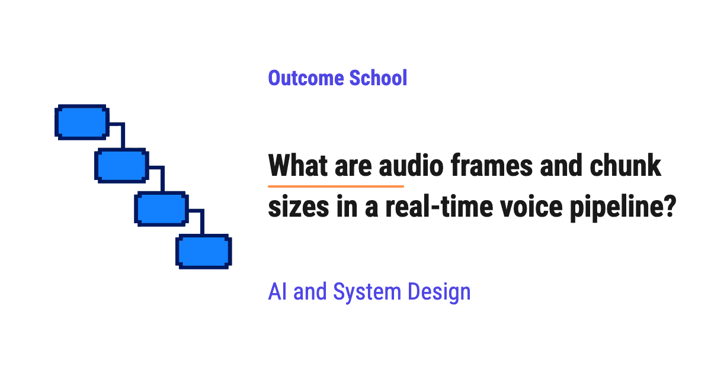

# What are audio frames and chunk sizes in a real-time voice pipeline?

> Archived from <https://outcomeschool.com/blog/audio-frames-and-chunk-sizes> on 2026-11-25.

An audio frame is a small, fixed slice of sound, usually 10 or 20 milliseconds long, and the chunk size is how much of that sound we pass from one step of a voice pipeline to the next at one time.

In this blog, we will learn about audio frames and chunk sizes in a real-time voice pipeline. We will also see how sound becomes numbers, how those numbers are grouped into frames, how to calculate the size of a frame, how chunk size affects both delay and overhead, why every part of the pipeline wants a different size, and how to pick the right chunk size for our use case.

We will cover the following:
<ul><li>How sound becomes numbers</li><li>What is an audio frame?</li><li>How to calculate the size of a frame</li><li>What is a chunk size?</li><li>How chunk size affects delay</li><li>The cost of very small chunks</li><li>Different parts want different sizes</li><li>How to pick the right chunk size</li></ul>
I am <strong>Amit Shekhar</strong>, Founder @ <a target="_blank" rel="noopener noreferrer" href="https://outcomeschool.com">Outcome School</a>, I have taught and mentored many developers, and their efforts landed them high-paying tech jobs, helped many tech companies in solving their unique problems, and created many open-source libraries being used by top companies. I am passionate about sharing knowledge through open-source, blogs, and videos.

I teach <a target="_blank" rel="noopener noreferrer" href="https://outcomeschool.com/program/ai-and-machine-learning">AI and Machine Learning</a> at Outcome School.

Let&#x27;s get started.
<h2 id="how-sound-becomes-numbers">How sound becomes numbers</h2>
Before jumping into audio frames, we must know how a computer stores sound.

Sound is a wave in the air. When we speak into a microphone, the microphone turns that wave into an electrical signal. But a computer cannot store a smooth wave. It can only store numbers.

So, the computer measures the height of the wave again and again, very quickly. Each measurement is called a <strong>sample</strong>. A sample is just one number that tells the height of the wave at that exact moment.

How many samples do we take every second? This is called the <a target="_blank" rel="noopener noreferrer" href="sample-rates-for-voice-agents.md"><strong>sample rate</strong></a>.
<ul><li>8 kHz means 8,000 samples every second. Regular phone calls use this.</li><li>16 kHz means 16,000 samples every second. Many speech recognition models use this.</li><li>24 kHz or 48 kHz means 24,000 or 48,000 samples every second. Many voice generation models and video calling apps use these.</li></ul>
Each sample also takes some space in memory. The most common format for raw audio is <strong>16-bit PCM</strong>. PCM is the plain, uncompressed way of storing samples one after another, and 16-bit means each sample takes 2 bytes.

Let&#x27;s say we record 1 second of speech at 16 kHz. We get 16,000 numbers. Each number takes 2 bytes. So, 1 second of audio takes 32,000 bytes.
<h2 id="what-is-an-audio-frame">What is an audio frame?</h2>
Now, the next big question is: how do we send this stream of numbers to the other parts of our system?

We cannot send one sample at a time. That would mean 16,000 tiny messages every second. And we cannot wait for the user to finish talking before sending anything, because then our <a target="_blank" rel="noopener noreferrer" href="design-a-real-time-voice-ai-agent.md">voice agent</a>, the AI that talks with the user, will feel slow.

So, here comes the audio frame to the rescue.

<strong>An audio frame is a small group of samples that covers a fixed, short amount of time.</strong>

Instead of sending sound one number at a time, we cut it into small equal pieces, and each piece is a frame.

The most common frame lengths in voice systems are <strong>10 milliseconds</strong> and <strong>20 milliseconds</strong>. One millisecond is one thousandth of a second. So, a 20 millisecond frame is one fiftieth of a second.

Think of it like slicing a long loaf of bread. The loaf is the full sound. Each slice is a frame. Every slice has the same thickness, so we always know how much bread is in one slice.

<pre><code class="code-highlight">Full speech: &quot;Hello, how are you?&quot; (1 second)

| 20 ms   | 20 ms   | 20 ms   | 20 ms   | ... | 20 ms    |
| frame 1 | frame 2 | frame 3 | frame 4 | ... | frame 50 |
</code></pre>

Here, we can see that 1 second of speech becomes 50 frames, because 1000 milliseconds divided by 20 milliseconds is 50.
<h2 id="how-to-calculate-the-size-of-a-frame">How to calculate the size of a frame</h2>
The best way to learn this is by taking an example.

Let&#x27;s say our audio is 16 kHz, 16-bit PCM, mono (one channel), and our frame length is 20 milliseconds.

<strong>Step 1:</strong> We find the number of samples in one frame.

<strong>Samples per frame = sample rate * frame length in seconds</strong>

So, 16,000 * 0.020 = 320 samples.

<strong>Step 2:</strong> We find the number of bytes in one frame.

<strong>Bytes per frame = samples per frame * bytes per sample * channels</strong>

So, 320 * 2 * 1 = 640 bytes.

We can write the code as below:

<pre><code class="code-highlight language-python">def frame_size(sample_rate, frame_ms, bytes_per_sample=2, channels=1):
    samples = int(sample_rate * frame_ms / 1000)
    size_in_bytes = samples * bytes_per_sample * channels
    return samples, size_in_bytes

print(frame_size(16000, 20))
print(frame_size(8000, 20))
print(frame_size(24000, 20))
print(frame_size(16000, 10))
</code></pre>

Here, we have a small function that takes the sample rate and the frame length, and returns the number of samples and the number of bytes in one frame.

It will print the following:

<pre><code class="code-highlight">(320, 640)
(160, 320)
(480, 960)
(160, 320)
</code></pre>

Let me put these numbers in a table for your better understanding.
<table><thead><tr><th>Sample rate</th><th>Frame length</th><th>Samples per frame</th><th>Bytes per frame (16-bit)</th></tr></thead><tbody><tr><td>8 kHz</td><td>20 ms</td><td>160</td><td>320</td></tr><tr><td>16 kHz</td><td>10 ms</td><td>160</td><td>320</td></tr><tr><td>16 kHz</td><td>20 ms</td><td>320</td><td>640</td></tr><tr><td>24 kHz</td><td>20 ms</td><td>480</td><td>960</td></tr><tr><td>48 kHz</td><td>20 ms</td><td>960</td><td>1920</td></tr></tbody></table>
Here, we can notice one important thing. Look at the 20 ms rows. The frame length in time stays the same, but the number of samples changes with the sample rate. <strong>A frame is defined by time, not by the number of samples.</strong>

Many bugs in voice pipelines happen when one part thinks in milliseconds and another part thinks in samples or bytes. For example, if one part sends 320 bytes of 8 kHz audio, which is 20 ms of sound, and the next part reads it as 16 kHz audio, it treats those bytes as only 10 ms of sound. The voice then plays twice as fast and sounds high-pitched.

<strong>Planning your move into AI?</strong>

No matter which tech domain you work in today, with your effort, you can transition to these roles:
<ul><li>AI Engineer</li><li>Forward Deployed Engineer</li><li>AI Agent Engineer</li><li>Harness Engineer</li><li>Voice AI Engineer</li><li>AI Architect</li><li>LLM Engineer</li><li>LLM Inference Engineer</li><li>Gen AI Engineer</li><li>MLOps Engineer</li><li>ML Engineer</li><li>Deep Learning Engineer</li></ul>
Our <a target="_blank" rel="noopener noreferrer" href="https://outcomeschool.com/program/ai-and-machine-learning">AI and Machine Learning Program</a> at Outcome School takes you there.
<h2 id="what-is-a-chunk-size">What is a chunk size?</h2>
Now that we have learned about frames, it&#x27;s time to learn about chunk size.

<strong>Chunk size is the amount of audio that one part of the pipeline hands over to the next part in a single step.</strong>

A chunk can be exactly one frame. Or it can be many frames joined together. So, a frame is the small unit that the audio is cut into, and a chunk is how much of that audio we move at one time.

To understand why this matters, let&#x27;s first see what a real-time voice pipeline looks like.

<pre><code class="code-highlight">+------------------+
|    Microphone    |
+------------------+
         ↓
+------------------+
|  Speech-to-Text  |
+------------------+
         ↓
+------------------+
|       LLM        |
+------------------+
         ↓
+------------------+
|  Text-to-Speech  |
+------------------+
         ↓
+------------------+
|     Speaker      |
+------------------+
</code></pre>

Here, the speech-to-text part turns the user&#x27;s voice into text, the <a target="_blank" rel="noopener noreferrer" href="large-language-model-llm.md">LLM (Large Language Model)</a> writes a reply, and the text-to-speech part turns that reply back into voice.

At every arrow, audio or text moves from one part to the next. The chunk size decides how big each piece is when it moves.

Let&#x27;s say the microphone gives us 20 millisecond frames. We can:
<ul><li>Send every 20 millisecond frame to the speech-to-text part as soon as it is ready. Here, the chunk size is 20 milliseconds.</li><li>Collect 5 frames and send them together. Here, the chunk size is 100 milliseconds.</li><li>Collect 50 frames and send them together. Here, the chunk size is 1 second.</li></ul>
All three choices send the same sound, but they feel very different to the user.

<strong>A quick note for you</strong>

No matter which tech domain you work in, get familiar with these topics:
<ul><li>LLM</li><li>RAG</li><li>MCP</li><li>Agent</li><li>Fine-tuning</li><li>Quantization</li></ul>
We put it all together in one video:

<a target="_blank" rel="noopener noreferrer" href="https://www.youtube.com/watch?v=lnfWvX66FUk">AI Engineering Explained: LLM, RAG, MCP, Agent, Fine-Tuning, and Quantization</a>

No need to stop reading - bookmark it and watch later when you get time. Future you will thank you.

Now, let&#x27;s get back to the topic.
<h2 id="how-chunk-size-affects-delay">How chunk size affects delay</h2>
When we use a chunk size of 1 second, the first word the user says has to wait until a full second of audio is collected. Only then is it sent. So, the very first sound is already 1 second old before the next part even sees it.

When we use a chunk size of 20 milliseconds, the first sound waits at most 20 milliseconds before it moves forward.

<strong>The bigger the chunk, the longer the first sample in it has to wait.</strong>

This waiting time is called <strong>buffering delay</strong>. And it happens at every step where we collect audio into chunks.

Let&#x27;s see this with numbers. Suppose our pipeline collects audio into chunks at three places: when the microphone captures the voice, when we send it to speech-to-text, and when we play the reply from text-to-speech.
<table><thead><tr><th>Chunk size at each step</th><th>Buffering delay added (3 steps)</th></tr></thead><tbody><tr><td>20 ms</td><td>up to 60 ms</td></tr><tr><td>100 ms</td><td>up to 300 ms</td></tr><tr><td>500 ms</td><td>up to 1500 ms</td></tr></tbody></table>
Here, we can see that the delay adds up very quickly. In a normal conversation, people usually reply to each other within a few hundred milliseconds. So, spending a few hundred milliseconds only on waiting for chunks to fill is a big loss, and that too before the agent has done any real work.

We have a detailed blog on <a target="_blank" rel="noopener noreferrer" href="voice-agent-latency-budget.md">how to build a latency budget for a voice AI agent</a> that explains where every millisecond of a reply goes.

This is why real-time voice pipelines use small chunks.
<h2 id="the-cost-of-very-small-chunks">The cost of very small chunks</h2>
Now, the question is: if small chunks are good, why not make them as small as possible, like 1 millisecond?

The answer is that every chunk has a fixed cost.

When we send audio over the internet, we send it in small pieces called <strong>packets</strong>. Every packet carries a <strong>header</strong>. A header is extra information that tells the network where the packet is going and in which order to put the packets back together. For voice calls, the standard headers (called IP, UDP, and <a target="_blank" rel="noopener noreferrer" href="sip-and-rtp.md">RTP</a> headers) together take about 40 bytes for every packet.

Let&#x27;s say we use compressed voice at about 24,000 bits per second.
<ul><li>With 20 millisecond packets, we send 50 packets every second. The voice data in each packet is about 60 bytes, and the header is 40 bytes.</li><li>With 10 millisecond packets, we send 100 packets every second. The voice data in each packet is about 30 bytes, but the header is still 40 bytes.</li></ul>
Here, we can see that with 10 millisecond packets, the header becomes bigger than the actual voice inside the packet.

The same idea applies inside our own code. Every chunk means one more function call, one more message, and one more round of work for the model. So, very small chunks mean much more overhead for the same sound.

Also, many models need some amount of sound to make a good decision. A model cannot tell if a person is speaking or just breathing by looking at 1 millisecond of audio. It needs a bit more context.

So, we have a trade-off:
<ul><li>Small chunks mean less delay, but more overhead.</li><li>Big chunks mean less overhead, but more delay.</li></ul>
Many real-time voice systems use <strong>10 to 20 milliseconds</strong> for audio frames on the network, because this range keeps the delay low and the overhead reasonable.

<strong>Stay updated:</strong> Subscribe to our <a target="_blank" rel="noopener noreferrer" href="https://outcomeschool.substack.com/subscribe">newsletter</a> to get our latest AI and Machine Learning blogs straight to your inbox.
<h2 id="different-parts-want-different-sizes">Different parts want different sizes</h2>
Now, here comes another challenge. Every part of the voice pipeline has its own preferred size.

Let&#x27;s see a few real examples:
<ul><li>A <strong>codec</strong> is the tool that compresses audio before sending it and decompresses it after receiving it. <a target="_blank" rel="noopener noreferrer" href="opus-codec.md"><strong>Opus</strong></a>, the codec used by WebRTC (the technology browsers use for <a target="_blank" rel="noopener noreferrer" href="voice-and-video-call.md">live voice and video calls</a>) and many voice apps, supports frame lengths from 2.5 milliseconds up to 60 milliseconds, and newer versions of its library go up to 120 milliseconds. 20 milliseconds is the common default for voice.</li><li>A <strong>voice activity detector</strong>, or <strong>VAD</strong>, is a small model that <a target="_blank" rel="noopener noreferrer" href="endpointing-in-voice-agents.md">tells whether a person is speaking or not</a>. <strong>WebRTC VAD</strong>, a popular one, accepts only 10, 20, or 30 millisecond frames.</li><li><strong>Silero VAD</strong>, another popular voice activity detector, expects chunks of 512 samples at 16 kHz or 256 samples at 8 kHz. Both are 32 milliseconds.</li><li><a target="_blank" rel="noopener noreferrer" href="phone-calls-in-voice-agents.md">Phone networks</a> commonly carry audio as 20 millisecond frames at 8 kHz, which is 160 samples per frame.</li></ul>
Here, we can notice the problem. The microphone gives us 20 millisecond frames. But Silero VAD wants 32 millisecond chunks. These numbers do not line up.

So, how can we connect two parts that want different sizes? The answer is a <strong>buffer</strong>.

A buffer is a waiting area where we collect incoming audio and take out pieces of exactly the size the next part wants. Taking audio in one size and giving it out in another size is called <strong>re-chunking</strong>.

We can write the code as below:

<pre><code class="code-highlight language-python">class Rechunker:
    def __init__(self, chunk_bytes):
        self.chunk_bytes = chunk_bytes
        self.buffer = b&quot;&quot;

    def add(self, frame):
        self.buffer += frame
        chunks = []
        while len(self.buffer) &gt;= self.chunk_bytes:
            chunks.append(self.buffer[:self.chunk_bytes])
            self.buffer = self.buffer[self.chunk_bytes:]
        return chunks
</code></pre>

Here, we have a simple re-chunker:
<ul><li><code>chunk_bytes</code> is the size that the next part wants. For Silero VAD at 16 kHz, it is 512 samples * 2 bytes = 1024 bytes.</li><li><code>add</code> puts the new frame into the buffer and returns the list of chunks that are ready.</li><li>The <code>while</code> loop takes out full chunks of the right size as long as there is enough audio.</li><li>Any leftover audio stays in the buffer and waits for the next frame.</li></ul>
Now, let&#x27;s walk through it step by step. Each incoming frame is 640 bytes (20 milliseconds at 16 kHz), and each outgoing chunk is 1024 bytes.

<strong>Step 1:</strong> Frame 1 arrives. The buffer has 640 bytes. Not enough, so nothing goes out.

<strong>Step 2:</strong> Frame 2 arrives. The buffer has 1280 bytes. One chunk of 1024 bytes goes out. 256 bytes stay.

<strong>Step 3:</strong> Frame 3 arrives. The buffer has 896 bytes. Not enough, so nothing goes out.

<strong>Step 4:</strong> Frame 4 arrives. The buffer has 1536 bytes. One chunk goes out. 512 bytes stay.

Here, we can see that no sound is lost. Every byte goes out, just in different-sized pieces. It works perfectly.

<strong>Note:</strong> Every buffer adds a little delay, because audio sits there until a full chunk is ready. So, we must keep the number of re-chunking steps in our pipeline as small as possible.

To master how to Design a Real-Time Voice AI Agent and the Numbers Every AI Engineer Should Know, check out our <a target="_blank" rel="noopener noreferrer" href="https://outcomeschool.com/program/ai-and-machine-learning">AI and Machine Learning Program</a> at Outcome School.
<h2 id="how-to-pick-the-right-chunk-size">How to pick the right chunk size</h2>
Now that we have learned about the trade-off between delay and overhead, it&#x27;s time to see how to pick the right chunk size.

<strong>First, we must follow what each part accepts.</strong> If a codec or a model only works with certain sizes, we must give it exactly that. Otherwise, it will either reject the audio or give wrong results.

<strong>Then, we must keep the chunks small on the way in.</strong> The way in is the path from the user to the agent. The audio from the user must reach speech-to-text as fast as possible, because the agent cannot reply until it knows what the user said. 20 milliseconds is a safe starting point.

<strong>After that, we must think about the way out.</strong> The way out is the path from the agent back to the user. <a target="_blank" rel="noopener noreferrer" href="streaming-tts.md">Text-to-speech also produces audio in chunks</a>. If we wait for the full reply to be generated before playing it, the user hears silence for a long time. So, we must <a target="_blank" rel="noopener noreferrer" href="time-to-first-audio.md">start playing the first small chunk of audio as soon as it is ready</a>.

<strong>Finally, we must think about interruptions.</strong> If we send big chunks of the agent&#x27;s voice to the user&#x27;s device, and the user interrupts in the middle, <a target="_blank" rel="noopener noreferrer" href="tts-audio-buffering.md">the audio that is already waiting on the device keeps playing</a> until we clear it. Smaller chunks on the way out let the agent <a target="_blank" rel="noopener noreferrer" href="stopping-speech-on-interruption.md">stop talking faster when the user interrupts</a>.

So, for a real-time voice agent, we must choose small chunks, and accept a bit of extra overhead in return for a conversation that feels natural.

Now we must have understood what audio frames and chunk sizes are, how to calculate them, and how to choose the right size in a real-time voice pipeline.
<h2 id="frequently-asked-questions">Frequently Asked Questions</h2><h3 id="how-many-bytes-does-one-second-of-16-khz-audio-take">How many bytes does one second of 16 kHz audio take?</h3>
One second of 16 kHz, 16-bit PCM, mono audio takes 32,000 bytes. At 16 kHz, we take 16,000 samples every second, and each 16-bit sample takes 2 bytes. So, a 20 millisecond frame of this audio has 320 samples and takes 640 bytes.
<h3 id="what-happens-if-two-parts-of-a-voice-pipeline-use-different-sample-rates">What happens if two parts of a voice pipeline use different sample rates?</h3>
The audio plays at the wrong speed. For example, if one part sends 320 bytes of 8 kHz audio, which is 20 milliseconds of sound, and the next part reads it as 16 kHz audio, it treats those bytes as only 10 milliseconds of sound. The voice then plays twice as fast and sounds high-pitched.
<h3 id="what-chunk-size-does-silero-vad-expect">What chunk size does Silero VAD expect?</h3>
Silero VAD expects chunks of 512 samples at 16 kHz or 256 samples at 8 kHz. Both are 32 milliseconds of audio. Since a microphone often gives 20 millisecond frames, we use a buffer to re-chunk the audio into the size that Silero VAD wants.
<h3 id="does-re-chunking-audio-lose-any-sound">Does re-chunking audio lose any sound?</h3>
No. Re-chunking does not lose any sound. Every byte goes out, just in different-sized pieces, and any leftover audio stays in the buffer until the next frame arrives. But every buffer adds a little delay, so we must keep the number of re-chunking steps in the pipeline as small as possible.

That&#x27;s it for now.

Thanks

<strong>Amit Shekhar</strong> Founder @ <a target="_blank" rel="noopener noreferrer" href="https://outcomeschool.com">Outcome School</a>

You can connect with me on:
<ul><li><a target="_blank" rel="noopener noreferrer" href="https://x.com/amitiitbhu">X</a></li><li><a target="_blank" rel="noopener noreferrer" href="https://www.linkedin.com/in/amit-shekhar-iitbhu">LinkedIn</a></li><li><a target="_blank" rel="noopener noreferrer" href="https://github.com/amitshekhariitbhu">GitHub</a></li></ul>
Follow Outcome School on:
<ul><li><a target="_blank" rel="noopener noreferrer" href="https://x.com/outcome_school">X</a></li><li><a target="_blank" rel="noopener noreferrer" href="https://youtube.com/@OutcomeSchool">YouTube</a></li><li><a target="_blank" rel="noopener noreferrer" href="https://www.linkedin.com/company/outcomeschool">LinkedIn</a></li><li><a target="_blank" rel="noopener noreferrer" href="http://github.com/OutcomeSchool">GitHub</a></li></ul>
<a target="_blank" rel="noopener noreferrer" href="https://outcomeschool.com/blog"><strong>Read all of our high-quality blogs here.</strong></a>

