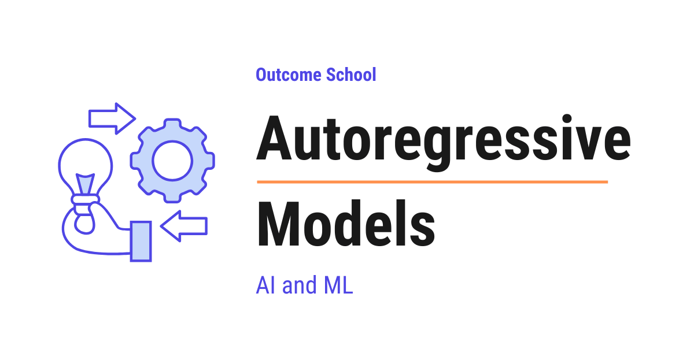

# What are Autoregressive Models?

> Archived from <https://outcomeschool.com/blog/autoregressive-models> on 2026-11-25.

An Autoregressive Model is a model that generates one piece at a time, like one word, by predicting the next piece from everything it has generated so far. This is how GPT-style models write text.

In this blog, we will learn about Autoregressive Models, the family of models that generate one piece at a time by predicting the next step from the past.

We will cover the following:
<ul><li>What is an Autoregressive Model?</li><li>The Chain Rule of Probability</li><li>The Generation Loop</li><li>Step-by-Step Numeric Example</li><li>Why GPT-style Models are Autoregressive</li><li>Why Autoregressive Models Need Causal Masking</li><li>The Connection with KV Cache</li><li>Autoregressive vs Non-Autoregressive Generation</li><li>Popular Autoregressive Models we should know</li><li>Pros and Cons of Autoregressive Models</li><li>Quick Summary</li></ul>
I am <strong>Amit Shekhar</strong>, Founder @ <a target="_blank" rel="noopener noreferrer" href="https://outcomeschool.com">Outcome School</a>, I have taught and mentored many developers, and their efforts landed them high-paying tech jobs, helped many tech companies in solving their unique problems, and created many open-source libraries being used by top companies. I am passionate about sharing knowledge through open-source, blogs, and videos.

I teach <a target="_blank" rel="noopener noreferrer" href="https://outcomeschool.com/program/ai-and-machine-learning">AI and Machine Learning</a> at Outcome School.

Let&#x27;s get started.
<h2 id="what-is-an-autoregressive-model">What is an Autoregressive Model?</h2>
Before we go further, let&#x27;s quickly understand what a <a target="_blank" rel="noopener noreferrer" href="tokenization-in-llms.md"><strong>token</strong></a> is. A token is a small piece of text that the model reads and writes - it can be a word, a part of a word, or even a single character. For example, the sentence <code>&quot;I love AI&quot;</code> can be split into the three tokens <code>&quot;I&quot;</code>, <code>&quot;love&quot;</code>, and <code>&quot;AI&quot;</code>. We will use the word &quot;token&quot; all over this blog.

Now, let&#x27;s decode the name itself.

<strong>Autoregressive = Auto (self) + Regressive (predicting from past values)</strong>
<ul><li><strong>Auto</strong> means <em>self</em>. The model uses its own previous outputs as the next input.</li><li><strong>Regressive</strong> means <em>predicting a value from past values</em>. In simple words, we look at history, and we predict the next number. A simple example: predicting tomorrow&#x27;s temperature from the temperatures of the last <code>7</code> days.</li></ul>
So, putting them together:

<strong>Autoregressive Model = A model that predicts the next token from all the previous tokens, one step at a time.</strong>

Means, the model looks at the past, and from the past it predicts the next step. Then it adds that new step to the past, and predicts the next one again. This loop continues until the model is done.

Let&#x27;s say we have the sentence:

<pre><code class="code-highlight">&quot;I love AI&quot;
</code></pre>

An autoregressive language model will:
<ol><li>See <code>&quot;I&quot;</code> and predict <code>&quot;love&quot;</code>.</li><li>See <code>&quot;I love&quot;</code> and predict <code>&quot;AI&quot;</code>.</li><li>See <code>&quot;I love AI&quot;</code> and predict the next token (often an <a target="_blank" rel="noopener noreferrer" href="stop-tokens-in-llms.md">end-of-sentence marker</a>).</li></ol>
Here, we can see the pattern. At every step, the model uses the full history so far to guess the next token. That is the heart of the idea.

This is exactly <a target="_blank" rel="noopener noreferrer" href="large-language-model-llm.md">how ChatGPT writes a sentence</a>, how WaveNet generates audio samples, and how PixelCNN paints an image pixel by pixel.

Now, the question is: how do we write this idea in a precise mathematical form? The answer is: the chain rule of probability.
<h2 id="the-chain-rule-of-probability">The Chain Rule of Probability</h2>
The autoregressive idea has a clean mathematical form. We use the chain rule of probability.

The chain rule of probability says that the joint probability (the probability of all the tokens occurring together as a sequence) of a full sequence can be written as a product of conditional probabilities, like below:

<pre><code class="code-highlight">P(x_1, x_2, ..., x_n) = P(x_1) * P(x_2 | x_1) * P(x_3 | x_1, x_2) * ... * P(x_n | x_1, x_2, ..., x_{n-1})
</code></pre>

Here:
<ul><li><code>x_1, x_2, ..., x_n</code> are the tokens in the sequence.</li><li><code>P(x_1, x_2, ..., x_n)</code> is the joint probability of the whole sequence.</li><li><code>P(x_i | x_1, ..., x_{i-1})</code> is the conditional probability (probability under a condition) of the <code>i</code>-th token given all the previous tokens.</li><li><code>*</code> means multiplication.</li><li><code>|</code> means <em>given</em>. So <code>P(B | A)</code> reads as &quot;the probability of B given A&quot;.</li></ul>
The idea is simple. To find the probability of a full sentence, we multiply the probability of each word, conditioned on every word that came before it.

Let&#x27;s put this into perspective with a small example. Suppose our sentence is <code>&quot;I love AI&quot;</code>. Then:

<pre><code class="code-highlight">P(&quot;I love AI&quot;) = P(&quot;I&quot;) * P(&quot;love&quot; | &quot;I&quot;) * P(&quot;AI&quot; | &quot;I&quot;, &quot;love&quot;)
</code></pre>

Here, we can see that every term on the right side asks the same question: given everything I have seen so far, what is the probability of the next word?

This is exactly the question an autoregressive model is trained to answer.

Now, let&#x27;s see what this loop looks like in practice.
<h2 id="the-generation-loop">The Generation Loop</h2>
Autoregressive generation is a loop. The same step repeats again and again, with the past growing by one token each time.

Let&#x27;s see the loop as a simple diagram:

<pre><code class="code-highlight">              +---------------------+
              |  Past tokens so far |
              +---------------------+
                        |
                        v
              +---------------------+
              |   Autoregressive    |
              |       Model         |
              +---------------------+
                        |
                        v
              +---------------------+
              |  Probabilities for  |
              |   the next token    |
              +---------------------+
                        |
                        v
              +---------------------+
              | Sample / pick one   |
              |     next token      |
              +---------------------+
                        |
                        v
              +---------------------+
              |  Append to past     |
              |  Repeat the loop    |
              +---------------------+
</code></pre>

Here, we can see the four moves of one generation step:
<ol><li>Feed the past tokens into the model.</li><li>The model gives us a probability for every possible next token.</li><li>We pick one token from those probabilities (this is called <a target="_blank" rel="noopener noreferrer" href="how-do-top-k-and-top-p-sampling-work.md">sampling</a>).</li><li>We append that token to the past, and we go back to step 1.</li></ol>
The loop runs until we hit an end-of-sentence marker, or until we reach a maximum length we set.

In pseudocode, the loop looks like below:

<pre><code class="code-highlight">past = [start_token]

while not done:
    probs = model(past)              # probabilities for the next token
    next_token = sample(probs)       # pick one token
    past = past + [next_token]       # append
    if next_token == end_token:
        done = True

output = past
</code></pre>

Here, we have a tight loop. Each pass through the loop produces exactly one token. So, to generate <code>100</code> tokens, the model runs <code>100</code> times.

This is the price we pay for being autoregressive. The output is high quality, because every new token is conditioned on the full past, but the generation is slow, because we cannot parallelize across tokens. I will come back to this trade-off later in the blog.

This one-token-at-a-time generation is also what makes token streaming possible - the moment each token is produced, an app can push it to the user instead of waiting for the whole reply. We have a blog on <a target="_blank" rel="noopener noreferrer" href="how-does-token-streaming-work.md">how Token Streaming works</a> that explains this step by step.

<strong>Planning your move into AI?</strong>

No matter which tech domain you work in today, with your effort, you can transition to these roles:
<ul><li>AI Engineer</li><li>Forward Deployed Engineer</li><li>AI Agent Engineer</li><li>Harness Engineer</li><li>Voice AI Engineer</li><li>AI Architect</li><li>LLM Engineer</li><li>LLM Inference Engineer</li><li>Gen AI Engineer</li><li>MLOps Engineer</li><li>ML Engineer</li><li>Deep Learning Engineer</li></ul>
Our <a target="_blank" rel="noopener noreferrer" href="https://outcomeschool.com/program/ai-and-machine-learning">AI and Machine Learning Program</a> at Outcome School takes you there.

Now, let&#x27;s run this loop on real numbers.
<h2 id="step-by-step-numeric-example">Step-by-Step Numeric Example</h2>
The best way to learn this is by taking an example. Let&#x27;s say our model has a tiny vocabulary of just <code>5</code> words:

<pre><code class="code-highlight">vocab = [&quot;I&quot;, &quot;love&quot;, &quot;AI&quot;, &quot;code&quot;, &quot;&lt;end&gt;&quot;]
</code></pre>

We start the generation with the first token <code>&quot;I&quot;</code>, and we will run the loop for a few steps.

I am using simple round numbers here for the sake of understanding. Real models work with vocabularies of <code>50,000+</code> tokens, but the idea is exactly the same.

<strong>Step 1: Predict the next token after <code>&quot;I&quot;</code>.</strong>

We give the past <code>[&quot;I&quot;]</code> to the model. The model returns a probability for every word in the vocabulary, like below:

<pre><code class="code-highlight">P(next | &quot;I&quot;) =
  &quot;I&quot;     -&gt; 0.05
  &quot;love&quot;  -&gt; 0.60
  &quot;AI&quot;    -&gt; 0.15
  &quot;code&quot;  -&gt; 0.15
  &quot;&lt;end&gt;&quot; -&gt; 0.05
</code></pre>

Here, we can see that all probabilities add up to <code>1.0</code> (<code>100%</code>). The model thinks <code>&quot;love&quot;</code> is the most likely next word, with <code>P(&quot;love&quot; | &quot;I&quot;) = 0.60</code>.

Now, we sample one token from this distribution. Sampling can be as simple as picking the highest-probability token (called <em><a target="_blank" rel="noopener noreferrer" href="greedy-decoding-vs-beam-search.md">greedy decoding</a></em>), or it can be more random (called <em><a target="_blank" rel="noopener noreferrer" href="how-does-temperature-control-llm-output.md">temperature sampling</a></em>). For this example, we go with greedy and pick the highest. We pick <code>&quot;love&quot;</code>. Our past becomes <code>[&quot;I&quot;, &quot;love&quot;]</code>.

<strong>Step 2: Predict the next token after <code>&quot;I love&quot;</code>.</strong>

We give the past <code>[&quot;I&quot;, &quot;love&quot;]</code> to the model. The model now uses both <code>&quot;I&quot;</code> and <code>&quot;love&quot;</code> to decide:

<pre><code class="code-highlight">P(next | &quot;I&quot;, &quot;love&quot;) =
  &quot;I&quot;     -&gt; 0.05
  &quot;love&quot;  -&gt; 0.05
  &quot;AI&quot;    -&gt; 0.70
  &quot;code&quot;  -&gt; 0.15
  &quot;&lt;end&gt;&quot; -&gt; 0.05
</code></pre>

Here, the probability of <code>&quot;AI&quot;</code> jumps to <code>0.70</code>. Because the model has now seen <code>&quot;love&quot;</code> as well, and <code>&quot;I love AI&quot;</code> is a common sentence, so the model leans heavily towards <code>&quot;AI&quot;</code>.

We sample, and we pick <code>&quot;AI&quot;</code>. Our past becomes <code>[&quot;I&quot;, &quot;love&quot;, &quot;AI&quot;]</code>.

<strong>Step 3: Predict the next token after <code>&quot;I love AI&quot;</code>.</strong>

We give the past <code>[&quot;I&quot;, &quot;love&quot;, &quot;AI&quot;]</code> to the model:

<pre><code class="code-highlight">P(next | &quot;I&quot;, &quot;love&quot;, &quot;AI&quot;) =
  &quot;I&quot;     -&gt; 0.05
  &quot;love&quot;  -&gt; 0.05
  &quot;AI&quot;    -&gt; 0.05
  &quot;code&quot;  -&gt; 0.05
  &quot;&lt;end&gt;&quot; -&gt; 0.80
</code></pre>

Here, the model thinks the sentence is complete, and <code>&lt;end&gt;</code> has the highest probability of <code>0.80</code>.

We sample, and we pick <code>&lt;end&gt;</code>. The loop stops.

<strong>Step 4: Compute the probability of the full sentence.</strong>

Using the chain rule of probability:

<pre><code class="code-highlight">P(&quot;I love AI &lt;end&gt;&quot;)
= P(&quot;I&quot;) * P(&quot;love&quot; | &quot;I&quot;) * P(&quot;AI&quot; | &quot;I&quot;, &quot;love&quot;) * P(&quot;&lt;end&gt;&quot; | &quot;I&quot;, &quot;love&quot;, &quot;AI&quot;)
</code></pre>

Let&#x27;s say <code>P(&quot;I&quot;) = 0.20</code> (the probability of starting with <code>&quot;I&quot;</code>). Then:

<pre><code class="code-highlight">P(&quot;I love AI &lt;end&gt;&quot;) = 0.20 * 0.60 * 0.70 * 0.80 = 0.0672
</code></pre>

Here, we can see that the probability of the full sentence is just the product of each step&#x27;s probability. This is exactly what the chain rule of probability told us at the start. The model never computes the full joint probability in one shot. It builds it up, one token at a time. This is the essence of an autoregressive model.

<strong>A quick note for you</strong>

No matter which tech domain you work in, get familiar with these topics:
<ul><li>LLM</li><li>RAG</li><li>MCP</li><li>Agent</li><li>Fine-tuning</li><li>Quantization</li></ul>
We put it all together in one video:

<a target="_blank" rel="noopener noreferrer" href="https://www.youtube.com/watch?v=lnfWvX66FUk">AI Engineering Explained: LLM, RAG, MCP, Agent, Fine-Tuning, and Quantization</a>

No need to stop reading - bookmark it and watch later when you get time. Future you will thank you.

Now, let&#x27;s get back to the topic.

Now, let&#x27;s connect this to the model family we hear about every day.
<h2 id="why-gpt-style-models-are-autoregressive">Why GPT-style Models are Autoregressive</h2>
<strong>GPT (Generative Pre-trained Transformer)</strong> is autoregressive by design. The first word, <a target="_blank" rel="noopener noreferrer" href="what-is-generative-ai.md"><em>Generative</em></a>, is the key. The language models like Claude, Gemini, and LLaMA - they are all autoregressive, and they are all <a target="_blank" rel="noopener noreferrer" href="encoder-vs-decoder-in-transformers.md">decoder-only</a> Transformers.

A GPT-style model is <a target="_blank" rel="noopener noreferrer" href="llm-pretraining.md">trained on one simple task</a>: given the past tokens, predict the next token.

That is it. Just next-token prediction, again and again, on huge amounts of text.

So, when we ask ChatGPT a question, here is what happens at a high level:
<ol><li>Our prompt is the starting <code>past</code>.</li><li>The model predicts the next token.</li><li>The new token is appended to the past.</li><li>The model predicts the next token again.</li><li>This repeats until the model decides to stop.</li></ol>
This is the autoregressive loop we just saw. GPT is autoregressive by design. That is why GPT-style models can keep writing as long as we let them - they always have a <em>past</em> to look at, and they always know how to predict one more token from it.

If we want to go deeper into how the Transformer works inside GPT-style models, we can read <a target="_blank" rel="noopener noreferrer" href="decoding-transformer-architecture.md">Decoding Transformer Architecture</a>.

To learn LLM Fundamentals, LLM Internals, and how to build a Large Language Model (LLM) from scratch, check out our <a target="_blank" rel="noopener noreferrer" href="https://outcomeschool.com/program/ai-and-machine-learning">AI and Machine Learning Program</a> at Outcome School.

Now, here is a natural question. If the model only looks at the past, how do we make sure it does not accidentally peek at the future during training? This is where causal masking comes into the picture.
<h2 id="why-autoregressive-models-need-causal-masking">Why Autoregressive Models Need Causal Masking</h2>
During training, an autoregressive model sees the full sentence at once, but it must still predict each token using only the tokens that came before it. The model must never peek at the future tokens. If it does, training is broken - the model just copies the answer instead of learning to predict it.

So, here comes <strong>Causal Masking</strong> to the rescue. Causal masking is a simple trick inside the attention layer that hides future tokens from each position.

Let&#x27;s say we have the sentence <code>&quot;I love AI&quot;</code>. During training:
<ul><li>When the model is predicting the token at position <code>1</code> (<code>&quot;love&quot;</code>), it can look at position <code>0</code> (<code>&quot;I&quot;</code>) only.</li><li>When the model is predicting the token at position <code>2</code> (<code>&quot;AI&quot;</code>), it can look at positions <code>0</code> and <code>1</code> (<code>&quot;I&quot;</code>, <code>&quot;love&quot;</code>).</li><li>And so on.</li></ul>
This rule is enforced inside attention by setting the attention scores for future positions to a very small number (negative infinity), so after softmax their attention weight becomes <code>0</code>. Here, <a target="_blank" rel="noopener noreferrer" href="softmax-function.md"><strong>softmax</strong></a> is a function that turns a list of raw scores into probabilities that add up to <code>1.0</code>. When we feed it negative infinity for a position, that position gets a probability of <code>0</code>, which means it is fully ignored.

The mask looks like below for a <code>3</code>-token sentence:

<pre><code class="code-highlight">            &quot;I&quot;     &quot;love&quot;   &quot;AI&quot;
&quot;I&quot;      [   1        0        0   ]
&quot;love&quot;   [   1        1        0   ]
&quot;AI&quot;     [   1        1        1   ]
</code></pre>

Here, <code>1</code> means &quot;allowed to look&quot;, and <code>0</code> means &quot;blocked&quot;. The first row is for the token <code>&quot;I&quot;</code> - it can only look at itself. The second row is for <code>&quot;love&quot;</code> - it can look at <code>&quot;I&quot;</code> and itself. The third row is for <code>&quot;AI&quot;</code> - it can look at all three. The upper triangle is full of <code>0</code>s, which is why this is called a <em>triangular mask</em>.

Means, the model is forced to behave autoregressively, even when it sees the whole sentence at once during training.

<strong>Note:</strong> During training, the model sees the full sentence in one shot, and causal masking enforces the autoregressive rule. During inference (generation), the model produces one token at a time, so the rule is enforced naturally - there is no future token to peek at. Same model, two slightly different behaviors.

We have a detailed blog on <a target="_blank" rel="noopener noreferrer" href="causal-masking-in-attention.md">Causal Masking in Attention</a> that explains this in depth.

Now, let&#x27;s see another important consequence of being autoregressive.
<h2 id="the-connection-with-kv-cache">The Connection with KV Cache</h2>
Autoregressive generation is slow because the model runs once per token. For a <code>1,000</code>-token output, the model runs <code>1,000</code> times.

And, here is the painful part. At every step, the model looks at the full past. If the past has <code>999</code> tokens, the attention layer must compute Keys and Values for all <code>999</code> tokens, plus the new one. This is repeated work, because we have already computed those Keys and Values in the previous steps.

So, here comes the <a target="_blank" rel="noopener noreferrer" href="kv-cache-in-llms.md">KV Cache</a> into the picture. The idea is simple: store the Keys and Values from previous steps, and reuse them in the next step. We only compute the Key and Value for the new token, not for all the old ones again.

This stored memory is called the <strong>KV Cache</strong> - where K stands for Key and V stands for Value. We have a detailed blog on <a target="_blank" rel="noopener noreferrer" href="kv-cache-in-llms.md">KV Cache in LLMs</a> that explains this in depth.

Let&#x27;s put this into perspective with real numbers. Suppose we are generating <code>1,000</code> tokens. Without KV Cache, at step <code>t</code> we recompute Keys and Values for all <code>t</code> past tokens. Across all <code>1,000</code> steps, that adds up to roughly <code>1 + 2 + 3 + ... + 1000 = 500,500</code> units of Key/Value work. With KV Cache, at every step we compute the Key and Value for only the new token, so total Key/Value work is roughly <code>1,000</code> units.

Means, KV Cache turns roughly <code>500,500</code> units of redundant Key/Value work into roughly <code>1,000</code> units. That is a huge speedup, and it exists because the model is autoregressive.

I am sure we can now see why KV Cache exists. It exists because autoregressive generation has a very specific shape - the past does not change between steps, only one new token is added. So, we cache the past.

Now, let&#x27;s compare autoregressive generation with the other side of the coin.
<h2 id="autoregressive-vs-non-autoregressive-generation">Autoregressive vs Non-Autoregressive Generation</h2>
Autoregressive generation is sequential. We produce one token, then the next, then the next. Each token depends on all the previous tokens.

Non-autoregressive generation is parallel. The model tries to produce many tokens at the same time, in one shot, without waiting for the previous ones.

Let me tabulate the differences between Autoregressive and Non-Autoregressive generation for your better understanding so that you can decide which one to use based on your use case.
<table><thead><tr><th>Aspect</th><th>Autoregressive</th><th>Non-Autoregressive</th></tr></thead><tbody><tr><td>Generation order</td><td>One token at a time, left to right</td><td>Many tokens at once, in parallel</td></tr><tr><td>Each token depends on</td><td>All previous tokens</td><td>Limited or no dependence on other generated tokens</td></tr><tr><td>Speed</td><td>Slow (one model run per token)</td><td>Fast (one model run for many tokens)</td></tr><tr><td>Quality</td><td>Generally higher, fluent text</td><td>Generally lower, can produce repeated or off-topic tokens</td></tr><tr><td>Training</td><td>Simple - just next-token prediction</td><td>More complex objectives</td></tr><tr><td>Examples</td><td>GPT, WaveNet, PixelCNN</td><td>Some translation models, parallel decoders</td></tr></tbody></table>
A <a target="_blank" rel="noopener noreferrer" href="variational-autoencoders.md">Variational Autoencoder</a> is a classic example of a non-autoregressive generative model - it produces a whole output in one shot by sampling from a smooth latent space, rather than one piece at a time. A <a target="_blank" rel="noopener noreferrer" href="generative-adversarial-networks.md">Generative Adversarial Network (GAN)</a> is another non-autoregressive example - two networks compete to produce a whole image at once, again rather than one piece at a time.

For text specifically, the leading non-autoregressive approach is the Diffusion Language Model, which fills and refines the whole sentence in parallel instead of one token at a time. We have a blog on <a target="_blank" rel="noopener noreferrer" href="how-do-diffusion-language-models-dlms-work.md">how Diffusion Language Models (DLMs) work</a> that covers this end to end.

Now, let&#x27;s see where autoregressive models are used.
<h2 id="popular-autoregressive-models-we-should-know">Popular Autoregressive Models we should know</h2>
Autoregressive models are not just for text. The same one-step-at-a-time idea applies to any kind of sequence. Let&#x27;s see a few popular examples.

<strong>1. Language models (GPT family).</strong> The most famous example. The model generates text one token at a time, conditioned on the prompt and everything generated so far.

<strong>2. PixelCNN (image generation).</strong> The model generates an image one pixel at a time. Each new pixel is predicted from the pixels above and to the left of it. The image is the <em>sequence</em>.

<strong>3. WaveNet (audio generation).</strong> The model generates raw audio one sample at a time. Audio sampled at <code>16,000</code> samples per second means the model runs <code>16,000</code> times to produce just <code>1</code> second of audio. Slow, but very high quality.

<strong>4. Music generation models.</strong> Many music models generate notes one at a time, conditioned on all the previous notes, just like words in a sentence.

Here, we can notice the common pattern. Whatever the data is - text, pixels, audio samples, notes - if we can lay it out as a sequence, we can apply the autoregressive idea on top of it.

We have a complete program on Generative AI - Autoregressive Models, Diffusion Models, and Variational Autoencoders (VAEs) - check out our <a target="_blank" rel="noopener noreferrer" href="https://outcomeschool.com/program/ai-and-machine-learning">AI and Machine Learning Program</a> at Outcome School.

Now, let&#x27;s look at the trade-offs.
<h2 id="pros-and-cons-of-autoregressive-models">Pros and Cons of Autoregressive Models</h2>
Let&#x27;s understand what we gain and what we lose by being autoregressive.

On the good side, the output is coherent and fluent, because the model uses the full past at every step. The training objective is also as simple as it gets - just predict the next token. The length is flexible too. The model can keep generating as long as we want, and we control when to stop. One more big win: a single autoregressive language model can do translation, summarization, question answering, code generation, and many other tasks. One model, many jobs.

On the painful side, generation is slow. We must produce tokens one by one. To generate <code>100</code> tokens, the model runs <code>100</code> times. The wait time grows with output length too. A <code>1,000</code>-token answer takes roughly <code>10x</code> longer to generate than a <code>100</code>-token answer. And then there is the error compounding problem. A bad early token can hurt the whole output, because every later token is conditioned on it. If token <code>5</code> is wrong, tokens <code>6</code>, <code>7</code>, <code>8</code>, and so on are all conditioned on a wrong past. We also cannot parallelize generation. Token <code>t+1</code> cannot be computed before token <code>t</code> is known.

To soften these problems, we use techniques like KV Cache, <a target="_blank" rel="noopener noreferrer" href="speculative-decoding.md">Speculative Decoding</a>, and better sampling strategies. We have a detailed blog on <a target="_blank" rel="noopener noreferrer" href="decoding-medusa.md">Medusa</a> that explains how a model can guess several of its own next tokens in one pass, and one on <a target="_blank" rel="noopener noreferrer" href="decoding-eagle.md">EAGLE</a> that makes those guesses more accurate by drafting at the feature level. But the core trade-off - slower generation, higher quality - is built into the autoregressive idea itself.

<strong>Stay updated:</strong> Subscribe to our <a target="_blank" rel="noopener noreferrer" href="https://outcomeschool.substack.com/subscribe">newsletter</a> to get our latest AI and Machine Learning blogs straight to your inbox.
<h2 id="quick-summary">Quick Summary</h2>
Let&#x27;s recap what we have learned:
<ul><li><strong>Autoregressive Model.</strong> A model that predicts the next token using all the previous tokens, one step at a time.</li><li><strong>Auto + Regressive.</strong> <em>Auto</em> means self, <em>regressive</em> means predicting from past values. So the model uses its own past outputs to predict the next one.</li><li><strong>Chain rule of probability.</strong> <code>P(x_1, ..., x_n) = P(x_1) * P(x_2 | x_1) * ... * P(x_n | x_1, ..., x_{n-1})</code>. The math behind autoregressive generation.</li><li><strong>Generation loop.</strong> Feed the past, get probabilities, sample one token, append, repeat.</li><li><strong>GPT-style models.</strong> Trained purely on next-token prediction. They are autoregressive by design.</li><li><strong>Causal masking.</strong> Hides future tokens during training so the model is forced to be autoregressive.</li><li><strong>KV Cache.</strong> Caches the Keys and Values of past tokens, so each new step computes Key and Value for only the new token. For <code>1,000</code> tokens, this turns roughly <code>500,500</code> units of redundant work into roughly <code>1,000</code> units. Exists because of the autoregressive shape.</li><li><strong>Autoregressive vs Non-Autoregressive.</strong> Autoregressive is sequential and high-quality. Non-autoregressive is parallel and faster, but quality often suffers.</li><li><strong>Use cases.</strong> Text (GPT), images (PixelCNN), audio (WaveNet), music. Anything that can be viewed as a sequence.</li><li><strong>Trade-off.</strong> High quality and simple training, at the cost of slow, sequential generation.</li></ul>
Now, we have understood Autoregressive Models.
<h2 id="frequently-asked-questions">Frequently Asked Questions</h2><h3 id="when-does-an-autoregressive-model-stop-generating">When does an autoregressive model stop generating?</h3>
An autoregressive model stops when it produces an end-of-sentence marker, or when it reaches a maximum length we set. Until then, the loop keeps running. It feeds the past tokens in, picks one next token, appends it, and repeats.
<h3 id="why-do-longer-llm-answers-take-longer-to-generate">Why do longer LLM answers take longer to generate?</h3>
The model runs once per token, so the wait time grows with the output length. To generate 100 tokens, the model runs 100 times. A 1,000-token answer takes roughly 10x longer than a 100-token answer, because token t+1 cannot be computed before token t is known.
<h3 id="what-is-greedy-decoding-in-autoregressive-models">What is greedy decoding in autoregressive models?</h3>
Greedy decoding means picking the highest-probability token at every step. It is the simplest way to sample the next token from the model&#x27;s probabilities. Sampling can also be more random, which is called temperature sampling.
<h3 id="can-one-wrong-token-spoil-the-rest-of-the-output">Can one wrong token spoil the rest of the output?</h3>
Yes. This is called the error compounding problem. Every later token is conditioned on the earlier ones, so a bad early token can hurt the whole output. If token 5 is wrong, tokens 6, 7, 8, and so on are all conditioned on a wrong past.

That&#x27;s it for now.

Thanks

<strong>Amit Shekhar</strong> Founder @ <a target="_blank" rel="noopener noreferrer" href="https://outcomeschool.com">Outcome School</a>

You can connect with me on:
<ul><li><a target="_blank" rel="noopener noreferrer" href="https://x.com/amitiitbhu">X</a></li><li><a target="_blank" rel="noopener noreferrer" href="https://www.linkedin.com/in/amit-shekhar-iitbhu">LinkedIn</a></li><li><a target="_blank" rel="noopener noreferrer" href="https://github.com/amitshekhariitbhu">GitHub</a></li></ul>
Follow Outcome School on:
<ul><li><a target="_blank" rel="noopener noreferrer" href="https://x.com/outcome_school">X</a></li><li><a target="_blank" rel="noopener noreferrer" href="https://youtube.com/@OutcomeSchool">YouTube</a></li><li><a target="_blank" rel="noopener noreferrer" href="https://www.linkedin.com/company/outcomeschool">LinkedIn</a></li><li><a target="_blank" rel="noopener noreferrer" href="https://github.com/OutcomeSchool">GitHub</a></li></ul>
<a target="_blank" rel="noopener noreferrer" href="https://outcomeschool.com/blog"><strong>Read all of our high-quality blogs here.</strong></a>

