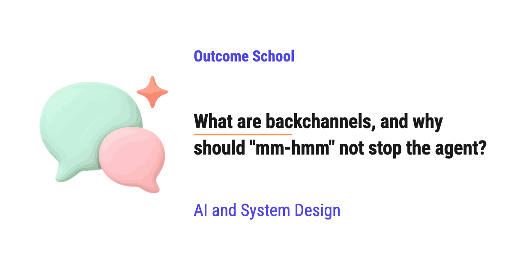

# What are backchannels, and why should "mm-hmm" not stop the agent?

> Archived from <https://outcomeschool.com/blog/backchannels-in-voice-agents> on 2026-11-25.

Backchannels are the short sounds like &quot;mm-hmm&quot;, &quot;yeah&quot;, and &quot;okay&quot; that a listener makes to tell the speaker &quot;I am following you, please continue&quot;. A voice agent must not stop for them, because the person is asking the agent to keep going, not asking to speak.

In this blog, we will learn about what backchannels are and why &quot;mm-hmm&quot; should not stop the agent. We will also see how backchannels work in a normal human conversation, what goes wrong when a voice agent treats them as interruptions, how an agent tells a backchannel apart from a real interruption, what the agent does while it is still unsure, and where this works well and where it fails.

We will cover the following:
<ul><li>What is a backchannel?</li><li>Backchannels in a normal conversation</li><li>What goes wrong when &quot;mm-hmm&quot; stops the agent</li><li>Backchannel vs real interruption</li><li>How a voice agent tells them apart</li><li>What the agent does while it is unsure</li><li>A complete example</li><li>Where it works well and where it fails</li></ul>
I am <strong>Amit Shekhar</strong>, Founder @ <a target="_blank" rel="noopener noreferrer" href="https://outcomeschool.com">Outcome School</a>, I have taught and mentored many developers, and their efforts landed them high-paying tech jobs, helped many tech companies in solving their unique problems, and created many open-source libraries being used by top companies. I am passionate about sharing knowledge through open-source, blogs, and videos.

I teach <a target="_blank" rel="noopener noreferrer" href="https://outcomeschool.com/program/ai-and-machine-learning">AI and Machine Learning</a> at Outcome School.

Let&#x27;s get started.
<h2 id="what-is-a-backchannel">What is a backchannel?</h2>
<strong>A backchannel is a short sound or word that a listener makes while someone else is speaking, to show that they are listening and that the speaker can continue.</strong>

Common examples are:
<ul><li>&quot;mm-hmm&quot;</li><li>&quot;uh-huh&quot;</li><li>&quot;yeah&quot;</li><li>&quot;okay&quot;</li><li>&quot;right&quot;</li><li>&quot;I see&quot;</li><li>&quot;wow&quot;</li></ul>
The term was introduced by the linguist Victor Yngve in 1970. He noticed that in a conversation, there are two channels at the same time. The <strong>main channel</strong> belongs to the person who holds the turn and is speaking. The <strong>back channel</strong> belongs to the listener, who keeps sending small signals back to the speaker without taking the turn. So, a backchannel is a small message that travels back from the listener to the speaker, while the main message is still going on.

<strong>A backchannel is not an attempt to take the turn.</strong> The listener is not asking to speak. The listener is saying, &quot;Go on, I am with you.&quot;

We have a detailed blog on <a target="_blank" rel="noopener noreferrer" href="what-is-turn-taking-in-a-voice-ai-agent.md">turn-taking in a voice AI agent</a> that explains how the speaker and the listener share the conversation.
<h2 id="backchannels-in-a-normal-conversation">Backchannels in a normal conversation</h2>
Let&#x27;s say our friend is telling us about a trip.

<pre><code class="code-highlight">Friend: So we reached the station at 6 in the morning,
Us:     mm-hmm
Friend: and the train was already full,
Us:     oh no
Friend: so we had to wait for the next one.
</code></pre>

Here, we spoke twice while our friend was talking. But our friend never stopped. Our friend did not say, &quot;Yes? Do you want to say something?&quot; Our friend just continued the story.

This is how humans talk. We send backchannels all the time, and that too without even thinking about it. If we stay completely silent on a phone call, the other person often asks, &quot;Hello? Are you there?&quot; Means, backchannels are a part of what makes a conversation feel natural.

We have a detailed blog on <a target="_blank" rel="noopener noreferrer" href="agent-side-backchannels.md">how a voice agent adds its own backchannels like &quot;okay&quot; and &quot;got it&quot;</a> that explains how the agent sends these sounds while we talk.

Backchannels are also not the same in every language and culture. In Japanese, they have an everyday name, <strong>aizuchi</strong>, and listeners use them much more often than in English. So, a <a target="_blank" rel="noopener noreferrer" href="design-a-real-time-voice-ai-agent.md">voice agent</a> that talks to people around the world will hear a lot of them.

Now, let&#x27;s see what happens when a voice agent hears these small sounds.
<h2 id="what-goes-wrong-when-mm-hmm-stops-the-agent">What goes wrong when &quot;mm-hmm&quot; stops the agent</h2>
Before jumping into the problem, we must know how a voice agent listens while it speaks.

A voice agent has three main parts. <strong>Speech-to-Text (STT)</strong> converts our voice into text, an <a target="_blank" rel="noopener noreferrer" href="large-language-model-llm.md"><strong>LLM (Large Language Model)</strong></a> reads that text and writes a reply, and <strong>Text-to-Speech (TTS)</strong> converts the reply into voice.

A voice agent keeps its microphone on even while it is talking, so that we can interrupt it. When we start speaking in the middle of the agent&#x27;s reply, it is called <a target="_blank" rel="noopener noreferrer" href="what-is-barge-in-in-a-voice-ai-agent.md"><strong>barge-in</strong></a>. The agent detects this and stops talking, so that it can listen to us.

The simplest way to detect barge-in is to use <strong>Voice Activity Detection (VAD)</strong>. VAD is a component, usually a small model, that listens to the audio and answers one question: &quot;Is a human voice present right now, yes or no?&quot; Before VAD runs, the agent removes its own voice from the microphone sound using <strong>echo cancellation</strong>, so that it does not hear itself.

So, the simplest rule is:

<pre><code class="code-highlight">If VAD hears a human voice while the agent is speaking
    ↓
Stop the agent immediately
</code></pre>

This rule looks fine. But, VAD only knows that someone made a voice sound. It does not know what that sound means. &quot;Stop&quot; and &quot;mm-hmm&quot; look the same to VAD. Both are a human voice.

Let&#x27;s say we call a voice agent to know the steps to reset our internet router.

<pre><code class="code-highlight">Agent: First, unplug the router from the power socket.
Us:    mm-hmm
Agent: (stops talking)
Agent: Sorry, did you want to say something?
Us:    No, please continue.
Agent: Sure. First, unplug the router from the power socket...
</code></pre>

Here, we just said &quot;mm-hmm&quot; to show that we were following. But the agent treated it as an interruption. It stopped, asked a question, and then started again from the beginning.

The following issues arise:
<ul><li>The conversation keeps breaking, again and again.</li><li>The agent repeats what it has already said, which wastes time.</li><li>We start to stay silent while the agent speaks, which feels unnatural.</li><li>In the worst case, the agent throws away the rest of its answer and replies to &quot;mm-hmm&quot; as if it were a new question.</li></ul>
This mistake is called a <strong>false barge-in</strong>, which means the agent stops for something that was not a real interruption. Backchannels are a common cause of false barge-ins. We have a detailed blog on <a target="_blank" rel="noopener noreferrer" href="interruption-vs-background-noise.md">how a voice agent tells a real interruption from a cough or background noise</a> that covers the other causes step by step.

So, the agent must learn one thing: <strong>not every voice in the middle of its reply is an interruption.</strong>

<strong>Planning your move into AI?</strong>

No matter which tech domain you work in today, with your effort, you can transition to these roles:
<ul><li>AI Engineer</li><li>Forward Deployed Engineer</li><li>AI Agent Engineer</li><li>Harness Engineer</li><li>Voice AI Engineer</li><li>AI Architect</li><li>LLM Engineer</li><li>LLM Inference Engineer</li><li>Gen AI Engineer</li><li>MLOps Engineer</li><li>ML Engineer</li><li>Deep Learning Engineer</li></ul>
Our <a target="_blank" rel="noopener noreferrer" href="https://outcomeschool.com/program/ai-and-machine-learning">AI and Machine Learning Program</a> at Outcome School takes you there.
<h2 id="backchannel-vs-real-interruption">Backchannel vs real interruption</h2>
Now, the question is: how is &quot;mm-hmm&quot; different from a real interruption?

Let&#x27;s look at a few things the user can say while the agent is speaking:
<table><thead><tr><th>What the user says</th><th>What the user means</th><th>What the agent must do</th></tr></thead><tbody><tr><td>&quot;mm-hmm&quot;</td><td>I am following you</td><td>Keep talking</td></tr><tr><td>&quot;yeah, okay&quot;</td><td>Go on</td><td>Keep talking</td></tr><tr><td>&quot;right&quot;</td><td>I agree, continue</td><td>Keep talking</td></tr><tr><td>&quot;wait&quot;</td><td>Stop, I want to speak</td><td>Stop and listen</td></tr><tr><td>&quot;no, not that one&quot;</td><td>You got it wrong</td><td>Stop and listen</td></tr><tr><td>&quot;can you repeat the address&quot;</td><td>I have a new question</td><td>Stop and listen</td></tr></tbody></table>
Here, we can see a clear pattern. A backchannel is short, it carries no new information, and it does not ask the agent to do anything. A real interruption carries a new meaning: a correction, a question, or a request to stop.

But, the same word can also mean two different things. Consider the word &quot;okay&quot;:
<ul><li>&quot;okay&quot; said softly in the middle of the agent&#x27;s sentence is a backchannel. It means &quot;go on&quot;.</li><li>&quot;okay, okay, I got it&quot; said loudly and quickly is a request to stop. It means &quot;enough, you can stop now&quot;.</li><li>&quot;okay, but what about the price?&quot; starts like a backchannel and then becomes a real question.</li></ul>
So, the agent cannot decide only by looking at one word. It must look at a few signals together.
<h2 id="how-a-voice-agent-tells-them-apart">How a voice agent tells them apart</h2>
A voice agent uses a few signals to tell a backchannel apart from a real interruption. Let&#x27;s see them one by one.
<h3 id="signal-1-how-long-the-sound-is">Signal 1: How long the sound is</h3>
A backchannel is usually very short, often less than a second. A real interruption is usually longer, because the person is saying a full sentence.

So, the agent can wait for a minimum amount of speech before it decides to stop. Let&#x27;s say the agent waits until the user has been speaking for at least half a second.

<strong>Advantage:</strong> It is simple, and it ignores short sounds like a cough or a quick &quot;mm&quot;.

<strong>Disadvantage:</strong> A real &quot;stop&quot; or &quot;wait&quot; is also very short, so it can get ignored. And a backchannel like &quot;yeah, yeah, okay&quot; can be longer than the limit.

So, time alone is not enough.
<h3 id="signal-2-what-the-words-are">Signal 2: What the words are</h3>
As we saw earlier, the agent already uses Speech-to-Text to convert the user&#x27;s voice into text. So, once the agent has the words, it can check them.
<ul><li>If the words are only from a list like &quot;mm-hmm&quot;, &quot;uh-huh&quot;, &quot;yeah&quot;, &quot;okay&quot;, &quot;right&quot;, it is most likely a backchannel.</li><li>If the words contain &quot;stop&quot;, &quot;wait&quot;, &quot;no&quot;, &quot;hold on&quot;, or a new question, it is most likely a real interruption.</li></ul>
A simple version of this check looks like below:

<pre><code class="code-highlight language-python">BACKCHANNELS = {&quot;mm-hmm&quot;, &quot;mhm&quot;, &quot;uh-huh&quot;, &quot;yeah&quot;, &quot;yes&quot;, &quot;okay&quot;, &quot;ok&quot;, &quot;right&quot;, &quot;sure&quot;}

def is_backchannel(text):
    for mark in &quot;,.!?&quot;:
        text = text.replace(mark, &quot; &quot;)
    words = text.lower().split()
    if len(words) == 0 or len(words) &gt; 3:
        return False
    return all(word in BACKCHANNELS for word in words)
</code></pre>

Here, we have a small set of common backchannel words. The function first removes the punctuation marks, converts the text to lowercase, and splits it into words. If the user said more than three words, it is treated as a real interruption, because a backchannel is short. Then, it checks that every word is a backchannel word. So, &quot;yeah okay&quot; returns <code>True</code>, but &quot;okay but what about the price&quot; returns <code>False</code>.

<strong>Note:</strong> Real STT systems can write the same sound in different ways, such as &quot;mm hmm&quot;, &quot;mmhmm&quot;, or &quot;uh huh&quot;. So, in practice, the list must cover these spellings too.

<strong>Advantage:</strong> It understands the actual words, so &quot;wait&quot; and &quot;mm-hmm&quot; are no longer the same.

<strong>Disadvantage:</strong> STT needs a little time to produce the words. And a fixed list cannot understand meaning. &quot;Right&quot; can be a backchannel, but &quot;right, but that is not my question&quot; is not.

<strong>A quick note for you</strong>

No matter which tech domain you work in, get familiar with these topics:
<ul><li>LLM</li><li>RAG</li><li>MCP</li><li>Agent</li><li>Fine-tuning</li><li>Quantization</li></ul>
We put it all together in one video:

<a target="_blank" rel="noopener noreferrer" href="https://www.youtube.com/watch?v=lnfWvX66FUk">AI Engineering Explained: LLM, RAG, MCP, Agent, Fine-Tuning, and Quantization</a>

No need to stop reading - bookmark it and watch later when you get time. Future you will thank you.

Now, let&#x27;s get back to the topic.
<h3 id="signal-3-how-it-is-said">Signal 3: How it is said</h3>
Humans do not only listen to words. We also listen to the tone. A backchannel is usually soft and low in volume. A real interruption is often louder, faster, and has more energy, because the person wants the agent to stop.

Some voice agents use an audio model that listens to these features of the voice, such as volume, pitch, and speed. This helps in cases where the words are the same but the intention is different, like the soft &quot;okay&quot; and the loud &quot;okay, okay, I got it&quot; that we saw earlier.
<h3 id="signal-4-when-it-is-said">Signal 4: When it is said</h3>
Humans do not send backchannels at random moments. We usually send them at small natural pauses, for example at the end of a phrase, when the speaker takes a short breath.

In our trip example, we said &quot;mm-hmm&quot; right after &quot;at 6 in the morning&quot;. That is a natural place for a backchannel.

So, if a short sound arrives exactly at a small pause in the agent&#x27;s speech, it is more likely a backchannel. The agent knows where these pauses are, because it created that speech itself. If the user starts speaking in the middle of the agent&#x27;s sentence, and keeps speaking, it is more likely a real interruption.
<h3 id="signal-5-a-model-that-looks-at-everything-together">Signal 5: A model that looks at everything together</h3>
Instead of writing separate rules for each signal, we can train a small model on real conversations. This model looks at the audio, the words, and the timing together, and gives a single answer: backchannel or real interruption.

For the sake of understanding, we can think of it like below:

<pre><code class="code-highlight">User audio + words + timing
    ↓
Interruption model
    ↓
&quot;backchannel&quot; or &quot;interruption&quot;
</code></pre>

The model learns from many examples of real conversations, where people have marked which sounds were backchannels and which were real interruptions. This usually handles the tricky cases better than a fixed list.

Newer <a target="_blank" rel="noopener noreferrer" href="half-duplex-vs-full-duplex-voice-agents.md"><strong>full-duplex</strong></a> speech models go one step further. Full-duplex means the model can listen and speak at the same time, just like two people on a phone call. Such a model can learn from conversation data when to keep talking, when to stop, and when a sound is just a backchannel, without a separate set of rules.

To learn Multimodal AI and how to Design a Real-Time Voice AI Agent end to end, we can check out our <a target="_blank" rel="noopener noreferrer" href="https://outcomeschool.com/program/ai-and-machine-learning">AI and Machine Learning Program</a> at Outcome School.
<h2 id="what-the-agent-does-while-it-is-unsure">What the agent does while it is unsure</h2>
There is still one problem. All the signals above need a little time. VAD hears the voice almost instantly, but the words from Speech-to-Text come a bit later.

So, what must the agent do in that small gap?

If it stops immediately, it can stop for a backchannel. If it waits too long, it keeps talking over a person who really wants to speak.

Here comes the <strong>soft pause</strong> into the picture.

When VAD first hears the user&#x27;s voice, the agent does not stop fully. Instead, it lowers its volume or pauses for a moment, and keeps its place in the sentence. Then:
<ul><li>If the signals say it was a backchannel, the agent <a target="_blank" rel="noopener noreferrer" href="false-interruption-recovery.md">continues from the same place</a>.</li><li>If the signals say it was a real interruption, the agent stops fully and listens.</li></ul>
<pre><code class="code-highlight">User makes a sound while the agent speaks
    ↓
Agent lowers its volume and keeps its place
    ↓
Check the length, words, tone, and timing
    ↓
Is it a backchannel?
    ↓
Yes: continue from the same place
No:  stop fully and listen
</code></pre>

This way, the agent reacts fast, and it still does not throw away its answer by mistake.

One more thing to notice: a backchannel must not be sent to the LLM as a new message. If the agent sends &quot;mm-hmm&quot; to the LLM as if the user asked something, the LLM often tries to reply to it, with something like &quot;Great, is there anything else I can help you with?&quot; So, when a backchannel is detected, the agent does not treat it as a new turn and keeps going.
<h2 id="a-complete-example">A complete example</h2>
Let&#x27;s take the router example again, now with backchannel handling.

<pre><code class="code-highlight">Agent: First, unplug the router from the power socket.
       Then, wait for thirty seconds.
Us:    mm-hmm
Agent: After that, plug it back in and wait for the lights to turn green.
Us:    okay
Agent: Once the lights are green, try opening a website.
Us:    wait, which light should be green?
Agent: (stops) The light with the internet symbol on it.
</code></pre>

Let&#x27;s see what happened at each step:
<ul><li><strong>Step 1:</strong> We said &quot;mm-hmm&quot;. VAD heard a voice, so the agent lowered its volume. STT gave the text &quot;mm-hmm&quot;. It is short, it is in the backchannel list, and it came at a natural pause. So, the agent continued from the same place.</li><li><strong>Step 2:</strong> We said &quot;okay&quot;. The same checks passed. It was soft and short. The agent continued.</li><li><strong>Step 3:</strong> We said &quot;wait, which light should be green?&quot;. STT gave a longer text with the word &quot;wait&quot; and a question. This is a real interruption. The agent stopped fully, and the LLM got our question as a new message.</li></ul>
The agent never broke the flow for the backchannels, and it still stopped quickly when we needed it to. This is how a voice agent handles backchannels.

<strong>Stay updated:</strong> Subscribe to our <a target="_blank" rel="noopener noreferrer" href="https://outcomeschool.substack.com/subscribe">newsletter</a> to get our latest AI and Machine Learning blogs straight to your inbox.
<h2 id="where-it-works-well-and-where-it-fails">Where it works well and where it fails</h2>
It works well:
<ul><li>For common backchannels like &quot;mm-hmm&quot;, &quot;yeah&quot;, &quot;okay&quot;, and &quot;right&quot;, which are short and easy to recognize.</li><li>When the user speaks clearly and the audio is clean.</li><li>When the agent uses a soft pause, so that it does not lose its place.</li><li>When it combines more than one signal instead of depending only on VAD.</li></ul>
It fails or struggles:
<ul><li>When the same word can mean two things, like &quot;okay&quot; or &quot;right&quot;, and the tone is not clear.</li><li>When a backchannel turns into a real sentence, like &quot;yeah, yeah, but...&quot;, because the agent must change its decision in the middle.</li><li>With noisy audio, where it is hard to hear the length and the tone.</li><li>With different languages and cultures, where backchannels sound different and come more often.</li><li>When the Speech-to-Text is slow, because the agent stays unsure for a longer time.</li></ul>
Now we must have understood what backchannels are, why &quot;mm-hmm&quot; should not stop the agent, and how a voice agent tells a backchannel apart from a real interruption.
<h2 id="frequently-asked-questions">Frequently Asked Questions</h2><h3 id="who-introduced-the-term-backchannel">Who introduced the term backchannel?</h3>
The linguist Victor Yngve introduced the term in 1970. He noticed that a conversation has two channels at the same time. The main channel belongs to the person who holds the turn and is speaking, and the back channel belongs to the listener, who keeps sending small signals back without taking the turn.
<h3 id="is-okay-always-a-backchannel">Is &quot;okay&quot; always a backchannel?</h3>
No. The same word can mean different things. A soft &quot;okay&quot; in the middle of the agent&#x27;s sentence means &quot;go on&quot;. A loud and quick &quot;okay, okay, I got it&quot; means &quot;you can stop now&quot;. And &quot;okay, but what about the price?&quot; starts like a backchannel and becomes a real question. So, the agent must look at a few signals together.
<h3 id="should-a-voice-agent-send-mm-hmm-to-the-llm-as-a-new-message">Should a voice agent send &quot;mm-hmm&quot; to the LLM as a new message?</h3>
No. If the agent sends &quot;mm-hmm&quot; to the LLM as if the user asked something, the LLM often tries to reply to it, with something like &quot;Great, is there anything else I can help you with?&quot; So, when a backchannel is detected, the agent does not treat it as a new turn and keeps going.
<h3 id="are-backchannels-the-same-in-every-language">Are backchannels the same in every language?</h3>
No. Backchannels are not the same in every language and culture. In Japanese, they have an everyday name, aizuchi, and listeners use them much more often than in English. So, a voice agent that talks to people around the world will hear a lot of them, and they can sound different and come more often.

That&#x27;s it for now.

Thanks

<strong>Amit Shekhar</strong> Founder @ <a target="_blank" rel="noopener noreferrer" href="https://outcomeschool.com">Outcome School</a>

You can connect with me on:
<ul><li><a target="_blank" rel="noopener noreferrer" href="https://x.com/amitiitbhu">X</a></li><li><a target="_blank" rel="noopener noreferrer" href="https://www.linkedin.com/in/amit-shekhar-iitbhu">LinkedIn</a></li><li><a target="_blank" rel="noopener noreferrer" href="https://github.com/amitshekhariitbhu">GitHub</a></li></ul>
Follow Outcome School on:
<ul><li><a target="_blank" rel="noopener noreferrer" href="https://x.com/outcome_school">X</a></li><li><a target="_blank" rel="noopener noreferrer" href="https://youtube.com/@OutcomeSchool">YouTube</a></li><li><a target="_blank" rel="noopener noreferrer" href="https://www.linkedin.com/company/outcomeschool">LinkedIn</a></li><li><a target="_blank" rel="noopener noreferrer" href="http://github.com/OutcomeSchool">GitHub</a></li></ul>
<a target="_blank" rel="noopener noreferrer" href="https://outcomeschool.com/blog"><strong>Read all of our high-quality blogs here.</strong></a>

