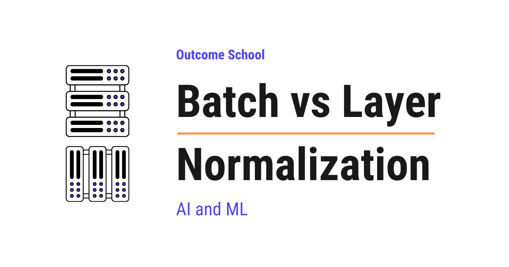

# Batch Normalization vs Layer Normalization

> Archived from <https://outcomeschool.com/blog/batch-normalization-vs-layer-normalization> on 2026-11-25.

Batch Normalization normalizes each feature across all the examples in a batch, whereas Layer Normalization normalizes all the features within each single example.

In this blog, we are going to learn about Batch Normalization vs Layer Normalization. We will also see how Batch Normalization and Layer Normalization differ from each other and when to use which one.

We will cover the following:
<ul><li>What is Normalization?</li><li>Why do we need Normalization?</li><li>What is Batch Normalization?</li><li>What is Layer Normalization?</li><li>Batch Normalization vs Layer Normalization</li><li>When to use which one?</li></ul>
I am <strong>Amit Shekhar</strong>, Founder @ <a target="_blank" rel="noopener noreferrer" href="https://outcomeschool.com">Outcome School</a>, I have taught and mentored many developers, and their efforts landed them high-paying tech jobs, helped many tech companies in solving their unique problems, and created many open-source libraries being used by top companies. I am passionate about sharing knowledge through open-source, blogs, and videos.

I teach <a target="_blank" rel="noopener noreferrer" href="https://outcomeschool.com/program/ai-and-machine-learning">AI and Machine Learning</a> at Outcome School.

Let&#x27;s get started.
<h2 id="what-is-normalization">What is Normalization?</h2>
In simple words, <strong>Normalization is the process of adjusting the values so that they are on a similar scale.</strong>

Let&#x27;s say we have two features: age (0 to 100) and salary (0 to 10,00,000). The values of salary are much larger than the values of age. This creates problems while training a <a target="_blank" rel="noopener noreferrer" href="neural-network.md">neural network</a> because the network gives more importance to the feature with larger values.

So, here comes Normalization to the rescue. It brings all the values to a similar scale, typically with mean 0 and variance 1.
<h2 id="why-do-we-need-normalization">Why do we need Normalization?</h2>
When we train a deep neural network, the values flowing through the layers can become very large or very small. This causes the following issues:
<ul><li>Training becomes slow.</li><li>The model becomes unstable.</li><li><a target="_blank" rel="noopener noreferrer" href="vanishing-and-exploding-gradients.md">Gradients can explode or vanish</a>.</li></ul>
So, we must normalize the values flowing through the network. This is where Batch Normalization and Layer Normalization come into the picture.

<strong>Planning your move into AI?</strong>

No matter which tech domain you work in today, with your effort, you can transition to these roles:
<ul><li>AI Engineer</li><li>Forward Deployed Engineer</li><li>AI Agent Engineer</li><li>Harness Engineer</li><li>Voice AI Engineer</li><li>AI Architect</li><li>LLM Engineer</li><li>LLM Inference Engineer</li><li>Gen AI Engineer</li><li>MLOps Engineer</li><li>ML Engineer</li><li>Deep Learning Engineer</li></ul>
Our <a target="_blank" rel="noopener noreferrer" href="https://outcomeschool.com/program/ai-and-machine-learning">AI and Machine Learning Program</a> at Outcome School takes you there.

Now, let&#x27;s learn about Batch Normalization first.
<h2 id="what-is-batch-normalization">What is Batch Normalization?</h2>
<strong>Batch Normalization is a technique that normalizes the values across the batch dimension for each feature.</strong>

In simple words, for each feature, it calculates the mean and variance across all the examples in the batch, and then normalizes the values using this mean and variance.

The best way to learn this is by taking an example.

Let&#x27;s say we have a <a target="_blank" rel="noopener noreferrer" href="epoch-batch-and-iteration.md">batch</a> of 4 examples, and each example has 3 features as below:

<pre><code class="code-highlight">Example 1: [10, 12, 14]
Example 2: [20, 22, 24]
Example 3: [30, 32, 34]
Example 4: [40, 42, 44]
</code></pre>

Here, we have 4 rows (batch size = 4) and 3 columns (features = 3).

In Batch Normalization, we normalize column by column. Means, for the first feature, we take all 4 values from the first column [10, 20, 30, 40], calculate the mean and variance, and then normalize them.
<ul><li>Mean of feature 1 = (10 + 20 + 30 + 40) / 4 = 25</li><li>We do the same for feature 2 and feature 3.</li></ul>
So, Batch Normalization works across the batch. The mean and variance of each feature depend on the other examples present in the batch.

The formula is as below:

<pre><code class="code-highlight">x_normalized = (x - mean) / sqrt(variance + epsilon)
</code></pre>

Here, <code>epsilon</code> is a very small number added to avoid division by zero.

After normalization, we apply two learnable parameters <code>gamma</code> (scale) and <code>beta</code> (shift) as below:

<pre><code class="code-highlight">output = gamma * x_normalized + beta
</code></pre>

Here, <code>gamma</code> and <code>beta</code> allow the network to learn the best scale and shift for the normalized values.

<strong>Note:</strong> During training, we use the mean and variance of the current batch. During inference, we often process one example at a time, so we cannot calculate the batch mean and variance. So, we use the average of the mean and variance that we tracked across all the batches during training. This means, Batch Normalization behaves differently during training and inference.

<strong>Advantages:</strong>
<ul><li>Faster training.</li><li>Allows higher learning rates.</li><li>Reduces the need for careful <a target="_blank" rel="noopener noreferrer" href="random-weight-initialization.md">weight initialization</a>.</li><li>Acts as a regularizer.</li></ul>
<strong>Disadvantages:</strong>
<ul><li>Does not work well with small batch sizes because the mean and variance of a very small batch are not reliable.</li><li>Different behavior during training and inference, which can lead to inconsistent predictions.</li><li>Not suitable for sequence models like <a target="_blank" rel="noopener noreferrer" href="recurrent-neural-network.md">Recurrent Neural Networks (RNNs)</a> and <a target="_blank" rel="noopener noreferrer" href="decoding-transformer-architecture.md">Transformers</a> because the sequence lengths vary from one example to another, and computing statistics across the batch becomes very difficult.</li></ul>
<strong>A quick note for you</strong>

No matter which tech domain you work in, get familiar with these topics:
<ul><li>LLM</li><li>RAG</li><li>MCP</li><li>Agent</li><li>Fine-tuning</li><li>Quantization</li></ul>
We put it all together in one video:

<a target="_blank" rel="noopener noreferrer" href="https://www.youtube.com/watch?v=lnfWvX66FUk">AI Engineering Explained: LLM, RAG, MCP, Agent, Fine-Tuning, and Quantization</a>

No need to stop reading - bookmark it and watch later when you get time. Future you will thank you.

Now, let&#x27;s get back to the topic.

This was all about Batch Normalization. Now, it&#x27;s time to learn about Layer Normalization.
<h2 id="what-is-layer-normalization">What is Layer Normalization?</h2>
<strong>Layer Normalization is a technique that normalizes the values across the feature dimension for each example.</strong>

In simple words, for each example, it calculates the mean and variance across all the features of that example, and then normalizes the values using this mean and variance.

Let&#x27;s take the same example as before:

<pre><code class="code-highlight">Example 1: [10, 12, 14]
Example 2: [20, 22, 24]
Example 3: [30, 32, 34]
Example 4: [40, 42, 44]
</code></pre>

In Layer Normalization, we normalize row by row. Means, for Example 1, we take all 3 values from the first row [10, 12, 14], calculate the mean and variance, and then normalize them.
<ul><li>Mean of Example 1 = (10 + 12 + 14) / 3 = 12</li><li>We do the same for Example 2, Example 3, and Example 4 independently.</li></ul>
So, Layer Normalization works across the features for each example, independently of the batch. The mean and variance of each example do not depend on the other examples present in the batch.

The formula is the same as Batch Normalization:

<pre><code class="code-highlight">x_normalized = (x - mean) / sqrt(variance + epsilon)
output = gamma * x_normalized + beta
</code></pre>

Here, the only difference is the dimension over which we calculate the mean and variance.

<strong>Note:</strong> Layer Normalization behaves the same way during training and inference, because it does not depend on the batch at all.

<strong>Advantages:</strong>
<ul><li>Works with any batch size, even a batch size of 1.</li><li>Same behavior during training and inference.</li><li>Works very well for sequence models like RNNs and Transformers.</li><li>Used in popular models like BERT, GPT, and other Large Language Models.</li></ul>
<strong>Disadvantages:</strong>
<ul><li>Not always the best choice for <a target="_blank" rel="noopener noreferrer" href="convolutional-neural-network-cnn.md">Convolutional Neural Networks (CNNs)</a>, where Batch Normalization usually performs better.</li></ul>
Now that we have learned about both Batch Normalization and Layer Normalization, it&#x27;s time to compare them side by side.
<h2 id="batch-normalization-vs-layer-normalization">Batch Normalization vs Layer Normalization</h2>
For the sake of understanding, let&#x27;s think of a classroom. Suppose we have 4 students and each student has scored marks in 3 subjects.
<ul><li><strong>Batch Normalization</strong> is like comparing the marks of a single subject across all 4 students. For example, we look at the Math marks of all 4 students together and normalize them.</li><li><strong>Layer Normalization</strong> is like comparing the marks of all 3 subjects for a single student. For example, we look at the Math, Science, and English marks of Student 1 together and normalize them.</li></ul>
This is the core difference between the two.

Let me tabulate the differences between Batch Normalization and Layer Normalization for your better understanding so that you can decide which one to use based on your use case.
<table><thead><tr><th>Aspect</th><th>Batch Normalization</th><th>Layer Normalization</th></tr></thead><tbody><tr><td>Direction of normalization</td><td>Across the batch (column-wise)</td><td>Across the features (row-wise)</td></tr><tr><td>Depends on batch size</td><td>Yes</td><td>No</td></tr><tr><td>Behavior in training and inference</td><td>Different</td><td>Same</td></tr><tr><td>Works with batch size of 1</td><td>No</td><td>Yes</td></tr><tr><td>Best for</td><td>CNNs and image data</td><td>RNNs, Transformers, and LLMs</td></tr></tbody></table>
In simple words:
<ul><li>Batch Normalization normalizes one feature across all examples in the batch.</li><li>Layer Normalization normalizes all features of one example.</li></ul>
To master Batch Normalization, Layer Normalization, and Deep Learning fundamentals in depth, check out our <a target="_blank" rel="noopener noreferrer" href="https://outcomeschool.com/program/ai-and-machine-learning">AI and Machine Learning Program</a> at Outcome School.
<h2 id="when-to-use-which-one">When to use which one?</h2>
The choice depends on our use case.
<ul><li>If we are working with <strong>image data</strong> and <strong>Convolutional Neural Networks (CNNs)</strong> with large batch sizes, we must use Batch Normalization.</li><li>If we are working with <strong>sequence data</strong>, <strong>Recurrent Neural Networks (RNNs)</strong>, <strong>Transformers</strong>, or <strong>Large Language Models (LLMs)</strong>, we must use Layer Normalization.</li><li>If we have <strong>very small batch sizes</strong>, Layer Normalization is the better choice because it does not depend on the batch.</li></ul>
The reason Large Language Models like GPT and BERT use Layer Normalization is exactly this. The sequence lengths are different for different examples, and the batch sizes can be small. Layer Normalization handles both of these situations perfectly.

Now we must have understood Batch Normalization vs Layer Normalization.

<strong>Stay updated:</strong> Subscribe to our <a target="_blank" rel="noopener noreferrer" href="https://outcomeschool.substack.com/subscribe">newsletter</a> to get our latest AI and Machine Learning blogs straight to your inbox.
<h2 id="frequently-asked-questions">Frequently Asked Questions</h2><h3 id="why-does-batch-normalization-behave-differently-during-inference">Why does Batch Normalization behave differently during inference?</h3>
During inference, we often process one example at a time, so we cannot calculate the batch mean and variance. Instead, we use the average of the mean and variance tracked across all the batches during training. This is why Batch Normalization behaves differently during training and inference, which can lead to inconsistent predictions.
<h3 id="what-are-gamma-and-beta-in-normalization">What are gamma and beta in normalization?</h3>
Gamma and beta are two learnable parameters applied after normalization. Gamma scales the normalized values and beta shifts them. They allow the network to learn the best scale and shift for the normalized values, and both Batch Normalization and Layer Normalization use them.
<h3 id="why-do-we-add-epsilon-in-the-normalization-formula">Why do we add epsilon in the normalization formula?</h3>
We add epsilon to avoid division by zero. Epsilon is a very small number added to the variance before taking the square root. This keeps the formula safe even when the variance is zero.
<h3 id="does-batch-normalization-work-with-small-batch-sizes">Does Batch Normalization work with small batch sizes?</h3>
No. Batch Normalization does not work well with small batch sizes, because the mean and variance of a very small batch are not reliable. It does not work with a batch size of 1 at all. Layer Normalization is the better choice here, since it does not depend on the batch.

That&#x27;s it for now.

Thanks

<strong>Amit Shekhar</strong> Founder @ <a target="_blank" rel="noopener noreferrer" href="https://outcomeschool.com">Outcome School</a>

You can connect with me on:
<ul><li><a target="_blank" rel="noopener noreferrer" href="https://x.com/amitiitbhu">X</a></li><li><a target="_blank" rel="noopener noreferrer" href="https://www.linkedin.com/in/amit-shekhar-iitbhu">LinkedIn</a></li><li><a target="_blank" rel="noopener noreferrer" href="https://github.com/amitshekhariitbhu">GitHub</a></li></ul>
Follow Outcome School on:
<ul><li><a target="_blank" rel="noopener noreferrer" href="https://x.com/outcome_school">X</a></li><li><a target="_blank" rel="noopener noreferrer" href="https://youtube.com/@OutcomeSchool">YouTube</a></li><li><a target="_blank" rel="noopener noreferrer" href="https://www.linkedin.com/company/outcomeschool">LinkedIn</a></li><li><a target="_blank" rel="noopener noreferrer" href="https://github.com/OutcomeSchool">GitHub</a></li></ul>
<a target="_blank" rel="noopener noreferrer" href="https://outcomeschool.com/blog"><strong>Read all of our high-quality blogs here.</strong></a>

