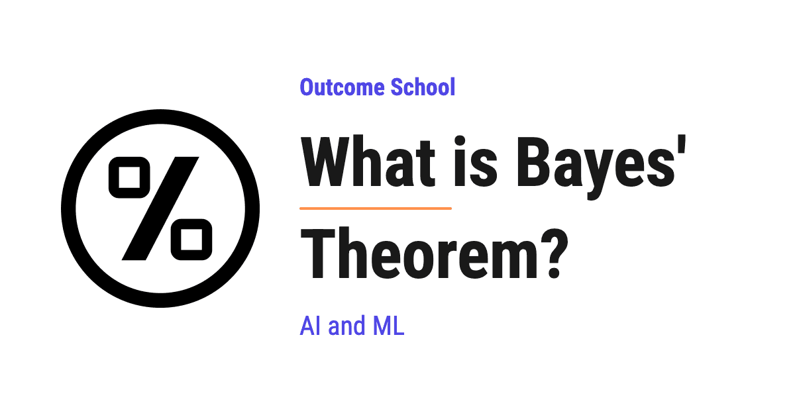

# What is Bayes' Theorem?

> Archived from <https://outcomeschool.com/blog/bayes-theorem> on 2026-11-25.

Bayes&#x27; Theorem is a rule that tells us how to update our belief when we get new evidence, turning a starting guess into a better, more informed guess.

In this blog, we will learn about Bayes&#x27; Theorem. We will also see the simple idea of prior and posterior behind it, the formula and each of its parts, a real example with numbers, why the answer surprises us, and where it is used.

We will cover the following:
<ul><li>What is Bayes&#x27; Theorem?</li><li>The simple idea behind it</li><li>The formula, decomposed</li><li>A real example with numbers</li><li>Why the answer surprises us</li><li>Where Bayes&#x27; Theorem is used</li></ul>
I am <strong>Amit Shekhar</strong>, Founder @ <a target="_blank" rel="noopener noreferrer" href="https://outcomeschool.com">Outcome School</a>, I have taught and mentored many developers, and their efforts landed them high-paying tech jobs, helped many tech companies in solving their unique problems, and created many open-source libraries being used by top companies. I am passionate about sharing knowledge through open-source, blogs, and videos.

I teach <a target="_blank" rel="noopener noreferrer" href="https://outcomeschool.com/program/ai-and-machine-learning">AI and Machine Learning</a> at Outcome School.

Let&#x27;s get started.
<h2 id="what-is-bayes-theorem">What is Bayes&#x27; Theorem?</h2>
<strong>Bayes&#x27; Theorem is a rule that tells us how to update our belief when we get new evidence.</strong>

We start with a guess. Then we see some new information. Bayes&#x27; Theorem tells us how to change our guess into a better, more informed guess.

We do this all the time in real life. Let&#x27;s say we think it will not rain today. Then we look outside and see dark clouds. Now we change our mind and expect rain. We just updated our belief based on new evidence. Bayes&#x27; Theorem is the exact math for doing this.
<h2 id="the-simple-idea-behind-it">The simple idea behind it</h2>
Before jumping into the formula, we must understand the core idea in plain words.

We have a belief before seeing evidence. We call this the <strong>prior</strong>.

Then we see some evidence.

After seeing the evidence, we form a new belief. We call this the <strong>posterior</strong>.

So, the whole idea is a simple flow:

<pre><code class="language-text code-highlight">   Prior belief  +  New evidence  =  Updated belief
   (before)                          (after)
</code></pre>

Bayes&#x27; Theorem takes our belief from &quot;before&quot; to &quot;after&quot; in a correct way.

<strong>Planning your move into AI?</strong>

No matter which tech domain you work in today, with your effort, you can transition to these roles:
<ul><li>AI Engineer</li><li>Forward Deployed Engineer</li><li>AI Agent Engineer</li><li>Harness Engineer</li><li>Voice AI Engineer</li><li>AI Architect</li><li>LLM Engineer</li><li>LLM Inference Engineer</li><li>Gen AI Engineer</li><li>MLOps Engineer</li><li>ML Engineer</li><li>Deep Learning Engineer</li></ul>
Our <a target="_blank" rel="noopener noreferrer" href="https://outcomeschool.com/program/ai-and-machine-learning">AI and Machine Learning Program</a> at Outcome School takes you there.
<h2 id="the-formula-decomposed">The formula, decomposed</h2>
Now, let&#x27;s see the actual formula.

<strong>P(A | B) = (P(B | A) * P(A)) / P(B)</strong>

Let&#x27;s break every piece down.

Here, <code>A</code> is the thing we want to know about, like &quot;the person has a disease&quot;. And <code>B</code> is the evidence we saw, like &quot;the test came back positive&quot;.
<ul><li><code>P(A | B)</code> is what we want. It reads as &quot;the probability of A given B&quot;. This is the updated belief. This is the <strong>posterior</strong>.</li><li><code>P(A)</code> is our belief before any evidence. This is the <strong>prior</strong>.</li><li><code>P(B | A)</code> is how likely the evidence is when A is true. This is the <strong>likelihood</strong>.</li><li><code>P(B)</code> is how likely the evidence is overall. This is the <strong>evidence</strong>.</li></ul>
So, in plain words, the formula says:

<strong>Posterior = (Likelihood * Prior) / Evidence</strong>

The best way to understand this is by taking an example with real numbers.
<h2 id="a-real-example-with-numbers">A real example with numbers</h2>
Let&#x27;s say there is a disease, and it is quite rare.
<ul><li>Only 1 out of every 100 people has the disease. So the prior is 1%.</li><li>There is a test for it. When a person has the disease, the test correctly shows positive 99% of the time.</li><li>But the test is not perfect. When a person does not have the disease, the test still wrongly shows positive 5% of the time.</li></ul>
Now, a person takes the test, and it comes back positive. What is the chance that this person actually has the disease?

Most people quickly say 99%, because the test is &quot;99% accurate&quot;. Let&#x27;s see if that is true.

The best way to see this clearly is to imagine 10,000 people and count.

<pre><code class="language-text code-highlight">                    10,000 people
                    /            \
              1% have          99% do not
              disease          have disease
               (100)             (9,900)
              /     \            /       \
         test +   test -    test +      test -
          (99)      (1)      (495)      (9,405)
</code></pre>

Let&#x27;s read this diagram.

Out of 10,000 people, 100 have the disease. The test catches 99 of them. So we get 99 <a target="_blank" rel="noopener noreferrer" href="confusion-matrix.md">true positives</a>.

The other 9,900 people do not have the disease. But the test wrongly flags 5% of them. And 5% of 9,900 is 495. So we get 495 <a target="_blank" rel="noopener noreferrer" href="precision-vs-recall.md">false positives</a>.

Now, let&#x27;s count everyone who got a positive result:

<pre><code class="language-text code-highlight">   Positive results = 99 (real)  +  495 (false)  =  594 total
</code></pre>

Out of these 594 people who tested positive, only 99 actually have the disease.

So the real chance of having the disease after a positive test is:

<pre><code class="language-text code-highlight">   99 / 594 = 0.1667  =  about 16.7%
</code></pre>

<strong>A quick note for you</strong>

No matter which tech domain you work in, get familiar with these topics:
<ul><li>LLM</li><li>RAG</li><li>MCP</li><li>Agent</li><li>Fine-tuning</li><li>Quantization</li></ul>
We put it all together in one video:

<a target="_blank" rel="noopener noreferrer" href="https://www.youtube.com/watch?v=lnfWvX66FUk">AI Engineering Explained: LLM, RAG, MCP, Agent, Fine-Tuning, and Quantization</a>

No need to stop reading - bookmark it and watch later when you get time. Future you will thank you.

Now, let&#x27;s get back to the topic.
<h2 id="why-the-answer-surprises-us">Why the answer surprises us</h2>
The test is &quot;99% accurate&quot;, but a positive result means only about a 16.7% chance of actually being sick. This surprises almost everyone.

Here is why this happens. The disease is very rare. So there are very few truly sick people to begin with. Even a small mistake rate on the huge healthy group creates many false positives. These false positives outnumber the true positives.

This is the main lesson of Bayes&#x27; Theorem. The prior matters a lot. When something is rare, even a good test gives many false alarms. We must combine the evidence with the prior, not look at the evidence alone.

Let&#x27;s confirm this with the formula so we see it matches our counting.
<ul><li>Prior, <code>P(A)</code> = 0.01</li><li>Likelihood, <code>P(B | A)</code> = 0.99</li><li>Evidence, <code>P(B)</code> = the total chance of a positive result = (0.01 * 0.99) + (0.99 * 0.05) = 0.0099 + 0.0495 = 0.0594</li></ul>
<strong>P(A | B) = (0.99 * 0.01) / 0.0594 = 0.0099 / 0.0594 = 0.1667</strong>

We get about 16.7%, the same answer as our counting. It works perfectly.

<strong>Stay updated:</strong> Subscribe to our <a target="_blank" rel="noopener noreferrer" href="https://outcomeschool.substack.com/subscribe">newsletter</a> to get our latest AI and Machine Learning blogs straight to your inbox.
<h2 id="where-bayes-theorem-is-used">Where Bayes&#x27; Theorem is used</h2>
Let&#x27;s see where Bayes&#x27; Theorem helps us in the real world.
<ul><li><strong>Spam filters.</strong> The filter starts with a belief about spam. Then it sees words in the email as evidence and updates the belief that the email is spam.</li><li><strong>Medical testing.</strong> As we saw, it tells doctors the real chance of a disease after a test result.</li><li><strong><a target="_blank" rel="noopener noreferrer" href="machine-learning.md">Machine learning</a>.</strong> A whole family of models called <a target="_blank" rel="noopener noreferrer" href="naive-bayes.md">Naive Bayes</a> uses this rule to classify things like text and reviews.</li><li><strong>Everyday reasoning.</strong> Any time we update a guess after new information, we are using the idea behind Bayes&#x27; Theorem.</li></ul><h2 id="frequently-asked-questions">Frequently Asked Questions</h2><h3 id="what-is-the-difference-between-pa--b-and-pb--a">What is the difference between P(A | B) and P(B | A)?</h3>
They are not the same. <code>P(A | B)</code> is the probability of A given B, which is the posterior, our updated belief after seeing the evidence. <code>P(B | A)</code> is the likelihood, which tells us how likely the evidence is when A is true. In the disease example, <code>P(B | A)</code> is 99%, but <code>P(A | B)</code> is only about 16.7%.
<h3 id="how-do-we-calculate-the-evidence-pb-in-bayes-theorem">How do we calculate the evidence P(B) in Bayes&#x27; Theorem?</h3>
<code>P(B)</code> is the total chance of seeing the evidence. We add the chance of the evidence when A is true and the chance of the evidence when A is not true. In the disease example, the total chance of a positive result is (0.01 * 0.99) + (0.99 * 0.05) = 0.0594.
<h3 id="can-we-solve-a-bayes-theorem-problem-without-the-formula">Can we solve a Bayes&#x27; Theorem problem without the formula?</h3>
Yes. We can imagine a large group, like 10,000 people, and count how many fall into each case. In the disease example, counting gives 99 real positives out of 594 positive results, which is about 16.7%. The formula gives the same answer, so counting is a simple way to check our work.
<h3 id="how-is-bayes-theorem-used-in-machine-learning">How is Bayes&#x27; Theorem used in machine learning?</h3>
A whole family of models called Naive Bayes uses Bayes&#x27; Theorem to classify things like text and reviews. Spam filters use the same idea. The filter starts with a belief about spam, sees the words in the email as evidence, and updates its belief that the email is spam.

That&#x27;s it for now.

Thanks

<strong>Amit Shekhar</strong> Founder @ <a target="_blank" rel="noopener noreferrer" href="https://outcomeschool.com">Outcome School</a>

You can connect with me on:
<ul><li><a target="_blank" rel="noopener noreferrer" href="https://x.com/amitiitbhu">X</a></li><li><a target="_blank" rel="noopener noreferrer" href="https://www.linkedin.com/in/amit-shekhar-iitbhu">LinkedIn</a></li><li><a target="_blank" rel="noopener noreferrer" href="https://github.com/amitshekhariitbhu">GitHub</a></li></ul>
Follow Outcome School on:
<ul><li><a target="_blank" rel="noopener noreferrer" href="https://x.com/outcome_school">X</a></li><li><a target="_blank" rel="noopener noreferrer" href="https://youtube.com/@OutcomeSchool">YouTube</a></li><li><a target="_blank" rel="noopener noreferrer" href="https://www.linkedin.com/company/outcomeschool">LinkedIn</a></li><li><a target="_blank" rel="noopener noreferrer" href="http://github.com/OutcomeSchool">GitHub</a></li></ul>
<a target="_blank" rel="noopener noreferrer" href="https://outcomeschool.com/blog"><strong>Read all of our high-quality blogs here.</strong></a>

