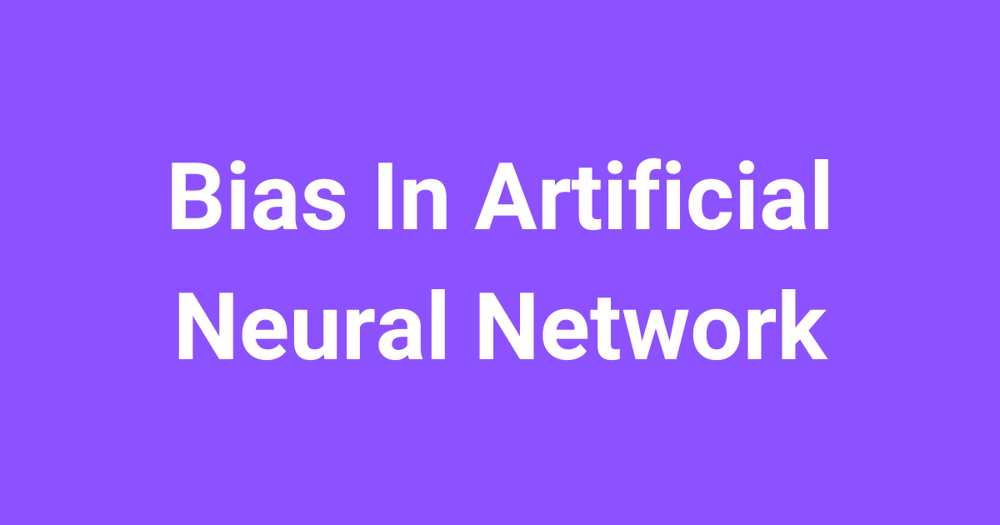

# What is Bias In Artificial Neural Network?

> Archived from <https://outcomeschool.com/blog/bias-in-artificial-neural-network> on 2026-11-25.

Bias in an Artificial Neural Network is the constant <code>c</code> in the model <code>y = mx + c</code>. Without bias, the line must pass through the origin. With bias, the model can shift the line and fit the data better.

In this blog, we will learn what is Bias In Artificial Neural Network.

I am <strong>Amit Shekhar</strong>, Founder @ <a target="_blank" rel="noopener noreferrer" href="https://outcomeschool.com">Outcome School</a>, I have taught and mentored many developers, and their efforts landed them high-paying tech jobs, helped many tech companies in solving their unique problems, and created many open-source libraries being used by top companies. I am passionate about sharing knowledge through open-source, blogs, and videos.

I teach <a target="_blank" rel="noopener noreferrer" href="https://outcomeschool.com/program/ai-and-machine-learning">AI and Machine Learning</a> at Outcome School.

Let&#x27;s get started.

<strong>Understanding bias in simple words</strong>

<strong>Bias</strong> is one of the important terminologies in <a target="_blank" rel="noopener noreferrer" href="machine-learning.md">machine learning</a>. Often we add bias while creating any model in the <a target="_blank" rel="noopener noreferrer" href="neural-network.md">artificial neural network</a>.

So, let&#x27;s understand what is this mysterious bias.

In the neural network, we are given the input(<code>x</code>) and for that input, we need to predict the output(<code>y</code>). Here, we create a model(<code>mx + c</code>), which predicts the output.

While training, the model itself finds the appropriate value of the constants <code>m</code>and <code>c</code>.

<strong>Planning your move into AI?</strong>

No matter which tech domain you work in today, with your effort, you can transition to these roles:
<ul><li>AI Engineer</li><li>Forward Deployed Engineer</li><li>AI Agent Engineer</li><li>Harness Engineer</li><li>Voice AI Engineer</li><li>AI Architect</li><li>LLM Engineer</li><li>LLM Inference Engineer</li><li>Gen AI Engineer</li><li>MLOps Engineer</li><li>ML Engineer</li><li>Deep Learning Engineer</li></ul>
Our <a target="_blank" rel="noopener noreferrer" href="https://outcomeschool.com/program/ai-and-machine-learning">AI and Machine Learning Program</a> at Outcome School takes you there.

Let&#x27;s say we have the model as <code>y = mx</code> instead of the <code>y = mx + c</code>.

Here, the model is having constraint to train itself and find a line which passes only through the origin.

Many times for the given data, it is impossible for the algorithm to fit the model so that it passes through the origin.

<strong>A quick note for you</strong>

No matter which tech domain you work in, get familiar with these topics:
<ul><li>LLM</li><li>RAG</li><li>MCP</li><li>Agent</li><li>Fine-tuning</li><li>Quantization</li></ul>
We put it all together in one video:

<a target="_blank" rel="noopener noreferrer" href="https://www.youtube.com/watch?v=lnfWvX66FUk">AI Engineering Explained: LLM, RAG, MCP, Agent, Fine-Tuning, and Quantization</a>

No need to stop reading - bookmark it and watch later when you get time. Future you will thank you.

Now, let&#x27;s get back to the topic.

Who doesn&#x27;t need the freedom to perform well?

Let&#x27;s give some freedom to the algorithm by changing the model as <code>mx + c </code>instead of <code>mx</code>, so that the model can find a line which fits the given data.

Now, it is having the full freedom to train itself and find a model that fits the best for the given data.

Here, the constant <code>c</code> is the <strong>bias</strong>.

<strong>Bias</strong> is a constant which helps the model in a way that it can fit best for the given data.

In other words, <strong>Bias</strong> is a constant which gives freedom to perform best. This is <strong>Bias</strong>.

<strong>Stay updated:</strong> Subscribe to our <a target="_blank" rel="noopener noreferrer" href="https://outcomeschool.substack.com/subscribe">newsletter</a> to get our latest AI and Machine Learning blogs straight to your inbox.
<h2 id="frequently-asked-questions">Frequently Asked Questions</h2><h3 id="what-happens-if-a-neural-network-model-has-no-bias">What happens if a neural network model has no bias?</h3>
Without bias, the model is <code>y = mx</code>, so it is forced to find a line that passes only through the origin. Many times, for the given data, it is impossible to fit such a line. Adding the bias gives the model the freedom to fit the data well.
<h3 id="who-decides-the-value-of-the-bias-in-a-neural-network">Who decides the value of the bias in a neural network?</h3>
The model itself decides it. While training, the model finds the appropriate values of the constants <code>m</code> and <code>c</code> on its own. Here, the constant <code>c</code> is the bias.
<h3 id="why-is-bias-described-as-giving-freedom-to-the-model">Why is bias described as giving freedom to the model?</h3>
Bias removes the constraint that the line must pass through the origin. With the model <code>mx + c</code> instead of <code>mx</code>, the model has full freedom to train itself and find the line that fits best for the given data. So, bias is a constant that gives the model freedom to perform best.

That&#x27;s it for now.

Thanks

<strong>Amit Shekhar</strong> Founder @ <a target="_blank" rel="noopener noreferrer" href="https://outcomeschool.com">Outcome School</a>

You can connect with me on:
<ul><li><a target="_blank" rel="noopener noreferrer" href="https://x.com/amitiitbhu">X</a></li><li><a target="_blank" rel="noopener noreferrer" href="https://www.linkedin.com/in/amit-shekhar-iitbhu">LinkedIn</a></li><li><a target="_blank" rel="noopener noreferrer" href="https://github.com/amitshekhariitbhu">GitHub</a></li></ul>
Follow Outcome School on:
<ul><li><a target="_blank" rel="noopener noreferrer" href="https://x.com/outcome_school">X</a></li><li><a target="_blank" rel="noopener noreferrer" href="https://youtube.com/@OutcomeSchool">YouTube</a></li><li><a target="_blank" rel="noopener noreferrer" href="https://www.linkedin.com/company/outcomeschool">LinkedIn</a></li><li><a target="_blank" rel="noopener noreferrer" href="https://github.com/OutcomeSchool">GitHub</a></li></ul>
<a target="_blank" rel="noopener noreferrer" href="https://outcomeschool.com/blog"><strong>Read all of our high-quality blogs here.</strong></a>

