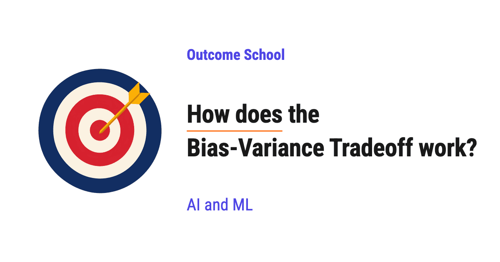

# How does the Bias-Variance Tradeoff work?

> Archived from <https://outcomeschool.com/blog/bias-variance-tradeoff> on 2026-11-25.

The Bias-Variance Tradeoff is the balance between a model that is too simple to learn the real pattern (high bias) and a model that is so sensitive that it learns the random accidents in its training data (high variance). A good model sits in the middle, where the total error on new data is the lowest.

In this blog, we will learn about how the Bias-Variance Tradeoff works. We will also see what error means in Machine Learning, what bias and variance are, how they connect to underfitting and overfitting, why reducing one usually increases the other, how we can spot each problem by comparing training and validation errors, and what we can do to fix each one for our use case.

We will cover the following:
<ul><li>What is error?</li><li>What is bias?</li><li>What is variance?</li><li>Bias and variance on a dartboard</li><li>Underfitting and overfitting</li><li>Why is it a tradeoff?</li><li>The three parts of the total error</li><li>Seeing it in code</li><li>How to detect high bias and high variance</li><li>How to fix high bias and high variance</li></ul>
I am <strong>Amit Shekhar</strong>, Founder @ <a target="_blank" rel="noopener noreferrer" href="https://outcomeschool.com">Outcome School</a>, I have taught and mentored many developers, and their efforts landed them high-paying tech jobs, helped many tech companies in solving their unique problems, and created many open-source libraries being used by top companies. I am passionate about sharing knowledge through open-source, blogs, and videos.

I teach <a target="_blank" rel="noopener noreferrer" href="https://outcomeschool.com/program/ai-and-machine-learning">AI and Machine Learning</a> at Outcome School.

Let&#x27;s get started.
<h2 id="what-is-error">What is error?</h2>
Before jumping into bias and variance, we must know what error is.

Let&#x27;s say we want to predict the price of a house from its size. We collect 100 houses. For each house, we know the size and the price at which it was sold. The model looks at these 100 houses and learns how price changes with size. Then, when a new house comes, the model guesses its price.

The examples that the model learns from are called the <strong>training data</strong>. The new examples that the model has never seen are called <strong>new data</strong> or <strong>unseen data</strong>.

<strong>Error is the difference between the model&#x27;s guess and the correct answer.</strong>

If the real price of a house is 50 lakh and our model guesses 45 lakh, the error is 5 lakh. Smaller error means a better model.

We do not care much about the error on the training data. We care about the error on new data. A model is useful only if it makes good guesses on houses that it has never seen.

Bias and variance are the two main reasons why a model makes errors on new data. Let&#x27;s understand each of them.
<h2 id="what-is-bias">What is bias?</h2>
<strong>Bias is the error that comes from wrong or too simple assumptions in the model. A model with high bias misses the real pattern, no matter how much data we give it.</strong>

Let&#x27;s say the real relationship between house size and price is a curve. Small houses are cheap, and the price grows faster and faster as the size grows. But our model can only draw a straight line. It assumes that the pattern is a straight line.

<pre><code class="language-text code-highlight">Price
  |                              *
  |                          *
  |                      *  /
  |                  *   /
  |              *    /          &lt;- straight line (model)
  |         *      /
  |    *        /                * = real houses
  | *        /
  |______/________________________ Size
</code></pre>

Here, we can see that the straight line cannot bend to follow the curve. It is wrong at the small houses, wrong in the middle, and wrong at the big houses. Even if we give it 1 million houses, a straight line will still be a straight line. It will still miss the curve.

This is high bias. The model is too simple for the problem.
<h2 id="what-is-variance">What is variance?</h2>
<strong>Variance is the error that comes from the model being too sensitive to the exact training data it saw. A model with high variance changes a lot if we train it on a slightly different set of examples.</strong>

Here, we must understand the word <strong>noise</strong>. Real data is never perfect. One house sold cheaper because the owner was in a hurry. Another sold higher because the buyer loved the garden. These random effects are noise. They are not part of the real pattern between size and price.

Now, suppose our model is very flexible. It can draw any wiggly line it wants. So, it draws a line that passes exactly through every single house in the training data.

<pre><code class="language-text code-highlight">Price
  |                          .-*-.      *
  |                *-.      /     \    /
  |               /   \    /       *--&#x27;
  |        .-*   /     *--&#x27;
  |       /   \ /                  &lt;- wiggly line (model)
  |  *---&#x27;     *
  |                                 * = real houses
  |________________________________ Size
</code></pre>

Here, we can see that the wiggly line hits every training house perfectly. The training error is zero. But the line has also learned the noise. Between the points, it goes up and down for no real reason. When a new house comes, the guess can be far off.

And, if we collect a different set of 100 houses and train again, we will get a completely different wiggly line. That is why we call it variance: the model varies a lot depending on which data it got.

This is high variance. The model is too sensitive for the problem.
<h2 id="bias-and-variance-on-a-dartboard">Bias and variance on a dartboard</h2>
We can see bias and variance together on a dartboard.

Assume that the center of the dartboard is the correct answer. Each time we train the model on a different set of data and make a guess, we throw one dart.

<pre><code class="language-text code-highlight">   Low Bias, Low Variance         Low Bias, High Variance
        _________                      _________
       /         \                    /  x      \
      |    xxx    |                  |       x   |
      |    xox    |                  | x   o     |
      |    xxx    |                  |   x     x |
       \_________/                    \___x_____/

   High Bias, Low Variance        High Bias, High Variance
        _________                      _________
       /     xxx \                    /   x  x  \
      |      xxx  |                  |  x        |
      |    o      |                  |     o   x |
      |           |                  |  x        |
       \_________/                    \_________/

   o = center (correct answer)    x = model&#x27;s guesses
</code></pre>

Let&#x27;s read each board:
<ul><li><strong>Low Bias, Low Variance:</strong> All the darts are close together and close to the center. This is the ideal model.</li><li><strong>Low Bias, High Variance:</strong> The darts are spread all over, but on average they are around the center. The model is right on average, but each single guess is shaky.</li><li><strong>High Bias, Low Variance:</strong> The darts are close together, but far from the center. The model is consistent, but consistently wrong.</li><li><strong>High Bias, High Variance:</strong> The darts are spread out and also away from the center. This is the worst case.</li></ul>
So, bias is about how far the average guess is from the center. Variance is about how spread out the guesses are.
<h2 id="underfitting-and-overfitting">Underfitting and overfitting</h2>
Now, let&#x27;s connect bias and variance to two words that we hear a lot in Machine Learning.

<strong>Underfitting</strong> happens when the model is too simple to learn the real pattern. It does badly on the training data and also badly on new data. Underfitting comes from high bias.

<strong>Overfitting</strong> happens when the model learns the training data too closely, including the noise. It does very well on the training data but badly on new data. Overfitting comes from high variance.

<strong>Planning your move into AI?</strong>

No matter which tech domain you work in today, with your effort, you can transition to these roles:
<ul><li>AI Engineer</li><li>Forward Deployed Engineer</li><li>AI Agent Engineer</li><li>Harness Engineer</li><li>Voice AI Engineer</li><li>AI Architect</li><li>LLM Engineer</li><li>LLM Inference Engineer</li><li>Gen AI Engineer</li><li>MLOps Engineer</li><li>ML Engineer</li><li>Deep Learning Engineer</li></ul>
Our <a target="_blank" rel="noopener noreferrer" href="https://outcomeschool.com/program/ai-and-machine-learning">AI and Machine Learning Program</a> at Outcome School takes you there.
<h2 id="why-is-it-a-tradeoff">Why is it a tradeoff?</h2>
A <strong>tradeoff</strong> means giving up a bit of one thing to get more of another thing. Here, lowering bias usually costs us higher variance, and lowering variance usually costs us higher bias.

Now, the question is: why can we not just make both bias and variance zero?

The answer is: when we make a model more flexible to reduce bias, it also becomes more sensitive to noise, which increases variance. And when we make a model simpler to reduce variance, it becomes less able to learn the real pattern, which increases bias.

The flexibility of a model is called its <strong>complexity</strong>. A straight line has low complexity. A very wiggly curve has high complexity.

Let&#x27;s see how the total error changes as we increase the complexity:

<pre><code class="language-text code-highlight">Total Error
  ^
  |  \                                 /
  |   \                               /
  |    \                             /
  |     &#x27;.                         .&#x27;
  |       &#x27;-.                   .-&#x27;
  |          &#x27;--..._______...--&#x27;
  |                   ^
  |  high bias here                 high variance here
  +-------------------------------------------&gt; Model Complexity
     simple          sweet spot          complex
   (underfit)                           (overfit)
</code></pre>

And let me tabulate what happens to each part of the error:
<table><thead><tr><th>Model Complexity</th><th>Bias</th><th>Variance</th><th>Total Error</th></tr></thead><tbody><tr><td>Very simple</td><td>High</td><td>Low</td><td>High</td></tr><tr><td>Just right</td><td>Medium</td><td>Medium</td><td>Lowest</td></tr><tr><td>Very complex</td><td>Low</td><td>High</td><td>High</td></tr></tbody></table>
Here, we can notice that on the left side, the model underfits, and on the right side, it overfits. Somewhere in the middle, the total error is the lowest. This is the <strong>sweet spot</strong>.

This is the Bias-Variance Tradeoff. We cannot push one down for free. We trade a bit of one to get less of the other, and we look for the point where the total error on new data is the lowest.

<strong>A quick note for you</strong>

No matter which tech domain you work in, get familiar with these topics:
<ul><li>LLM</li><li>RAG</li><li>MCP</li><li>Agent</li><li>Fine-tuning</li><li>Quantization</li></ul>
We put it all together in one video:

<a target="_blank" rel="noopener noreferrer" href="https://www.youtube.com/watch?v=lnfWvX66FUk">AI Engineering Explained: LLM, RAG, MCP, Agent, Fine-Tuning, and Quantization</a>

No need to stop reading - bookmark it and watch later when you get time. Future you will thank you.

Now, let&#x27;s get back to the topic.
<h2 id="the-three-parts-of-the-total-error">The three parts of the total error</h2>
Now, it&#x27;s time to see how bias and variance add up. For the sake of understanding, we can break the total error of a model on new data into three parts as below:

<strong>Total Error = Bias^2 + Variance + Irreducible Error</strong>

Here, we have:
<ul><li><strong>Bias^2 (bias squared):</strong> The error from the model being too simple. We square it because, in the math, errors are measured as <a target="_blank" rel="noopener noreferrer" href="l1-and-l2-loss-functions.md">squared differences</a>, so that positive and negative mistakes do not cancel each other.</li><li><strong>Variance:</strong> The error from the model being too sensitive to the training data.</li><li><strong>Irreducible Error:</strong> The error that comes from the noise in the data itself. No model can remove it. If the owner sold the house cheap because he was in a hurry, no model can know that from the size alone.</li></ul>
<strong>Note:</strong> This exact formula is true when we measure error as the squared difference between the guess and the correct answer, which is the most common way for predicting numbers. For other kinds of problems, the idea stays the same even if the math looks different.

The irreducible error is a floor. We can never go below it. So, our job is to reduce Bias^2 + Variance together, and that is exactly where the tradeoff comes into the picture.
<h2 id="seeing-it-in-code">Seeing it in code</h2>
Now, let&#x27;s see the tradeoff with a small example in Python. We will create some data that follows a curve, add some noise, and try three models: a very simple one, a balanced one, and a very complex one.

<pre><code class="code-highlight language-python">import numpy as np
from sklearn.preprocessing import PolynomialFeatures
from sklearn.linear_model import LinearRegression
from sklearn.pipeline import make_pipeline
from sklearn.metrics import mean_squared_error
from sklearn.model_selection import train_test_split

# Create data that follows a curve, plus some noise
rng = np.random.RandomState(1)
X = np.sort(rng.uniform(0, 1, 30)).reshape(-1, 1)
y = np.sin(2 * np.pi * X).ravel() + rng.normal(0, 0.2, 30)

X_train, X_val, y_train, y_val = train_test_split(
    X, y, test_size=0.3, random_state=0)

for degree in [1, 4, 12]:
    model = make_pipeline(PolynomialFeatures(degree), LinearRegression())
    model.fit(X_train, y_train)
    train_err = mean_squared_error(y_train, model.predict(X_train))
    val_err = mean_squared_error(y_val, model.predict(X_val))
    print(f&quot;degree={degree:2d}  train={train_err:.3f}  val={val_err:.3f}&quot;)
</code></pre>

Here, we have done the following:
<ul><li>We have created 30 points that follow a wave shape (a sine curve) and added random noise to each point.</li><li>We have kept 70% of the points for training and 30% as a <strong><a target="_blank" rel="noopener noreferrer" href="train-validation-test-split.md">validation set</a></strong>, which means data that the model does not learn from, so that we can check it on unseen points.</li><li>We have trained three models. The <code>degree</code> controls how much the line can bend. <code>degree=1</code> is a straight line. <code>degree=4</code> can bend a few times. <code>degree=12</code> can bend a lot.</li><li><code>PolynomialFeatures</code> together with <code>LinearRegression</code> lets the model draw a curve instead of only a straight line, and <code>make_pipeline</code> joins these two steps into one model.</li><li>For each model, we print the training error and the validation error. We measure both with <code>mean_squared_error</code>, which is the average of the squared differences between the guesses and the correct answers. Lower is better.</li></ul>
This will print the following:

<pre><code class="language-text code-highlight">degree= 1  train=0.217  val=0.181
degree= 4  train=0.019  val=0.036
degree=12  train=0.010  val=9.616
</code></pre>

Here, we can see that:
<ul><li>The straight line (<code>degree=1</code>) has a high error on both training and validation data. It cannot follow the wave. This is high bias.</li><li>The <code>degree=12</code> model has the lowest training error of all three, but its validation error explodes to 9.616. It has bent itself to pass through the noisy training points, and it goes wild between and around them. This is high variance.</li><li>The <code>degree=4</code> model has a low error on both. This is the balance we want.</li></ul>
<strong>Note:</strong> The exact numbers will change if we change the random data, but the pattern stays the same.

To learn Machine Learning Fundamentals like Linear Regression, Loss Functions, and Evaluation and Testing in depth, check out our <a target="_blank" rel="noopener noreferrer" href="https://outcomeschool.com/program/ai-and-machine-learning">AI and Machine Learning Program</a> at Outcome School.
<h2 id="how-to-detect-high-bias-and-high-variance">How to detect high bias and high variance</h2>
The next big question is: how do we know which problem our model has?

Most of the time, we do mistakes by looking only at the training error. A low training error alone tells us nothing about new data. The answer is to always compare two numbers:
<ul><li><strong>Training error:</strong> the error on the data the model learned from.</li><li><strong>Validation error:</strong> the error on data the model has never seen.</li></ul>
Let me tabulate the cases for your better understanding.
<table><thead><tr><th>Training Error</th><th>Validation Error</th><th>What it means</th><th>Problem</th></tr></thead><tbody><tr><td>High</td><td>High (close to training)</td><td>Model cannot even learn the training data</td><td>High Bias (Underfitting)</td></tr><tr><td>Low</td><td>High (much higher than training)</td><td>Model memorized training data, fails on new data</td><td>High Variance (Overfitting)</td></tr><tr><td>Low</td><td>Low (close to training)</td><td>Model learned the real pattern</td><td>Good balance</td></tr><tr><td>High</td><td>Much higher</td><td>Model is too simple and also unstable</td><td>High Bias and High Variance</td></tr></tbody></table>
So, the gap between the two errors tells us about variance. And the level of the training error tells us about bias. In our code example, <code>degree=1</code> had a high training error (high bias), and <code>degree=12</code> had a huge gap (high variance).

<strong>A big gap between training error and validation error means high variance. A high training error means high bias.</strong>

We have a detailed blog on <a target="_blank" rel="noopener noreferrer" href="cross-validation.md">Cross-Validation</a> that explains how to get a validation score we can trust by averaging over several splits.

<strong>Stay updated:</strong> Subscribe to our <a target="_blank" rel="noopener noreferrer" href="https://outcomeschool.substack.com/subscribe">newsletter</a> to get our latest AI and Machine Learning blogs straight to your inbox.
<h2 id="how-to-fix-high-bias-and-high-variance">How to fix high bias and high variance</h2>
Now that we know how to detect the problem, it&#x27;s time to learn how to fix it.

<strong>If the model has high bias (underfitting):</strong>
<ul><li>Use a more complex model. For example, move from a straight line to a curve, or from a small <a target="_blank" rel="noopener noreferrer" href="neural-network.md">neural network</a> to a bigger one.</li><li>Add more useful inputs, which are called <strong><a target="_blank" rel="noopener noreferrer" href="feature-engineering.md">features</a></strong>. For a house, adding the number of rooms and the location along with the size helps the model see more of the picture.</li><li>Reduce <strong><a target="_blank" rel="noopener noreferrer" href="regularization-in-machine-learning.md">regularization</a></strong>. Regularization is a technique that puts a penalty on the model for being too complex. If the penalty is too strong, the model becomes too simple.</li><li>Train for longer, if the model has not finished learning.</li></ul>
<strong>Note:</strong> Adding more data does not fix high bias. A straight line stays a straight line even with a million houses.

We have a detailed blog on <a target="_blank" rel="noopener noreferrer" href="gradient-boosting.md">Gradient Boosting</a> that covers how adding many small, simple models one after another reduces high bias.

<strong>If the model has high variance (overfitting):</strong>
<ul><li>Get more training data. With more examples, the noise of any single example matters less, and the model is forced to learn the real pattern.</li><li>Use a simpler model, or <a target="_blank" rel="noopener noreferrer" href="principal-component-analysis-pca.md">reduce the number of features</a>.</li><li>Increase regularization, so that the model is punished for being too wiggly.</li><li>Use <strong>ensembles</strong>, which means training many models and averaging their guesses. Averaging cancels out a lot of the random shakiness. This is the idea behind <a target="_blank" rel="noopener noreferrer" href="decision-trees-and-random-forests.md">Random Forests</a>.</li><li>In neural networks, use techniques like <strong><a target="_blank" rel="noopener noreferrer" href="dropout-in-neural-networks.md">dropout</a></strong> (randomly switching off some parts during training) and <strong><a target="_blank" rel="noopener noreferrer" href="early-stopping.md">early stopping</a></strong> (stopping the training when the validation error starts going up).</li></ul>
We have a detailed blog on <a target="_blank" rel="noopener noreferrer" href="data-augmentation.md">Data Augmentation</a> that explains how to create more varied training examples from the data we already have.

Let me tabulate this for your better understanding.
<table><thead><tr><th>Fix</th><th>Reduces Bias?</th><th>Reduces Variance?</th></tr></thead><tbody><tr><td>More complex model</td><td>Yes</td><td>No, increases it</td></tr><tr><td>Simpler model</td><td>No, increases it</td><td>Yes</td></tr><tr><td>More training data</td><td>No</td><td>Yes</td></tr><tr><td>More useful features</td><td>Yes</td><td>No, can increase it</td></tr><tr><td>Stronger regularization</td><td>No, increases it</td><td>Yes</td></tr><tr><td>Averaging many models (like Random Forests)</td><td>Little</td><td>Yes</td></tr></tbody></table>
Here, we can see the tradeoff again. Most fixes reduce one and increase the other. Only a few, like more training data, help one side without hurting the other.

<strong>Note:</strong> In modern deep learning, very large neural networks trained on huge data sometimes keep improving on new data even after they are big enough to memorize the training data. Researchers call this <strong>double descent</strong>. But the core idea of the tradeoff still guides us: we always watch the training error and the validation error together.

Now we must have understood how the Bias-Variance Tradeoff works.
<h2 id="frequently-asked-questions">Frequently Asked Questions</h2><h3 id="does-adding-more-training-data-fix-underfitting">Does adding more training data fix underfitting?</h3>
No. Adding more data does not fix high bias. A model that is too simple, like a straight line, stays a straight line even with a million examples, so it still misses the real pattern. To fix underfitting, we use a more complex model, add more useful features, reduce regularization, or train for longer.
<h3 id="can-a-model-have-both-high-bias-and-high-variance">Can a model have both high bias and high variance?</h3>
Yes. A model can be too simple and also unstable at the same time. On a dartboard, its guesses are spread out and also away from the center, which is the worst case. We can spot it when the training error is high and the validation error is much higher.
<h3 id="can-we-ever-reach-zero-error-on-new-data">Can we ever reach zero error on new data?</h3>
No. Even a perfect balance of bias and variance cannot remove the irreducible error, which comes from the noise in the data itself. For example, if a house sold cheap because the owner was in a hurry, no model can know that from the size alone. This error is a floor that we can never go below.
<h3 id="why-can-a-training-error-of-zero-be-a-bad-sign">Why can a training error of zero be a bad sign?</h3>
A training error of zero often means the model has memorized the training data, including its noise. Such a model has high variance and can make guesses that are far off on new data. This is why we always compare the training error with the validation error instead of looking at the training error alone.

That&#x27;s it for now.

Thanks

<strong>Amit Shekhar</strong> Founder @ <a target="_blank" rel="noopener noreferrer" href="https://outcomeschool.com">Outcome School</a>

You can connect with me on:
<ul><li><a target="_blank" rel="noopener noreferrer" href="https://x.com/amitiitbhu">X</a></li><li><a target="_blank" rel="noopener noreferrer" href="https://www.linkedin.com/in/amit-shekhar-iitbhu">LinkedIn</a></li><li><a target="_blank" rel="noopener noreferrer" href="https://github.com/amitshekhariitbhu">GitHub</a></li></ul>
Follow Outcome School on:
<ul><li><a target="_blank" rel="noopener noreferrer" href="https://x.com/outcome_school">X</a></li><li><a target="_blank" rel="noopener noreferrer" href="https://youtube.com/@OutcomeSchool">YouTube</a></li><li><a target="_blank" rel="noopener noreferrer" href="https://www.linkedin.com/company/outcomeschool">LinkedIn</a></li><li><a target="_blank" rel="noopener noreferrer" href="http://github.com/OutcomeSchool">GitHub</a></li></ul>
<a target="_blank" rel="noopener noreferrer" href="https://outcomeschool.com/blog"><strong>Read all of our high-quality blogs here.</strong></a>

