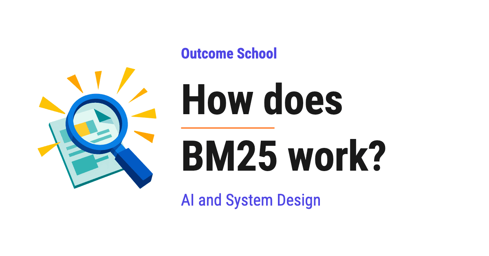

# How does BM25 work?

> Archived from <https://outcomeschool.com/blog/bm25> on 2026-11-25.

BM25 is a scoring formula that search engines use to rank documents for a search query. It gives a higher score to a document when it contains the query words many times, when those words are rare across all documents, and when the document is not unnecessarily long.

In this blog, we will learn about how BM25 works. We will also see why simple word counting fails, how BM25 rewards rare words using IDF, how it limits a repeated word using saturation, how it treats long and short documents fairly using length normalization, a complete worked example with Python code, and where BM25 works well and where it fails.

We will cover the following:
<ul><li>The problem: ranking documents for a query</li><li>The simple approach: counting words</li><li>What is BM25?</li><li>Idea 1: Rare words matter more (IDF)</li><li>Idea 2: Repeating a word has a limit (saturation)</li><li>Idea 3: Long documents must not win unfairly (length normalization)</li><li>The full BM25 formula</li><li>A complete worked example</li><li>BM25 in Python code</li><li>What do k1 and b control?</li><li>TF-IDF vs BM25</li><li>Where BM25 works well and where it fails</li></ul>
I am <strong>Amit Shekhar</strong>, Founder @ <a target="_blank" rel="noopener noreferrer" href="https://outcomeschool.com">Outcome School</a>, I have taught and mentored many developers, and their efforts landed them high-paying tech jobs, helped many tech companies in solving their unique problems, and created many open-source libraries being used by top companies. I am passionate about sharing knowledge through open-source, blogs, and videos.

I teach <a target="_blank" rel="noopener noreferrer" href="https://outcomeschool.com/program/ai-and-machine-learning">AI and Machine Learning</a> at Outcome School.

Let&#x27;s get started.
<h2 id="the-problem-ranking-documents-for-a-query">The problem: ranking documents for a query</h2>
Before jumping into BM25, we must understand the problem it solves.

Let&#x27;s say we have a library with one million articles. Someone types &quot;cat food&quot; in the search box. Many articles contain these words. Some are exactly about cat food. Some just mention a cat once. Some are about dog food.

We must show the best ones on top. So, we need a way to give every article a <strong>score</strong> that tells how well it matches the search. Then, we sort by this score.

This is called <strong>ranking</strong>. BM25 is one of the most famous ways of doing ranking. It is used inside search tools like Elasticsearch, and it is also used in <a target="_blank" rel="noopener noreferrer" href="retrieval-augmented-generation-rag.md">RAG</a> systems to find the right text to give to an LLM.
<h2 id="the-simple-approach-counting-words">The simple approach: counting words</h2>
The most natural idea is: count how many times the query terms appear in each document. More count, higher score.

This count is called the <strong>term frequency</strong>. If &quot;cat&quot; appears 3 times in a document, the term frequency of &quot;cat&quot; in that document is 3.

It looks reasonable, but the following issues arise:
<ul><li><strong>Problem 1:</strong> Common words win. Suppose the query is &quot;the cat&quot;. The word &quot;the&quot; appears in almost every document many times. So, documents full of &quot;the&quot; will win, even if they are not about cats.</li><li><strong>Problem 2:</strong> Repetition wins. A spammy page that writes &quot;cat cat cat cat cat&quot; 100 times will beat a genuine page about cats.</li><li><strong>Problem 3:</strong> Long documents win. A 50-page book naturally contains &quot;cat&quot; more times than a 1-paragraph article, even if the article is more focused on cats.</li></ul>
So, here comes BM25 to the rescue. It fixes each of these three problems with one idea each.
<h2 id="what-is-bm25">What is BM25?</h2>
<strong>BM25 is a ranking formula that scores how relevant a document is to a query, based on how often the query terms appear in the document, how rare those terms are in the whole collection, and how long the document is.</strong>

BM stands for <strong>Best Matching</strong>, and 25 is simply the version number. It came from the work of Stephen Robertson, Karen Spärck Jones, and others in the Okapi search system in the 1990s. That is why it is also called <strong>Okapi BM25</strong>.

The important point is that BM25 does not understand meaning. It only looks at words and counts. Search by meaning is a different method, and we have a detailed blog on <a target="_blank" rel="noopener noreferrer" href="how-does-semantic-search-work.md">Semantic Search</a> that explains how it works.

Let&#x27;s understand the three ideas one by one.
<h2 id="idea-1-rare-words-matter-more-idf">Idea 1: Rare words matter more (IDF)</h2>
If we search &quot;the cat&quot;, which word tells us more about what we want? Clearly &quot;cat&quot;. The word &quot;the&quot; is everywhere, so it tells us almost nothing.

<strong>Rare words carry more information than common words.</strong>

BM25 measures how rare a term is using <strong>IDF</strong>, which stands for <strong>Inverse Document Frequency</strong>.
<ul><li><strong>Document frequency</strong> is the number of documents that contain the term.</li><li><strong>Inverse</strong> means we flip it. Fewer documents with the term means a higher IDF.</li></ul>
BM25 commonly uses this IDF formula:

<pre><code class="language-text code-highlight">IDF(term) = ln( (N - n + 0.5) / (n + 0.5) + 1 )

N = total number of documents
n = number of documents that contain the term
ln = natural logarithm
</code></pre>

Here, let&#x27;s see the behavior:
<ul><li>If a term appears in very few documents, <code>n</code> is small, so the IDF is big.</li><li>If a term appears in almost all documents, <code>n</code> is close to <code>N</code>, so the IDF is close to zero.</li></ul>
The <code>ln</code> (logarithm) just keeps the numbers from becoming too big. The <code>0.5</code> values are small adjustments that keep the formula safe when <code>n</code> is 0. The <code>+ 1</code> inside makes sure the IDF never goes below zero.

Let&#x27;s say we have 1000 documents:

<pre><code class="language-text code-highlight">&quot;the&quot; appears in 990 documents -&gt; IDF = 0.01   (almost useless)
&quot;cat&quot; appears in 20 documents  -&gt; IDF = 3.89   (very useful)
</code></pre>

Problem 1 is solved. Common words now count for almost nothing.
<h2 id="idea-2-repeating-a-word-has-a-limit-saturation">Idea 2: Repeating a word has a limit (saturation)</h2>
Now, let&#x27;s fix the spam problem.

If a document mentions &quot;cat&quot; once, it is about cats a little. If it mentions &quot;cat&quot; 5 times, it is clearly about cats. But if it mentions &quot;cat&quot; 100 times, is it 20 times more about cats than the one with 5? No. After some point, more repetition tells us nothing new.

Let&#x27;s take a real-world example. The first slice of pizza makes us very happy. The second makes us happy. By the tenth slice, one more slice adds almost no happiness. This is called <strong>saturation</strong>.

BM25 uses this idea. The score for term frequency grows quickly at first and then flattens. It uses a setting called <strong>k1</strong> to control how fast it flattens. A common value is <code>k1 = 1.2</code>.

Ignoring document length for now, the term frequency part looks like below:

<pre><code class="language-text code-highlight">TF part = f * (k1 + 1) / (f + k1)

f = how many times the term appears in the document
</code></pre>

Let&#x27;s see the numbers with <code>k1 = 1.2</code>:

<pre><code class="language-text code-highlight">f = 1    -&gt; 1.00
f = 2    -&gt; 1.38
f = 3    -&gt; 1.57
f = 5    -&gt; 1.77
f = 10   -&gt; 1.96
f = 100  -&gt; 2.17
</code></pre>

Here, we can see that going from 1 to 2 adds a lot, but going from 10 to 100 adds very little. The value can never cross <code>k1 + 1</code>, which is 2.2 here.

Problem 2 is solved. Writing a word 100 times does not help much.

<strong>Planning your move into AI?</strong>

No matter which tech domain you work in today, with your effort, you can transition to these roles:
<ul><li>AI Engineer</li><li>Forward Deployed Engineer</li><li>AI Agent Engineer</li><li>Harness Engineer</li><li>Voice AI Engineer</li><li>AI Architect</li><li>LLM Engineer</li><li>LLM Inference Engineer</li><li>Gen AI Engineer</li><li>MLOps Engineer</li><li>ML Engineer</li><li>Deep Learning Engineer</li></ul>
Our <a target="_blank" rel="noopener noreferrer" href="https://outcomeschool.com/program/ai-and-machine-learning">AI and Machine Learning Program</a> at Outcome School takes you there.
<h2 id="idea-3-long-documents-must-not-win-unfairly-length-normalization">Idea 3: Long documents must not win unfairly (length normalization)</h2>
Now, the last problem: long documents.

Suppose two documents both mention &quot;cat&quot; 2 times. One is 10 words long. The other is 1000 words long. In the short one, cats are a big part of the text. In the long one, cats are just a small mention.

<strong>The same count means more in a short document than in a long document.</strong>

BM25 handles this by comparing the document&#x27;s length with the <strong>average document length</strong> in the collection. This adjustment is called <strong>length normalization</strong>.

It uses another setting called <strong>b</strong>, which is a number between 0 and 1. A common value is <code>b = 0.75</code>.

<pre><code class="language-text code-highlight">length factor = 1 - b + b * (document length / average length)
</code></pre>

Let&#x27;s see what this does:
<ul><li>If the document has exactly the average length, the factor is 1. No change.</li><li>If the document is longer than average, the factor is bigger than 1, which lowers the score.</li><li>If the document is shorter than average, the factor is smaller than 1, which raises the score.</li></ul>
The setting <code>b</code> controls how strong this effect is. With <code>b = 0</code>, length is ignored completely. With <code>b = 1</code>, length has the full effect.

Problem 3 is solved.
<h2 id="the-full-bm25-formula">The full BM25 formula</h2>
Now, we have all three ideas. Let&#x27;s put them together.

For each term in the query, BM25 calculates:

<pre><code class="language-text code-highlight">term score = IDF(term) * ( f * (k1 + 1) ) / ( f + k1 * (1 - b + b * |D| / avgdl) )

f      = how many times the term appears in document D
|D|    = length of document D (number of words)
avgdl  = average document length in the collection
k1     = saturation setting (commonly 1.2)
b      = length setting (commonly 0.75)
</code></pre>

Then, it adds the term scores for all the query terms:

<pre><code class="language-text code-highlight">BM25(document, query) = sum of term scores for every term in the query
</code></pre>

Here, we can notice that the length factor sits inside the denominator, next to <code>k1</code>. So, a long document makes the score flatten faster. It needs more repetitions to get the same score as a short document.

So, for each query word, BM25 combines three things:

<strong>term score = how rare the word is * how often it appears (with a limit and an adjustment for length)</strong>

<strong>A quick note for you</strong>

No matter which tech domain you work in, get familiar with these topics:
<ul><li>LLM</li><li>RAG</li><li>MCP</li><li>Agent</li><li>Fine-tuning</li><li>Quantization</li></ul>
We put it all together in one video:

<a target="_blank" rel="noopener noreferrer" href="https://www.youtube.com/watch?v=lnfWvX66FUk">AI Engineering Explained: LLM, RAG, MCP, Agent, Fine-Tuning, and Quantization</a>

No need to stop reading - bookmark it and watch later when you get time. Future you will thank you.

Now, let&#x27;s get back to the topic.
<h2 id="a-complete-worked-example">A complete worked example</h2>
The best way to learn this is by taking an example.

Let&#x27;s say our collection has only 4 documents:

<pre><code class="language-text code-highlight">D1: &quot;the cat eats cat food&quot;                  (5 words)
D2: &quot;dog food is cheap&quot;                      (4 words)
D3: &quot;the cat sat on the mat near the door&quot;   (9 words)
D4: &quot;fresh food for every pet&quot;               (5 words)
</code></pre>

The query is &quot;cat food&quot;. We will use <code>k1 = 1.2</code> and <code>b = 0.75</code>.

<strong>Step 1:</strong> We find the basics.

<pre><code class="language-text code-highlight">N = 4 documents
avgdl = (5 + 4 + 9 + 5) / 4 = 5.75 words
</code></pre>

<strong>Step 2:</strong> We find the IDF of each query term.

&quot;cat&quot; appears in D1 and D3, so <code>n = 2</code>. &quot;food&quot; appears in D1, D2, and D4, so <code>n = 3</code>.

<pre><code class="language-text code-highlight">IDF(cat)  = ln( (4 - 2 + 0.5) / (2 + 0.5) + 1 ) = ln(2.00) = 0.69
IDF(food) = ln( (4 - 3 + 0.5) / (3 + 0.5) + 1 ) = ln(1.43) = 0.36
</code></pre>

Here, we can see that &quot;cat&quot; is rarer, so it gets almost double the weight of &quot;food&quot;.

<strong>Step 3:</strong> We find the TF part for each document and term.

<pre><code class="language-text code-highlight">D1: cat f=2 -&gt; 1.43,  food f=1 -&gt; 1.06
D2: cat f=0 -&gt; 0,     food f=1 -&gt; 1.14
D3: cat f=1 -&gt; 0.81,  food f=0 -&gt; 0
D4: cat f=0 -&gt; 0,     food f=1 -&gt; 1.06
</code></pre>

Here, we can notice something interesting. &quot;food&quot; appears once in D2, D4, and D1. But D2 gets 1.14, while D1 and D4 get 1.06. Why? Because D2 is shorter (4 words) than D1 and D4 (5 words). The length normalization is working.

Similarly, &quot;cat&quot; appears once in D3, but D3 gets only 0.81 because it is a long document (9 words).

<strong>Step 4:</strong> We multiply by IDF and add up.

<pre><code class="language-text code-highlight">D1: 0.69 x 1.43 + 0.36 x 1.06 = 0.99 + 0.38 = 1.37
D2: 0.36 x 1.14               = 0.41
D3: 0.69 x 0.81               = 0.56
D4: 0.36 x 1.06               = 0.38
</code></pre>

<strong>Step 5:</strong> We rank the documents.

<pre><code class="language-text code-highlight">1st: D1 (1.37)  &quot;the cat eats cat food&quot;
2nd: D3 (0.56)  &quot;the cat sat on the mat near the door&quot;
3rd: D2 (0.41)  &quot;dog food is cheap&quot;
4th: D4 (0.38)  &quot;fresh food for every pet&quot;
</code></pre>

This makes sense. D1 has both words, so it wins clearly. D3 comes second because &quot;cat&quot; is the rarer and more important word. D2 beats D4 only because it is shorter.

This is how BM25 ranks documents.
<h2 id="bm25-in-python-code">BM25 in Python code</h2>
Now, let&#x27;s see the code for the same example. We can write the code as below:

<pre><code class="code-highlight language-python">import math

docs = [
    &quot;the cat eats cat food&quot;,
    &quot;dog food is cheap&quot;,
    &quot;the cat sat on the mat near the door&quot;,
    &quot;fresh food for every pet&quot;,
]
query = &quot;cat food&quot;
k1, b = 1.2, 0.75

tokenized = [d.split() for d in docs]
N = len(tokenized)
avgdl = sum(len(d) for d in tokenized) / N

def idf(term):
    n = sum(1 for d in tokenized if term in d)
    return math.log((N - n + 0.5) / (n + 0.5) + 1)

def bm25(doc):
    score = 0.0
    for term in query.split():
        f = doc.count(term)
        tf_part = f * (k1 + 1) / (f + k1 * (1 - b + b * len(doc) / avgdl))
        score += idf(term) * tf_part
    return score

for i, doc in enumerate(tokenized, 1):
    print(f&quot;D{i}: {bm25(doc):.2f}&quot;)
</code></pre>

Here, we have:
<ul><li><code>tokenized</code> splits every document into a list of words.</li><li><code>N</code> is the number of documents and <code>avgdl</code> is the average length.</li><li><code>idf(term)</code> counts how many documents contain the term and applies the IDF formula.</li><li><code>bm25(doc)</code> loops over the query terms, counts each term in the document, applies the saturation and length factor, multiplies by the IDF, and adds everything.</li></ul>
It will print the following:

<pre><code class="language-text code-highlight">D1: 1.37
D2: 0.41
D3: 0.56
D4: 0.38
</code></pre>

It works perfectly, and it matches our hand calculation.

<strong>Note:</strong> Real search engines do not loop over every document like this. They build an <strong><a target="_blank" rel="noopener noreferrer" href="inverted-index.md">inverted index</a></strong> first. An inverted index is like the index at the back of a book. For every word, it stores the list of documents that contain it, along with the counts. So, for &quot;cat food&quot;, the engine looks at only the documents in the &quot;cat&quot; list and the &quot;food&quot; list. That is why BM25 search is very fast, even on millions of documents.

<strong>Stay updated:</strong> Subscribe to our <a target="_blank" rel="noopener noreferrer" href="https://outcomeschool.substack.com/subscribe">newsletter</a> to get our latest AI and Machine Learning blogs straight to your inbox.
<h2 id="what-do-k1-and-b-control">What do k1 and b control?</h2>
Let me summarize the two settings:
<ul><li><strong>k1</strong> controls saturation. A small <code>k1</code> means repetition stops helping very quickly. A large <code>k1</code> means repetition keeps helping for longer. With <code>k1 = 0</code>, only the presence of the word matters, not the count. Common values are between 1.2 and 2.0.</li><li><strong>b</strong> controls length normalization. With <code>b = 0</code>, length is ignored. With <code>b = 1</code>, length matters fully. The common value is 0.75.</li></ul>
Most of the time, the default values work well. We change them only when we test on our own data and see a clear improvement.
<h2 id="tf-idf-vs-bm25">TF-IDF vs BM25</h2>
BM25 is often compared with an older method called <strong>TF-IDF</strong>, which simply multiplies term frequency by IDF.

Let me tabulate the differences between TF-IDF and BM25 for your better understanding.
<table><thead><tr><th>Point</th><th>TF-IDF</th><th>BM25</th></tr></thead><tbody><tr><td>Rewards rare words</td><td>Yes, with IDF</td><td>Yes, with IDF</td></tr><tr><td>Effect of repeating a word</td><td>Keeps growing (often softened with a log, but no hard limit)</td><td>Flattens towards a fixed limit (saturation)</td></tr><tr><td>Handles document length</td><td>Usually through a separate normalization</td><td>Built in, controlled by <code>b</code></td></tr><tr><td>Settings to tune</td><td>Almost none</td><td><code>k1</code> and <code>b</code></td></tr><tr><td>Ranking quality</td><td>Good</td><td>Usually better, a common default in search engines</td></tr></tbody></table><h2 id="where-bm25-works-well-and-where-it-fails">Where BM25 works well and where it fails</h2>
<strong>Advantages:</strong>
<ul><li>It is fast, even on millions of documents, because of the inverted index.</li><li>It needs no training and no GPU.</li><li>It is great at exact matches, like product codes, error messages, names, and rare technical words.</li><li>It is easy to explain why a document ranked high.</li></ul>
<strong>Disadvantages:</strong>
<ul><li>It does not understand meaning. A search for &quot;car&quot; will not match a document that only says &quot;automobile&quot;.</li><li>It ignores word order. &quot;dog bites man&quot; and &quot;man bites dog&quot; look the same to it.</li><li>It does not understand that &quot;not good&quot; is different from &quot;good&quot;.</li></ul>
This is why modern search systems often use <strong><a target="_blank" rel="noopener noreferrer" href="how-does-hybrid-search-work.md">hybrid search</a></strong>. They run BM25 for exact word matching and <strong><a target="_blank" rel="noopener noreferrer" href="how-does-a-vector-database-work.md">vector search</a></strong> (which finds text with similar meaning using <a target="_blank" rel="noopener noreferrer" href="what-are-embeddings.md">embeddings</a>) together, and then combine both results. BM25 catches the exact words, vector search catches the meaning.

Now, we must have understood how BM25 works, how it scores documents, and where it works well and where it fails.

To master RAG, Vector Databases, and Embeddings, and to build an AI Tutor from scratch, check out our <a target="_blank" rel="noopener noreferrer" href="https://outcomeschool.com/program/ai-and-machine-learning">AI and Machine Learning Program</a> at Outcome School.
<h2 id="frequently-asked-questions">Frequently Asked Questions</h2><h3 id="what-does-bm-in-bm25-stand-for">What does BM in BM25 stand for?</h3>
BM stands for Best Matching, and 25 is simply the version number. BM25 came from the work of Stephen Robertson, Karen Spärck Jones, and others in the Okapi search system in the 1990s. That is why it is also called Okapi BM25.
<h3 id="does-bm25-need-training-or-a-gpu">Does BM25 need training or a GPU?</h3>
No. BM25 needs no training and no GPU. It only looks at words and counts, using a fixed formula with two settings, <code>k1</code> and <code>b</code>. Most of the time, the default values of these settings work well, and we change them only when we test on our own data and see a clear improvement.
<h3 id="why-is-bm25-search-fast-on-millions-of-documents">Why is BM25 search fast on millions of documents?</h3>
BM25 search is fast because real search engines build an inverted index first. For every word, the inverted index stores the list of documents that contain it, along with the counts. So, the engine looks at only the documents in the lists of the query words, instead of looping over every document.
<h3 id="can-bm25-find-documents-that-use-synonyms">Can BM25 find documents that use synonyms?</h3>
No. BM25 does not understand meaning, so a search for &quot;car&quot; will not match a document that only says &quot;automobile&quot;. This is why modern search systems often combine BM25 with vector search, which finds text with similar meaning using embeddings. BM25 catches the exact words, and vector search catches the meaning.

That&#x27;s it for now.

Thanks

<strong>Amit Shekhar</strong> Founder @ <a target="_blank" rel="noopener noreferrer" href="https://outcomeschool.com">Outcome School</a>

You can connect with me on:
<ul><li><a target="_blank" rel="noopener noreferrer" href="https://x.com/amitiitbhu">X</a></li><li><a target="_blank" rel="noopener noreferrer" href="https://www.linkedin.com/in/amit-shekhar-iitbhu">LinkedIn</a></li><li><a target="_blank" rel="noopener noreferrer" href="https://github.com/amitshekhariitbhu">GitHub</a></li></ul>
Follow Outcome School on:
<ul><li><a target="_blank" rel="noopener noreferrer" href="https://x.com/outcome_school">X</a></li><li><a target="_blank" rel="noopener noreferrer" href="https://youtube.com/@OutcomeSchool">YouTube</a></li><li><a target="_blank" rel="noopener noreferrer" href="https://www.linkedin.com/company/outcomeschool">LinkedIn</a></li><li><a target="_blank" rel="noopener noreferrer" href="http://github.com/OutcomeSchool">GitHub</a></li></ul>
<a target="_blank" rel="noopener noreferrer" href="https://outcomeschool.com/blog"><strong>Read all of our high-quality blogs here.</strong></a>

