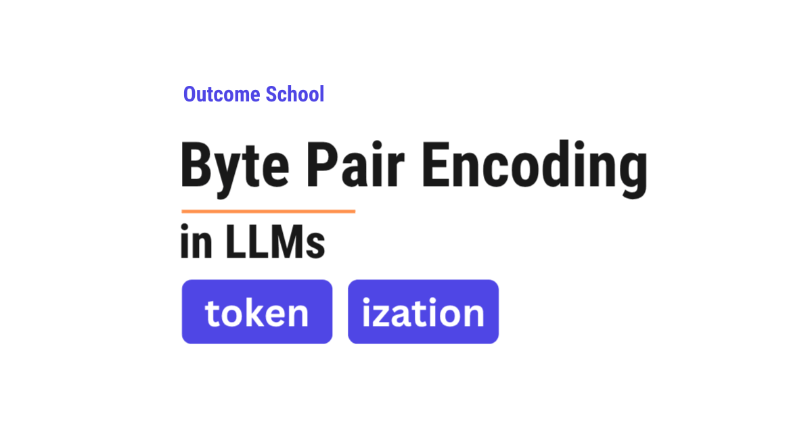

# What is Byte Pair Encoding (BPE) in LLMs?

> Archived from <https://outcomeschool.com/blog/bpe-in-llms> on 2026-11-25.

BPE (Byte Pair Encoding) is the tokenization algorithm used by most modern Large Language Models (LLMs). It starts with single characters and keeps merging the most frequent pair of pieces until it builds a vocabulary of common subwords.

In this blog, we will learn about <strong>BPE (Byte Pair Encoding)</strong> - the tokenization algorithm used by most modern Large Language Models (LLMs) to break text into smaller pieces before processing it.

We will understand what BPE is, why it is needed, and how it works step by step with a simple example.

I am <strong>Amit Shekhar</strong>, Founder @ <a target="_blank" rel="noopener noreferrer" href="https://outcomeschool.com">Outcome School</a>, I have taught and mentored many developers, and their efforts landed them high-paying tech jobs, helped many tech companies in solving their unique problems, and created many open-source libraries being used by top companies. I am passionate about sharing knowledge through open-source, blogs, and videos.

I teach <a target="_blank" rel="noopener noreferrer" href="https://outcomeschool.com/program/ai-and-machine-learning">AI and Machine Learning</a> at Outcome School.

Let&#x27;s get started.
<h2 id="what-is-tokenization">What is Tokenization?</h2>
Before we understand BPE, we must first understand <a target="_blank" rel="noopener noreferrer" href="https://www.youtube.com/watch?v=sK2s9I84EVI">tokenization</a>.

When we type a sentence like &quot;I love teaching AI&quot;, we see words. But a model does not understand words directly. It works with numbers. So, the first step is to break the text into small pieces called <strong>tokens</strong>. Each token is then converted into a number. This process of breaking text into tokens is called <a target="_blank" rel="noopener noreferrer" href="tokenization-in-llms.md"><strong>tokenization</strong></a>.

Think of it like a chocolate bar. The full bar is the sentence. Each small part you break off is a token. The model processes multiple tokens at a time.

Now, the question is: how do we decide where to cut? How big or small should each token be?

This is where different tokenization approaches come into the picture.
<h2 id="the-problem-how-to-break-text-into-tokens">The Problem: How to Break Text into Tokens?</h2>
There are different ways to break text into tokens. Let&#x27;s look at the two simplest approaches and understand why they do not work well.

<strong>Approach 1: Word-Level Tokenization</strong>

The simplest idea is to treat each word as one token.

For the sentence &quot;I love teaching&quot;, the tokens would be: &quot;I&quot;, &quot;love&quot;, &quot;teaching&quot;.

This seems easy. But the issue with this approach is that the model needs to know every word in the language. Think about it - there are hundreds of thousands of words in English alone. And then there are names, technical terms, words from other languages, misspellings, and new words being created every day.

If the model sees a word it has never seen before - like &quot;ChatGPT&quot; or &quot;tokenization&quot; - it does not know what to do. It treats the entire unknown word as a single &quot;unknown&quot; token and loses all meaning.

<strong>Approach 2: Character-Level Tokenization</strong>

The other extreme is to treat each character as one token.

For the sentence &quot;I love&quot;, the tokens would be: &quot;I&quot;, &quot; &quot;, &quot;l&quot;, &quot;o&quot;, &quot;v&quot;, &quot;e&quot;.

Now the model can handle any word - because every word is made up of characters, and the number of unique characters is very small compared to the number of words. For example, English has only 26 letters. Even if we include digits, punctuation, and spaces, the total is still very small. No word is ever &quot;unknown.&quot;

But the issue with this approach is that the tokens are too small. The model has to process many more tokens for the same text. A 10-word sentence can become 50+ tokens. This makes training very slow and makes it harder for the model to understand meaning - because a single character like &quot;l&quot; carries very little meaning on its own.

We needed a solution that gives us the best of both worlds - not too big, not too small. So, here comes <strong>BPE</strong> to the rescue.
<h2 id="what-is-bpe-byte-pair-encoding">What is BPE (Byte Pair Encoding)?</h2>
<strong>BPE (Byte Pair Encoding)</strong> is a tokenization algorithm that breaks text into pieces that are somewhere between characters and words.

It works by repeatedly finding the most common <strong>pair</strong> of adjacent tokens and merging them into one.

So, BPE starts with individual characters and keeps merging the most frequent pairs until it builds up a vocabulary of common pieces - called <strong>subwords</strong>. These subwords can be full words (like &quot;the&quot;), parts of words (like &quot;ing&quot;, &quot;un&quot;, &quot;tion&quot;), or even single characters.

Think of it like learning shorthand. When you first start taking notes, you write every letter. But over time, you notice that some combinations appear very often - like &quot;ing&quot; or &quot;tion&quot;. So, you create shortcuts for them. BPE does the same thing automatically.

<strong>Planning your move into AI?</strong>

No matter which tech domain you work in today, with your effort, you can transition to these roles:
<ul><li>AI Engineer</li><li>Forward Deployed Engineer</li><li>AI Agent Engineer</li><li>Harness Engineer</li><li>Voice AI Engineer</li><li>AI Architect</li><li>LLM Engineer</li><li>LLM Inference Engineer</li><li>Gen AI Engineer</li><li>MLOps Engineer</li><li>ML Engineer</li><li>Deep Learning Engineer</li></ul>
Our <a target="_blank" rel="noopener noreferrer" href="https://outcomeschool.com/program/ai-and-machine-learning">AI and Machine Learning Program</a> at Outcome School takes you there.
<h2 id="how-bpe-works-step-by-step">How BPE Works: Step by Step</h2>
The best way to learn this is by taking an example.

Let&#x27;s say we have the following text that we want to build our vocabulary from:

<pre><code class="code-highlight">low low low low low
lower lower
newest newest newest newest newest newest
widest widest widest
</code></pre>

For the sake of understanding, let&#x27;s count the word frequencies:
<ul><li>&quot;low&quot; appears 5 times</li><li>&quot;lower&quot; appears 2 times</li><li>&quot;newest&quot; appears 6 times</li><li>&quot;widest&quot; appears 3 times</li></ul><h3 id="step-1-start-with-characters">Step 1: Start with Characters</h3>
We start by breaking every word into individual characters. We also add a special end-of-word symbol &quot;_&quot; at the end of each word so the model knows where words end.

<pre><code class="code-highlight">l o w _        (frequency: 5)
l o w e r _    (frequency: 2)
n e w e s t _  (frequency: 6)
w i d e s t _  (frequency: 3)
</code></pre>

Our initial vocabulary is all the individual characters: <code>{l, o, w, e, r, n, s, t, i, d, _}</code>
<h3 id="step-2-find-the-most-frequent-pair">Step 2: Find the Most Frequent Pair</h3>
Now, we look at all pairs of adjacent tokens across our entire text and count how often each pair appears.

For the sake of understanding, let&#x27;s count a few important pairs:
<ul><li>&quot;e s&quot; appears in &quot;newest&quot; (6 times) and &quot;widest&quot; (3 times) = 9 times</li><li>&quot;s t&quot; appears in &quot;newest&quot; (6 times) and &quot;widest&quot; (3 times) = 9 times</li><li>&quot;t _&quot; appears in &quot;newest&quot; (6 times) and &quot;widest&quot; (3 times) = 9 times</li><li>&quot;l o&quot; appears in &quot;low&quot; (5 times) and &quot;lower&quot; (2 times) = 7 times</li><li>&quot;o w&quot; appears in &quot;low&quot; (5 times) and &quot;lower&quot; (2 times) = 7 times</li></ul>
The most frequent pair is &quot;e s&quot; with 9 occurrences. We merge this pair into a single token &quot;es&quot;.
<h3 id="step-3-merge-and-update">Step 3: Merge and Update</h3>
After merging &quot;e s&quot; into &quot;es&quot;, our words now look like this:

<pre><code class="code-highlight">l o w _         (frequency: 5)
l o w e r _     (frequency: 2)
n e w es t _    (frequency: 6)
w i d es t _    (frequency: 3)
</code></pre>

Our vocabulary is now: <code>{l, o, w, e, r, n, s, t, i, d, _, es}</code>

Here, we can see that &quot;e&quot; and &quot;s&quot; have been merged into &quot;es&quot; wherever they appeared together.
<h3 id="step-4-repeat">Step 4: Repeat</h3>
We repeat the same process. We find the next most frequent pair. Now &quot;es t&quot; appears 9 times (6 from &quot;newest&quot; and 3 from &quot;widest&quot;). We merge it into &quot;est&quot;.

<pre><code class="code-highlight">l o w _         (frequency: 5)
l o w e r _     (frequency: 2)
n e w est _     (frequency: 6)
w i d est _     (frequency: 3)
</code></pre>

Vocabulary: <code>{l, o, w, e, r, n, s, t, i, d, _, es, est}</code>

We keep repeating this process. The next merge could be &quot;est _&quot; into &quot;est_&quot;. Then &quot;l o&quot; into &quot;lo&quot;. Then &quot;lo w&quot; into &quot;low&quot;. And so on.

With each merge, our vocabulary grows by one token, and our text gets represented using fewer, larger pieces.
<h3 id="step-5-stop-when-done">Step 5: Stop When Done</h3>
We keep merging until we reach a desired <strong>vocabulary size</strong>. This size is a number we choose in advance. Modern LLMs typically use vocabulary sizes between 32,000 and 256,000 tokens. For example, LLaMA 3 uses a vocabulary of about 128K tokens, while Gemma uses about 256K tokens.

The final vocabulary contains a mix of:
<ul><li>Full common words like &quot;the&quot;, &quot;is&quot;, &quot;and&quot;</li><li>Common subwords like &quot;ing&quot;, &quot;tion&quot;, &quot;est&quot;, &quot;un&quot;</li><li>Individual characters for rare combinations</li></ul>
This is how BPE builds its vocabulary.

<strong>A quick note for you</strong>

No matter which tech domain you work in, get familiar with these topics:
<ul><li>LLM</li><li>RAG</li><li>MCP</li><li>Agent</li><li>Fine-tuning</li><li>Quantization</li></ul>
We put it all together in one video:

<a target="_blank" rel="noopener noreferrer" href="https://www.youtube.com/watch?v=lnfWvX66FUk">AI Engineering Explained: LLM, RAG, MCP, Agent, Fine-Tuning, and Quantization</a>

No need to stop reading - bookmark it and watch later when you get time. Future you will thank you.

Now, let&#x27;s get back to the topic.
<h2 id="how-bpe-tokenizes-new-text">How BPE Tokenizes New Text</h2>
Once BPE has finished training, it has two things: a vocabulary and an <strong>ordered list of merge rules</strong>. The order matters. During training, BPE learned these merges in a specific sequence - first &quot;e s&quot; into &quot;es&quot;, then &quot;es t&quot; into &quot;est&quot;, then &quot;l o&quot; into &quot;lo&quot;, and so on. This exact sequence is saved.

Now, when BPE needs to tokenize new text, it does not simply look up subwords in the vocabulary. Instead, it <strong>replays the same merge rules in the same order they were learned during training</strong>.

Let&#x27;s say we want to tokenize the word &quot;lowest&quot;. Here is how it works:

<strong>Start:</strong> Break the word into individual characters: <code>l o w e s t</code>

<strong>Apply merge rule 1</strong> (&quot;e s&quot; into &quot;es&quot;): <code>l o w es t</code>

<strong>Apply merge rule 2</strong> (&quot;es t&quot; into &quot;est&quot;): <code>l o w est</code>

<strong>Apply merge rule 3</strong> (&quot;l o&quot; into &quot;lo&quot;): <code>lo w est</code>

<strong>Apply merge rule 4</strong> (&quot;lo w&quot; into &quot;low&quot;): <code>low est</code>

Result: &quot;lowest&quot; is tokenized as [&quot;low&quot;, &quot;est&quot;].

Similarly, for the word &quot;newer&quot;:

<strong>Start:</strong> <code>n e w e r</code>

The merge rules are applied in order. The rules that match adjacent pairs in this word get applied step by step, eventually producing: [&quot;new&quot;, &quot;er&quot;].

For a rare word like &quot;widestness&quot;:

<strong>Start:</strong> <code>w i d e s t n e s s</code>

The merge rules are applied in order. Common merges like &quot;es&quot; into &quot;es&quot; and &quot;est&quot; into &quot;est&quot; will fire when they match. The remaining characters stay as smaller pieces. The word gets broken into known subwords from the vocabulary.

<strong>Why does the order matter?</strong> Because different merge orders can produce different results. If we just did a greedy lookup - trying to find the longest matching subwords in the vocabulary - we could get different tokenizations than what the model expects. By replaying the merge rules in the exact training order, we get consistent and correct tokenizations every time.

This is the beauty of BPE. It never encounters a completely unknown word. Even if a word has never been seen before, BPE can break it down into smaller pieces by applying the merge rules. In the worst case, it falls back to individual characters - but that rarely happens for common languages. Problem Solved.

This is how BPE tokenizes new text.

If we want to go deep into Tokenization and LLM Internals, and build a Large Language Model (LLM) from scratch, check out our <a target="_blank" rel="noopener noreferrer" href="https://outcomeschool.com/program/ai-and-machine-learning">AI and Machine Learning Program</a> at Outcome School.
<h2 id="why-bpe-is-used-in-modern-llms">Why BPE is Used in Modern LLMs</h2>
BPE is the tokenization algorithm used by most modern LLMs. Here is why:

<strong>Handles unknown words:</strong> BPE can tokenize any word, even words it has never seen before, by breaking them into known subword pieces. No word is ever completely &quot;unknown.&quot;

<strong>Efficient vocabulary size:</strong> Instead of needing millions of entries for every possible word, BPE creates a compact vocabulary of 32,000 to 256,000 tokens that can represent any text. It makes our life easy.

<strong>Balances meaning and efficiency:</strong> Common words like &quot;the&quot; and &quot;is&quot; are kept as single tokens - fast to process and meaningful. Rare words are broken into subword pieces - still understandable and manageable. This gives us the best of both worlds.

<strong>Works across languages:</strong> BPE works at the character level, so it can handle any language, any script, and any special characters. The same algorithm works for English, Chinese, Arabic, code, and that too without any changes to the algorithm itself.

Models use a variant of BPE, but the core idea remains the same - BPE or its variants are at the heart of how modern LLMs read and process text.

Once the text is split into tokens, the Transformer takes over. We have a detailed blog on <a target="_blank" rel="noopener noreferrer" href="encoder-vs-decoder-in-transformers.md">Encoder vs Decoder in Transformers</a> that explains the two blocks which process these tokens.

Now, we have understood BPE (Byte Pair Encoding) and how it works.

<strong>Stay updated:</strong> Subscribe to our <a target="_blank" rel="noopener noreferrer" href="https://outcomeschool.substack.com/subscribe">newsletter</a> to get our latest AI and Machine Learning blogs straight to your inbox.
<h2 id="frequently-asked-questions">Frequently Asked Questions</h2><h3 id="is-bpe-better-than-word-level-tokenization">Is BPE better than word-level tokenization?</h3>
Yes. Word-level tokenization needs the model to know every word, and an unseen word like &quot;ChatGPT&quot; becomes a single &quot;unknown&quot; token that loses all meaning. BPE breaks such a word into known subword pieces instead. So, no word is ever completely unknown.
<h3 id="why-not-just-use-character-level-tokenization">Why not just use character-level tokenization?</h3>
Character-level tokenization makes the tokens too small. A 10-word sentence can become 50+ tokens, which makes training very slow. It also makes it harder for the model to understand meaning, because a single character carries very little meaning on its own. BPE sits between characters and words.
<h3 id="what-vocabulary-size-do-llms-use-with-bpe">What vocabulary size do LLMs use with BPE?</h3>
Modern LLMs typically use vocabulary sizes between 32,000 and 256,000 tokens. This size is a number we choose in advance, and BPE keeps merging pairs until it reaches it. For example, LLaMA 3 uses about 128K tokens, while Gemma uses about 256K tokens.
<h3 id="does-bpe-use-a-greedy-longest-match-lookup-to-tokenize-new-text">Does BPE use a greedy longest-match lookup to tokenize new text?</h3>
No. BPE replays the ordered list of merge rules in the same sequence they were learned during training. A greedy lookup of the longest matching subwords could give different tokenizations than what the model expects. Replaying the merges in order gives consistent and correct tokenizations every time.
<h3 id="can-bpe-ever-fail-to-tokenize-a-word">Can BPE ever fail to tokenize a word?</h3>
No. BPE can break any word, even one it has never seen, into smaller pieces by applying the merge rules. In the worst case, it falls back to individual characters. That rarely happens for common languages.

That&#x27;s it for now.

Thanks

<strong>Amit Shekhar</strong> Founder @ <a target="_blank" rel="noopener noreferrer" href="https://outcomeschool.com">Outcome School</a>

You can connect with me on:
<ul><li><a target="_blank" rel="noopener noreferrer" href="https://x.com/amitiitbhu">X</a></li><li><a target="_blank" rel="noopener noreferrer" href="https://www.linkedin.com/in/amit-shekhar-iitbhu">LinkedIn</a></li><li><a target="_blank" rel="noopener noreferrer" href="https://github.com/amitshekhariitbhu">GitHub</a></li></ul>
Follow Outcome School on:
<ul><li><a target="_blank" rel="noopener noreferrer" href="https://x.com/outcome_school">X</a></li><li><a target="_blank" rel="noopener noreferrer" href="https://youtube.com/@OutcomeSchool">YouTube</a></li><li><a target="_blank" rel="noopener noreferrer" href="https://www.linkedin.com/company/outcomeschool">LinkedIn</a></li><li><a target="_blank" rel="noopener noreferrer" href="https://github.com/OutcomeSchool">GitHub</a></li></ul>
<a target="_blank" rel="noopener noreferrer" href="https://outcomeschool.com/blog"><strong>Read all of our high-quality blogs here.</strong></a>

