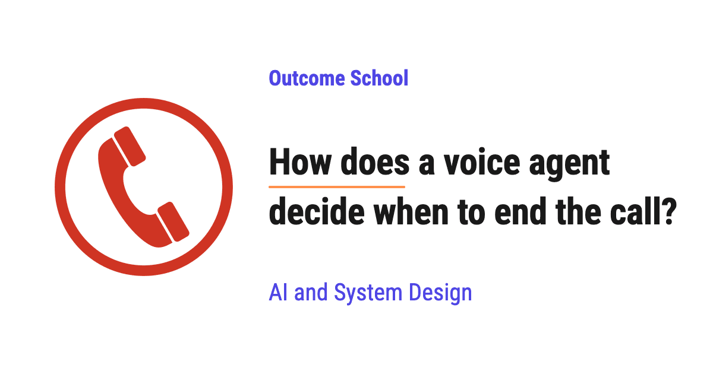

# How does a voice agent decide when to end the call?

> Archived from <https://outcomeschool.com/blog/call-ending-in-voice-agents> on 2026-11-25.

A voice agent decides when to end the call by watching for a few signals, like the user hanging up, the LLM recommending an end to the call once the conversation is complete, the user staying silent for too long, or the call hitting a time limit. When the agent itself ends the call, it says a short goodbye, waits for that goodbye to finish playing, and then hangs up.

In this blog, we will learn about how a voice agent decides when to end the call. We will also see why ending a call is harder than it looks, how the agent reacts when the user hangs up first, how the LLM recommends ending the call with an end call tool, how the agent says goodbye without cutting it off, how silence and time limits end a call, and how we stop the agent from hanging up too early.

We will cover the following:
<ul><li>What does ending a call mean for a voice agent?</li><li>Why is ending a call hard?</li><li>The signals that end a call</li><li>Signal 1: The user hangs up</li><li>Signal 2: The LLM recommends ending the call</li><li>Saying goodbye without cutting it off</li><li>Signal 3: The user goes silent</li><li>Signal 4: The call hits a time limit</li><li>Signal 5: The call is transferred or reaches a voicemail</li><li>Stopping the agent from hanging up too early</li><li>What happens after the call ends</li><li>Putting it all together in code</li></ul>
I am <strong>Amit Shekhar</strong>, Founder @ <a target="_blank" rel="noopener noreferrer" href="https://outcomeschool.com">Outcome School</a>, I have taught and mentored many developers, and their efforts landed them high-paying tech jobs, helped many tech companies in solving their unique problems, and created many open-source libraries being used by top companies. I am passionate about sharing knowledge through open-source, blogs, and videos.

I teach <a target="_blank" rel="noopener noreferrer" href="https://outcomeschool.com/program/ai-and-machine-learning">AI and Machine Learning</a> at Outcome School.

Let&#x27;s get started.
<h2 id="what-does-ending-a-call-mean-for-a-voice-agent">What does ending a call mean for a voice agent?</h2>
Many voice agents work as a <a target="_blank" rel="noopener noreferrer" href="design-a-real-time-voice-ai-agent.md">pipeline of three steps</a>: <strong>Speech-to-Text (STT)</strong> turns what the user said into text, an <strong>LLM (Large Language Model)</strong> decides the reply, and <strong>Text-to-Speech (TTS)</strong> turns the reply into a voice.

The end of a call is the moment when the line is closed. After that, no audio goes in and no audio comes out. On a phone call, this is the same as pressing the red button on our phone.

<strong>Ending a call means the agent decides that the conversation is over, finishes what it is saying, and closes the line.</strong>

When two people talk on the phone, they say &quot;Okay, bye&quot;, and one of them hangs up. But, a voice agent must be told exactly when to hang up and how to do it.
<h2 id="why-is-ending-a-call-hard">Why is ending a call hard?</h2>
Let&#x27;s say we are building a voice agent for a restaurant that books tables. It can make three mistakes at the end of a call.

<strong>Mistake 1: It hangs up too early.</strong> The user says, &quot;Thank you,&quot; and <a target="_blank" rel="noopener noreferrer" href="long-pauses-in-voice-agents.md">pauses to think</a>. The agent thinks the call is over and hangs up. But, the user was about to say, &quot;Thank you, and can I also bring my dog?&quot; Now, the user is angry and has to call again.

<strong>Mistake 2: It never hangs up.</strong> The booking is done. The user says &quot;Bye&quot; and walks away without pressing the red button. The agent keeps the line open and keeps talking to nobody. Every minute on the line costs money for the phone service, the STT, the LLM, and the TTS.

<strong>Mistake 3: It cuts its own goodbye.</strong> The agent starts saying, &quot;Your table is booked. Have a great evening.&quot; But, it closes the line after &quot;Your table is&quot;. The user hears half a sentence and a click.
<h2 id="the-signals-that-end-a-call">The signals that end a call</h2>
A voice agent ends the call when one of a few signals comes. The signals are:
<ul><li>The user hangs up.</li><li>The LLM recommends ending the call because the conversation is complete.</li><li>The user goes silent for too long.</li><li>The call hits a time limit.</li><li>The call is transferred to a human or reaches a voicemail.</li></ul>
We will learn about each of them in detail.
<h2 id="signal-1-the-user-hangs-up">Signal 1: The user hangs up</h2>
This is the easiest signal, because the user decides for us.

On a phone call, when the user presses the red button, the phone network sends a message to the other side that the call is over. In <strong><a target="_blank" rel="noopener noreferrer" href="sip-and-rtp.md">SIP (Session Initiation Protocol)</a></strong>, the protocol that carries most internet phone calls, this message is called <code>BYE</code>. In an app or a website, the connection between the user and the agent closes.

The agent does not need to decide anything here. It needs to react quickly: stop the LLM and the TTS, stop sending audio, and run the cleanup work. Otherwise, it keeps paying for the LLM and the TTS to talk to nobody.
<h2 id="signal-2-the-llm-recommends-ending-the-call">Signal 2: The LLM recommends ending the call</h2>
Most of the time, we want the agent itself to decide that the conversation is over. This is the hardest signal.

The naive approach is to look for words. If the user says &quot;bye&quot; or &quot;thank you&quot;, we hang up.

The issue with this approach is that words alone do not tell us the meaning. Let&#x27;s see a few examples:
<ul><li>&quot;Thank you, and one more thing.&quot; The user is not done.</li><li>&quot;Okay, bye. Oh wait, what time do you close?&quot; The user is not done.</li><li>&quot;Okay, that is all.&quot; The user is done, but there is no &quot;bye&quot; or &quot;thank you&quot; in it.</li></ul>
Let&#x27;s see how the next approach solve this issue.

The better approach is to let the LLM decide, because the LLM understands the whole conversation, not only the last word.

An LLM can use <strong><a target="_blank" rel="noopener noreferrer" href="function-calling-in-voice-agents.md">function calling</a></strong>. We describe a function to the LLM, and when that function is needed, the LLM replies with its name instead of a normal text reply. The LLM never runs the function itself. It recommends it, and our code runs it.

So, we give the LLM a function called <code>end_call</code>, and we can describe it as below:

<pre><code class="code-highlight language-json">{
  &quot;type&quot;: &quot;function&quot;,
  &quot;name&quot;: &quot;end_call&quot;,
  &quot;description&quot;: &quot;End the phone call. Use this only when the user&#x27;s request is fully handled and the user has clearly said goodbye or said they need nothing else.&quot;,
  &quot;parameters&quot;: {
    &quot;type&quot;: &quot;object&quot;,
    &quot;properties&quot;: {
      &quot;reason&quot;: {
        &quot;type&quot;: &quot;string&quot;,
        &quot;description&quot;: &quot;Why the call is ending, for example: booking_done or user_said_goodbye&quot;
      }
    },
    &quot;required&quot;: [&quot;reason&quot;]
  }
}
</code></pre>

Here, we can see that the description gives two conditions that must both be true: the request is fully handled, and the user has clearly said they are done. The <code>reason</code> field helps us later, when we look at why our calls ended.

We also add a few lines to the <a target="_blank" rel="noopener noreferrer" href="voice-agent-system-prompt.md">system prompt</a>, which is the set of instructions the LLM reads before every reply:

<pre><code class="code-highlight language-text">When the booking is done, ask if the user needs anything else.
If the user says no or says goodbye, say a short goodbye and then use the end_call tool.
Never use end_call while the user is still asking for something.
</code></pre>

Now, let&#x27;s see the restaurant call again:
<ul><li>User: &quot;Book a table for two at 8 PM.&quot;</li><li>Agent: &quot;Done. Your table for two is booked at 8 PM. Is there anything else I can help you with?&quot;</li><li>User: &quot;No, that is all, thanks.&quot;</li><li>Agent: &quot;Have a great evening. Goodbye.&quot; Along with this reply, the LLM recommends <code>end_call</code> with the reason <code>booking_done</code>.</li></ul>
The LLM read the full conversation. It saw that the booking was done and that the user said no to &quot;anything else?&quot;. So, it recommended ending the call.

<strong>Planning your move into AI?</strong>

No matter which tech domain you work in today, with your effort, you can transition to these roles:
<ul><li>AI Engineer</li><li>Forward Deployed Engineer</li><li>AI Agent Engineer</li><li>Harness Engineer</li><li>Voice AI Engineer</li><li>AI Architect</li><li>LLM Engineer</li><li>LLM Inference Engineer</li><li>Gen AI Engineer</li><li>MLOps Engineer</li><li>ML Engineer</li><li>Deep Learning Engineer</li></ul>
Our <a target="_blank" rel="noopener noreferrer" href="https://outcomeschool.com/program/ai-and-machine-learning">AI and Machine Learning Program</a> at Outcome School takes you there.
<h2 id="saying-goodbye-without-cutting-it-off">Saying goodbye without cutting it off</h2>
Now, the next big question is: when exactly should our code close the line?

The LLM recommended <code>end_call</code> and wrote &quot;Have a great evening. Goodbye.&quot; But, these words are not spoken yet. They still have to become audio in the TTS, travel over the network, and play on the user&#x27;s phone. This takes a few seconds.

If our code closes the line the moment it sees <code>end_call</code>, the user hears only &quot;Have a great&quot; and then a click. This is Mistake 3 from earlier.

So, the rule is: <strong>close the line only after the goodbye audio has finished playing.</strong>

The flow looks like below:

<pre><code class="code-highlight language-text">+----------------------------------+
| LLM writes &quot;Goodbye&quot;             |
| and recommends end_call          |
+----------------------------------+
                  ↓
+----------------------------------+
| TTS turns &quot;Goodbye&quot; into audio   |
+----------------------------------+
                  ↓
+----------------------------------+
| Audio plays to the user          |
+----------------------------------+
                  ↓
+----------------------------------+
| Agent waits until playback       |
| is finished                      |
+----------------------------------+
                  ↓
+----------------------------------+
| Agent closes the line            |
+----------------------------------+
</code></pre>

Here, the important step is the wait. Our code does not close the line right away. It marks the call as &quot;ending&quot;, lets the goodbye play fully, and only then closes the line. We can also add a short pause, around half a second, after the audio ends, so that the last word is not clipped.

One more thing to notice: in normal function calling, our code sends the result of a function back to the LLM, and the LLM writes another reply. For <code>end_call</code>, we do not want that, because the LLM can then say &quot;The call has ended.&quot; to the user. So, <code>end_call</code> does not trigger another reply.

Also, the user can still talk while the goodbye is playing. If the user says, &quot;Wait, one more question&quot;, the agent must stop the goodbye, cancel the ending, and go back to the conversation, just like any other <a target="_blank" rel="noopener noreferrer" href="what-is-barge-in-in-a-voice-ai-agent.md">interruption</a>.
<h2 id="signal-3-the-user-goes-silent">Signal 3: The user goes silent</h2>
Now, let&#x27;s handle Mistake 2, where the agent never hangs up.

Sometimes, the user walks away, or the network drops their audio. The line is still open, but nobody is there.

For this, the agent uses a <strong>silence timeout</strong>. It is a timer that starts every time the user stops speaking. If the user speaks again, the timer resets. If the timer runs out, the agent acts.

A good agent does not hang up at the first silence. It follows the steps like below:
<ul><li><strong>Step 1:</strong> The user is silent for around 10 seconds. The agent asks, &quot;Are you still there?&quot;</li><li><strong>Step 2:</strong> The user is still silent for another 10 seconds. The agent says, &quot;I am not able to hear you. Please call again anytime.&quot;</li><li><strong>Step 3:</strong> The agent waits for this message to finish playing and closes the line.</li></ul>
The exact numbers depend on our use case. A call where the user reads a long card number needs a longer timeout than a quick booking call.

Silence must be measured from the user&#x27;s side only. When the agent is talking, or waiting for a <a target="_blank" rel="noopener noreferrer" href="slow-tool-calls-in-voice-agents.md">slow tool</a> like a booking system, the timer must not count those seconds. Otherwise, the agent will ask &quot;Are you still there?&quot; while it is the one keeping the user waiting.

<strong>A quick note for you</strong>

No matter which tech domain you work in, get familiar with these topics:
<ul><li>LLM</li><li>RAG</li><li>MCP</li><li>Agent</li><li>Fine-tuning</li><li>Quantization</li></ul>
We put it all together in one video:

<a target="_blank" rel="noopener noreferrer" href="https://www.youtube.com/watch?v=lnfWvX66FUk">AI Engineering Explained: LLM, RAG, MCP, Agent, Fine-Tuning, and Quantization</a>

No need to stop reading - bookmark it and watch later when you get time. Future you will thank you.

Now, let&#x27;s get back to the topic.
<h2 id="signal-4-the-call-hits-a-time-limit">Signal 4: The call hits a time limit</h2>
Even a healthy call must not go on forever. So, we set a <strong>maximum call duration</strong>, for example 15 or 30 minutes, based on our use case.

This protects us from a call stuck in a loop, a call where another machine on the other side keeps talking to our agent, and a very large bill from one single call.

When the limit is close, the agent gives a warning first, for example one minute before: &quot;We are almost out of time.&quot; Then, at the limit, it says goodbye, waits for the audio to finish, and closes the line.
<h2 id="signal-5-the-call-is-transferred-or-reaches-a-voicemail">Signal 5: The call is transferred or reaches a voicemail</h2>
Sometimes, the agent is not the one who finishes the conversation:
<ul><li><strong>Transfer to a human:</strong> The user asks for a person, or the agent cannot help. The agent <a target="_blank" rel="noopener noreferrer" href="call-transfer-with-context.md">transfers the call to a human</a>. After the transfer is done, the agent leaves the call, even though the call continues with the human.</li><li><strong>Voicemail:</strong> In an <a target="_blank" rel="noopener noreferrer" href="outbound-calling-voice-agent.md">outbound call</a>, where the agent dials, the call can reach an answering machine. The agent <a target="_blank" rel="noopener noreferrer" href="answering-machine-detection.md">detects this</a>, leaves a short message or none, and hangs up.</li></ul>
In both cases, the decision to leave comes from the task itself, not from a goodbye. The transfer is often built as a tool too, like <code>transfer_call</code>, which the LLM recommends just like <code>end_call</code>.
<h2 id="stopping-the-agent-from-hanging-up-too-early">Stopping the agent from hanging up too early</h2>
Now, let&#x27;s handle Mistake 1. Hanging up too early is worse than hanging up late, because the user loses their work and has to call again.

We can use a few guards:
<ul><li><strong>Ask before ending.</strong> The agent asks &quot;Is there anything else I can help you with?&quot; before it ends the call. It ends only after the user says no. This one question prevents many early hang-ups.</li><li><strong>Write a strict tool description.</strong> The <code>end_call</code> description must say clearly when to use it and when not to use it. A vague description like &quot;End the call&quot; can make the LLM recommend it too early.</li><li><strong>Check the state in our code.</strong> Our code can check if important work is finished before it accepts <code>end_call</code>. For example, if a booking was started but not saved, our code refuses to hang up and tells the LLM to finish the booking first.</li><li><strong>Let the user cancel the ending.</strong> As we saw earlier, if the user speaks during the goodbye, the agent cancels the ending.</li><li><strong>Test with many conversations.</strong> We run test calls and count how often the agent hung up too early or never hung up, then improve the prompt and the tool description.</li></ul>
Here, we can notice that the LLM recommends, but our code has the final say, because hanging up cannot be undone.

To learn Tool use in Agents, Evaluation of LLMs and Agents, and how to Design a Real-Time Voice AI Agent, check out our <a target="_blank" rel="noopener noreferrer" href="https://outcomeschool.com/program/ai-and-machine-learning">AI and Machine Learning Program</a> at Outcome School.
<h2 id="what-happens-after-the-call-ends">What happens after the call ends</h2>
The line is closed, but the agent still runs the cleanup steps:
<ul><li>Stop all timers, the STT, the LLM, and the TTS, so that we do not keep paying for them.</li><li>Save the full transcript of the call.</li><li>Save the reason why the call ended, like <code>booking_done</code>, <code>user_hung_up</code>, <code>silence_timeout</code>, or <code>max_duration</code>.</li><li>Send any follow-up, like a booking confirmation by text message.</li></ul>
The saved reason helps us find problems. Let&#x27;s say 20 percent of our calls end with <code>silence_timeout</code>. This tells us that something is wrong, like confusing questions or user audio that is not reaching the agent.

<strong>Stay updated:</strong> Subscribe to our <a target="_blank" rel="noopener noreferrer" href="https://outcomeschool.substack.com/subscribe">newsletter</a> to get our latest AI and Machine Learning blogs straight to your inbox.
<h2 id="putting-it-all-together-in-code">Putting it all together in code</h2>
Now, let&#x27;s see the code for an agent that handles all these signals. For the sake of understanding, this is a simple Python version, and helpers like <code>speak</code> and <code>hang_up</code> stand for the real parts of our voice pipeline.

<pre><code class="code-highlight language-python">import asyncio

SILENCE_LIMIT = 10        # seconds before &quot;Are you still there?&quot;
MAX_CALL_SECONDS = 900    # 15 minutes

class Call:
    def __init__(self, line):
        self.line = line
        self.ending = False
        self.end_reason = None

    async def end(self, goodbye, reason):
        self.ending = True
        self.end_reason = reason
        await speak(self.line, goodbye)       # returns after playback ends
        await asyncio.sleep(0.5)              # short pause
        if self.ending:                       # not cancelled by the user
            await hang_up(self.line)

    async def on_llm_tool_call(self, name, args, reply_text):
        if name == &quot;end_call&quot;:
            if booking_in_progress(self):
                return &quot;Finish the booking before ending the call.&quot;
            await self.end(reply_text, args[&quot;reason&quot;])
            return None                       # no new LLM reply after end_call

    def on_user_speech(self):
        self.ending = False                   # the user spoke, cancel any ending
        self.end_reason = None
</code></pre>

Here, we have:
<ul><li><code>end()</code> speaks the goodbye, waits until the audio has finished playing and a short moment more, and then closes the line.</li><li><code>self.ending</code> is the flag that marks the call as &quot;ending&quot;. If the user speaks during the goodbye, <code>on_user_speech()</code> sets it back to <code>False</code>, and the agent does not hang up.</li><li><code>on_llm_tool_call()</code> runs when the LLM recommends a function. For <code>end_call</code>, it refuses if a booking is still in progress. Otherwise, it ends the call and returns <code>None</code>, so that the LLM does not write another reply.</li></ul>
Now, let&#x27;s add the silence timer and the time limit:

<pre><code class="code-highlight language-python">    async def watch_silence(self):
        while not self.ending:
            await wait_for_user_silence(self.line, SILENCE_LIMIT)
            await speak(self.line, &quot;Are you still there?&quot;)
            heard = await wait_for_user_speech(self.line, SILENCE_LIMIT)
            if not heard:
                await self.end(&quot;I am not able to hear you. Please call again anytime.&quot;, &quot;silence_timeout&quot;)

    async def watch_duration(self):
        await asyncio.sleep(MAX_CALL_SECONDS - 60)
        await speak(self.line, &quot;We are almost out of time.&quot;)
        await asyncio.sleep(60)
        await self.end(&quot;Thank you for calling. Goodbye.&quot;, &quot;max_duration&quot;)

    async def on_line_closed(self):
        self.ending = True
        self.end_reason = self.end_reason or &quot;user_hung_up&quot;
        stop_pipeline(self.line)
        save_transcript_and_reason(self)
</code></pre>

Here, we have:
<ul><li><code>watch_silence()</code> asks &quot;Are you still there?&quot; after 10 seconds of user silence, and ends the call with <code>silence_timeout</code> if there is still no reply. The helper <code>wait_for_user_silence</code> counts only the seconds when the agent is not talking and not waiting on a tool.</li><li><code>watch_duration()</code> warns the user one minute before the limit, then ends the call with <code>max_duration</code>.</li><li><code>on_line_closed()</code> runs whenever the line closes, no matter who closed it. If the user hung up first, the reason is <code>user_hung_up</code>.</li></ul>
Here, I have kept only the important lines of the code and removed other lines for brevity.

Now we must have understood how a voice agent decides when to end the call, how it says goodbye without cutting it off, and how it avoids hanging up too early.
<h2 id="frequently-asked-questions">Frequently Asked Questions</h2><h3 id="should-a-voice-agent-hang-up-when-the-user-says-bye">Should a voice agent hang up when the user says &quot;bye&quot;?</h3>
No. Words alone do not tell us the meaning. A user can say &quot;Okay, bye. Oh wait, what time do you close?&quot; and still not be done, or say &quot;Okay, that is all.&quot; with no &quot;bye&quot; in it. So, we let the LLM decide with an <code>end_call</code> tool, because it understands the whole conversation, not only the last word.
<h3 id="does-the-llm-end-the-call-by-itself">Does the LLM end the call by itself?</h3>
No. The LLM never runs the function itself. It recommends <code>end_call</code>, and our code runs it. Our code has the final say, because hanging up cannot be undone. For example, if a booking was started but not saved, our code refuses to hang up and tells the LLM to finish the booking first.
<h3 id="why-does-end_call-not-trigger-another-llm-reply">Why does end_call not trigger another LLM reply?</h3>
Because the LLM could then say &quot;The call has ended.&quot; to the user. In normal function calling, our code sends the result of a function back to the LLM, and the LLM writes another reply. For <code>end_call</code>, we skip this step, so the goodbye is the last thing the user hears.
<h3 id="how-long-should-the-silence-timeout-be-in-a-voice-agent">How long should the silence timeout be in a voice agent?</h3>
It depends on our use case. A common pattern is to ask &quot;Are you still there?&quot; after around 10 seconds of user silence, and end the call after another 10 seconds without a reply. A call where the user reads a long card number needs a longer timeout than a quick booking call.

That&#x27;s it for now.

Thanks

<strong>Amit Shekhar</strong> Founder @ <a target="_blank" rel="noopener noreferrer" href="https://outcomeschool.com">Outcome School</a>

You can connect with me on:
<ul><li><a target="_blank" rel="noopener noreferrer" href="https://x.com/amitiitbhu">X</a></li><li><a target="_blank" rel="noopener noreferrer" href="https://www.linkedin.com/in/amit-shekhar-iitbhu">LinkedIn</a></li><li><a target="_blank" rel="noopener noreferrer" href="https://github.com/amitshekhariitbhu">GitHub</a></li></ul>
Follow Outcome School on:
<ul><li><a target="_blank" rel="noopener noreferrer" href="https://x.com/outcome_school">X</a></li><li><a target="_blank" rel="noopener noreferrer" href="https://youtube.com/@OutcomeSchool">YouTube</a></li><li><a target="_blank" rel="noopener noreferrer" href="https://www.linkedin.com/company/outcomeschool">LinkedIn</a></li><li><a target="_blank" rel="noopener noreferrer" href="http://github.com/OutcomeSchool">GitHub</a></li></ul>
<a target="_blank" rel="noopener noreferrer" href="https://outcomeschool.com/blog"><strong>Read all of our high-quality blogs here.</strong></a>

