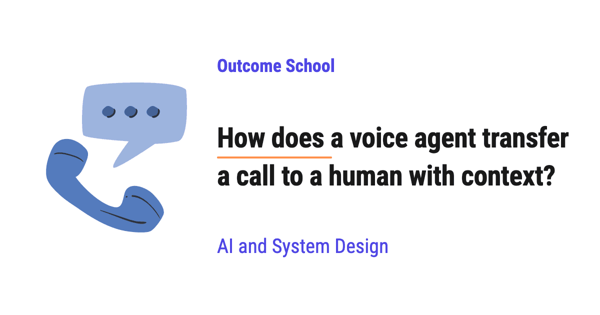

# How does a voice agent transfer a call to a human with context?

> Archived from <https://outcomeschool.com/blog/call-transfer-with-context> on 2026-11-25.

A voice agent transfers a call to a human with context by deciding that a human is needed, writing a short summary of the call, and moving the call and that summary to the human together, so that the caller never has to repeat the story.

In this blog, we will learn about how a voice agent transfers a call to a human with context. We will also see why a voice agent needs to hand off a call at all, how it decides the right moment to transfer, what context it must pass along, the difference between a cold transfer and a warm transfer, how the call and the context travel together, and what happens when no human is free to take the call.

We will cover the following:
<ul><li>The problem: transferring a call without context</li><li>What is a call transfer with context?</li><li>When does a voice agent decide to transfer?</li><li>What context must travel with the call?</li><li>Cold transfer vs Warm transfer</li><li>How do the call and the context travel together?</li><li>Putting it all together in code</li><li>What if no human is available?</li></ul>
I am <strong>Amit Shekhar</strong>, Founder @ <a target="_blank" rel="noopener noreferrer" href="https://outcomeschool.com">Outcome School</a>, I have taught and mentored many developers, and their efforts landed them high-paying tech jobs, helped many tech companies in solving their unique problems, and created many open-source libraries being used by top companies. I am passionate about sharing knowledge through open-source, blogs, and videos.

I teach <a target="_blank" rel="noopener noreferrer" href="https://outcomeschool.com/program/ai-and-machine-learning">AI and Machine Learning</a> at Outcome School.

Let&#x27;s get started.
<h2 id="the-problem-transferring-a-call-without-context">The problem: transferring a call without context</h2>
A <a target="_blank" rel="noopener noreferrer" href="design-a-real-time-voice-ai-agent.md">voice agent</a> is an <a target="_blank" rel="noopener noreferrer" href="ai-agent.md">AI agent</a> that we talk to on a phone call. It listens to what we say, turns it into text, lets an <a target="_blank" rel="noopener noreferrer" href="large-language-model-llm.md">LLM (Large Language Model)</a> decide the reply, and speaks the reply back to us.

A voice agent can handle many calls on its own, like checking an order or booking an appointment. But some calls need a human.

Let&#x27;s say a caller named Riya calls her bank. She talks to the voice agent for three minutes. She gives her name, her account number, and explains that a payment of 5,000 rupees left her account twice. The agent verifies her identity and checks the transactions. Then, the agent decides that this refund needs a human.

Now, the agent transfers the call. A human agent named Rahul picks up and says:

&quot;Hello, thank you for calling. Can I have your name and account number, please?&quot;

Riya has to repeat her name, her account number, and the whole story. Three minutes of her time are wasted, and she is now more upset than before.

This is the problem. The call moved to a human, but the information did not move with it.

Phone systems have been transferring calls for decades. So, the real question is: how do we also transfer what the caller already told us?
<h2 id="what-is-a-call-transfer-with-context">What is a call transfer with context?</h2>
<strong>A call transfer with context is a handoff where the voice agent moves the live call to a human agent and, at the same time, gives that human everything the caller has already shared, so that the human can continue the conversation instead of restarting it.</strong>

Here, the word &quot;context&quot; means the information gathered during the call: who the caller is, what the problem is, what the agent has already checked, and what the caller wants.

With context, the same call goes like below:

Rahul picks up the call. Before he speaks, his screen already shows: &quot;Riya Sharma, identity verified, payment of 5,000 rupees charged twice on 12 October, wants a refund of the second payment.&quot; Rahul says:

&quot;Hi Riya, I can see that the payment of 5,000 rupees was charged twice. Let me process the refund for the second one right away.&quot;

Riya does not repeat anything. The call feels like one conversation, even though it moved from an AI to a human.

A transfer with context has three parts:
<ul><li><strong>Decide:</strong> The agent decides that a human is needed.</li><li><strong>Package:</strong> The agent collects the context and writes a short summary.</li><li><strong>Hand off:</strong> The agent moves the call and the context to the human together.</li></ul>
Now, let&#x27;s understand each part one by one.
<h2 id="when-does-a-voice-agent-decide-to-transfer">When does a voice agent decide to transfer?</h2>
If the agent transfers too early, humans get calls that the agent could have handled. If it transfers too late, the caller gets frustrated.

A voice agent usually transfers the call in the following situations:
<ul><li><strong>The caller asks for a human.</strong> The caller says &quot;I want to talk to a person&quot;. This is the clearest signal, and the agent must respect it.</li><li><strong>The task is outside what the agent can do.</strong> The company does not let the agent approve refunds, change legal details, or handle a complaint about fraud.</li><li><strong>The agent is stuck.</strong> The agent has failed to understand the caller two or three times in a row.</li><li><strong>The caller is upset.</strong> The caller&#x27;s words, or in some systems the tone of voice, show anger or distress, and a human can handle the situation better.</li><li><strong>A business rule says so.</strong> For example, every call about closing an account must go to a human.</li></ul>
We have a detailed blog on <a target="_blank" rel="noopener noreferrer" href="human-in-the-loop-agents.md">Human-in-the-Loop agents</a> that explains how an agent hands control to a human at the right moments.

Now, the question is: how does the agent make this decision?

The answer is that we <a target="_blank" rel="noopener noreferrer" href="how-does-function-calling-work-in-llms.md">give the LLM a tool</a> named something like <code>transfer_to_human</code>. In the <a target="_blank" rel="noopener noreferrer" href="voice-agent-system-prompt.md">system prompt</a>, we describe when this tool must be used. When the LLM sees one of these situations, it recommends calling this tool along with a reason.

<strong>Note:</strong> The LLM never transfers the call by itself. It only recommends the tool and its inputs, and our code performs the actual transfer.

Some rules are too important to leave to the LLM. For example, &quot;the agent failed to understand the caller three times&quot; or &quot;the caller mentioned fraud&quot;. For these, our code checks the rule directly and triggers the transfer, even if the LLM did not recommend it. This way, the most important rules never depend on the LLM alone.

<strong>Planning your move into AI?</strong>

No matter which tech domain you work in today, with your effort, you can transition to these roles:
<ul><li>AI Engineer</li><li>Forward Deployed Engineer</li><li>AI Agent Engineer</li><li>Harness Engineer</li><li>Voice AI Engineer</li><li>AI Architect</li><li>LLM Engineer</li><li>LLM Inference Engineer</li><li>Gen AI Engineer</li><li>MLOps Engineer</li><li>ML Engineer</li><li>Deep Learning Engineer</li></ul>
Our <a target="_blank" rel="noopener noreferrer" href="https://outcomeschool.com/program/ai-and-machine-learning">AI and Machine Learning Program</a> at Outcome School takes you there.
<h2 id="what-context-must-travel-with-the-call">What context must travel with the call?</h2>
Now that the agent has decided to transfer, it needs to package the context. The human agent has only a few seconds to read before saying hello, so the context must be short and useful.

A good context package contains the following:
<ul><li><strong>Caller identity:</strong> The caller&#x27;s name, phone number, and account number.</li><li><strong>Verification status:</strong> Whether the agent has already verified the caller&#x27;s identity. This saves the human from asking the security questions again.</li><li><strong>Reason for transfer:</strong> Why the call came to a human. For example, &quot;refund needs human approval&quot; or &quot;caller asked for a human&quot;.</li><li><strong>Summary of the problem:</strong> Two or three sentences about what the caller wants.</li><li><strong>What has been done:</strong> What the agent has already checked or tried. For example, &quot;found two payments of 5,000 rupees on 12 October&quot;.</li><li><strong>Caller mood:</strong> Whether the caller is calm or upset.</li><li><strong>Full transcript:</strong> The complete text of the conversation, kept as a backup.</li></ul>
Here, the most important item is the summary. A transcript of three minutes is too long to read in a few seconds. So, the agent asks the LLM to turn it into a short summary.

We can write the prompt for the summary as below:

<pre><code class="code-highlight language-text">You are preparing a handoff note for a human support agent.
Read the call transcript below and write a short note with:
- The caller&#x27;s main problem in one sentence
- What has already been checked or done
- What the caller wants next
Keep it under 60 words. Use only facts from the transcript.

Transcript:
{transcript}
</code></pre>

Here, we have asked the LLM to use only facts from the transcript, because the human will trust this note. If the LLM <a target="_blank" rel="noopener noreferrer" href="why-do-llms-hallucinate-the-token-level-explanation.md">adds a detail that the caller never said</a>, the human will act on wrong information.

For the same reason, facts like the account number and the verification status come from our own system, not from the LLM. The LLM only writes the summary. We have a detailed blog on <a target="_blank" rel="noopener noreferrer" href="conversation-state-in-voice-agents.md">how a voice agent manages conversation state across a long call</a> that explains how these facts are kept during the call.

The final context package looks like below:

<pre><code class="code-highlight language-json">{
  &quot;caller_name&quot;: &quot;Riya Sharma&quot;,
  &quot;phone&quot;: &quot;+91-98xxxxxx10&quot;,
  &quot;account_id&quot;: &quot;ACC-48213&quot;,
  &quot;identity_verified&quot;: true,
  &quot;transfer_reason&quot;: &quot;Refund of duplicate payment needs human approval&quot;,
  &quot;summary&quot;: &quot;Payment of 5,000 rupees was charged twice on 12 October. Agent confirmed both charges. Caller wants the second charge refunded.&quot;,
  &quot;caller_mood&quot;: &quot;frustrated&quot;,
  &quot;transcript_id&quot;: &quot;call-7731&quot;
}
</code></pre>

Here, the full transcript is not inside the package. Only its ID is there, so that the human&#x27;s screen can load it if needed.

To learn LLM Fundamentals, Prompt Engineering, and Context Engineering in depth, check out our <a target="_blank" rel="noopener noreferrer" href="https://outcomeschool.com/program/ai-and-machine-learning">AI and Machine Learning Program</a> at Outcome School.
<h2 id="cold-transfer-vs-warm-transfer">Cold transfer vs Warm transfer</h2>
Now, it&#x27;s time to learn about the two ways to hand off the call.
<h3 id="cold-transfer">Cold transfer</h3>
<strong>A cold transfer (also called a blind transfer) is when the voice agent sends the call to a human or a queue and leaves the call right away, without talking to the human first.</strong>

Let&#x27;s say the agent tells Riya: &quot;I am connecting you to a specialist now.&quot; Then, it sends the call to the refunds team and drops out. The next free human picks up the call.

<strong>Advantage:</strong> It is fast and simple. The caller reaches the queue without any extra wait.

<strong>Disadvantage:</strong> Nobody checks that the human has read the context. If the context did not reach the human&#x27;s screen, the caller has to repeat everything.
<h3 id="warm-transfer">Warm transfer</h3>
The issue with a cold transfer is that nobody confirms the handoff. Here comes the warm transfer into the picture.

<strong>A warm transfer (also called an attended transfer) is when the voice agent first connects to the human, briefs them about the call, and only then connects the caller to the human.</strong>

A warm transfer works in the following steps:

<strong>Step 1:</strong> The agent tells the caller: &quot;Please hold for a moment while I connect you to a specialist.&quot; The caller hears hold music.

<strong>Step 2:</strong> The agent places a new call to a human agent.

<strong>Step 3:</strong> When the human picks up, the agent speaks a short briefing: &quot;I have Riya Sharma on the line. Her identity is verified. A payment of 5,000 rupees was charged twice, and she wants the second one refunded.&quot;

This spoken briefing is often called a <strong>whisper</strong>, because only the human hears it, and the caller does not.

<strong>Step 4:</strong> The agent connects the caller and the human into one call.

<strong>Step 5:</strong> The agent leaves the call. Now, only Riya and Rahul are talking.

<strong>Advantage:</strong> The human hears the context before talking to the caller, and the caller hears that the human already knows the story.

<strong>Disadvantage:</strong> It takes longer, and the caller waits on hold during the briefing. It also needs a human to be free right now.

Let me tabulate the differences between Cold transfer and Warm transfer for your better understanding so that you can decide which one to use based on your use case.
<table><thead><tr><th>Point</th><th>Cold transfer</th><th>Warm transfer</th></tr></thead><tbody><tr><td>Agent talks to human first</td><td>No</td><td>Yes</td></tr><tr><td>Speed</td><td>Fast</td><td>Slower</td></tr><tr><td>Caller waits on hold</td><td>Only in the queue</td><td>During the briefing too</td></tr><tr><td>Context delivery</td><td>Only on the human&#x27;s screen</td><td>On the screen and spoken</td></tr><tr><td>Risk of caller repeating</td><td>Higher</td><td>Lower</td></tr><tr><td>Best for</td><td>Simple calls, big queues</td><td>Complex or sensitive calls</td></tr></tbody></table>
In practice, many teams use a cold transfer to a queue for simple calls, and a warm transfer for upset callers or high-value cases.

<strong>A quick note for you</strong>

No matter which tech domain you work in, get familiar with these topics:
<ul><li>LLM</li><li>RAG</li><li>MCP</li><li>Agent</li><li>Fine-tuning</li><li>Quantization</li></ul>
We put it all together in one video:

<a target="_blank" rel="noopener noreferrer" href="https://www.youtube.com/watch?v=lnfWvX66FUk">AI Engineering Explained: LLM, RAG, MCP, Agent, Fine-Tuning, and Quantization</a>

No need to stop reading - bookmark it and watch later when you get time. Future you will thank you.

Now, let&#x27;s get back to the topic.
<h2 id="how-do-the-call-and-the-context-travel-together">How do the call and the context travel together?</h2>
Now, the next big question is: how does the context reach the right human at the same moment as the call?

The call and the context travel on two different paths.
<ul><li><strong>The call</strong> is audio. It <a target="_blank" rel="noopener noreferrer" href="phone-calls-in-voice-agents.md">travels through the phone system</a>.</li><li><strong>The context</strong> is data. It travels through our software, like the CRM (Customer Relationship Management) system that the human agents use.</li></ul>
If these two paths are not linked, Rahul picks up the call, but his screen shows nothing or shows the details of some other caller.

So, we need a way to link the call and the context. There are two common ways to do this.
<h3 id="way-1-send-the-context-inside-the-call">Way 1: Send the context inside the call</h3>
Phone calls over the internet often use a protocol called <strong><a target="_blank" rel="noopener noreferrer" href="sip-and-rtp.md">SIP (Session Initiation Protocol)</a></strong>. SIP is the set of rules that phone systems use to set up, move, and end calls.

SIP messages carry headers, which are small labeled pieces of information attached to the call. The voice agent can attach a small piece of data to the call in a header. For example, it can attach the account ID and the transfer reason. Some systems use custom headers that start with <code>X-</code>, and there is also a standard header named <code>User-to-User</code> built for passing such data along with a call.

When the call reaches the human&#x27;s phone system, the system reads the header and opens the right caller details on the human&#x27;s screen. This is called a <strong>screen pop</strong>, because the caller&#x27;s details pop up on the screen when the call arrives.

SIP also has a method named <code>REFER</code>, which is commonly used for a cold transfer. With <code>REFER</code>, the voice agent tells the phone system &quot;please move this call to this other destination&quot;, and then steps out.
<h3 id="way-2-store-the-context-and-look-it-up">Way 2: Store the context and look it up</h3>
The second way is to store the context package in a database, using the call ID as the key. When the call reaches the human, the human&#x27;s software looks up the call ID and loads the package.

Here, the header needs to carry the call ID, not the whole summary. Headers have size limits, so a short ID is safer than a long text.

Most real systems combine both ways: a small ID travels inside the call, and the full context waits in the database.

We can see it in the diagram below:

<pre><code class="code-highlight">+--------------------------------+
|          Voice Agent           |
+--------------------------------+
        |                |
        ↓                ↓
   call + ID       context package
        |                |
        ↓                ↓
+--------------+  +--------------+
| Phone System |  |   Database   |
+--------------+  +--------------+
        |                |
        ↓                ↓
+--------------------------------+
| Human agent: call + screen pop |
+--------------------------------+
</code></pre>

Here, the human&#x27;s software uses the ID from the call to load the matching package from the database.

<strong>Stay updated:</strong> Subscribe to our <a target="_blank" rel="noopener noreferrer" href="https://outcomeschool.substack.com/subscribe">newsletter</a> to get our latest AI and Machine Learning blogs straight to your inbox.
<h2 id="putting-it-all-together-in-code">Putting it all together in code</h2>
Now, let&#x27;s see the code for a simple transfer flow. Here, I have kept only the important lines of the code and removed other lines for brevity.

First, we define the tool that the LLM can recommend, as below:

<pre><code class="code-highlight language-python">transfer_tool = {
    &quot;name&quot;: &quot;transfer_to_human&quot;,
    &quot;description&quot;: &quot;Transfer the call to a human agent. Use when the caller &quot;
                   &quot;asks for a human, is upset, or needs something you cannot do.&quot;,
    &quot;parameters&quot;: {
        &quot;type&quot;: &quot;object&quot;,
        &quot;properties&quot;: {
            &quot;reason&quot;: { &quot;type&quot;: &quot;string&quot; },
            &quot;team&quot;: { &quot;type&quot;: &quot;string&quot;, &quot;enum&quot;: [&quot;refunds&quot;, &quot;fraud&quot;, &quot;general&quot;] }
        },
        &quot;required&quot;: [&quot;reason&quot;, &quot;team&quot;]
    }
}
</code></pre>

Here, we have described the tool and its two inputs: the reason and the team that must receive the call.

Then, we write the function that our code runs when the LLM recommends this tool, as below:

<pre><code class="code-highlight language-python">async def handle_transfer(call, reason, team):
    # build the context package
    summary = await llm_summarize(call.transcript)
    context = {
        &quot;caller_name&quot;: call.customer.name,
        &quot;account_id&quot;: call.customer.account_id,
        &quot;identity_verified&quot;: call.customer.verified,
        &quot;transfer_reason&quot;: reason,
        &quot;summary&quot;: summary,
        &quot;transcript_id&quot;: call.id,
    }

    # store the context so the human&#x27;s screen can load it
    await context_store.save(call.id, context)

    # no human is free, so offer a callback instead
    if not await has_free_agent(team):
        return await offer_callback(call, context)

    # tell the caller what is happening
    await call.say(&quot;I am connecting you to a specialist. Please hold for a moment.&quot;)

    # move the call and attach the context ID
    await call.transfer(
        destination=team_queue(team),
        headers={ &quot;X-Context-Id&quot;: call.id },
    )
</code></pre>

Here, we can see the three parts that we discussed:
<ul><li><strong>Decide:</strong> The LLM recommended <code>transfer_to_human</code> with a reason and a team.</li><li><strong>Package:</strong> We combined a short summary from the LLM with facts from our own system.</li><li><strong>Hand off:</strong> We saved the context and transferred the call with the call ID in a header.</li></ul>
This code does a cold transfer to a team queue, with the context waiting on the human&#x27;s screen.

If no human in the team is free, the code offers a callback instead.

One more thing to notice is the order. We save the context before we transfer the call. If we transfer first, the call can reach the human before the context is saved, and the screen will show nothing.

If we want to go deep into Tool use in Agents, Agent Architecture, and how to Design a Real-Time Voice AI Agent, and to build an AI Coding Agent from scratch, we can check out our <a target="_blank" rel="noopener noreferrer" href="https://outcomeschool.com/program/ai-and-machine-learning">AI and Machine Learning Program</a> at Outcome School.
<h2 id="what-if-no-human-is-available">What if no human is available?</h2>
Sometimes, all human agents are busy, or the team is offline at night. So, before the transfer, our code checks whether any human in that team is free.

If nobody is free, the voice agent can do the following:
<ul><li><strong>Tell the caller the wait time.</strong> &quot;All our specialists are busy. The expected wait time is about 6 minutes.&quot;</li><li><strong>Offer a callback.</strong> The agent books a callback, saves the context with it, and the human who calls back later sees the same summary.</li><li><strong>Create a ticket.</strong> For offline hours, the agent creates a support ticket with the full context, so that the team can pick it up the next morning.</li></ul>
In every case, the context is saved first. So, whenever a human finally talks to the caller, the human starts from where the agent stopped.

Now we must have understood how a voice agent transfers a call to a human with context, how it decides when to transfer, what it sends along, and how the call and the context reach the human together.
<h2 id="frequently-asked-questions">Frequently Asked Questions</h2><h3 id="does-the-llm-transfer-the-call-by-itself">Does the LLM transfer the call by itself?</h3>
No. The LLM never transfers the call by itself. It only recommends a tool like <code>transfer_to_human</code> along with a reason, and our code performs the actual transfer. For the most important rules, like a caller mentioning fraud, our code checks the rule directly and triggers the transfer even if the LLM did not recommend it.
<h3 id="why-should-the-account-number-and-verification-status-not-come-from-the-llm">Why should the account number and verification status not come from the LLM?</h3>
Because the human agent will trust the handoff note and act on it. If the LLM adds a detail that the caller never said, the human acts on wrong information. So, facts like the account number and the verification status come from our own system, and the LLM only writes the short summary.
<h3 id="what-is-a-whisper-in-a-warm-transfer">What is a whisper in a warm transfer?</h3>
A whisper is the short spoken briefing that the voice agent gives the human agent during a warm transfer. Only the human hears it, and the caller does not. For example, the agent says who is on the line, that the identity is verified, and what the caller wants, before connecting the caller.
<h3 id="why-is-the-context-saved-before-the-call-is-transferred">Why is the context saved before the call is transferred?</h3>
Because the call can reach the human before the context is saved if we transfer first, and then the human&#x27;s screen will show nothing. Saving the context first means that whenever a human picks up the call, or calls back later, the matching summary is already waiting.

That&#x27;s it for now.

Thanks

<strong>Amit Shekhar</strong> Founder @ <a target="_blank" rel="noopener noreferrer" href="https://outcomeschool.com">Outcome School</a>

You can connect with me on:
<ul><li><a target="_blank" rel="noopener noreferrer" href="https://x.com/amitiitbhu">X</a></li><li><a target="_blank" rel="noopener noreferrer" href="https://www.linkedin.com/in/amit-shekhar-iitbhu">LinkedIn</a></li><li><a target="_blank" rel="noopener noreferrer" href="https://github.com/amitshekhariitbhu">GitHub</a></li></ul>
Follow Outcome School on:
<ul><li><a target="_blank" rel="noopener noreferrer" href="https://x.com/outcome_school">X</a></li><li><a target="_blank" rel="noopener noreferrer" href="https://youtube.com/@OutcomeSchool">YouTube</a></li><li><a target="_blank" rel="noopener noreferrer" href="https://www.linkedin.com/company/outcomeschool">LinkedIn</a></li><li><a target="_blank" rel="noopener noreferrer" href="http://github.com/OutcomeSchool">GitHub</a></li></ul>
<a target="_blank" rel="noopener noreferrer" href="https://outcomeschool.com/blog"><strong>Read all of our high-quality blogs here.</strong></a>

