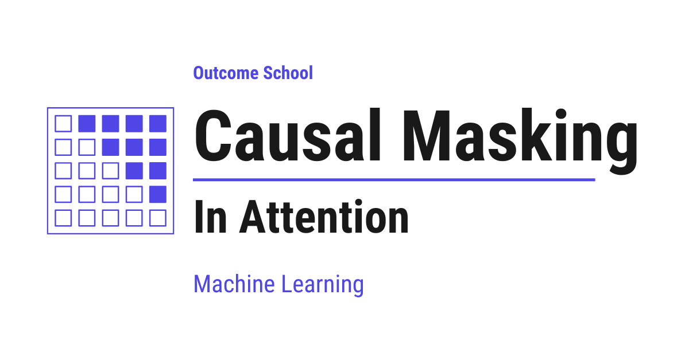

# What is Causal Masking in Attention and Why Do LLMs Need It?

> Archived from <https://outcomeschool.com/blog/causal-masking-in-attention> on 2026-11-25.

Causal Masking in Attention is a mechanism that blocks the future tokens, so that each token can look only at itself and the tokens before it, never at the tokens after it.

In this blog, we will learn about <strong>causal masking in attention</strong>.

We will start with the introduction of causal masking, understand the problem of seeing future tokens through an example, and then walk through its implementation to see how masked attention prevents the model from accessing future tokens.

I am <strong>Amit Shekhar</strong>, Founder @ <a target="_blank" rel="noopener noreferrer" href="https://outcomeschool.com">Outcome School</a>, I have taught and mentored many developers, and their efforts landed them high-paying tech jobs, helped many tech companies in solving their unique problems, and created many open-source libraries being used by top companies. I am passionate about sharing knowledge through open-source, blogs, and videos.

I teach <a target="_blank" rel="noopener noreferrer" href="https://outcomeschool.com/program/ai-and-machine-learning">AI and Machine Learning</a> at Outcome School.

Let&#x27;s get started.

As we all know, the attention layer is the most important component of the <a target="_blank" rel="noopener noreferrer" href="decoding-transformer-architecture.md">Transformer architecture</a> and the key building block behind <a target="_blank" rel="noopener noreferrer" href="large-language-model-llm.md">LLMs (Large Language Models)</a>.

Inside the attention layer, we use <strong>causal masking</strong>. This ensures that a token can attend only to itself and past tokens, <strong>never to future tokens</strong>.

<strong>Causal masking</strong> is a mechanism that uses a <strong>mask matrix</strong> to block future positions in the attention score matrix, ensuring each token attends only to itself and past tokens, <strong>never to future tokens</strong>.

This is exactly why the <a target="_blank" rel="noopener noreferrer" href="encoder-vs-decoder-in-transformers.md">Decoder of a Transformer</a> can look only backward, while the Encoder reads the whole input in both directions.

Let&#x27;s try to understand this with an example.

Take the sentence: <strong>&quot;I love teaching AI&quot;</strong>

Token positions:

<pre><code class="language-bash code-highlight">[ I | love | teaching | AI ]
  1     2        3        4
</code></pre>

Let&#x27;s see what happens without causal masking.
<h3 id="without-causal-masking"><strong>Without Causal Masking</strong></h3><ul><li>While predicting <strong>&quot;love&quot;</strong>, the model could attend to <strong>&quot;teaching&quot;</strong> and <strong>&quot;AI&quot;</strong>.</li><li>While predicting <strong>&quot;teaching&quot;</strong>, it could already see <strong>&quot;AI&quot;</strong>.</li></ul>
This is not something we want.

We should not allow the model to see the future, because doing so would introduce <strong>information leakage</strong>.

If future tokens are visible, the model can learn shortcuts by using words that it is supposed to predict as inputs. This leads to unrealistically good training performance but breaks the fundamental assumption of language modeling: predicting the next token using only past context.

During inference, future tokens do <strong>not</strong> exist.

If the model relied on future information during training, it would fail when asked to generate text step by step.

Causal masking ensures that training conditions match inference conditions, forcing the model to learn <strong>genuine language patterns</strong> instead of <strong>memorizing answers</strong>.

So, if we allow the model to see the future, training becomes easier, but generation becomes incorrect.

<strong>Planning your move into AI?</strong>

No matter which tech domain you work in today, with your effort, you can transition to these roles:
<ul><li>AI Engineer</li><li>Forward Deployed Engineer</li><li>AI Agent Engineer</li><li>Harness Engineer</li><li>Voice AI Engineer</li><li>AI Architect</li><li>LLM Engineer</li><li>LLM Inference Engineer</li><li>Gen AI Engineer</li><li>MLOps Engineer</li><li>ML Engineer</li><li>Deep Learning Engineer</li></ul>
Our <a target="_blank" rel="noopener noreferrer" href="https://outcomeschool.com/program/ai-and-machine-learning">AI and Machine Learning Program</a> at Outcome School takes you there.

Let&#x27;s see what happens with causal masking.
<h3 id="with-causal-masking"><strong>With Causal Masking</strong></h3><ul><li>While predicting <strong>&quot;love&quot;</strong>, the model attends to <strong>&quot;I&quot;</strong>.</li><li>While predicting <strong>&quot;teaching&quot;</strong>, it attends to <strong>&quot;I&quot;</strong> and <strong>&quot;love&quot;</strong>.</li><li>While predicting <strong>&quot;AI&quot;</strong>, it attends to <strong>&quot;I&quot;</strong>, <strong>&quot;love&quot;</strong>, and <strong>&quot;teaching&quot;</strong>.</li></ul>
Here, we do not allow the model to see the future, so it is forced to behave exactly as it would during inference.

Blocking future tokens is one way to limit what a token can attend to. Limiting how far back a token can look is another, and we have a detailed blog on <a target="_blank" rel="noopener noreferrer" href="how-does-sliding-window-attention-work.md">Sliding Window Attention</a> that covers this end to end.

Now, let&#x27;s understand how this is implemented using a <strong>mask matrix</strong>.
<h3 id="implementation-of-causal-masking"><strong>Implementation of Causal Masking</strong></h3>
In the attention layer, we compute an <strong>attention score matrix</strong>.

An attention score is a number that indicates how relevant one token is to another token.
<ul><li>Each token compares itself with all other tokens.</li><li>The attention score measures how much focus to give to each token.</li><li>A higher score means more attention.</li><li>A lower score means less attention.</li></ul>
As a result, each token computes a score with every other token, forming a 2D matrix where rows represent <strong>query tokens</strong> and columns represent <strong>key tokens</strong>. We have a detailed blog on <a target="_blank" rel="noopener noreferrer" href="math-behind-attention-qkv.md">Math behind Attention: Q, K, V</a> that explains how query and key vectors are computed.

Since the sentence &quot;I love teaching AI&quot; contains 4 tokens, the attention scores form a <strong>4 × 4 matrix</strong>.

Each row corresponds to a query token, and each column corresponds to a key token.

Each value in this matrix indicates how much one token should attend to another <strong>before normalization</strong>.

<strong>Example attention score matrix (before masking):</strong>

<pre><code class="language-bash code-highlight">            I     love   teaching    AI
          --------------------------------
I         | 2.0 | 1.0 |   3.0   | 0.5 |
love      | 1.5 | 2.5 |   0.5   | 1.0 |
teaching  | 0.2 | 1.0 |   2.0   | 1.5 |
AI        | 0.1 | 0.3 |   0.7   | 2.5 |
</code></pre>

<strong>A quick note for you</strong>

No matter which tech domain you work in, get familiar with these topics:
<ul><li>LLM</li><li>RAG</li><li>MCP</li><li>Agent</li><li>Fine-tuning</li><li>Quantization</li></ul>
We put it all together in one video:

<a target="_blank" rel="noopener noreferrer" href="https://www.youtube.com/watch?v=lnfWvX66FUk">AI Engineering Explained: LLM, RAG, MCP, Agent, Fine-Tuning, and Quantization</a>

No need to stop reading - bookmark it and watch later when you get time. Future you will thank you.

Now, let&#x27;s get back to the topic.

Ideally, masking is applied before <a target="_blank" rel="noopener noreferrer" href="softmax-function.md">softmax</a>. Let&#x27;s see what happens if we skip masking and directly apply softmax.

<strong>After Softmax: Attention Weights</strong>

<pre><code class="language-bash code-highlight">            I     love   teaching    AI
          --------------------------------
I         | 0.23 | 0.09 |  0.63 | 0.05 |
love      | 0.21 | 0.58 |  0.08 | 0.13 |
teaching  | 0.08 | 0.17 |  0.47 | 0.28 |
AI        | 0.07 | 0.08 |  0.12 | 0.73 |
</code></pre>

At this stage, every token can attend to every other token, including future ones.
<ul><li>While predicting <strong>&quot;love&quot;</strong>, the model attends not only to past tokens but also to <strong>future tokens</strong>: it assigns an attention weight of <strong>0.08</strong> to <strong>&quot;teaching&quot;</strong> and <strong>0.13</strong> to <strong>&quot;AI&quot;</strong>, which indicates information leakage.</li><li>While predicting <strong>&quot;teaching&quot;</strong>, the model already attends to the <strong>future token</strong> <strong>&quot;AI&quot;</strong> with an attention weight of <strong>0.28</strong>, even though <strong>&quot;AI&quot;</strong> should not be visible at this stage.</li></ul>
Because of this issue, masking is required, and for that we use a causal mask matrix.
<h3 id="the-causal-mask-matrix"><strong>The Causal Mask Matrix</strong></h3>
We create a mask matrix of the same size. This matrix defines which positions are allowed (<code>1</code>) and which are blocked (<code>0</code>).

<pre><code class="language-bash code-highlight">            I   love  teaching   AI
          --------------------------
I         | 1 |  0  |    0    | 0 |
love      | 1 |  1  |    0    | 0 |
teaching  | 1 |  1  |    1    | 0 |
AI        | 1 |  1  |    1    | 1 |
</code></pre>

<strong>This is our mask matrix, and we will apply it to the score matrix to block future tokens.</strong>

<strong>Keep this mask matrix in mind as you read further, as we will use it to mask the attention score matrix.</strong>
<ul><li><code>1</code> → attention allowed</li><li><code>0</code> → attention blocked (future)</li></ul>
After applying the mask, the blocked positions are set to <strong>−∞</strong>.

Causal masking blocks access to future tokens by assigning <strong>−∞</strong> to those positions.

In some time, we will understand why <strong>−∞</strong> is used.

<strong>Example attention score matrix (before masking):</strong>

<pre><code class="language-bash code-highlight">            I     love   teaching    AI
          --------------------------------
I         | 2.0 | 1.0 |   3.0   | 0.5 |
love      | 1.5 | 2.5 |   0.5   | 1.0 |
teaching  | 0.2 | 1.0 |   2.0   | 1.5 |
AI        | 0.1 | 0.3 |   0.7   | 2.5 |
</code></pre>

<strong>Masked attention score matrix (after masking using our mask matrix):</strong>

<pre><code class="language-bash code-highlight">            I     love   teaching    AI
          --------------------------------
I         | 2.0 | -∞  |   -∞    | -∞  |
love      | 1.5 | 2.5 |   -∞    | -∞  |
teaching  | 0.2 | 1.0 |   2.0   | -∞  |
AI        | 0.1 | 0.3 |   0.7   | 2.5 |
</code></pre>

When the mask is applied, positions marked <strong>0</strong> in the mask matrix are blocked by setting their attention scores to <strong>−∞</strong>, while positions marked <strong>1</strong> retain their original values in the attention score matrix.

Why <strong>−∞</strong>? <strong>As we have to apply softmax, and because of how softmax works mathematically</strong>, −∞ becomes exactly zero after softmax. If we used zero instead, softmax would still assign a non-zero probability, allowing the model to partially attend to future tokens and defeating the purpose of causal masking.

<strong>After Softmax: Attention Weights</strong>

<pre><code class="language-bash code-highlight">            I     love   teaching    AI
          --------------------------------
I         | 1.00 | 0.00 |  0.00 | 0.00 |
love      | 0.27 | 0.73 |  0.00 | 0.00 |
teaching  | 0.11 | 0.24 |  0.65 | 0.00 |
AI        | 0.07 | 0.08 |  0.12 | 0.73 |
</code></pre>

Now, the future tokens receive <strong>zero attention</strong>:
<ul><li>While predicting <strong>&quot;love&quot;</strong>, the model attends to <strong>&quot;I&quot;</strong> with an attention weight of <strong>0.27</strong> and to itself (<strong>&quot;love&quot;</strong>) with <strong>0.73</strong>. It does <strong>not</strong> attend to the future tokens <strong>&quot;teaching&quot;</strong> and <strong>&quot;AI&quot;</strong>, as both receive <strong>0.00</strong> attention.</li><li>While predicting <strong>&quot;teaching&quot;</strong>, the model attends to <strong>&quot;I&quot;</strong> (<strong>0.11</strong>) and <strong>&quot;love&quot;</strong> (<strong>0.24</strong>), and to itself (<strong>&quot;teaching&quot;</strong>) with <strong>0.65</strong>. It does <strong>not</strong> attend to the future token <strong>&quot;AI&quot;</strong>, which has an attention weight of <strong>0.00</strong>.</li><li>While predicting <strong>&quot;AI&quot;</strong>, the model attends to <strong>&quot;I&quot;</strong> (<strong>0.07</strong>), <strong>&quot;love&quot;</strong> (<strong>0.08</strong>), and <strong>&quot;teaching&quot;</strong> (<strong>0.12</strong>), and to itself (<strong>&quot;AI&quot;</strong>) with <strong>0.73</strong>.</li></ul>
Notice that every row still gives some weight to the first token <strong>&quot;I&quot;</strong>, because it is the one token that every position can always see. This is exactly why the first tokens end up acting as <a target="_blank" rel="noopener noreferrer" href="how-do-attention-sinks-work.md">attention sinks</a>, the place where a model dumps the attention it does not need anywhere else.

This is how <strong>causal masking</strong> prevents the model from seeing future tokens.

To learn Causal Masked Attention, Q/K/V matrices, and Transformer internals end to end, check out our <a target="_blank" rel="noopener noreferrer" href="https://outcomeschool.com/program/ai-and-machine-learning">AI and Machine Learning Program</a> at Outcome School.

<strong>Stay updated:</strong> Subscribe to our <a target="_blank" rel="noopener noreferrer" href="https://outcomeschool.substack.com/subscribe">newsletter</a> to get our latest AI and Machine Learning blogs straight to your inbox.
<h2 id="frequently-asked-questions">Frequently Asked Questions</h2><h3 id="why-is-minus-infinity-used-for-masking-instead-of-zero">Why is minus infinity used for masking instead of zero?</h3>
Minus infinity becomes exactly zero after softmax. If we used zero instead, softmax would still assign a non-zero probability to the blocked positions. The model could then partially attend to future tokens, which defeats the purpose of causal masking.
<h3 id="is-the-causal-mask-applied-before-or-after-softmax">Is the causal mask applied before or after softmax?</h3>
The causal mask is applied before softmax. The blocked positions in the attention score matrix are set to minus infinity, and then softmax turns them into zero attention weights. If we skip masking and apply softmax directly, every token can attend to future tokens.
<h3 id="why-do-we-need-causal-masking-if-future-tokens-do-not-exist-during-inference">Why do we need causal masking if future tokens do not exist during inference?</h3>
Causal masking makes training conditions match inference conditions. Without it, the model learns shortcuts during training by using the words it is supposed to predict. That gives unrealistically good training performance, but the model then fails when it generates text step by step.
<h3 id="does-the-encoder-of-a-transformer-use-causal-masking">Does the Encoder of a Transformer use causal masking?</h3>
No. The Decoder of a Transformer can look only backward because of causal masking. The Encoder reads the whole input in both directions.
<h3 id="what-is-the-difference-between-causal-masking-and-sliding-window-attention">What is the difference between causal masking and sliding window attention?</h3>
Causal masking blocks future tokens, so each token attends only to itself and the tokens before it. Sliding window attention limits how far back a token can look. Both limit what a token can attend to, but in different ways.

That&#x27;s it for now.

Thanks

<strong>Amit Shekhar</strong> Founder @ <a target="_blank" rel="noopener noreferrer" href="https://outcomeschool.com">Outcome School</a>

You can connect with me on:
<ul><li><a target="_blank" rel="noopener noreferrer" href="https://x.com/amitiitbhu">X</a></li><li><a target="_blank" rel="noopener noreferrer" href="https://www.linkedin.com/in/amit-shekhar-iitbhu">LinkedIn</a></li><li><a target="_blank" rel="noopener noreferrer" href="https://github.com/amitshekhariitbhu">GitHub</a></li></ul>
Follow Outcome School on:
<ul><li><a target="_blank" rel="noopener noreferrer" href="https://x.com/outcome_school">X</a></li><li><a target="_blank" rel="noopener noreferrer" href="https://youtube.com/@OutcomeSchool">YouTube</a></li><li><a target="_blank" rel="noopener noreferrer" href="https://www.linkedin.com/company/outcomeschool">LinkedIn</a></li><li><a target="_blank" rel="noopener noreferrer" href="https://github.com/OutcomeSchool">GitHub</a></li></ul>
<a target="_blank" rel="noopener noreferrer" href="https://outcomeschool.com/blog"><strong>Read all of our high-quality blogs here.</strong></a>

