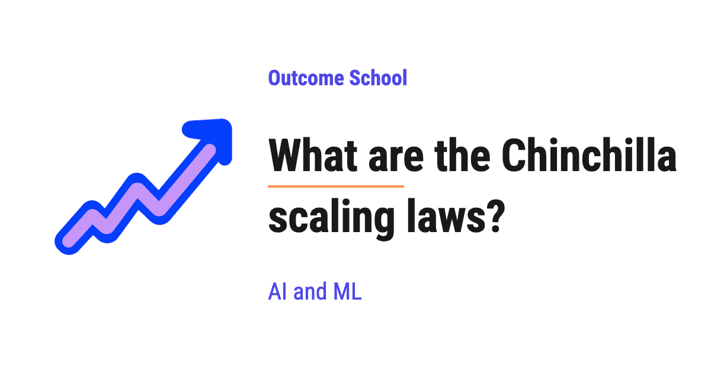

# What are the Chinchilla scaling laws?

> Archived from <https://outcomeschool.com/blog/chinchilla-scaling-laws> on 2026-11-25.

The Chinchilla scaling laws are rules that tell us how to split a fixed training budget between the size of a language model and the amount of text it is trained on. Their main finding is that model size and training data must grow together, at roughly 20 training tokens for every parameter.

In this blog, we will learn about the Chinchilla scaling laws. We will also see what a scaling law is, what the older belief before Chinchilla was, how DeepMind ran the experiments, the &quot;20 tokens per parameter&quot; rule with a step-by-step calculation, how the smaller Chinchilla model beat much bigger models, and where teams go beyond the Chinchilla rule today.

We will cover the following:
<ul><li>The three ingredients: parameters, tokens, and compute</li><li>What is a scaling law?</li><li>The problem: we have a fixed budget</li><li>The belief before Chinchilla</li><li>What did the Chinchilla paper do?</li><li>The main finding: grow both equally</li><li>The 20 tokens per parameter rule</li><li>Chinchilla vs Gopher: the proof</li><li>A step-by-step calculation</li><li>The Chinchilla formula</li><li>Why were the earlier models undertrained?</li><li>What changed after Chinchilla?</li><li>Limitations of the Chinchilla scaling laws</li></ul>
I am <strong>Amit Shekhar</strong>, Founder @ <a target="_blank" rel="noopener noreferrer" href="https://outcomeschool.com">Outcome School</a>, I have taught and mentored many developers, and their efforts landed them high-paying tech jobs, helped many tech companies in solving their unique problems, and created many open-source libraries being used by top companies. I am passionate about sharing knowledge through open-source, blogs, and videos.

I teach <a target="_blank" rel="noopener noreferrer" href="https://outcomeschool.com/program/ai-and-machine-learning">AI and Machine Learning</a> at Outcome School.

Let&#x27;s get started.
<h2 id="the-three-ingredients-parameters-tokens-and-compute">The three ingredients: parameters, tokens, and compute</h2>
Before jumping into the Chinchilla scaling laws, we must know three terms.

<strong>Parameters:</strong> Parameters are the numbers inside the model that it learns during training. They store what the model knows. More parameters means a bigger model with more room to store knowledge. We write the number of parameters as <strong>N</strong>.

<strong>Tokens:</strong> A <a target="_blank" rel="noopener noreferrer" href="tokenization-in-llms.md">token</a> is a small piece of text, like a word or a part of a word. The number of tokens the model reads during training is the size of its training data. We write this as <strong>D</strong> (for data).

<strong>Compute:</strong> Compute is the total amount of calculation done during training. It is measured in <strong>FLOPs</strong>, which means the number of basic math operations, like additions and multiplications. We write compute as <strong>C</strong>.

Let&#x27;s say we compare the model to a student. The parameters are the size of the student&#x27;s brain, the tokens are the number of books the student reads, and the compute is the total hours of study.

There is a simple and widely used estimate that connects all three:

<strong>C = 6 x N x D (approximately)</strong>

Here, the idea is simple. For every token the model reads, it does work for every parameter, both to make a guess and to learn from the guess. That work comes to roughly 6 operations per parameter per token: about 2 for making the guess, and about 4 for learning from it.

Means, if we make the model bigger, or if we give it more tokens, the compute cost goes up.

We have a detailed blog on <a target="_blank" rel="noopener noreferrer" href="llm-pretraining.md">Pretraining</a> that explains how an LLM learns from trillions of tokens step by step.
<h2 id="what-is-a-scaling-law">What is a scaling law?</h2>
<strong>A scaling law is a rule that predicts how good a model will become when we make it bigger, give it more data, or spend more compute on it.</strong>

A scaling law works like a forecast. Before spending millions of dollars on a giant training run, we can train many small models cheaply, see the pattern, and predict how a big model will perform.

How do we measure &quot;how good&quot; a model is? We use the <strong><a target="_blank" rel="noopener noreferrer" href="math-behind-cross-entropy-loss.md">loss</a></strong>. The loss is a number that shows how wrong the model&#x27;s guesses are. <strong>A lower loss means a better model.</strong>

Researchers found that the loss goes down in a smooth and predictable way as we increase size, data, or compute. This smooth pattern is what we call a scaling law.
<h2 id="the-problem-we-have-a-fixed-budget">The problem: we have a fixed budget</h2>
Compute is expensive. A big training run needs thousands of <strong><a target="_blank" rel="noopener noreferrer" href="how-does-a-gpu-work-for-deep-learning.md">GPUs</a></strong>, which are special chips that do this math very fast, running for weeks. So, every team has a fixed compute budget.

Let&#x27;s say we have a fixed budget <strong>C</strong>. From <code>C = 6 x N x D</code>, we can see that we have a choice:
<ul><li><strong>Option A:</strong> Build a very big model and train it on fewer tokens.</li><li><strong>Option B:</strong> Build a smaller model and train it on many more tokens.</li><li><strong>Option C:</strong> Something in between.</li></ul>
All three options cost the same compute. But which one gives the lowest loss?

Going back to our student analogy: with a fixed number of study hours, is it better to have a giant brain that reads a few books, or a normal brain that reads many books?

This is exactly the question the Chinchilla scaling laws answer.

<strong>Planning your move into AI?</strong>

No matter which tech domain you work in today, with your effort, you can transition to these roles:
<ul><li>AI Engineer</li><li>Forward Deployed Engineer</li><li>AI Agent Engineer</li><li>Harness Engineer</li><li>Voice AI Engineer</li><li>AI Architect</li><li>LLM Engineer</li><li>LLM Inference Engineer</li><li>Gen AI Engineer</li><li>MLOps Engineer</li><li>ML Engineer</li><li>Deep Learning Engineer</li></ul>
Our <a target="_blank" rel="noopener noreferrer" href="https://outcomeschool.com/program/ai-and-machine-learning">AI and Machine Learning Program</a> at Outcome School takes you there.
<h2 id="the-belief-before-chinchilla">The belief before Chinchilla</h2>
In 2020, a team at OpenAI, led by Jared Kaplan, published an important paper on scaling laws. Their results suggested that when the compute budget grows, most of the extra budget must go into making the model bigger, and only a smaller part into more data. For example, by their rule, a 10 times bigger budget meant a roughly 5 times bigger model, but only about 2 times more data.

The industry followed this idea. <a target="_blank" rel="noopener noreferrer" href="evolution-of-llm-architecture.md">Models became huge very quickly</a>, but the amount of training text did not grow as fast.

<pre><code class="language-text code-highlight">Model              Parameters    Training tokens
GPT-3              175 billion   300 billion
Gopher (DeepMind)  280 billion   300 billion
</code></pre>

Here, we can see that these giant models read only around 300 billion tokens. That is about 1 to 2 tokens for every parameter.

But the following question arises: <strong>was this really the best use of the budget?</strong>
<h2 id="what-did-the-chinchilla-paper-do">What did the Chinchilla paper do?</h2>
In 2022, a team at DeepMind, led by Jordan Hoffmann, published the paper &quot;Training Compute-Optimal Large Language Models&quot;. This is the paper we now call the Chinchilla paper.

They asked one clear question: <strong>for a fixed compute budget, what is the best model size and the best number of training tokens?</strong>

To answer this, they did not guess. They trained more than 400 language models, with sizes from 70 million to more than 16 billion parameters, and with training data from 5 billion to 500 billion tokens.

Then, they studied the results in three different ways:
<ul><li><strong>Approach 1:</strong> Fix the model size, vary the training length, and see which combination reaches the lowest loss for each budget.</li><li><strong>Approach 2:</strong> Fix the compute budget, try many model sizes, and find the size with the lowest loss. The curves look like a valley, and the bottom of the valley is the best size. These curves are called <strong>IsoFLOP</strong> curves, because every point on one curve uses the same number of FLOPs.</li><li><strong>Approach 3:</strong> Fit one mathematical formula to all the results, and use it to find the best size and data.</li></ul>
All three approaches pointed to the same answer.
<h2 id="the-main-finding-grow-both-equally">The main finding: grow both equally</h2>
<strong>The main finding of the Chinchilla paper is that model size and training tokens must be scaled up in equal proportion.</strong>

For example, if we double our model size, we must also double our training data.

Let&#x27;s say our compute budget becomes 4 times bigger. What do we do?

<pre><code class="language-text code-highlight">Old belief (roughly):   make the model much bigger, add a little more data
Chinchilla:             make the model 2x bigger AND give it 2x more data
                        (2 x 2 = 4x compute)
</code></pre>

Here, we split the extra budget equally between model size and training data.
<h2 id="the-20-tokens-per-parameter-rule">The 20 tokens per parameter rule</h2>
From the Chinchilla results, the community took a simple rule of thumb:

<strong>A compute-optimal model needs roughly 20 training tokens for every parameter.</strong>

<pre><code class="language-text code-highlight">Model size (N)        Tokens needed (D = 20 x N)
1 billion             20 billion
10 billion            200 billion
70 billion            1.4 trillion
</code></pre>

Here, &quot;compute-optimal&quot; means the best loss we can get for that compute budget.

Let&#x27;s compare this with the older models. GPT-3 and Gopher had only around 1 to 2 tokens per parameter. By the Chinchilla rule, they were too big for the amount of text they had read. Such a model is called <strong>undertrained</strong>.

<strong>A quick note for you</strong>

No matter which tech domain you work in, get familiar with these topics:
<ul><li>LLM</li><li>RAG</li><li>MCP</li><li>Agent</li><li>Fine-tuning</li><li>Quantization</li></ul>
We put it all together in one video:

<a target="_blank" rel="noopener noreferrer" href="https://www.youtube.com/watch?v=lnfWvX66FUk">AI Engineering Explained: LLM, RAG, MCP, Agent, Fine-Tuning, and Quantization</a>

No need to stop reading - bookmark it and watch later when you get time. Future you will thank you.

Now, let&#x27;s get back to the topic.
<h2 id="chinchilla-vs-gopher-the-proof">Chinchilla vs Gopher: the proof</h2>
A rule is only useful if it works in practice. So, DeepMind tested it.

They took roughly the same compute budget used for their own Gopher model and trained a new model the Chinchilla way. They named this new model <strong>Chinchilla</strong>.
<table><thead><tr><th>Point</th><th>Gopher</th><th>Chinchilla</th></tr></thead><tbody><tr><td>Parameters</td><td>280 billion</td><td>70 billion</td></tr><tr><td>Training tokens</td><td>300 billion</td><td>1.4 trillion</td></tr><tr><td>Tokens per parameter</td><td>About 1</td><td>20</td></tr><tr><td>Compute used</td><td>Roughly the same</td><td>Roughly the same</td></tr><tr><td>Result</td><td>Good</td><td>Better on most tests</td></tr></tbody></table>
Chinchilla was 4 times smaller than Gopher, but it read more than 4 times more text. And it performed better than Gopher on a large range of tasks. It also beat other bigger models of that time, like GPT-3 (175 billion parameters) and Megatron-Turing NLG (530 billion parameters).

On a popular test of knowledge across many subjects, called <strong>MMLU</strong>, Chinchilla reached an average accuracy of 67.5%, which was more than 7 percentage points better than Gopher.

Also, because Chinchilla is 4 times smaller, it is much cheaper and faster to use after training. Every answer the model gives needs less computation.
<h2 id="a-step-by-step-calculation">A step-by-step calculation</h2>
The best way to learn this is by taking an example.

Let&#x27;s say we have a compute budget of <code>C = 1.2 x 10^22</code> FLOPs. We want to find the best model size and the best number of tokens.

<strong>Step 1:</strong> We write down the two rules.

<pre><code class="language-text code-highlight">Rule 1:  C = 6 x N x D        (compute cost)
Rule 2:  D = 20 x N           (Chinchilla rule)
</code></pre>

<strong>Step 2:</strong> We put Rule 2 into Rule 1.

<pre><code class="language-text code-highlight">C = 6 x N x (20 x N)
C = 120 x N x N
</code></pre>

<strong>Step 3:</strong> We solve for N.

<pre><code class="language-text code-highlight">N x N = C / 120
N x N = (1.2 x 10^22) / 120
N x N = 10^20
N     = 10^10   = 10 billion parameters
</code></pre>

<strong>Step 4:</strong> We find D.

<pre><code class="language-text code-highlight">D = 20 x N
D = 20 x 10 billion
D = 200 billion tokens
</code></pre>

So, for this budget, the Chinchilla rule says: build a 10 billion parameter model and train it on 200 billion tokens.

We can write the code for this calculation as below:

<pre><code class="code-highlight language-python">import math

def chinchilla_optimal(compute_flops):
    n = math.sqrt(compute_flops / 120)   # best number of parameters
    d = 20 * n                           # best number of tokens
    return n, d

n, d = chinchilla_optimal(1.2e22)
print(f&quot;Parameters: {n:.2e}, Tokens: {d:.2e}&quot;)
</code></pre>

Here, we have a function that takes the compute budget. It finds the best number of parameters using the square root from Step 3, and then multiplies it by 20 to get the number of tokens. It will print the following:

<pre><code class="language-text code-highlight">Parameters: 1.00e+10, Tokens: 2.00e+11
</code></pre>

That is 10 billion parameters and 200 billion tokens. It works perfectly.

Let&#x27;s also check this with the real Chinchilla model. It had 70 billion parameters and 1.4 trillion tokens. So, <code>C = 6 x 70 billion x 1.4 trillion</code>, which is about <code>5.9 x 10^23</code> FLOPs. And 1.4 trillion divided by 70 billion is exactly 20. The numbers match the rule.

To learn Optimization and Scaling Techniques and the Numbers Every AI Engineer Should Know, and to build a Large Language Model (LLM) from scratch, check out our <a target="_blank" rel="noopener noreferrer" href="https://outcomeschool.com/program/ai-and-machine-learning">AI and Machine Learning Program</a> at Outcome School.
<h2 id="the-chinchilla-formula">The Chinchilla formula</h2>
In Approach 3, the paper fitted a formula for the loss. It looks like below:

<strong>Loss(N, D) = E + A / N^alpha + B / D^beta</strong>

It says that the loss is made of three parts:
<ul><li><strong>E:</strong> The best loss possible even with an infinite model and infinite data. This part comes from the natural randomness of language, which no model can remove. For example, after &quot;I had a cup of&quot;, both &quot;tea&quot; and &quot;coffee&quot; are fine answers, so no model can be sure.</li><li><strong>A / N^alpha:</strong> The extra loss because the model is not big enough. It shrinks as N grows.</li><li><strong>B / D^beta:</strong> The extra loss because the model has not read enough data. It shrinks as D grows.</li></ul>
Here, <code>A</code>, <code>B</code>, <code>alpha</code>, and <code>beta</code> are numbers that the researchers found by fitting the formula to their 400 training runs.

Both the second and the third part matter. If we put all our budget into N, the third part stays large. If we put all our budget into D, the second part stays large. The lowest total loss comes from balancing both.
<h2 id="why-were-the-earlier-models-undertrained">Why were the earlier models undertrained?</h2>
Now, the question is: why did the earlier study suggest bigger models?

The Chinchilla paper pointed to the way the earlier experiments were set up. One important difference was the <strong><a target="_blank" rel="noopener noreferrer" href="learning-rate-schedules-and-warmup.md">learning rate schedule</a></strong>. The learning rate controls how big each learning step is during training. Usually, it slowly decreases over the training run, and the schedule must match the length of the run.

In the earlier study, the schedule was not matched to each shorter run. So, the models trained on less data looked worse than they really were. This made &quot;more data&quot; look less useful, and &quot;bigger model&quot; look more useful.

When the Chinchilla team matched the schedule properly for every run, the value of more data became clear.

<strong>Stay updated:</strong> Subscribe to our <a target="_blank" rel="noopener noreferrer" href="https://outcomeschool.substack.com/subscribe">newsletter</a> to get our latest AI and Machine Learning blogs straight to your inbox.
<h2 id="what-changed-after-chinchilla">What changed after Chinchilla?</h2>
The Chinchilla paper changed how the whole industry trains models.
<ul><li>Teams stopped making giant models trained on too little text.</li><li>Collecting more and better training data became just as important as making models bigger.</li><li><a target="_blank" rel="noopener noreferrer" href="small-language-models-slms.md">Smaller models</a> trained on much more data became popular, because they give good results and are cheaper to use.</li></ul>
But, the Chinchilla rule finds the best model for the <strong>training</strong> budget only. It does not care about what happens after training.

In the real world, a model is used by millions of people, again and again, for months. This usage is called <strong><a target="_blank" rel="noopener noreferrer" href="llm-inference-optimization.md">inference</a></strong>. A smaller model makes every inference cheaper and faster.

So, many teams now train small models on far more than 20 tokens per parameter. For example, Meta trained its Llama 3 8 billion parameter model on more than 15 trillion tokens. That is nearly 1,900 tokens per parameter, far beyond the Chinchilla rule.

Means, this spends more compute on training than Chinchilla recommends, but it gives a small model that is cheaper to run after training. This trade-off makes sense for models that will be used heavily.

<pre><code class="language-text code-highlight">Chinchilla-optimal:   best model for a fixed TRAINING budget
Over-trained small:   a bit more training cost, much cheaper USAGE cost
</code></pre>

If we want to go deep into SLMs and Model Distillation and LLM Inference Engineering, we have a complete program - check out our <a target="_blank" rel="noopener noreferrer" href="https://outcomeschool.com/program/ai-and-machine-learning">AI and Machine Learning Program</a> at Outcome School.
<h2 id="limitations-of-the-chinchilla-scaling-laws">Limitations of the Chinchilla scaling laws</h2>
The Chinchilla scaling laws are very useful, but we must know their limits.
<ul><li><strong>Training cost only:</strong> They ignore the cost of using the model after training, as we have just seen.</li><li><strong>The &quot;20&quot; is not a law of nature:</strong> It came from one set of experiments, one type of model, and one kind of data. Different data, a different way of splitting text into tokens, or a different model architecture can shift the best ratio.</li><li><strong>Assumes data is unlimited:</strong> The rule assumes we can always get more fresh, good-quality text. In reality, high-quality text on the internet is limited.</li><li><strong>Loss is not everything:</strong> A lower loss usually means a better model, but it does not tell us everything about how good the model is at a specific task.</li><li><strong>The fits were checked again:</strong> Later, other researchers re-checked the formula from Approach 3 and found some errors in how it was fitted. After correcting it, their results agreed with Approaches 1 and 2, and the main idea of growing size and data together still held.</li></ul>
Now, we must have understood the Chinchilla scaling laws.
<h2 id="frequently-asked-questions">Frequently Asked Questions</h2><h3 id="is-a-bigger-language-model-always-better">Is a bigger language model always better?</h3>
No. A bigger model is not always better for the same compute budget. Chinchilla was 4 times smaller than Gopher, but it read more than 4 times more text, and it performed better than Gopher on a large range of tasks. It also beat bigger models like GPT-3 and Megatron-Turing NLG.
<h3 id="how-do-we-estimate-the-compute-needed-to-train-an-llm">How do we estimate the compute needed to train an LLM?</h3>
We use the simple estimate C = 6 x N x D, where N is the number of parameters and D is the number of training tokens. For every token, the model does roughly 6 operations per parameter: about 2 for making the guess and about 4 for learning from it. For Chinchilla, this comes to about 5.9 x 10^23 FLOPs.
<h3 id="what-is-the-difference-between-the-kaplan-and-chinchilla-scaling-laws">What is the difference between the Kaplan and Chinchilla scaling laws?</h3>
The Kaplan scaling laws from OpenAI in 2020 suggested putting most of a bigger budget into a bigger model, for example a roughly 5 times bigger model but only about 2 times more data for a 10 times bigger budget. The Chinchilla scaling laws from DeepMind in 2022 showed that model size and training data must grow in equal proportion.
<h3 id="why-do-teams-train-small-models-on-far-more-than-20-tokens-per-parameter">Why do teams train small models on far more than 20 tokens per parameter?</h3>
Because the Chinchilla rule finds the best model for the training budget only, and ignores the cost of using the model after training. A smaller model makes every inference cheaper and faster. For example, Meta trained its Llama 3 8 billion parameter model on more than 15 trillion tokens, which is nearly 1,900 tokens per parameter.

That&#x27;s it for now.

Thanks

<strong>Amit Shekhar</strong> Founder @ <a target="_blank" rel="noopener noreferrer" href="https://outcomeschool.com">Outcome School</a>

You can connect with me on:
<ul><li><a target="_blank" rel="noopener noreferrer" href="https://x.com/amitiitbhu">X</a></li><li><a target="_blank" rel="noopener noreferrer" href="https://www.linkedin.com/in/amit-shekhar-iitbhu">LinkedIn</a></li><li><a target="_blank" rel="noopener noreferrer" href="https://github.com/amitshekhariitbhu">GitHub</a></li></ul>
Follow Outcome School on:
<ul><li><a target="_blank" rel="noopener noreferrer" href="https://x.com/outcome_school">X</a></li><li><a target="_blank" rel="noopener noreferrer" href="https://youtube.com/@OutcomeSchool">YouTube</a></li><li><a target="_blank" rel="noopener noreferrer" href="https://www.linkedin.com/company/outcomeschool">LinkedIn</a></li><li><a target="_blank" rel="noopener noreferrer" href="http://github.com/OutcomeSchool">GitHub</a></li></ul>
<a target="_blank" rel="noopener noreferrer" href="https://outcomeschool.com/blog"><strong>Read all of our high-quality blogs here.</strong></a>

