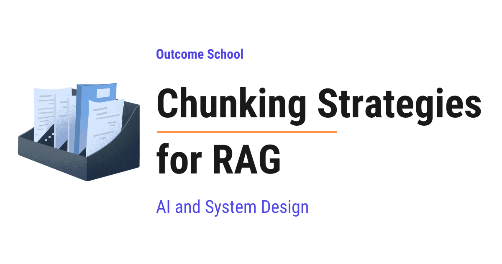

# How to Chunk Documents for RAG? Chunking Strategies Explained

> Archived from <https://outcomeschool.com/blog/chunking-strategies-for-rag> on 2026-11-25.

Chunking for RAG means cutting a big document into smaller pieces, called chunks, so that an AI system can find the right piece at the right time and answer our question correctly.

In this blog, we will learn about Chunking Strategies for RAG, the art of cutting a big document into smaller pieces so that an AI system can find the right piece at the right time. We will also see what RAG is, why chunking is needed at all, what happens when we chunk badly, the most useful chunking strategies one by one, how to pick the chunk size and the overlap, and where each strategy works well and where it fails.

We will cover the following:
<ul><li>What is RAG?</li><li>What is a chunk?</li><li>Why do we need chunking?</li><li>How retrieval actually works</li><li>What happens when we chunk badly</li><li>Fixed-size chunking</li><li>Chunking by sentence</li><li>Recursive chunking</li><li>Document structure based chunking</li><li>Semantic chunking</li><li>Contextual chunking</li><li>Small-to-big chunking</li><li>Agentic chunking</li><li>Chunk overlap</li><li>How to choose the chunk size</li><li>Comparison of all the strategies</li><li>Common mistakes</li><li>Conclusion</li></ul>
I am <strong>Amit Shekhar</strong>, Founder @ <a target="_blank" rel="noopener noreferrer" href="https://outcomeschool.com">Outcome School</a>, I have taught and mentored many developers, and their efforts landed them high-paying tech jobs, helped many tech companies in solving their unique problems, and created many open-source libraries being used by top companies. I am passionate about sharing knowledge through open-source, blogs, and videos.

I teach <a target="_blank" rel="noopener noreferrer" href="https://outcomeschool.com/program/ai-and-machine-learning">AI and Machine Learning</a> at Outcome School.

Let&#x27;s get started.
<h2 id="what-is-rag">What is RAG?</h2>
Before jumping into chunking, we must know what RAG is.

<strong>RAG = Retrieval + Augmented + Generation.</strong>

Let&#x27;s break the name into three plain words:
<ul><li><strong>Retrieval</strong> means finding.</li><li><strong>Augmented</strong> means adding something extra.</li><li><strong>Generation</strong> means writing the answer.</li></ul>
So, RAG is a system that first finds the useful information, then adds that information to our question, and then lets the AI model write the answer using it.

Let&#x27;s say we have a company handbook of 500 pages. We ask the AI, &quot;How many leave days do I get in my first year?&quot;

The AI model has never read our handbook. It was trained on the public internet, and our handbook is a private document sitting on our laptop. So, the model has no way to know the answer.

Here comes RAG into the picture. RAG does three simple things:
<ul><li>It searches our handbook and finds the small part that talks about leave days.</li><li>It pastes that small part along with our question.</li><li>It sends both to the AI model and asks it to answer using that part.</li></ul>
The model now has the right page in front of it, so it answers correctly, and that too without any retraining.

This is <a target="_blank" rel="noopener noreferrer" href="retrieval-augmented-generation-rag.md">how RAG works</a>. It is like giving an open-book exam to the model instead of asking it to remember everything.

Now, the question is, how does RAG search a 500-page handbook? It cannot send all 500 pages to the model every time. It is too big, too slow, and too costly. So, we cut the handbook into small pieces first.

Those small pieces are called chunks.
<h2 id="what-is-a-chunk">What is a chunk?</h2>
<strong>A chunk is a small piece of text that we cut out from a bigger document.</strong>

In simple words, if the document is a long chocolate bar, a chunk is one square of it.

Let&#x27;s say our handbook has this paragraph:

<pre><code class="language-text code-highlight">Every employee gets 24 paid leave days in the first year.
Leave days do not carry forward to the next year.
Sick leave is counted separately and is limited to 12 days.
</code></pre>

If we cut it into three pieces, one per sentence, we get three chunks. Each chunk is a small, self-contained note.

Later, when someone asks about sick leave, we do not need the whole handbook. We only need the third chunk.

This cutting is called <strong>chunking</strong>.

Now, we have understood the chunk. Now, let&#x27;s learn why we need chunking at all.
<h2 id="why-do-we-need-chunking">Why do we need chunking?</h2>
There are four solid reasons.

<strong>Reason 1: The model has a limited context window.</strong>

A model can only read a limited amount of text at once. This limit is called the <a target="_blank" rel="noopener noreferrer" href="context-engineering.md">context window</a>.

This limit is counted in <strong><a target="_blank" rel="noopener noreferrer" href="tokenization-in-llms.md">tokens</a></strong>. A token is a small piece of text, roughly three-fourth of a word. So, 100 tokens is about 75 words. We will use this word many times in this blog, so it is good to remember it now.

Our 500-page handbook has millions of tokens, and it does not fit inside the window. So, we must send only the relevant part.

<strong>Reason 2: Cost and speed.</strong>

Even if a huge document fits, sending it every single time is slow and expensive. We pay for every token we send. Sending one paragraph is far cheaper than sending 500 pages.

<strong>Reason 3: Accuracy.</strong>

This is the most important reason. When we give the model a mountain of text, the useful line gets buried inside it. The model gets distracted and starts mixing up facts from two different pages. When we give it three short and relevant chunks, it answers cleanly.

Less and correct text always beats more and noisy text.

We have a detailed blog on <a target="_blank" rel="noopener noreferrer" href="lost-in-the-middle-problem-in-llms.md">The Lost in the Middle Problem in LLMs</a> that explains this in depth.

<strong>Reason 4: Search itself needs small pieces.</strong>

The search step works by comparing meaning. A small chunk has one clear meaning. A giant chunk has fifty mixed meanings, so its meaning becomes blurry, and the search stops working well.

We will understand this fourth reason properly in the next section.
<h2 id="how-retrieval-actually-works">How retrieval actually works</h2>
Before jumping into the strategies, we need to see how the searching happens. Once we understand this, every chunking strategy will make sense on its own.

The search inside RAG is not a keyword search. It is a <strong><a target="_blank" rel="noopener noreferrer" href="how-does-semantic-search-work.md">meaning search</a></strong>.

Here is how it happens.

<strong>Step 1: Every chunk is turned into a list of numbers.</strong>

We pass each chunk through a small model called an <a target="_blank" rel="noopener noreferrer" href="what-are-embeddings.md">embedding model</a>. It reads the chunk and gives back a long list of numbers, something like <code>[0.12, -0.98, 0.45, ...]</code>.

This list of numbers is called an <strong>embedding</strong>. We can think of it as the address of the meaning of that chunk. Two chunks that talk about the same thing get two addresses that sit close to each other.

<strong>Step 2: All these number lists are stored in a vector database.</strong>

A <a target="_blank" rel="noopener noreferrer" href="how-does-a-vector-database-work.md">vector database</a> is simply a storage that is very good at one job, finding the addresses that sit closest to a given address.

This whole one-time work of cutting the document, creating the embeddings, and storing them is called <strong>indexing</strong>. We do it once, before any user asks anything.

<strong>Step 3: The user&#x27;s question is also turned into numbers.</strong>

When the user asks, &quot;How many sick leave days do I get?&quot;, we pass this question through the same embedding model and get its address.

<strong>Step 4: We pick the closest chunks.</strong>

The vector database compares the question address with all the chunk addresses and returns the closest few, usually the top 3 or top 5. In a real system, one more step often sits right here. A reranker takes these closest few and reorders them by true relevance before they go to the model. We have a detailed blog on <a target="_blank" rel="noopener noreferrer" href="how-does-a-reranker-work.md">how a Reranker works</a> that explains this step by step.

<strong>Step 5: Those chunks go to the model.</strong>

We paste those chunks along with the question and ask the model to answer.

Here, we can notice one very important thing. The whole system stands on one assumption, that <strong>each chunk carries one clear meaning</strong>. The moment a chunk carries a mix of ten unrelated ideas, its address becomes an average of ten things, and it stops being close to anything.

This is exactly why chunking strategy matters so much.

To learn RAG, Vector Databases, and Embeddings in depth, check out our <a target="_blank" rel="noopener noreferrer" href="https://outcomeschool.com/program/ai-and-machine-learning">AI and Machine Learning Program</a> at Outcome School.
<h2 id="what-happens-when-we-chunk-badly">What happens when we chunk badly</h2>
The best way to learn this is by taking an example.

Assume that we have this text in our handbook:

<pre><code class="language-text code-highlight">Every employee gets 24 paid leave days in the first year. To apply,
open the HR portal and submit the request at least 7 days in advance.
</code></pre>

Now, let&#x27;s say we cut blindly after a fixed number of letters, and the cut lands in the middle:

<strong>Chunk 1:</strong>

<pre><code class="language-text code-highlight">Every employee gets 24 paid leave days in the first year. To apply,
open the HR portal and submit the request at least
</code></pre>

<strong>Chunk 2:</strong>

<pre><code class="language-text code-highlight">7 days in advance.
</code></pre>

Now, the user asks, &quot;How early do I need to apply for leave?&quot;

Chunk 2 has the actual answer, but it is just a floating fragment. It does not contain the words leave, apply, or request. Its meaning address is nowhere near the question. So, it is never retrieved.

Chunk 1 gets retrieved instead, and it stops right before the answer. The model reads it and either says it does not know, or worse, it guesses a number.

This is the core problem. <strong>A bad chunk is not a small problem, it silently destroys the answer.</strong>

So, our whole goal in chunking is simple, we must cut at places where a complete idea ends, not at random places.

Every strategy that we will learn now is just a smarter way of finding those places.

<strong>Planning your move into AI?</strong>

No matter which tech domain you work in today, with your effort, you can transition to these roles:
<ul><li>AI Engineer</li><li>Forward Deployed Engineer</li><li>AI Agent Engineer</li><li>Harness Engineer</li><li>Voice AI Engineer</li><li>AI Architect</li><li>LLM Engineer</li><li>LLM Inference Engineer</li><li>Gen AI Engineer</li><li>MLOps Engineer</li><li>ML Engineer</li><li>Deep Learning Engineer</li></ul>
Our <a target="_blank" rel="noopener noreferrer" href="https://outcomeschool.com/program/ai-and-machine-learning">AI and Machine Learning Program</a> at Outcome School takes you there.

Now that we have understood the problem, it is time to learn the strategies one by one. We will start from the simplest one and keep improving. Do not worry, we will learn about each of them in detail.
<h2 id="fixed-size-chunking">Fixed-size chunking</h2>
<strong>Fixed-size chunking means we cut the document after every fixed number of characters or tokens, no matter what the text says.</strong>

This is the simplest strategy. We decide a number, let&#x27;s say 500 characters, and we cut after every 500 characters.

Let&#x27;s see the code as below:

<pre><code class="code-highlight language-python">def fixed_size_chunks(text, size=500):
    chunks = []
    for i in range(0, len(text), size):
        chunks.append(text[i:i + size])
    return chunks
</code></pre>

Here, we are walking through the text 500 characters at a time and collecting each slice as one chunk.

<strong>Advantage:</strong>
<ul><li>It is very simple and very fast.</li><li>Every chunk has a predictable size, so nothing ever overflows the model limit.</li><li>It works on any kind of text, even messy text with no structure.</li></ul>
But, here is the catch.

<strong>Disadvantage:</strong>
<ul><li>It cuts in the middle of a word, a sentence, or an idea, exactly like the leave-application example we just saw.</li><li>The retrieved chunk often reads like a broken fragment.</li></ul>
The issue with this approach is that the cut position is decided by counting, not by meaning. Let&#x27;s see how the next approach solve this issue.
<h2 id="chunking-by-sentence">Chunking by sentence</h2>
<strong>Sentence-based chunking means we split the text into sentences first, and then group a few sentences together to form one chunk.</strong>

So, instead of cutting after 500 characters, we cut only at a full stop. This one small change removes broken words and broken sentences completely.

Let&#x27;s see the code as below:

<pre><code class="code-highlight language-python">import re

def sentence_chunks(text, sentences_per_chunk=5):
    sentences = re.split(r&#x27;(?&lt;=[.!?])\s+&#x27;, text)
    chunks = []
    for i in range(0, len(sentences), sentences_per_chunk):
        group = sentences[i:i + sentences_per_chunk]
        chunks.append(&quot; &quot;.join(group))
    return chunks
</code></pre>

Here, we have first split the text wherever a full stop, a question mark, or an exclamation mark is followed by a space. Then we have grouped every 5 sentences into one chunk.

<strong>Advantage:</strong>
<ul><li>No sentence is ever cut in half, so every chunk reads like proper language.</li><li>It is still simple and fast.</li></ul>
<strong>Disadvantage:</strong>
<ul><li>Chunk sizes become uneven, because some sentences are very long and some are very short.</li><li>It still groups blindly. Sentence number 5 may be the last line of one topic and sentence number 6 may be the first line of a completely new topic, and this strategy happily puts them in the same chunk.</li></ul>
The issue with this approach is that it respects sentences but it does not respect paragraphs and sections. Let&#x27;s see how the next approach solve this issue.
<h2 id="recursive-chunking">Recursive chunking</h2>
<strong>Recursive chunking means we try to cut at the biggest natural boundary first, and only if the piece is still too big, we go down to a smaller boundary.</strong>

This is the most commonly used strategy in real projects, and the idea behind it is beautiful.

Every document already has natural boundaries, and they have a natural order of importance:
<ul><li>A blank line between paragraphs is a strong boundary.</li><li>A single new line is a weaker boundary.</li><li>A full stop is weaker than that.</li><li>A space is the weakest one.</li></ul>
So, the strategy works like this. First, we try to split the document at blank lines. If a resulting piece is still bigger than our chunk size, then we take that piece alone and split it at new lines. If it is still too big, we split it at full stops. If it is still too big, we split it at spaces.

We keep going down the list only when we are forced to. That is why it is called recursive.

Let&#x27;s see the code as below:

<pre><code class="code-highlight language-python">def recursive_chunks(text, size=500, separators=[&quot;\n\n&quot;, &quot;\n&quot;, &quot;. &quot;, &quot; &quot;]):
    if len(text) &lt;= size or not separators:
        return [text]

    separator = separators[0]
    parts = text.split(separator)

    chunks = []
    for part in parts:
        if len(part) &lt;= size:
            chunks.append(part)
        else:
            # still too big, so try the next weaker separator
            chunks.extend(recursive_chunks(part, size, separators[1:]))
    return chunks
</code></pre>

Here, we can see that we always start with the strongest separator <code>&quot;\n\n&quot;</code>, and we call the same function again with the remaining weaker separators only for the parts that are still too big.

<strong>Note:</strong> This code is kept short just for the sake of understanding. A real implementation also merges the tiny neighbouring pieces back together until they reach the chunk size, so that we do not end up with a lot of one-line chunks.

<strong>Advantage:</strong>
<ul><li>Most chunks end up matching real paragraphs, so they carry a complete idea.</li><li>It never blows past our size limit, because in the worst case it falls back to splitting at spaces.</li><li>It works well on almost every kind of document, which is why it is the default choice in most RAG systems.</li></ul>
<strong>Disadvantage:</strong>
<ul><li>It follows the shape of the text, not the meaning of the text. If the writer put two unrelated ideas in one paragraph, this strategy keeps them together.</li></ul>
The issue with this approach is that it treats every document as plain text and ignores the headings that the document already gives us. Let&#x27;s see how the next approach solve this issue.
<h2 id="document-structure-based-chunking">Document structure based chunking</h2>
<strong>Document structure based chunking means we use the headings, sections, and tables that already exist in the document, and we cut along those lines.</strong>

Many of our documents are not plain text. A Markdown file has <code>#</code> and <code>##</code> headings. An HTML page has <code>&lt;h1&gt;</code> and <code>&lt;h2&gt;</code> tags. A PDF has chapters. A code file has functions and classes.

The writer already told us where one topic ends and the next begins. It would be a waste to ignore that.

Let&#x27;s say we have this Markdown document:

<pre><code class="code-highlight language-markdown"># Leave Policy

## Paid Leave

Every employee gets 24 paid leave days in the first year.

## Sick Leave

Sick leave is limited to 12 days and needs a doctor note after 3 days.
</code></pre>

If we cut at every <code>##</code> heading, we get two clean chunks. One chunk is fully about paid leave, and the other chunk is fully about sick leave. Nothing is mixed.

There is one more trick here that makes a big difference. <strong>We must carry the parent headings into each chunk.</strong> So, the second chunk should be stored like this:

<pre><code class="language-text code-highlight">Leave Policy &gt; Sick Leave
Sick leave is limited to 12 days and needs a doctor note after 3 days.
</code></pre>

Here, we have added the heading path at the top. Now the chunk knows which document and which section it belongs to, even when it is pulled out alone.

<strong>Advantage:</strong>
<ul><li>The boundaries are decided by the person who wrote the document, so they are usually perfect.</li><li>Adding the heading path gives every chunk a clear identity.</li></ul>
<strong>Disadvantage:</strong>
<ul><li>It only works when the document actually has structure. A plain transcript of a meeting or a scanned page has no headings at all.</li><li>Sections can be very uneven. One section may be two lines and another may be twenty pages, so we still need a size-based split inside the big sections.</li></ul>
In practice, we combine this with recursive chunking. First, we split by headings, and then we split the oversized sections recursively. This combination handles almost every real document well.

<strong>A quick note for you</strong>

No matter which tech domain you work in, get familiar with these topics:
<ul><li>LLM</li><li>RAG</li><li>MCP</li><li>Agent</li><li>Fine-tuning</li><li>Quantization</li></ul>
We put it all together in one video:

<a target="_blank" rel="noopener noreferrer" href="https://www.youtube.com/watch?v=lnfWvX66FUk">AI Engineering Explained: LLM, RAG, MCP, Agent, Fine-Tuning, and Quantization</a>

No need to stop reading - bookmark it and watch later when you get time. Future you will thank you.

Now, let&#x27;s get back to the topic.

The issue with this approach is that it still depends on someone having written good headings. Let&#x27;s see how the next approach solve this issue.
<h2 id="semantic-chunking">Semantic chunking</h2>
The word semantic simply means related to meaning.

<strong>Semantic chunking means we cut the document at the exact points where the topic changes, and we find those points by measuring meaning.</strong>

Till now, every strategy was cutting based on shape, which means characters, sentences, paragraphs, or headings. Semantic chunking is the first strategy that cuts based on meaning.

Here is how it works.

<strong>Step 1:</strong> We split the document into sentences.

<strong>Step 2:</strong> We turn every sentence into its embedding, which is that list of numbers we learned about earlier.

<strong>Step 3:</strong> We walk from one sentence to the next and measure how similar the two meanings are. Measuring the similarity simply means checking how close the two addresses sit. Close addresses mean the same topic.

<strong>Step 4:</strong> When two neighbouring sentences are still talking about the same thing, the similarity is high, so we keep them together. When the similarity suddenly drops, it means the topic just changed, so we cut there.

Let&#x27;s see it with an example:

<pre><code class="language-text code-highlight">1. Every employee gets 24 paid leave days in the first year.
2. These days do not carry forward to the next year.
3. The office cafeteria is open from 8 AM to 6 PM.
4. It serves breakfast, lunch, and evening snacks.
</code></pre>

Sentence 1 and sentence 2 are both about leave, so their similarity is high. Sentence 2 and sentence 3 are about two totally different things, so the similarity drops sharply. That drop is our cut point.

So, we get two chunks. One is about leave, and one is about the cafeteria. This is exactly what we wanted, and notice that no heading was needed.

<strong>Advantage:</strong>
<ul><li>The boundaries follow the actual topics, so each chunk is genuinely about one thing.</li><li>It works even on documents with no headings at all, like transcripts and chat logs.</li></ul>
<strong>Disadvantage:</strong>
<ul><li>It is slow and costly, because we have to create an embedding for every single sentence before we can even start chunking.</li><li>We have to tune the drop threshold. The threshold is the limit we set for deciding how big a drop counts as a topic change. If the threshold is too sensitive, we get hundreds of tiny chunks. If it is not sensitive enough, we get very few huge chunks.</li><li>On a document that has one long flowing topic, it gives no clear cut points at all.</li></ul>
The issue with this approach is that even a perfectly cut chunk can still be useless on its own. Let&#x27;s see why, and how the next approach solve this issue.
<h2 id="contextual-chunking">Contextual chunking</h2>
Let&#x27;s understand the problem first, because this problem is very easy to miss.

Assume that our chunking worked perfectly and we got this clean chunk:

<pre><code class="language-text code-highlight">The limit was raised to 18 days from April, and the doctor note
requirement was removed.
</code></pre>

Now, the user asks, &quot;What is the current sick leave limit?&quot;

This chunk has the exact answer, but read it once again carefully. It never says the words sick leave. It says &quot;the limit&quot;. A human reading the full document knows which limit, because the heading two pages above said Sick Leave. But this chunk is stored alone in the database, with no memory of where it came from.

So, its meaning address is vague, and it never gets retrieved. <strong>A chunk that loses its context loses its usefulness.</strong>

So, here comes the contextual chunking to the rescue.

<strong>Contextual chunking means we add a short line of context to the top of each chunk before we store it, so that the chunk can stand on its own.</strong>

The fixed chunk looks like this:

<pre><code class="language-text code-highlight">From the Employee Handbook, Leave Policy section, about sick leave:
The limit was raised to 18 days from April, and the doctor note
requirement was removed.
</code></pre>

Now the chunk carries its own identity. The words sick leave are present, the section is present, and the source is present. The question now matches it easily.

There are two common ways to write this context line.

<strong>The cheap way:</strong> We build it from the metadata we already have. Metadata means the extra information we know about the chunk, like the file name and the heading path. This costs nothing and helps a lot.

<strong>The costly way:</strong> We send the chunk along with the full document to a language model and ask it to write one short line explaining what this chunk is about in the context of the document. This gives a better result, but we pay for one model call per chunk. This costly way is the idea behind <a target="_blank" rel="noopener noreferrer" href="how-does-contextual-retrieval-work.md">Contextual Retrieval</a>.

<strong>Advantage:</strong>
<ul><li>Retrieval accuracy improves a lot, especially for chunks full of pronouns like &quot;it&quot;, &quot;this&quot;, and &quot;the above&quot;.</li><li>It works on top of any other strategy, so we never have to choose between them.</li></ul>
<strong>Disadvantage:</strong>
<ul><li>The costly way needs one model call per chunk during indexing.</li><li>The context line takes up some space inside every chunk.</li></ul>
<strong>Note:</strong> This is one of the highest value improvements we can do, and the cheap way costs us almost nothing. We must not skip it.

If we want to go deep into Context Engineering and RAG, we cover them from the ground up in our <a target="_blank" rel="noopener noreferrer" href="https://outcomeschool.com/program/ai-and-machine-learning">AI and Machine Learning Program</a> at Outcome School.

The issue with this approach is that we are still stuck between two needs. A small chunk searches well but answers poorly, and a big chunk answers well but searches poorly. Let&#x27;s see how the next approach solve this issue.
<h2 id="small-to-big-chunking">Small-to-big chunking</h2>
Let&#x27;s understand the tug of war first.
<ul><li>A small chunk has one sharp meaning, so the search finds it easily. But when it reaches the model, it is too thin. The model does not have enough surrounding information to answer well.</li><li>A big chunk gives the model plenty of information to answer with. But its meaning is an average of many things, so the search struggles to find it.</li></ul>
We want both. We want to search with something small and answer with something big.

<strong>Small-to-big chunking means we search using small chunks, but we send the bigger surrounding piece to the model.</strong>

Here is how it works. We cut the document twice. First, we cut it into big parent chunks, let&#x27;s say full sections. Then we cut each parent into small child chunks, let&#x27;s say single sentences or short paragraphs. We store only the child embeddings in the vector database, and we keep a note on each child saying which parent it came from.

At query time, we search over the children. When a child matches, we throw away the child and send its parent to the model.

Let&#x27;s see it with an example:

<pre><code class="language-text code-highlight">Parent chunk: The full &quot;Sick Leave&quot; section, 12 sentences long.

Child chunks stored for search:
  - &quot;Sick leave is limited to 12 days.&quot;      -&gt; parent: Sick Leave
  - &quot;A doctor note is needed after 3 days.&quot;  -&gt; parent: Sick Leave
  - &quot;The limit was raised to 18 days.&quot;       -&gt; parent: Sick Leave
</code></pre>

The user asks, &quot;Do I need a doctor note for sick leave?&quot;

The second child matches sharply, because that child is about nothing else. But instead of sending that one thin line, we send the whole Sick Leave section. Now the model can see the number of days, the doctor note rule, and the April update, all together, so it writes a complete answer.

This is how we get sharp search and rich answers at the same time.

<strong>Advantage:</strong>
<ul><li>It gives us the best of both sides, precise retrieval and complete context.</li><li>It removes the awkward hunt for one perfect chunk size, because we no longer need one size to do both jobs.</li></ul>
<strong>Disadvantage:</strong>
<ul><li>We have to store and manage two levels of chunks, so the indexing pipeline becomes more complex.</li><li>The final prompt becomes bigger, so the cost per question goes up.</li><li>If several matching children belong to the same parent, we must remove the duplicates before sending, otherwise we send the same parent twice.</li></ul>
So, till now, every strategy was following a rule that we wrote by hand. Now, let&#x27;s see the strategy where we stop writing the rule ourselves.
<h2 id="agentic-chunking">Agentic chunking</h2>
<strong>Agentic chunking means we hand the document to a language model and let the model itself decide where the cuts should be.</strong>

In all the earlier strategies, we were the ones deciding the rule. In this one, we let the model read the document like a human editor would and mark the boundaries.

We give it an instruction like below:

<pre><code class="language-text code-highlight">Read the document below. Split it into pieces where each piece
covers exactly one complete idea. Do not break a table or a list
in the middle. Give each piece a one-line title.
</code></pre>

The model returns the pieces along with the titles, and we store those as our chunks.

<strong>Advantage:</strong>
<ul><li>It handles the ugly cases that rules cannot handle, like a table split across two pages, a numbered list, or a legal clause that must never be broken.</li><li>The one-line title it gives us works as free context for each chunk.</li></ul>
<strong>Disadvantage:</strong>
<ul><li>It is the slowest and the most expensive option by a wide margin.</li><li>It is not repeatable. Running it twice on the same document can give two different sets of chunks.</li><li>It does not scale to millions of documents.</li></ul>
So, we must use this only for a small set of high-value and messy documents, like contracts, medical notes, or financial filings. For everything else, the earlier strategies are far more practical.

The same idea also shows up on the retrieval side, where an agent decides what to fetch and when. We have a detailed blog on <a target="_blank" rel="noopener noreferrer" href="agentic-rag.md">Agentic RAG</a> that covers this end to end.

Now, we have understood all the strategies. Now, let&#x27;s move to the two settings that we must get right no matter which strategy we pick.
<h2 id="chunk-overlap">Chunk overlap</h2>
<strong>Chunk overlap means we repeat the last few lines of one chunk at the start of the next chunk.</strong>

Let&#x27;s understand why we need it.

Even with a good strategy, a cut has to happen somewhere. And sometimes the answer sits right on top of that cut. Half of it is at the end of chunk 1 and half of it is at the start of chunk 2, so neither chunk can answer the question fully.

Overlap is the safety net for exactly this case.

Let&#x27;s see it with an example. Without overlap:

<pre><code class="language-text code-highlight">Chunk 1: ... Leave must be applied 7 days in advance.
Chunk 2: Emergency leave is an exception to this rule. ...
</code></pre>

Here, chunk 2 says &quot;this rule&quot;, but the rule itself is sitting in chunk 1. If only chunk 2 is retrieved, the model has no idea what rule is being talked about.

Now, with overlap:

<pre><code class="language-text code-highlight">Chunk 1: ... Leave must be applied 7 days in advance.
Chunk 2: Leave must be applied 7 days in advance. Emergency leave
         is an exception to this rule. ...
</code></pre>

Here, we have repeated the last sentence of chunk 1 at the start of chunk 2. Now chunk 2 is complete on its own. The problem is solved.

A common setting is an overlap of about 10 to 20 percent of the chunk size. So, for a chunk of 500 tokens, an overlap of 50 to 100 tokens works well.

<strong>Note:</strong> Overlap is not free. Every repeated line is stored again and embedded again, so our database grows. Too much overlap also means the same text gets retrieved multiple times, which wastes space in the prompt. So, we must keep the overlap small.

<strong>Stay updated:</strong> Subscribe to our <a target="_blank" rel="noopener noreferrer" href="https://outcomeschool.substack.com/subscribe">newsletter</a> to get our latest AI and Machine Learning blogs straight to your inbox.
<h2 id="how-to-choose-the-chunk-size">How to choose the chunk size</h2>
This is the question everyone asks, and there is no single correct number. But there is a very reliable way to decide, and it comes from one simple idea.

<strong>The chunk size must match the size of one complete answer in our data.</strong>

Let&#x27;s see what this means with three cases.

<strong>Case 1: Short and factual answers.</strong> A product catalogue, a FAQ page, or a list of definitions. Each answer is one or two lines. Here, small chunks of about 200 to 300 tokens work best, because each chunk holds exactly one fact and nothing extra.

<strong>Case 2: Explanations and procedures.</strong> A technical document, a policy handbook, or a tutorial. Each answer is a paragraph or two. Here, medium chunks of about 500 to 800 tokens work best. This is the safe default for most projects.

<strong>Case 3: Long reasoning and narratives.</strong> Research papers, legal contracts, or meeting transcripts. The answer needs a lot of surrounding argument to make sense. Here, larger chunks of about 1000 to 1500 tokens work better, and small-to-big chunking helps even more.

Here is the practical way to find our own number. We take about 20 real questions that our users would actually ask. We build the system with a chunk size of 500 and an overlap of 50, and we check for each question whether the correct chunk came back in the top results. Then we try 300 and 1000 and compare the same 20 questions. The number that wins is our number.
<blockquote>
Measure with real questions, not with guesses.
</blockquote>
<strong>Very important:</strong> The <a target="_blank" rel="noopener noreferrer" href="embedding-model.md">embedding model</a> also has a limit on how much text it can read. If our chunk is longer than that limit, the extra text is silently thrown away and never becomes part of the meaning address. So, we must always keep our chunk size within the limit of the embedding model we are using.
<h2 id="comparison-of-all-the-strategies">Comparison of all the strategies</h2>
Let me tabulate the differences between all the chunking strategies for your better understanding so that you can decide which one to use based on your use case.
<table><thead><tr><th>Strategy</th><th>How it cuts</th><th>Cost</th><th>Quality</th><th>Best for</th></tr></thead><tbody><tr><td>Fixed-size</td><td>After N characters</td><td>Very low</td><td>Low</td><td>Quick prototypes, messy text</td></tr><tr><td>Sentence</td><td>At full stops</td><td>Very low</td><td>Low to medium</td><td>Short and clean text</td></tr><tr><td>Recursive</td><td>At paragraphs, then smaller</td><td>Low</td><td>Good</td><td>The default for most projects</td></tr><tr><td>Document structure</td><td>At headings and sections</td><td>Low</td><td>Very good</td><td>Markdown, HTML, PDFs with headings</td></tr><tr><td>Semantic</td><td>Where the topic changes</td><td>High</td><td>Very good</td><td>Transcripts and text with no headings</td></tr><tr><td>Contextual</td><td>Adds context to any chunk</td><td>Medium to high</td><td>Very good</td><td>Any document with pronouns and references</td></tr><tr><td>Small-to-big</td><td>Search small, send big</td><td>Medium</td><td>Very good</td><td>Long documents needing full context</td></tr><tr><td>Agentic</td><td>The model decides</td><td>Very high</td><td>Excellent</td><td>Small sets of critical messy documents</td></tr></tbody></table>
Here, we can see that these strategies are not all competing with each other. Contextual chunking and small-to-big chunking sit on top of the others rather than replacing them.

So, a very strong and very practical setup looks like this.

First, we clean the document and split it by its headings. Then, we split the oversized sections recursively with a small overlap. After that, we add a short context line to every chunk. Finally, for the long sections, we search with the small children and send the parent to the model.

This combination is simple to build, cheap to run, and it covers almost every real case. We can always add semantic chunking or agentic chunking later for the few documents that need it, depending on our use case.

We have a complete program on this - in our <a target="_blank" rel="noopener noreferrer" href="https://outcomeschool.com/program/ai-and-machine-learning">AI and Machine Learning Program</a> at Outcome School, we learn RAG and Vector Databases, and we build an AI Tutor from scratch.
<h2 id="common-mistakes">Common mistakes</h2>
Most of the time, we do mistakes while doing the chunking. Let&#x27;s see the most common ones so that we can avoid them.

<strong>Mistake 1: Chunking the raw file directly.</strong> A PDF converted carelessly gives us page numbers, headers, and footers repeated on every page. These get mixed into our chunks and pollute the meaning. We must clean the text before chunking.

<strong>Mistake 2: Breaking tables and code blocks.</strong> Half a table is worse than no table. We must keep tables, code blocks, and lists together as one unit, even when they cross our size limit.

<strong>Mistake 3: Storing no metadata.</strong> We must store the source file, the section, the page number, and the date along with every chunk. This lets us filter the search, and it lets us show the user where the answer came from.

<strong>Mistake 4: Using one chunk size for every kind of document.</strong> A FAQ page and a legal contract need very different sizes. We must chunk each type of document with settings that suit it.

<strong>Mistake 5: Never measuring.</strong> Many teams pick a chunk size once and never check it again. We must build a small set of test questions and measure, because that is the only honest way to know if our chunking is working.

<strong>Mistake 6: Forgetting to re-index after a change.</strong> The moment we change the chunk size, the overlap, or the embedding model, every stored embedding becomes stale. We must rebuild the whole index.
<h2 id="conclusion">Conclusion</h2>
Chunking looks like a small step in the middle of a RAG pipeline, but it decides everything that comes after it. If the right piece of text never gets retrieved, then no amount of clever prompting and no bigger model can save the answer.

The rule to remember is a simple one. <strong>One chunk must hold one complete idea, and it must make sense when read completely alone.</strong> Every strategy we learned is just a different way of reaching that same goal.

So, we must start with recursive chunking, respect the headings of the document, add a line of context to every chunk, keep a small overlap, and measure with real questions. This way we can use chunking to solve the retrieval problem in a very simple way.

There is also a line of thinking where we skip the cutting altogether and let the model walk the structure of the whole document instead. We have a detailed blog on <a target="_blank" rel="noopener noreferrer" href="vectorless-rag.md">Vectorless RAG</a> that explains how retrieval works without any chunks and without a vector database.

Now we must have understood the chunking strategies for RAG.
<h2 id="frequently-asked-questions">Frequently Asked Questions</h2><h3 id="which-chunking-strategy-should-we-use-by-default-for-rag">Which chunking strategy should we use by default for RAG?</h3>
Recursive chunking is the default choice for most RAG systems. A strong practical setup splits the document by its headings, splits oversized sections recursively with a small overlap, adds a short context line to every chunk, and uses small-to-big chunking for long sections. Semantic or agentic chunking can be added later for the few documents that need it.
<h3 id="do-we-still-need-chunking-if-the-whole-document-fits-in-the-context-window">Do we still need chunking if the whole document fits in the context window?</h3>
Yes. Sending a huge document every single time is slow and expensive, because we pay for every token we send. Accuracy also drops, since the useful line gets buried and the model starts mixing up facts. Three short and relevant chunks give a cleaner answer.
<h3 id="can-a-chunk-be-longer-than-the-embedding-models-limit">Can a chunk be longer than the embedding model&#x27;s limit?</h3>
It should not be. If a chunk is longer than the limit of the embedding model, the extra text is silently thrown away. That text never becomes part of the meaning address of the chunk. So, we must always keep the chunk size within the limit of the embedding model we are using.
<h3 id="do-we-need-to-re-index-after-changing-the-chunk-size">Do we need to re-index after changing the chunk size?</h3>
Yes. The moment we change the chunk size, the overlap, or the embedding model, every stored embedding becomes stale. We must rebuild the whole index.
<h3 id="should-we-split-tables-and-code-blocks-across-chunks">Should we split tables and code blocks across chunks?</h3>
No. Half a table is worse than no table. We must keep tables, code blocks, and lists together as one unit, even when they cross our size limit.

That&#x27;s it for now.

Thanks

<strong>Amit Shekhar</strong> Founder @ <a target="_blank" rel="noopener noreferrer" href="https://outcomeschool.com">Outcome School</a>

You can connect with me on:
<ul><li><a target="_blank" rel="noopener noreferrer" href="https://x.com/amitiitbhu">X</a></li><li><a target="_blank" rel="noopener noreferrer" href="https://www.linkedin.com/in/amit-shekhar-iitbhu">LinkedIn</a></li><li><a target="_blank" rel="noopener noreferrer" href="https://github.com/amitshekhariitbhu">GitHub</a></li></ul>
Follow Outcome School on:
<ul><li><a target="_blank" rel="noopener noreferrer" href="https://x.com/outcome_school">X</a></li><li><a target="_blank" rel="noopener noreferrer" href="https://youtube.com/@OutcomeSchool">YouTube</a></li><li><a target="_blank" rel="noopener noreferrer" href="https://www.linkedin.com/company/outcomeschool">LinkedIn</a></li><li><a target="_blank" rel="noopener noreferrer" href="http://github.com/OutcomeSchool">GitHub</a></li></ul>
<a target="_blank" rel="noopener noreferrer" href="https://outcomeschool.com/blog"><strong>Read all of our high-quality blogs here.</strong></a>

