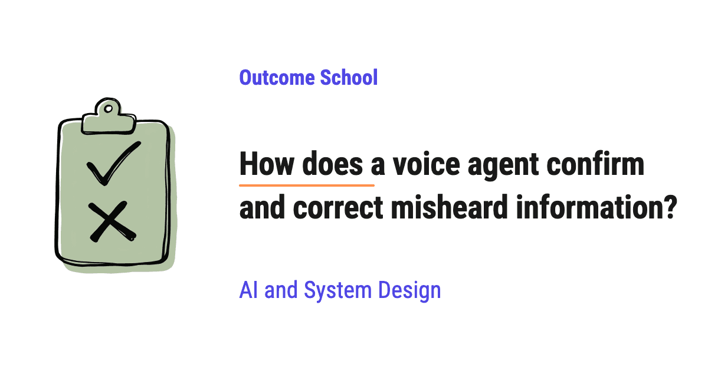

# How does a voice agent confirm and correct misheard information?

> Archived from <https://outcomeschool.com/blog/confirm-and-correct-in-voice-agents> on 2026-11-25.

A voice agent confirms misheard information by reading the important details back to the caller and asking &quot;Is that correct?&quot;, and it corrects them by listening for a &quot;no&quot;, finding which part was wrong, and fixing only that part.

In this blog, we will learn about how a voice agent confirms and corrects misheard information. We will also see why a voice agent mishears in the first place, how it uses a confidence score to decide when to confirm, the difference between explicit and implicit confirmation, how it reads numbers and spellings back clearly, how it fixes only the wrong part when the caller says &quot;no&quot;, and when to confirm and when to skip it.

We will cover the following:
<ul><li>Why does a voice agent mishear?</li><li>What does it mean to confirm and correct?</li><li>What is a confidence score?</li><li>Explicit confirmation vs Implicit confirmation</li><li>Reading back numbers and spellings</li><li>Correcting only the wrong part</li><li>Checking the value with simple rules</li><li>Putting it all together in code</li><li>When to confirm and when to skip</li></ul>
I am <strong>Amit Shekhar</strong>, Founder @ <a target="_blank" rel="noopener noreferrer" href="https://outcomeschool.com">Outcome School</a>, I have taught and mentored many developers, and their efforts landed them high-paying tech jobs, helped many tech companies in solving their unique problems, and created many open-source libraries being used by top companies. I am passionate about sharing knowledge through open-source, blogs, and videos.

I teach <a target="_blank" rel="noopener noreferrer" href="https://outcomeschool.com/program/ai-and-machine-learning">AI and Machine Learning</a> at Outcome School.

Let&#x27;s get started.
<h2 id="why-does-a-voice-agent-mishear">Why does a voice agent mishear?</h2>
A <a target="_blank" rel="noopener noreferrer" href="design-a-real-time-voice-ai-agent.md">voice agent</a> is a system that talks to us over a call. It listens to our voice, understands what we said, and replies with a voice.

Many voice agents work in <a target="_blank" rel="noopener noreferrer" href="cascaded-vs-speech-to-speech.md">three steps</a>:
<ul><li><strong>Speech-to-Text (STT):</strong> It converts our voice into text.</li><li><strong>LLM (Large Language Model):</strong> It reads that text and decides what to say.</li><li><strong>Text-to-Speech (TTS):</strong> It converts the reply text back into voice.</li></ul>
Most mishearing happens in the first step. The STT model hears sound, not letters, and it has to guess which words made that sound. Most of the time, the guess is right. But, sometimes it is wrong.

Let&#x27;s say the caller says:

&quot;My name is Amit, A-M-I-T.&quot;

The STT model can return:

&quot;My name is Amit, A-N-I-T.&quot;

The letters &quot;M&quot; and &quot;N&quot; sound close, especially on a <a target="_blank" rel="noopener noreferrer" href="phone-audio-and-speech-recognition.md">phone line</a>. Similarly:
<ul><li>&quot;fifteen&quot; and &quot;fifty&quot;, or &quot;thirteen&quot; and &quot;thirty&quot;, sound alike.</li><li>&quot;B&quot;, &quot;D&quot;, &quot;P&quot;, and &quot;T&quot; sound alike.</li><li>Background noise, a weak network, and accents make it harder.</li></ul>
If the agent books an appointment for &quot;Anit&quot; or charges 50 dollars instead of 15 dollars, it causes a real problem for a real person. And in this pipeline, the LLM cannot know that the text is wrong, because the LLM only sees the text, not the voice.

So, the agent needs a way to catch these mistakes before it acts on them. Here comes confirmation into the picture.
<h2 id="what-does-it-mean-to-confirm-and-correct">What does it mean to confirm and correct?</h2>
<strong>Confirmation is the step where the voice agent repeats the important information back to the caller, so that the caller can say whether it is right or wrong.</strong>

<strong>Correction is the step where the voice agent takes the caller&#x27;s &quot;no&quot;, finds which part was wrong, and fixes it.</strong>

The best way to learn this is by taking an example.

Think about how we give our phone number to a person at a pizza shop over a call. We say the number. The person says it back to us, &quot;9 8 7 6 5, 4 3 2 1 9, right?&quot;. They got one digit wrong, so we say, &quot;No, the last digit is 0, not 9.&quot; They fix only that one digit.

A voice agent does the same thing. The full flow looks like below:

<pre><code class="code-highlight">Caller says the information
            ↓
STT converts it into text
            ↓
Agent pulls out the important value
            ↓
Agent reads the value back to the caller
            ↓
Caller says &quot;yes&quot; or &quot;no&quot;
            ↓
&quot;yes&quot;: agent saves it and moves on
&quot;no&quot;:  agent fixes only the wrong part
</code></pre>

Now, the next big question is: should the agent confirm everything? The answer is no. If it confirms every sentence, the call becomes slow and annoying. This is where the confidence score comes into the picture.
<h2 id="what-is-a-confidence-score">What is a confidence score?</h2>
<strong>A confidence score is a number between 0 and 1 that tells how sure the STT model is about its guess.</strong>

Many STT models return this score along with the text. Many of them give it for every single word, not only for the full sentence.

Let&#x27;s say the caller says their account number. The STT output looks like below:

<pre><code class="code-highlight">Word:        4      7      1      9      2      5
Confidence:  0.98   0.97   0.55   0.96   0.99   0.62
</code></pre>

Here, we can see that the model is very sure about most of the digits. But it is not sure about the third digit &quot;1&quot; and the last digit &quot;5&quot;. The sound of these two digits was unclear, so the model only gave its best guess.

Now, the agent can use a simple rule:
<ul><li>If the confidence is high, for example above 0.9, the agent can move ahead and repeat the value lightly inside its next sentence.</li><li>If the confidence is low, the agent must confirm clearly.</li><li>If the confidence is very low, for example below 0.4, the agent must ask the caller to say it again.</li></ul>
<strong>Note:</strong> These numbers are only for the sake of example. Every STT model scores differently, so the team must pick these limits by testing with real calls. Also, a high score does not guarantee that the word is right. The model can be confident and still be wrong.

Some STT models can also return more than one guess for the same audio. These are called <strong>N-best results</strong>, which means the top few guesses in order. For example:

<pre><code class="code-highlight">Guess 1: &quot;fifteen&quot;   (0.51)
Guess 2: &quot;fifty&quot;     (0.47)
</code></pre>

When the top two guesses are this close, the agent knows it must confirm. It can even use both guesses in the question: &quot;Did you say fifteen, one five, or fifty, five zero?&quot;

The confidence score is the first reason to confirm. The second reason is the cost of a mistake. A wrong name in a greeting is a small problem, but a wrong amount in a payment is a big problem. So, the agent confirms based on two things:
<ul><li>How unsure the STT model is.</li><li>How costly a mistake would be.</li></ul>
<strong>Planning your move into AI?</strong>

No matter which tech domain you work in today, with your effort, you can transition to these roles:
<ul><li>AI Engineer</li><li>Forward Deployed Engineer</li><li>AI Agent Engineer</li><li>Harness Engineer</li><li>Voice AI Engineer</li><li>AI Architect</li><li>LLM Engineer</li><li>LLM Inference Engineer</li><li>Gen AI Engineer</li><li>MLOps Engineer</li><li>ML Engineer</li><li>Deep Learning Engineer</li></ul>
Our <a target="_blank" rel="noopener noreferrer" href="https://outcomeschool.com/program/ai-and-machine-learning">AI and Machine Learning Program</a> at Outcome School takes you there.

Now, let&#x27;s learn how the agent confirms.
<h2 id="explicit-confirmation-vs-implicit-confirmation">Explicit confirmation vs Implicit confirmation</h2>
There are two main ways to confirm: explicit and implicit.
<h3 id="explicit-confirmation">Explicit confirmation</h3>
<strong>Explicit confirmation is when the agent reads the value back and directly asks a yes or no question.</strong>

Example:

<pre><code class="code-highlight">Caller: I want to send 500 dollars to Rahul.
Agent:  Just to confirm, you want to send 500 dollars to Rahul. Is that correct?
Caller: Yes.
</code></pre>

Here, the agent does not move ahead until the caller says &quot;yes&quot;.

<strong>Advantage:</strong> It is safe. The caller gets a clear chance to catch the mistake.

<strong>Disadvantage:</strong> It adds one extra <a target="_blank" rel="noopener noreferrer" href="what-is-turn-taking-in-a-voice-ai-agent.md">turn</a>, which means one more back-and-forth, to the call. If the agent does this for every small detail, the call becomes long and tiring.

So, we use explicit confirmation for things that are costly to get wrong, like money, appointment dates, addresses, and account changes.
<h3 id="implicit-confirmation">Implicit confirmation</h3>
<strong>Implicit confirmation is when the agent repeats the value inside its next question, without asking a separate yes or no question.</strong>

Example:

<pre><code class="code-highlight">Caller: I want to book a table for Thursday.
Agent:  Sure, a table for Tuesday. How many people will be there?
Caller: Not Tuesday, Thursday. And four people.
</code></pre>

Here, the STT model misheard &quot;Thursday&quot; as &quot;Tuesday&quot;, and the agent said &quot;Tuesday&quot; inside its next question. So, the caller caught the mistake and corrected it in the same turn. If the agent had heard it right, the caller would simply answer the next question, and the call would move fast.

<strong>Advantage:</strong> It saves time. There is no extra yes or no turn.

<strong>Disadvantage:</strong> The caller can miss it. If the caller is busy thinking about the next question, they do not notice that the agent said &quot;Tuesday&quot; instead of &quot;Thursday&quot;.

So, we use implicit confirmation for things that are less costly, and only when the confidence score is high.

Let me tabulate the differences between Explicit confirmation and Implicit confirmation for your better understanding.
<table><thead><tr><th>Point</th><th>Explicit confirmation</th><th>Implicit confirmation</th></tr></thead><tbody><tr><td>How it works</td><td>Reads back and asks &quot;Is that correct?&quot;</td><td>Repeats the value inside the next question</td></tr><tr><td>Extra turn</td><td>Yes</td><td>No</td></tr><tr><td>Safety</td><td>High</td><td>Medium</td></tr><tr><td>Speed of the call</td><td>Slower</td><td>Faster</td></tr><tr><td>Best for</td><td>Money, dates, addresses, account changes</td><td>Low-risk details, high confidence</td></tr></tbody></table>
<strong>A quick note for you</strong>

No matter which tech domain you work in, get familiar with these topics:
<ul><li>LLM</li><li>RAG</li><li>MCP</li><li>Agent</li><li>Fine-tuning</li><li>Quantization</li></ul>
We put it all together in one video:

<a target="_blank" rel="noopener noreferrer" href="https://www.youtube.com/watch?v=lnfWvX66FUk">AI Engineering Explained: LLM, RAG, MCP, Agent, Fine-Tuning, and Quantization</a>

No need to stop reading - bookmark it and watch later when you get time. Future you will thank you.

Now, let&#x27;s get back to the topic.

Now, it&#x27;s time to learn how the agent reads back numbers and spellings, because these are the values that get misheard the most.
<h2 id="reading-back-numbers-and-spellings">Reading back numbers and spellings</h2>
If the agent reads back a phone number as &quot;nine billion eight hundred seventy six million...&quot;, the caller cannot check it. So, the agent must read back values the way a human would.

<strong>Rule 1: Read digits one by one, in small groups.</strong>

Instead of &quot;9876543210&quot;, the agent says &quot;9 8 7 6 5, 4 3 2 1 0&quot;. Short groups with a small pause between them are easy for the caller to follow and check.

<strong>Rule 2: Say tricky numbers in two ways.</strong>

For &quot;15&quot;, the agent can say &quot;fifteen, that is one five&quot;. Now, the caller can easily tell &quot;fifteen&quot; apart from &quot;fifty&quot;.

<strong>Rule 3: Spell names and emails with a clear word for each letter.</strong>

Letters like &quot;M&quot; and &quot;N&quot;, or &quot;B&quot; and &quot;D&quot;, sound alike. So, the agent can spell with a word for each letter, like below:

<pre><code class="code-highlight">&quot;A as in Apple, M as in Mango, I as in India, T as in Tiger.&quot;
</code></pre>

The agent can also ask the caller to spell the same way.

<strong>Rule 4: Write the read-back text for the voice, not for the screen.</strong>

The LLM writes text, and the TTS speaks it. If the LLM writes &quot;<a target="_blank" rel="noopener noreferrer" href="mailto:amit.s@gmail.com">amit.s@gmail.com</a>&quot;, the TTS can read it in a way that is hard to follow. So, the agent turns it into spoken words first: &quot;amit dot s at gmail dot com&quot;.

We have a detailed blog on <a target="_blank" rel="noopener noreferrer" href="structured-inputs-in-voice-agents.md">how a voice agent handles structured inputs like dates, numbers, and addresses</a> that explains this in depth.
<h2 id="correcting-only-the-wrong-part">Correcting only the wrong part</h2>
Now, let&#x27;s say the caller says &quot;no&quot;. What should the agent do?

The naive way is to ask for everything again: &quot;Okay, please tell me the full phone number again.&quot; The issue with this approach is that the STT model can make a new mistake in another digit, and the caller gets frustrated because they have to repeat everything. Let&#x27;s see how the better approach solves this issue.

The better way is to fix only the wrong part. Let&#x27;s say the agent read back the number and the caller replied:

<pre><code class="code-highlight">Agent:  I have 9 8 7 6 5, 4 3 2 1 9. Is that correct?
Caller: No, the last digit is zero.
</code></pre>

Here, the caller has already told us which part is wrong and the right value. So, the agent must:
<ul><li>Understand that the caller is correcting, not giving a new number.</li><li>Find the part that changed: the last digit.</li><li>Replace only that part: 9 becomes 0.</li><li>Read back the fixed value once more: &quot;Got it, 9 8 7 6 5, 4 3 2 1 0. Is that correct now?&quot;</li></ul>
The LLM handles this step well, because it is trained to work with everyday language. It reads the old value and the caller&#x27;s correction, and returns the new value. We can give the LLM an instruction like below:

<pre><code class="code-highlight">The current phone number is 9876543219.
The caller said: &quot;No, the last digit is zero.&quot;
Return the corrected phone number only.
</code></pre>

The LLM returns <code>9876543210</code>.

Callers correct in many ways, and the agent must handle all of them:
<ul><li>&quot;No, it is Thursday, not Tuesday.&quot; (gives the right value directly)</li><li>&quot;No, the last digit is zero.&quot; (points to the wrong part)</li><li>&quot;Not M, it is N.&quot; (swaps one letter)</li><li>&quot;No.&quot; (says nothing more)</li></ul>
For a plain &quot;No.&quot;, the agent does not know which part is wrong. So, it asks a narrow question: &quot;Sorry about that. Which part is wrong?&quot; or it breaks the value into parts and confirms each part one by one.

<strong>Note:</strong> If the same value fails two or three times, the agent must stop trying with voice. It can ask the caller to type the number on the <a target="_blank" rel="noopener noreferrer" href="dtmf-in-voice-agents.md">phone keypad</a>, send a text message link, or <a target="_blank" rel="noopener noreferrer" href="call-transfer-with-context.md">transfer the call to a human</a>. Asking again and again in a loop only frustrates the caller.

To master Prompt Engineering, Tool use in Agents, and how to Design a Real-Time Voice AI Agent from the ground up, check out our <a target="_blank" rel="noopener noreferrer" href="https://outcomeschool.com/program/ai-and-machine-learning">AI and Machine Learning Program</a> at Outcome School.
<h2 id="checking-the-value-with-simple-rules">Checking the value with simple rules</h2>
The agent does not depend only on the caller to catch mistakes. Many values follow fixed rules, and the agent can check them in code before it reads back the value. For example:
<ul><li>In many countries, a mobile number has a fixed number of digits. If the STT gave 9 digits where 10 are needed, something was missed.</li><li>The last digit of a credit card number is a check digit, calculated from all the other digits using a simple math rule called the <strong>Luhn check</strong>. If the number fails this check, at least one digit is wrong.</li><li>A date like &quot;February 30&quot; does not exist.</li><li>An email must have exactly one &quot;@&quot; and a domain after it.</li><li>An order ID or account number can be looked up in the company database. If it does not exist, it was most likely misheard.</li></ul>
When a rule fails, the agent knows the value is wrong even if the confidence score was high. So, it asks again right away and saves a wasted read-back turn.
<h2 id="putting-it-all-together-in-code">Putting it all together in code</h2>
Now, let&#x27;s see a simple version of this logic in code, just for the sake of understanding.

First, we decide how to confirm, based on the confidence and the risk. We can write the code as below:

<pre><code class="code-highlight language-python">def choose_confirmation(confidence, is_high_risk):
    if confidence &lt; 0.4:
        return &quot;ask_again&quot;
    if is_high_risk or confidence &lt; 0.9:
        return &quot;explicit&quot;
    return &quot;implicit&quot;
</code></pre>

Here, we have three results:
<ul><li><code>ask_again</code> when the STT model is very unsure. Reading back a bad guess only wastes a turn.</li><li><code>explicit</code> when the value is high-risk, or when the confidence is not high enough.</li><li><code>implicit</code> when the value is low-risk and the confidence is high.</li></ul>
Then, we turn a phone number into a voice-friendly read-back. We can write the code as below:

<pre><code class="code-highlight language-python">def speak_digits(number):
    groups = [number[i:i + 5] for i in range(0, len(number), 5)]
    return &quot;, &quot;.join(&quot; &quot;.join(group) for group in groups)
</code></pre>

Here, we are splitting the number into groups of 5 digits, and we are putting a space between the digits so that the TTS reads each digit on its own. Most TTS models take a small pause at a comma, so the two groups are easy to hear.

If we call <code>speak_digits(&quot;9876543210&quot;)</code>, it will return the following:

<pre><code class="code-highlight">9 8 7 6 5, 4 3 2 1 0
</code></pre>

After that, we handle the caller&#x27;s reply in a loop. We can write the code as below:

<pre><code class="code-highlight language-python">def confirm_value(value, max_tries=3):
    for _ in range(max_tries):
        reply = ask(f&quot;I have {speak_digits(value)}. Is that correct?&quot;)

        if is_yes(reply):
            return value

        value = llm_correct(value, reply)

        if not is_valid_phone(value):
            value = ask_value_again()

    return transfer_to_human()
</code></pre>

Here, <code>ask</code>, <code>is_yes</code>, <code>llm_correct</code>, <code>is_valid_phone</code>, <code>ask_value_again</code>, and <code>transfer_to_human</code> are helper functions that our agent already has. We can see that:
<ul><li>The agent reads back the value and asks &quot;Is that correct?&quot;.</li><li>If the caller says &quot;yes&quot;, the agent saves the value and moves on.</li><li>Otherwise, the LLM applies the caller&#x27;s correction to the old value, so only the wrong part changes.</li><li>The agent checks the new value with a simple rule. If it fails, it asks for the value again.</li><li>After 3 failed tries, the agent stops looping and transfers the call to a human.</li></ul>
<strong>Stay updated:</strong> Subscribe to our <a target="_blank" rel="noopener noreferrer" href="https://outcomeschool.substack.com/subscribe">newsletter</a> to get our latest AI and Machine Learning blogs straight to your inbox.
<h2 id="when-to-confirm-and-when-to-skip">When to confirm and when to skip</h2>
Confirmation makes the agent safer, but too much of it makes the call slow. So, we must find the right balance based on our use case.

Confirm explicitly when any one of these is true:
<ul><li>The value involves money, like a payment or a refund.</li><li>The value is hard to hear, like names, emails, codes, and long numbers.</li><li>The action cannot be undone easily, like cancelling an account.</li><li>The confidence score is low.</li></ul>
Use implicit confirmation when the value is low-risk and the confidence score is high. For example, the number of people at a table is low-risk, because it can be changed easily later.

Skip confirmation when the caller is just asking a question, like &quot;What are your opening hours?&quot;, and nothing is being saved or changed.

One more thing to notice is that the agent can confirm several values together at the end of a booking, instead of one by one. For example: &quot;So, a table for 4 people, on Thursday, at 7 PM, under the name Amit. Is that all correct?&quot;. This saves turns, and if one part is wrong, the agent fixes only that part.

We have a detailed blog on <a target="_blank" rel="noopener noreferrer" href="voice-agent-system-prompt.md">how to write a system prompt for a voice agent</a> that covers how to tell the agent which details to confirm.

Now we must have understood how a voice agent confirms and corrects misheard information, how it decides when to confirm, and how it fixes only the wrong part.
<h2 id="frequently-asked-questions">Frequently Asked Questions</h2><h3 id="why-cant-the-llm-catch-a-misheard-word-on-its-own">Why can&#x27;t the LLM catch a misheard word on its own?</h3>
Because the LLM only sees the text, not the voice. The STT model turns the voice into text first, so if it hears &quot;fifty&quot; instead of &quot;fifteen&quot;, the LLM gets the wrong text and has no way to know it is wrong. This is why the agent reads the important values back to the caller.
<h3 id="does-a-high-confidence-score-mean-the-word-is-right">Does a high confidence score mean the word is right?</h3>
No. A high confidence score does not guarantee that the word is right, because the STT model can be confident and still be wrong. So, the agent also checks values with simple rules, like the number of digits in a mobile number or the Luhn check for a card number. When a rule fails, the agent knows the value is wrong even if the score was high.
<h3 id="what-are-n-best-results-in-speech-recognition">What are N-best results in speech recognition?</h3>
N-best results are the top few guesses that an STT model returns for the same audio, in order. For example, it can return &quot;fifteen&quot; with 0.51 and &quot;fifty&quot; with 0.47. When the top two guesses are this close, the agent knows it must confirm, and it can even use both guesses in the question.
<h3 id="what-should-a-voice-agent-do-when-the-same-value-keeps-failing">What should a voice agent do when the same value keeps failing?</h3>
It should stop trying with voice after two or three failed tries. It can ask the caller to type the number on the phone keypad, send a text message link, or transfer the call to a human. Asking again and again in a loop only frustrates the caller.
<h3 id="can-a-voice-agent-confirm-several-details-at-once">Can a voice agent confirm several details at once?</h3>
Yes. The agent can confirm several values together at the end of a booking, instead of one by one. For example: &quot;So, a table for 4 people, on Thursday, at 7 PM, under the name Amit. Is that all correct?&quot; This saves turns, and if one part is wrong, the agent fixes only that part.

That&#x27;s it for now.

Thanks

<strong>Amit Shekhar</strong> Founder @ <a target="_blank" rel="noopener noreferrer" href="https://outcomeschool.com">Outcome School</a>

You can connect with me on:
<ul><li><a target="_blank" rel="noopener noreferrer" href="https://x.com/amitiitbhu">X</a></li><li><a target="_blank" rel="noopener noreferrer" href="https://www.linkedin.com/in/amit-shekhar-iitbhu">LinkedIn</a></li><li><a target="_blank" rel="noopener noreferrer" href="https://github.com/amitshekhariitbhu">GitHub</a></li></ul>
Follow Outcome School on:
<ul><li><a target="_blank" rel="noopener noreferrer" href="https://x.com/outcome_school">X</a></li><li><a target="_blank" rel="noopener noreferrer" href="https://youtube.com/@OutcomeSchool">YouTube</a></li><li><a target="_blank" rel="noopener noreferrer" href="https://www.linkedin.com/company/outcomeschool">LinkedIn</a></li><li><a target="_blank" rel="noopener noreferrer" href="http://github.com/OutcomeSchool">GitHub</a></li></ul>
<a target="_blank" rel="noopener noreferrer" href="https://outcomeschool.com/blog"><strong>Read all of our high-quality blogs here.</strong></a>

