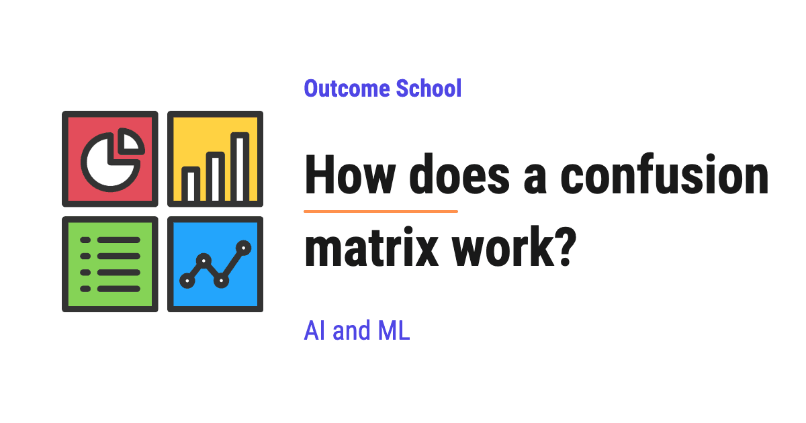

# How does a confusion matrix work?

> Archived from <https://outcomeschool.com/blog/confusion-matrix> on 2026-11-25.

A confusion matrix is a small table that compares what a model predicted with the real answers, showing how often it was right and what kinds of mistakes it made.

In this blog, we will learn about how a confusion matrix works. We will also see why we need it, the four boxes TP, TN, FP, and FN, how to read it, how accuracy, precision, recall, and F1 score come from it, how it works for more than two classes, and how we build one in code.

We will cover the following:
<ul><li>What is a confusion matrix?</li><li>Why we need a confusion matrix</li><li>The four boxes: TP, TN, FP, FN</li><li>A real example: a spam filter</li><li>How to read the matrix</li><li>Accuracy and why it can fool us</li><li>Precision: how trustworthy are the &quot;yes&quot; answers</li><li>Recall: how many real cases did we catch</li><li>F1 score: balancing precision and recall</li><li>Confusion matrix for more than two classes</li><li>How we build one in real tools</li><li>Where a confusion matrix is used</li></ul>
I am <strong>Amit Shekhar</strong>, Founder @ <a target="_blank" rel="noopener noreferrer" href="https://outcomeschool.com">Outcome School</a>, I have taught and mentored many developers, and their efforts landed them high-paying tech jobs, helped many tech companies in solving their unique problems, and created many open-source libraries being used by top companies. I am passionate about sharing knowledge through open-source, blogs, and videos.

I teach <a target="_blank" rel="noopener noreferrer" href="https://outcomeschool.com/program/ai-and-machine-learning">AI and Machine Learning</a> at Outcome School.

Let&#x27;s get started.
<h3 id="what-is-a-confusion-matrix">What is a confusion matrix?</h3>
A <strong>confusion matrix</strong> is a small table that compares what our model predicted with what the real answer actually was.

It shows us, in one picture, how many times the model was right and how many times it was wrong, and what kind of mistakes it made.

The word <strong>confusion</strong> is here because this table shows us where our model gets confused, which means where it makes mistakes.

It is used for a model that predicts categories, such as &quot;spam&quot; or &quot;not spam&quot;, &quot;cat&quot; or &quot;dog&quot;, &quot;sick&quot; or &quot;healthy&quot;.
<h3 id="why-we-need-a-confusion-matrix">Why we need a confusion matrix</h3>
Suppose we build a model that looks at an email and predicts &quot;spam&quot; or &quot;not spam&quot;.

After the model is ready, we <a target="_blank" rel="noopener noreferrer" href="train-validation-test-split.md">test it on emails where we already know the true answer</a>. Now we want to know one thing: how good is this model?

The simplest idea is to count how many predictions were correct. But this single number hides a lot.

For example, a model can be correct most of the time and still be useless. We will see exactly how this happens later in this blog.

So, we need something deeper than a single number. We need to see the different kinds of mistakes the model makes.

So, here comes the confusion matrix to the rescue.

It breaks down every prediction into clear groups, so we can see not just how often the model is wrong, but how it is wrong.
<h3 id="the-four-boxes-tp-tn-fp-fn">The four boxes: TP, TN, FP, FN</h3>
To read a confusion matrix, we must first understand four ideas.

In a yes-or-no problem, we pick one class as the <strong>positive</strong> class. The positive class is the thing we are trying to detect. For a spam filter, &quot;spam&quot; is the positive class.

Now, every prediction falls into one of four boxes.

<strong>True Positive (TP):</strong> The model said &quot;yes&quot;, and the real answer was also &quot;yes&quot;. The model said an email was spam, and it really was spam. This is correct.

<strong>True Negative (TN):</strong> The model said &quot;no&quot;, and the real answer was also &quot;no&quot;. The model said an email was not spam, and it really was not spam. This is correct.

<strong>False Positive (FP):</strong> The model said &quot;yes&quot;, but the real answer was &quot;no&quot;. The model said an email was spam, but it was actually a normal email. This is a mistake. It is also called a <strong>Type I error</strong>, which means a false alarm.

<strong>False Negative (FN):</strong> The model said &quot;no&quot;, but the real answer was &quot;yes&quot;. The model said an email was not spam, but it actually was spam. This is also a mistake. It is also called a <strong>Type II error</strong>, which means a missed catch.

Let&#x27;s place all four boxes into one grid like below:

<pre><code class="language-text code-highlight">                          REAL ANSWER
                    Yes               No
               +----------------+----------------+
   MODEL  Yes  | True Positive  | False Positive |
   SAID        |     (TP)       |     (FP)       |
               |    correct     |    mistake     |
               +----------------+----------------+
         No    | False Negative | True Negative  |
               |     (FN)       |     (TN)       |
               |    mistake     |    correct     |
               +----------------+----------------+
</code></pre>

Here, we can see how the model&#x27;s prediction and the real answer meet in each box. When both agree, we land in a correct box (TP or TN). When they disagree, we land in a mistake box (FP or FN). The two correct boxes sit on the diagonal, and the two mistakes sit off the diagonal.

Here is a simple way to remember it. The first word tells us if the model was right or wrong. The second word tells us what the model predicted.

So, &quot;False Positive&quot; means the model predicted positive, and it was false, which means wrong.

<strong>Planning your move into AI?</strong>

No matter which tech domain you work in today, with your effort, you can transition to these roles:
<ul><li>AI Engineer</li><li>Forward Deployed Engineer</li><li>AI Agent Engineer</li><li>Harness Engineer</li><li>Voice AI Engineer</li><li>AI Architect</li><li>LLM Engineer</li><li>LLM Inference Engineer</li><li>Gen AI Engineer</li><li>MLOps Engineer</li><li>ML Engineer</li><li>Deep Learning Engineer</li></ul>
Our <a target="_blank" rel="noopener noreferrer" href="https://outcomeschool.com/program/ai-and-machine-learning">AI and Machine Learning Program</a> at Outcome School takes you there.
<h3 id="a-real-example-a-spam-filter">A real example: a spam filter</h3>
The best way to learn this is by taking an example.

Let&#x27;s say we test our spam filter on 100 emails. We already know the true answer for each one.

Out of these 100 emails, suppose 40 are really spam and 60 are really normal.

Now our model makes its predictions, and we count the results into the four boxes like below:

<pre><code class="language-text code-highlight">                            REAL ANSWER
                       Spam            Not Spam
                  +---------------+---------------+
   MODEL  Spam    |   TP = 35     |   FP = 5      |
   SAID           |  (caught it)  | (false alarm) |
                  +---------------+---------------+
          Not     |   FN = 5      |   TN = 55     |
          Spam    |  (missed it)  | (correct no)  |
                  +---------------+---------------+
</code></pre>

Here, we can see the four boxes filled with numbers. The model caught 35 real spam emails (TP). It wrongly flagged 5 normal emails as spam (FP). It missed 5 real spam emails and let them through (FN). And it correctly let 55 normal emails pass (TN).

Let&#x27;s check the totals. The real spam emails are 35 + 5 = 40. The real normal emails are 5 + 55 = 60. This matches our 100 emails.

This table is our confusion matrix. Now let&#x27;s learn how to read it.
<h3 id="how-to-read-the-matrix">How to read the matrix</h3>
A confusion matrix always has two directions.

One direction is the <strong>real answer</strong>, which is the truth we already know.

The other direction is the <strong>model&#x27;s prediction</strong>, which is the guess the model made.

The boxes on the main diagonal, going from the top-left to the bottom-right, are the correct predictions. In our example, those are TP = 35 and TN = 55.

The other boxes, off the diagonal, are the mistakes. Those are FP = 5 and FN = 5.

Let&#x27;s see this idea as below:

<pre><code class="language-text code-highlight">   +---------------------+---------------------+
   |   CORRECT (TP)      |   MISTAKE (FP)      |
   |   diagonal          |   off-diagonal      |
   +---------------------+---------------------+
   |   MISTAKE (FN)      |   CORRECT (TN)      |
   |   off-diagonal      |   diagonal          |
   +---------------------+---------------------+

   Diagonal     = the model got it right
   Off-diagonal = the model got it wrong
</code></pre>

Here, we can see a simple rule. The numbers sitting on the diagonal are the correct predictions. The numbers sitting off the diagonal are the mistakes. A good model has big numbers on the diagonal and tiny numbers everywhere else.

This single rule works even when we have many classes, as we will see later.

<strong>A quick note for you</strong>

No matter which tech domain you work in, get familiar with these topics:
<ul><li>LLM</li><li>RAG</li><li>MCP</li><li>Agent</li><li>Fine-tuning</li><li>Quantization</li></ul>
We put it all together in one video:

<a target="_blank" rel="noopener noreferrer" href="https://www.youtube.com/watch?v=lnfWvX66FUk">AI Engineering Explained: LLM, RAG, MCP, Agent, Fine-Tuning, and Quantization</a>

No need to stop reading - bookmark it and watch later when you get time. Future you will thank you.

Now, let&#x27;s get back to the topic.
<h3 id="accuracy-and-why-it-can-fool-us">Accuracy and why it can fool us</h3>
Now, let&#x27;s use these four numbers to measure the model.

The most common measure is <strong>accuracy</strong>.

<strong>Accuracy</strong> means the fraction of all predictions that were correct.

We calculate it like below:

<pre><code class="language-text code-highlight">Accuracy = (TP + TN) / (TP + TN + FP + FN)
         = (35 + 55) / (35 + 55 + 5 + 5)
         = 90 / 100
         = 0.90  (which means 90%)
</code></pre>

Here, we can see our model is correct 90% of the time. But accuracy alone can mislead us.

Suppose only 1 email out of 100 is spam, and 99 are normal. Now imagine a lazy model that simply says &quot;not spam&quot; for every single email.

This lazy model will be correct 99 times out of 100. So its accuracy is 99%. But it never catches a single spam email. It is completely useless.

This problem happens with <strong>imbalanced data</strong>, which means one class is far more common than the other.

So, accuracy alone is not enough. We need measures that look deeper.
<h3 id="precision-how-trustworthy-are-the-yes-answers">Precision: how trustworthy are the &quot;yes&quot; answers</h3>
The first deeper measure is <strong>precision</strong>.

<strong>Precision</strong> answers one question: out of all the times the model said &quot;yes&quot;, how many were actually correct?

When the model says &quot;this is spam&quot;, how often should we believe it?

We calculate it using only the predicted-positive boxes, like below:

<pre><code class="language-text code-highlight">Precision = TP / (TP + FP)
          = 35 / (35 + 5)
          = 35 / 40
          = 0.875  (which means 87.5%)
</code></pre>

Here, we can see that when our model marks an email as spam, it is right about 87.5% of the time. The other 12.5% of the time, it wrongly flags a normal email.

Precision matters most when a false alarm is costly. For a spam filter, a false alarm means a real, important email gets sent to the spam folder, and the user may never see it. So we want precision to be high.
<h3 id="recall-how-many-real-cases-did-we-catch">Recall: how many real cases did we catch</h3>
The next measure is <strong>recall</strong>.

<strong>Recall</strong> answers a different question: out of all the real &quot;yes&quot; cases, how many did the model actually catch?

Of all the spam emails that truly existed, how many did the model find?

We calculate it using only the real-positive boxes, like below:

<pre><code class="language-text code-highlight">Recall = TP / (TP + FN)
       = 35 / (35 + 5)
       = 35 / 40
       = 0.875  (which means 87.5%)
</code></pre>

Here, we can see our model caught 87.5% of all the real spam. The other 12.5% slipped through into the inbox.

Recall matters most when a miss is costly. Let&#x27;s say the model detects a serious disease. Missing a sick patient (a false negative) can be very dangerous. So in that case, we want recall to be very high, even if it means a few more false alarms.

So, precision and recall look at the same model from two different angles. One asks &quot;are your yes answers trustworthy&quot;, and the other asks &quot;did you catch everything&quot;. We have a detailed blog on <a target="_blank" rel="noopener noreferrer" href="precision-vs-recall.md">Precision vs Recall</a> that explains when to use which one in depth.

Let&#x27;s see exactly which boxes each one uses, like below:

<pre><code class="language-text code-highlight">PRECISION reads the ROW where the MODEL SAID &quot;Yes&quot;:

               +---------------+---------------+
   MODEL  Yes  |   TP = 35     |   FP = 5      |  ---&gt; Precision = TP / (TP + FP)
   SAID        +---------------+---------------+

RECALL reads the COLUMN where the REAL ANSWER is &quot;Yes&quot;:

                  REAL = Yes
               +---------------+
   MODEL  Yes  |   TP = 35     |
   SAID        +---------------+  ---&gt; Recall = TP / (TP + FN)
          No   |   FN = 5      |
               +---------------+
</code></pre>

Here, we can see the difference at a glance. Precision moves across the row of everything the model called &quot;yes&quot;, so it checks how many of those guesses were right. Recall moves down the column of everything that was truly &quot;yes&quot;, so it checks how many of those real cases the model managed to catch. Both share the TP box, but each pairs it with a different mistake box.

To master Supervised and Unsupervised Learning, Logistic Regression, and Evaluation and Testing in depth, check out our <a target="_blank" rel="noopener noreferrer" href="https://outcomeschool.com/program/ai-and-machine-learning">AI and Machine Learning Program</a> at Outcome School.
<h3 id="f1-score-balancing-precision-and-recall">F1 score: balancing precision and recall</h3>
Often, when precision goes up, recall goes down, and the other way around.

If we make the model say &quot;yes&quot; very easily, it catches more real cases, so recall goes up. But it also raises more false alarms, so precision goes down.

If we make the model very strict, it raises fewer false alarms, so precision goes up. But it misses more real cases, so recall goes down.

So, we need a single number that balances both. That number is the <strong>F1 score</strong>.

The <strong>F1 score</strong> is the <strong>harmonic mean</strong> of precision and recall. A harmonic mean is a special kind of average that stays low if either of the two numbers is low. So, a model that is good at one but poor at the other gets a low F1 score.

We calculate it like below:

<pre><code class="language-text code-highlight">F1 = 2 * (Precision * Recall) / (Precision + Recall)
   = 2 * (0.875 * 0.875) / (0.875 + 0.875)
   = 1.53125 / 1.75
   = 0.875  (which means 87.5%)
</code></pre>

Here, we can see the F1 score is 87.5%. Because our precision and recall were equal, the F1 score lands at the same value. When they are different, the F1 score sits closer to the smaller one.

So, the F1 score gives us one balanced number to judge a model, especially when our data is imbalanced.
<h3 id="confusion-matrix-for-more-than-two-classes">Confusion matrix for more than two classes</h3>
So far, we used a yes-or-no problem. But a confusion matrix also works when there are many classes.

Let&#x27;s say we build a model that looks at a photo of an animal and predicts &quot;Cat&quot;, &quot;Dog&quot;, or &quot;Bird&quot;.

Now the matrix becomes a bigger grid, with one row and one column for each class, like below:

<pre><code class="language-text code-highlight">                         REAL ANSWER
                    Cat     Dog     Bird
               +-------+-------+-------+
   MODEL  Cat  |  40   |   3   |   2   |
   SAID        +-------+-------+-------+
          Dog  |   4   |  35   |   1   |
               +-------+-------+-------+
          Bird |   2   |   2   |  38   |
               +-------+-------+-------+
</code></pre>

Here, we can see the same idea as before, just larger. The diagonal boxes (40, 35, 38) are the correct predictions. Every other box is a mistake.

Let&#x27;s read one mistake. The number 3 in the top row means the model said &quot;Cat&quot; 3 times when the real animal was actually a Dog. This tells us the model sometimes confuses dogs with cats.

We can also measure precision and recall for each class on its own. For example, we can ask how good the model is at finding cats, then separately how good it is at finding dogs. The same four-box idea is applied to one class at a time.

A confusion matrix does not just say &quot;the model was wrong&quot;. It tells us exactly which classes the model mixes up, so we know where to improve.

<strong>Stay updated:</strong> Subscribe to our <a target="_blank" rel="noopener noreferrer" href="https://outcomeschool.substack.com/subscribe">newsletter</a> to get our latest AI and Machine Learning blogs straight to your inbox.
<h3 id="how-we-build-one-in-real-tools">How we build one in real tools</h3>
In real <a target="_blank" rel="noopener noreferrer" href="machine-learning.md">machine learning</a> work, we do not draw these tables by hand. We use ready-made tools.

A popular Python library for this is <strong>scikit-learn</strong>. It has a built-in function for this job.

We give it two lists. One list has the real answers. The other list has the model&#x27;s predictions. The function then counts the four boxes for us.

We can write the code like below:

<pre><code class="code-highlight language-python">from sklearn.metrics import confusion_matrix, ConfusionMatrixDisplay

real_answers = [&quot;spam&quot;, &quot;spam&quot;, &quot;not spam&quot;, &quot;spam&quot;, &quot;not spam&quot;]
predictions  = [&quot;spam&quot;, &quot;not spam&quot;, &quot;not spam&quot;, &quot;spam&quot;, &quot;not spam&quot;]

matrix = confusion_matrix(real_answers, predictions)
print(matrix)

# To see it as a picture:
ConfusionMatrixDisplay.from_predictions(real_answers, predictions)
</code></pre>

This will print the following:

<pre><code class="language-text code-highlight">[[2 0]
 [1 2]]
</code></pre>

Here, we pass the real answers and the predictions, and <code>confusion_matrix</code> returns the grid of numbers. The grid above is the confusion matrix counted for us. In scikit-learn, the rows are the real answers and the columns are the predictions, and the classes are sorted alphabetically, so &quot;not spam&quot; comes first. The <code>ConfusionMatrixDisplay</code> part draws it as a colored picture, so we can read it at a glance. This same code works for two classes or for many classes.
<h3 id="where-a-confusion-matrix-is-used">Where a confusion matrix is used</h3>
Now, let&#x27;s see where a confusion matrix is used.

A confusion matrix is used almost everywhere a model predicts categories. Here are a few examples:
<ul><li><strong>Email spam filters</strong> use it to balance catching spam against blocking real emails.</li><li><strong>Medical tests</strong> use it to make sure the model does not miss sick patients.</li><li><strong>Fraud detection</strong> in banks uses it to catch fraud while avoiding false alarms on honest customers.</li><li><strong>Image recognition</strong> uses it to see which objects a model confuses with each other.</li><li><strong>Text classification</strong> uses it when a model sorts text into categories, such as positive or negative reviews.</li></ul>
In every one of these cases, the confusion matrix helps us pick the right measure for the job, whether we care more about precision, recall, or a balance of both.

Now we must have understood how a confusion matrix works, how to read it, and how it helps us measure a model.
<h2 id="frequently-asked-questions">Frequently Asked Questions</h2><h3 id="what-are-type-i-and-type-ii-errors-in-a-confusion-matrix">What are Type I and Type II errors in a confusion matrix?</h3>
A Type I error is a False Positive, and a Type II error is a False Negative. A Type I error is a false alarm, where the model said &quot;yes&quot; but the real answer was &quot;no&quot;. A Type II error is a missed catch, where the model said &quot;no&quot; but the real answer was &quot;yes&quot;.
<h3 id="what-does-a-good-confusion-matrix-look-like">What does a good confusion matrix look like?</h3>
A good confusion matrix has big numbers on the main diagonal and tiny numbers everywhere else. The diagonal, going from the top-left to the bottom-right, holds the correct predictions. The boxes off the diagonal hold the mistakes. This rule works for two classes and for many classes.
<h3 id="why-does-the-f1-score-use-the-harmonic-mean">Why does the F1 score use the harmonic mean?</h3>
The F1 score uses the harmonic mean because it stays low if either precision or recall is low. So, a model that is good at one but poor at the other gets a low F1 score. When precision and recall are different, the F1 score sits closer to the smaller one.
<h3 id="in-scikit-learn-what-do-the-rows-and-columns-of-a-confusion-matrix-mean">In scikit-learn, what do the rows and columns of a confusion matrix mean?</h3>
In scikit-learn, the rows are the real answers and the columns are the predictions. The classes are sorted alphabetically, so for a spam filter, &quot;not spam&quot; comes first. The library counts the boxes for us, and it can also draw the matrix as a colored picture.

That&#x27;s it for now.

Thanks

<strong>Amit Shekhar</strong> Founder @ <a target="_blank" rel="noopener noreferrer" href="https://outcomeschool.com">Outcome School</a>

You can connect with me on:
<ul><li><a target="_blank" rel="noopener noreferrer" href="https://x.com/amitiitbhu">X</a></li><li><a target="_blank" rel="noopener noreferrer" href="https://www.linkedin.com/in/amit-shekhar-iitbhu">LinkedIn</a></li><li><a target="_blank" rel="noopener noreferrer" href="https://github.com/amitshekhariitbhu">GitHub</a></li></ul>
Follow Outcome School on:
<ul><li><a target="_blank" rel="noopener noreferrer" href="https://x.com/outcome_school">X</a></li><li><a target="_blank" rel="noopener noreferrer" href="https://youtube.com/@OutcomeSchool">YouTube</a></li><li><a target="_blank" rel="noopener noreferrer" href="https://www.linkedin.com/company/outcomeschool">LinkedIn</a></li><li><a target="_blank" rel="noopener noreferrer" href="http://github.com/OutcomeSchool">GitHub</a></li></ul>
<a target="_blank" rel="noopener noreferrer" href="https://outcomeschool.com/blog"><strong>Read all of our high-quality blogs here.</strong></a>

