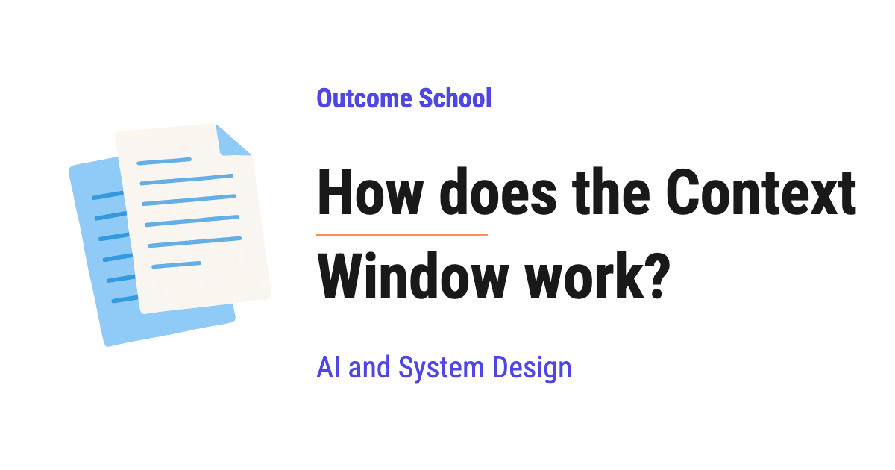

# How does the Context Window work?

> Archived from <https://outcomeschool.com/blog/context-window> on 2026-11-25.

A Context Window is the total amount of text, measured in tokens, that a Large Language Model can read and remember at one time. It is the model&#x27;s short-term memory.

In this blog, we will learn about how the Context Window works in <a target="_blank" rel="noopener noreferrer" href="large-language-model-llm.md">Large Language Models</a>. We will also see why we need it, what tokens are, how the model reads everything inside it, what happens when it gets full, how to manage it, and the common mistakes we must avoid.

We will cover the following:
<ul><li>What is a Context Window?</li><li>Why do we need a Context Window?</li><li>What are tokens?</li><li>How does the model read the Context Window?</li><li>A step-by-step walkthrough of a conversation</li><li>What happens when the Context Window gets full?</li><li>How to manage the Context Window</li><li>Common mistakes while using the Context Window</li></ul>
I am <strong>Amit Shekhar</strong>, Founder @ <a target="_blank" rel="noopener noreferrer" href="https://outcomeschool.com">Outcome School</a>, I have taught and mentored many developers, and their efforts landed them high-paying tech jobs, helped many tech companies in solving their unique problems, and created many open-source libraries being used by top companies. I am passionate about sharing knowledge through open-source, blogs, and videos.

I teach <a target="_blank" rel="noopener noreferrer" href="https://outcomeschool.com/program/ai-and-machine-learning">AI and Machine Learning</a> at Outcome School.

Let&#x27;s get started.
<h2 id="what-is-a-context-window">What is a Context Window?</h2>
A <strong>Context Window</strong> is the total amount of text a model can read and remember at one time while answering us.

We can think of it as the model&#x27;s short-term memory.

Here, <strong>context</strong> means everything the model needs to know to answer well. This includes our question, our earlier messages, and any documents we paste.

So, a Context Window is a fixed-size space that holds all the text the model is currently looking at.

Let&#x27;s say we are talking to an AI assistant. Everything we typed and everything the model replied sits inside this window. The model reads this whole window before writing the next word.
<h2 id="why-do-we-need-a-context-window">Why do we need a Context Window?</h2>
To understand why we need it, let&#x27;s first understand a problem.

A model does not have permanent memory of our chat. Every time we send a message, the model starts fresh and reads the text we give it.

Suppose we tell the model, &quot;My name is Amit.&quot; Then in the next message we ask, &quot;What is my name?&quot;

How does the model answer correctly? The answer is the Context Window.

When we send the second message, the whole conversation is packed and sent again to the model. So, the model sees both messages together inside the Context Window. It reads &quot;My name is Amit&quot; and then answers &quot;Your name is Amit.&quot;

We can picture the flow as below:

<pre><code class="language-text code-highlight">      We send message 2
              ↓
+----------------------------+
| Context Window             |
| &quot;My name is Amit.&quot;         |
| &quot;What is my name?&quot;         |
+----------------------------+
              ↓
         +---------+
         |  Model  |
         +---------+
              ↓
     &quot;Your name is Amit.&quot;
</code></pre>

Here, we can see that both the old message and the new question travel together inside the Context Window. The model reads the whole window, finds &quot;My name is Amit&quot;, and answers correctly.

<strong>Note:</strong> The model itself stays the same. The memory of the conversation lives inside the Context Window that we send each time.
<h2 id="what-are-tokens">What are tokens?</h2>
Before we go deeper, we must know about tokens, because the Context Window is measured in tokens, not in words.

A <strong>token</strong> is a small piece of text. It can be a whole word, a part of a word, or even a single character.

The model does not read full sentences directly. It first <a target="_blank" rel="noopener noreferrer" href="tokenization-in-llms.md">breaks the text into small pieces called tokens</a>, and then it reads those pieces.

Let&#x27;s see an example. Consider the sentence below:

<pre><code class="language-text code-highlight">I love learning
</code></pre>

This sentence can be broken into tokens like below:

<pre><code class="language-text code-highlight">[&quot;I&quot;, &quot; love&quot;, &quot; learn&quot;, &quot;ing&quot;]
</code></pre>

Here, we can see that the word &quot;learning&quot; got split into two tokens, &quot;learn&quot; and &quot;ing&quot;. So, three words became four tokens.

A rough rule for English is that one token is about four characters, and 100 tokens are about 75 words. This is just for the sake of understanding, the exact count depends on the words we use.

So, when we say a model has a Context Window of 8,000 tokens, it means the model can hold about 6,000 words of text at one time. This includes both our text and the model&#x27;s reply.

<strong>Planning your move into AI?</strong>

No matter which tech domain you work in today, with your effort, you can transition to these roles:
<ul><li>AI Engineer</li><li>Forward Deployed Engineer</li><li>AI Agent Engineer</li><li>Harness Engineer</li><li>Voice AI Engineer</li><li>AI Architect</li><li>LLM Engineer</li><li>LLM Inference Engineer</li><li>Gen AI Engineer</li><li>MLOps Engineer</li><li>ML Engineer</li><li>Deep Learning Engineer</li></ul>
Our <a target="_blank" rel="noopener noreferrer" href="https://outcomeschool.com/program/ai-and-machine-learning">AI and Machine Learning Program</a> at Outcome School takes you there.
<h2 id="how-does-the-model-read-the-context-window">How does the model read the Context Window?</h2>
Now that we have learned about tokens, it is time to learn how the model uses the window.

The model reads all the tokens in the Context Window together. It looks at <a target="_blank" rel="noopener noreferrer" href="self-attention-in-transformers.md">how each token relates to the tokens</a> that come before it. This is how it understands the meaning of the whole conversation.

Then the model predicts the next token. After that, it adds this new token back into the window and predicts the next one. It keeps doing this until the answer is complete.

So, the reply is built one token at a time, and each new token is decided by reading the entire window again.

This is why the Context Window matters so much. If important information is inside the window, the model can use it. If it is outside the window, the model cannot see it at all.

Let me tabulate the parts that usually sit inside the Context Window for your better understanding.
<table><thead><tr><th>Part</th><th>What it contains</th></tr></thead><tbody><tr><td>System instruction</td><td>The rules we give, like &quot;You are a helpful teacher.&quot;</td></tr><tr><td>Past messages</td><td>Everything we and the model said earlier</td></tr><tr><td>Current question</td><td>The new message we just sent</td></tr><tr><td>Pasted documents</td><td>Any file or text we added for reference</td></tr><tr><td>The model&#x27;s reply</td><td>The answer being written, token by token</td></tr></tbody></table>
Here, we can notice that all of these share the same fixed space. They all compete for room inside the window.

To learn Tokenization, Self-Attention, and how to build a Large Language Model (LLM) from scratch, check out our <a target="_blank" rel="noopener noreferrer" href="https://outcomeschool.com/program/ai-and-machine-learning">AI and Machine Learning Program</a> at Outcome School.
<h2 id="a-step-by-step-walkthrough-of-a-conversation">A step-by-step walkthrough of a conversation</h2>
The best way to learn this is by taking an example. Let&#x27;s say our model has a small Context Window of only 100 tokens, just for the sake of understanding.

<strong>Step 1:</strong> We send &quot;My name is Amit.&quot; This takes around 5 tokens. The window now holds 5 tokens. We have 95 tokens of room left.

<strong>Step 2:</strong> The model replies &quot;Nice to meet you, Amit.&quot; This reply also goes into the window. Now the window holds around 12 tokens.

<strong>Step 3:</strong> We ask &quot;What is my name?&quot; This message is added too. The full conversation so far is sent to the model. The model reads everything, sees &quot;My name is Amit&quot;, and replies &quot;Your name is Amit.&quot;

<strong>Step 4:</strong> We keep chatting. With every message, the window keeps filling up. The total keeps growing toward the 100-token limit.

So, the window grows as the conversation grows. Each new turn carries all the older turns along with it.

This is why the model seems to remember us, even though it has no permanent memory.

We have a detailed blog on <a target="_blank" rel="noopener noreferrer" href="how-does-chatgpt-remember-you.md">how ChatGPT remembers you</a> that explains how saved memories work on top of this.

<strong>A quick note for you</strong>

No matter which tech domain you work in, get familiar with these topics:
<ul><li>LLM</li><li>RAG</li><li>MCP</li><li>Agent</li><li>Fine-tuning</li><li>Quantization</li></ul>
We put it all together in one video:

<a target="_blank" rel="noopener noreferrer" href="https://www.youtube.com/watch?v=lnfWvX66FUk">AI Engineering Explained: LLM, RAG, MCP, Agent, Fine-Tuning, and Quantization</a>

No need to stop reading - bookmark it and watch later when you get time. Future you will thank you.

Now, let&#x27;s get back to the topic.
<h2 id="what-happens-when-the-context-window-gets-full">What happens when the Context Window gets full?</h2>
Now, the next big question is: what happens when the conversation becomes longer than the window?

The window has a hard limit. We cannot fit more tokens than the limit allows.

Let&#x27;s say our window is 100 tokens, and our conversation has now grown to 130 tokens. The extra 30 tokens cannot fit.

So, something must be removed. In many chat applications, the oldest messages are pushed out to make room.

Let&#x27;s visualize this as below:

<pre><code class="language-text code-highlight">Conversation = 130 tokens
+---------------------+
| &quot;My name is Amit.&quot;  |
| older reply         |
| recent message      |
| recent reply        |
| newest question     |
+---------------------+
           ↓
Window limit = 100 tokens, so the oldest messages are pushed out
           ↓
+---------------------+
| recent message      |
| recent reply        |
| newest question     |
+---------------------+
Kept inside the window
</code></pre>

Here, we can see that the newest messages stay inside the window, while the oldest messages, including &quot;My name is Amit.&quot;, fall out because there is no room left for them.

This leads to a real problem. If we told the model our name at the very start, and that message gets pushed out, the model can no longer see it. So, when we ask &quot;What is my name?&quot; later, the model does not know the answer anymore.

This is why a very long chat sometimes makes the model &quot;forget&quot; things we said earlier. The information is no longer inside the Context Window.

<strong>Note:</strong> Some tools handle this differently. Instead of dropping old messages, they may <a target="_blank" rel="noopener noreferrer" href="how-does-context-compaction-work.md">create a short summary of the old chat</a> and keep the summary inside the window. We will learn about this next.
<h2 id="how-to-manage-the-context-window">How to manage the Context Window</h2>
Now, let&#x27;s learn how we can use the Context Window well so the model gives better answers.

We must <a target="_blank" rel="noopener noreferrer" href="context-engineering.md">keep the most important information inside the window</a> and avoid filling it with text the model does not need.

<strong>First,</strong> we must put the important details close to our question. Since the window has limited room, we must not waste it on text that does not help.

<strong>Then,</strong> for long chats, we can summarize the old part. We replace many old messages with one short summary. This frees up tokens while keeping the key facts.

<strong>After that,</strong> when we paste a large document, we must paste only the relevant part. If we paste a 50-page file but only need one page, we are wasting most of the window.

<strong>Finally,</strong> we must remember that the reply also takes tokens. If the window is almost full with our input, there is very less room left for the answer. So, we must leave enough space for the model to write a complete reply.

Let&#x27;s see a small example of summarizing to save tokens. Suppose we have a long chat, and we compress it like below:

<pre><code class="language-text code-highlight">Old long chat (about 400 tokens):
&quot;My name is Amit. I am from India. I teach AI and Machine Learning.
I am building a course. I work at Outcome School... (many more lines)&quot;

Short summary (about 30 tokens):
&quot;User is Amit from India. Teaches AI and ML at Outcome School.
Building a course.&quot;
</code></pre>

Here, we have replaced 400 tokens of old chat with a 30-token summary. The key facts are still there, but now we have a lot more room in the window for new messages and the reply.

<strong>Stay updated:</strong> Subscribe to our <a target="_blank" rel="noopener noreferrer" href="https://outcomeschool.substack.com/subscribe">newsletter</a> to get our latest AI and Machine Learning blogs straight to your inbox.
<h2 id="common-mistakes-while-using-the-context-window">Common mistakes while using the Context Window</h2>
Most of the time, we do mistakes while using the Context Window, so let&#x27;s learn about them.

<strong>Mistake 1:</strong> We paste a huge document and expect the model to read all of it perfectly. If the document is larger than the window, part of it gets cut off and is never read, or the request fails.

<strong>Mistake 2:</strong> We keep a single chat going forever for many different topics. The window fills with old, unrelated text. The model then mixes things up. For a new topic, it is better to start a fresh chat.

<strong>Mistake 3:</strong> We bury the real question at the very top and then add pages of text after it. The important part can get lost. We must keep our actual question clear and near the relevant context.

We have a detailed blog on the <a target="_blank" rel="noopener noreferrer" href="lost-in-the-middle-problem-in-llms.md">Lost in the Middle problem in LLMs</a> that covers how position inside a long context changes what the model uses.

Now we must have understood how the Context Window works, what happens when it gets full, and how to manage it.
<h2 id="frequently-asked-questions">Frequently Asked Questions</h2><h3 id="does-the-models-reply-also-use-the-context-window">Does the model&#x27;s reply also use the Context Window?</h3>
Yes. The model&#x27;s reply also takes tokens inside the Context Window. If the window is almost full with our input, there is very little room left for the answer. So, we must leave enough space for the model to write a complete reply.
<h3 id="how-many-words-fit-in-a-context-window-of-8000-tokens">How many words fit in a Context Window of 8,000 tokens?</h3>
About 6,000 words fit in a Context Window of 8,000 tokens. A rough rule for English is that one token is about four characters, and 100 tokens are about 75 words. The exact count depends on the words we use, and this space includes both our text and the model&#x27;s reply.
<h3 id="why-does-an-llm-forget-things-we-said-earlier-in-a-long-chat">Why does an LLM forget things we said earlier in a long chat?</h3>
An LLM forgets earlier things because they are no longer inside the Context Window. When a conversation grows longer than the window, many chat applications push out the oldest messages to make room. If our name was in one of those messages, the model can no longer see it.
<h3 id="should-we-start-a-new-chat-for-a-new-topic">Should we start a new chat for a new topic?</h3>
Yes. For a new topic, it is better to start a fresh chat. If we keep a single chat going for many different topics, the window fills with old, unrelated text, and the model then mixes things up.

That&#x27;s it for now.

Thanks

<strong>Amit Shekhar</strong> Founder @ <a target="_blank" rel="noopener noreferrer" href="https://outcomeschool.com">Outcome School</a>

You can connect with me on:
<ul><li><a target="_blank" rel="noopener noreferrer" href="https://x.com/amitiitbhu">X</a></li><li><a target="_blank" rel="noopener noreferrer" href="https://www.linkedin.com/in/amit-shekhar-iitbhu">LinkedIn</a></li><li><a target="_blank" rel="noopener noreferrer" href="https://github.com/amitshekhariitbhu">GitHub</a></li></ul>
Follow Outcome School on:
<ul><li><a target="_blank" rel="noopener noreferrer" href="https://x.com/outcome_school">X</a></li><li><a target="_blank" rel="noopener noreferrer" href="https://youtube.com/@OutcomeSchool">YouTube</a></li><li><a target="_blank" rel="noopener noreferrer" href="https://www.linkedin.com/company/outcomeschool">LinkedIn</a></li><li><a target="_blank" rel="noopener noreferrer" href="http://github.com/OutcomeSchool">GitHub</a></li></ul>
<a target="_blank" rel="noopener noreferrer" href="https://outcomeschool.com/blog"><strong>Read all of our high-quality blogs here.</strong></a>

