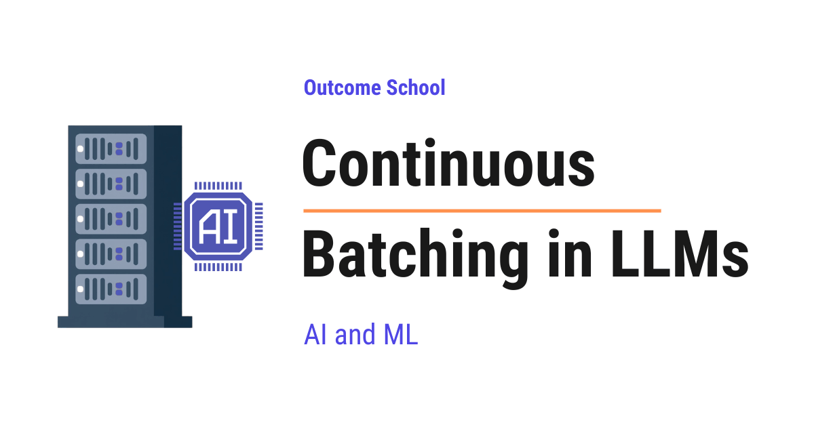

# What is Continuous Batching in LLMs and How Does It Work?

> Archived from <https://outcomeschool.com/blog/continuous-batching-in-llms> on 2026-11-25.

Continuous Batching is a technique where an LLM server does not wait for the whole batch to finish. The moment any request finishes, it immediately puts a new waiting request in its place, so that the GPU is always busy.

In this blog, we will learn about Continuous Batching, a technique that lets LLM servers handle many more users at the same time by keeping the GPU busy at every single step of generation.

We will cover the following:
<ul><li>The Big Picture</li><li>Quick Recap: How an LLM Generates Tokens</li><li>Why Batching Matters for LLMs</li><li>The Old Way: Static Batching</li><li>The Problem with Static Batching</li><li>What is Continuous Batching?</li><li>The Ride-Share Analogy</li><li>How Continuous Batching Works Step by Step</li><li>A Numeric Example</li><li>Real Numbers and Speedup</li><li>Benefits of Continuous Batching</li><li>A Few Important Notes</li><li>Quick Summary</li></ul>
I am <strong>Amit Shekhar</strong>, Founder @ <a target="_blank" rel="noopener noreferrer" href="https://outcomeschool.com">Outcome School</a>, I have taught and mentored many developers, and their efforts landed them high-paying tech jobs, helped many tech companies in solving their unique problems, and created many open-source libraries being used by top companies. I am passionate about sharing knowledge through open-source, blogs, and videos.

I teach <a target="_blank" rel="noopener noreferrer" href="https://outcomeschool.com/program/ai-and-machine-learning">AI and Machine Learning</a> at Outcome School.

Let&#x27;s get started.
<h2 id="the-big-picture">The Big Picture</h2>
Before we go into the details, let&#x27;s understand the big picture.

When many users send requests to an LLM at the same time, the server has to process all of them. The server runs on a <a target="_blank" rel="noopener noreferrer" href="how-does-a-gpu-work-for-deep-learning.md">GPU</a>, which is very good at doing many small jobs in parallel. To use the GPU well, the server groups requests together into a <strong>batch</strong> and processes them at the same time.

The old way of batching, called <strong>Static Batching</strong>, makes the GPU wait. The new way, called <strong>Continuous Batching</strong>, keeps the GPU busy at every step.

In simple words:

<strong>Continuous Batching = Adding new requests to the batch the moment any old request finishes, instead of waiting for the whole batch to finish.</strong>

This single idea makes LLM servers serve many more users with the same hardware.
<h2 id="quick-recap-how-an-llm-generates-tokens">Quick Recap: How an LLM Generates Tokens</h2>
To understand Continuous Batching, we must first understand how an LLM generates a response.

A token is a small piece of text. It can be a word, part of a word, or a single character.

An LLM generates text <strong>one token at a time</strong>. To generate the next token, it looks at all the tokens so far and predicts the most likely next one. Then it adds that token to the text and predicts the next one. This continues until the model decides to stop.

Inference has <a target="_blank" rel="noopener noreferrer" href="prefill-vs-decode-llm-inference-optimization.md">two phases</a>:
<ul><li><strong>Prefill phase:</strong> The model reads the entire prompt at once and processes all the input tokens together in a single forward pass. During this pass, it computes the Key and Value for every prompt token and stores them in the <a target="_blank" rel="noopener noreferrer" href="kv-cache-in-llms.md">KV Cache</a>. At the end of prefill, the model produces the first output token. This happens once per request, at the start.</li><li><strong>Decode phase:</strong> The model generates one token at a time. Each new token is one step. A response of 200 tokens means 200 decode steps.</li></ul>
The key point for us is this: generating a response is not one big task. It is hundreds of small steps, one token per step.

Because the response is produced one token per step, the server can send each token to the user the moment it is ready, instead of waiting for the whole reply. We have a blog on <a target="_blank" rel="noopener noreferrer" href="how-does-token-streaming-work.md">how Token Streaming works</a> that explains how this works.

To make decoding fast, the server stores something called the <strong><a target="_blank" rel="noopener noreferrer" href="kv-cache-in-llms.md">KV Cache</a></strong> for each request. The KV Cache holds the Keys and Values of all the tokens seen so far, so the model does not have to recompute them at every step. Each request in the batch has its own KV Cache. If we want to go deeper, we can read our detailed blog on <a target="_blank" rel="noopener noreferrer" href="kv-cache-in-llms.md">KV Cache</a>.

To learn LLM Internals, KV Cache, and Tokenization in depth, check out our <a target="_blank" rel="noopener noreferrer" href="https://outcomeschool.com/program/ai-and-machine-learning">AI and Machine Learning Program</a> at Outcome School.
<h2 id="why-batching-matters-for-llms">Why Batching Matters for LLMs</h2>
LLMs run on GPUs. A GPU is very good at doing the same kind of work on many pieces of data at the same time. If we give the GPU only one request to process, most of its power sits idle.

To keep the GPU busy, the server processes many requests together. This group is called a <strong>batch</strong>.

Let&#x27;s say 8 users send requests at the same time. Instead of running them one by one, the server runs all 8 together as a batch. The GPU does the work for all 8 in roughly the same time as it would take for just 1.

This is why batching matters: it lets a single GPU serve many users at the same time, without making each user wait much longer than if they were the only one.

But there is a catch. How do we form the batch? When do we start it? When do we end it? This is where Static Batching and Continuous Batching differ.
<h2 id="the-old-way-static-batching">The Old Way: Static Batching</h2>
In Static Batching, the server collects a fixed group of requests, runs them together, and waits for all of them to finish before starting a new batch.

Let&#x27;s see how it works:
<ul><li>The server collects, say, 4 requests into a batch.</li><li>It runs the prefill phase for all 4 requests together.</li><li>Then it runs the decode phase. Each decode step produces one new token for each of the 4 requests.</li><li>It keeps decoding until <strong>every</strong> request in the batch is done.</li><li>Only after all 4 requests are done does the server start a new batch.</li></ul>
This is simple and easy to build. But it has a serious problem.
<h2 id="the-problem-with-static-batching">The Problem with Static Batching</h2>
The problem is that different requests finish at very different times.

One user may ask &quot;What is 2 + 2?&quot; and the response is just a few tokens. Another user may ask &quot;Write a detailed essay on climate change.&quot; and the response is 1,000 tokens.

If both are in the same batch, the short request finishes after 5 decode steps. But the batch keeps running for hundreds of steps because the long request is still going.

What happens to the slot that the short request was using? <strong>It just sits there empty.</strong> The GPU still does the work for that empty slot, but the work produces nothing useful. It is wasted.

Do you see the problem?

For most of the batch&#x27;s life, only a few of the slots are doing useful work. The rest are empty, waiting for the slowest request to finish. The GPU is busy, but most of its work is wasted.

And new users who arrive in the middle have to wait for the entire current batch to finish before they can even start.

So, here comes Continuous Batching to the rescue.
<h2 id="what-is-continuous-batching">What is Continuous Batching?</h2>
<strong>Continuous Batching</strong> is a way of running batches where the server does not wait for the whole batch to finish. The moment any request in the batch finishes, the server immediately replaces it with a new request that is waiting in the queue.

The batch is never idle. Every slot is always doing useful work for some request.

Instead of thinking of a batch as &quot;a group of requests that start and end together&quot;, we think of it as &quot;a group of slots that always have someone in them.&quot;

The key idea is simple:

<strong>Static Batching works at the request level. Continuous Batching works at the token level.</strong>

In Static Batching, the unit of work is &quot;a full request&quot;. The batch starts when all requests start, and ends when all requests end.

In Continuous Batching, the unit of work is &quot;one decode step for whoever is in the batch right now&quot;. After every single decode step, the server checks: has anyone finished? If yes, swap them out. Has any new request arrived? If yes, slot them in.
<h2 id="the-ride-share-analogy">The Ride-Share Analogy</h2>
Let&#x27;s understand this with a real-world analogy.

Imagine a shared cab that has 4 seats. The cab drives along a long route and drops off passengers one by one as they reach their stops.

<strong>Static Batching is like this:</strong> 4 passengers get in at the start. The cab waits at every stop until all 4 passengers have reached their destinations. Even if one passenger reaches their stop in 5 minutes, their seat stays empty for the rest of the trip. New passengers waiting on the road cannot get in until the whole trip is over and the cab returns to pick up the next group of 4.

<strong>Continuous Batching is like this:</strong> 4 passengers get in at the start. As soon as any passenger reaches their stop and gets out, a new passenger waiting on the road immediately takes that empty seat. The cab always has 4 passengers in it. No seat is ever empty for long.

Which cab serves more passengers in a day? Clearly the second one. The seat is the expensive resource, and we keep every seat full at all times.

The seat is the GPU slot. The passenger is the request. The time a passenger spends in the cab is the number of tokens that request generates. Continuous Batching keeps every GPU slot full at every step.

<strong>Planning your move into AI?</strong>

No matter which tech domain you work in today, with your effort, you can transition to these roles:
<ul><li>AI Engineer</li><li>Forward Deployed Engineer</li><li>AI Agent Engineer</li><li>Harness Engineer</li><li>Voice AI Engineer</li><li>AI Architect</li><li>LLM Engineer</li><li>LLM Inference Engineer</li><li>Gen AI Engineer</li><li>MLOps Engineer</li><li>ML Engineer</li><li>Deep Learning Engineer</li></ul>
Our <a target="_blank" rel="noopener noreferrer" href="https://outcomeschool.com/program/ai-and-machine-learning">AI and Machine Learning Program</a> at Outcome School takes you there.
<h2 id="how-continuous-batching-works-step-by-step">How Continuous Batching Works Step by Step</h2>
Let&#x27;s walk through how a server with Continuous Batching handles requests.

<strong>Step 1:</strong> The server has a fixed number of slots in the batch. Let&#x27;s say 4 slots.

<strong>Step 2:</strong> Requests arrive in a queue. As long as there is a free slot in the batch, the server takes the next request from the queue and puts it in that slot. The server runs the prefill phase for the new request to prepare its state.

<strong>Step 3:</strong> The server runs one decode step for all requests currently in the batch. Each request gets one new token.

<strong>Step 4:</strong> After the decode step, the server checks each request. A request is finished when the model produces a <a target="_blank" rel="noopener noreferrer" href="stop-tokens-in-llms.md">stop token</a> or hits the maximum length. If a request is finished, the server removes it from the slot and sends the result back to the user.

<strong>Step 5:</strong> The server looks at the queue. If there is a waiting request, it goes into the now-empty slot. The server runs prefill for it.

<strong>Step 6:</strong> The server runs the next decode step. Repeat from Step 4.

The whole flow looks like this:

<pre><code class="code-highlight">                +-----------+
                |   Queue   |  &lt;- new requests arrive here
                +-----------+
                      |
                      | pull when a slot is free
                      v
        +-------------------------------+
        |   Batch (4 slots)             |
        |   [Slot 1] [Slot 2]           |
        |   [Slot 3] [Slot 4]           |
        +-------------------------------+
                      |
                      v
        +-------------------------------+
        |   Decode step                 |
        |   (one new token per slot)    |
        +-------------------------------+
                      |
                      v
        +-------------------------------+
        |   Check each slot:            |
        |   - finished? remove and send |
        |   - free?     pull from queue |
        +-------------------------------+
                      |
                      +---&gt; loop back to Decode step
</code></pre>

This loop keeps running. Every single decode step, the server checks for finishes and new arrivals. The batch is always full. The GPU is always doing useful work.

<strong>A quick note for you</strong>

No matter which tech domain you work in, get familiar with these topics:
<ul><li>LLM</li><li>RAG</li><li>MCP</li><li>Agent</li><li>Fine-tuning</li><li>Quantization</li></ul>
We put it all together in one video:

<a target="_blank" rel="noopener noreferrer" href="https://www.youtube.com/watch?v=lnfWvX66FUk">AI Engineering Explained: LLM, RAG, MCP, Agent, Fine-Tuning, and Quantization</a>

No need to stop reading - bookmark it and watch later when you get time. Future you will thank you.

Now, let&#x27;s get back to the topic.
<h2 id="a-numeric-example">A Numeric Example</h2>
Let&#x27;s put this into perspective with real numbers.

Suppose the server has 4 slots. Four requests arrive:
<ul><li>Request A: needs 100 decode steps</li><li>Request B: needs 20 decode steps</li><li>Request C: needs 50 decode steps</li><li>Request D: needs 200 decode steps</li></ul>
A new request E arrives just after the batch starts. E needs 30 decode steps.

<strong>With Static Batching:</strong>

The batch starts with A, B, C, D. E waits in the queue. Here is how the slots look at each step (<code>[.]</code> means an empty slot doing wasted work):

<pre><code class="code-highlight">            Slot 1   Slot 2   Slot 3   Slot 4    Queue
Step   0:    [A]      [B]      [C]      [D]      [E]
Step  20:    [A]      [.]      [C]      [D]      [E]    &lt;- B done, slot sits empty
Step  50:    [A]      [.]      [.]      [D]      [E]    &lt;- C done, two slots empty
Step 100:    [.]      [.]      [.]      [D]      [E]    &lt;- A done, three slots wasted
Step 200:    [.]      [.]      [.]      [.]      [E]    &lt;- D done, batch ends
</code></pre>

From step 20 onwards, the GPU is mostly doing wasted work on empty slots. E has been waiting in the queue this whole time. Only after step 200 does E finally get a slot to start.

<strong>With Continuous Batching:</strong>

The batch starts with A, B, C, D. E waits in the queue.

<pre><code class="code-highlight">            Slot 1   Slot 2   Slot 3   Slot 4    Queue
Step   0:    [A]      [B]      [C]      [D]      [E]
Step  20:    [A]      [E]      [C]      [D]      [ ]    &lt;- B done, E slots in immediately
Step  50:    [A]      [.]      [.]      [D]      [ ]    &lt;- E and C both finish
Step 100:    [.]      [.]      [.]      [D]      [ ]    &lt;- A done
Step 200:    [.]      [.]      [.]      [.]      [ ]    &lt;- D done
</code></pre>

E finishes at step 50 instead of waiting until step 200 to even start. Slots only sit empty here because the queue ran out of requests. In a real server with steady traffic, every slot stays full at every step, and the GPU keeps doing useful work.
<h2 id="real-numbers-and-speedup">Real Numbers and Speedup</h2>
Let&#x27;s put this into perspective with real numbers so we can clearly see how much we save.

Suppose:
<ul><li>Each decode step takes 50 ms on the GPU</li><li>The batch size is 4 slots</li><li>We use the same 5 requests from the example above (A=100, B=20, C=50, D=200, E=30 tokens)</li></ul>
<strong>Without Continuous Batching (Static):</strong>

<pre><code class="code-highlight">Round 1: A, B, C, D in batch. Batch runs until all done = 200 steps.
Time: 200 x 50 ms = 10,000 ms = 10.0 s

Round 2: E (alone in next batch). Runs 30 steps.
Time: 30 x 50 ms = 1,500 ms = 1.5 s

Total time to finish all 5 requests: 11.5 s
Total tokens generated: 100 + 20 + 50 + 200 + 30 = 400 tokens
</code></pre>

<strong>With Continuous Batching:</strong>

<pre><code class="code-highlight">All 5 requests finish in one continuous run.
E slots in at step 20 and finishes at step 50.
D, the longest, finishes at step 200.

Total time to finish all 5 requests: 200 x 50 ms = 10,000 ms = 10.0 s
Total tokens generated: 400 tokens
</code></pre>

Now let&#x27;s compare what the user actually feels - the response time per request.

<pre><code class="code-highlight">                  Static Batching   Continuous Batching
Request A (100):       5.0 s              5.0 s
Request B  (20):       1.0 s              1.0 s
Request C  (50):       2.5 s              2.5 s
Request D (200):      10.0 s             10.0 s
Request E  (30):      11.5 s              2.5 s     &lt;- 4.6x faster
Average:               6.0 s              4.2 s
</code></pre>

User E waited 10 seconds for the previous batch to finish before E even started. With Continuous Batching, E slots in immediately and finishes 4.6 times faster.

<strong>Now, let&#x27;s see the impact on a realistic workload.</strong>

Suppose 100 requests arrive at the server:
<ul><li>50 short requests (20 tokens each)</li><li>50 long requests (200 tokens each)</li><li>Total tokens to generate: 50 x 20 + 50 x 200 = 11,000 tokens</li></ul>
The key metric here is <strong>throughput</strong> - the number of tokens the server produces per second. Higher throughput means more users served on the same hardware. The math works out as below:

<pre><code class="code-highlight">Without Continuous Batching:
  Each batch of 4 has on average 2 short + 2 long requests.
  The batch runs until the longest finishes = 200 steps.
  Number of batches: 100 / 4 = 25 batches
  Time per batch: 200 x 50 ms = 10 s
  Total time: 25 x 10 = 250 s
  Throughput: 11,000 tokens / 250 s = 44 tokens/sec

With Continuous Batching:
  Slots stay full because the queue keeps feeding new requests.
  Each step produces 1 token per slot = 4 tokens per step.
  Steps needed: 11,000 / 4 = 2,750 steps
  Total time: 2,750 x 50 ms = 137,500 ms = 137.5 s
  Throughput: 11,000 tokens / 137.5 s = 80 tokens/sec

Speedup: 80 / 44 = 1.8x
Time saved: 250 - 137.5 = 112.5 s (45% less time for the same work)
</code></pre>

Here is the same comparison shown on a timeline as below:

<pre><code class="code-highlight">Time (seconds):  0     50    100   150   200   250

Without:         |==========================================|  250 s
                 (25 batches of 4, each running 200 steps)

With:            |=======================|                     137.5 s
                 (continuous, 4 slots always full)

                                         &lt;--- 112.5 s saved ---&gt;
</code></pre>

The server finishes the same work in 137.5 seconds instead of 250 seconds. Same hardware, almost twice the work done. That is the beauty of Continuous Batching.

In practice, the speedup ranges from <strong>2x to 4x</strong> for most real workloads. The exact number depends on:
<ul><li>How much the request lengths vary (more variance = bigger win)</li><li>How steady the incoming traffic is (steady traffic = bigger win)</li><li>The model and the hardware</li></ul>
Published benchmarks from systems like <code>vLLM</code> show that Continuous Batching combined with Paged Attention can deliver more than 20 times higher throughput than naive serving, and 2 to 4 times higher than static batching on the same GPU.

If we want to go deep into vLLM, Paged Attention, and Continuous Batching end to end, we have a complete program on this - check out our <a target="_blank" rel="noopener noreferrer" href="https://outcomeschool.com/program/ai-and-machine-learning">AI and Machine Learning Program</a> at Outcome School.
<h2 id="benefits-of-continuous-batching">Benefits of Continuous Batching</h2>
Continuous Batching gives us three big benefits:
<ul><li>
<strong>Higher throughput:</strong> Throughput is the number of tokens the server produces per second. Because the GPU is always doing useful work, it produces more tokens per second. In real systems, throughput often goes up by several times compared to Static Batching.
</li><li>
<strong>Lower waiting time:</strong> New requests do not have to wait for the whole batch to finish. They slot in as soon as any seat opens up. This makes the user feel that the server is fast.
</li><li>
<strong>Better hardware usage:</strong> The GPU is the most expensive part of an LLM server. Continuous Batching keeps it busy with useful work, so we get more value out of the same GPU.
</li></ul>
This is why almost all modern LLM serving systems, like <a target="_blank" rel="noopener noreferrer" href="how-does-vllm-work.md"><code>vLLM</code></a>, <a target="_blank" rel="noopener noreferrer" href="how-does-sglang-work.md"><code>SGLang</code></a>, <a target="_blank" rel="noopener noreferrer" href="how-does-tensorrt-llm-work.md"><code>TensorRT-LLM</code></a>, and others, use Continuous Batching.
<h2 id="a-few-important-notes">A Few Important Notes</h2><ul><li>
Continuous Batching works very well with <a target="_blank" rel="noopener noreferrer" href="paged-attention-in-llms.md">Paged Attention</a>. Paged Attention solves the memory waste problem of KV Cache, and Continuous Batching solves the compute waste problem of static batches. Together, they are the reason a single GPU can serve many users at once. We have a detailed blog on <a target="_blank" rel="noopener noreferrer" href="how-does-vllm-work.md">how vLLM works</a> that explains how a serving system puts both of these together.
</li><li>
Continuous Batching does not change the model itself. It does not change how attention works, how tokens are generated, or what the model outputs. It only changes how the server schedules requests on the GPU. The output for each user is the same as if their request was run alone.
</li><li>
The batch size is not unlimited. The GPU has limited memory, and each request in the batch uses memory for its KV Cache. The server picks a batch size that fits in memory. If the batch is full, new requests wait in the queue until a slot opens. Shrinking each request&#x27;s cache with <a target="_blank" rel="noopener noreferrer" href="kv-cache-compression.md">KV Cache Compression</a> is one way to fit more requests into the same memory.
</li><li>
In Continuous Batching, a new request&#x27;s prefill runs on the same GPU as the decode steps of everyone else. When a very long prompt arrives, its prefill can pause the decode of all the other users for a moment. At a very large scale, <a target="_blank" rel="noopener noreferrer" href="prefill-decode-disaggregation.md">Prefill-Decode Disaggregation</a> removes this by running prefill and decode on separate GPUs.
</li><li>
The numbers in our examples use a few simplifications for clarity. When a new request joins a continuous batch, there is a small prefill cost we treated as zero, and the static-batch mix we used (2 short + 2 long) is an average that real batches will vary around. The qualitative pattern - that Continuous Batching wins by several times when request lengths vary - holds across all real workloads.
</li></ul>
<strong>Stay updated:</strong> Subscribe to our <a target="_blank" rel="noopener noreferrer" href="https://outcomeschool.substack.com/subscribe">newsletter</a> to get our latest AI and Machine Learning blogs straight to your inbox.
<h2 id="quick-summary">Quick Summary</h2>
Let&#x27;s recap what we have learned:
<ul><li><strong>LLMs generate one token at a time.</strong> A response is hundreds of small decode steps, not one big task.</li><li><strong>Batching matters</strong> because GPUs are best at doing the same work on many pieces of data at the same time.</li><li><strong>Static Batching</strong> runs a fixed group of requests together and waits for the slowest one to finish. Slots that finish early sit empty and waste GPU work.</li><li><strong>Continuous Batching</strong> swaps in a new request the moment any old request finishes. The batch is always full.</li><li><strong>Ride-share analogy:</strong> Static Batching is a cab that waits till all passengers reach their stops. Continuous Batching is a cab that picks up a new passenger the moment a seat opens.</li><li><strong>Token-level scheduling:</strong> Continuous Batching works at the token level, not the request level. Every decode step, the server checks for finishes and arrivals.</li><li><strong>Benefits:</strong> higher throughput, lower waiting time, and better GPU usage.</li><li><strong>Pairs well with <a target="_blank" rel="noopener noreferrer" href="paged-attention-in-llms.md">Paged Attention</a>:</strong> Together they solve both the memory waste and compute waste problems of LLM serving.</li></ul>
This is how Continuous Batching keeps the GPU busy and lets a single server handle many more users at the same time.
<h2 id="frequently-asked-questions">Frequently Asked Questions</h2><h3 id="does-continuous-batching-change-the-output-of-the-model">Does Continuous Batching change the output of the model?</h3>
No. Continuous Batching does not change the model, how attention works, or how tokens are generated. It only changes how the server schedules requests on the GPU. The output for each user is the same as if their request was run alone.
<h3 id="how-much-faster-is-continuous-batching-than-static-batching">How much faster is Continuous Batching than Static Batching?</h3>
In practice, the speedup ranges from 2x to 4x for most real workloads. The exact number depends on how much the request lengths vary, how steady the incoming traffic is, and the model and hardware. More variance in request lengths and steadier traffic give a bigger win.
<h3 id="what-is-the-difference-between-continuous-batching-and-paged-attention">What is the difference between Continuous Batching and Paged Attention?</h3>
Paged Attention solves the memory waste problem of the KV Cache. Continuous Batching solves the compute waste problem of static batches. They work very well together, and together they are the reason a single GPU can serve many users at once.
<h3 id="can-we-keep-adding-requests-to-a-continuous-batch-without-limit">Can we keep adding requests to a continuous batch without limit?</h3>
No. The GPU has limited memory, and each request in the batch uses memory for its KV Cache. The server picks a batch size that fits in memory, and new requests wait in the queue until a slot opens. KV Cache Compression is one way to fit more requests into the same memory.
<h3 id="can-one-long-prompt-slow-down-other-users-in-continuous-batching">Can one long prompt slow down other users in Continuous Batching?</h3>
Yes. A new request&#x27;s prefill runs on the same GPU as the decode steps of everyone else. When a very long prompt arrives, its prefill can pause the decode of all the other users for a moment. At a very large scale, Prefill-Decode Disaggregation removes this by running prefill and decode on separate GPUs.

That&#x27;s it for now.

Thanks

<strong>Amit Shekhar</strong> Founder @ <a target="_blank" rel="noopener noreferrer" href="https://outcomeschool.com">Outcome School</a>

You can connect with me on:
<ul><li><a target="_blank" rel="noopener noreferrer" href="https://x.com/amitiitbhu">X</a></li><li><a target="_blank" rel="noopener noreferrer" href="https://www.linkedin.com/in/amit-shekhar-iitbhu">LinkedIn</a></li><li><a target="_blank" rel="noopener noreferrer" href="https://github.com/amitshekhariitbhu">GitHub</a></li></ul>
Follow Outcome School on:
<ul><li><a target="_blank" rel="noopener noreferrer" href="https://x.com/outcome_school">X</a></li><li><a target="_blank" rel="noopener noreferrer" href="https://youtube.com/@OutcomeSchool">YouTube</a></li><li><a target="_blank" rel="noopener noreferrer" href="https://www.linkedin.com/company/outcomeschool">LinkedIn</a></li><li><a target="_blank" rel="noopener noreferrer" href="https://github.com/OutcomeSchool">GitHub</a></li></ul>
<a target="_blank" rel="noopener noreferrer" href="https://outcomeschool.com/blog"><strong>Read all of our high-quality blogs here.</strong></a>

