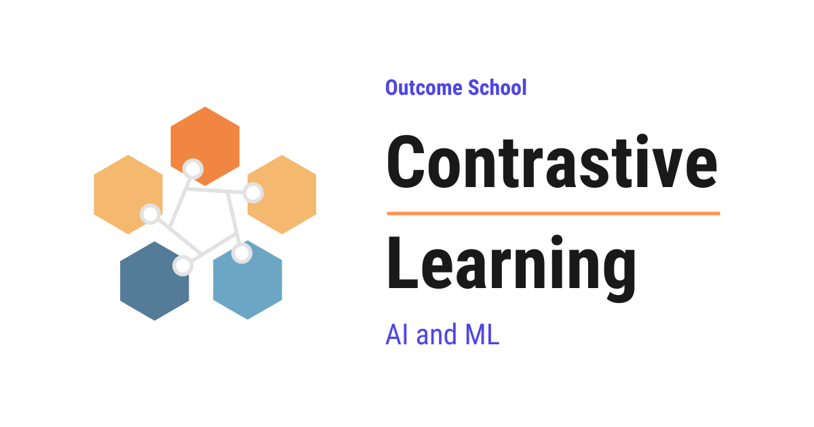

# What is Contrastive Learning? How It Works Step by Step

> Archived from <https://outcomeschool.com/blog/contrastive-learning> on 2026-11-25.

Contrastive Learning is a way of teaching a model by comparing things. The model learns to pull similar things close to each other and push different things far apart.

In this blog, we will learn about Contrastive Learning. We will also see how it works step-by-step and where it is used in the real world.

We will cover the following:
<ul><li>What is Contrastive Learning?</li><li>Why do we need Contrastive Learning?</li><li>The key idea behind Contrastive Learning.</li><li>Positive pairs and Negative pairs.</li><li>How does Contrastive Learning work step-by-step?</li><li>Loss functions used in Contrastive Learning.</li><li>Popular Contrastive Learning methods.</li><li>Real-world use cases of Contrastive Learning.</li></ul>
I am <strong>Amit Shekhar</strong>, Founder @ <a target="_blank" rel="noopener noreferrer" href="https://outcomeschool.com">Outcome School</a>, I have taught and mentored many developers, and their efforts landed them high-paying tech jobs, helped many tech companies in solving their unique problems, and created many open-source libraries being used by top companies. I am passionate about sharing knowledge through open-source, blogs, and videos.

I teach <a target="_blank" rel="noopener noreferrer" href="https://outcomeschool.com/program/ai-and-machine-learning">AI and Machine Learning</a> at Outcome School.

Let&#x27;s get started.
<h3 id="what-is-contrastive-learning">What is Contrastive Learning?</h3>
<strong>Contrastive Learning</strong> is a way of teaching a model to learn good representations of data by comparing things. The model learns to pull similar things close to each other and push dissimilar things far apart in a representation space.

In simple words, <strong>Contrastive Learning = Contrast + Learning</strong>. We learn by contrasting one thing with another.

Let&#x27;s say we have two photos of the same cat, taken from different angles. These two photos are similar. They should be close to each other in the representation space. Now, consider a photo of a car. This is very different from the cat photos. It should be far away from them.

This is the core idea of Contrastive Learning.

Similar things attract each other and stick together. Dissimilar things repel each other and move apart. Contrastive Learning teaches the model to behave like these magnets.
<h3 id="why-do-we-need-contrastive-learning">Why do we need Contrastive Learning?</h3>
Before jumping into how it works, we must understand the problem it solves.

In traditional <a target="_blank" rel="noopener noreferrer" href="supervised-vs-unsupervised-learning.md">supervised learning</a>, we need labeled data. For every image, we need a human to tell us &quot;this is a cat&quot;, &quot;this is a dog&quot;, and so on. Labeling data is expensive. It is slow. It needs a lot of human effort.

But, here is the catch. The internet has billions of images, videos, and pieces of text. Only a very small fraction of this data is labeled. We have huge amounts of unlabeled data available, but we cannot use it directly with supervised learning.

So, here comes Contrastive Learning to the rescue.

Contrastive Learning does not need any labels from humans. It is a <a target="_blank" rel="noopener noreferrer" href="self-supervised-learning.md">self-supervised learning</a> technique. The model creates its own labels from the data itself. This way, we can train the model on massive amounts of unlabeled data and still learn very useful representations.

Once these representations are learned, we can reuse them for many downstream tasks like classification, search, clustering, and etc., with very little labeled data.

This is the beauty of Contrastive Learning.
<h3 id="the-key-idea-behind-contrastive-learning">The key idea behind Contrastive Learning</h3>
We want the model to learn a function that maps each input (an image, a sentence, a video, and etc.) to a vector. This vector is called the <strong><a target="_blank" rel="noopener noreferrer" href="what-are-embeddings.md">embedding</a></strong> or the <strong>representation</strong>. The space where all these vectors live is called the <strong>embedding space</strong>.

In this embedding space:
<ul><li>Similar inputs should have embeddings that are close to each other.</li><li>Dissimilar inputs should have embeddings that are far apart from each other.</li></ul>
If the model can do this well, then the embeddings become very useful. We can use them for many tasks like search, classification, recommendation, and etc.

This is the goal of Contrastive Learning.
<h3 id="positive-pairs-and-negative-pairs">Positive pairs and Negative pairs</h3>
Now, the question is: how does the model know which things are similar and which things are different, without any labels?

The answer is: we create pairs from the data itself.

<strong>Positive pair:</strong> Two samples that are similar and should be close in the embedding space.

<strong>Negative pair:</strong> Two samples that are different and should be far apart in the embedding space.

Let&#x27;s see how we create these pairs for images.

We take an image. We apply some changes to it, such as cropping, rotating, flipping, or changing the colors. These changes are called <strong><a target="_blank" rel="noopener noreferrer" href="data-augmentation.md">data augmentation</a></strong>. The two augmented versions of the same image form a positive pair, because they come from the same original image.

Now, we take any other image from the dataset. This image and the first image form a negative pair, because they are different images.

This way, we get positive pairs and negative pairs without any human labels.

The choice of augmentation is very important. The augmentations should change the look of the image but not its meaning. For example, a cropped cat is still a cat. A rotated cat is still a cat. So, the model learns that these surface-level changes do not matter, and it focuses on the actual content of the image.

For text, a positive pair can be two sentences that mean the same thing. For an image-text model, a positive pair can be an image and its caption.

Search models are trained on the same shape of data, where the query is paired with a passage that answers it as the positive and one that does not as the negative. We have a detailed blog on <a target="_blank" rel="noopener noreferrer" href="decoding-colbert.md">Decoding ColBERT</a> that walks through this training setup with real numbers.

<strong>Planning your move into AI?</strong>

No matter which tech domain you work in today, with your effort, you can transition to these roles:
<ul><li>AI Engineer</li><li>Forward Deployed Engineer</li><li>AI Agent Engineer</li><li>Harness Engineer</li><li>Voice AI Engineer</li><li>AI Architect</li><li>LLM Engineer</li><li>LLM Inference Engineer</li><li>Gen AI Engineer</li><li>MLOps Engineer</li><li>ML Engineer</li><li>Deep Learning Engineer</li></ul>
Our <a target="_blank" rel="noopener noreferrer" href="https://outcomeschool.com/program/ai-and-machine-learning">AI and Machine Learning Program</a> at Outcome School takes you there.
<h3 id="how-does-contrastive-learning-work-step-by-step">How does Contrastive Learning work step-by-step?</h3>
The best way to learn this is by taking an example.

Let&#x27;s say we have an image of a cat. We will follow these steps:

<strong>Step 1:</strong> We take the cat image and create two different augmented versions of it. Let&#x27;s call them View 1 and View 2. View 1 and View 2 form a positive pair.

<strong>Step 2:</strong> We take another image from the dataset, let&#x27;s say an image of a car. This image is a negative sample.

<strong>Step 3:</strong> We pass View 1, View 2, and the car image through a neural network. The neural network gives us three embedding vectors.

<strong>Step 4:</strong> We compute the similarity between every pair of embeddings. A common way to measure similarity is the <strong><a target="_blank" rel="noopener noreferrer" href="cosine-similarity.md">cosine similarity</a></strong>, which tells us how close two vectors are in direction. The cosine similarity gives a value between -1 and 1. A value close to 1 means the two vectors are very similar. A value close to -1 means they are very different.

For the sake of understanding, let&#x27;s assume after a fresh start, the model gives these similarity scores:
<ul><li>Similarity(View 1, View 2) = 0.3</li><li>Similarity(View 1, Car) = 0.6</li><li>Similarity(View 2, Car) = 0.5</li></ul>
Here, we can see that the model is confused. It thinks the two cat views are less similar to each other than they are to the car. This is wrong. So, the loss will be high, and the model will update its weights.

<strong>Step 5:</strong> We train the model to make the similarity between View 1 and View 2 high, and the similarity between View 1 and the car image low, and the similarity between View 2 and the car image low.

After training for many rounds, we want the scores to look more like this:
<ul><li>Similarity(View 1, View 2) = 0.9</li><li>Similarity(View 1, Car) = 0.1</li><li>Similarity(View 2, Car) = 0.1</li></ul>
<strong>Step 6:</strong> We repeat this process for many images, many times, until the model learns good embeddings.

This is how the model learns without any labels.

<strong>A quick note for you</strong>

No matter which tech domain you work in, get familiar with these topics:
<ul><li>LLM</li><li>RAG</li><li>MCP</li><li>Agent</li><li>Fine-tuning</li><li>Quantization</li></ul>
We put it all together in one video:

<a target="_blank" rel="noopener noreferrer" href="https://www.youtube.com/watch?v=lnfWvX66FUk">AI Engineering Explained: LLM, RAG, MCP, Agent, Fine-Tuning, and Quantization</a>

No need to stop reading - bookmark it and watch later when you get time. Future you will thank you.

Now, let&#x27;s get back to the topic.

This was all about the high-level process. Now, the next big question is: how exactly do we tell the model that its current similarity scores are wrong, and by how much? This is where the loss function comes into the picture.
<h3 id="loss-functions-used-in-contrastive-learning">Loss functions used in Contrastive Learning</h3>
To train the model, we need a loss function. The loss function tells the model how well it is doing. The model updates its weights to reduce the loss.

There are a few popular loss functions used in Contrastive Learning. Let&#x27;s see each one.

<strong>Contrastive Loss</strong>

Contrastive Loss works on <strong>2 samples</strong> at a time (a pair).

This is the simplest one. We give the model a pair of samples and tell it whether they are similar or different.
<ul><li>If they are similar, the loss is small when their embeddings are close and large when their embeddings are far apart.</li><li>If they are different, the loss is small when their embeddings are far apart (beyond a fixed margin) and large when their embeddings are close.</li></ul>
For the sake of understanding, let&#x27;s say the margin is 1.0. If two different images have an embedding distance of 0.2, the loss will be high because they are too close. The model will push them apart. If their distance becomes 1.5, the loss for this pair becomes zero, because they are already far enough apart.

The model learns to pull similar pairs together and push dissimilar pairs apart by at least the margin.

<strong>Triplet Loss</strong>

Triplet Loss works on <strong>3 samples</strong> at a time (a triplet).

The three samples are:
<ul><li><strong>Anchor:</strong> the reference sample.</li><li><strong>Positive:</strong> a sample similar to the anchor.</li><li><strong>Negative:</strong> a sample different from the anchor.</li></ul>
The loss pushes the anchor closer to the positive than to the negative by at least a fixed margin. In simple words, the distance between the anchor and the positive must be smaller than the distance between the anchor and the negative, by some safety gap.

For the sake of understanding, let&#x27;s say the anchor is a photo of person A, the positive is another photo of the same person A, and the negative is a photo of person B. The triplet loss will pull the two photos of person A together and push the photo of person B away from them. This is exactly what we want in face recognition.

<strong>InfoNCE Loss</strong>

InfoNCE Loss works on <strong>1 anchor with 1 positive and many negative samples</strong> at a time.

This is the most popular one in modern Contrastive Learning. It is used in methods like SimCLR and CLIP.

The model has to pick the positive sample out of all the samples. It is like a classification problem where the correct answer is the positive sample, and all the others are wrong answers.

The model learns to give a high similarity score to the positive sample and low similarity scores to the negative samples.

<strong>Note:</strong> InfoNCE also uses a small number called the <strong><a target="_blank" rel="noopener noreferrer" href="how-does-temperature-control-llm-output.md">temperature</a></strong>, which controls how sharp the model&#x27;s decisions are. A small temperature makes the model very confident, while a large temperature makes it softer. The right temperature is important for good training.

To learn Loss Functions, Embeddings, and Cross-Entropy in depth, check out our <a target="_blank" rel="noopener noreferrer" href="https://outcomeschool.com/program/ai-and-machine-learning">AI and Machine Learning Program</a> at Outcome School.
<h3 id="popular-contrastive-learning-methods">Popular Contrastive Learning methods</h3>
Now that we have learned the basics, it&#x27;s time to learn about some popular Contrastive Learning methods.

<strong>SimCLR</strong>

<strong>SimCLR</strong> stands for <strong>Simple Framework for Contrastive Learning of Visual Representations</strong>. It was introduced by Google.

The idea is very simple:
<ul><li>Take an image, create two augmented versions of it. One version is treated as the <strong>anchor</strong>, and the other as the <strong>positive</strong>.</li><li>Pass both versions through the same neural network to get embeddings.</li><li>The <strong>negative samples</strong> are simply the augmented versions of the other images in the same batch.</li><li>Use the InfoNCE loss to bring the anchor and the positive close together, and push the anchor away from all the negatives.</li></ul>
SimCLR showed that simple data augmentation is enough to learn very powerful <a target="_blank" rel="noopener noreferrer" href="how-do-image-embeddings-work.md">image representations</a>, without any labels.

<strong>MoCo (Momentum Contrast)</strong>

SimCLR needs a large <a target="_blank" rel="noopener noreferrer" href="epoch-batch-and-iteration.md">batch size</a> to have enough negative samples. This is a problem because large batches need a lot of GPU memory.

So, here comes MoCo to the rescue.

<strong>MoCo</strong> maintains a dynamic dictionary of negative samples as a queue. Every new mini-batch is added to the queue, and the oldest mini-batch is removed. This way, we can have many negative samples without needing a very large batch size. MoCo also uses a slowly updated copy of the model, called the <strong>momentum encoder</strong>, to compute the embeddings for the queue. This keeps the embeddings in the queue fresh and makes the training stable.

<strong>CLIP (Contrastive Language-Image Pre-training)</strong>

<strong>CLIP</strong> is from OpenAI. It learns by matching images with their text captions.

Here, the positive pair is an image and its correct caption. The negative pairs are the image and the captions of other images in the same batch.

CLIP is trained on millions of image-text pairs from the internet. After training, CLIP can do amazing things. For example, we can give CLIP a new image of a puppy and a list of labels like &quot;a photo of a cat&quot;, &quot;a photo of a dog&quot;, &quot;a photo of a bird&quot;. CLIP will compute the similarity between the image and each label, and pick the one with the highest similarity, which will be &quot;a photo of a dog&quot;. CLIP can do this without being trained on that specific task. This is called <strong>zero-shot classification</strong>.

In 2023, Google introduced <strong>SigLIP</strong>, which replaces CLIP&#x27;s softmax loss with a simpler pairwise sigmoid loss. This makes training more memory-efficient and allows much larger batch sizes. SigLIP is now the vision encoder of choice in many modern <a target="_blank" rel="noopener noreferrer" href="vision-language-model-vlm.md">vision-language models</a>.

CLIP is now used as a building block in many famous models like <a target="_blank" rel="noopener noreferrer" href="diffusion-models.md">Stable Diffusion</a> and DALL-E.

<strong>Non-contrastive methods</strong>

More recent methods like <strong>BYOL</strong>, <strong>SimSiam</strong>, and <strong>DINO</strong> drop negative pairs entirely. They learn good representations using only positive pairs, with the help of architectural tricks (different methods use different combinations of stop-gradient, momentum encoders, predictor heads, and output centering) to avoid collapsing all inputs to the same embedding. These methods are sometimes called <strong>non-contrastive</strong> self-supervised learning. DINO and its successor DINOv2 from Meta are the current go-to choice for self-supervised visual representation learning. A closely related idea is the <a target="_blank" rel="noopener noreferrer" href="joint-embedding-predictive-architecture-jepa.md">Joint Embedding Predictive Architecture (JEPA)</a> from Yann LeCun&#x27;s team, which drops negative pairs by predicting the summary of a hidden part of the input from the visible part, instead of comparing pairs at all.

If we want to go deep into Contrastive Learning, Self-supervised Learning, and Multimodal AI, we have a complete program on this - check out our <a target="_blank" rel="noopener noreferrer" href="https://outcomeschool.com/program/ai-and-machine-learning">AI and Machine Learning Program</a> at Outcome School.
<h3 id="real-world-use-cases-of-contrastive-learning">Real-world use cases of Contrastive Learning</h3>
Now, let&#x27;s see where Contrastive Learning is used in the real world.
<ul><li><strong>Image search:</strong> Finding images that look similar to a given image.</li><li><strong>Face recognition:</strong> Bringing different photos of the same person close together and photos of different people far apart in the embedding space.</li><li><strong><a target="_blank" rel="noopener noreferrer" href="recommendation-system.md">Recommendation systems</a>:</strong> Products that users often buy together are pulled close, and unrelated products are pushed apart. This helps in recommending similar products.</li><li><strong><a target="_blank" rel="noopener noreferrer" href="embedding-model.md">Text similarity</a>:</strong> Finding sentences or documents with similar meaning, useful in search engines and chatbots.</li><li><strong><a target="_blank" rel="noopener noreferrer" href="multimodal-ai.md">Multimodal models</a>:</strong> CLIP-style models that connect images with text. These are used inside image generation models like Stable Diffusion and DALL-E.</li><li><strong>Medical imaging:</strong> Learning useful representations from large amounts of unlabeled medical images, where labeled data is very hard to get.</li><li><strong>Audio and speech:</strong> Learning representations of sounds and speech without labels.</li></ul>
In many of these use cases, once the embeddings are learned, the next step is to quickly find the most similar ones in a huge collection. We have a detailed blog on <a target="_blank" rel="noopener noreferrer" href="how-does-approximate-nearest-neighbor-ann-search-work.md">Approximate Nearest Neighbor (ANN) Search</a> that explains how that fast search works.

This is how Contrastive Learning helps in solving many real-world problems in a very simple way.

Now, we have understood Contrastive Learning.

<strong>Stay updated:</strong> Subscribe to our <a target="_blank" rel="noopener noreferrer" href="https://outcomeschool.substack.com/subscribe">newsletter</a> to get our latest AI and Machine Learning blogs straight to your inbox.
<h2 id="frequently-asked-questions">Frequently Asked Questions</h2><h3 id="is-contrastive-learning-supervised-or-unsupervised">Is Contrastive Learning supervised or unsupervised?</h3>
Contrastive Learning is a self-supervised learning technique. It does not need any labels from humans, because the model creates its own labels from the data itself. For example, two augmented versions of the same image form a positive pair, and any other image forms a negative pair.
<h3 id="do-all-self-supervised-methods-need-negative-pairs">Do all self-supervised methods need negative pairs?</h3>
No. Methods like BYOL, SimSiam, and DINO drop negative pairs entirely and learn using only positive pairs. They use architectural tricks such as stop-gradient, momentum encoders, predictor heads, and output centering to avoid collapsing all inputs to the same embedding. These are called non-contrastive methods.
<h3 id="what-is-the-difference-between-simclr-and-moco">What is the difference between SimCLR and MoCo?</h3>
SimCLR takes its negative samples from the other images in the same batch, so it needs a large batch size and a lot of GPU memory. MoCo keeps a queue of negative samples, adding each new mini-batch and removing the oldest one. It also uses a slowly updated momentum encoder to keep training stable.
<h3 id="what-is-the-difference-between-contrastive-loss-and-triplet-loss">What is the difference between Contrastive Loss and Triplet Loss?</h3>
Contrastive Loss works on 2 samples at a time and is told whether the pair is similar or different. Triplet Loss works on 3 samples, an anchor, a positive, and a negative. It pushes the anchor closer to the positive than to the negative by at least a fixed margin.
<h3 id="how-does-clip-classify-images-it-was-never-trained-on">How does CLIP classify images it was never trained on?</h3>
CLIP computes the similarity between the new image and each text label, like &quot;a photo of a cat&quot; or &quot;a photo of a dog&quot;. It then picks the label with the highest similarity. This is called zero-shot classification, because CLIP was not trained on that specific task.

That&#x27;s it for now.

Thanks

<strong>Amit Shekhar</strong> Founder @ <a target="_blank" rel="noopener noreferrer" href="https://outcomeschool.com">Outcome School</a>

You can connect with me on:
<ul><li><a target="_blank" rel="noopener noreferrer" href="https://x.com/amitiitbhu">X</a></li><li><a target="_blank" rel="noopener noreferrer" href="https://www.linkedin.com/in/amit-shekhar-iitbhu">LinkedIn</a></li><li><a target="_blank" rel="noopener noreferrer" href="https://github.com/amitshekhariitbhu">GitHub</a></li></ul>
Follow Outcome School on:
<ul><li><a target="_blank" rel="noopener noreferrer" href="https://x.com/outcome_school">X</a></li><li><a target="_blank" rel="noopener noreferrer" href="https://youtube.com/@OutcomeSchool">YouTube</a></li><li><a target="_blank" rel="noopener noreferrer" href="https://www.linkedin.com/company/outcomeschool">LinkedIn</a></li><li><a target="_blank" rel="noopener noreferrer" href="https://github.com/OutcomeSchool">GitHub</a></li></ul>
<a target="_blank" rel="noopener noreferrer" href="https://outcomeschool.com/blog"><strong>Read all of our high-quality blogs here.</strong></a>

