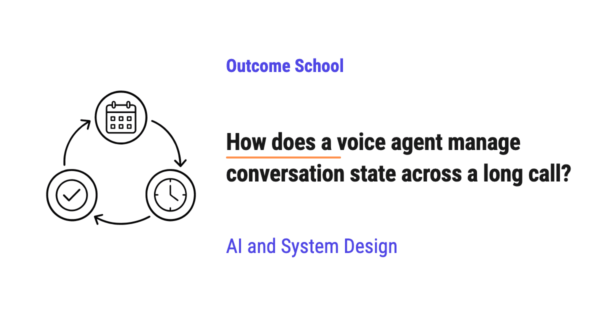

# How does a voice agent manage conversation state across a long call?

> Archived from <https://outcomeschool.com/blog/conversation-state-in-voice-agents> on 2026-11-25.

A voice agent manages conversation state across a long call by keeping a small set of important facts in a structured state, keeping only the recent turns word by word, and turning older turns into a short summary, so that the LLM always gets what it needs without the history growing forever.

In this blog, we will learn about how a voice agent manages conversation state across a long call. We will also see what conversation state is, why a long call breaks the simple approach, how the agent trims and summarizes old turns, how it keeps facts in a structured state, how it tracks the stage of the call, and how it keeps the state safe when the call drops.

We will cover the following:
<ul><li>What is conversation state?</li><li>How does the simple approach work?</li><li>Why does a long call break the simple approach?</li><li>Approach 1: Keep only the recent turns</li><li>Approach 2: Summarize the older turns</li><li>Approach 3: Keep the important facts in a structured state</li><li>Tracking the stage of the call</li><li>Keeping tool results small</li><li>Saving only what the user actually heard</li><li>Keeping the state safe when the call drops</li><li>Putting it all together</li></ul>
I am <strong>Amit Shekhar</strong>, Founder @ <a target="_blank" rel="noopener noreferrer" href="https://outcomeschool.com">Outcome School</a>, I have taught and mentored many developers, and their efforts landed them high-paying tech jobs, helped many tech companies in solving their unique problems, and created many open-source libraries being used by top companies. I am passionate about sharing knowledge through open-source, blogs, and videos.

I teach <a target="_blank" rel="noopener noreferrer" href="https://outcomeschool.com/program/ai-and-machine-learning">AI and Machine Learning</a> at Outcome School.

Let&#x27;s get started.
<h2 id="what-is-conversation-state">What is conversation state?</h2>
<strong>Conversation state is everything the voice agent must remember about the call so far, so that its next reply makes sense.</strong>

It includes:
<ul><li>What the user has said.</li><li>What the agent has said.</li><li>The facts collected so far, like the name, the patient ID, and the date of the appointment.</li><li>The results of any <a target="_blank" rel="noopener noreferrer" href="function-calling-in-voice-agents.md">tool calls</a>, like the free slots fetched from the clinic calendar.</li><li>The stage of the call, like &quot;verify&quot; (checking who the caller is) or &quot;booking&quot; (finding a new slot).</li></ul>
Let&#x27;s say we call a clinic and talk to a <a target="_blank" rel="noopener noreferrer" href="design-a-real-time-voice-ai-agent.md">voice agent</a>. In the first minute, we tell it our name. In the fifth minute, we ask to move our appointment. The agent must still know our name in the fifth minute. That memory is the conversation state.

Here, one thing we must understand is that the <a target="_blank" rel="noopener noreferrer" href="large-language-model-llm.md">LLM (Large Language Model)</a> inside the agent does not remember anything on its own between two requests. Every time the agent needs a reply, our code sends the LLM the full picture again. So, the conversation state lives in our code, not inside the LLM.
<h2 id="how-does-the-simple-approach-work">How does the simple approach work?</h2>
The simplest way is to keep a list of messages. Every time the user speaks, we add the user&#x27;s words to the list. Every time the agent replies, we add the reply to the list. Then, for every new reply, we send the whole list to the LLM.

The list looks like below:

<pre><code class="language-python code-highlight">messages = [
    { &quot;role&quot;: &quot;system&quot;, &quot;content&quot;: &quot;You are a helpful clinic assistant.&quot; },
    { &quot;role&quot;: &quot;user&quot;, &quot;content&quot;: &quot;Hi, my name is Riya Sharma.&quot; },
    { &quot;role&quot;: &quot;assistant&quot;, &quot;content&quot;: &quot;Hi Riya, how can I help you today?&quot; },
    { &quot;role&quot;: &quot;user&quot;, &quot;content&quot;: &quot;I want to move my appointment.&quot; },
]
</code></pre>

Here, we have:
<ul><li>A <code>system</code> message that tells the LLM how to behave.</li><li><code>user</code> messages that hold what the caller said, after the speech-to-text (STT) step turned the audio into text.</li><li><code>assistant</code> messages that hold what the agent said.</li></ul>
For a short call of two or three minutes, this works perfectly.
<h2 id="why-does-a-long-call-break-the-simple-approach">Why does a long call break the simple approach?</h2>
Now, let&#x27;s say the call goes on for 30 minutes. The list keeps growing with every turn.

But the following issues arise:
<ul><li><strong>The context window fills up.</strong> Every LLM can read only a limited number of tokens in one request. This limit is called the <strong><a target="_blank" rel="noopener noreferrer" href="context-window.md">context window</a></strong>. A very long call can come close to it, especially when tool results are large.</li><li><strong>Every reply gets slower.</strong> The LLM must read the whole list before it starts to answer. A longer list usually means more time before the first word comes out.</li><li><strong>Every reply costs more.</strong> We pay for the tokens we send. Sending the full history on every turn means we pay for the same old turns again and again.</li><li><strong>The LLM loses focus.</strong> When important facts are <a target="_blank" rel="noopener noreferrer" href="lost-in-the-middle-problem-in-llms.md">buried deep inside a long history</a>, the LLM can miss them. It can overlook the name the user gave 25 minutes ago or mix up two appointment dates.</li></ul>
In a chat app, a small delay is fine. In a voice call, even <a target="_blank" rel="noopener noreferrer" href="voice-agent-latency-budget.md">one extra second of silence</a> feels broken. Hence, a growing history hurts a voice agent more than a chat app.

<strong>Planning your move into AI?</strong>

No matter which tech domain you work in today, with your effort, you can transition to these roles:
<ul><li>AI Engineer</li><li>Forward Deployed Engineer</li><li>AI Agent Engineer</li><li>Harness Engineer</li><li>Voice AI Engineer</li><li>AI Architect</li><li>LLM Engineer</li><li>LLM Inference Engineer</li><li>Gen AI Engineer</li><li>MLOps Engineer</li><li>ML Engineer</li><li>Deep Learning Engineer</li></ul>
Our <a target="_blank" rel="noopener noreferrer" href="https://outcomeschool.com/program/ai-and-machine-learning">AI and Machine Learning Program</a> at Outcome School takes you there.
<h2 id="approach-1-keep-only-the-recent-turns">Approach 1: Keep only the recent turns</h2>
The first idea is to keep only the last few turns and drop the older ones. This is called a <strong>sliding window</strong>.

Let&#x27;s say we keep only the last 10 messages. When the 11th message comes, we remove the oldest one. We can write the code as below:

<pre><code class="language-python code-highlight">MAX_MESSAGES = 10

def add_message(messages, new_message):
    messages.append(new_message)
    # keep the system message, plus the last MAX_MESSAGES messages
    system = messages[0]
    recent = messages[1:][-MAX_MESSAGES:]
    return [system] + recent
</code></pre>

Here, we always keep the <code>system</code> message at the top, because it tells the LLM how to behave. Then, we keep only the last 10 messages of the conversation.

<strong>Advantage:</strong> The list never grows beyond a fixed size, so the speed and the cost stay steady for the whole call.

<strong>Disadvantage:</strong> The agent forgets everything that fell out of the window. If the user said their name in the first minute, the agent no longer knows it in the twentieth minute.

The issue with this approach is that important facts get dropped along with the small talk. Let&#x27;s see how the next approach solve this issue.
<h2 id="approach-2-summarize-the-older-turns">Approach 2: Summarize the older turns</h2>
The next idea is that, instead of throwing away the old turns, we turn them into a short summary.

Here is how it works:
<ul><li>We keep the recent turns word by word.</li><li>When the older part of the history grows beyond a limit, we ask an LLM to write a short summary of it.</li><li>We replace those older turns with the summary.</li></ul>
After a few summaries, the list looks like below:

<pre><code class="language-python code-highlight">messages = [
    { &quot;role&quot;: &quot;system&quot;, &quot;content&quot;: &quot;You are a helpful clinic assistant.&quot; },
    { &quot;role&quot;: &quot;system&quot;, &quot;content&quot;: &quot;Summary so far: The caller is Riya Sharma. &quot;
        &quot;She wants to move her appointment with Dr. Mehta from Monday to a later day. &quot;
        &quot;She prefers mornings.&quot; },
    # the last few turns, word by word
    { &quot;role&quot;: &quot;user&quot;, &quot;content&quot;: &quot;Is Thursday possible?&quot; },
]
</code></pre>

Here, we can see that the summary carries the important points of the first 20 minutes in a few lines. The recent turns are still kept word by word, so the agent knows exactly what was said just now. We have a detailed blog on <a target="_blank" rel="noopener noreferrer" href="how-does-context-compaction-work.md">how context compaction works</a> that explains this in depth.

One more thing to notice: summarizing takes time, because it is one more LLM request. So, a good voice agent does not summarize while the user is waiting for a reply. It writes the summary in the background, and the later replies use it once it is ready.

<strong>Advantage:</strong> The history stays small, and the agent still remembers the main points of the whole call.

<strong>Disadvantage:</strong> A summary can lose exact details. A patient ID like <code>48213</code> can turn into &quot;her patient ID&quot;, or a date can get slightly changed. Often, each new summary is built from the old summary plus the newer turns, so small mistakes can add up over a long call.

The issue with this approach is that exact facts are not safe inside free text. Let&#x27;s see how the next approach solve this issue.
<h2 id="approach-3-keep-the-important-facts-in-a-structured-state">Approach 3: Keep the important facts in a structured state</h2>
So, here comes the structured state to the rescue.

Instead of hoping that the facts survive inside the history or the summary, we pull them out and keep them in a separate, fixed place. This place is the <strong>structured state</strong>. Each named fact in it is called a <strong><a target="_blank" rel="noopener noreferrer" href="structured-inputs-in-voice-agents.md">slot</a></strong>.

For example:

<pre><code class="language-python code-highlight">state = {
    &quot;caller_name&quot;: &quot;Riya Sharma&quot;,
    &quot;patient_id&quot;: &quot;48213&quot;,
    &quot;verified&quot;: True,
    &quot;doctor&quot;: &quot;Dr. Mehta&quot;,
    &quot;current_appointment&quot;: &quot;Monday 10:00 AM&quot;,
    &quot;requested_day&quot;: &quot;Thursday&quot;,
    &quot;preferred_time&quot;: &quot;morning&quot;,
}
</code></pre>

Here, we have each important fact stored with its own name. The name, the patient ID, the doctor, and the dates are kept exactly as they are.

Now, the question is: how do these slots get filled? One common way is tool calls. We give the LLM a tool like <code>update_state</code>. When the user says something important, the LLM recommends calling this tool with the new value, and our code runs it and saves the value in the state.

<pre><code class="language-python code-highlight">def update_state(state, field, value):
    # our code runs this when the LLM recommends it
    state[field] = value
    return state
</code></pre>

Here, the LLM does not change the state by itself. It only recommends the tool call and its input. Our agent code runs the function and updates the state, so the control stays with our code.

Then, on every turn, our code puts the current state at the top of the request, like below:

<pre><code class="language-python code-highlight">def build_request(system_prompt, state, summary, recent_turns):
    state_text = &quot;Known facts about this call: &quot; + str(state)
    return (
        [{ &quot;role&quot;: &quot;system&quot;, &quot;content&quot;: system_prompt }]
        + [{ &quot;role&quot;: &quot;system&quot;, &quot;content&quot;: state_text }]
        + [{ &quot;role&quot;: &quot;system&quot;, &quot;content&quot;: &quot;Summary so far: &quot; + summary }]
        + recent_turns
    )
</code></pre>

Here, we can notice that every request now has four parts: the instructions, the known facts, the summary of older turns, and the recent turns word by word. The facts are always in the same place, near the top, so the LLM finds them easily.

<strong>Advantage:</strong> Exact facts do not get lost or rewritten by a summary, no matter how long the call goes on.

<strong>Disadvantage:</strong> We must decide the slots ahead of time and add a way to fill them, like a tool. Anything that is not a slot still depends on the summary and the recent turns.

<strong>A quick note for you</strong>

No matter which tech domain you work in, get familiar with these topics:
<ul><li>LLM</li><li>RAG</li><li>MCP</li><li>Agent</li><li>Fine-tuning</li><li>Quantization</li></ul>
We put it all together in one video:

<a target="_blank" rel="noopener noreferrer" href="https://www.youtube.com/watch?v=lnfWvX66FUk">AI Engineering Explained: LLM, RAG, MCP, Agent, Fine-Tuning, and Quantization</a>

No need to stop reading - bookmark it and watch later when you get time. Future you will thank you.

Now, let&#x27;s get back to the topic.
<h2 id="tracking-the-stage-of-the-call">Tracking the stage of the call</h2>
Now, let&#x27;s discuss one more part of the state: the stage of the call.

Most business calls follow a fixed set of steps. For example, a clinic call goes like this: greet the caller, verify who they are, understand the request, book the new slot, and confirm. Each step is a <strong>stage</strong>.

We keep the current stage in the state as below:

<pre><code class="language-python code-highlight">state[&quot;stage&quot;] = &quot;booking&quot;
</code></pre>

Then, our code gives the LLM only the instructions and tools that fit the current stage. In the &quot;verify&quot; stage, the LLM gets the tool to check the caller&#x27;s date of birth. In the &quot;booking&quot; stage, it gets the tools to find free slots and book one. When one stage is done, our code moves the call to the next stage.

This helps a long call in the following ways:
<ul><li>The instructions for each stage are short, so the request stays small.</li><li>The LLM has fewer tools to choose from, so it picks the right one more often.</li><li>The agent does not skip a step. For example, it cannot book a slot before it verifies the caller, because the booking tool is not available yet.</li></ul>
When a stage is finished, the detailed turns of that stage are usually not needed anymore. Only the result matters, like <code>&quot;verified&quot;: True</code>. So, moving to a new stage is also a natural point to summarize the old turns and keep only the result in the state.
<h2 id="keeping-tool-results-small">Keeping tool results small</h2>
Tool results are often one of the biggest reasons the history grows fast.

Let&#x27;s say the agent calls a tool to fetch the caller&#x27;s past appointments. The clinic system returns a long response with 40 fields for each appointment. If we put the whole response into the history, it takes up a large part of the context window, and it stays there for the rest of the call.

So, a good voice agent does the following:
<ul><li>It keeps only the fields that the conversation needs, like the date, the time, and the doctor.</li><li>It saves the useful values into the structured state.</li><li>It removes or shortens the full tool result from the history once the agent has used it.</li></ul>
We have a complete program that covers Context Engineering, Memory in Agents, Tool use in Agents, and Design a Real-Time Voice AI Agent - check out our <a target="_blank" rel="noopener noreferrer" href="https://outcomeschool.com/program/ai-and-machine-learning">AI and Machine Learning Program</a> at Outcome School.
<h2 id="saving-only-what-the-user-actually-heard">Saving only what the user actually heard</h2>
A voice call has one problem that a chat does not have: the user can <a target="_blank" rel="noopener noreferrer" href="what-is-barge-in-in-a-voice-ai-agent.md">interrupt the agent in the middle of a sentence</a>.

Let&#x27;s say the agent&#x27;s planned reply was: &quot;Your appointment is on Monday at 10 AM, and you can also bring your old reports.&quot; The user interrupted right after &quot;Monday at 10 AM&quot;. So, the user never heard the part about the reports.

If we save the full planned reply in the history, the agent will believe it already told the user about the reports. Later, it will not repeat it, and the user will never get that information.

So, when an interruption happens, the agent saves only the part of the reply that was actually played to the user. It cuts the <code>assistant</code> message at the point where the audio stopped.

<pre><code class="language-python code-highlight">def on_interrupted(messages, spoken_text):
    # the last message is the reply that got interrupted
    # replace it with only the part the user heard
    messages[-1][&quot;content&quot;] = spoken_text
</code></pre>

Here, <code>spoken_text</code> is the part of the reply that the user heard before interrupting. The agent can find it using the word timings that many text-to-speech services send along with the audio. Now, the history matches what really happened on the call.

We have a detailed blog on <a target="_blank" rel="noopener noreferrer" href="truncating-context-on-interruption.md">how a voice agent truncates its memory to only what the user actually heard</a> that explains this step by step.

Without this, a long call with many interruptions slowly fills the history with things the user never heard.

<strong>Stay updated:</strong> Subscribe to our <a target="_blank" rel="noopener noreferrer" href="https://outcomeschool.substack.com/subscribe">newsletter</a> to get our latest AI and Machine Learning blogs straight to your inbox.
<h2 id="keeping-the-state-safe-when-the-call-drops">Keeping the state safe when the call drops</h2>
Phone calls can drop. The network can fail, or the server running the agent can restart. If the state lives only in the memory of one running program, a dropped call loses everything.

So, a good voice agent saves the state outside the running program, in a fast storage like a database or a key-value store, after every turn or after every important change.

The saved record usually has:
<ul><li>The structured state with the slots and the current stage.</li><li>The summary of the older turns.</li><li>The recent turns word by word.</li><li>A call ID and the caller&#x27;s phone number, so that the record can be found again.</li></ul>
Now, if the caller calls back two minutes later, the agent can look up the saved record using the phone number and continue from where it left off. It can say, &quot;Welcome back, Riya. We were finding a Thursday morning slot with Dr. Mehta.&quot; The same saved record is also useful when the agent <a target="_blank" rel="noopener noreferrer" href="call-transfer-with-context.md">transfers the call to a human</a>, because the human gets the full picture without asking the caller to repeat everything.
<h2 id="putting-it-all-together">Putting it all together</h2>
Now, let&#x27;s see how all these pieces work together on every turn of a long call.

<pre><code class="code-highlight">User speaks
    ↓
Speech-to-text turns the audio into text
    ↓
Our code adds the user&#x27;s text to the recent turns
    ↓
Our code builds the request:
instructions for the current stage
+ structured state
+ summary of older turns
+ recent turns
    ↓
LLM recommends a tool call or writes a reply
    ↓
If it is a tool call, our code runs it, updates the
structured state, and asks the LLM for the reply
    ↓
Text-to-speech plays the reply
    ↓
Our code keeps only the part of the reply the user heard
    ↓
Our code saves the state to storage
    ↓
In the background: if the old turns are too long, summarize them
</code></pre>

Here, we can see that the request sent to the LLM stays small and does not keep growing with every turn, whether the call is 10 minutes long or 40 minutes long.

In practice, a voice agent built for long calls often uses all three together: a sliding window for the recent turns, a summary for the older turns, and a structured state for the facts that must stay exact.

Now we must have understood how a voice agent manages conversation state across a long call, how it keeps the important facts exact, and how it keeps every reply fast even when the call goes on for a long time.
<h2 id="frequently-asked-questions">Frequently Asked Questions</h2><h3 id="does-the-llm-in-a-voice-agent-remember-the-earlier-part-of-the-call-by-itself">Does the LLM in a voice agent remember the earlier part of the call by itself?</h3>
No. The LLM does not remember anything on its own between two requests. Every time the agent needs a reply, our code sends the LLM the full picture again. So, the conversation state lives in our code, not inside the LLM, and our code decides what goes into each request.
<h3 id="why-not-just-send-the-full-history-to-the-llm-on-every-turn">Why not just send the full history to the LLM on every turn?</h3>
Because a long call makes the full history grow with every turn. It can come close to the context window, every reply gets slower and costs more, and the LLM can miss important facts buried deep inside the history. In a voice call, even one extra second of silence feels broken.
<h3 id="does-summarizing-the-old-turns-make-the-voice-agent-slower">Does summarizing the old turns make the voice agent slower?</h3>
Not if it is done in the background. Summarizing is one more LLM request, so it takes time. A good voice agent does not summarize while the user is waiting for a reply. It writes the summary in the background, and the later replies use it once it is ready.
<h3 id="why-should-exact-values-like-a-patient-id-not-live-only-in-the-summary">Why should exact values like a patient ID not live only in the summary?</h3>
Because a summary can lose exact details. A patient ID like 48213 can turn into &quot;her patient ID&quot;, or a date can get slightly changed, and small mistakes can add up over a long call. Keeping such values as slots in a structured state keeps them exact, no matter how long the call goes on.

That&#x27;s it for now.

Thanks

<strong>Amit Shekhar</strong> Founder @ <a target="_blank" rel="noopener noreferrer" href="https://outcomeschool.com">Outcome School</a>

You can connect with me on:
<ul><li><a target="_blank" rel="noopener noreferrer" href="https://x.com/amitiitbhu">X</a></li><li><a target="_blank" rel="noopener noreferrer" href="https://www.linkedin.com/in/amit-shekhar-iitbhu">LinkedIn</a></li><li><a target="_blank" rel="noopener noreferrer" href="https://github.com/amitshekhariitbhu">GitHub</a></li></ul>
Follow Outcome School on:
<ul><li><a target="_blank" rel="noopener noreferrer" href="https://x.com/outcome_school">X</a></li><li><a target="_blank" rel="noopener noreferrer" href="https://youtube.com/@OutcomeSchool">YouTube</a></li><li><a target="_blank" rel="noopener noreferrer" href="https://www.linkedin.com/company/outcomeschool">LinkedIn</a></li><li><a target="_blank" rel="noopener noreferrer" href="http://github.com/OutcomeSchool">GitHub</a></li></ul>
<a target="_blank" rel="noopener noreferrer" href="https://outcomeschool.com/blog"><strong>Read all of our high-quality blogs here.</strong></a>

