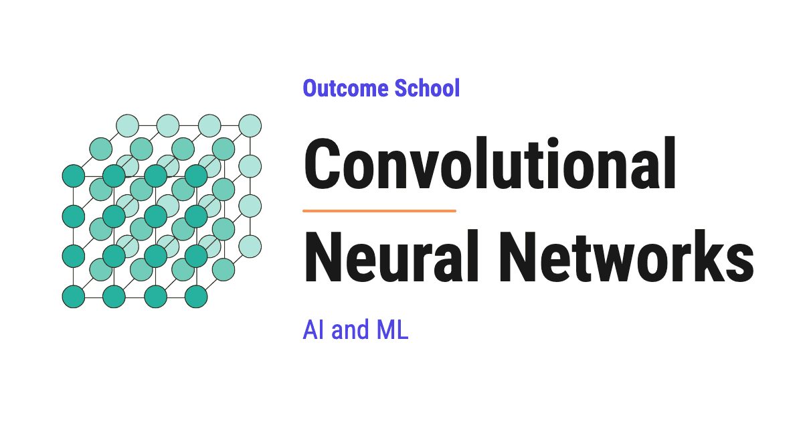

# Convolutional Neural Networks

> Archived from <https://outcomeschool.com/blog/convolutional-neural-network-cnn> on 2026-11-25.

Convolutional Neural Networks (CNNs) are neural networks built to understand images. They slide small pattern detectors over a picture to find edges, shapes, and objects, step by step.

In this blog, we will learn about Convolutional Neural Networks. We will also see why a normal neural network struggles with images, how a filter slides over an image to find patterns, what feature maps, stride, padding, and pooling are, how many layers work together to go from edges to whole objects, how to write a small CNN in code, and where CNNs work well and where they fail.

We will cover the following:
<ul><li>How does a computer see an image?</li><li>Why does a normal neural network struggle with images?</li><li>What is a Convolutional Neural Network?</li><li>What is a filter and how does convolution work?</li><li>What is a feature map?</li><li>Stride and padding</li><li>What is ReLU?</li><li>What is pooling?</li><li>Putting the layers together</li><li>How does a CNN learn its filters?</li><li>Why are CNNs so efficient?</li><li>A simple CNN in code</li><li>Famous CNNs</li><li>Where CNNs work well and where they fail</li></ul>
I am <strong>Amit Shekhar</strong>, Founder @ <a target="_blank" rel="noopener noreferrer" href="https://outcomeschool.com">Outcome School</a>, I have taught and mentored many developers, and their efforts landed them high-paying tech jobs, helped many tech companies in solving their unique problems, and created many open-source libraries being used by top companies. I am passionate about sharing knowledge through open-source, blogs, and videos.

I teach <a target="_blank" rel="noopener noreferrer" href="https://outcomeschool.com/program/ai-and-machine-learning">AI and Machine Learning</a> at Outcome School.

Let&#x27;s get started.
<h2 id="how-does-a-computer-see-an-image">How does a computer see an image?</h2>
Before jumping into Convolutional Neural Networks, we must know how a computer sees an image, because a CNN works on images.

When we look at a photo of a cat, we see a cat. But a computer does not see a cat. It sees only numbers.

An image is made of tiny colored squares called <strong>pixels</strong>. If we zoom into any photo on our phone, we will see these small squares.

In a black and white image, each pixel is one number from 0 to 255. Here, 0 means black, 255 means white, and the numbers in between are shades of gray.

Let&#x27;s say we have a tiny 5 x 5 black and white image. The computer sees it like below:

<pre><code class="code-highlight">  0    0    0  255  255
  0    0    0  255  255
  0    0    0  255  255
  0    0    0  255  255
  0    0    0  255  255
</code></pre>

Here, the left part is black and the right part is white. There is a straight vertical line where black meets white. This line is called an <strong>edge</strong>.

In a color image, each pixel has three numbers: one for red, one for green, and one for blue. These three layers of numbers are called <strong>channels</strong>. So, a color photo of size 1000 x 1000 is actually 1000 x 1000 x 3 = 3,000,000 numbers.

So, for a computer, &quot;understanding an image&quot; means finding meaning inside a big grid of numbers.
<h2 id="why-does-a-normal-neural-network-struggle-with-images">Why does a normal neural network struggle with images?</h2>
In a normal <a target="_blank" rel="noopener noreferrer" href="neural-network.md">neural network</a>, every neuron in a layer is connected to every number from the previous layer, and each connection has its own importance value called a <strong>weight</strong>. This is called a <strong><a target="_blank" rel="noopener noreferrer" href="multilayer-perceptron-mlp.md">fully connected layer</a></strong>.

Let&#x27;s see what happens if we give our 1000 x 1000 color photo to a fully connected layer.
<ul><li>The input has 3,000,000 numbers.</li><li>Each neuron in the first layer needs one weight for each input number. That means 3,000,000 weights for just one neuron.</li><li>If the first layer has 1000 neurons, we need 3,000,000 x 1000 = 3,000,000,000 weights.</li></ul>
Three billion weights in just the first layer. This is very slow, needs huge memory, and needs a huge amount of data to train.

But the following issues also arise:
<ul><li><strong>It ignores the neighbors.</strong> In an image, pixels that are close to each other belong together. A fully connected layer treats the image like a long flat list of numbers, so it loses the idea of &quot;this pixel is next to that pixel&quot;.</li><li><strong>It does not reuse what it learns.</strong> Suppose the network learns to find a cat&#x27;s eye in the top-left corner. If the eye appears in the bottom-right corner, it has to learn it again with different weights.</li></ul>
We needed a solution for that, and Convolutional Neural Networks were introduced to solve this problem.
<h2 id="what-is-a-convolutional-neural-network">What is a Convolutional Neural Network?</h2>
<strong>A Convolutional Neural Network (CNN) is a neural network that looks at an image through small windows and uses the same small pattern detector everywhere in the image.</strong>

Here, <strong>convolution</strong> is the name of the operation where we slide a small window over the image and calculate a value at every position. We will understand it in detail with numbers in a moment.

Think of how we search for our friend in a big crowd photo. We do not look at the whole photo at once. We move our eyes from one small area to the next and check, &quot;Is my friend here?&quot;. We use the same idea of our friend&#x27;s face in every area. A CNN does exactly this.
<h2 id="what-is-a-filter-and-how-does-convolution-work">What is a filter and how does convolution work?</h2>
<strong>A filter is a small grid of numbers that acts as a pattern detector.</strong> It is also called a <strong>kernel</strong>.

A common filter size is 3 x 3. Let&#x27;s take a filter that detects vertical edges:

<pre><code class="code-highlight"> -1   0   1
 -1   0   1
 -1   0   1
</code></pre>

Here, the left column is negative and the right column is positive. So, this filter gives a big number when the right side of a small area is brighter than the left side. That is exactly what a vertical edge looks like.

Now, let&#x27;s apply this filter on our 5 x 5 image. For the sake of understanding, let&#x27;s use 9 instead of 255 to keep the math simple:

<pre><code class="code-highlight"> 0  0  0  9  9
 0  0  0  9  9
 0  0  0  9  9
 0  0  0  9  9
 0  0  0  9  9
</code></pre>

<strong>Step 1:</strong> Place the 3 x 3 filter on the top-left corner of the image. It covers the first three columns:

<pre><code class="code-highlight"> 0  0  0
 0  0  0
 0  0  0
</code></pre>

Multiply each image number with the filter number at the same place and add everything. Every image number here is 0, so every product is 0.

The result is 0. Means, no edge here. It is all black.

<strong>Step 2:</strong> Slide the filter one step to the right. Now it covers columns 2, 3, and 4:

<pre><code class="code-highlight"> 0  0  9
 0  0  9
 0  0  9
</code></pre>

Multiply and add:

<pre><code class="code-highlight">(0 x -1) + (0 x 0) + (9 x 1)  = 9
(0 x -1) + (0 x 0) + (9 x 1)  = 9
(0 x -1) + (0 x 0) + (9 x 1)  = 9
Total = 27
</code></pre>

The result is 27. A big number. Means, there is a vertical edge here.

<strong>Step 3:</strong> Slide one more step to the right. Now it covers columns 3, 4, and 5:

<pre><code class="code-highlight"> 0  9  9
 0  9  9
 0  9  9
</code></pre>

Each row gives (0 x -1) + (9 x 0) + (9 x 1) = 9, so the total is again 27.

Then we move the filter down one row and repeat the same thing. Since every row of our image is the same, we get the same values again.

This sliding, multiplying, and adding is called <strong>convolution</strong>.
<h2 id="what-is-a-feature-map">What is a feature map?</h2>
When we finish sliding the filter over the whole image, we get a new grid of numbers:

<pre><code class="code-highlight"> 0  27  27
 0  27  27
 0  27  27
</code></pre>

<strong>This new grid is called a feature map. It shows where in the image the filter found its pattern.</strong>

Here, we can see that the big numbers appear exactly where the black part meets the white part. The filter has found the edge.

<strong>Note:</strong> The feature map is 3 x 3, smaller than the 5 x 5 image. This is because a 3 x 3 filter can fit in only 3 positions across a row of 5 pixels.

A real CNN layer does not use just one filter. It uses many filters, for example 32 or 64. One filter finds vertical edges, another finds horizontal edges, another finds a certain color, and so on. Each filter gives its own feature map. So, 32 filters give 32 feature maps stacked together.

Also, on a color image, each filter is actually 3 x 3 x 3, so that it looks at the red, green, and blue channels together.

<strong>Planning your move into AI?</strong>

No matter which tech domain you work in today, with your effort, you can transition to these roles:
<ul><li>AI Engineer</li><li>Forward Deployed Engineer</li><li>AI Agent Engineer</li><li>Harness Engineer</li><li>Voice AI Engineer</li><li>AI Architect</li><li>LLM Engineer</li><li>LLM Inference Engineer</li><li>Gen AI Engineer</li><li>MLOps Engineer</li><li>ML Engineer</li><li>Deep Learning Engineer</li></ul>
Our <a target="_blank" rel="noopener noreferrer" href="https://outcomeschool.com/program/ai-and-machine-learning">AI and Machine Learning Program</a> at Outcome School takes you there.
<h2 id="stride-and-padding">Stride and padding</h2>
Now, let&#x27;s understand two small settings of a convolution.

<strong>Stride</strong> is how many pixels the filter moves at each step. In our example, the stride was 1, because we moved one pixel at a time. If the stride is 2, the filter jumps two pixels at a time, and the feature map becomes roughly half the size.

<strong>Padding</strong> means adding a border of zeros around the image before sliding the filter.

<pre><code class="code-highlight"> 0  0  0  0  0  0  0
 0  0  0  0  9  9  0
 0  0  0  0  9  9  0
 0  0  0  0  9  9  0
 0  0  0  0  9  9  0
 0  0  0  0  9  9  0
 0  0  0  0  0  0  0
</code></pre>

Here, our 5 x 5 image now has a border of zeros, so it is 7 x 7. A 3 x 3 filter can now fit in 5 positions across, so the feature map stays 5 x 5, the same size as the original image. Padding also lets the filter look properly at the pixels on the edges of the image.

The size of the feature map can be calculated as below:

<pre><code class="code-highlight">output size = (input size + 2 x padding - filter size) / stride + 1
</code></pre>

For our first example: (5 + 0 - 3) / 1 + 1 = 3. For the padded example: (5 + 2 - 3) / 1 + 1 = 5.
<h2 id="what-is-relu">What is ReLU?</h2>
After convolution, a CNN passes every number of the feature map through a rule called <strong><a target="_blank" rel="noopener noreferrer" href="activation-functions.md">ReLU</a></strong>, which stands for <strong>Rectified Linear Unit</strong>.

The rule is: if the number is negative, make it 0. If it is positive, keep it as it is.

<pre><code class="code-highlight">Before ReLU:  -5   3   0  -2   8
After ReLU:    0   3   0   0   8
</code></pre>

Here, we can see that only the positive values survive. So, ReLU keeps the places where the pattern was found and removes the rest.

ReLU also does something important. Without such a rule, stacking many layers would be no more powerful than a single layer, because adding and multiplying again and again only gives straight-line relationships. ReLU adds a bend, so the network can learn complex patterns.

<strong>A quick note for you</strong>

No matter which tech domain you work in, get familiar with these topics:
<ul><li>LLM</li><li>RAG</li><li>MCP</li><li>Agent</li><li>Fine-tuning</li><li>Quantization</li></ul>
We put it all together in one video:

<a target="_blank" rel="noopener noreferrer" href="https://www.youtube.com/watch?v=lnfWvX66FUk">AI Engineering Explained: LLM, RAG, MCP, Agent, Fine-Tuning, and Quantization</a>

No need to stop reading - bookmark it and watch later when you get time. Future you will thank you.

Now, let&#x27;s get back to the topic.
<h2 id="what-is-pooling">What is pooling?</h2>
<strong>Pooling is a step that shrinks a feature map by keeping only the most important value from each small area.</strong>

The most common type is <strong>max pooling</strong>. We take a 2 x 2 window, keep the biggest number, and move to the next 2 x 2 window.

Let&#x27;s say we have this 4 x 4 feature map:

<pre><code class="code-highlight"> 1   3 |  2   0
 4   6 |  1   2
-------+-------
 0   2 |  9   5
 1   1 |  3   7
</code></pre>

Each 2 x 2 box gives its maximum:
<ul><li>Top-left box: 1, 3, 4, 6 -&gt; maximum is 6</li><li>Top-right box: 2, 0, 1, 2 -&gt; maximum is 2</li><li>Bottom-left box: 0, 2, 1, 1 -&gt; maximum is 2</li><li>Bottom-right box: 9, 5, 3, 7 -&gt; maximum is 9</li></ul>
The result will be:

<pre><code class="code-highlight"> 6  2
 2  9
</code></pre>

Here, the feature map went from 16 numbers to 4 numbers. We kept the strongest signal from each area.

Pooling helps in two ways:
<ul><li>It makes the data smaller, so the next layers have less work.</li><li>It makes the network less sensitive to small shifts. If the cat&#x27;s eye moves by one pixel, the maximum in that area stays almost the same.</li></ul><h2 id="putting-the-layers-together">Putting the layers together</h2>
Now, it&#x27;s time to see how all these pieces work together in a full CNN.

<pre><code class="code-highlight">Image
  ↓
[ Convolution + ReLU ]   finds edges
[ Pooling ]
  ↓
[ Convolution + ReLU ]   combines edges into shapes like corners and circles
[ Pooling ]
  ↓
[ Convolution + ReLU ]   combines shapes into parts like eyes, ears, wheels
[ Pooling ]
  ↓
[ Flatten ]              turns the grid into one long list of numbers
  ↓
[ Fully connected ]      makes the final decision
  ↓
&quot;cat: 92%, dog: 7%, car: 1%&quot;
</code></pre>

Here, we can see that each layer builds on the previous one.
<ul><li>The first layer finds very simple things like edges and color changes.</li><li>The second layer looks at the feature maps of the first layer, so it finds combinations of edges, like corners and curves.</li><li>The deeper layers find bigger things like eyes, wheels, and faces.</li><li>At the end, <strong>flatten</strong> turns the final small grids into one long list. Then a fully connected layer, the normal neural network layer we saw earlier, uses this list to decide the answer.</li></ul>
Here, the fully connected layer is now cheap, because by this point the image has been shrunk into a small summary of important features.

The final step usually turns the scores into percentages that add up to 100%, using a function called <strong><a target="_blank" rel="noopener noreferrer" href="softmax-function.md">softmax</a></strong>. So, the network says something like &quot;92% cat&quot;.

We have a detailed blog on <a target="_blank" rel="noopener noreferrer" href="how-do-image-embeddings-work.md">How Do Image Embeddings Work?</a> that explains how such a small summary of an image is used to compare and search images by meaning.
<h2 id="how-does-a-cnn-learn-its-filters">How does a CNN learn its filters?</h2>
In our example, we wrote the vertical edge filter by hand. <strong>In a real CNN, nobody writes the filters. The CNN learns the numbers inside its filters on its own during training.</strong>

The filter numbers are the weights of a CNN. Training works as below:
<ul><li>We show the CNN a photo with the correct label, like &quot;cat&quot;.</li><li>The CNN makes a guess.</li><li>We measure how wrong the guess is. This is called the <strong>loss</strong>.</li><li>A method called <strong><a target="_blank" rel="noopener noreferrer" href="math-behind-backpropagation.md">backpropagation</a></strong> finds how each filter number must change to reduce the loss.</li><li>Every filter number is adjusted a tiny bit.</li><li>We repeat this for thousands or millions of photos.</li></ul>
After training, the filters in the first layer usually end up looking like edge and color detectors, very similar to what we made by hand. Nobody told the CNN to do that. It discovered them because they are useful.

If we want to go deep into Neural Networks, Backpropagation, and Loss Functions, and build a Neural Network from scratch, check out our <a target="_blank" rel="noopener noreferrer" href="https://outcomeschool.com/program/ai-and-machine-learning">AI and Machine Learning Program</a> at Outcome School.
<h2 id="why-are-cnns-so-efficient">Why are CNNs so efficient?</h2>
Now, let&#x27;s understand why a CNN needs far fewer weights than a fully connected network.

A 3 x 3 filter on a color image has 3 x 3 x 3 = 27 weights, plus 1 extra number called the <strong><a target="_blank" rel="noopener noreferrer" href="bias-in-artificial-neural-network.md">bias</a></strong>. So, 28 numbers. With 64 filters, the layer has 64 x 28 = 1,792 numbers.

Earlier, the fully connected layer needed 3,000,000,000 weights. The convolution layer needs 1,792.

This is possible because of two ideas:
<ul><li><strong>Local connections:</strong> Each filter looks at only a small area at a time, not the whole image.</li><li><strong>Weight sharing:</strong> The same filter is used at every position in the image. A cat&#x27;s eye detector works in the top-left corner and in the bottom-right corner with the same numbers.</li></ul>
Let me tabulate the differences between a fully connected network and a CNN for your better understanding.
<table><thead><tr><th>Point</th><th>Fully connected network</th><th>Convolutional Neural Network</th></tr></thead><tbody><tr><td>How it looks at the image</td><td>Whole image as one flat list</td><td>Small windows, one area at a time</td></tr><tr><td>Respects neighboring pixels</td><td>No</td><td>Yes</td></tr><tr><td>Same pattern in a new place</td><td>Must learn it again</td><td>Same filter finds it anywhere</td></tr><tr><td>Weights in the first layer (1000 x 1000 color photo)</td><td>Billions</td><td>A few thousand</td></tr><tr><td>Training data needed</td><td>Very large</td><td>Much less for the same task</td></tr><tr><td>Best for</td><td>Simple tabular data</td><td>Images and grid-like data</td></tr></tbody></table><h2 id="a-simple-cnn-in-code">A simple CNN in code</h2>
Now, let&#x27;s see the code for a small CNN in <a target="_blank" rel="noopener noreferrer" href="how-does-pytorch-work.md">PyTorch</a>. This CNN takes a 28 x 28 black and white image of a handwritten digit and tells which digit from 0 to 9 it is.

<pre><code class="code-highlight language-python">import torch.nn as nn

class SimpleCNN(nn.Module):
    def __init__(self):
        super().__init__()
        self.conv1 = nn.Conv2d(1, 16, kernel_size=3, padding=1)   # 1 channel in, 16 filters
        self.conv2 = nn.Conv2d(16, 32, kernel_size=3, padding=1)  # 16 in, 32 filters
        self.pool = nn.MaxPool2d(2)                               # 2 x 2 max pooling
        self.relu = nn.ReLU()
        self.fc = nn.Linear(32 * 7 * 7, 10)                       # final decision: 10 digits

    def forward(self, x):
        x = self.pool(self.relu(self.conv1(x)))   # 28 x 28 -&gt; 14 x 14
        x = self.pool(self.relu(self.conv2(x)))   # 14 x 14 -&gt; 7 x 7
        x = x.flatten(1)                           # grid -&gt; one long list
        return self.fc(x)                          # scores for 0 to 9
</code></pre>

Here, we have built a CNN with two convolution layers.
<ul><li><code>nn.Conv2d(1, 16, kernel_size=3, padding=1)</code> creates 16 filters of size 3 x 3. The input has 1 channel because the image is black and white. <code>padding=1</code> keeps the size the same.</li><li><code>nn.Conv2d(16, 32, ...)</code> takes the 16 feature maps from the first layer and creates 32 new feature maps.</li><li><code>nn.MaxPool2d(2)</code> does 2 x 2 max pooling, which halves the width and height.</li><li><code>nn.ReLU()</code> turns negative numbers into zero.</li><li>In <code>forward</code>, the image goes from 28 x 28 to 14 x 14 after the first pooling, and to 7 x 7 after the second pooling.</li><li><code>x.flatten(1)</code> turns the 32 feature maps of size 7 x 7 into one list of 32 x 7 x 7 = 1,568 numbers.</li><li><code>nn.Linear(32 * 7 * 7, 10)</code> is the fully connected layer. It gives 10 scores, one for each digit.</li></ul>
The digit with the highest score is the answer. After training on handwritten digits, a small CNN like this one usually reaches very high accuracy.

<strong>Stay updated:</strong> Subscribe to our <a target="_blank" rel="noopener noreferrer" href="https://outcomeschool.substack.com/subscribe">newsletter</a> to get our latest AI and Machine Learning blogs straight to your inbox.
<h2 id="famous-cnns">Famous CNNs</h2>
Let&#x27;s see a few well-known CNNs:
<ul><li><strong>LeNet</strong> (1998): Created by Yann LeCun and his team to <a target="_blank" rel="noopener noreferrer" href="optical-character-recognition-ocr.md">read handwritten digits</a>, for example on bank checks. It showed that CNNs work in the real world.</li><li><strong>AlexNet</strong> (2012): Won the ImageNet image recognition competition by a large margin, using <a target="_blank" rel="noopener noreferrer" href="how-does-a-gpu-work-for-deep-learning.md">GPUs</a> for training. This result is widely seen as the start of the modern era of deep learning.</li><li><strong>VGG</strong> (2014): Showed that stacking many small 3 x 3 filters works very well.</li><li><strong>ResNet</strong> (2015): Added <a target="_blank" rel="noopener noreferrer" href="vanishing-and-exploding-gradients.md">shortcut connections</a>, which allowed training networks with more than 100 layers.</li></ul><h2 id="where-cnns-work-well-and-where-they-fail">Where CNNs work well and where they fail</h2>
<strong>Where CNNs work well:</strong>
<ul><li><strong>Image classification:</strong> Is this photo a cat or a dog?</li><li><strong><a target="_blank" rel="noopener noreferrer" href="object-detection.md">Object detection</a>:</strong> Where are the cars and people in this street photo? Used in self-driving cars.</li><li><strong>Face recognition:</strong> Unlocking our phone with our face.</li><li><strong>Medical imaging:</strong> Finding signs of disease in X-rays and scans.</li><li><strong>Other grid-like data:</strong> Sound turned into a picture-like grid called a spectrogram, and even some text tasks.</li></ul>
CNNs are also used to label every single pixel in an image, and we have a detailed blog on <a target="_blank" rel="noopener noreferrer" href="semantic-segmentation.md">How does Semantic Segmentation work?</a> that covers this end to end.

<strong>Where CNNs fail or struggle:</strong>
<ul><li><strong>Big-picture relationships:</strong> A filter sees only a small area. Connecting two far-apart parts of an image needs many layers.</li><li><strong>Rotations and big changes in size:</strong> A CNN trained on upright faces can struggle with upside-down faces unless it saw such examples during training.</li><li><strong>Data hungry:</strong> They still need many labeled images to learn well.</li><li><strong>Easy to fool:</strong> Tiny, carefully chosen changes to pixels, invisible to us, can make a CNN give a completely wrong answer.</li></ul>
<strong>Note:</strong> Today, a newer architecture called the <strong><a target="_blank" rel="noopener noreferrer" href="decoding-vision-transformer-vit.md">Vision Transformer</a></strong> also works very well on images, especially with huge amounts of data. But CNNs are still widely used because they are efficient, simple, and work well even with less data.

Now we must have understood Convolutional Neural Networks.
<h2 id="frequently-asked-questions">Frequently Asked Questions</h2><h3 id="is-a-cnn-better-than-a-vision-transformer">Is a CNN better than a Vision Transformer?</h3>
Not always. A Vision Transformer works very well on images, especially when we have huge amounts of data. But CNNs are still widely used because they are efficient, simple, and work well even with less data. So, the right choice depends on how much data we have for the task.
<h3 id="can-cnns-be-used-for-data-other-than-images">Can CNNs be used for data other than images?</h3>
Yes. CNNs work on any grid-like data, not only photos. For example, sound can be turned into a picture-like grid called a spectrogram, and a CNN can learn from it. CNNs are even used for some text tasks. The same idea of sliding small filters over a grid applies in all these cases.
<h3 id="what-is-the-difference-between-a-filter-and-a-kernel-in-a-cnn">What is the difference between a filter and a kernel in a CNN?</h3>
There is no difference. A filter and a kernel are two names for the same thing: a small grid of numbers that acts as a pattern detector. A common size is 3 x 3. The CNN slides it over the image and multiplies and adds at every position to build a feature map.
<h3 id="why-does-a-cnn-still-use-a-fully-connected-layer-at-the-end">Why does a CNN still use a fully connected layer at the end?</h3>
The fully connected layer makes the final decision. After the convolution and pooling layers, flatten turns the final small grids into one long list of numbers, and the fully connected layer uses this list to give a score for each answer. It is cheap at this point because the image has already been shrunk into a small summary of important features.

That&#x27;s it for now.

Thanks

<strong>Amit Shekhar</strong> Founder @ <a target="_blank" rel="noopener noreferrer" href="https://outcomeschool.com">Outcome School</a>

You can connect with me on:
<ul><li><a target="_blank" rel="noopener noreferrer" href="https://x.com/amitiitbhu">X</a></li><li><a target="_blank" rel="noopener noreferrer" href="https://www.linkedin.com/in/amit-shekhar-iitbhu">LinkedIn</a></li><li><a target="_blank" rel="noopener noreferrer" href="https://github.com/amitshekhariitbhu">GitHub</a></li></ul>
Follow Outcome School on:
<ul><li><a target="_blank" rel="noopener noreferrer" href="https://x.com/outcome_school">X</a></li><li><a target="_blank" rel="noopener noreferrer" href="https://youtube.com/@OutcomeSchool">YouTube</a></li><li><a target="_blank" rel="noopener noreferrer" href="https://www.linkedin.com/company/outcomeschool">LinkedIn</a></li><li><a target="_blank" rel="noopener noreferrer" href="http://github.com/OutcomeSchool">GitHub</a></li></ul>
<a target="_blank" rel="noopener noreferrer" href="https://outcomeschool.com/blog"><strong>Read all of our high-quality blogs here.</strong></a>

