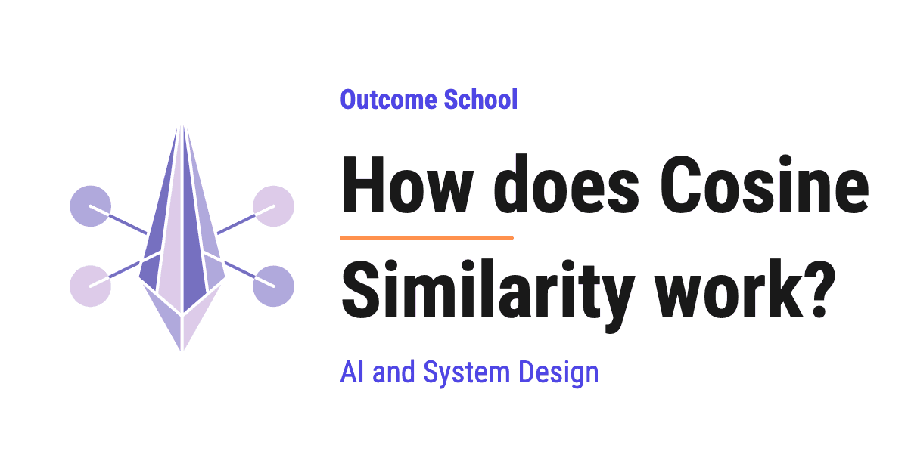

# How does Cosine Similarity work?

> Archived from <https://outcomeschool.com/blog/cosine-similarity> on 2026-11-25.

Cosine Similarity is a way to measure how similar two things are by looking at the angle between their vectors, giving a number between -1 and 1.

In this blog, we will learn about how Cosine Similarity works. We will also see what a vector is, how the angle between two vectors measures their similarity, the formula with a step-by-step numeric walkthrough, why we use the angle and not the distance, where it is used in the real world, and how it differs from Euclidean Distance.

We will cover the following:
<ul><li>What is Cosine Similarity?</li><li>What is a vector?</li><li>The idea of direction and angle</li><li>Where does the word &quot;Cosine&quot; come from?</li><li>The Cosine Similarity formula</li><li>A step-by-step numeric walkthrough</li><li>Cosine Similarity in code</li><li>Why we use the angle and not the distance</li><li>Where Cosine Similarity is used</li><li>Cosine Similarity vs Euclidean Distance</li></ul>
I am <strong>Amit Shekhar</strong>, Founder @ <a target="_blank" rel="noopener noreferrer" href="https://outcomeschool.com">Outcome School</a>, I have taught and mentored many developers, and their efforts landed them high-paying tech jobs, helped many tech companies in solving their unique problems, and created many open-source libraries being used by top companies. I am passionate about sharing knowledge through open-source, blogs, and videos.

I teach <a target="_blank" rel="noopener noreferrer" href="https://outcomeschool.com/program/ai-and-machine-learning">AI and Machine Learning</a> at Outcome School.

Let&#x27;s get started.
<h2 id="what-is-cosine-similarity">What is Cosine Similarity?</h2>
<strong>Cosine Similarity is a way to measure how similar two things are by looking at the angle between them.</strong>

In simple words, it gives us a single number that tells us whether two things point in the same direction or in different directions.

This number is always between <code>-1</code> and <code>1</code>.
<ul><li>When the number is close to <code>1</code>, the two things are very similar.</li><li>When the number is close to <code>0</code>, the two things are not related.</li><li>When the number is close to <code>-1</code>, the two things are opposite.</li></ul><h2 id="what-is-a-vector">What is a vector?</h2>
To compare things with numbers, we first turn each thing into a <strong>vector</strong>.

A vector is a list of numbers.

Let&#x27;s say we want to describe a fruit using two features, sweetness and roundness. We can write a fruit as a list of two numbers.
<ul><li>An apple could be <code>[8, 9]</code>, which means sweetness is 8 and roundness is 9.</li><li>A lemon could be <code>[3, 8]</code>, which means sweetness is 3 and roundness is 8.</li></ul>
Here, each number in the list is called a feature. The apple is now a vector <code>[8, 9]</code>. The lemon is now a vector <code>[3, 8]</code>.

In the real world, a vector can have hundreds or thousands of numbers. For the sake of understanding, we will use small vectors with only two or three numbers.
<h2 id="the-idea-of-direction-and-angle">The idea of direction and angle</h2>
Now, let&#x27;s understand direction and angle.

Let&#x27;s say we draw a graph with two lines, one going right and one going up. The line going right is the sweetness. The line going up is the roundness.

Now, we place our apple <code>[8, 9]</code> on this graph. We start from the corner and move 8 steps to the right and 9 steps up. Then we draw an arrow from the corner to that point.

This arrow is the direction of the apple.

We do the same for the lemon <code>[3, 8]</code>. We move 3 steps right and 8 steps up, then draw an arrow.

Now we have two arrows. The <strong>angle</strong> is the gap between these two arrows.

Let&#x27;s visualize this as below:

<pre><code class="code-highlight language-text">roundness
   ^
 9 |                * apple [8, 9]
 8 |      * lemon [3, 8]
   |
   |
   |
   +-------------------------&gt; sweetness
   0      3         8
</code></pre>

Here, we can see the two points. The lemon arrow goes from the corner <code>0</code> to the point <code>[3, 8]</code>, and the apple arrow goes from the corner <code>0</code> to the point <code>[8, 9]</code>. The small gap between these two arrows is the angle that Cosine Similarity measures.
<ul><li>When two arrows point in almost the same direction, the angle between them is small.</li><li>When two arrows point in very different directions, the angle between them is large.</li></ul>
Cosine Similarity looks at this angle to decide how similar the two things are.

A small angle means the things are similar. A large angle means the things are different.
<h2 id="where-does-the-word-cosine-come-from">Where does the word &quot;Cosine&quot; come from?</h2>
Now, the question is, why do we call it Cosine Similarity and not Angle Similarity?

The reason is that we do not directly use the angle. We use the cosine of the angle.

<strong>Cosine</strong> is a simple math function that takes an angle and gives back a number between <code>-1</code> and <code>1</code>.

Cosine gives us exactly the values we need:
<ul><li>When the angle is <code>0</code> degrees, which means the arrows point in the exact same direction, the cosine is <code>1</code>.</li><li>When the angle is <code>90</code> degrees, which means the arrows are at a right angle and unrelated, the cosine is <code>0</code>.</li><li>When the angle is <code>180</code> degrees, which means the arrows point in the exact opposite direction, the cosine is <code>-1</code>.</li></ul>
So, cosine turns the angle into a clean similarity score. A score of <code>1</code> means most similar, and a score of <code>-1</code> means most opposite.

We can picture these three cases as below:

<pre><code class="code-highlight language-text">angle 0 degrees         angle 90 degrees        angle 180 degrees

  A B                     A
  | |                     |                     B &lt;--- ---&gt; A
  ↓ ↓                     |
                          +----&gt; B

cosine = 1              cosine = 0              cosine = -1
most similar            unrelated               most opposite
</code></pre>

Here, we can see that as the angle grows from <code>0</code> degrees to <code>90</code> degrees and then to <code>180</code> degrees, the cosine value smoothly drops from <code>1</code> to <code>0</code> and finally to <code>-1</code>.

This is why we call it Cosine Similarity.

<strong>Planning your move into AI?</strong>

No matter which tech domain you work in today, with your effort, you can transition to these roles:
<ul><li>AI Engineer</li><li>Forward Deployed Engineer</li><li>AI Agent Engineer</li><li>Harness Engineer</li><li>Voice AI Engineer</li><li>AI Architect</li><li>LLM Engineer</li><li>LLM Inference Engineer</li><li>Gen AI Engineer</li><li>MLOps Engineer</li><li>ML Engineer</li><li>Deep Learning Engineer</li></ul>
Our <a target="_blank" rel="noopener noreferrer" href="https://outcomeschool.com/program/ai-and-machine-learning">AI and Machine Learning Program</a> at Outcome School takes you there.
<h2 id="the-cosine-similarity-formula">The Cosine Similarity formula</h2>
Now, let&#x27;s see the formula.

The Cosine Similarity between two vectors <code>A</code> and <code>B</code> is calculated like below:

<strong>Cosine Similarity = (A dot B) / (|A| * |B|)</strong>

This formula has two parts, the top part and the bottom part. Let&#x27;s understand each part.

<strong>The top part: A dot B</strong>

This is called the <strong>dot product</strong> of the two vectors.

The dot product means we multiply matching numbers from both vectors and then add the results.

Let&#x27;s say <code>A</code> is <code>[a1, a2]</code> and <code>B</code> is <code>[b1, b2]</code>. Then the dot product is calculated like below:

<strong>A dot B = (a1 * b1) + (a2 * b2)</strong>

Here, we multiply the first number of <code>A</code> with the first number of <code>B</code>, then multiply the second number of <code>A</code> with the second number of <code>B</code>, and finally add both results.

<strong>The bottom part: |A| * |B|</strong>

The symbol <code>|A|</code> is called the <strong>magnitude</strong> of the vector <code>A</code>.

The magnitude is the length of the arrow we drew earlier.

We calculate the magnitude by squaring every number, adding them, and taking the square root. For <code>A = [a1, a2]</code>, the magnitude is calculated like below:

<strong>|A| = sqrt(a1^2 + a2^2)</strong>

So, the bottom part is just the length of arrow <code>A</code> multiplied by the length of arrow <code>B</code>.

The full formula divides the dot product by the product of the two lengths. This division removes the effect of length and keeps only the direction. We will see why this is important soon.

<strong>A quick note for you</strong>

No matter which tech domain you work in, get familiar with these topics:
<ul><li>LLM</li><li>RAG</li><li>MCP</li><li>Agent</li><li>Fine-tuning</li><li>Quantization</li></ul>
We put it all together in one video:

<a target="_blank" rel="noopener noreferrer" href="https://www.youtube.com/watch?v=lnfWvX66FUk">AI Engineering Explained: LLM, RAG, MCP, Agent, Fine-Tuning, and Quantization</a>

No need to stop reading - bookmark it and watch later when you get time. Future you will thank you.

Now, let&#x27;s get back to the topic.
<h2 id="a-step-by-step-numeric-walkthrough">A step-by-step numeric walkthrough</h2>
The best way to learn this is by taking an example.

Let&#x27;s say we have two vectors:
<ul><li><code>A = [8, 9]</code></li><li><code>B = [3, 8]</code></li></ul>
Now, let&#x27;s calculate the Cosine Similarity step by step.

<strong>Step 1:</strong> Calculate the dot product <code>A dot B</code>.

<pre><code class="code-highlight">A dot B = (8 x 3) + (9 x 8)
        = 24 + 72
        = 96
</code></pre>

Here, we multiplied 8 with 3 to get 24, then multiplied 9 with 8 to get 72, and added them to get 96.

<strong>Step 2:</strong> Calculate the magnitude of <code>A</code>.

<pre><code class="code-highlight">|A| = square root of (8^2 + 9^2)
    = square root of (64 + 81)
    = square root of 145
    = 12.04
</code></pre>

Here, we squared 8 to get 64, squared 9 to get 81, added them to get 145, and took the square root to get 12.04.

<strong>Step 3:</strong> Calculate the magnitude of <code>B</code>.

<pre><code class="code-highlight">|B| = square root of (3^2 + 8^2)
    = square root of (9 + 64)
    = square root of 73
    = 8.54
</code></pre>

Here, we did the same steps for <code>B</code> and got 8.54.

<strong>Step 4:</strong> Put everything into the formula.

<pre><code class="code-highlight">Cosine Similarity = 96 / (12.04 x 8.54)
                  = 96 / 102.82
                  = 0.93
</code></pre>

The result is <code>0.93</code>. This number is very close to <code>1</code>.

So, the apple and the lemon are quite similar in our example, because both are round fruits with some sweetness.

This is how we calculate Cosine Similarity by hand.
<h2 id="cosine-similarity-in-code">Cosine Similarity in code</h2>
Now, let&#x27;s see the same calculation in code. We will write it in Python because it is simple to read.

We can write the code as below:

<pre><code class="code-highlight language-python">import math

def cosine_similarity(a, b):
    dot_product = 0
    for i in range(len(a)):
        dot_product += a[i] * b[i]

    magnitude_a = math.sqrt(sum(x * x for x in a))
    magnitude_b = math.sqrt(sum(y * y for y in b))

    return dot_product / (magnitude_a * magnitude_b)

vector_a = [8, 9]
vector_b = [3, 8]

result = cosine_similarity(vector_a, vector_b)
print(result)
</code></pre>

Here, we can see what the code does:
<ul><li>First, we calculate the <code>dot_product</code> by multiplying matching numbers and adding them.</li><li>Then, we calculate <code>magnitude_a</code> and <code>magnitude_b</code> by squaring every number, adding them, and taking the square root.</li><li>Finally, we divide the dot product by the product of the two magnitudes.</li></ul>
This will print the following:

<pre><code class="code-highlight">0.9330948702273482
</code></pre>

It works perfectly. The code gives us the same <code>0.93</code> that we calculated by hand.

<strong>Stay updated:</strong> Subscribe to our <a target="_blank" rel="noopener noreferrer" href="https://outcomeschool.substack.com/subscribe">newsletter</a> to get our latest AI and Machine Learning blogs straight to your inbox.
<h2 id="why-we-use-the-angle-and-not-the-distance">Why we use the angle and not the distance</h2>
Now, the next big question is, why do we care about the angle and not the plain distance between the two points?

Let&#x27;s understand this with a simple example.

Suppose we have two documents about cars.
<ul><li>Document A is a short note that says &quot;car&quot; 1 time and &quot;engine&quot; 1 time, so its vector is <code>[1, 1]</code>.</li><li>Document B is a long article that says &quot;car&quot; 10 times and &quot;engine&quot; 10 times, so its vector is <code>[10, 10]</code>.</li></ul>
Both documents talk about the exact same topic in the same proportion. Only the length is different.

If we measure the plain distance between <code>[1, 1]</code> and <code>[10, 10]</code>, the distance is large, so they look very different. But that is wrong, because they are about the same thing.

But both vectors point in the exact same direction. The angle between them is <code>0</code>. So, the Cosine Similarity is <code>1</code>, which means they are perfectly similar.

We can see it as below:

<pre><code class="code-highlight language-text">engine
   ^
10 |                   * B [10, 10]
   |                 .
   |               .
   |             .
   |           .
   |         .
   |       .
   |     .
   |   .
 1 | * A [1, 1]
   +----------------------&gt; car
   0 1                 10
</code></pre>

Here, we can see that arrow <code>A</code> is short and arrow <code>B</code> is long, but both lie on the exact same line, so the angle between them is <code>0</code>. The plain distance between the two arrow tips is large, yet the direction is identical, which is why Cosine Similarity gives them a score of <code>1</code>.

So, Cosine Similarity ignores the size and looks only at the direction. This is why it works so well for text, where a long document and a short document can still be about the same topic. We have a detailed blog on <a target="_blank" rel="noopener noreferrer" href="how-does-semantic-search-work.md">Semantic Search</a> that explains step by step how this idea powers search by meaning.
<h2 id="where-cosine-similarity-is-used">Where Cosine Similarity is used</h2>
Now, let&#x27;s see where we use Cosine Similarity in the real world.
<ul><li><strong>Search engines:</strong> to find documents that match what we typed.</li><li><strong><a target="_blank" rel="noopener noreferrer" href="recommendation-system.md">Recommendation systems</a>:</strong> to suggest movies or products similar to what we already liked.</li><li><strong>Chatbots and AI assistants:</strong> to find the most relevant answer to our question.</li><li><strong>Plagiarism checkers:</strong> to find documents that are very similar to each other.</li><li><strong>Embedding search in LLM apps:</strong> text is turned into vectors called <a target="_blank" rel="noopener noreferrer" href="what-are-embeddings.md">embeddings</a>, and Cosine Similarity is used to find which pieces of text are closest in meaning.</li></ul>
To learn Embeddings, Vector Databases, and RAG in depth, check out our <a target="_blank" rel="noopener noreferrer" href="https://outcomeschool.com/program/ai-and-machine-learning">AI and Machine Learning Program</a> at Outcome School.
<h2 id="cosine-similarity-vs-euclidean-distance">Cosine Similarity vs Euclidean Distance</h2>
There is another popular way to compare vectors called <strong>Euclidean Distance</strong>.

Euclidean Distance is the straight-line distance between two points. It measures how far apart the two arrow tips are, not the angle between the arrows.

Let me tabulate the differences between Cosine Similarity and Euclidean Distance for your better understanding.
<table><thead><tr><th>Point</th><th>Cosine Similarity</th><th>Euclidean Distance</th></tr></thead><tbody><tr><td>What it measures</td><td>The angle between two vectors</td><td>The straight-line distance between two points</td></tr><tr><td>Cares about size</td><td>No, it ignores the length of the vector</td><td>Yes, the length affects the result</td></tr><tr><td>Range of value</td><td>Between <code>-1</code> and <code>1</code></td><td>From <code>0</code> to a large number</td></tr><tr><td>Higher value means</td><td>More similar</td><td>More far apart, which means less similar</td></tr><tr><td>Best use case</td><td>Text and high-dimensional data</td><td>When the actual size and distance matter</td></tr></tbody></table>
Here, we can see that both measure similarity in different ways. We pick one based on our use case.

When the size of the vector does not matter and only the direction matters, we use Cosine Similarity. When the actual distance matters, we use Euclidean Distance.

We have a detailed blog on <a target="_blank" rel="noopener noreferrer" href="how-does-a-vector-database-work.md">how a Vector Database works</a> that compares Cosine Similarity, dot product, and Euclidean Distance in depth.

Now, we have understood how Cosine Similarity works.
<h2 id="frequently-asked-questions">Frequently Asked Questions</h2><h3 id="can-cosine-similarity-be-negative">Can Cosine Similarity be negative?</h3>
Yes. Cosine Similarity is always between -1 and 1, so it can be negative. A negative score means the two vectors point in different directions, and a score of -1 means they point in the exact opposite direction, which means the two things are opposite.
<h3 id="what-does-a-cosine-similarity-of-0-mean">What does a Cosine Similarity of 0 mean?</h3>
A Cosine Similarity of 0 means the two things are not related. It happens when the angle between the two vectors is 90 degrees, so the arrows are at a right angle to each other. A score close to 1 means similar, and a score close to -1 means opposite.
<h3 id="what-is-the-difference-between-the-dot-product-and-cosine-similarity">What is the difference between the dot product and Cosine Similarity?</h3>
The dot product is only the top part of the Cosine Similarity formula. We multiply matching numbers from both vectors and add the results. Cosine Similarity then divides the dot product by the product of the two vector lengths, which removes the effect of length and keeps only the direction.
<h3 id="does-cosine-similarity-work-for-vectors-with-thousands-of-numbers">Does Cosine Similarity work for vectors with thousands of numbers?</h3>
Yes. In the real world, a vector can have hundreds or thousands of numbers, and the formula stays the same. We multiply matching numbers and add them for the dot product, and we square every number, add them, and take the square root for each magnitude.

That&#x27;s it for now.

Thanks

<strong>Amit Shekhar</strong> Founder @ <a target="_blank" rel="noopener noreferrer" href="https://outcomeschool.com">Outcome School</a>

You can connect with me on:
<ul><li><a target="_blank" rel="noopener noreferrer" href="https://x.com/amitiitbhu">X</a></li><li><a target="_blank" rel="noopener noreferrer" href="https://www.linkedin.com/in/amit-shekhar-iitbhu">LinkedIn</a></li><li><a target="_blank" rel="noopener noreferrer" href="https://github.com/amitshekhariitbhu">GitHub</a></li></ul>
Follow Outcome School on:
<ul><li><a target="_blank" rel="noopener noreferrer" href="https://x.com/outcome_school">X</a></li><li><a target="_blank" rel="noopener noreferrer" href="https://youtube.com/@OutcomeSchool">YouTube</a></li><li><a target="_blank" rel="noopener noreferrer" href="https://www.linkedin.com/company/outcomeschool">LinkedIn</a></li><li><a target="_blank" rel="noopener noreferrer" href="http://github.com/OutcomeSchool">GitHub</a></li></ul>
<a target="_blank" rel="noopener noreferrer" href="https://outcomeschool.com/blog"><strong>Read all of our high-quality blogs here.</strong></a>

