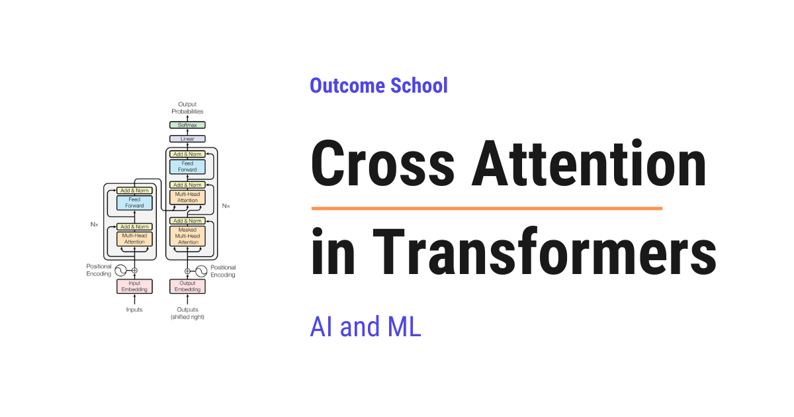

# What is Cross Attention in Transformers and How Does It Work?

> Archived from <https://outcomeschool.com/blog/cross-attention-in-transformers> on 2026-11-25.

Cross Attention is a mechanism in Transformers where one sequence looks at a different sequence. In simple words, one sequence asks the questions, and the other sequence provides the answers.

In this blog, we will learn about Cross Attention in Transformers. We will understand what it is, how it works step by step, how it is different from Self Attention, and where it is used.

We will cover the following:
<ul><li>What is Cross Attention?</li><li>Why do we need Cross Attention?</li><li>Query, Key, and Value in Cross Attention</li><li>Self Attention vs Cross Attention</li><li>Step-by-step working of Cross Attention</li><li>A simple example walk-through</li><li>Where Cross Attention is used</li><li>Importance of Cross Attention</li></ul>
I am <strong>Amit Shekhar</strong>, Founder @ <a target="_blank" rel="noopener noreferrer" href="https://outcomeschool.com">Outcome School</a>, I have taught and mentored many developers, and their efforts landed them high-paying tech jobs, helped many tech companies in solving their unique problems, and created many open-source libraries being used by top companies. I am passionate about sharing knowledge through open-source, blogs, and videos.

I teach <a target="_blank" rel="noopener noreferrer" href="https://outcomeschool.com/program/ai-and-machine-learning">AI and Machine Learning</a> at Outcome School.

Let&#x27;s get started.
<h3 id="what-is-cross-attention">What is Cross Attention?</h3>
<strong>Cross Attention is a mechanism where one sequence looks at a different sequence, using its own Queries against the Keys and Values of the other sequence.</strong>

In simple words, <strong>Cross Attention = Cross + Attention</strong>. The word &quot;Cross&quot; means the information crosses over from one sequence to another. The word &quot;Attention&quot; means the model decides how much it should focus on each part of the other sequence.

So, one sequence asks the questions, and a different sequence provides the answers.
<h3 id="why-do-we-need-cross-attention">Why do we need Cross Attention?</h3>
The best way to learn this is by taking an example.

Suppose we want to translate the English sentence &quot;How are you&quot; into Spanish. The Spanish translation is &quot;Cómo estás&quot;.

Now, the question is: when the model is generating the Spanish word <code>Cómo</code>, how does it know that <code>Cómo</code> should mean <code>How</code>?

The model must look at the original English sentence to figure this out. It must look at the input (&quot;How are you&quot;) while it is generating each word of the output (&quot;Cómo estás&quot;).

So, we now have two sequences:
<ul><li>The input sequence: &quot;How are you&quot; (3 words)</li><li>The output sequence: &quot;Cómo estás&quot; (2 words)</li></ul>
Notice that the two sequences do not even have the same number of words. The English sentence has three words, but the Spanish translation has only two. This happens all the time in real life, and Cross Attention handles it naturally.

The output sequence must constantly look at the input sequence to produce the correct translation. The Spanish word being generated must attend to the most relevant English word.

This is exactly what Cross Attention does. The output sequence attends to the input sequence. The two sequences are different, but one looks at the other. Since the attention crosses from one sequence to another, we call it <strong>Cross Attention</strong>.

For the sake of understanding, let&#x27;s take an analogy.

Suppose we are a student writing an exam answer. We have our own thoughts in our head (this is one sequence). We also have a reference book open on the table (this is another sequence). While writing each line of our answer, we look at our own thoughts (Query) and check the reference book (Key and Value) to pick up the relevant information.

That is exactly what Cross Attention does in a model. One sequence is reading from another sequence.

So, Cross Attention lets the output sequence read from the input sequence at every step. Now, let&#x27;s understand how it does this using <a target="_blank" rel="noopener noreferrer" href="math-behind-attention-qkv.md">Query, Key, and Value</a>.
<h3 id="query-key-and-value-in-cross-attention">Query, Key, and Value in Cross Attention</h3>
For each word the decoder is generating, Cross Attention needs to answer two questions:
<ul><li>Which tokens of the input sequence are important for me?</li><li>How much should I focus on each of them?</li></ul>
To answer these questions, we create three vectors:
<ul><li><strong>Query (Q):</strong> what the decoder is looking for at the current step.</li><li><strong>Key (K):</strong> what each input token offers.</li><li><strong>Value (V):</strong> the actual information each input token carries.</li></ul>
The word &quot;Cross&quot; in Cross Attention comes from one very important fact:
<blockquote>
Query comes from one sequence, and Key and Value come from a different sequence.
</blockquote>
This is what makes it &quot;Cross&quot; Attention. The two sequences are different, but one is attending to the other.

In simple words, if our input is &quot;How are you&quot; and our output is &quot;Cómo estás&quot;, then:
<ul><li>The Query comes from the decoder side, which is generating &quot;Cómo estás&quot; (the output sequence).</li><li>The Key and Value come from &quot;How are you&quot; (the input sequence).</li></ul>
<strong>Note:</strong> This is the key difference between <a target="_blank" rel="noopener noreferrer" href="self-attention-in-transformers.md">Self Attention</a> and Cross Attention. In Self Attention, all three (Q, K, V) come from the same sequence. In Cross Attention, Q comes from one sequence, while K and V come from a different sequence.

<strong>Planning your move into AI?</strong>

No matter which tech domain you work in today, with your effort, you can transition to these roles:
<ul><li>AI Engineer</li><li>Forward Deployed Engineer</li><li>AI Agent Engineer</li><li>Harness Engineer</li><li>Voice AI Engineer</li><li>AI Architect</li><li>LLM Engineer</li><li>LLM Inference Engineer</li><li>Gen AI Engineer</li><li>MLOps Engineer</li><li>ML Engineer</li><li>Deep Learning Engineer</li></ul>
Our <a target="_blank" rel="noopener noreferrer" href="https://outcomeschool.com/program/ai-and-machine-learning">AI and Machine Learning Program</a> at Outcome School takes you there.
<h3 id="self-attention-vs-cross-attention">Self Attention vs Cross Attention</h3>
Let me tabulate the differences between Self Attention and Cross Attention for your better understanding.
<table><thead><tr><th>Aspect</th><th>Self Attention</th><th>Cross Attention</th></tr></thead><tbody><tr><td>Source of Query (Q)</td><td>Same sequence</td><td>Output sequence (decoder)</td></tr><tr><td>Source of Key (K)</td><td>Same sequence</td><td>Input sequence (encoder)</td></tr><tr><td>Source of Value (V)</td><td>Same sequence</td><td>Input sequence (encoder)</td></tr><tr><td>Masking</td><td>Usually masked in the decoder</td><td>Not masked</td></tr><tr><td>Attention matrix shape</td><td>Square (N x N)</td><td>Rectangular (output length x input length)</td></tr><tr><td>Purpose</td><td>Understand relationships within one sequence</td><td>Connect information from two different sequences</td></tr><tr><td>Common use</td><td>Encoder layers, decoder self-attention</td><td>Encoder-decoder bridge, multi-modal models</td></tr></tbody></table>
A few of these differences are very important, so let&#x27;s understand them one by one. Do not worry, we will learn about each of them now.

First, the decoder of a Transformer uses both types of attention. It first uses Self Attention to look at the words it has already generated. Then it uses Cross Attention to look at the encoder&#x27;s output. So, Cross Attention does not replace Self Attention. They work together inside the decoder.

Second, Cross Attention is not masked. In the decoder&#x27;s Self Attention, <a target="_blank" rel="noopener noreferrer" href="causal-masking-in-attention.md">a word is not allowed to look at the future words</a>, because the model has not generated them yet. But in Cross Attention, the whole input sentence is already known. So, every output word is allowed to look at every input word, with no restriction.

Third, the Key and Value are computed only once. The encoder reads the input sentence a single time and creates the Key and Value. The decoder then reuses the same Key and Value for every output word it generates. This makes Cross Attention very efficient.

Now, we have understood the difference. Let&#x27;s see how Cross Attention actually works.

To master Cross Attention, Self-Attention, and Causal Masked Attention in depth, check out our <a target="_blank" rel="noopener noreferrer" href="https://outcomeschool.com/program/ai-and-machine-learning">AI and Machine Learning Program</a> at Outcome School.
<h3 id="step-by-step-working-of-cross-attention">Step-by-step working of Cross Attention</h3>
Now, it&#x27;s time to learn the exact steps of Cross Attention.

The classic place where Cross Attention is used is the original <a target="_blank" rel="noopener noreferrer" href="decoding-transformer-architecture.md">Transformer</a> from the paper &quot;Attention Is All You Need&quot;. The Transformer has two parts:
<ul><li>The <strong>Encoder:</strong> reads the input sequence and creates a rich representation of it.</li><li>The <strong>Decoder:</strong> generates the output sequence, one token at a time.</li></ul>
We have a detailed blog on <a target="_blank" rel="noopener noreferrer" href="encoder-vs-decoder-in-transformers.md">Encoder vs Decoder in Transformers</a> that explains how these two parts differ.

Inside the decoder, there are actually two attention steps. First, the decoder uses Self Attention to look at the words it has already generated. Then, it uses Cross Attention to look at the encoder&#x27;s output. Here, we are focusing on the second step, the Cross Attention.

So, here comes Cross Attention to the rescue. It is the bridge between the encoder and the decoder.

<strong>Step 1:</strong> The encoder reads the input sequence and produces a set of vectors. From these vectors, we create the <strong>Key (K)</strong> and the <strong>Value (V)</strong>.
<ul><li>K = Encoder Output x W_K</li><li>V = Encoder Output x W_V</li></ul>
The encoder does this only once. The same Key and Value are then reused for every token the decoder generates. This is what makes Cross Attention efficient.

<strong>Step 2:</strong> The decoder takes the tokens generated so far and produces its own hidden states. From these hidden states, we create the <strong>Query (Q)</strong>.
<ul><li>Q = Decoder Hidden State x W_Q</li></ul>
Here, <code>W_Q</code>, <code>W_K</code>, and <code>W_V</code> are weight matrices that the model learns during training.

<strong>Step 3:</strong> We compute the dot product of <code>Q</code> with the transpose of <code>K</code>. This is a <a target="_blank" rel="noopener noreferrer" href="matrix-multiplication-in-neural-networks.md">matrix multiplication</a> that gives us the attention scores. We use the transpose so that the shapes align correctly for the multiplication.
<ul><li>Scores = Q . K^T</li></ul>
The score tells us how much each decoder token should attend to each encoder token. A higher score means a stronger match between the Query of a decoder token and the Key of an encoder token.

<strong>Step 4:</strong> We scale the scores by dividing them by the square root of the dimension of the Key vectors. Here, <code>d_k</code> is the dimension of the Key vector.
<ul><li>Scaled Scores = (Q . K^T) / sqrt(d_k)</li></ul>
This scaling is done to keep the numbers in a stable range so that the <a target="_blank" rel="noopener noreferrer" href="softmax-function.md">softmax</a> does not produce extreme values. Without this scaling, the gradients can become very small during training. We have a detailed blog on the <a target="_blank" rel="noopener noreferrer" href="scaling-dot-product-attention.md">Math behind √dₖ Scaling Factor in Attention</a> that explains the math behind it.

<strong>Step 5:</strong> We apply softmax on the scaled scores. This converts the scores into probabilities. Every row of the matrix now sums to 1.
<ul><li>Attention Weights = softmax((Q . K^T) / sqrt(d_k))</li></ul>
These weights tell us, for every decoder token, how much attention it should pay to every encoder token.

<strong>Step 6:</strong> We multiply the attention weights by the Value matrix <code>V</code>. This gives us the final output.
<ul><li>Output = Attention Weights . V</li></ul>
The output is a new vector for each decoder position, now enriched with the relevant information from the encoder. The decoder uses this vector to decide the next word it should generate.

So, the full Cross Attention formula is:

<strong>Attention(Q, K, V) = softmax((Q . K^T) / sqrt(d_k)) . V</strong>

Notice that the formula itself is exactly the same as Self Attention. The difference is not in the math. The difference is in <strong>where Q, K, and V come from</strong>. In Cross Attention, Q comes from the decoder, while K and V come from the encoder. We have also seen the other differences earlier: Cross Attention is not masked, and its attention matrix is rectangular, because the two sequences can have different lengths.

Here, we can visualize the full flow of Cross Attention as below:

<pre><code class="code-highlight">       Encoder Output             Decoder Hidden State
      (Input Sequence)              (Output Sequence)
              |                             |
        +-----+-----+                       ↓
        ↓           ↓                       Q
        V           K                       |
        |           |                       |
        |           +-----------+-----------+
        |                       |
        |                       ↓
        |                    Q . K^T
        |                       |
        |                       ↓
        |              Divide by sqrt(d_k)
        |                       |
        |                       ↓
        |                    Softmax
        |                       |
        |                       ↓
        |               Attention Weights
        |                       |
        +-----------+-----------+
                    |
                    ↓
                Multiply
                    |
                    ↓
                 Output
</code></pre>

Here, we can see that Q comes from the decoder, while K and V come from the encoder. Then Q and K are used to compute the attention weights, and V is used to compute the final output.

<strong>A quick note for you</strong>

No matter which tech domain you work in, get familiar with these topics:
<ul><li>LLM</li><li>RAG</li><li>MCP</li><li>Agent</li><li>Fine-tuning</li><li>Quantization</li></ul>
We put it all together in one video:

<a target="_blank" rel="noopener noreferrer" href="https://www.youtube.com/watch?v=lnfWvX66FUk">AI Engineering Explained: LLM, RAG, MCP, Agent, Fine-Tuning, and Quantization</a>

No need to stop reading - bookmark it and watch later when you get time. Future you will thank you.

Now, let&#x27;s get back to the topic.
<h3 id="a-simple-example-walk-through">A simple example walk-through</h3>
Let&#x27;s take a small example to make this concrete.

Suppose we want to translate the English sentence &quot;How are you&quot; into Spanish: &quot;Cómo estás&quot;.

The decoder produces the Spanish words one at a time. It has already produced the first word, <code>Cómo</code>. Now, let&#x27;s see how it predicts the next word. It does not know that word yet.

<strong>Step 1:</strong> The encoder produces a Key (K) and a Value (V) for every English token.
<ul><li>K for <code>How</code>, K for <code>are</code>, K for <code>you</code></li><li>V for <code>How</code>, V for <code>are</code>, V for <code>you</code></li></ul>
These Keys and Values are created only once. The decoder reuses them at every step.

<strong>Step 2:</strong> The decoder looks at what it has produced so far (<code>Cómo</code>) and creates a Query (Q) for the next word.

<strong>Step 3:</strong> We take this Query and compute the dot product with the Key vectors of all three English tokens: <code>How</code>, <code>are</code>, and <code>you</code>. This gives us three scores.

<strong>Step 4:</strong> We scale these scores by <code>sqrt(d_k)</code>.

<strong>Step 5:</strong> We apply softmax to get the attention weights. Just for the sake of understanding, let&#x27;s say the result is:
<ul><li>Weight for <code>How</code> = 0.050</li><li>Weight for <code>are</code> = 0.500</li><li>Weight for <code>you</code> = 0.450</li></ul>
So, the decoder is paying 5% attention to <code>How</code>, 50% to <code>are</code>, and 45% to <code>you</code>. It is focusing on <code>are</code> and <code>you</code>.

<strong>Step 6:</strong> We combine the Value vectors using these weights. This gives us an output vector.
<ul><li>Output = 0.050 x V(<code>How</code>) + 0.500 x V(<code>are</code>) + 0.450 x V(<code>you</code>)</li></ul>
This output vector carries the most relevant English information for the next word.

<strong>Step 7:</strong> Finally, the decoder uses this output vector to predict the next word. It gives a score to every word in its Spanish vocabulary and picks the most likely one. Just for the sake of understanding, let&#x27;s say the probabilities are:
<ul><li><code>estás</code> = 0.70</li><li><code>gracias</code> = 0.20</li><li><code>Hola</code> = 0.10</li></ul>
The word <code>estás</code> has the highest probability. So, the decoder predicts <code>estás</code> as the next word. This makes sense, because the decoder was focusing on <code>are</code> and <code>you</code>, and the single Spanish word <code>estás</code> carries the meaning of both of them.

The decoder then adds <code>estás</code> to the output and repeats the whole process to predict the next word, until the sentence is complete.

If we collect the attention weights from every step, the full attention matrix looks like below:

<pre><code class="code-highlight">                          English (Encoder)
                           How       are       you
                       +---------+---------+---------+
 Spanish     Cómo      |  0.800  |  0.100  |  0.100  |
 (Decoder)             +---------+---------+---------+
             estás     |  0.050  |  0.500  |  0.450  |
                       +---------+---------+---------+
</code></pre>

Here, every row sums to 1 because of softmax. The numbers are just for the sake of understanding. Each row is one step of the output, and it tells us how much attention that step paid to every English word.

Notice that this matrix is not a square. It has 2 rows (one for every Spanish word) and 3 columns (one for every English word), because the two sequences have different lengths. This is a key sign of Cross Attention. In Self Attention, the matrix is always square, because a sequence attends to itself.

It works perfectly.

<strong>Stay updated:</strong> Subscribe to our <a target="_blank" rel="noopener noreferrer" href="https://outcomeschool.substack.com/subscribe">newsletter</a> to get our latest AI and Machine Learning blogs straight to your inbox.
<h3 id="where-cross-attention-is-used">Where Cross Attention is used</h3>
Now, let&#x27;s see where Cross Attention is used.

Cross Attention is not limited to translation. It is used in many modern AI systems.
<ul><li><strong>Encoder-Decoder Transformers:</strong> The original Transformer for machine translation, summarization, and question answering uses Cross Attention to connect the encoder and decoder.</li><li><strong>Stable Diffusion:</strong> In text-to-image models like <a target="_blank" rel="noopener noreferrer" href="diffusion-models.md">Stable Diffusion</a>, Cross Attention is used to condition image generation on a text prompt. The image features form the Query, and the text embeddings form the Key and Value. This is how the model &quot;listens&quot; to our prompt while drawing the image.</li><li><strong>Flamingo:</strong> A <a target="_blank" rel="noopener noreferrer" href="multimodal-ai.md">multi-modal model</a> from DeepMind that uses Cross Attention to mix visual information with language. The text tokens form the Query, and the image features form the Key and Value.</li><li><strong>Whisper:</strong> OpenAI&#x27;s speech-to-text model uses an encoder-decoder Transformer where Cross Attention helps the decoder attend over audio features.</li><li><strong>Multi-modal models in general:</strong> Whenever a model needs to combine two different types of information (text and image, audio and text, video and text, and etc.), Cross Attention comes into the picture.</li></ul>
So, now we know where we can use Cross Attention.

If we want to go deep into Multimodal AI, the Encoder-Decoder Architecture, and Transformer internals from the ground up, we have a complete program on it - check out our <a target="_blank" rel="noopener noreferrer" href="https://outcomeschool.com/program/ai-and-machine-learning">AI and Machine Learning Program</a> at Outcome School.
<h3 id="importance-of-cross-attention">Importance of Cross Attention</h3>
Now, the question is: why is Cross Attention so important?

The answer is simple. Many real-world AI tasks involve two different sources of information, and we need to combine them in a smart way.
<ul><li>In translation, we have the input language and the output language.</li><li>In text-to-image, we have the text prompt and the image we are generating.</li><li>In speech-to-text, we have the audio and the text.</li></ul>
Without Cross Attention, the decoder would have to guess what the input was about. With Cross Attention, the decoder can directly look at the encoder&#x27;s output and pick the most relevant information for every step.

That&#x27;s the beauty of Cross Attention. It lets one sequence guide the generation of another sequence.

This was all about Cross Attention in Transformers.

Now we must have understood what Cross Attention is, how it works step by step, how it is different from Self Attention, and where it is used.
<h2 id="frequently-asked-questions">Frequently Asked Questions</h2><h3 id="does-cross-attention-replace-self-attention-in-the-decoder">Does Cross Attention replace Self Attention in the decoder?</h3>
No. The decoder of a Transformer uses both. It first uses Self Attention to look at the words it has already generated. Then it uses Cross Attention to look at the encoder&#x27;s output. They work together inside the decoder.
<h3 id="is-cross-attention-masked-like-decoder-self-attention">Is Cross Attention masked like decoder Self Attention?</h3>
No. Cross Attention is not masked. In the decoder&#x27;s Self Attention, a word cannot look at future words because they are not generated yet. But in Cross Attention, the whole input sentence is already known, so every output word is allowed to look at every input word.
<h3 id="is-the-cross-attention-formula-different-from-the-self-attention-formula">Is the Cross Attention formula different from the Self Attention formula?</h3>
No. The formula is exactly the same: softmax of Q times K transpose divided by sqrt(d_k), multiplied by V. The difference is in where Q, K, and V come from. In Cross Attention, Q comes from the decoder, while K and V come from the encoder.
<h3 id="are-the-key-and-value-recomputed-for-every-output-token-in-cross-attention">Are the Key and Value recomputed for every output token in Cross Attention?</h3>
No. The encoder reads the input sentence a single time and creates the Key and Value. The decoder then reuses the same Key and Value for every output token it generates. This makes Cross Attention very efficient.
<h3 id="why-is-the-cross-attention-matrix-not-square">Why is the Cross Attention matrix not square?</h3>
The Cross Attention matrix is rectangular because the input and output sequences can have different lengths. Its shape is output length by input length. For example, &quot;Cómo estás&quot; attending to &quot;How are you&quot; gives 2 rows and 3 columns. In Self Attention, the matrix is always square.

That&#x27;s it for now.

Thanks

<strong>Amit Shekhar</strong> Founder @ <a target="_blank" rel="noopener noreferrer" href="https://outcomeschool.com">Outcome School</a>

You can connect with me on:
<ul><li><a target="_blank" rel="noopener noreferrer" href="https://x.com/amitiitbhu">X</a></li><li><a target="_blank" rel="noopener noreferrer" href="https://www.linkedin.com/in/amit-shekhar-iitbhu">LinkedIn</a></li><li><a target="_blank" rel="noopener noreferrer" href="https://github.com/amitshekhariitbhu">GitHub</a></li></ul>
Follow Outcome School on:
<ul><li><a target="_blank" rel="noopener noreferrer" href="https://x.com/outcome_school">X</a></li><li><a target="_blank" rel="noopener noreferrer" href="https://youtube.com/@OutcomeSchool">YouTube</a></li><li><a target="_blank" rel="noopener noreferrer" href="https://www.linkedin.com/company/outcomeschool">LinkedIn</a></li><li><a target="_blank" rel="noopener noreferrer" href="https://github.com/OutcomeSchool">GitHub</a></li></ul>
<a target="_blank" rel="noopener noreferrer" href="https://outcomeschool.com/blog"><strong>Read all of our high-quality blogs here.</strong></a>

