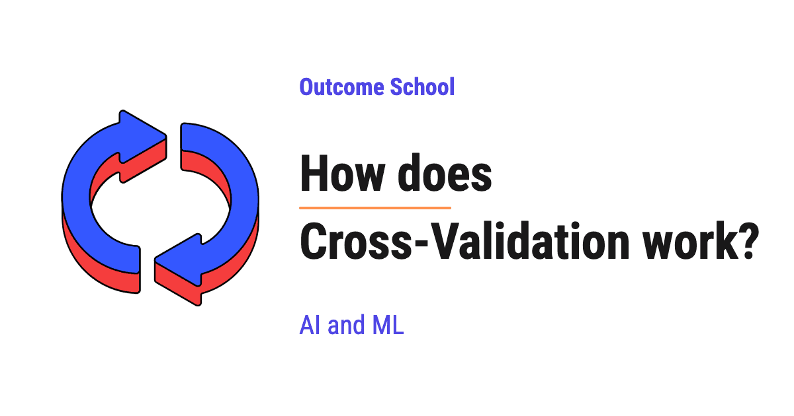

# How does Cross-Validation work?

> Archived from <https://outcomeschool.com/blog/cross-validation> on 2026-11-25.

Cross-Validation is a way to check how well a Machine Learning model will work on new data by splitting the data into several parts, training and testing the model several times so that every part gets a turn to be the test part, and then taking the average of all the scores. It gives a more reliable score than testing the model only once.

In this blog, we will learn about how Cross-Validation works. We will also see why testing a model on just one split can fool us, how K-Fold Cross-Validation works step by step and how to pick the value of K, the popular types like Stratified, Leave-One-Out, Group, and Time Series Cross-Validation, how we use it to pick the best model, the common mistakes that leak information, and when to use which one.

We will cover the following:
<ul><li>The problem with one single split</li><li>What is Cross-Validation?</li><li>How does K-Fold Cross-Validation work?</li><li>A step-by-step example with numbers</li><li>Seeing it in code</li><li>Using Cross-Validation to pick the best model</li><li>How to choose the value of K?</li><li>Types of Cross-Validation</li><li>Common mistakes while using Cross-Validation</li><li>Where Cross-Validation works well and where it fails</li></ul>
I am <strong>Amit Shekhar</strong>, Founder @ <a target="_blank" rel="noopener noreferrer" href="https://outcomeschool.com">Outcome School</a>, I have taught and mentored many developers, and their efforts landed them high-paying tech jobs, helped many tech companies in solving their unique problems, and created many open-source libraries being used by top companies. I am passionate about sharing knowledge through open-source, blogs, and videos.

I teach <a target="_blank" rel="noopener noreferrer" href="https://outcomeschool.com/program/ai-and-machine-learning">AI and Machine Learning</a> at Outcome School.

Let&#x27;s get started.
<h2 id="the-problem-with-one-single-split">The problem with one single split</h2>
To know how good a model really is, we must check it on data that it has never seen during training. The simplest way is to split our data once. Let&#x27;s say we have 100 emails. We use 80 for training and keep 20 aside for testing.

<pre><code class="language-text code-highlight">| &lt;------------- 80 for training -------------&gt; | &lt;-- 20 for testing --&gt; |
</code></pre>

We train the model on the 80 and check it on the 20. Suppose it gets 18 out of 20 correct. The score, called <strong>accuracy</strong>, which means the fraction of examples for which the model gave the correct answer, is 90%.

Looks good. But the following question arises: what if those 20 test emails were very easy by luck? Or very hard by luck?

Let&#x27;s say we shuffle the data and split again. This time, the score is 80%. We shuffle again, and the score is 95%. Which one is the real score?

This is the problem. <strong>With one single split, the score depends a lot on which examples landed in the test part by luck.</strong> When the data is small, this luck matters even more.

There is one more problem. The 20 test emails are never used for learning. When we have only 100 emails, throwing away 20 of them from training hurts.

We need a solution that solves both problems. So, here comes Cross-Validation to the rescue.
<h2 id="what-is-cross-validation">What is Cross-Validation?</h2>
<strong>Cross-Validation is a method to measure how well a model works on unseen data by training and testing it many times on different splits of the same data, and then averaging the scores.</strong>

Here, <strong>Cross</strong> means the parts take turns. The part used for testing in one round is used for training in the other rounds. The roles cross over.

Let&#x27;s take an example from school. Suppose a teacher wants to know how good a student really is. Judging the student on only one test is risky. The student can have a bad day. So, the teacher gives five tests on five different chapters and takes the average. The average is a much fairer picture of the student.

Cross-Validation does exactly this for a model.
<h2 id="how-does-k-fold-cross-validation-work">How does K-Fold Cross-Validation work?</h2>
The most common type of Cross-Validation is <strong>K-Fold Cross-Validation</strong>. Here, a <strong>fold</strong> means one part of the data, and <strong>K</strong> is the number of parts.

It works in these steps:

<strong>Step 1:</strong> Shuffle the data. Mix the examples randomly, so that each part gets a fair mix.

<strong>Step 2:</strong> Split the data into K equal folds. For example, with K = 5, we get 5 parts.

<strong>Step 3:</strong> Run K rounds. In each round, one fold acts as the test part, and the remaining K - 1 folds act as the training part. We train a fresh model on the training part and check it on the test part. We note the score.

<strong>Step 4:</strong> Rotate. In the next round, a different fold becomes the test part. We repeat until every fold has been the test part exactly once.

<strong>Step 5:</strong> Average the K scores. This average is our final Cross-Validation score.

Let&#x27;s see it with K = 5:

<pre><code class="language-text code-highlight">           Fold 1   Fold 2   Fold 3   Fold 4   Fold 5
Round 1:  [ TEST ] [train ] [train ] [train ] [train ]  -&gt; Score 1
Round 2:  [train ] [ TEST ] [train ] [train ] [train ]  -&gt; Score 2
Round 3:  [train ] [train ] [ TEST ] [train ] [train ]  -&gt; Score 3
Round 4:  [train ] [train ] [train ] [ TEST ] [train ]  -&gt; Score 4
Round 5:  [train ] [train ] [train ] [train ] [ TEST ]  -&gt; Score 5

Final score = average of Score 1 to Score 5
</code></pre>

Here, we can notice two important things:
<ul><li>Every example is used for testing exactly once. So, no example is left out of the judging.</li><li>Every example is used for training K - 1 times. So, no example is wasted.</li></ul>
This solves both of our problems. The luck of one split gets averaged out, and all the data gets used.

<strong>Note:</strong> In each round, we train a brand-new model from scratch. The model from Round 1 is not carried over to Round 2. Otherwise, the model will have already seen the test fold, and the score will be dishonest.

<strong>Planning your move into AI?</strong>

No matter which tech domain you work in today, with your effort, you can transition to these roles:
<ul><li>AI Engineer</li><li>Forward Deployed Engineer</li><li>AI Agent Engineer</li><li>Harness Engineer</li><li>Voice AI Engineer</li><li>AI Architect</li><li>LLM Engineer</li><li>LLM Inference Engineer</li><li>Gen AI Engineer</li><li>MLOps Engineer</li><li>ML Engineer</li><li>Deep Learning Engineer</li></ul>
Our <a target="_blank" rel="noopener noreferrer" href="https://outcomeschool.com/program/ai-and-machine-learning">AI and Machine Learning Program</a> at Outcome School takes you there.
<h2 id="a-step-by-step-example-with-numbers">A step-by-step example with numbers</h2>
The best way to learn this is by taking an example. Suppose we have 100 emails and we use K = 5. So, each fold has 20 emails.
<table><thead><tr><th>Round</th><th>Train on</th><th>Test on</th><th>Correct out of 20</th><th>Accuracy</th></tr></thead><tbody><tr><td>1</td><td>Folds 2, 3, 4, 5 (80 emails)</td><td>Fold 1</td><td>18</td><td>90%</td></tr><tr><td>2</td><td>Folds 1, 3, 4, 5 (80 emails)</td><td>Fold 2</td><td>16</td><td>80%</td></tr><tr><td>3</td><td>Folds 1, 2, 4, 5 (80 emails)</td><td>Fold 3</td><td>19</td><td>95%</td></tr><tr><td>4</td><td>Folds 1, 2, 3, 5 (80 emails)</td><td>Fold 4</td><td>17</td><td>85%</td></tr><tr><td>5</td><td>Folds 1, 2, 3, 4 (80 emails)</td><td>Fold 5</td><td>18</td><td>90%</td></tr></tbody></table>
<strong>Average accuracy = (90 + 80 + 95 + 85 + 90) / 5 = 440 / 5 = 88%</strong>

Here, we can see that if we had used only one split, we could have reported anything from 80% to 95%, depending on luck. Cross-Validation tells us that the model is about 88% accurate, and that the score on a single split can land anywhere between 80% and 95%.

This second part is very useful. The <strong>spread</strong> of the scores tells us how stable the model is. If the five scores were 88%, 87%, 89%, 88%, and 88%, we would trust the model a lot. If they were 60%, 95%, 70%, 99%, and 100%, the average is still 84.8%, but the model is very unstable. We cannot trust it on new data.

For the sake of understanding, these numbers are made up. Now, let&#x27;s see real numbers in code.
<h2 id="seeing-it-in-code">Seeing it in code</h2>
Now, let&#x27;s run 5-Fold Cross-Validation in Python using the <code>scikit-learn</code> library. We will use a built-in dataset of 569 patients, where each patient has 30 measurements of a tumor, and the answer is whether the tumor is harmful or not. Our model is a small <a target="_blank" rel="noopener noreferrer" href="decision-trees-and-random-forests.md">Decision Tree</a>, which is a model that predicts by asking a series of yes-or-no questions.

<pre><code class="code-highlight language-python">from sklearn.datasets import load_breast_cancer
from sklearn.model_selection import cross_val_score, KFold
from sklearn.tree import DecisionTreeClassifier

X, y = load_breast_cancer(return_X_y=True)
model = DecisionTreeClassifier(max_depth=3, random_state=0)

folds = KFold(n_splits=5, shuffle=True, random_state=0)
scores = cross_val_score(model, X, y, cv=folds)

print(&quot;Score of each fold:&quot;, scores.round(3))
print(&quot;Average score:&quot;, round(scores.mean(), 3))
print(&quot;Spread (std):&quot;, round(scores.std(), 3))
</code></pre>

Here, we have done the following:
<ul><li>We have loaded the data. <code>X</code> holds the measurements, and <code>y</code> holds the correct answers.</li><li>We have created a Decision Tree that asks at most 3 levels of questions (<code>max_depth=3</code>).</li><li><code>KFold(n_splits=5, shuffle=True)</code> shuffles the data and splits it into 5 folds. <code>random_state=0</code> fixes the random choices, so that we get the same result every time.</li><li><code>cross_val_score</code> runs the 5 rounds, trains a fresh model each time, and returns the 5 accuracy scores.</li><li>We print each score, the average, and the <strong>standard deviation</strong> (std), which is a number that tells us how spread out the scores are. Smaller means more stable.</li></ul>
This will print the following:

<pre><code class="language-text code-highlight">Score of each fold: [0.965 0.93  0.912 0.939 0.938]
Average score: 0.937
Spread (std): 0.017
</code></pre>

Here, we can see that the scores of the 5 rounds range from 91.2% to 96.5%. If we had used only one split, we could have reported any of these numbers. Cross-Validation tells us that the model is about 93.7% accurate, and the scores are fairly stable, with a small spread of 0.017.

<strong>A quick note for you</strong>

No matter which tech domain you work in, get familiar with these topics:
<ul><li>LLM</li><li>RAG</li><li>MCP</li><li>Agent</li><li>Fine-tuning</li><li>Quantization</li></ul>
We put it all together in one video:

<a target="_blank" rel="noopener noreferrer" href="https://www.youtube.com/watch?v=lnfWvX66FUk">AI Engineering Explained: LLM, RAG, MCP, Agent, Fine-Tuning, and Quantization</a>

No need to stop reading - bookmark it and watch later when you get time. Future you will thank you.

Now, let&#x27;s get back to the topic.
<h2 id="using-cross-validation-to-pick-the-best-model">Using Cross-Validation to pick the best model</h2>
Now, it&#x27;s time to learn the most common real use of Cross-Validation: comparing models.

Let&#x27;s say we are not sure how deep our Decision Tree must be. A very shallow tree is too simple. A very deep tree can <strong><a target="_blank" rel="noopener noreferrer" href="bias-variance-tradeoff.md">overfit</a></strong>, which means it remembers the training data and fails on new data. Settings like this, which we choose before training, are called <strong>hyperparameters</strong>.

We can try a few values and compare their Cross-Validation scores as below:

<pre><code class="code-highlight language-python">from sklearn.datasets import load_breast_cancer
from sklearn.model_selection import cross_val_score, KFold
from sklearn.tree import DecisionTreeClassifier

X, y = load_breast_cancer(return_X_y=True)
folds = KFold(n_splits=5, shuffle=True, random_state=0)

for depth in [1, 3, 10]:
    model = DecisionTreeClassifier(max_depth=depth, random_state=0)
    scores = cross_val_score(model, X, y, cv=folds)
    print(f&quot;max_depth={depth:2d}  average={scores.mean():.3f}&quot;)
</code></pre>

Here, we run 5-Fold Cross-Validation for three different tree depths, using the same folds for all three, so that the comparison is fair.

This will print the following:

<pre><code class="language-text code-highlight">max_depth= 1  average=0.884
max_depth= 3  average=0.937
max_depth=10  average=0.924
</code></pre>

Here, we can see that a tree with depth 1 is too simple, and a tree with depth 10 starts to overfit. A depth of 3 gives the best average score. So, we pick <code>max_depth=3</code>.

After picking the best setting, we train one final model on all of the training data with that setting.

<strong>Note:</strong> <code>scikit-learn</code> also has <code>GridSearchCV</code>, which tries many combinations of settings and runs Cross-Validation for each one automatically.

<strong>Very important:</strong> When we use Cross-Validation to pick settings, the best Cross-Validation score is a little too optimistic, because we picked the winner by looking at those very scores. So, we must still keep a separate <strong><a target="_blank" rel="noopener noreferrer" href="train-validation-test-split.md">test set</a></strong> aside, which is never touched during Cross-Validation, and check the final model on it only once at the end.

<pre><code class="language-text code-highlight">| &lt;------------ used for Cross-Validation ------------&gt; | &lt;- final test set -&gt; |
     (train and compare models here, fold by fold)          (touch only once)
</code></pre>

To master Hyperparameter Tuning, Model Development and Training, and Evaluation and Testing from the ground up, check out our <a target="_blank" rel="noopener noreferrer" href="https://outcomeschool.com/program/ai-and-machine-learning">AI and Machine Learning Program</a> at Outcome School.
<h2 id="how-to-choose-the-value-of-k">How to choose the value of K?</h2>
Now, the next big question is: how many folds do we use?
<ul><li><strong>Small K (like 3):</strong> Each round trains on less data (only 2 out of 3 parts). So, the model is a bit weaker than it would be with all the data, and the score comes out a little lower than the truth. But it is fast.</li><li><strong>Large K (like 20):</strong> Each round trains on almost all the data, so the score is closer to the truth. But we must train 20 models, which is slow.</li></ul>
In practice, <strong>K = 5</strong> or <strong>K = 10</strong> is the most common choice. It gives a good balance between a reliable score and the time it takes.

Let me tabulate this for your better understanding.
<table><thead><tr><th>K</th><th>Models trained</th><th>Training data per round</th><th>Speed</th></tr></thead><tbody><tr><td>3</td><td>3</td><td>67%</td><td>Fast</td></tr><tr><td>5</td><td>5</td><td>80%</td><td>Good balance</td></tr><tr><td>10</td><td>10</td><td>90%</td><td>Good balance, slower</td></tr><tr><td>N (number of examples)</td><td>N</td><td>All but one</td><td>Very slow</td></tr></tbody></table><h2 id="types-of-cross-validation">Types of Cross-Validation</h2>
K-Fold is the basic version. But real data comes in different shapes, so we have a few special types.

<strong>Stratified K-Fold</strong>

Suppose only 10% of our emails are spam. If we split randomly, one fold can get almost no spam by luck, and that round will give a misleading score.

<strong>Stratified K-Fold</strong> makes sure that every fold keeps the same mix of answers as the full data. If the full data is 10% spam, every fold is about 10% spam. For classification problems, which means problems where the answer is a category like &quot;spam&quot; or &quot;not spam&quot;, this is the safer default. In <code>scikit-learn</code>, when we pass a plain number like <code>cv=5</code> for a classifier, it already uses Stratified K-Fold.

<strong>Leave-One-Out Cross-Validation (LOOCV)</strong>

This is K-Fold where K is equal to the number of examples. Each round, we keep just one example for testing and train on all the others. If we have 50 examples, we train 50 models.

It uses the data to the maximum, so it is useful when the data is very small. But it is very slow for large data.

<strong>Group K-Fold</strong>

Suppose we have 10 X-ray photos of each patient. If photos of the same patient land in both the training part and the test part, the model can recognize the patient instead of learning the disease. The score will look better than it really is.

<strong>Group K-Fold</strong> makes sure that all the examples of one group, like one patient, stay together in the same fold.

<strong>Time Series Cross-Validation</strong>

When data has a time order, like daily sales, we must never train on the future to predict the past. In real life, we only know the past.

So, we always train on earlier data and test on the data that comes right after it:

<pre><code class="language-text code-highlight">Round 1:  [train ] [ TEST ]
Round 2:  [train ] [train ] [ TEST ]
Round 3:  [train ] [train ] [train ] [ TEST ]
Round 4:  [train ] [train ] [train ] [train ] [ TEST ]
          ---------------- time moves forward ----------------&gt;
</code></pre>

Here, we can see that the training part grows with each round, and the test part is always in the future. In <code>scikit-learn</code>, this is <code>TimeSeriesSplit</code>.

Let me tabulate the differences between these types for your better understanding so that you can decide which one to use based on your use case.
<table><thead><tr><th>Type</th><th>How it splits</th><th>When to use</th></tr></thead><tbody><tr><td>K-Fold</td><td>Random, equal folds</td><td>General use, numbers to predict</td></tr><tr><td>Stratified K-Fold</td><td>Each fold keeps the same mix of answers</td><td>Categories, especially when some are rare</td></tr><tr><td>Leave-One-Out</td><td>One example tests, all others train</td><td>Very small data</td></tr><tr><td>Group K-Fold</td><td>One group stays in one fold</td><td>Many examples from the same person or source</td></tr><tr><td>Time Series Split</td><td>Train on past, test on future</td><td>Data with a time order</td></tr></tbody></table><h2 id="common-mistakes-while-using-cross-validation">Common mistakes while using Cross-Validation</h2>
Most of the time, we do mistakes while using Cross-Validation in the following ways.

<strong>Mistake 1: Preparing the data before splitting.</strong> Suppose we scale all the data, which means bringing all the numbers into a similar range using the average of the full data, and then run Cross-Validation. Now, the average included the test fold too. A bit of information from the test fold has leaked into training. This is called <strong>data leakage</strong>.

<strong>Solution:</strong> Put the preparation steps and the model together in a <code>Pipeline</code> in <code>scikit-learn</code>. Then, in every round, the preparation is learned only from the training folds. We can write the code as below:

<pre><code class="code-highlight language-python">from sklearn.model_selection import cross_val_score
from sklearn.pipeline import make_pipeline
from sklearn.preprocessing import StandardScaler
from sklearn.linear_model import LogisticRegression

model = make_pipeline(StandardScaler(), LogisticRegression())
scores = cross_val_score(model, X, y, cv=5)
</code></pre>

Here, <code>StandardScaler</code> is the scaling step, and <code>LogisticRegression</code> is a simple model for yes-or-no answers. Since both are joined by <code>make_pipeline</code>, <code>cross_val_score</code> learns the scaling from the training folds only, in every round. The test fold stays fully unseen.

<strong>Mistake 2: Shuffling time-based data.</strong> Using normal K-Fold on daily sales mixes the future into training. Use Time Series Cross-Validation instead.

<strong>Mistake 3: Same person or source in two folds.</strong> Use Group K-Fold.

<strong>Mistake 4: Reporting the best Cross-Validation score as the final score after tuning.</strong> Keep a separate test set for the final check.

<strong>Stay updated:</strong> Subscribe to our <a target="_blank" rel="noopener noreferrer" href="https://outcomeschool.substack.com/subscribe">newsletter</a> to get our latest AI and Machine Learning blogs straight to your inbox.
<h2 id="where-cross-validation-works-well-and-where-it-fails">Where Cross-Validation works well and where it fails</h2>
Cross-Validation works well when:
<ul><li>The data is small or medium, and we cannot afford to waste examples.</li><li>We want to compare models or settings fairly.</li><li>We want to know not just the average score, but also how stable the model is.</li></ul>
Cross-Validation is not the best fit when:
<ul><li>The model is very slow to train. Training a large deep learning model 5 or 10 times can take days or weeks. In such cases, people usually use one fixed validation split.</li><li>The data is huge. With millions of examples, one split already has a very large test part, so luck matters very little.</li></ul>
Now we must have understood how Cross-Validation works.
<h2 id="frequently-asked-questions">Frequently Asked Questions</h2><h3 id="what-is-the-difference-between-cross-validation-and-a-single-train-test-split">What is the difference between Cross-Validation and a single train-test split?</h3>
A single split trains the model once and checks it once on one test part, so the score depends a lot on which examples landed in the test part by luck. Cross-Validation trains and tests the model several times so that every part gets a turn to be the test part, and then averages the scores. It also uses every example for both training and testing.
<h3 id="do-we-still-need-a-separate-test-set-when-we-use-cross-validation">Do we still need a separate test set when we use Cross-Validation?</h3>
Yes. When we use Cross-Validation to pick settings, the best Cross-Validation score is a little too optimistic, because we picked the winner by looking at those very scores. So, we keep a separate test set aside, never touch it during Cross-Validation, and check the final model on it only once at the end.
<h3 id="why-do-we-train-a-new-model-in-every-round-of-cross-validation">Why do we train a new model in every round of Cross-Validation?</h3>
We train a brand-new model from scratch in each round so that the model has never seen the test fold of that round. If we carried the model from one round to the next, it would have already seen the test fold, and the score would be dishonest.
<h3 id="what-does-a-large-spread-in-cross-validation-scores-mean">What does a large spread in Cross-Validation scores mean?</h3>
A large spread means the model is unstable. Even if the average looks fine, the scores change a lot from one fold to another, so we cannot trust the model on new data. A small spread, which we can measure with the standard deviation, means the model is stable.

That&#x27;s it for now.

Thanks

<strong>Amit Shekhar</strong> Founder @ <a target="_blank" rel="noopener noreferrer" href="https://outcomeschool.com">Outcome School</a>

You can connect with me on:
<ul><li><a target="_blank" rel="noopener noreferrer" href="https://x.com/amitiitbhu">X</a></li><li><a target="_blank" rel="noopener noreferrer" href="https://www.linkedin.com/in/amit-shekhar-iitbhu">LinkedIn</a></li><li><a target="_blank" rel="noopener noreferrer" href="https://github.com/amitshekhariitbhu">GitHub</a></li></ul>
Follow Outcome School on:
<ul><li><a target="_blank" rel="noopener noreferrer" href="https://x.com/outcome_school">X</a></li><li><a target="_blank" rel="noopener noreferrer" href="https://youtube.com/@OutcomeSchool">YouTube</a></li><li><a target="_blank" rel="noopener noreferrer" href="https://www.linkedin.com/company/outcomeschool">LinkedIn</a></li><li><a target="_blank" rel="noopener noreferrer" href="http://github.com/OutcomeSchool">GitHub</a></li></ul>
<a target="_blank" rel="noopener noreferrer" href="https://outcomeschool.com/blog"><strong>Read all of our high-quality blogs here.</strong></a>

