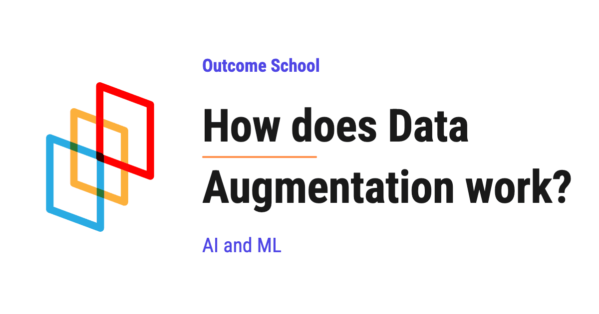

# How does Data Augmentation work?

> Archived from <https://outcomeschool.com/blog/data-augmentation> on 2026-11-25.

Data Augmentation is a technique where we create new training examples from our existing data by making small changes to it, like flipping an image or rewording text.

In this blog, we will learn about how Data Augmentation works. We will also see why we need it, how it creates new training examples from images and text, a simple code example, a step-by-step numeric walkthrough, and when to use it.

We will cover the following:
<ul><li>What is Data Augmentation?</li><li>Why do we need Data Augmentation?</li><li>How does Data Augmentation work?</li><li>Data Augmentation for images</li><li>A simple code example</li><li>Data Augmentation for text</li><li>A step-by-step numeric walkthrough</li><li>When to use Data Augmentation</li></ul>
I am <strong>Amit Shekhar</strong>, Founder @ <a target="_blank" rel="noopener noreferrer" href="https://outcomeschool.com">Outcome School</a>, I have taught and mentored many developers, and their efforts landed them high-paying tech jobs, helped many tech companies in solving their unique problems, and created many open-source libraries being used by top companies. I am passionate about sharing knowledge through open-source, blogs, and videos.

I teach <a target="_blank" rel="noopener noreferrer" href="https://outcomeschool.com/program/ai-and-machine-learning">AI and Machine Learning</a> at Outcome School.

Let&#x27;s get started.
<h2 id="what-is-data-augmentation">What is Data Augmentation?</h2>
<strong>Data Augmentation is a technique where we create new training examples from our existing data by making small changes to it.</strong>

The word <strong>Augmentation</strong> means to increase something or make it larger.

So, Data Augmentation means increasing the amount of training data we have, without going out and collecting brand new data.

We take one example, make a few small changes to it, and now we have a new example. We do this again and again. From a small set of data, we end up with a much larger set.

Now, let&#x27;s understand why we need it.
<h2 id="why-do-we-need-data-augmentation">Why do we need Data Augmentation?</h2>
A model learns from examples. The more good examples it sees, the better it learns.

Let&#x27;s say we want to build a model that can look at a photo and tell us whether it contains a cat or a dog. To teach this model, we need thousands of cat photos and thousands of dog photos.

Collecting thousands of <a target="_blank" rel="noopener noreferrer" href="supervised-vs-unsupervised-learning.md">labeled photos</a> is hard. It takes a lot of time, money, and effort.

Suppose we only managed to collect 500 cat photos and 500 dog photos. That is a small amount of data.

When a model trains on a small amount of data, a big problem arises. The model starts to memorize the exact photos instead of learning the general idea of what a cat looks like.

This problem has a name. It is called <strong><a target="_blank" rel="noopener noreferrer" href="regularization-in-machine-learning.md">overfitting</a></strong>. Means, the model performs very well on the training data but performs poorly on new data it has never seen before.

Let us understand overfitting with a simple comparison.

Suppose a student prepares for an exam by memorizing the answers to only 10 specific questions. If the exam asks those exact 10 questions, the student scores full marks. But if the exam asks even slightly different questions, the student fails. The student memorized instead of truly understanding.

A model that overfits behaves exactly like this student.

So, how do we help the model truly understand instead of memorize? The answer is to give it more varied examples.

So, here comes Data Augmentation to the rescue. It gives us more varied examples from the data we already have.

We have a detailed blog on <a target="_blank" rel="noopener noreferrer" href="dropout-in-neural-networks.md">Dropout in Neural Networks</a> that explains another way to reduce overfitting in depth.
<h2 id="how-does-data-augmentation-work">How does Data Augmentation work?</h2>
The core idea is simple. We take an existing example and apply a small transformation to it to create a new example.

A <strong>transformation</strong> is just a small change we make to the data. The change is small enough that the meaning stays the same, but the data looks different to the model.

Let&#x27;s say we have one photo of a cat. We can do the following with it:
<ul><li>We can flip the photo from left to right. It is still a cat.</li><li>We can rotate the photo by a small angle. It is still a cat.</li><li>We can make the photo a little brighter or darker. It is still a cat.</li><li>We can zoom into the photo slightly. It is still a cat.</li></ul>
From one single cat photo, we just created four new cat photos. Each one looks different to the model, but to us, all of them are clearly cats.

Let&#x27;s visualize this as below:

<pre><code class="language-text code-highlight">                          +----------------+
                          | One cat photo  |
                          | (label: cat)   |
                          +----------------+
                                  |
        +----------------+--------+---------+----------------+
        |                |                  |                |
        ↓                ↓                  ↓                ↓
   +----------+     +----------+       +----------+     +----------+
   | Flipped  |     | Rotated  |       | Brighter |     | Zoomed   |
   | cat      |     | cat      |       | cat      |     | cat      |
   | (cat)    |     | (cat)    |       | (cat)    |     | (cat)    |
   +----------+     +----------+       +----------+     +----------+
</code></pre>

Here, we can see that one cat photo turns into four new cat photos. Each photo looks different to the model, but the label stays &quot;cat&quot; for all of them.

This is the core idea of Data Augmentation. The label does not change, but the data looks new.

A <strong>label</strong> is the correct answer we attach to an example. For a cat photo, the label is &quot;cat&quot;. When we flip or rotate a cat photo, the answer is still &quot;cat&quot;, so the label stays the same.

Each new photo looks like a slightly different camera angle, a slightly different lighting, or a slightly different position of the cat. In the real world, cats appear in all these conditions. So, by showing these variations to the model, we teach it that a cat is a cat no matter how it is flipped, rotated, or lit.

This is how the model learns the general idea of a cat instead of memorizing exact photos.

<strong>Planning your move into AI?</strong>

No matter which tech domain you work in today, with your effort, you can transition to these roles:
<ul><li>AI Engineer</li><li>Forward Deployed Engineer</li><li>AI Agent Engineer</li><li>Harness Engineer</li><li>Voice AI Engineer</li><li>AI Architect</li><li>LLM Engineer</li><li>LLM Inference Engineer</li><li>Gen AI Engineer</li><li>MLOps Engineer</li><li>ML Engineer</li><li>Deep Learning Engineer</li></ul>
Our <a target="_blank" rel="noopener noreferrer" href="https://outcomeschool.com/program/ai-and-machine-learning">AI and Machine Learning Program</a> at Outcome School takes you there.

Now, let&#x27;s see the most common types of transformations we use for images.
<h2 id="data-augmentation-for-images">Data Augmentation for images</h2>
For images, we have many transformations. The common ones are as below:
<ul><li><strong>Flipping:</strong> We flip the image horizontally or vertically.</li><li><strong>Rotation:</strong> We rotate the image by a small angle, such as 10 or 20 degrees.</li><li><strong>Cropping:</strong> We cut out a smaller part of the image and use it.</li><li><strong>Zooming:</strong> We zoom in or out a little.</li><li><strong>Brightness change:</strong> We make the image brighter or darker.</li><li><strong>Adding noise:</strong> We add small random dots to the image, like a slightly grainy photo.</li><li><strong>Shifting:</strong> We move the image a little to the left, right, up, or down.</li></ul>
Each of these creates a new example, and the label stays the same. A flipped cat is still a cat.

Let me map each transformation to the real-world situation it imitates, for your better understanding.
<table><thead><tr><th>Transformation</th><th>Real-world situation it imitates</th></tr></thead><tbody><tr><td>Flipping</td><td>The cat is facing the other direction</td></tr><tr><td>Rotation</td><td>The camera was slightly tilted</td></tr><tr><td>Cropping</td><td>Only part of the cat is in the frame</td></tr><tr><td>Zooming</td><td>The cat is closer or farther away</td></tr><tr><td>Brightness change</td><td>The photo was taken in bright sun or dim light</td></tr><tr><td>Adding noise</td><td>The camera was low quality or it was dark</td></tr><tr><td>Shifting</td><td>The cat is not perfectly in the center</td></tr></tbody></table>
Here, we can see that every transformation copies a condition that happens naturally in the real world. So, the model gets ready for these conditions before it ever sees a real new photo.

Data Augmentation also plays a big role in <a target="_blank" rel="noopener noreferrer" href="self-supervised-learning.md">self-supervised learning</a>. We have a detailed blog on <a target="_blank" rel="noopener noreferrer" href="contrastive-learning.md">Contrastive Learning</a> that explains how two augmented versions of the same image help a model learn without labels.

<strong>Note:</strong> We must apply these changes carefully. The change must not break the meaning. For example, if we are recognizing the digit 6, we must not flip it upside down, because an upside-down 6 looks like a 9. So, the type of transformation depends on our use case.

<strong>A quick note for you</strong>

No matter which tech domain you work in, get familiar with these topics:
<ul><li>LLM</li><li>RAG</li><li>MCP</li><li>Agent</li><li>Fine-tuning</li><li>Quantization</li></ul>
We put it all together in one video:

<a target="_blank" rel="noopener noreferrer" href="https://www.youtube.com/watch?v=lnfWvX66FUk">AI Engineering Explained: LLM, RAG, MCP, Agent, Fine-Tuning, and Quantization</a>

No need to stop reading - bookmark it and watch later when you get time. Future you will thank you.

Now, let&#x27;s get back to the topic.

Now that we have understood the idea, let&#x27;s see a simple code example.
<h2 id="a-simple-code-example">A simple code example</h2>
The best way to learn this is by taking an example. Let&#x27;s see the code for image Data Augmentation using Python and a popular library called Keras.

Keras gives us ready-made tools for Data Augmentation. So, we do not write the flipping and rotating steps ourselves.

We can write the code as below:

<pre><code class="code-highlight language-python">from tensorflow.keras.preprocessing.image import ImageDataGenerator

# Create an augmentation generator with a few transformations
data_generator = ImageDataGenerator(
    rotation_range=20,        # rotate the image up to 20 degrees
    horizontal_flip=True,     # flip the image left to right
    brightness_range=[0.8, 1.2],  # make it darker or brighter
    zoom_range=0.2,           # zoom in or out by 20 percent
    width_shift_range=0.1     # shift the image left or right
)
</code></pre>

Here, we have created an object called <code>data_generator</code>. We told it the kind of changes we want to make to our images.

Let us understand each line.
<ul><li><code>rotation_range=20</code> tells it to rotate each image by a random angle up to 20 degrees.</li><li><code>horizontal_flip=True</code> tells it to randomly flip images from left to right.</li><li><code>brightness_range=[0.8, 1.2]</code> tells it to randomly make images darker or brighter.</li><li><code>zoom_range=0.2</code> tells it to randomly zoom in or out by up to 20 percent.</li><li><code>width_shift_range=0.1</code> tells it to randomly shift the image sideways.</li></ul>
<strong>Note:</strong> <code>ImageDataGenerator</code> is the legacy API, which means it is the older way. It is deprecated and not recommended for new code. The modern Keras approach uses augmentation layers like <code>tf.keras.layers.RandomFlip(&quot;horizontal&quot;)</code>, <code>RandomRotation(0.1)</code>, <code>RandomZoom(0.2)</code>, and <code>RandomBrightness(0.2)</code>. The idea stays the same, only the tool is newer.

Now, we feed our original images to this <code>data_generator</code>. Every time the model asks for an image during training, the <code>data_generator</code> takes an original image, applies these random changes, and hands over a new, slightly different image.

We can picture the flow as below:

<pre><code class="language-text code-highlight">   +-----------------+      +--------------------+      +------------+
   | Original image  | ---&gt; |   data_generator   | ---&gt; |   Model    |
   | from our folder |      | (random changes:   |      | (training) |
   |                 |      |  flip, rotate,     |      |            |
   |                 |      |  zoom, brightness) |      |            |
   +-----------------+      +--------------------+      +------------+
                                      |
                                      ↓
                            Fresh image each time,
                            never saved to disk
</code></pre>

Here, we can see that the <code>data_generator</code> sits between our stored images and the model. It takes one original image, applies random changes on the fly, and hands a new image to the model every time.

So, the model almost never sees the exact same image twice. It sees a new variation each time.

This is how, from a small set of images, the model effectively trains on a much larger and more varied set.

One more thing to notice. We did not save thousands of new images on our computer. The changes happen on the fly during training. This saves us a lot of storage space.

If we want to go deep into Machine Learning Fundamentals, Deep Learning, and Model Development and Training, we can check out our <a target="_blank" rel="noopener noreferrer" href="https://outcomeschool.com/program/ai-and-machine-learning">AI and Machine Learning Program</a> at Outcome School, which covers them from the ground up.

Now, let&#x27;s learn how Data Augmentation works for text.
<h2 id="data-augmentation-for-text">Data Augmentation for text</h2>
Data Augmentation is not only for images. We can also use it for text.

The idea stays the same. We take a sentence and make a small change to create a new sentence with the same meaning.

Let&#x27;s say we have this sentence for a model that detects positive reviews: &quot;The movie was very good and I really enjoyed it.&quot; The label for this sentence is &quot;positive&quot;.

We can create new versions of this sentence using the following techniques.
<ul><li><strong>Synonym replacement:</strong> We replace a word with a word that means the same thing. For example, we replace &quot;good&quot; with &quot;nice&quot;. The new sentence becomes: &quot;The movie was very nice and I really enjoyed it.&quot;</li><li><strong>Word shuffling:</strong> We change the order of a few words slightly, while keeping the meaning clear.</li><li><strong>Back translation:</strong> We translate the sentence into another language and then translate it back into the original language. The result is usually a sentence with the same meaning but slightly different words. For example, the sentence may come back as: &quot;The film was really good and I enjoyed it a lot.&quot;</li><li><strong>Random insertion:</strong> We add a small extra word that does not change the meaning.</li></ul>
From one sentence, we just created several new sentences. All of them carry the same positive feeling. So, the label stays positive.

<strong>Note:</strong> With text, we must be even more careful. Changing one important word can flip the meaning completely. For example, replacing &quot;good&quot; with &quot;bad&quot; changes a positive review into a negative one. So, we must always check that the meaning is preserved.

This is how Data Augmentation works for text.

<strong>Stay updated:</strong> Subscribe to our <a target="_blank" rel="noopener noreferrer" href="https://outcomeschool.substack.com/subscribe">newsletter</a> to get our latest AI and Machine Learning blogs straight to your inbox.
<h2 id="a-step-by-step-numeric-walkthrough">A step-by-step numeric walkthrough</h2>
Let us see how Data Augmentation grows our dataset with simple numbers, just for the sake of understanding.

<strong>Step 1:</strong> We start with 1,000 original images.

<strong>Step 2:</strong> For each image, we create a flipped version. Now we have the original 1,000 plus 1,000 flipped, which is 2,000 images.

<strong>Step 3:</strong> For each of these, we create a rotated version. Now we have 2,000 plus 2,000, which is 4,000 images.

<strong>Step 4:</strong> For each of these, we create a brightness-changed version. Now we have 4,000 plus 4,000, which is 8,000 images.

So, from just 1,000 original images, we ended up with 8,000 training images. And we did not collect a single new photo.

The growth looks like below:

<pre><code class="language-text code-highlight">    Start            + Flip           + Rotate        + Brightness
  +-------+         +-------+         +-------+         +-------+
  | 1,000 |  ----&gt;  | 2,000 |  ----&gt;  | 4,000 |  ----&gt;  | 8,000 |
  +-------+         +-------+         +-------+         +-------+
   images            images            images            images
</code></pre>

Here, we can see that the dataset doubles at every step. We start with 1,000 images, and after three transformations we reach 8,000 images, without collecting a single new photo.
<h2 id="when-to-use-data-augmentation">When to use Data Augmentation</h2>
Let me tabulate when Data Augmentation helps the most, for your better understanding.
<table><thead><tr><th>Situation</th><th>Should we use Data Augmentation?</th></tr></thead><tbody><tr><td>We have a small amount of training data</td><td>Yes, it helps a lot</td></tr><tr><td>The model is overfitting</td><td>Yes, it adds variety and reduces overfitting</td></tr><tr><td>Real-world data has many variations</td><td>Yes, it teaches the model to handle them</td></tr><tr><td>We already have a huge and varied dataset</td><td>It still helps, but the benefit is smaller</td></tr><tr><td>The transformation changes the meaning</td><td>No, we must avoid it</td></tr></tbody></table>
So, based on our use case, we decide which transformations to apply and how many.

<strong>Note:</strong> We usually apply augmentation only to the training data, not to the <a target="_blank" rel="noopener noreferrer" href="train-validation-test-split.md">test data</a>, because we must check the model on real, unchanged examples.

This is how we use Data Augmentation to solve the interesting problem of having too little data.
<h2 id="frequently-asked-questions">Frequently Asked Questions</h2><h3 id="does-data-augmentation-change-the-label-of-an-example">Does Data Augmentation change the label of an example?</h3>
No. Data Augmentation does not change the label. The change we make is small enough that the meaning stays the same. A flipped or rotated cat photo is still a cat, so its label stays &quot;cat&quot;, and a reworded positive review still carries the label &quot;positive&quot;.
<h3 id="do-we-apply-data-augmentation-to-the-test-data">Do we apply Data Augmentation to the test data?</h3>
No. We usually apply augmentation only to the training data, not to the test data. We must check the model on real, unchanged examples, so the test data stays exactly as it was collected.
<h3 id="do-we-need-to-save-the-augmented-images-on-disk">Do we need to save the augmented images on disk?</h3>
No. With tools like Keras, the changes happen on the fly during training. Every time the model asks for an image, the generator applies random changes to an original image and hands over a fresh one. We do not save thousands of new images, which saves a lot of storage space.
<h3 id="can-data-augmentation-hurt-a-model">Can Data Augmentation hurt a model?</h3>
Yes, if the transformation changes the meaning. For example, flipping the digit 6 upside down makes it look like a 9, and replacing &quot;good&quot; with &quot;bad&quot; turns a positive review into a negative one. So, we pick only the transformations that keep the meaning for our use case.

That&#x27;s it for now.

Thanks

<strong>Amit Shekhar</strong> Founder @ <a target="_blank" rel="noopener noreferrer" href="https://outcomeschool.com">Outcome School</a>

You can connect with me on:
<ul><li><a target="_blank" rel="noopener noreferrer" href="https://x.com/amitiitbhu">X</a></li><li><a target="_blank" rel="noopener noreferrer" href="https://www.linkedin.com/in/amit-shekhar-iitbhu">LinkedIn</a></li><li><a target="_blank" rel="noopener noreferrer" href="https://github.com/amitshekhariitbhu">GitHub</a></li></ul>
Follow Outcome School on:
<ul><li><a target="_blank" rel="noopener noreferrer" href="https://x.com/outcome_school">X</a></li><li><a target="_blank" rel="noopener noreferrer" href="https://youtube.com/@OutcomeSchool">YouTube</a></li><li><a target="_blank" rel="noopener noreferrer" href="https://www.linkedin.com/company/outcomeschool">LinkedIn</a></li><li><a target="_blank" rel="noopener noreferrer" href="http://github.com/OutcomeSchool">GitHub</a></li></ul>
<a target="_blank" rel="noopener noreferrer" href="https://outcomeschool.com/blog"><strong>Read all of our high-quality blogs here.</strong></a>

