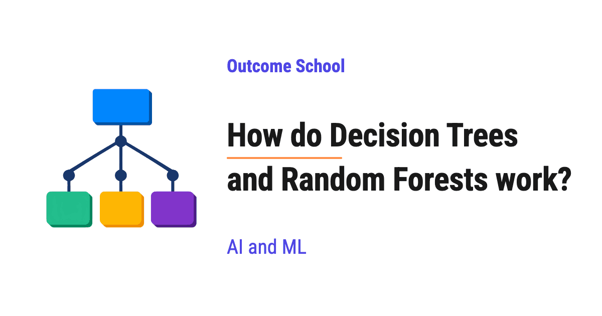

# How do Decision Trees and Random Forests work?

> Archived from <https://outcomeschool.com/blog/decision-trees-and-random-forests> on 2026-11-25.

Decision Trees and Random Forests are <a target="_blank" rel="noopener noreferrer" href="machine-learning.md">Machine Learning</a> models that make a decision by asking a series of simple yes-or-no questions about the data. A Decision Tree is one such flowchart of questions, and a Random Forest is a team of many slightly different Decision Trees that vote together to give a more reliable answer.

In this blog, we will learn about how Decision Trees and Random Forests work. We will also see what a Decision Tree looks like, how it picks the best question to ask at each step, why a single tree overfits so easily, how a Random Forest fixes that by building many trees on random samples of data, how the trees vote, and when to use which one.

We will cover the following:
<ul><li>What is a Decision Tree?</li><li>Parts of a Decision Tree</li><li>How does a Decision Tree make a prediction?</li><li>How does a Decision Tree learn which question to ask?</li><li>Measuring mixedness with Gini Impurity</li><li>When does the tree stop growing?</li><li>The problem with a single Decision Tree</li><li>What is a Random Forest?</li><li>How does a Random Forest add randomness?</li><li>How does a Random Forest make a prediction?</li><li>Seeing it in code</li><li>Decision Tree vs Random Forest</li></ul>
I am <strong>Amit Shekhar</strong>, Founder @ <a target="_blank" rel="noopener noreferrer" href="https://outcomeschool.com">Outcome School</a>, I have taught and mentored many developers, and their efforts landed them high-paying tech jobs, helped many tech companies in solving their unique problems, and created many open-source libraries being used by top companies. I am passionate about sharing knowledge through open-source, blogs, and videos.

I teach <a target="_blank" rel="noopener noreferrer" href="https://outcomeschool.com/program/ai-and-machine-learning">AI and Machine Learning</a> at Outcome School.

Let&#x27;s get started.
<h2 id="what-is-a-decision-tree">What is a Decision Tree?</h2>
We all have played the game of 20 questions. One person thinks of an animal, and the other person asks yes-or-no questions to guess it.
<ul><li>Does it live in water? No.</li><li>Does it have four legs? Yes.</li><li>Does it bark? Yes.</li><li>It is a dog.</li></ul>
Each question cuts down the possible answers, and after a few questions, we reach the answer.

A Decision Tree works exactly like this.

<strong>A Decision Tree is a Machine Learning model that makes a prediction by asking a series of yes-or-no questions about the input, one after another, until it reaches an answer.</strong>

Why do we call it a tree? Because when we draw these questions, the drawing branches out like a tree turned upside down.

Let&#x27;s say we want to predict whether a friend will go out to play cricket today. We can draw it like below:

<pre><code class="language-text code-highlight">                  [Is it raining?]
                   /           \
                 Yes            No
                 /                \
          [Stay Home]       [Is it a holiday?]
                               /         \
                             Yes          No
                             /              \
                       [Play Cricket]  [Is homework done?]
                                          /         \
                                        Yes          No
                                        /              \
                                 [Play Cricket]    [Stay Home]
</code></pre>

Here, we can see that to answer, we start at the top and follow the arrows. The best thing about a Decision Tree is that a human can read it and understand exactly why it gave an answer.
<h2 id="parts-of-a-decision-tree">Parts of a Decision Tree</h2>
Before jumping into how the tree learns, we must know the names of its parts.
<ul><li><strong>Root node:</strong> The very first question at the top. In our example, &quot;Is it raining?&quot;.</li><li><strong>Internal node (decision node):</strong> Any question in the middle of the tree. In our example, &quot;Is it a holiday?&quot; and &quot;Is homework done?&quot;.</li><li><strong>Branch:</strong> The arrow that comes out of a question, one for each answer (Yes or No).</li><li><strong>Leaf node:</strong> The end of a path. It holds the final answer, like &quot;Play Cricket&quot; or &quot;Stay Home&quot;. A leaf asks no more questions.</li><li><strong>Depth:</strong> How many questions we ask from the root to the deepest leaf. Our tree has a depth of 3.</li></ul><h2 id="how-does-a-decision-tree-make-a-prediction">How does a Decision Tree make a prediction?</h2>
Now, let&#x27;s see how the tree gives an answer for a new day.

Suppose today it is not raining, it is not a holiday, and our friend has finished the homework.
<ul><li><strong>Step 1:</strong> At the root, we ask &quot;Is it raining?&quot;. The answer is No, so we go right.</li><li><strong>Step 2:</strong> We ask &quot;Is it a holiday?&quot;. The answer is No, so we go right.</li><li><strong>Step 3:</strong> We ask &quot;Is homework done?&quot;. The answer is Yes, so we go left.</li><li><strong>Step 4:</strong> We reach the leaf &quot;Play Cricket&quot;. That is our prediction.</li></ul>
This is how a Decision Tree makes a prediction. It walks from the top to a leaf.

<strong>Note:</strong> Decision Trees can also predict numbers, like the price of a house. In that case, each leaf holds a number, usually the average price of all the training houses that ended up in that leaf. Such a tree is called a <strong>regression tree</strong>. A tree that predicts a category, like &quot;Play&quot; or &quot;Stay Home&quot;, is called a <strong>classification tree</strong>. The idea is the same for both.

<strong>Planning your move into AI?</strong>

No matter which tech domain you work in today, with your effort, you can transition to these roles:
<ul><li>AI Engineer</li><li>Forward Deployed Engineer</li><li>AI Agent Engineer</li><li>Harness Engineer</li><li>Voice AI Engineer</li><li>AI Architect</li><li>LLM Engineer</li><li>LLM Inference Engineer</li><li>Gen AI Engineer</li><li>MLOps Engineer</li><li>ML Engineer</li><li>Deep Learning Engineer</li></ul>
Our <a target="_blank" rel="noopener noreferrer" href="https://outcomeschool.com/program/ai-and-machine-learning">AI and Machine Learning Program</a> at Outcome School takes you there.
<h2 id="how-does-a-decision-tree-learn-which-question-to-ask">How does a Decision Tree learn which question to ask?</h2>
Now, the next big question is: how does the model build this tree from data?

The model learns from <strong>training data</strong>, which means past examples where we already know the correct answer. Let&#x27;s say we have records of 10 past days:
<table><thead><tr><th>Day</th><th>Raining</th><th>Holiday</th><th>Played Cricket?</th></tr></thead><tbody><tr><td>1</td><td>No</td><td>Yes</td><td>Yes</td></tr><tr><td>2</td><td>No</td><td>No</td><td>Yes</td></tr><tr><td>3</td><td>Yes</td><td>No</td><td>No</td></tr><tr><td>4</td><td>No</td><td>Yes</td><td>Yes</td></tr><tr><td>5</td><td>Yes</td><td>Yes</td><td>Yes</td></tr><tr><td>6</td><td>No</td><td>No</td><td>Yes</td></tr><tr><td>7</td><td>Yes</td><td>No</td><td>No</td></tr><tr><td>8</td><td>No</td><td>No</td><td>No</td></tr><tr><td>9</td><td>No</td><td>Yes</td><td>Yes</td></tr><tr><td>10</td><td>Yes</td><td>Yes</td><td>No</td></tr></tbody></table>
Here, we have 6 days of &quot;Yes&quot; and 4 days of &quot;No&quot;.

Learning from past examples where the correct answer is already known is called supervised learning. We have a detailed blog on <a target="_blank" rel="noopener noreferrer" href="supervised-vs-unsupervised-learning.md">Supervised vs Unsupervised Learning</a> that explains this in depth.

The tree must decide which question to put at the root. It has two choices: &quot;Is it raining?&quot; or &quot;Is it a holiday?&quot;.

<strong>A good question is one that splits the data into groups that are as pure as possible.</strong> A <strong>pure</strong> group means all the examples inside it have the same answer. If a group has only &quot;Yes&quot; days, we are fully sure about the answer for that group.

So, the tree tries every possible question, checks how pure the resulting groups are, and picks the question that gives the purest groups. To compare questions, we need a number that measures how mixed a group is. Here comes <strong>Gini Impurity</strong> into the picture.
<h2 id="measuring-mixedness-with-gini-impurity">Measuring mixedness with Gini Impurity</h2>
<strong>Gini Impurity is a number that tells us how mixed a group is. It is 0 when the group is fully pure, and it grows as the group gets more mixed.</strong>

For a group with two possible answers, the formula is as below:

<strong>Gini = 1 - (share of Yes)^2 - (share of No)^2</strong>

Let&#x27;s understand with simple cases:
<ul><li>A group of 4 &quot;Yes&quot; and 0 &quot;No&quot;: Gini = 1 - (1)^2 - (0)^2 = 0. Fully pure.</li><li>A group of 2 &quot;Yes&quot; and 2 &quot;No&quot;: Gini = 1 - (0.5)^2 - (0.5)^2 = 0.5. As mixed as it gets for two answers.</li></ul>
Now, let&#x27;s calculate for our 10 days.

<strong>Before any split:</strong> 6 Yes and 4 No.

<pre><code class="language-text code-highlight">Gini = 1 - (6/10)^2 - (4/10)^2 = 1 - 0.36 - 0.16 = 0.48
</code></pre>

<strong>Option 1: Split on &quot;Is it raining?&quot;</strong>
<ul><li>Raining = Yes: Days 3, 5, 7, 10. That is 1 Yes and 3 No.</li><li>Raining = No: Days 1, 2, 4, 6, 8, 9. That is 5 Yes and 1 No.</li></ul>
<pre><code class="language-text code-highlight">Gini (Raining = Yes) = 1 - (1/4)^2 - (3/4)^2 = 1 - 0.0625 - 0.5625 = 0.375
Gini (Raining = No)  = 1 - (5/6)^2 - (1/6)^2 = 1 - 0.694 - 0.028 = 0.278
</code></pre>

To get one number for the whole split, we take the weighted average, which means a bigger group counts more:

<pre><code class="language-text code-highlight">Weighted Gini = (4/10) x 0.375 + (6/10) x 0.278 = 0.15 + 0.167 = 0.317
</code></pre>

<strong>Option 2: Split on &quot;Is it a holiday?&quot;</strong>
<ul><li>Holiday = Yes: Days 1, 4, 5, 9, 10. That is 4 Yes and 1 No.</li><li>Holiday = No: Days 2, 3, 6, 7, 8. That is 2 Yes and 3 No.</li></ul>
<pre><code class="language-text code-highlight">Gini (Holiday = Yes) = 1 - (4/5)^2 - (1/5)^2 = 1 - 0.64 - 0.04 = 0.32
Gini (Holiday = No)  = 1 - (2/5)^2 - (3/5)^2 = 1 - 0.16 - 0.36 = 0.48
Weighted Gini        = (5/10) x 0.32 + (5/10) x 0.48 = 0.16 + 0.24 = 0.40
</code></pre>

Let me tabulate the results for your better understanding.
<table><thead><tr><th>Question</th><th>Weighted Gini after split</th><th>Drop from 0.48</th></tr></thead><tbody><tr><td>Is it raining?</td><td>0.317</td><td>0.163</td></tr><tr><td>Is it a holiday?</td><td>0.40</td><td>0.08</td></tr></tbody></table>
Here, we can see that &quot;Is it raining?&quot; makes the groups purer. So, the tree picks &quot;Is it raining?&quot; as the root question.

Then, the tree repeats the exact same process inside each group. For example, inside the &quot;Raining = No&quot; group (5 Yes, 1 No), the only question left is &quot;Is it a holiday?&quot;:

<pre><code class="language-text code-highlight">                    [Is it raining?]
                     /            \
                   Yes             No
                   /                 \
      Days 3,5,7,10           [Is it a holiday?]
      (1 Yes, 3 No)             /           \
                              Yes            No
                              /                \
                      Days 1,4,9          Days 2,6,8
                      (3 Yes, 0 No)       (2 Yes, 1 No)
                      Pure. Play.         Mostly Play.
</code></pre>

Here, we can see that the &quot;Holiday = Yes&quot; group became fully pure, so it becomes a leaf with the answer &quot;Play&quot;. This keeps going, group by group, and the tree grows downward. This step-by-step splitting is called <strong>recursive splitting</strong>.

<strong>Note:</strong> For number inputs, like temperature, the tree tries questions like &quot;Is temperature less than 30?&quot; for many different cut points and picks the best cut. Also, some trees use a different mixedness measure called <strong><a target="_blank" rel="noopener noreferrer" href="entropy-in-information-theory.md">Entropy</a></strong> instead of Gini. The idea stays the same: pick the question that makes the groups purest.

<strong>A quick note for you</strong>

No matter which tech domain you work in, get familiar with these topics:
<ul><li>LLM</li><li>RAG</li><li>MCP</li><li>Agent</li><li>Fine-tuning</li><li>Quantization</li></ul>
We put it all together in one video:

<a target="_blank" rel="noopener noreferrer" href="https://www.youtube.com/watch?v=lnfWvX66FUk">AI Engineering Explained: LLM, RAG, MCP, Agent, Fine-Tuning, and Quantization</a>

No need to stop reading - bookmark it and watch later when you get time. Future you will thank you.

Now, let&#x27;s get back to the topic.
<h2 id="when-does-the-tree-stop-growing">When does the tree stop growing?</h2>
If we let the tree keep splitting, it stops only when every leaf is fully pure, or when there is nothing left to split. We can also stop it earlier by setting some rules:
<ul><li><strong>Maximum depth:</strong> Do not ask more than, say, 5 questions in a row.</li><li><strong>Minimum samples in a leaf:</strong> Every leaf must have at least, say, 10 examples.</li><li><strong>Minimum improvement:</strong> Do not split if the purity improves by only a tiny amount.</li></ul>
These rules are very important. Let&#x27;s see why.
<h2 id="the-problem-with-a-single-decision-tree">The problem with a single Decision Tree</h2>
Suppose we do not stop the tree. It keeps asking more and more specific questions until every single training example has its own perfect leaf.

<pre><code class="language-text code-highlight">[Is it raining?]
   -&gt; No -&gt; [Is it a holiday?]
      -&gt; No -&gt; [Is the temperature above 31.5?]
         -&gt; Yes -&gt; [Is it the 3rd Tuesday of the month?]
            -&gt; Yes -&gt; [Did the neighbor&#x27;s dog bark?]
               -&gt; ... (Day 8 only)
</code></pre>

Here, we can notice that the tree is no longer learning the real pattern. It is memorizing the accidental details of each day. This is called <strong><a target="_blank" rel="noopener noreferrer" href="regularization-in-machine-learning.md">overfitting</a></strong>. Such a tree scores perfectly on the training data, but makes bad predictions on new days.

There is one more problem. A deep Decision Tree is very sensitive to small changes in the data. If we change or remove just a few training examples, a different question can win at the root, and then the whole tree below it changes. This shakiness is called <strong><a target="_blank" rel="noopener noreferrer" href="bias-variance-tradeoff.md">high variance</a></strong>.

What is the solution to this problem? Answer: Ask many people and take a vote. So, here comes the Random Forest to the rescue.
<h2 id="what-is-a-random-forest">What is a Random Forest?</h2>
<strong>A Random Forest is a Machine Learning model that builds many Decision Trees, each one trained in a slightly different random way, and combines their answers by voting or averaging.</strong>

Here, <strong>Random</strong> means that each tree is built with some randomness, so that the trees are different from each other.

Let&#x27;s say we want to guess the number of sweets in a big jar. If we ask one person, the guess can be far off. But if we ask 100 people and take the average, the average is usually very close to the real number. This is called the <strong>wisdom of the crowd</strong>. The personal mistakes of different people go in different directions and cancel each other out.

But, this works only if the people think differently. If all 100 people copy the same person, we get the same wrong guess 100 times. In the same way, if all our trees are exactly the same, voting does not help at all.

So, the key idea of a Random Forest is to make the trees different from each other. Let&#x27;s see how.
<h2 id="how-does-a-random-forest-add-randomness">How does a Random Forest add randomness?</h2>
A Random Forest uses two kinds of randomness.

<strong>Randomness 1: Each tree gets a random sample of the data (Bootstrap Sampling).</strong>

Suppose we have 10 training days. For each tree, we pick 10 days at random, but <strong>with replacement</strong>. With replacement means that after picking a day, we put it back, so the same day can be picked again.

<pre><code class="language-text code-highlight">Original data:  [1, 2, 3, 4, 5, 6, 7, 8, 9, 10]

Tree 1 gets:    [2, 2, 5, 7, 1, 9, 9, 3, 10, 6]
Tree 2 gets:    [4, 8, 1, 1, 3, 6, 10, 10, 2, 7]
Tree 3 gets:    [5, 9, 9, 2, 8, 4, 4, 6, 1, 3]
</code></pre>

Here, we can see that each tree sees a slightly different version of the data. Some days appear twice, and some days are missing. When the data is large, each tree sees only about 63% of the different examples on average, and the rest are left out for that tree.

Training many models on such random samples and then combining them is called <strong>Bagging</strong>, which is short for <strong>Bootstrap Aggregating</strong>. Bootstrap means the random sampling with replacement, and Aggregating means combining the results.

We have a detailed blog on <a target="_blank" rel="noopener noreferrer" href="gradient-boosting.md">Gradient Boosting</a> that explains a different way to combine trees: building small trees one after another, where each new tree fixes the mistakes of the trees before it.

<strong>Randomness 2: Each split looks at only a random few of the questions (Feature Randomness).</strong>

Here, a <strong><a target="_blank" rel="noopener noreferrer" href="feature-engineering.md">feature</a></strong> means one input column, like &quot;Raining&quot;, &quot;Holiday&quot;, or &quot;Temperature&quot;.

When a normal tree picks a question, it checks all the features. In a Random Forest, at every split, the tree can look at only a random few features and must pick the best question among those.

Why do we need this? Suppose one feature is very strong, like &quot;Raining&quot;. Without this rule, every tree will put &quot;Raining&quot; at the root, and all the trees will look alike. By hiding some features at each split, we force the trees to explore other questions too. This makes the trees more different from each other, and the vote becomes more useful.

<strong>Note:</strong> A common default for classification is to look at about the square root of the total number of features at each split. If we have 25 features, each split looks at about 5 of them.
<h2 id="how-does-a-random-forest-make-a-prediction">How does a Random Forest make a prediction?</h2>
Now, our forest of trees is ready. When a new day comes, we send it to every tree, and each tree gives its own answer.

<pre><code class="language-text code-highlight">New day: Not raining, not a holiday, homework done

  Tree 1  -&gt;  Play
  Tree 2  -&gt;  Play
  Tree 3  -&gt;  Stay Home
  Tree 4  -&gt;  Play
  Tree 5  -&gt;  Play
           ---------------
  Vote:   Play = 4, Stay Home = 1

  Final answer: Play
</code></pre>

Here, we can see that:
<ul><li>For a <strong>category</strong> (classification), the forest takes a <strong>majority vote</strong>. The answer with the most votes wins.</li><li>For a <strong>number</strong> (regression), the forest takes the <strong>average</strong> of all the trees&#x27; numbers.</li></ul>
Even if a few trees make mistakes, the majority is usually right. This is how a Random Forest reduces the shakiness (variance) of a single tree, without making each tree simpler.

<strong>Stay updated:</strong> Subscribe to our <a target="_blank" rel="noopener noreferrer" href="https://outcomeschool.substack.com/subscribe">newsletter</a> to get our latest AI and Machine Learning blogs straight to your inbox.
<h2 id="seeing-it-in-code">Seeing it in code</h2>
Now, let&#x27;s see both models in Python using the <code>scikit-learn</code> library. We will use a built-in dataset of 569 patients, where each patient has 30 measurements of a tumor, and the answer is whether the tumor is harmful or not.

<pre><code class="code-highlight language-python">from sklearn.datasets import load_breast_cancer
from sklearn.model_selection import train_test_split
from sklearn.tree import DecisionTreeClassifier
from sklearn.ensemble import RandomForestClassifier

X, y = load_breast_cancer(return_X_y=True)
X_train, X_test, y_train, y_test = train_test_split(
    X, y, test_size=0.3, random_state=42)

tree = DecisionTreeClassifier(random_state=42)
tree.fit(X_train, y_train)

forest = RandomForestClassifier(n_estimators=100, random_state=42)
forest.fit(X_train, y_train)

print(&quot;Tree   train:&quot;, round(tree.score(X_train, y_train), 3),
      &quot;test:&quot;, round(tree.score(X_test, y_test), 3))
print(&quot;Forest train:&quot;, round(forest.score(X_train, y_train), 3),
      &quot;test:&quot;, round(forest.score(X_test, y_test), 3))
</code></pre>

Here, we have done the following:
<ul><li>We have loaded the data. <code>X</code> holds the 30 measurements for each patient, and <code>y</code> holds the correct answers.</li><li>We have kept 70% of the patients for training and 30% as a <strong><a target="_blank" rel="noopener noreferrer" href="train-validation-test-split.md">test set</a></strong>, which means patients that the models never see while learning.</li><li>We have trained one <code>DecisionTreeClassifier</code> with no depth limit.</li><li>We have trained one <code>RandomForestClassifier</code> with <code>n_estimators=100</code>, which means 100 trees.</li><li><code>random_state=42</code> fixes the random choices, so that we get the same result every time we run the code.</li><li><code>score</code> gives the <strong>accuracy</strong>, which means the fraction of patients for which the model gave the correct answer.</li></ul>
This will print the following:

<pre><code class="language-text code-highlight">Tree   train: 1.0 test: 0.942
Forest train: 1.0 test: 0.971
</code></pre>

Here, we can see that both models score a perfect 1.0 on the training data. But on new patients, the single tree gets 94.2% right, while the forest gets 97.1% right. The forest makes about half as many mistakes on new data.

<strong>Note:</strong> The exact numbers will change with a different data split, but the forest usually does better than a single deep tree on new data.

To learn Machine Learning Fundamentals like Supervised and Unsupervised Learning, Hyperparameter Tuning, and Evaluation and Testing from the ground up, check out our <a target="_blank" rel="noopener noreferrer" href="https://outcomeschool.com/program/ai-and-machine-learning">AI and Machine Learning Program</a> at Outcome School.
<h2 id="decision-tree-vs-random-forest">Decision Tree vs Random Forest</h2>
Let me tabulate the differences between a Decision Tree and a Random Forest for your better understanding so that you can decide which one to use based on your use case.
<table><thead><tr><th>Point</th><th>Decision Tree</th><th>Random Forest</th></tr></thead><tbody><tr><td>What it is</td><td>One flowchart of questions</td><td>Many trees that vote</td></tr><tr><td>Easy to explain?</td><td>Yes, we can draw and read it</td><td>No, hundreds of trees are hard to read</td></tr><tr><td>Accuracy on new data</td><td>Good, but can overfit</td><td>Usually better</td></tr><tr><td>Overfitting</td><td>Overfits easily if not stopped</td><td>Much less, due to voting</td></tr><tr><td>Training speed</td><td>Very fast</td><td>Slower, since it builds many trees</td></tr><tr><td>Prediction speed</td><td>Very fast</td><td>Slower, since every tree must answer</td></tr><tr><td>Sensitivity to small data changes</td><td>High</td><td>Low</td></tr></tbody></table>
Here is when to use each one:
<ul><li>Use a <strong>Decision Tree</strong> when we must explain every decision clearly, for example, to a bank customer whose loan was rejected, or when we need a quick and simple first model.</li><li>Use a <strong>Random Forest</strong> when we care most about accuracy on new data and do not need to explain each decision step by step. It is a strong default choice for table-like data, such as spreadsheets of customers, sales, or patients.</li></ul>
When we keep a complex model like a Random Forest but still need the reasons behind its decisions, we can use Explainable AI. We have a detailed blog on <a target="_blank" rel="noopener noreferrer" href="explainable-ai-xai.md">Explainable AI</a> that covers this end to end.

Now we must have understood how Decision Trees and Random Forests work.
<h2 id="frequently-asked-questions">Frequently Asked Questions</h2><h3 id="can-a-decision-tree-predict-numbers-instead-of-categories">Can a Decision Tree predict numbers instead of categories?</h3>
Yes. A Decision Tree can predict numbers, like the price of a house. In that case, each leaf holds a number, usually the average of all the training examples that ended up in that leaf. Such a tree is called a regression tree. A Random Forest of such trees takes the average of all the trees&#x27; numbers.
<h3 id="what-is-the-difference-between-gini-impurity-and-entropy">What is the difference between Gini Impurity and Entropy?</h3>
Both are ways to measure how mixed a group is. Gini Impurity is 0 when a group is fully pure, and it grows as the group gets more mixed. Some trees use Entropy instead of Gini. The idea stays the same with both: the tree picks the question that makes the groups purest.
<h3 id="how-do-we-stop-a-decision-tree-from-overfitting">How do we stop a Decision Tree from overfitting?</h3>
We stop the tree from growing too deep. We can set a maximum depth, a minimum number of examples in each leaf, or a minimum improvement in purity before a split is allowed. Another way is to use a Random Forest, which overfits much less because many different trees vote together.
<h3 id="how-many-features-does-a-random-forest-check-at-each-split">How many features does a Random Forest check at each split?</h3>
A Random Forest checks only a random few features at each split, not all of them. A common default for classification is about the square root of the total number of features. So, if we have 25 features, each split looks at about 5 of them. This keeps the trees different from each other.

That&#x27;s it for now.

Thanks

<strong>Amit Shekhar</strong> Founder @ <a target="_blank" rel="noopener noreferrer" href="https://outcomeschool.com">Outcome School</a>

You can connect with me on:
<ul><li><a target="_blank" rel="noopener noreferrer" href="https://x.com/amitiitbhu">X</a></li><li><a target="_blank" rel="noopener noreferrer" href="https://www.linkedin.com/in/amit-shekhar-iitbhu">LinkedIn</a></li><li><a target="_blank" rel="noopener noreferrer" href="https://github.com/amitshekhariitbhu">GitHub</a></li></ul>
Follow Outcome School on:
<ul><li><a target="_blank" rel="noopener noreferrer" href="https://x.com/outcome_school">X</a></li><li><a target="_blank" rel="noopener noreferrer" href="https://youtube.com/@OutcomeSchool">YouTube</a></li><li><a target="_blank" rel="noopener noreferrer" href="https://www.linkedin.com/company/outcomeschool">LinkedIn</a></li><li><a target="_blank" rel="noopener noreferrer" href="http://github.com/OutcomeSchool">GitHub</a></li></ul>
<a target="_blank" rel="noopener noreferrer" href="https://outcomeschool.com/blog"><strong>Read all of our high-quality blogs here.</strong></a>

