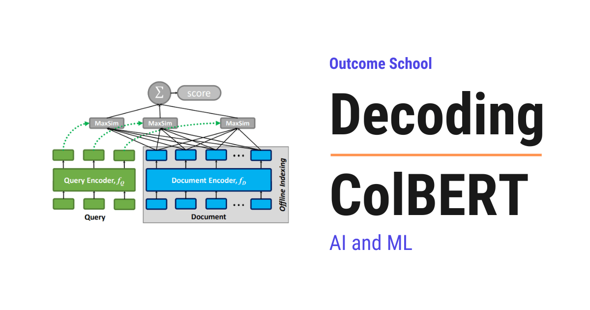

# What is ColBERT? Late Interaction Retrieval Explained

> Archived from <https://outcomeschool.com/blog/decoding-colbert> on 2026-11-25.

ColBERT is a retrieval method that keeps the word-by-word matching of a slow BERT reranker, but makes it fast enough to search millions of passages, using a trick called late interaction.

In this blog, we are going to learn about ColBERT, a retrieval method that keeps the fine-grained, word-by-word matching of a slow BERT reranker but makes it fast enough to search millions of passages, using a clever trick called late interaction.

We will cover the following:
<ul><li>What is the ColBERT paper?</li><li>The building blocks we must know first</li><li>The big picture: what ColBERT does</li><li>The two old extremes</li><li>Late interaction: the key idea</li><li>Encoding the query and document</li><li>The MaxSim operation</li><li>Why max, not average</li><li>Ranking documents</li><li>Training: positives and negatives</li><li>The loss with small numbers</li><li>Fast retrieval at scale</li><li>The cost of a bigger index</li><li>The Results</li><li>Where ColBERT led</li><li>Quick Summary</li></ul>
I am <strong>Amit Shekhar</strong>, Founder @ <a target="_blank" rel="noopener noreferrer" href="https://outcomeschool.com">Outcome School</a>, I have taught and mentored many developers, and their efforts landed them high-paying tech jobs, helped many tech companies in solving their unique problems, and created many open-source libraries being used by top companies. I am passionate about sharing knowledge through open-source, blogs, and videos.

I teach <a target="_blank" rel="noopener noreferrer" href="https://outcomeschool.com/program/ai-and-machine-learning">AI and Machine Learning</a> at Outcome School.

Let&#x27;s get started.
<h2 id="what-is-the-colbert-paper">What is the ColBERT paper?</h2>
<strong>ColBERT encodes the query and each document into a bag of per-token vectors, separately, so documents can be encoded ahead of time. At search time it scores relevance with a cheap operation called MaxSim. This keeps the word-level detail of a slow BERT reranker while being fast enough to search millions of passages.</strong>

ColBERT was introduced in 2020 in the paper &quot;ColBERT: Efficient and Effective Passage Search via Contextualized Late Interaction over BERT&quot; by Omar Khattab and Matei Zaharia at Stanford. The name means <strong>Contextualized Late Interaction over BERT.</strong>

BERT itself is an encoder-only transformer, the half that reads a text in both directions and builds a deep understanding of every token in it. We have a detailed blog on <a target="_blank" rel="noopener noreferrer" href="encoder-vs-decoder-in-transformers.md">Encoder vs Decoder in Transformers</a> that explains how each half works.
<h2 id="the-building-blocks-we-must-know-first">The building blocks we must know first</h2>
Before jumping into the paper, we must know a few simple words. Do not worry, each one is just a plain idea.
<ul><li><strong>Token</strong> - a word or word-piece, the unit the model reads.</li><li><strong><a target="_blank" rel="noopener noreferrer" href="what-are-embeddings.md">Embedding</a></strong> - a vector capturing the meaning of a token.</li><li><strong><a target="_blank" rel="noopener noreferrer" href="cosine-similarity.md">Cosine similarity</a></strong> - a score from -1 to 1 for how aligned two vectors are. For unit-length vectors, it equals their dot product.</li><li><strong><a target="_blank" rel="noopener noreferrer" href="how-does-a-reranker-work.md">Reranker</a></strong> - a model that re-scores a small set of candidate documents for relevance.</li><li><strong>Offline / online</strong> - work done ahead of time (offline) versus at query time (online).</li></ul>
That is everything we need. Now, let&#x27;s move to the big picture.
<h2 id="the-big-picture-what-colbert-does">The big picture: what ColBERT does</h2>
Before going into the details, let&#x27;s see the simple input-to-output view.

<pre><code class="code-highlight">   Document  -&gt;  BERT  -&gt;  a bag of per-token vectors   (done OFFLINE, once)

   Query     -&gt;  BERT  -&gt;  a bag of per-token vectors   (done at query time)
                                  |
                                  v
              cheap MaxSim score between the two bags  -&gt;  relevance
</code></pre>

The whole trick: encode the query and the document <strong>separately</strong> into per-token vectors, so all documents can be pre-computed offline. At query time, only a cheap scoring step runs. Let&#x27;s decode why this is such a good middle ground.
<h2 id="the-two-old-extremes">The two old extremes</h2>
Before ColBERT, BERT-based retrieval came in two flavors, each with a flaw.
<ul><li><strong>Cross-encoder (accurate but slow)</strong>: feed the query and document <strong>together</strong> into BERT, so every query word attends to every document word. Very accurate, but BERT must run from scratch for <strong>every</strong> query-document pair. Nothing can be precomputed. On millions of passages, this is impossibly slow (the paper measured one BERT reranker at over 10 seconds per query).</li><li><strong>Single-vector dual encoder (fast but blunt)</strong>: encode the whole query into <strong>one</strong> vector and the whole document into <strong>one</strong> vector, then take a single dot product. This is the DPR style: fast and precomputable, but squashing a whole passage into one vector loses word-level detail, so quality drops.</li></ul>
Let&#x27;s put the two of them side by side, along with the one ColBERT proposes:

<pre><code class="code-highlight">  1. Cross-encoder  (accurate, slow)

     query + document together  -&gt;  BERT  -&gt;  score
     BERT runs once per pair, nothing can be stored ahead of time

  2. Single-vector dual encoder  (fast, blunt)

     query     -&gt;  BERT  -&gt;  [ one vector ]
                                          &gt;--  one dot product  -&gt;  score
     document  -&gt;  BERT  -&gt;  [ one vector ]

  3. Late interaction, ColBERT  (accurate and fast)

     query     -&gt;  BERT  -&gt;  [ v1  v2  v3 ]
                                          &gt;--  MaxSim  -&gt;  score
     document  -&gt;  BERT  -&gt;  [ v1  v2  v3  v4  v5 ]
</code></pre>

Here, we can see the difference clearly. In the first one, the query and the document go into BERT <strong>together</strong>, so nothing can be stored ahead of time. In the second one, they go in separately, but each side is squeezed into a single vector, so the word-level detail is lost. In the third one, they go in separately <strong>and</strong> each side keeps one vector per token, so we get both.

The second one is the style behind most vector search running today. We have a detailed blog on <a target="_blank" rel="noopener noreferrer" href="how-does-semantic-search-work.md">how Semantic Search works</a> that explains that single-vector flow step by step.

So the question was: <strong>can we keep the word-level detail of the cross-encoder, but still precompute documents like the dual encoder?</strong> The third row is the answer, and we will decode it next.
<h2 id="late-interaction-the-key-idea">Late interaction: the key idea</h2>
ColBERT&#x27;s answer is <strong>late interaction.</strong> Encode the query and document into <strong>bags of per-token vectors</strong>, separately. Because the document encoder never sees the query, every document&#x27;s vectors can be computed <strong>once, offline</strong>, and stored.

The word-level interaction still happens, but <strong>late</strong>: after both sides are encoded, and through a cheap operation instead of inside BERT. This is the difference from the single-vector model, which has almost no token-level interaction at all. ColBERT keeps &quot;every query word can find its match in the document&quot;, just done cheaply.

<strong>Planning your move into AI?</strong>

No matter which tech domain you work in today, with your effort, you can transition to these roles:
<ul><li>AI Engineer</li><li>Forward Deployed Engineer</li><li>AI Agent Engineer</li><li>Harness Engineer</li><li>Voice AI Engineer</li><li>AI Architect</li><li>LLM Engineer</li><li>LLM Inference Engineer</li><li>Gen AI Engineer</li><li>MLOps Engineer</li><li>ML Engineer</li><li>Deep Learning Engineer</li></ul>
Our <a target="_blank" rel="noopener noreferrer" href="https://outcomeschool.com/program/ai-and-machine-learning">AI and Machine Learning Program</a> at Outcome School takes you there.
<h2 id="encoding-the-query-and-document">Encoding the query and document</h2>
A single BERT is shared for both, told which is which by a marker token:
<ul><li>The <strong>query</strong> gets a <code>[Q]</code> marker. Short queries are padded with <code>[MASK]</code> tokens up to a fixed length, and BERT fills those positions with useful extra terms, a kind of learned query expansion.</li><li>The <strong>document</strong> gets a <code>[D]</code> marker, and punctuation tokens are dropped to save space.</li></ul>
Each token vector is then projected down to a small size (128 numbers) and made unit-length. So a document becomes a <strong>matrix</strong> of token vectors, not a single vector. Making the vectors unit-length means cosine similarity is just a dot product:

<pre><code class="code-highlight">q1 = [0.6, 0.8, 0.0]   (length = sqrt(0.36 + 0.64) = 1)
d1 = [0.8, 0.6, 0.0]   (length = sqrt(0.64 + 0.36) = 1)

dot = 0.6*0.8 + 0.8*0.6 + 0.0*0.0 = 0.48 + 0.48 = 0.96
</code></pre>

Because both are unit length, this <code>0.96</code> <strong>is</strong> their cosine similarity.

To learn Tokenization, Embeddings, and Transformer Architecture in depth, check out our <a target="_blank" rel="noopener noreferrer" href="https://outcomeschool.com/program/ai-and-machine-learning">AI and Machine Learning Program</a> at Outcome School.
<h2 id="the-maxsim-operation">The MaxSim operation</h2>
Now the heart of ColBERT: scoring a document with <strong>MaxSim</strong>. This is the one formula of the paper:

<pre><code class="code-highlight">S(q, d) = sum over i of ( max over j of ( Eq_i · Ed_j ) )
</code></pre>

First, let&#x27;s define every symbol:
<ul><li><code>S(q, d)</code> is the relevance score of document <code>d</code> for query <code>q</code></li><li><code>Eq_i</code> is the vector of the i-th query token</li><li><code>Ed_j</code> is the vector of the j-th document token</li><li><code>·</code> is the dot product, which here <strong>is</strong> the cosine similarity, because we made every vector unit length in the previous section</li><li><code>max over j</code> means: for one query token, take its best match across all the document tokens</li><li><code>sum over i</code> means: add up those best matches over all the query tokens</li></ul>
So the rule in plain words is: for <strong>each</strong> query token, find its <strong>best-matching</strong> document token, then <strong>sum</strong> those best matches.

Let&#x27;s compute it with a 2-token query and a 3-token document. We keep the same <code>q1</code> and <code>d1</code> from the previous section, so one of the numbers is already familiar. Our tiny vectors, all unit length:

<pre><code class="code-highlight">Query tokens                Document tokens
q1 = [0.6, 0.8, 0.0]        d1 = [0.8, 0.6, 0.0]
q2 = [0.0, 0.6, 0.8]        d2 = [0.0, 0.0, 1.0]
                            d3 = [1.0, 0.0, 0.0]
</code></pre>

<strong>Step 1:</strong> the dot product of every query token with every document token, term by term.

<pre><code class="code-highlight">q1 · d1 = 0.6*0.8 + 0.8*0.6 + 0.0*0.0 = 0.48 + 0.48 + 0.00 = 0.96
q1 · d2 = 0.6*0.0 + 0.8*0.0 + 0.0*1.0 = 0.00 + 0.00 + 0.00 = 0.00
q1 · d3 = 0.6*1.0 + 0.8*0.0 + 0.0*0.0 = 0.60 + 0.00 + 0.00 = 0.60

q2 · d1 = 0.0*0.8 + 0.6*0.6 + 0.8*0.0 = 0.00 + 0.36 + 0.00 = 0.36
q2 · d2 = 0.0*0.0 + 0.6*0.0 + 0.8*1.0 = 0.00 + 0.00 + 0.80 = 0.80
q2 · d3 = 0.0*1.0 + 0.6*0.0 + 0.8*0.0 = 0.00 + 0.00 + 0.00 = 0.00
</code></pre>

Putting those six numbers into a small table:

<pre><code class="code-highlight">              d1     d2     d3
   q1  -&gt;  [ 0.96   0.00   0.60 ]
   q2  -&gt;  [ 0.36   0.80   0.00 ]
</code></pre>

<strong>Step 2:</strong> take the max along each row, which means the best document token for each query token.

<pre><code class="code-highlight">   q1: max(0.96, 0.00, 0.60) = 0.96   (best match is d1)
   q2: max(0.36, 0.80, 0.00) = 0.80   (best match is d2)
</code></pre>

<strong>Step 3:</strong> sum those maxima.

<pre><code class="code-highlight">   score = 0.96 + 0.80 = 1.76
</code></pre>

So the document scores <code>1.76</code>. In words: each query word found its best home in the document (q1 at d1, q2 at d2), and we added up how well each query word was matched.

Here, we have used 3-number vectors, a 2-token query, and a 3-token document, just for the sake of understanding. In the real ColBERT, every vector has 128 numbers, the query is padded to 32 tokens, and a passage can run to a few hundred tokens, so the table above becomes a 32 by 300 grid of numbers. The steps stay exactly the same.

Let&#x27;s look at the formula once more:

<pre><code class="code-highlight">S(q, d) = sum over i of ( max over j of ( Eq_i · Ed_j ) )
</code></pre>

Now, every part of this formula is clear. The dot product is the similarity of one query token to one document token, the max picks the best document token for that query token, and the sum adds those best matches over the whole query.

<strong>A quick note for you</strong>

No matter which tech domain you work in, get familiar with these topics:
<ul><li>LLM</li><li>RAG</li><li>MCP</li><li>Agent</li><li>Fine-tuning</li><li>Quantization</li></ul>
We put it all together in one video:

<a target="_blank" rel="noopener noreferrer" href="https://www.youtube.com/watch?v=lnfWvX66FUk">AI Engineering Explained: LLM, RAG, MCP, Agent, Fine-Tuning, and Quantization</a>

No need to stop reading - bookmark it and watch later when you get time. Future you will thank you.

Now, let&#x27;s get back to the topic.
<h2 id="why-max-not-average">Why max, not average</h2>
Why take the <strong>max</strong> over document tokens, not the average? Because a document is relevant if it <strong>contains</strong> a good match for a query word, even if most of its other words are unrelated.

Let&#x27;s take the q1 row we just computed and try both.

<pre><code class="code-highlight">q1 similarities to the document: [0.96, 0.00, 0.60]

MaxSim uses:   0.96        (rewards the single strong match)
Average gives: (0.96 + 0.00 + 0.60) / 3 = 1.56 / 3 = 0.52   (dilutes the strong match)
</code></pre>

The average is barely half of the max, and the only thing that changed it is <code>d2</code>, a token that has nothing to do with the query. Now, imagine the same passage with 200 more unrelated tokens. The average would keep falling towards zero, while the max would stay at <code>0.96</code>.

The max captures &quot;does the document contain a token that means the same as this query word?&quot;. An average would drown that strong <code>0.96</code> match in irrelevant tokens. So max is the right choice.
<h2 id="ranking-documents">Ranking documents</h2>
To rank, we compute MaxSim for each candidate and sort. We scored document A at <code>1.76</code> above. Now, take a document B with two tokens:

<pre><code class="code-highlight">b1 = [1.0, 0.0, 0.0]
b2 = [0.8, 0.0, 0.6]
</code></pre>

The same three steps, with the same query tokens:

<pre><code class="code-highlight">q1 · b1 = 0.6*1.0 + 0.8*0.0 + 0.0*0.0 = 0.60
q1 · b2 = 0.6*0.8 + 0.8*0.0 + 0.0*0.6 = 0.48
q2 · b1 = 0.0*1.0 + 0.6*0.0 + 0.8*0.0 = 0.00
q2 · b2 = 0.0*0.8 + 0.6*0.0 + 0.8*0.6 = 0.48

   q1: max(0.60, 0.48) = 0.60
   q2: max(0.00, 0.48) = 0.48

   score(B) = 0.60 + 0.48 = 1.08
</code></pre>

Since <code>1.76 &gt; 1.08</code>, ColBERT ranks document A above document B. The summed maxima turn directly into a ranking. Notice why B lost: neither of its tokens is a strong home for <code>q2</code>, the best it can offer is <code>0.48</code>, while document A had <code>d2</code> sitting at <code>0.80</code>.
<h2 id="training-positives-and-negatives">Training: positives and negatives</h2>
Till now, we have learned how ColBERT scores a document. Now, the question is: where do these vectors come from? BERT does not know by itself that a query token and a document token should point the same way. It has to be taught, and it is taught with examples.

ColBERT is trained on <strong>triples</strong>, and each triple has three parts:

<pre><code class="code-highlight">   &lt;  q  ,  d+  ,  d-  &gt;

   q   =  the query
   d+  =  a passage that DOES answer the query   (the positive)
   d-  =  a passage that does NOT answer it      (the negative)
</code></pre>

For one triple, we run MaxSim twice, once for <code>d+</code> and once for <code>d-</code>, and we get two scores. The training goal is simple to say: <strong>make the score of the positive higher than the score of the negative.</strong>

That&#x27;s the beauty of this training setup. We never tell the model what any individual vector must be. We only tell it which of the two documents should win. Over millions of triples, BERT slowly learns to place a query token and the document tokens that answer it in the same direction, which is exactly what makes <code>q1 · d1 = 0.96</code> possible.

Teaching a model by pulling a positive closer and pushing a negative away is the core idea of <a target="_blank" rel="noopener noreferrer" href="contrastive-learning.md">Contrastive Learning</a>, and we have a detailed blog on it that covers this end to end.
<h2 id="the-loss-with-small-numbers">The loss with small numbers</h2>
To turn &quot;the positive must win&quot; into a number the model can reduce, ColBERT uses a <strong>pairwise softmax <a target="_blank" rel="noopener noreferrer" href="math-behind-cross-entropy-loss.md">cross-entropy loss</a></strong> over the two scores. Let&#x27;s compute it with the two scores we already have.

Let&#x27;s say <code>d+</code> is document A, which scored <code>1.76</code>, and <code>d-</code> is document B, which scored <code>1.08</code>.

<strong>Step 1:</strong> take <code>e</code> to the power of each score.

<pre><code class="code-highlight">e^1.76 = 5.812
e^1.08 = 2.945
</code></pre>

<strong>Step 2:</strong> add them to get the total.

<pre><code class="code-highlight">5.812 + 2.945 = 8.757
</code></pre>

<strong>Step 3:</strong> divide the positive&#x27;s value by the total. This is the softmax probability of picking the right document.

<pre><code class="code-highlight">p = 5.812 / 8.757 = 0.664
</code></pre>

<strong>Step 4:</strong> the loss is the negative natural log of that probability.

<pre><code class="code-highlight">loss = -ln(0.664) = 0.41
</code></pre>

So the loss for this triple is <code>0.41</code>. Now, let&#x27;s see what happens after training pushes the two scores apart, say the positive rises to <code>2.5</code> and the negative falls to <code>0.5</code>:

<pre><code class="code-highlight">e^2.5 = 12.182
e^0.5 = 1.649

p    = 12.182 / (12.182 + 1.649) = 12.182 / 13.831 = 0.881
loss = -ln(0.881) = 0.13
</code></pre>

The loss dropped from <code>0.41</code> to <code>0.13</code>. Here, we can see that the loss only goes down when the <strong>gap</strong> between the positive and the negative grows. That single pressure, applied over millions of triples, is what teaches every token vector where to point.
<h2 id="fast-retrieval-at-scale">Fast retrieval at scale</h2>
MaxSim is not just cheap. It is also <strong>pruning-friendly</strong>. Each query token can independently look up its nearest document tokens in a <a target="_blank" rel="noopener noreferrer" href="how-does-a-vector-database-work.md">vector index</a>, without scoring every document. This lets ColBERT work in two modes:
<ul><li><strong>Reranking</strong>: re-score the top candidates from a cheap first stage.</li><li><strong>End-to-end retrieval</strong>: index all document token vectors and retrieve straight from millions of passages, in two stages (an <a target="_blank" rel="noopener noreferrer" href="how-does-approximate-nearest-neighbor-ann-search-work.md">approximate nearest-neighbor</a> filter, then exact MaxSim on the survivors).</li></ul>
This is exactly what a cross-encoder cannot do, because its document representation depends on the query.

We have a complete program on RAG, Vector Databases, and Embeddings. Check out our <a target="_blank" rel="noopener noreferrer" href="https://outcomeschool.com/program/ai-and-machine-learning">AI and Machine Learning Program</a> at Outcome School, where we also build an AI Tutor from scratch.
<h2 id="the-cost-of-a-bigger-index">The cost of a bigger index</h2>
Every design has a price, and we must be honest about the price ColBERT pays. Storing <strong>one vector per token</strong> instead of one vector per passage makes the index much bigger.

Let&#x27;s compute it for a single passage of 100 tokens:

<pre><code class="code-highlight">Single-vector model:  1 vector   x 128 numbers =     128 numbers
ColBERT:              100 vectors x 128 numbers =  12,800 numbers
</code></pre>

That is 100 times more storage for the same passage. Multiply that by 8.8 million passages and the index for MS MARCO comes to about <strong>154 GB</strong>, while a single-vector index for the same passages fits in a few gigabytes.

So ColBERT buys its accuracy with disk space.

<strong>Stay updated:</strong> Subscribe to our <a target="_blank" rel="noopener noreferrer" href="https://outcomeschool.substack.com/subscribe">newsletter</a> to get our latest AI and Machine Learning blogs straight to your inbox.
<h2 id="the-results">The Results</h2>
ColBERT nearly matched a full BERT reranker&#x27;s quality at a tiny fraction of the cost. On the MS MARCO passage benchmark:
<table><thead><tr><th>Method</th><th>Quality (MRR@10)</th><th>Reranking latency</th></tr></thead><tbody><tr><td>BERT reranker</td><td>34.7</td><td>~10,700 ms</td></tr><tr><td>ColBERT (rerank)</td><td>34.9</td><td>~61 ms</td></tr></tbody></table>
ColBERT was about <strong>170 times faster</strong> with roughly the same quality, and used vastly fewer computations. And run end-to-end over the full 8.8 million passages, it retrieved in well under a second with very high recall, far better quality than the cheap keyword and single-vector methods.
<h2 id="where-colbert-led">Where ColBERT led</h2>
ColBERT created a whole retrieval paradigm. Let&#x27;s decode its legacy, piece by piece.
<ul><li><strong>A third option.</strong> Late interaction (multi-vector) now sits alongside single-vector dense (DPR), learned sparse (SPLADE), and <a target="_blank" rel="noopener noreferrer" href="how-does-hybrid-search-work.md">keyword search</a> as a main retrieval style, a middle ground more accurate than single-vector and far cheaper than a full reranker.</li><li><strong>Smaller indexes.</strong> <strong>ColBERTv2</strong> attacked the storage problem directly with residual compression, storing each vector as a nearby centroid plus a tiny correction. That cut the MS MARCO index from about 154 GB down to roughly 16 to 25 GB, which is a 6 to 10 times reduction, with better quality than the original.</li><li><strong>Faster serving.</strong> <strong>PLAID</strong> made ColBERTv2 practical in production by pruning candidates using those centroids before touching the full vectors, bringing latency down to a few tens of milliseconds.</li><li><strong>Beyond text.</strong> The late-interaction idea spread to images. <strong>ColPali</strong> runs MaxSim over the <a target="_blank" rel="noopener noreferrer" href="decoding-vision-transformer-vit.md">patches</a> of a document <strong>image</strong> (a page screenshot) against the query tokens, enabling visual document retrieval over charts, tables, and scanned pages, without reading the text at all.</li><li><strong>Inside RAG systems.</strong> Late-interaction retrievers are now a common first stage in <a target="_blank" rel="noopener noreferrer" href="retrieval-augmented-generation-rag.md">Retrieval-Augmented Generation</a>, where the quality of what we retrieve decides the quality of what the model answers.</li></ul>
Through it all, the core idea endures: <strong>keep the word-by-word matching, but defer it to a cheap MaxSim so documents can be precomputed and search stays fast.</strong>
<h2 id="quick-summary">Quick Summary</h2>
We have decoded the ColBERT paper piece by piece. Let&#x27;s recap each piece in one line.
<ul><li><strong>ColBERT</strong> encodes query and document into per-token vectors separately, then scores with a cheap MaxSim.</li><li><strong>The two old extremes</strong>: cross-encoders are accurate but unscalably slow, and single-vector models are fast but blunt.</li><li><strong>Late interaction</strong>: keep word-level matching, but run it late and cheaply so documents are precomputed offline.</li><li><strong>Encoding</strong>: a shared BERT with <code>[Q]</code> and <code>[D]</code> markers, projected to 128-number unit vectors (so cosine equals dot product).</li><li><strong>MaxSim</strong>: <code>S(q, d) = sum over i of ( max over j of ( Eq_i · Ed_j ) )</code>, which means for each query token take its best-matching document token, then sum those maxima.</li><li><strong>Why max</strong>: it rewards a document for containing a strong match (0.96), instead of diluting it with an average (0.52).</li><li><strong>Ranking</strong>: document A scored 1.76 beats document B at 1.08.</li><li><strong>Training</strong>: triples of query, positive passage, and negative passage, with the only goal being that the positive must score higher.</li><li><strong>The loss</strong>: a pairwise softmax cross-entropy, which fell from 0.41 to 0.13 as the gap between the two scores grew.</li><li><strong>Fast at scale</strong>: MaxSim is pruning-friendly, enabling both reranking and end-to-end retrieval from millions of passages.</li><li><strong>The cost</strong>: one vector per token makes the index about 100 times bigger, around 154 GB for MS MARCO.</li><li><strong>The results</strong>: about the same quality as a BERT reranker (34.9 vs 34.7 MRR) at roughly 170 times the speed.</li><li><strong>The legacy</strong>: late interaction as a main retrieval paradigm, ColBERTv2 for compressed indexes, PLAID for fast serving, and ColPali for visual document retrieval.</li></ul>
Now, we have decoded ColBERT piece by piece and understood how deferring the word-by-word matching to a cheap MaxSim keeps fine-grained accuracy while scaling to millions of passages.
<h2 id="frequently-asked-questions">Frequently Asked Questions</h2><h3 id="why-can-colbert-precompute-documents-when-a-cross-encoder-cannot">Why can ColBERT precompute documents when a cross-encoder cannot?</h3>
ColBERT can precompute documents because its document encoder never sees the query. So every document&#x27;s token vectors are computed once, offline, and stored. A cross-encoder feeds the query and document together into BERT, so its document representation depends on the query and BERT must run again for every query-document pair.
<h3 id="is-colbert-better-than-a-single-vector-dense-retriever">Is ColBERT better than a single-vector dense retriever?</h3>
ColBERT is more accurate, but it costs more storage. A single-vector model squashes a whole passage into one vector and loses word-level detail. ColBERT keeps one vector per token, which makes the index about 100 times bigger, around 154 GB for MS MARCO instead of a few gigabytes.
<h3 id="can-colbert-be-used-as-a-first-stage-retriever-and-not-just-a-reranker">Can ColBERT be used as a first-stage retriever and not just a reranker?</h3>
Yes. ColBERT can rerank the top candidates from a cheap first stage, or it can do end-to-end retrieval over millions of passages. In end-to-end mode, it uses an approximate nearest-neighbor filter first, then runs exact MaxSim on the survivors. This works because MaxSim is pruning-friendly.
<h3 id="is-colbert-used-in-rag-systems">Is ColBERT used in RAG systems?</h3>
Yes. Late-interaction retrievers are now a common first stage in Retrieval-Augmented Generation. In RAG, the quality of what we retrieve decides the quality of what the model answers. ColBERT keeps word-level matching while staying fast, which makes it a good fit for this stage.
<h3 id="does-late-interaction-work-only-for-text">Does late interaction work only for text?</h3>
No. The late-interaction idea spread to images through ColPali. ColPali runs MaxSim over the patches of a document image, like a page screenshot, against the query tokens. This enables visual document retrieval over charts, tables, and scanned pages without reading the text at all.

That&#x27;s it for now.

Thanks

<strong>Amit Shekhar</strong> Founder @ <a target="_blank" rel="noopener noreferrer" href="https://outcomeschool.com">Outcome School</a>

You can connect with me on:
<ul><li><a target="_blank" rel="noopener noreferrer" href="https://x.com/amitiitbhu">X</a></li><li><a target="_blank" rel="noopener noreferrer" href="https://www.linkedin.com/in/amit-shekhar-iitbhu">LinkedIn</a></li><li><a target="_blank" rel="noopener noreferrer" href="https://github.com/amitshekhariitbhu">GitHub</a></li></ul>
Follow Outcome School on:
<ul><li><a target="_blank" rel="noopener noreferrer" href="https://x.com/outcome_school">X</a></li><li><a target="_blank" rel="noopener noreferrer" href="https://youtube.com/@OutcomeSchool">YouTube</a></li><li><a target="_blank" rel="noopener noreferrer" href="https://www.linkedin.com/company/outcomeschool">LinkedIn</a></li><li><a target="_blank" rel="noopener noreferrer" href="https://github.com/OutcomeSchool">GitHub</a></li></ul>
<a target="_blank" rel="noopener noreferrer" href="https://outcomeschool.com/blog"><strong>Read all of our high-quality blogs here.</strong></a>

