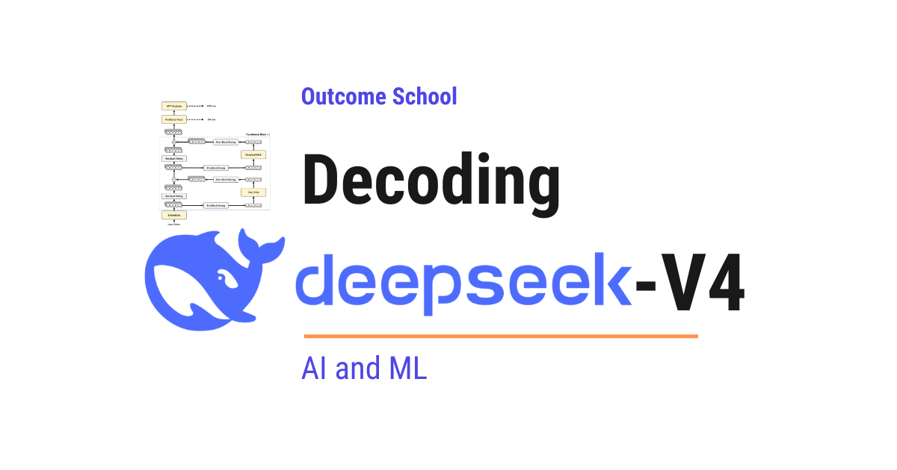

# What is DeepSeek-V4 and How Does It Work? Architecture Explained

> Archived from <https://outcomeschool.com/blog/decoding-deepseek-v4> on 2026-11-25.

DeepSeek-V4 is a family of open Mixture-of-Experts language models that supports a one-million-token context, at roughly a tenth of the cost of DeepSeek-V3.2.

In this blog, we will learn about DeepSeek-V4, the new family of open Mixture-of-Experts language models that natively supports a one-million-token context with dramatically lower inference cost.

DeepSeek-V4 makes one-million-token context roughly a tenth as expensive as it was in DeepSeek-V3.2. It introduces a new attention design, a new way of doing residual connections, a new optimizer, and a new post-training pipeline. We will decode each of these one by one.

We will cover the following:
<ul><li>The Big Picture</li><li>Two Models: DeepSeek-V4-Pro and DeepSeek-V4-Flash</li><li>Hybrid Attention with CSA and HCA</li><li>Manifold-Constrained Hyper-Connections (mHC)</li><li>Muon Optimizer</li><li>FP4 Quantization-Aware Training</li><li>Pre-Training</li><li>Post-Training: Specialist Training and On-Policy Distillation</li><li>Reasoning Modes</li><li>Putting It All Together</li><li>Quick Summary</li></ul>
I am <strong>Amit Shekhar</strong>, Founder @ <a target="_blank" rel="noopener noreferrer" href="https://outcomeschool.com">Outcome School</a>, I have taught and mentored many developers, and their efforts landed them high-paying tech jobs, helped many tech companies in solving their unique problems, and created many open-source libraries being used by top companies. I am passionate about sharing knowledge through open-source, blogs, and videos.

I teach <a target="_blank" rel="noopener noreferrer" href="https://outcomeschool.com/program/ai-and-machine-learning">AI and Machine Learning</a> at Outcome School.

Let&#x27;s get started.
<h2 id="the-big-picture">The Big Picture</h2>
Before we go into the details, let&#x27;s understand the big picture.

DeepSeek-V4 is built to solve one core problem: <strong>make ultra-long context cheap</strong>. Modern <a target="_blank" rel="noopener noreferrer" href="large-reasoning-models.md">reasoning models</a> and AI Agents need to handle very long inputs - long documents, long tool histories, long agent trajectories. The standard attention mechanism in a Transformer <a target="_blank" rel="noopener noreferrer" href="evolution-of-llm-architecture.md">becomes very expensive as the input gets longer</a>. DeepSeek-V4 redesigns attention so that even a one-million-token input remains practical.

In simple words:

<strong>DeepSeek-V4 = DeepSeek-V3 + Hybrid Compressed Attention + Better Residual Connections + Muon Optimizer + On-Policy Distillation.</strong>

Let&#x27;s put this into perspective with real numbers. At a one-million-token context:
<ul><li>DeepSeek-V4-Pro uses only <strong>27%</strong> of the per-token compute of DeepSeek-V3.2.</li><li>DeepSeek-V4-Pro uses only <strong>10%</strong> of the KV cache size of DeepSeek-V3.2.</li><li>DeepSeek-V4-Flash uses only <strong>10%</strong> of the per-token compute and <strong>7%</strong> of the KV cache size of DeepSeek-V3.2.</li></ul>
This is a massive efficiency gain. Now, let&#x27;s decode each piece.
<h2 id="two-models-deepseek-v4-pro-and-deepseek-v4-flash">Two Models: DeepSeek-V4-Pro and DeepSeek-V4-Flash</h2>
DeepSeek-V4 ships as two models. Both are <strong><a target="_blank" rel="noopener noreferrer" href="mixture-of-experts.md">Mixture-of-Experts (MoE)</a></strong> models. In an MoE model, the feed-forward layer is split into many small expert networks, and a router picks only a few experts per token. This is how the total parameter count can be huge while the per-token compute stays small.

Let me tabulate the differences between the two models for your better understanding so that you can decide which one to use based on your use case.
<table><thead><tr><th>Model</th><th>Total Parameters</th><th>Activated Parameters</th><th>Transformer Layers</th><th>Context Length</th><th>Pre-training Tokens</th></tr></thead><tbody><tr><td>DeepSeek-V4-Flash</td><td>284B</td><td>13B</td><td>43</td><td>1M</td><td>32T</td></tr><tr><td>DeepSeek-V4-Pro</td><td>1.6T</td><td>49B</td><td>61</td><td>1M</td><td>33T</td></tr></tbody></table>
Here, &quot;activated&quot; means the parameters that actually run for each input token. In an MoE model, only a small fraction of the experts are active per token, so activated parameters are much smaller than total parameters.

Both models support a context of <strong>one million tokens</strong> natively. Both are trained on more than 32 trillion tokens.

DeepSeek-V4-Pro is the larger, more capable model. DeepSeek-V4-Flash is the smaller, faster, more cost-efficient model.
<h2 id="hybrid-attention-with-csa-and-hca">Hybrid Attention with CSA and HCA</h2>
This is the most important change in DeepSeek-V4. Let&#x27;s understand the problem first.

<strong>The Problem.</strong> Standard attention compares every query token with every other token. Suppose we have N tokens in the input. The cost grows like N x N. At one million tokens, this becomes one trillion comparisons across the full sequence. The KV cache, which is the memory of past keys and values, also grows linearly with N. Both of these become a serious bottleneck for long context.

We have a detailed blog on <a target="_blank" rel="noopener noreferrer" href="kv-cache-in-llms.md">KV Cache in LLMs</a> that explains what KV cache is and why it matters, and another on <a target="_blank" rel="noopener noreferrer" href="kv-cache-compression.md">KV Cache Compression</a> that covers the standard ways to shrink it.

<strong>The Solution.</strong> Here comes the hybrid attention design to the rescue. DeepSeek-V4 introduces two new attention types and uses both of them in an interleaved manner across layers:
<ul><li><strong>CSA (Compressed Sparse Attention)</strong> - lighter compression, but uses sparse selection.</li><li><strong>HCA (Heavily Compressed Attention)</strong> - heavier compression, but keeps attention dense.</li></ul>
Let&#x27;s decode the names first.

<strong>CSA = Compressed + Sparse + Attention.</strong>

<strong>HCA = Heavily + Compressed + Attention.</strong>

The best way to learn this is by taking an example. Let&#x27;s say we are reading a huge library of one million pages and we want to answer a question. Standard attention is like reading every single page from start to end before answering. It works, but it is painfully slow.

CSA and HCA both fix this, but in different ways. We will use this library example throughout to understand both. Let&#x27;s decode each one.
<h3 id="csa-compressed-sparse-attention">CSA: Compressed Sparse Attention</h3>
CSA does two things to make attention cheap.

<strong>Step 1: Compress.</strong> Instead of keeping the KV cache for every single token, CSA combines every <code>m</code> consecutive tokens into one compressed entry using learned softmax weights. Just for the sake of understanding, let&#x27;s say <code>m = 4</code>. So every 4 tokens get combined into 1 entry in the KV cache. The KV cache shrinks by a factor of <code>m</code>.

In our library example, this is like grouping every 4 pages into one summary card. Instead of reading 1 million pages, we now have only 250K summary cards to look at.

<strong>Step 2: Select.</strong> After compression, CSA still does not look at every summary card. It uses a small <strong>Lightning Indexer</strong> to score each compressed entry against the current query, and then picks only the top-k most relevant ones. The Lightning Indexer runs in FP4 precision to keep this scoring step cheap.

In our library example, this is like a quick scanner who flips through the 250K summary cards, scores each one for relevance, and hands us only the top few cards. We then read only those few cards in detail. Most of the library is skipped completely.

For a deeper background on Q, K, V in attention, we have a detailed blog on <a target="_blank" rel="noopener noreferrer" href="math-behind-attention-qkv.md">Math Behind Attention: Q, K, V</a>.

Here is a simple ASCII picture:

<pre><code class="code-highlight">All tokens:    [t1][t2][t3][t4][t5][t6][t7][t8] ...
                |__________|  |__________|
                  group 1       group 2
                     |             |
Compressed:        [C1]          [C2]          [C3] ...
                     |             |             |
Lightning Indexer scores each one against current query
                     |             |             |
                  score=0.9     score=0.2     score=0.8
                     |             |             |
Top-k selection:   [ C1 ]        ( C2 )        [ C3 ]
                   picked        skipped       picked
                     |                           |
                     +-------------+-------------+
                                   |
                                   v
                  Attention runs only on [C1] and [C3]
                         (the picked compressed entries)
</code></pre>

So CSA first compresses many tokens into one, and then picks only the few compressed entries that look most relevant. This is how CSA brings the cost down. Both compute and memory are saved.
<h3 id="hca-heavily-compressed-attention">HCA: Heavily Compressed Attention</h3>
This was all about CSA. Now, let&#x27;s move to HCA.

HCA makes a different trade-off. It compresses much more aggressively, and because the compressed sequence is already tiny, dense attention on it is cheap. No need for sparse selection.

HCA uses a much larger group size <code>m&#x27;</code>, much bigger than <code>m</code> in CSA. For DeepSeek-V4, <code>m&#x27;</code> is set to 128. So instead of combining 4 tokens into one entry, HCA combines 128 tokens into one entry. The KV cache shrinks even more dramatically.

In our library example, this is like grouping every 128 pages into one summary card. Now we have only about 7,800 summary cards in total. Since the number of cards is already very small, we just read all of them, every time. There is no need to pick the top few.

So CSA and HCA are two different design points with the same goal - cheap long-context attention. CSA does mild compression plus sparse top-k selection. HCA does aggressive compression plus dense attention. The result for both: very low compute and very low memory.

This was all about HCA. Now, let&#x27;s see how the actual model uses both.

In DeepSeek-V4, the layers are interleaved. For DeepSeek-V4-Flash, the first two layers use pure <a target="_blank" rel="noopener noreferrer" href="how-does-sliding-window-attention-work.md">sliding window attention</a>, and the rest alternate between CSA and HCA. For DeepSeek-V4-Pro, the first two layers use HCA, and the rest alternate between CSA and HCA. This way, different layers handle long context in slightly different ways, and together they cover both fine-grained selection (CSA) and broad coverage (HCA).

<strong>Planning your move into AI?</strong>

No matter which tech domain you work in today, with your effort, you can transition to these roles:
<ul><li>AI Engineer</li><li>Forward Deployed Engineer</li><li>AI Agent Engineer</li><li>Harness Engineer</li><li>Voice AI Engineer</li><li>AI Architect</li><li>LLM Engineer</li><li>LLM Inference Engineer</li><li>Gen AI Engineer</li><li>MLOps Engineer</li><li>ML Engineer</li><li>Deep Learning Engineer</li></ul>
Our <a target="_blank" rel="noopener noreferrer" href="https://outcomeschool.com/program/ai-and-machine-learning">AI and Machine Learning Program</a> at Outcome School takes you there.
<h3 id="sliding-window-branch">Sliding Window Branch</h3>
Now, a natural question arises - what if compression blurs out important details from very recent tokens?

The answer is the <strong>sliding window branch</strong>. Both CSA and HCA also keep a small extra set of recent uncompressed KV entries. For DeepSeek-V4, this window size is 128 tokens.

In our library example, this is like always keeping the last 128 pages we just read on our desk in full. Compression is used for the older pages, but the most recent pages are right there in front of us, uncompressed and ready to read. This makes sure that local fine-grained dependencies are not lost.
<h3 id="attention-sink">Attention Sink</h3>
One more small but clever trick. In the core attention of both CSA and HCA, DeepSeek-V4 adds a small set of learnable <strong>sink logits</strong> to the denominator of the softmax. This allows each attention head to have attention scores that sum to <em>less than</em> 1.

Why does this help? In standard attention, the scores are forced to sum to exactly 1. This means every query token must distribute all of its attention somewhere, even when nothing in the context is actually relevant. <a target="_blank" rel="noopener noreferrer" href="how-do-attention-sinks-work.md">Attention sinks</a> let the model say &quot;none of these are important right now&quot; and spend less attention overall.

DeepSeek-V4 also applies <a target="_blank" rel="noopener noreferrer" href="rmsnorm-root-mean-square-layer-normalization.md">RMSNorm</a> on the queries and compressed KV entries just before the core attention step. This is what keeps attention logits stable and prevents them from exploding.

<strong>Note:</strong> Put together, CSA, HCA, Sliding Window, and Attention Sink make one trade-off possible: <strong>less memory, less compute, with no major loss in quality</strong>. That is what makes one-million-token context practical.

To learn Attention, KV Cache, and Mixture of Experts, check out our <a target="_blank" rel="noopener noreferrer" href="https://outcomeschool.com/program/ai-and-machine-learning">AI and Machine Learning Program</a> at Outcome School.
<h2 id="manifold-constrained-hyper-connections-mhc">Manifold-Constrained Hyper-Connections (mHC)</h2>
This was all about attention. Now, let&#x27;s move to the residual connections inside the Transformer.

Let&#x27;s decode the name first.

<strong>mHC = Manifold + Constrained + Hyper + Connections.</strong>

In a normal Transformer, every layer adds its output to a &quot;residual stream&quot; - a single shared signal that flows from the bottom of the model to the top. Hyper-Connections (HC) widen this residual stream by a factor of <code>n_hc</code> (set to 4 in DeepSeek-V4), turning the single stream into multiple parallel streams. Three learned matrices (A, B, C) mix these streams at every layer, giving the model more flexibility in how information flows.

The issue with plain HC is that it becomes numerically unstable when we stack many layers. The signal can blow up or collapse. Training breaks down.

So, here comes mHC to the rescue. mHC fixes the problem by <strong>constraining</strong> the residual mapping matrix to lie on a special manifold called the Birkhoff polytope - the set of doubly stochastic matrices. A doubly stochastic matrix is a matrix whose every row sums to 1 and every column sums to 1. This simple constraint bounds the largest stretch factor (the spectral norm) of the matrix at 1, so the signal cannot blow up as it passes through dozens of layers.

The result is that deeper stacks train stably, and the model expressivity is preserved. It works perfectly.
<h2 id="muon-optimizer">Muon Optimizer</h2>
This was all about mHC. Now, let&#x27;s move to the optimizer.

DeepSeek-V4 swaps the optimizer for most of its parameters from <a target="_blank" rel="noopener noreferrer" href="optimizers-in-deep-learning.md">AdamW</a> to <strong>Muon</strong>.

<strong>Muon = An optimizer that uses the full gradient matrix and orthogonalizes the update direction.</strong>

Why does this matter? Most optimizers like AdamW treat each weight independently. Muon, on the other hand, looks at the full gradient matrix and applies an orthogonalization step before doing the weight update. This orthogonalization is done using Newton-Schulz iterations. It normalizes all the singular values of the update matrix to be close to 1, so no single direction in the update dominates. The result is faster convergence and more stable training.

A few important points:
<ul><li>AdamW is still used for the embedding module, the prediction head, all RMSNorm modules, and the static parts of mHC.</li><li>Muon is used for everything else.</li><li>The DeepSeek team uses a hybrid Newton-Schulz iteration with carefully chosen coefficients for stable orthogonalization.</li></ul>
This gives us the best of both worlds. Muon brings faster convergence where it matters, and AdamW stays where it is already proven to work well.

<strong>A quick note for you</strong>

No matter which tech domain you work in, get familiar with these topics:
<ul><li>LLM</li><li>RAG</li><li>MCP</li><li>Agent</li><li>Fine-tuning</li><li>Quantization</li></ul>
We put it all together in one video:

<a target="_blank" rel="noopener noreferrer" href="https://www.youtube.com/watch?v=lnfWvX66FUk">AI Engineering Explained: LLM, RAG, MCP, Agent, Fine-Tuning, and Quantization</a>

No need to stop reading - bookmark it and watch later when you get time. Future you will thank you.

Now, let&#x27;s get back to the topic.
<h2 id="fp4-quantization-aware-training">FP4 Quantization-Aware Training</h2>
Now, let&#x27;s move to how DeepSeek-V4 makes inference faster and cheaper. The answer is <strong>FP4 Quantization-Aware Training</strong>.

Let&#x27;s decode this.
<ul><li><strong>FP4</strong> stands for floating point with only 4 bits per number. Compared to FP8 or BF16, FP4 uses much less memory and bandwidth. It makes our life easier on the hardware side.</li><li><strong><a target="_blank" rel="noopener noreferrer" href="how-does-model-quantization-work.md">Quantization-Aware Training (QAT)</a></strong> means the model is trained while simulating the lower-precision number format, so the weights adapt to the precision loss during training itself. Without QAT, we would squeeze the weights down only at deployment time, and the model would lose quality. With QAT, the model learns to live with low precision.</li></ul>
DeepSeek-V4 applies FP4 to two key places:
<ul><li><strong>MoE expert weights</strong>, which take up most of the GPU memory.</li><li>The <strong>Query-Key (QK) path of the CSA indexer</strong>, where the lightning indexer computes scores in FP4.</li></ul>
There is one more clever detail here. FP8 (E4M3) has 2 more exponent bits than FP4 (E2M1), which gives it a much wider dynamic range. Because of this, the FP4 block scale factors can be fully absorbed into the FP8 format during dequantization. This means the FP4-to-FP8 dequantization is <strong>lossless</strong>, and the entire existing FP8 training pipeline can be reused without any modification.

The end result is a 2x speedup on the top-k selector while preserving a 99.7% recall of KV entries. There is no major quality loss.

To master Quantization, Model Compression, and LLM Fundamentals in depth, check out our <a target="_blank" rel="noopener noreferrer" href="https://outcomeschool.com/program/ai-and-machine-learning">AI and Machine Learning Program</a> at Outcome School.
<h2 id="pre-training">Pre-Training</h2>
Now that we have learned about the architecture and optimizer, it&#x27;s time to learn about <a target="_blank" rel="noopener noreferrer" href="llm-pretraining.md">pre-training</a>.

<strong>Data.</strong> The pre-training corpus has more than <strong>32 trillion tokens</strong>. It includes mathematical content, code, web pages, long documents, scientific papers, and multilingual data. The team puts a special emphasis on long-document curation since the model is built for long context.

<strong>Sequence length scheduling.</strong> Training does not start at one-million tokens directly. First, the model trains at a sequence length of 4K. Then, the length is extended to 16K. After that, to 64K. Finally, to 1M. Sparse attention is also turned on gradually. The model first warms up with dense attention for the first 1T tokens, and sparse attention is introduced at 64K and kept on for the rest of the training.

<strong>Mitigating Training Instability.</strong> Training trillion-parameter MoE models is hard. Loss spikes happen. But here is the catch - simple rollbacks do not prevent the next spike from happening. The DeepSeek team found two practical tricks that fix this:
<ul><li><strong>Anticipatory Routing.</strong> The MoE routing network at step <code>t</code> is computed using slightly older parameters <code>θ_{t-Δt}</code>, while the rest of the backbone uses the current parameters <code>θ_t</code>. This asymmetry breaks the feedback loop where bad routing causes outliers, which then cause worse routing.</li><li><strong>SwiGLU Clamping.</strong> The output of the SwiGLU activation is clamped to a fixed range. This prevents extreme values from appearing and destabilizing training.</li></ul>
With these two tricks in place, training stays stable all the way through.

<strong>Stay updated:</strong> Subscribe to our <a target="_blank" rel="noopener noreferrer" href="https://outcomeschool.substack.com/subscribe">newsletter</a> to get our latest AI and Machine Learning blogs straight to your inbox.
<h2 id="post-training-specialist-training-and-on-policy-distillation">Post-Training: Specialist Training and On-Policy Distillation</h2>
Till now, we have learned about pre-training. Now, it&#x27;s time to learn about post-training.

Post-training is where DeepSeek-V4 takes a different path from many other models. The pipeline has two stages. Let&#x27;s decode each one.
<h3 id="stage-1-specialist-training">Stage 1: Specialist Training</h3>
For each target domain like mathematics, coding, agent use, instruction following, and etc., the DeepSeek team trains a separate <strong>expert model</strong>. Each expert model is built in two steps.

First, the base model goes through <a target="_blank" rel="noopener noreferrer" href="how-does-fine-tuning-work.md">Supervised Fine-Tuning (SFT)</a> on high-quality, domain-specific data. This establishes the foundational capability for that domain. Then, <a target="_blank" rel="noopener noreferrer" href="reinforcement-learning.md">Reinforcement Learning</a> is applied using <strong><a target="_blank" rel="noopener noreferrer" href="group-relative-policy-optimization-grpo.md">GRPO (Group Relative Policy Optimization)</a></strong>, guided by domain-specific reward signals. This sharpens the model for the specific success criteria of that domain.

After this stage, the team has multiple specialist expert models - one per domain, each trained for varying reasoning efforts - each excelling in its own field.

This was all about Stage 1. Now, let&#x27;s move to Stage 2.
<h3 id="stage-2-on-policy-distillation-opd">Stage 2: On-Policy Distillation (OPD)</h3>
Now, a natural question arises - how do we combine all these expert models into one final unified model?

The answer is <strong>On-Policy Distillation (OPD)</strong>.

In simple words:

<strong>On-Policy Distillation = The student model generates its own outputs, and learns to match the probability distribution of the right teacher expert for each task.</strong>

Let&#x27;s understand what makes OPD different from <a target="_blank" rel="noopener noreferrer" href="how-does-knowledge-distillation-work.md">regular distillation</a>.

In regular distillation, the student learns from data that the teacher produced. But there is one catch - the student never sees the kind of outputs it actually produces at inference time. This creates a gap between training and real behavior.

In OPD, the student samples its own trajectories. This is the &quot;on-policy&quot; part. The student writes its own drafts, and the teacher corrects each token by providing the full vocabulary distribution it would have used. The student is pulled towards the teacher&#x27;s distribution using <strong>reverse KL loss</strong>. Reverse KL is mode-seeking - it pushes the student to concentrate probability mass where the teacher&#x27;s mass is concentrated, rather than smearing out across all teacher modes. This gives sharper, more decisive outputs.

Also, different teachers are weighted based on the task. For a math task, the math expert teaches more. For a coding task, the coding expert teaches more. This way, all the specialist knowledge gets merged into one single unified student.

This step replaces the traditional mixed RL stage that DeepSeek-V3.2 used. The team found that OPD gives more stable and faithful knowledge transfer than weight merging or mixed RL, which is why it became the core consolidation step in the DeepSeek-V4 post-training pipeline.

We have a complete program on Fine-tuning, Knowledge Distillation, and RLHF - check out our <a target="_blank" rel="noopener noreferrer" href="https://outcomeschool.com/program/ai-and-machine-learning">AI and Machine Learning Program</a> at Outcome School.
<h2 id="reasoning-modes">Reasoning Modes</h2>
This was all about post-training. Now, let&#x27;s move to how DeepSeek-V4 actually serves users at inference time.

DeepSeek-V4 supports three reasoning modes that the user can pick depending on how hard the task is. Let me tabulate the differences between them for your better understanding so that you can decide which one to use based on your use case.
<table><thead><tr><th>Reasoning Mode</th><th>When to Use</th><th>How it Works</th></tr></thead><tbody><tr><td>Non-think</td><td>Routine daily tasks, quick answers</td><td>No <code>&lt;think&gt;</code> block, direct response</td></tr><tr><td>Think High</td><td>Complex problem-solving, planning</td><td><code>&lt;think&gt;</code> block with conscious reasoning</td></tr><tr><td>Think Max</td><td>Pushing reasoning to its limit</td><td>Long <code>&lt;think&gt;</code> block with a special &quot;absolute maximum&quot; instruction injected</td></tr></tbody></table>
For <strong>Think Max</strong> mode, the injected system prompt essentially tells the model: <em>Reasoning effort is set to absolute maximum with no shortcuts permitted. Be very thorough, decompose the problem to its root cause, rigorously stress-test your logic against all edge cases and adversarial scenarios, and write out every intermediate step, considered alternative, and rejected hypothesis explicitly.</em> This instruction stretches the reasoning as far as it can go.

This way, the model can be cheap when the question is easy, and slow but powerful when the question is hard. We get to control the trade-off based on our use case.
<h2 id="putting-it-all-together">Putting It All Together</h2>
Now, let&#x27;s put everything together to see how DeepSeek-V4 runs end to end.

In one sentence: a token enters the embedding layer, flows through many Transformer blocks (each one alternating CSA/HCA attention with a DeepSeekMoE feed-forward layer, both wrapped by mHC residual connections), and exits through the prediction head and MTP modules.

Here is the high-level architecture of one Transformer block in DeepSeek-V4:

<pre><code class="code-highlight">                    Input Tokens
                         |
                     Embedding
                         |
        +----------------|----------------+
        |          Pre-Block Mixing       |
        |                |                |
        |             CSA / HCA           |   &lt;- Hybrid Attention
        |                |                |
        |          Post-Block Mixing      |
        |                |                |
        |          Residual Mixing        |   &lt;- mHC residuals
        |                |                |
        |          Pre-Block Mixing       |
        |                |                |
        |           DeepSeekMoE           |   &lt;- Mixture of Experts FFN
        |                |                |
        |          Post-Block Mixing      |
        |                |                |
        |          Residual Mixing        |   &lt;- mHC residuals
        +----------------|----------------+
                  (repeat for L layers)
                         |
                    Prediction Head
                         |
                    MTP Modules           &lt;- Multi-Token Prediction
                         |
                       Output
</code></pre>

At the top of the stack, a prediction head and <strong>MTP (Multi-Token Prediction)</strong> modules produce the output. MTP allows the model to predict more than one token at a time during training, which improves data efficiency, and at inference it can also serve as a built-in drafter for <a target="_blank" rel="noopener noreferrer" href="speculative-decoding.md">Speculative Decoding</a>. We have a detailed blog on <a target="_blank" rel="noopener noreferrer" href="decoding-medusa.md">Medusa</a> that explains how extra prediction heads like these speed up generation without a separate draft model.

This is how DeepSeek-V4 runs end to end - combining strong capability with one-million-token efficiency.
<h2 id="quick-summary">Quick Summary</h2>
Let&#x27;s recap what we have decoded:
<ul><li><strong>DeepSeek-V4</strong> is a family of open MoE language models built for ultra-long context. Two variants: <strong>V4-Pro (1.6T total, 49B active)</strong> and <strong>V4-Flash (284B total, 13B active)</strong>, both natively supporting <strong>1M tokens</strong>.</li><li><strong>Hybrid Attention</strong> combines <strong>CSA (Compressed Sparse Attention)</strong> and <strong>HCA (Heavily Compressed Attention)</strong> in an interleaved manner. CSA compresses tokens into groups and then picks top-k. HCA compresses even more but keeps attention dense. A small sliding window keeps recent tokens uncompressed, and learnable attention sinks keep attention logits stable.</li><li><strong>mHC (Manifold-Constrained Hyper-Connections)</strong> widens the residual stream by <code>n_hc=4</code> and constrains the mixing matrix to the Birkhoff polytope (doubly stochastic matrices, rows and columns summing to 1), which bounds the spectral norm at 1 for stable deep training.</li><li><strong>Muon Optimizer</strong> orthogonalizes the gradient update matrix using Newton-Schulz iterations, normalizing all singular values close to 1 for balanced, faster convergence. AdamW is still used for embeddings and a few other modules.</li><li><strong>FP4 Quantization-Aware Training</strong> is applied to MoE expert weights and the CSA indexer, with a lossless FP4-to-FP8 dequantization that reuses the existing FP8 pipeline unchanged.</li><li><strong>Pre-training</strong> uses 32T+ tokens with a sequence length schedule that grows from 4K to 1M, plus <strong>Anticipatory Routing</strong> and <strong>SwiGLU Clamping</strong> to fix loss spikes.</li><li><strong>Post-training</strong> has two stages: <strong>Specialist Training</strong> (SFT + GRPO per domain) followed by <strong>On-Policy Distillation (OPD)</strong> that merges all specialists into one unified student model.</li><li><strong>Three reasoning modes</strong> - Non-think, Think High, Think Max - let the user trade off cost and depth.</li><li><strong>Net result:</strong> at 1M-token context, DeepSeek-V4-Pro uses only 27% of the FLOPs and 10% of the KV cache of DeepSeek-V3.2. DeepSeek-V4-Flash pushes this further to 10% FLOPs and 7% KV cache.</li></ul>
This is how the DeepSeek-V4 series ushers in a new era of million-length contexts for open large language models.
<h2 id="frequently-asked-questions">Frequently Asked Questions</h2><h3 id="should-we-use-deepseek-v4-pro-or-deepseek-v4-flash">Should we use DeepSeek-V4-Pro or DeepSeek-V4-Flash?</h3>
We should pick DeepSeek-V4-Pro when we need the larger, more capable model, and DeepSeek-V4-Flash when we need a smaller, faster, more cost-efficient model. Pro has 1.6T total and 49B activated parameters, while Flash has 284B total and 13B activated. Both support a context of one million tokens.
<h3 id="how-is-deepseek-v4-different-from-deepseek-v3">How is DeepSeek-V4 different from DeepSeek-V3?</h3>
DeepSeek-V4 is DeepSeek-V3 plus Hybrid Compressed Attention, better residual connections, the Muon optimizer, and On-Policy Distillation. At a one-million-token context, DeepSeek-V4-Pro uses only 27% of the per-token compute and 10% of the KV cache size of DeepSeek-V3.2. It also replaces the mixed RL stage of DeepSeek-V3.2 with On-Policy Distillation.
<h3 id="does-fp4-quantization-reduce-the-quality-of-deepseek-v4">Does FP4 quantization reduce the quality of DeepSeek-V4?</h3>
Not in a major way, since there is no major quality loss. The model is trained with Quantization-Aware Training, so the weights adapt to the lower precision during training itself. FP4 gives a 2x speedup on the top-k selector while preserving a 99.7% recall of KV entries.
<h3 id="does-deepseek-v4-use-the-muon-optimizer-for-every-parameter">Does DeepSeek-V4 use the Muon optimizer for every parameter?</h3>
No. Muon is used for most parameters, but AdamW is still used for the embedding module, the prediction head, all RMSNorm modules, and the static parts of mHC. This gives the best of both worlds. Muon brings faster convergence where it matters, and AdamW stays where it is already proven to work well.
<h3 id="why-is-on-policy-distillation-better-than-regular-distillation">Why is on-policy distillation better than regular distillation?</h3>
On-policy distillation closes the gap between training and real behavior. In regular distillation, the student learns from data the teacher produced, so it never sees the kind of outputs it actually produces at inference time. In on-policy distillation, the student samples its own outputs, and the teacher corrects each token.

That&#x27;s it for now.

Thanks

<strong>Amit Shekhar</strong> Founder @ <a target="_blank" rel="noopener noreferrer" href="https://outcomeschool.com">Outcome School</a>

You can connect with me on:
<ul><li><a target="_blank" rel="noopener noreferrer" href="https://x.com/amitiitbhu">X</a></li><li><a target="_blank" rel="noopener noreferrer" href="https://www.linkedin.com/in/amit-shekhar-iitbhu">LinkedIn</a></li><li><a target="_blank" rel="noopener noreferrer" href="https://github.com/amitshekhariitbhu">GitHub</a></li></ul>
Follow Outcome School on:
<ul><li><a target="_blank" rel="noopener noreferrer" href="https://x.com/outcome_school">X</a></li><li><a target="_blank" rel="noopener noreferrer" href="https://youtube.com/@OutcomeSchool">YouTube</a></li><li><a target="_blank" rel="noopener noreferrer" href="https://www.linkedin.com/company/outcomeschool">LinkedIn</a></li><li><a target="_blank" rel="noopener noreferrer" href="https://github.com/OutcomeSchool">GitHub</a></li></ul>
<a target="_blank" rel="noopener noreferrer" href="https://outcomeschool.com/blog"><strong>Read all of our high-quality blogs here.</strong></a>

