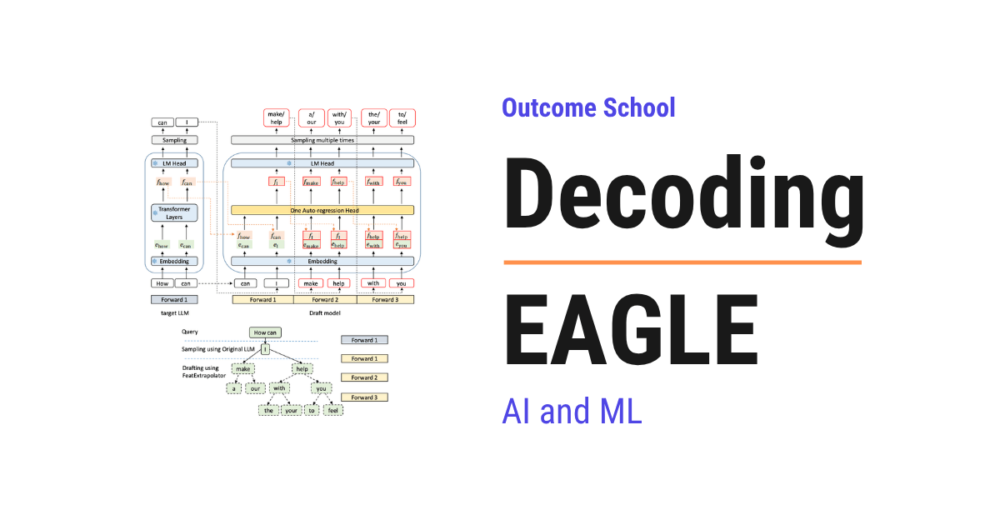

# What is EAGLE? Feature-Level Speculative Decoding Explained

> Archived from <https://outcomeschool.com/blog/decoding-eagle> on 2026-11-25.

EAGLE is a speculative decoding method that makes a language model generate text faster without changing its output at all. It guesses the future tokens at the level of the model&#x27;s internal features, not at the level of words.

In this blog, we will learn about EAGLE, a state-of-the-art way to speed up language model generation by drafting tokens at the feature level instead of the token level.

We will cover the following:
<ul><li>What is EAGLE?</li><li>A quick recap of speculative decoding</li><li>The problem with token-level drafting</li><li>The big idea: draft at the feature level</li><li>Resolving the uncertainty by feeding back the token</li><li>The math behind the speedup with small numbers</li><li>EAGLE-2 and dynamic draft trees</li><li>How EAGLE lives on today</li><li>Quick Summary</li></ul>
I am <strong>Amit Shekhar</strong>, Founder @ <a target="_blank" rel="noopener noreferrer" href="https://outcomeschool.com">Outcome School</a>, I have taught and mentored many developers, and their efforts landed them high-paying tech jobs, helped many tech companies in solving their unique problems, and created many open-source libraries being used by top companies. I am passionate about sharing knowledge through open-source, blogs, and videos.

I teach <a target="_blank" rel="noopener noreferrer" href="https://outcomeschool.com/program/ai-and-machine-learning">AI and Machine Learning</a> at Outcome School.

Let&#x27;s get started.

EAGLE was introduced in 2024 in the research papers &quot;EAGLE: Speculative Sampling Requires Rethinking Feature Uncertainty&quot; and its follow-up &quot;EAGLE-2&quot;, by Yuhui Li and collaborators at Peking University, Microsoft Research, and the University of Waterloo.

EAGLE is among the fastest lossless ways to speed up text generation, and it is built into many serving systems. It improves on earlier methods with one key insight about where to do the drafting. So, let&#x27;s decode it piece by piece.
<h2 id="what-is-eagle">What is EAGLE?</h2>
EAGLE is a speculative decoding method, a way to make a language model generate text faster without changing its output at all.

It works by having a small, cheap draft step guess several future tokens, which the big model then checks all at once. EAGLE&#x27;s twist is that it does the guessing at the level of the model&#x27;s internal <strong>features</strong>, not at the level of words. This makes the guesses much more accurate, which leads to a bigger speedup.
<h2 id="a-quick-recap-of-speculative-decoding">A quick recap of speculative decoding</h2>
We covered <a target="_blank" rel="noopener noreferrer" href="speculative-decoding.md">speculative decoding</a> and <a target="_blank" rel="noopener noreferrer" href="decoding-medusa.md">Medusa</a> before. The short version: generating text one token at a time is slow because each token needs a full pass through the big model. That slow, one-token-at-a-time stage is the decode phase of inference. We have a detailed blog on <a target="_blank" rel="noopener noreferrer" href="prefill-vs-decode-llm-inference-optimization.md">Prefill vs Decode</a> that explains why it is the bottleneck.

Speculative decoding fixes this by cheaply guessing several tokens ahead, then letting the big model verify them all in a single pass. If the guesses are right, we get several tokens for the cost of one verification. The better the guesses, the more tokens are accepted, and the bigger the speedup.

So the whole game is making accurate guesses cheaply. EAGLE found a better place to make them.
<h2 id="the-problem-with-token-level-drafting">The problem with token-level drafting</h2>
Earlier methods, like <a target="_blank" rel="noopener noreferrer" href="decoding-medusa.md">Medusa</a>, guess the next tokens directly. But predicting the exact next token is hard and uncertain.

Why? Because of sampling. Even the big model does not output one token, it outputs a probability distribution, and the actual token is <a target="_blank" rel="noopener noreferrer" href="how-does-temperature-control-llm-output.md">sampled from it with some randomness</a>. Predicting which token will be sampled is inherently noisy. So token-level guesses are often wrong, and wrong guesses get rejected, which limits the speedup.

We wanted a more predictable thing to guess. EAGLE found one.

<strong>Planning your move into AI?</strong>

No matter which tech domain you work in today, with your effort, you can transition to these roles:
<ul><li>AI Engineer</li><li>Forward Deployed Engineer</li><li>AI Agent Engineer</li><li>Harness Engineer</li><li>Voice AI Engineer</li><li>AI Architect</li><li>LLM Engineer</li><li>LLM Inference Engineer</li><li>Gen AI Engineer</li><li>MLOps Engineer</li><li>ML Engineer</li><li>Deep Learning Engineer</li></ul>
Our <a target="_blank" rel="noopener noreferrer" href="https://outcomeschool.com/program/ai-and-machine-learning">AI and Machine Learning Program</a> at Outcome School takes you there.
<h2 id="the-big-idea-draft-at-the-feature-level">The big idea: draft at the feature level</h2>
EAGLE&#x27;s insight is to guess the next <strong>feature</strong> instead of the next token.

A feature here means the model&#x27;s internal hidden state, the rich vector it computes in its second-to-last layer, just before it turns that vector into a token. EAGLE observed that this feature sequence is much more <strong>regular and predictable</strong> than the token sequence. The randomness of sampling happens at the very last step, token selection, but the features flowing underneath are smooth.

So EAGLE trains a small, lightweight draft network that <a target="_blank" rel="noopener noreferrer" href="autoregressive-models.md">autoregresses</a> at the feature level: it predicts the next feature from the previous features, and only at the end maps features to tokens. Because features are more predictable than tokens, these drafts are far more accurate, so more of them get accepted by the big model.

<pre><code class="code-highlight">Medusa style:   guess the next TOKEN directly        (noisy, often rejected)
EAGLE style:    guess the next FEATURE, then the token (smooth, often accepted)
</code></pre>
<h2 id="resolving-the-uncertainty-by-feeding-back-the-token">Resolving the uncertainty by feeding back the token</h2>
There is a subtlety EAGLE had to fix, which gives the first paper its name: feature uncertainty.

The next feature actually depends on which token was sampled at the previous step. If we do not know the sampled token, the next feature is uncertain. EAGLE solves this by feeding the previously sampled token back into the draft network, along with the features.

So the draft network looks at both the smooth feature stream and the actual token that was just chosen, which removes the uncertainty and lets it predict the next feature accurately. This combination is what makes EAGLE&#x27;s drafts so good.

<strong>A quick note for you</strong>

No matter which tech domain you work in, get familiar with these topics:
<ul><li>LLM</li><li>RAG</li><li>MCP</li><li>Agent</li><li>Fine-tuning</li><li>Quantization</li></ul>
We put it all together in one video:

<a target="_blank" rel="noopener noreferrer" href="https://www.youtube.com/watch?v=lnfWvX66FUk">AI Engineering Explained: LLM, RAG, MCP, Agent, Fine-Tuning, and Quantization</a>

No need to stop reading - bookmark it and watch later when you get time. Future you will thank you.

Now, let&#x27;s get back to the topic.
<h2 id="the-math-behind-the-speedup-with-small-numbers">The math behind the speedup with small numbers</h2>
The speedup of any speculative method is simply how many tokens get accepted per verification pass, on average. We saw this with <a target="_blank" rel="noopener noreferrer" href="decoding-medusa.md">Medusa</a>.

Suppose token-level drafting gets, on average, <code>2.5</code> tokens accepted per pass:

<pre><code class="code-highlight">token-level speedup = about 2.5 times
</code></pre>

Because EAGLE&#x27;s feature-level drafts are more accurate, more of them survive verification. Suppose it gets <code>3.5</code> tokens accepted per pass:

<pre><code class="code-highlight">feature-level speedup = about 3.5 times
</code></pre>

The whole gain comes from a higher acceptance rate: more guessed tokens are correct, so more are kept per pass. And because every kept token is still verified against the big model, the final output is exactly what the big model would have produced. The speedup is free in quality.

<strong>Note:</strong> Acceptance counts of <code>2.5</code> and <code>3.5</code> are just for the sake of understanding, so we can see the relationship. Real numbers depend on the model and task. The rule, more accurate drafts mean more accepted tokens mean more speedup, stays exactly the same.
<h2 id="eagle-2-and-dynamic-draft-trees">EAGLE-2 and dynamic draft trees</h2>
EAGLE-2 added another improvement. Instead of a fixed shape of guesses, it builds a <strong>dynamic draft tree</strong>.

The draft network does not just guess one chain of tokens. It guesses a tree of likely continuations. EAGLE-2 makes this tree <strong>context-aware</strong>: it spends more guesses where the draft network is confident and fewer where it is unsure, and it shapes the tree on the fly for each input. This squeezes out even more accepted tokens per pass, pushing the speedup higher, while still being lossless.

To learn Speculative Decoding, KV Cache, LLM Internals, vLLM, and to build a Large Language Model (LLM) from scratch, check out our <a target="_blank" rel="noopener noreferrer" href="https://outcomeschool.com/program/ai-and-machine-learning">AI and Machine Learning Program</a> at Outcome School.
<h2 id="how-eagle-lives-on-today">How EAGLE lives on today</h2>
EAGLE is one of the leading speculative decoding methods in practice.
<ul><li>It gives <strong>some of the highest lossless speedups</strong> available, often around <code>3</code> to <code>4</code> times faster generation, and is widely adopted.</li><li>It is supported in major serving systems like <a target="_blank" rel="noopener noreferrer" href="how-does-vllm-work.md"><strong>vLLM</strong></a>, <a target="_blank" rel="noopener noreferrer" href="how-does-sglang-work.md"><strong>SGLang</strong></a>, and <a target="_blank" rel="noopener noreferrer" href="how-does-tensorrt-llm-work.md"><strong>TensorRT-LLM</strong></a>, so many production deployments use it.</li><li>Its core lesson, that drafting at the smoother feature level beats drafting at the noisy token level, influenced later fast-inference research, and it was extended further in EAGLE-3.</li></ul>
Speculative decoding is one piece of a much bigger toolkit for fast serving. We have a detailed blog on <a target="_blank" rel="noopener noreferrer" href="llm-inference-optimization.md">LLM Inference Optimization</a> that covers these techniques end to end.

So EAGLE took the powerful idea of speculative decoding and made it sharper by guessing the model&#x27;s smooth internal features instead of its noisy output tokens, getting more accepted tokens and a bigger speedup for free.

<strong>Stay updated:</strong> Subscribe to our <a target="_blank" rel="noopener noreferrer" href="https://outcomeschool.substack.com/subscribe">newsletter</a> to get our latest AI and Machine Learning blogs straight to your inbox.
<h2 id="quick-summary">Quick Summary</h2><ul><li><strong>EAGLE</strong> is a state-of-the-art speculative decoding method that speeds up generation losslessly.</li><li><a target="_blank" rel="noopener noreferrer" href="speculative-decoding.md">Speculative decoding</a> guesses several tokens cheaply and verifies them in one pass, so better guesses mean more speedup.</li><li>Guessing the exact next <strong>token</strong> is noisy because of sampling randomness, which limits earlier methods like <a target="_blank" rel="noopener noreferrer" href="decoding-medusa.md">Medusa</a>.</li><li>EAGLE&#x27;s big idea is to draft at the <strong>feature level</strong>, the smooth internal hidden state, which is far more predictable than tokens.</li><li>It resolves <strong>feature uncertainty</strong> by feeding the previously sampled token back into the draft network.</li><li>The speedup equals the <strong>average accepted tokens per pass</strong>, and more accurate feature-level drafts raise it, for example from <code>2.5</code> to <code>3.5</code> times.</li><li><strong>EAGLE-2</strong> adds context-aware <strong>dynamic draft trees</strong> for even more speedup, and EAGLE is used in vLLM, SGLang, and TensorRT-LLM.</li></ul>
Now, we have decoded EAGLE piece by piece and understood how drafting smooth internal features instead of noisy tokens makes speculative decoding faster while keeping the output identical.
<h2 id="frequently-asked-questions">Frequently Asked Questions</h2><h3 id="does-eagle-change-the-output-of-the-language-model">Does EAGLE change the output of the language model?</h3>
No. EAGLE makes generation faster without changing the output at all. Every drafted token is still verified against the big model, so the final output is exactly what the big model would have produced. The speedup is free in quality.
<h3 id="is-eagle-better-than-medusa">Is EAGLE better than Medusa?</h3>
Yes. EAGLE usually gets a bigger speedup than Medusa. Medusa guesses the next tokens directly, and token-level guesses are noisy because of sampling randomness, so many get rejected. EAGLE guesses the next feature, which is smoother and more predictable, so more drafts are accepted per pass.
<h3 id="how-much-faster-does-eagle-make-text-generation">How much faster does EAGLE make text generation?</h3>
EAGLE often gives around 3 to 4 times faster generation. This is among the highest lossless speedups available. The exact number depends on the model and task, since the speedup equals the average number of tokens accepted per verification pass.
<h3 id="is-eagle-used-in-production-serving-systems">Is EAGLE used in production serving systems?</h3>
Yes. EAGLE is supported in major serving systems like vLLM, SGLang, and TensorRT-LLM, so many production deployments use it. It is one of the leading speculative decoding methods in practice, and it was extended further in EAGLE-3.

That&#x27;s it for now.

Thanks

<strong>Amit Shekhar</strong> Founder @ <a target="_blank" rel="noopener noreferrer" href="https://outcomeschool.com">Outcome School</a>

You can connect with me on:
<ul><li><a target="_blank" rel="noopener noreferrer" href="https://x.com/amitiitbhu">X</a></li><li><a target="_blank" rel="noopener noreferrer" href="https://www.linkedin.com/in/amit-shekhar-iitbhu">LinkedIn</a></li><li><a target="_blank" rel="noopener noreferrer" href="https://github.com/amitshekhariitbhu">GitHub</a></li></ul>
Follow Outcome School on:
<ul><li><a target="_blank" rel="noopener noreferrer" href="https://x.com/outcome_school">X</a></li><li><a target="_blank" rel="noopener noreferrer" href="https://youtube.com/@OutcomeSchool">YouTube</a></li><li><a target="_blank" rel="noopener noreferrer" href="https://www.linkedin.com/company/outcomeschool">LinkedIn</a></li><li><a target="_blank" rel="noopener noreferrer" href="http://github.com/OutcomeSchool">GitHub</a></li></ul>
<a target="_blank" rel="noopener noreferrer" href="https://outcomeschool.com/blog"><strong>Read all of our high-quality blogs here.</strong></a>

