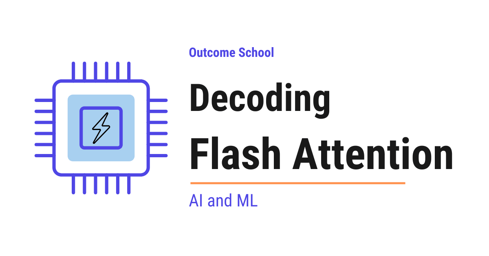

# What is Flash Attention and Why Is It So Fast?

> Archived from <https://outcomeschool.com/blog/decoding-flash-attention> on 2026-11-25.

Flash Attention computes the same attention that Transformers already use, but in a much faster and more memory-efficient way on the GPU. It does not change the math, and it does not change the result.

In this blog, we will learn about Flash Attention by decoding it piece by piece - understanding why standard attention is slow, what makes Flash Attention fast, how it uses GPU memory cleverly, and why it is used in almost every modern Large Language Model (LLM).

When we hear &quot;Flash Attention&quot;, it sounds complex. But do not worry. If we break it down into its individual parts, every single piece is simple. Our goal is to decode Flash Attention so clearly that by the end, we will be able to explain it to anyone.

We will cover the following:
<ul><li>A quick recap of standard attention</li><li>Why standard attention is slow</li><li>How GPU memory actually works (HBM vs SRAM)</li><li>The core idea behind Flash Attention</li><li>Tiling: breaking the work into small blocks</li><li>Online softmax: computing softmax without the full matrix</li><li>Recomputation in the backward pass</li><li>Flash Attention 2</li><li>Flash Attention 3</li><li>Advantages and impact of Flash Attention</li></ul>
I am <strong>Amit Shekhar</strong>, Founder @ <a target="_blank" rel="noopener noreferrer" href="https://outcomeschool.com">Outcome School</a>, I have taught and mentored many developers, and their efforts landed them high-paying tech jobs, helped many tech companies in solving their unique problems, and created many open-source libraries being used by top companies. I am passionate about sharing knowledge through open-source, blogs, and videos.

I teach <a target="_blank" rel="noopener noreferrer" href="https://outcomeschool.com/program/ai-and-machine-learning">AI and Machine Learning</a> at Outcome School.

Let&#x27;s get started.
<h2 id="the-big-picture">The Big Picture</h2>
Before we go into the details, let&#x27;s understand the big picture.

<strong>Flash Attention</strong> computes the <strong>same</strong> attention that Transformers already use, but in a much faster and more memory-efficient way. It does not change the math. It does not change the result. It only changes <strong>how</strong> the attention is computed on the GPU so that it runs much faster and uses much less memory.

In simple words: <strong>Flash Attention = Same attention, computed in a much smarter way on the GPU.</strong>
<h2 id="a-quick-recap-of-standard-attention">A Quick Recap of Standard Attention</h2>
Before jumping into Flash Attention, we must quickly recall how standard attention works.

In a <a target="_blank" rel="noopener noreferrer" href="decoding-transformer-architecture.md">Transformer</a>, each token is converted into three vectors: <strong>Query (Q)</strong>, <strong>Key (K)</strong>, and <strong>Value (V)</strong>. Attention is then computed in three steps.

First, we compute the <strong>attention scores</strong> by multiplying Q with the transpose of K. This gives us a big matrix of scores - one score for every pair of tokens.

Then, we apply <a target="_blank" rel="noopener noreferrer" href="softmax-function.md"><strong>softmax</strong></a> on these scores so that each row becomes a set of probabilities that add up to 1.

Finally, we multiply these probabilities with V to get the final output.

<strong>Attention(Q, K, V) = softmax(Q × Kᵀ / √dₖ) × V</strong>. If we want to go deeper into the math behind Q, K, and V, we can read <a target="_blank" rel="noopener noreferrer" href="math-behind-attention-qkv.md">Math Behind Attention: Q, K, V</a>.

This is the standard attention. It works perfectly. But it has a serious problem when sequences get long.
<h2 id="why-is-standard-attention-slow">Why Is Standard Attention Slow?</h2>
The issue with standard attention is the <strong>giant intermediate matrix</strong>.

If our sequence has <strong>N</strong> tokens, then the score matrix <code>Q × Kᵀ</code> has a shape of <strong>N × N</strong>. Let&#x27;s put this into perspective with real numbers:
<ul><li>For an input of <strong>4,000 tokens</strong>, the attention matrix has 4,000 × 4,000 = <strong>16 million</strong> entries.</li><li>For an input of <strong>10,000 tokens</strong>, the attention matrix has 10,000 × 10,000 = <strong>100 million</strong> entries.</li><li>For an input of <strong>100,000 tokens</strong>, the attention matrix has 100,000 × 100,000 = <strong>10 billion</strong> entries.</li></ul>
The memory needed grows with the <strong>square</strong> of the number of tokens. Double the input length, and the memory needed becomes 4 times larger.

There is also a completely different way to attack this cost. We have a detailed blog on <a target="_blank" rel="noopener noreferrer" href="how-does-sliding-window-attention-work.md">Sliding Window Attention</a> that explains how letting each token look only at its neighbors makes the cost grow in a straight line instead of a square.

Here is what happens during standard attention. Notice that the giant N×N matrix is touched <strong>four full times</strong> by the GPU memory:
<ul><li><strong>Step 1:</strong> The GPU computes the full N×N matrix and <strong>writes</strong> it to GPU memory.</li><li><strong>Step 2:</strong> The matrix is <strong>read</strong> back from GPU memory to apply softmax.</li><li><strong>Step 3:</strong> The softmax result is <strong>written</strong> back to GPU memory.</li><li><strong>Step 4:</strong> It is <strong>read</strong> again from GPU memory to multiply with V.</li><li><strong>Step 5:</strong> Finally, the smaller output matrix is written back to GPU memory. This one is not the N×N matrix - it is the much smaller final output.</li></ul>
When we read the &quot;How GPU Memory Actually Works&quot; section below, this will become clearer.

So, the same huge matrix is being moved back and forth many times. This back-and-forth is the real bottleneck. The GPU is not slow at math. The computing cores are fast enough - they spend most of their time <strong>waiting</strong> for data to arrive from slow memory.

This is the problem Flash Attention solves.
<h2 id="how-gpu-memory-actually-works">How GPU Memory Actually Works</h2>
To understand Flash Attention, we must first understand how GPU memory works. A GPU has two main types of memory:

<strong>HBM (High Bandwidth Memory):</strong> This is the large but <strong>slower</strong> memory on the GPU. It can hold tens of gigabytes, but reading from it and writing to it is slow compared to the GPU&#x27;s compute speed.

<strong>SRAM (Static RAM):</strong> This is the small but <strong>very fast</strong> on-chip memory. Reading from SRAM is roughly <strong>10 to 20 times faster</strong> than reading from HBM, but it can only hold a few hundred kilobytes at a time.

Think of HBM as a huge library on another floor, and SRAM as a small desk right in front of you. Walking to the library takes time. Reading on your desk is instant.

<strong>The key insight:</strong> The GPU is fast, but moving data between HBM and SRAM is slow. So if we keep moving the giant attention matrix between HBM and SRAM, we waste most of our time on data movement instead of math.

Some chips take this idea all the way and keep the whole model inside SRAM so the weights never travel at all, and we have a detailed blog on <a target="_blank" rel="noopener noreferrer" href="how-does-an-lpu-work.md">how an LPU works</a> that explains that design step by step.

Standard attention writes the full N×N attention matrix into HBM. This is the main bottleneck.

If we want to go deep into attention internals, LLM Inference Bottleneck Analysis, and Transformer Architecture, we have a complete program on it - check out our <a target="_blank" rel="noopener noreferrer" href="https://outcomeschool.com/program/ai-and-machine-learning">AI and Machine Learning Program</a> at Outcome School.
<h2 id="the-core-idea-behind-flash-attention">The Core Idea Behind Flash Attention</h2>
Now, here comes <strong>Flash Attention</strong> into the picture. Flash Attention says:
<blockquote>
Why store the giant N×N attention matrix in HBM at all? Let&#x27;s compute attention in small blocks that fit inside SRAM, and never write the full matrix to HBM.
</blockquote>
In simple words, Flash Attention <strong>avoids creating the giant intermediate matrix</strong> in slow memory. Instead, it processes small chunks at a time, fully inside the fast SRAM, and only writes the final output back to HBM.

This single idea is what makes Flash Attention so much faster than standard attention. No giant matrix in HBM means no expensive back-and-forth data movement.

<strong>Planning your move into AI?</strong>

No matter which tech domain you work in today, with your effort, you can transition to these roles:
<ul><li>AI Engineer</li><li>Forward Deployed Engineer</li><li>AI Agent Engineer</li><li>Harness Engineer</li><li>Voice AI Engineer</li><li>AI Architect</li><li>LLM Engineer</li><li>LLM Inference Engineer</li><li>Gen AI Engineer</li><li>MLOps Engineer</li><li>ML Engineer</li><li>Deep Learning Engineer</li></ul>
Our <a target="_blank" rel="noopener noreferrer" href="https://outcomeschool.com/program/ai-and-machine-learning">AI and Machine Learning Program</a> at Outcome School takes you there.

But doing this is not easy. There are two challenges to solve:
<ul><li>How do we break the work into small blocks? (<strong>Tiling</strong>)</li><li>How do we compute softmax when we only see one block at a time? (<strong>Online softmax</strong>)</li></ul>
Let&#x27;s decode each one.
<h2 id="tiling">Tiling</h2>
<strong>Tiling</strong> means breaking a large matrix operation into smaller block-sized operations.

Think of it like reading a very long book from the library. The standard approach would be to bring every single page of the book from the library and spread them all over a huge table. This requires a very large table and a lot of walking back and forth to the library. The Flash Attention approach is different. We bring just one small chapter from the library, read it on our small desk, take notes, return it, and then bring the next chapter. We never need a huge table. Our small desk is enough.

Instead of computing <code>Q × Kᵀ</code> for the entire sequence at once, Flash Attention splits Q, K, and V into small blocks - for example, blocks of 256 tokens each. It then loads one block of Q and one block of K into SRAM, computes the partial attention scores there, and immediately uses those scores with the matching block of V.

Here is a simple visual of tiling:

<pre><code class="code-highlight">      Q split into blocks:        K split into blocks:        V split into blocks:
      [Q1] [Q2] [Q3] ... [Qb]     [K1] [K2] [K3] ... [Kb]     [V1] [V2] [V3] ... [Vb]

      For each Q block:
         For each K block:
            Load Q_block and K_block into SRAM
            Compute partial scores in SRAM
            Multiply with matching V_block
            Update the running output
</code></pre>

Because each block is small, both Q_block and K_block fit comfortably inside the fast SRAM. The full N×N matrix is <strong>never</strong> materialized anywhere. The GPU is busy doing math instead of moving data around.

We have a detailed blog on <a target="_blank" rel="noopener noreferrer" href="how-do-cuda-kernels-work.md">how CUDA Kernels work</a> that explains how GPU threads, blocks, and the fast shared memory work together.

This is the first half of Flash Attention. But there is still one big problem - <strong>softmax</strong>.
<h2 id="the-softmax-problem">The Softmax Problem</h2>
Softmax is tricky because it needs to look at the <strong>entire row</strong> to work correctly. If we want to understand softmax in detail, we can watch <a target="_blank" rel="noopener noreferrer" href="https://www.youtube.com/watch?v=2Zx6x01WwWM">this video on softmax</a>.

Standard softmax for a row of scores <code>[s1, s2, s3, ..., sn]</code> works in two steps.

<strong>Step 1:</strong> It finds the <strong>maximum</strong> of the row. Let&#x27;s call it <code>max</code>. We do this for <strong>numerical stability</strong> - because the scores can be very large numbers, and <code>exp</code> of a very large number can blow up the calculation and produce a <strong>NaN</strong> (Not a Number). By subtracting the max, we keep the numbers small and safe.

<strong>Step 2:</strong> For each element <code>si</code>, it computes <code>exp(si - max) / sum(exp(sj - max))</code>. The numerator makes each score positive, and the denominator makes the whole row add up to 1 - so the row becomes a set of probabilities.

For example, for a row <code>[2, 4, 6]</code>, the max is 6. We compute <code>exp(2-6), exp(4-6), exp(6-6)</code> which is <code>exp(-4), exp(-2), exp(0)</code>. Then we divide each by the sum of these three values to get the final probabilities.

The problem is: to find the max and the sum, softmax must see <strong>all the scores in the row</strong> at the same time. But in tiling, we only see one small block of scores at a time. So, how can we compute softmax block by block without ever holding the full row? The answer is <strong>online softmax</strong>.
<h2 id="online-softmax">Online Softmax</h2>
<strong>Online softmax</strong> is a clever trick that lets us compute softmax in pieces. As each new block arrives, we update the running max and the running sum so that the final result is exactly the same as standard softmax - as if we had seen the whole row at once.

Here is the idea in simple words:
<ul><li>We keep a <strong>running max</strong> of all scores seen so far</li><li>We keep a <strong>running sum</strong> of <code>exp(score - running_max)</code> seen so far</li><li>We keep a <strong>running output</strong> of the weighted V values seen so far</li><li>When a new block arrives with a higher max, we <strong>rescale</strong> the previous running sum and running output to match the new max</li></ul>
Let&#x27;s see this with a small example. Suppose our full row of scores is <code>[2, 4, 6]</code> and we see it in two blocks - first <code>[2, 4]</code>, then <code>[6]</code>.

<strong>Step 1:</strong> The first block arrives with scores <code>[2, 4]</code>. The running max is <code>4</code>. The running sum is <code>exp(2-4) + exp(4-4) = exp(-2) + exp(0) ≈ 0.135 + 1 = 1.135</code>.

<strong>Step 2:</strong> The second block arrives with score <code>[6]</code>. The new max is now <code>6</code>, which is higher than the old max <code>4</code>. So we must <strong>rescale</strong> the old running sum to match the new max. We multiply the old sum by <code>exp(old_max - new_max) = exp(4-6) = exp(-2) ≈ 0.135</code>. The rescaled old sum becomes <code>1.135 × 0.135 ≈ 0.153</code>. Then we add the new block&#x27;s contribution: <code>exp(6-6) = 1</code>. The new running sum is <code>0.153 + 1 ≈ 1.153</code>.

If we had done standard softmax on the full row <code>[2, 4, 6]</code> at once, the sum would be <code>exp(2-6) + exp(4-6) + exp(6-6) = exp(-4) + exp(-2) + exp(0) ≈ 0.018 + 0.135 + 1 ≈ 1.153</code>. Exactly the same result. The running output is rescaled in the same way whenever the max changes.

This way, we never need to hold the full row in memory. After processing all blocks, the running output is exactly the same as the final attention output we would get from standard attention. The softmax problem is solved.

This is the second half of Flash Attention. Combined with tiling, it lets the GPU compute attention without ever storing the giant N×N matrix. It works perfectly.

To master LLM internals, check out our <a target="_blank" rel="noopener noreferrer" href="https://outcomeschool.com/program/ai-and-machine-learning">AI and Machine Learning Program</a> at Outcome School.
<h2 id="putting-it-all-together">Putting It All Together</h2>
Now, let&#x27;s put tiling and online softmax together to see how Flash Attention runs end to end.

<pre><code class="code-highlight">For each block of Q (loaded into SRAM):
    Initialize running_max, running_sum, running_output

    For each block of K and V (loaded into SRAM):
        Compute partial scores = Q_block × K_blockᵀ
        Update running_max
        Rescale running_sum and running_output for the new max
        Add the new contribution from this V_block

    Write the final block of output back to HBM
</code></pre>

Notice what is happening here. The giant N×N matrix is <strong>never</strong> written to HBM. Only the small Q, K, V blocks move between HBM and SRAM, and only the final output is written back.

Now, a natural question arises - if Flash Attention also moves blocks back and forth many times, why is it faster? The answer is simple: <strong>the total amount of data moved is much smaller.</strong>

Let&#x27;s take our earlier example of <strong>4,000 tokens</strong> and put real numbers on it. But first, let&#x27;s quickly understand two terms:
<ul><li><strong>Block size:</strong> This is how many tokens we group together in one block. In our example, the block size is <strong>256</strong>, so one Q block contains 256 tokens.</li><li><strong>The dimension <code>d</code>:</strong> This is the number of values used to represent <strong>one token</strong> inside Q, K, and V. So if <code>d = 128</code>, each token in Q is a list of 128 numbers. The full Q matrix has <code>N × d</code> entries in total. Common values are 64 or 128 in modern LLMs.</li></ul>
Now let&#x27;s compare how much data each approach moves between HBM and SRAM.

<strong>Standard attention</strong> creates the full N×N score matrix with <strong>16 million entries</strong> (4,000 × 4,000). Let&#x27;s also name two intermediate matrices used inside standard attention:
<ul><li><strong>S = Scores matrix.</strong> This is the raw output of <code>Q × Kᵀ</code> - the attention scores before softmax. Shape: N × N.</li><li><strong>P = Probabilities matrix.</strong> This is the output of applying softmax on S - each row is now a set of probabilities that add up to 1. Shape: N × N.</li></ul>
So the flow inside standard attention is <code>S = Q × Kᵀ</code>, then <code>P = softmax(S)</code>, then <code>O = P × V</code>.

Now, the N×N matrix gets touched <strong>4 full times</strong> during one attention call:
<ul><li><strong>Write S</strong> to HBM → 16M</li><li><strong>Read S</strong> back to apply softmax → 16M</li><li><strong>Write P</strong> to HBM → 16M</li><li><strong>Read P</strong> back to multiply with V → 16M</li></ul>
That gives <code>4 × 16M = ~64 million entries</code> just from the N×N matrix moving back and forth. On top of that, there are smaller movements - reading Q, K, V once each, and writing the final output - but these are tiny compared to the N×N matrix and do not change the picture much. So the total data movement for standard attention is roughly <strong>~64 million entries</strong> for one attention call, ignoring any kernel fusion or caching optimizations.

<strong>Flash Attention</strong> never creates that 16 million entry matrix at all. It works in blocks of 256 tokens. Let&#x27;s break the numbers down:
<ul><li>Number of blocks: <code>4,000 / 256 = 16 blocks</code> (for each of Q, K, V)</li><li>Size of one block: <code>256 × 128 = 32,768 entries ≈ 32K</code></li></ul>
Flash Attention has two loops - an <strong>outer loop over Q blocks</strong> (16 iterations), and an <strong>inner loop over K and V blocks</strong> (16 iterations inside each outer iteration).

For <strong>each Q block</strong> (one outer iteration):
<ul><li>Load 1 Q block into SRAM → 32K</li><li>Load all 16 K blocks (one per inner iteration) → <code>16 × 32K = 512K</code></li><li>Load all 16 V blocks (one per inner iteration) → <code>16 × 32K = 512K</code></li><li><strong>Subtotal per outer iteration ≈ ~1M</strong></li></ul>
Across all 16 outer iterations: <code>16 × 1M ≈ 16M entries</code> of reads. Plus the final output write of <code>~0.5M</code> - the output has shape <code>N × d = 4,000 × 128 = 512K entries</code>, which is written back to HBM only once at the very end. So the total data movement for Flash Attention is roughly <strong>~17 million entries</strong> - approximate, and the exact number depends on the implementation details and caching.

Here, we can notice that <strong>K and V blocks are re-read once per Q block</strong>. Even with this re-reading, ~17M is still much smaller than ~64M for standard attention because Flash Attention never creates the giant N×N matrix.

Compare the two:
<ul><li><strong>Standard attention:</strong> ~64 million entries moved</li><li><strong>Flash Attention:</strong> ~17 million entries moved</li></ul>
That is roughly <strong>4 times less data movement</strong>, and the gap grows even larger as the sequence length grows. Even though Flash Attention re-reads K and V blocks many times, the total data moved is still far smaller because it never creates the giant N×N matrix. The GPU spends most of its time doing math instead of waiting for data. <strong>That is why Flash Attention is faster.</strong>

<strong>Note:</strong> We have simplified a few things here to make it easier to understand. In a real Transformer, attention runs in <strong><a target="_blank" rel="noopener noreferrer" href="multi-head-attention-in-transformers.md">multiple heads</a></strong> in parallel, and <code>d</code> is actually the <strong>head dimension</strong> (the per-head slice of the full token embedding). We have skipped the multi-head detail because it does not change the core comparison. The exact numbers also depend on the GPU, the block size, and how the implementation is written. The core idea stays the same - Flash Attention moves far less data between HBM and SRAM, and that is why it is faster.

<strong>A quick note for you</strong>

No matter which tech domain you work in, get familiar with these topics:
<ul><li>LLM</li><li>RAG</li><li>MCP</li><li>Agent</li><li>Fine-tuning</li><li>Quantization</li></ul>
We put it all together in one video:

<a target="_blank" rel="noopener noreferrer" href="https://www.youtube.com/watch?v=lnfWvX66FUk">AI Engineering Explained: LLM, RAG, MCP, Agent, Fine-Tuning, and Quantization</a>

No need to stop reading - bookmark it and watch later when you get time. Future you will thank you.

Now, let&#x27;s get back to the topic.
<h2 id="recomputation-in-the-backward-pass">Recomputation in the Backward Pass</h2>
There is one more trick that Flash Attention uses during training. During training, we need a <a target="_blank" rel="noopener noreferrer" href="math-behind-backpropagation.md"><strong>backward pass</strong></a> to compute gradients. The backward pass normally needs the attention matrix that was computed in the forward pass.

But Flash Attention never stored that matrix in HBM. So how does the backward pass work?

The answer is simple: <strong>Flash Attention recomputes the attention scores in SRAM during the backward pass</strong>. It does not start completely from scratch - during the forward pass, it saves a small amount of <strong>softmax statistics</strong> for each row (just the running max and the running sum), which is only O(N) extra memory. In the backward pass, it uses these saved statistics together with Q, K, and V to quickly rebuild the attention scores inside fast SRAM, without ever writing the giant matrix back to HBM. This sounds wasteful, but it is actually faster overall because recomputing in fast SRAM is cheaper than reading a giant matrix from slow HBM.

This trade-off - <strong>less memory traffic, more compute</strong> - is one of the key reasons Flash Attention is so fast on modern GPUs. Modern GPUs have far more compute than memory bandwidth, so trading memory for compute is a great deal.
<h2 id="flash-attention-2">Flash Attention 2</h2>
After Flash Attention was introduced, the researchers improved it further and released <strong>Flash Attention 2</strong>. Flash Attention 2 uses the same core idea - tiling and avoiding the full attention matrix in HBM. But it reduces wasted work even further by reorganizing the computation in three ways.

<strong>Change 1 - Fewer non-matmul operations.</strong> In Flash Attention 1, the running output is rescaled <strong>every</strong> time a new K, V block arrives. This rescaling is a non-matmul operation, and non-matmul operations run much slower on modern GPUs than matrix multiplications - because modern GPUs have special <strong>tensor cores</strong> that are extremely fast at matmuls but not at anything else. Flash Attention 2 delays this rescaling and does it only <strong>once at the very end</strong> of each Q block. This removes a lot of slow work from the inner loop.

<strong>Change 2 - Better parallelism across the sequence.</strong> Flash Attention 1 only parallelized work across <strong>batch size × number of heads</strong>, which works well for short sequences with large batches but leaves the GPU underused for long sequences with small batches. Flash Attention 2 adds one more axis of parallelism - it also <strong>parallelizes across Q blocks</strong> along the sequence dimension. Different Q blocks can be processed <strong>completely in parallel</strong> by different GPU workers, with no need to share results between them. This lets Flash Attention 2 use the full GPU much more efficiently, especially for long sequences.

<strong>Change 3 - Better work split inside each worker.</strong> Inside each GPU worker, Flash Attention 2 also splits the work differently among its threads, which reduces extra reads and writes to fast memory.

Here is a simple way to remember the difference. <strong>Flash Attention 1 is mostly about cutting the trips to slow HBM.</strong> It took the trips from very high down to a small number. <strong>Flash Attention 2 is mostly about keeping the GPU fully busy doing fast matmul work</strong> once those trips are already cut. It makes sure the tensor cores are not sitting idle while the GPU does slow rescaling or waits for other workers. Because of these improvements, Flash Attention 2 is roughly <strong>2x faster</strong> than Flash Attention 1, and that too with the same mathematical output.

<strong>Note:</strong> The pseudocode we saw in the &quot;Putting It All Together&quot; section above already follows the Flash Attention 2 style - Q on the outside, K and V on the inside.

<strong>Stay updated:</strong> Subscribe to our <a target="_blank" rel="noopener noreferrer" href="https://outcomeschool.substack.com/subscribe">newsletter</a> to get our latest AI and Machine Learning blogs straight to your inbox.
<h2 id="flash-attention-3">Flash Attention 3</h2>
After Flash Attention 2, the researchers also released <strong>Flash Attention 3</strong>, which is built specifically for the latest NVIDIA Hopper GPUs (like the H100 and H200). It uses the same core ideas but takes advantage of new hardware features to go even faster.

The key trick in Flash Attention 3 is <strong>asynchronous copy</strong>. In Flash Attention 2, the GPU still had to wait a little bit for each new K, V block to arrive from HBM before it could compute on it. Flash Attention 3 uses the H100&#x27;s <strong>Tensor Memory Accelerator (TMA)</strong> - a special hardware unit that moves data in the background while the tensor cores keep doing math at the same time. This overlap means the GPU is almost never waiting - it is always computing.

Since Flash Attention 3 needs the latest Hopper GPUs, <strong>Flash Attention 2 is still the most widely used version today</strong> - most developers are still on A100s or consumer cards like the RTX 3090 and RTX 4090. Flash Attention 3 is strictly for the H100 and H200 generation, where it is the fastest option available. That&#x27;s the beauty of it - as GPUs keep evolving, Flash Attention keeps getting better along with them.

To learn about vLLM, KV Cache, and LLM Inference Engineering end to end, check out our <a target="_blank" rel="noopener noreferrer" href="https://outcomeschool.com/program/ai-and-machine-learning">AI and Machine Learning Program</a> at Outcome School.
<h2 id="advantages-of-flash-attention">Advantages of Flash Attention</h2>
Let&#x27;s understand why Flash Attention has become the default in almost every modern LLM:

<strong>Much faster:</strong> Flash Attention is typically <strong>2x to 4x faster</strong> than standard attention for long sequences. The longer the sequence, the bigger the speedup.

<strong>Much less memory:</strong> Memory usage drops from <strong>O(N²)</strong> to <strong>O(N)</strong>. This means we can train models on much longer sequences using the same GPU.

<strong>Exactly the same result:</strong> Flash Attention is not an approximation. The output is <strong>exactly the same</strong> as standard attention. There is no quality loss.

<strong>Enables long context windows:</strong> Before Flash Attention, processing very long inputs (like a 100,000-word document) was extremely expensive because the attention matrix was too large to fit in memory. Flash Attention makes this possible by never creating the full matrix. This is one of the key reasons modern LLMs can handle very long conversations and documents.

<strong>Drop-in replacement:</strong> Flash Attention works with the same Q, K, V interface as standard attention. We can replace standard attention with Flash Attention without changing anything else in the model.

<strong>Used everywhere in modern AI:</strong> Today, almost every serious LLM training run and inference engine uses Flash Attention or one of its successors (Flash Attention 2, Flash Attention 3). It has quietly become one of the most important pieces of infrastructure in modern AI. One such inference engine is vLLM, and we have a detailed blog on <a target="_blank" rel="noopener noreferrer" href="how-does-vllm-work.md">how vLLM works</a> that explains LLM serving in depth. NVIDIA ships the same fused-kernel idea inside <a target="_blank" rel="noopener noreferrer" href="how-does-tensorrt-llm-work.md">TensorRT-LLM</a> as its custom attention kernels.

I personally believe that Flash Attention is one of the most elegant pieces of systems engineering in modern AI. It takes the same math, keeps the same result, and still makes everything run much faster - that too on the same hardware. It makes our life easier.
<h2 id="quick-summary">Quick Summary</h2>
Let&#x27;s recap what we have decoded:
<ul><li><strong>Flash Attention</strong> computes the exact same attention as standard attention, just in a much smarter way on the GPU.</li><li><strong>Standard attention is slow</strong> because it creates a giant N×N matrix in slow HBM and moves it back and forth many times.</li><li><strong>GPUs have two memory types:</strong> HBM (large but slow) and SRAM (small but very fast). Data movement between them is the real bottleneck.</li><li><strong>Tiling</strong> breaks Q, K, and V into small blocks that fit in SRAM, so the giant matrix is never materialized.</li><li><strong>Online softmax</strong> lets us compute softmax block by block by tracking a running max, running sum, and running output.</li><li><strong>Recomputation</strong> in the backward pass trades a little extra compute for huge memory savings.</li><li><strong>The result is the same</strong> as standard attention - just much faster and lighter.</li><li><strong>Flash Attention 2</strong> keeps the GPU&#x27;s tensor cores fully busy by doing fewer non-matmul operations and parallelizing across Q blocks, making it roughly 2x faster than Flash Attention 1.</li><li><strong>Flash Attention 3</strong> is built for the latest NVIDIA Hopper GPUs and goes even faster by using new hardware features, while Flash Attention 2 remains the most widely used version today.</li><li>Flash Attention is now the default in almost every modern LLM and is what makes today&#x27;s long context windows possible.</li></ul>
This is how Flash Attention quietly runs inside almost every modern LLM today.
<h2 id="frequently-asked-questions">Frequently Asked Questions</h2><h3 id="is-flash-attention-an-approximation-of-standard-attention">Is Flash Attention an approximation of standard attention?</h3>
No. Flash Attention is not an approximation. It computes the exact same attention and gives exactly the same output as standard attention, so there is no quality loss. It only changes how the attention is computed on the GPU, which makes it faster and more memory-efficient.
<h3 id="is-flash-attention-faster-because-it-does-less-math">Is Flash Attention faster because it does less math?</h3>
No. Flash Attention is faster because it moves far less data between slow HBM and fast SRAM. It even does extra compute in the backward pass by recomputing attention scores. Modern GPUs have far more compute than memory bandwidth, so trading memory traffic for compute is a great deal.
<h3 id="do-we-need-to-change-the-model-to-use-flash-attention">Do we need to change the model to use Flash Attention?</h3>
No. Flash Attention works with the same Q, K, V interface as standard attention. We can replace standard attention with Flash Attention without changing anything else in the model. That is why it is a drop-in replacement.
<h3 id="which-version-of-flash-attention-should-we-use">Which version of Flash Attention should we use?</h3>
It depends on the GPU. Flash Attention 3 is strictly for NVIDIA Hopper GPUs like the H100 and H200, where it is the fastest option available. Since most developers are still on A100s or consumer cards like the RTX 3090 and RTX 4090, Flash Attention 2 is still the most widely used version today.
<h3 id="is-flash-attention-the-same-as-sliding-window-attention">Is Flash Attention the same as sliding window attention?</h3>
No. Flash Attention computes the full attention, just in a smarter way on the GPU. Sliding window attention is a completely different way to attack the cost, where each token looks only at its neighbors. That makes the cost grow in a straight line instead of a square.

That&#x27;s it for now.

Thanks

<strong>Amit Shekhar</strong> Founder @ <a target="_blank" rel="noopener noreferrer" href="https://outcomeschool.com">Outcome School</a>

You can connect with me on:
<ul><li><a target="_blank" rel="noopener noreferrer" href="https://x.com/amitiitbhu">X</a></li><li><a target="_blank" rel="noopener noreferrer" href="https://www.linkedin.com/in/amit-shekhar-iitbhu">LinkedIn</a></li><li><a target="_blank" rel="noopener noreferrer" href="https://github.com/amitshekhariitbhu">GitHub</a></li></ul>
Follow Outcome School on:
<ul><li><a target="_blank" rel="noopener noreferrer" href="https://x.com/outcome_school">X</a></li><li><a target="_blank" rel="noopener noreferrer" href="https://youtube.com/@OutcomeSchool">YouTube</a></li><li><a target="_blank" rel="noopener noreferrer" href="https://www.linkedin.com/company/outcomeschool">LinkedIn</a></li><li><a target="_blank" rel="noopener noreferrer" href="https://github.com/OutcomeSchool">GitHub</a></li></ul>
<a target="_blank" rel="noopener noreferrer" href="https://outcomeschool.com/blog"><strong>Read all of our high-quality blogs here.</strong></a>

