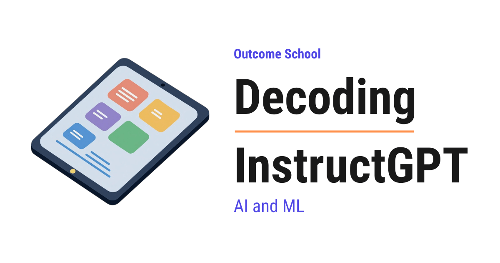

# What is InstructGPT? How GPT-3 Learned to Follow Instructions

> Archived from <https://outcomeschool.com/blog/decoding-instructgpt> on 2026-11-25.

InstructGPT is the model that taught GPT-3 to follow human instructions in a way that is helpful, honest, and harmless, by learning from human feedback. This work led directly to ChatGPT.

In this blog, we are going to learn about InstructGPT, the model that taught GPT-3 to actually follow our instructions, and the work that led directly to ChatGPT.

We will cover the following:
<ul><li>What is the InstructGPT paper?</li><li>The building blocks we must know first</li><li>The big picture: what InstructGPT does</li><li>Why GPT-3 was not enough</li><li>Helpful, Honest, and Harmless</li><li>The three-step method</li><li>Step 1: Supervised Fine-Tuning</li><li>Step 2: The Reward Model</li><li>Step 3: Reinforcement Learning with PPO</li><li>The alignment tax</li><li>The results</li><li>What alignment looks like today</li><li>Quick Summary</li></ul>
I am <strong>Amit Shekhar</strong>, Founder @ <a target="_blank" rel="noopener noreferrer" href="https://outcomeschool.com">Outcome School</a>, I have taught and mentored many developers, and their efforts landed them high-paying tech jobs, helped many tech companies in solving their unique problems, and created many open-source libraries being used by top companies. I am passionate about sharing knowledge through open-source, blogs, and videos.

I teach <a target="_blank" rel="noopener noreferrer" href="https://outcomeschool.com/program/ai-and-machine-learning">AI and Machine Learning</a> at Outcome School.

Let&#x27;s get started.
<h2 id="what-is-the-instructgpt-paper">What is the InstructGPT paper?</h2>
<strong>InstructGPT takes GPT-3, which only knows how to predict the next word, and teaches it to follow a human&#x27;s instructions in a way that is helpful, honest, and harmless. It does this by learning from human feedback.</strong>

This research was introduced by OpenAI in the paper &quot;Training language models to follow instructions with human feedback&quot; by Long Ouyang, Jeff Wu, Xu Jiang, and their team.

The idea is the bridge between a raw language model and a real assistant. GPT-3 was powerful, but it often did not do what people actually asked. InstructGPT fixed that. And the method it used, called RLHF, is the same method that powered ChatGPT later that year.
<h2 id="the-building-blocks-we-must-know-first">The building blocks we must know first</h2>
Before jumping into the paper, we must know a few simple words.
<ul><li><strong><a target="_blank" rel="noopener noreferrer" href="llm-pretraining.md">Pre-training</a></strong> - GPT-3 first reads a huge pile of internet text and learns to <a target="_blank" rel="noopener noreferrer" href="autoregressive-models.md">predict the next word</a>. This gives it raw language skill.</li><li><strong><a target="_blank" rel="noopener noreferrer" href="how-does-fine-tuning-work.md">Fine-tuning</a></strong> - training the model a little more on a smaller, specific dataset to shape its behavior.</li><li><strong>Alignment</strong> - making the model do what the user actually wants, not just what is statistically likely. This is the whole goal of the paper.</li><li><strong>Reward</strong> - a single number that says how good an answer is. Higher is better.</li><li><strong>Reinforcement Learning (RL)</strong> - a way of training where the model tries something, gets a reward, and adjusts to earn more reward next time. We have a full blog on <a target="_blank" rel="noopener noreferrer" href="reinforcement-learning.md">reinforcement learning</a>.</li><li><strong>RLHF</strong> - Reinforcement Learning from Human Feedback. The reward comes from human opinions. We have a full blog on <a target="_blank" rel="noopener noreferrer" href="reinforcement-learning-from-human-feedback-rlhf.md">RLHF</a>.</li></ul>
That is everything we need. Now, let&#x27;s move to the big picture.
<h2 id="the-big-picture-what-instructgpt-does">The big picture: what InstructGPT does</h2>
Before going into the details, let&#x27;s see the simple input-to-output view.

<pre><code class="code-highlight">   GPT-3:        predicts the next word on internet text
                          |
                          |  add human feedback (RLHF)
                          v
   InstructGPT:  follows the user&#x27;s instruction, helpfully and safely
</code></pre>

Here, we start with GPT-3 and add a layer of human feedback on top. The result is a model that listens to instructions. The architecture does not change at all. It is the same GPT-3. Only the training changes.
<h2 id="why-gpt-3-was-not-enough">Why GPT-3 was not enough</h2>
GPT-3 was trained to do one thing: predict the next word on internet text. But &quot;predict the next word&quot; is <strong>not</strong> the same as &quot;do what the user asked&quot;. This gap is called <strong>misalignment</strong>.

Let&#x27;s see it with an example. Suppose we type this instruction:

<pre><code class="code-highlight">Explain the moon landing to a 6 year old in a few sentences.
</code></pre>

A raw next-word model has seen a lot of internet text where a line like this is followed by <strong>more lines like it</strong>. So it continues with lines like these:

<pre><code class="code-highlight">Explain the theory of gravity to a 6 year old.
Explain the big bang theory to a 6 year old.
</code></pre>

That is a perfectly reasonable next-word prediction. It is also completely useless. The model continued the pattern instead of answering the question. It did not understand that we wanted an <strong>answer</strong>, not more instructions.

So, here is the problem. The model is smart, but it does not know what we want from it. We needed a way to teach it our intent, and InstructGPT was introduced to solve this problem.
<h2 id="helpful-honest-and-harmless">Helpful, Honest, and Harmless</h2>
Before fixing the model, the paper had to define what &quot;good behavior&quot; even means. It used three simple goals, often called the three H&#x27;s:
<ul><li><strong>Helpful</strong> - the answer should actually solve the user&#x27;s task.</li><li><strong>Honest</strong> - the answer should not make up facts or mislead.</li><li><strong>Harmless</strong> - the answer should not cause harm to people.</li></ul>
These three words are the target. Everything InstructGPT does is aimed at making the model more helpful, more honest, and more harmless.

These three goals are trained into the model, and a separate safety layer checks inputs and outputs at runtime. We have a detailed blog on <a target="_blank" rel="noopener noreferrer" href="how-do-llm-guardrails-work.md">How do LLM guardrails work?</a> that explains this layer step by step.

<strong>Planning your move into AI?</strong>

No matter which tech domain you work in today, with your effort, you can transition to these roles:
<ul><li>AI Engineer</li><li>Forward Deployed Engineer</li><li>AI Agent Engineer</li><li>Harness Engineer</li><li>Voice AI Engineer</li><li>AI Architect</li><li>LLM Engineer</li><li>LLM Inference Engineer</li><li>Gen AI Engineer</li><li>MLOps Engineer</li><li>ML Engineer</li><li>Deep Learning Engineer</li></ul>
Our <a target="_blank" rel="noopener noreferrer" href="https://outcomeschool.com/program/ai-and-machine-learning">AI and Machine Learning Program</a> at Outcome School takes you there.
<h2 id="the-three-step-method">The three-step method</h2>
InstructGPT teaches the model in three steps. This is the famous RLHF recipe. Here is the whole pipeline at a glance:

<pre><code class="code-highlight">   Step 1            Step 2            Step 3
   +----------+      +----------+      +----------+
   |   SFT    | --&gt;  |  Reward  | --&gt;  |   PPO    |
   |          |      |  Model   |      |  (RL)    |
   +----------+      +----------+      +----------+
</code></pre>
<ul><li><strong>Step 1 (SFT):</strong> humans write good answers, and the model imitates them.</li><li><strong>Step 2 (Reward Model):</strong> humans rank the model&#x27;s answers, and a model learns to score them.</li><li><strong>Step 3 (PPO):</strong> the model writes answers, the reward model scores them, and the model learns to score higher.</li></ul>
The idea is simple. First we show the model good answers (Step 1). Then we teach a second model to judge answers the way humans do (Step 2). Then we let the first model practice, using the judge as its coach (Step 3). Let&#x27;s decode each step.
<h2 id="step-1-supervised-fine-tuning">Step 1: Supervised Fine-Tuning</h2>
In the first step, OpenAI hired about 40 people, called labelers, to <strong>write good answers</strong> to many prompts. This created about 13,000 examples of &quot;here is a prompt, and here is a good answer to it&quot;.

Then we fine-tune GPT-3 to imitate these answers. This is plain <a target="_blank" rel="noopener noreferrer" href="supervised-vs-unsupervised-learning.md">supervised learning</a>: show the model the prompt, ask it to produce the answer, and correct it when it is wrong. We call the result the <strong>SFT model</strong> (<a target="_blank" rel="noopener noreferrer" href="instruction-tuning.md">Supervised Fine-Tuning</a>).

This already helps a lot. The model now knows the basic style of following instructions. But it is not enough. We can only write so many examples by hand, and we can never show the model a good answer for every possible prompt in the world. We need a way for the model to keep improving on its own. That is where the next two steps come in.
<h2 id="step-2-the-reward-model">Step 2: The Reward Model</h2>
Writing good answers by hand is slow. But there is something humans find much easier than writing: <strong>comparing</strong>. It is hard to write the perfect answer, but it is easy to look at a few answers and say which one is best.

So in Step 2, we take a prompt, have the model produce several answers (between 4 and 9 of them), and ask a labeler to <strong>rank them</strong> from best to worst. The labeler does not give scores. They just put the answers in order.

Then we turn each ranking into pairs. If a labeler ranked 4 answers, we can make every possible pair of &quot;this one is better than that one&quot;. The number of pairs from 4 answers is:

<pre><code class="code-highlight">C(4, 2) = (4 x 3) / 2 = 6 pairs
</code></pre>

For 9 answers, we get even more:

<pre><code class="code-highlight">C(9, 2) = (9 x 8) / 2 = 36 pairs
</code></pre>

So one ranking of 9 answers gives us 36 training pairs. This is why ranking is so efficient. A little human effort produces a lot of training data.

Now we train a separate model, called the <strong><a target="_blank" rel="noopener noreferrer" href="reward-model.md">Reward Model</a></strong>, to read a (prompt, answer) and output a single number: how good humans would find that answer. The reward model is a 6 billion parameter model, much smaller than the 175 billion GPT-3.

Training a scorer from human comparisons is not new here. It comes from the 2017 paper <a target="_blank" rel="noopener noreferrer" href="decoding-deep-rl-from-human-preferences.md">Deep RL from Human Preferences</a>, which used the same math to teach a simulated robot a backflip.

<strong>How does it learn from pairs?</strong> For each pair, the reward model gives a score to the winning answer and a score to the losing answer. We want the winner&#x27;s score to be higher. The exact formula it uses is:

<pre><code class="code-highlight">loss = -log( sigmoid( r_w - r_l ) )
</code></pre>

Let&#x27;s define every symbol:
<ul><li><code>r_w</code> is the reward score the model gives the <strong>winning</strong> (preferred) answer.</li><li><code>r_l</code> is the reward score it gives the <strong>losing</strong> answer.</li><li><code>sigmoid</code> is a function that squashes any number into a value between 0 and 1. It turns the score gap into a probability.</li><li><code>log</code> is the natural logarithm.</li></ul>
Do not worry, we will break this down with actual numbers. The key part is <code>r_w - r_l</code>, the gap between the winner&#x27;s score and the loser&#x27;s score. The bigger this gap, the more sure the model is that the winner is better.

We will use small, round numbers here, just for the sake of understanding. In real training, the reward model produces these scores itself, and they can be any value.

Let&#x27;s compute. Suppose the model scores the winning answer <code>r_w = 2.0</code> and the losing answer <code>r_l = 1.0</code>. The gap is <code>2.0 - 1.0 = 1.0</code>. Now apply sigmoid:

<pre><code class="code-highlight">sigmoid(1.0) = 1 / (1 + e^-1.0) = 1 / (1 + 0.368) = 1 / 1.368 = 0.731
</code></pre>

So the model thinks the winner is better with probability 0.731, about 73%. The loss for this pair is:

<pre><code class="code-highlight">loss = -log(0.731) = 0.313
</code></pre>

Now suppose training makes the model better, and it gives a bigger gap: <code>r_w = 3.0</code> and <code>r_l = 0.0</code>, a gap of 3.0:

<pre><code class="code-highlight">sigmoid(3.0) = 1 / (1 + e^-3.0) = 1 / (1 + 0.050) = 0.953
loss = -log(0.953) = 0.048
</code></pre>

The loss dropped from 0.313 to 0.048. So a bigger gap in favor of the winner gives a smaller loss, which is exactly what we want. And if the two answers tie (<code>r_w = r_l</code>), then sigmoid(0) = 0.5 and the loss is <code>-log(0.5) = 0.693</code>, the model is unsure. Training pushes the model to give better answers a clearly higher score.

This was the loss for one pair. Now, remember the 36 pairs we made from a single ranking of 9 answers. The model computes this same loss for every one of those 36 pairs and takes the average. So one human ranking teaches the model 36 times over.

Here is the full formula again:

<pre><code class="code-highlight">loss = -log( sigmoid( r_w - r_l ) )
</code></pre>

Now, every part of this formula is clear. We take the winner&#x27;s score, subtract the loser&#x27;s score, squash that gap with sigmoid to turn it into a probability, and take the negative log of it. That is the whole reward model in one line.

Now we have a model that can score any answer the way humans would. This is our automatic judge.

<strong>A quick note for you</strong>

No matter which tech domain you work in, get familiar with these topics:
<ul><li>LLM</li><li>RAG</li><li>MCP</li><li>Agent</li><li>Fine-tuning</li><li>Quantization</li></ul>
We put it all together in one video:

<a target="_blank" rel="noopener noreferrer" href="https://www.youtube.com/watch?v=lnfWvX66FUk">AI Engineering Explained: LLM, RAG, MCP, Agent, Fine-Tuning, and Quantization</a>

No need to stop reading - bookmark it and watch later when you get time. Future you will thank you.

Now, let&#x27;s get back to the topic.
<h2 id="step-3-reinforcement-learning-with-ppo">Step 3: Reinforcement Learning with PPO</h2>
Now the final step. We have the SFT model that writes answers, and the reward model that scores them. We connect them in a loop:

<pre><code class="code-highlight">   1. give the model a prompt
   2. the model writes an answer
   3. the reward model scores the answer
   4. nudge the model to make higher-scoring answers next time
   5. repeat
</code></pre>

This loop is reinforcement learning. The algorithm used to do the nudging is called <strong>PPO (Proximal Policy Optimization)</strong>, which we cover in detail in the <a target="_blank" rel="noopener noreferrer" href="proximal-policy-optimization-ppo.md">PPO blog</a>.

But there is a catch. If we only tell the model &quot;get the highest score&quot;, it will cheat. It will find weird, broken text that fools the reward model into giving a high score, even though the text is nonsense. This is called <a target="_blank" rel="noopener noreferrer" href="reward-hacking.md"><strong>reward hacking</strong></a>.

To stop this, we add a leash. We compare the new model to the SFT model from Step 1, and we punish it for drifting too far away. This leash is called a <a target="_blank" rel="noopener noreferrer" href="kl-divergence.md"><strong>KL penalty</strong></a>. The reward the model actually receives is:

<pre><code class="code-highlight">final reward = reward model score  -  beta x (how far it drifted from the SFT model)
</code></pre>

Here <code>beta</code> is a small number that sets how strong the leash is. Let&#x27;s see it with numbers. Suppose an answer gets a reward model score of <code>5.0</code>, and it drifted from the SFT model by an amount of <code>3.0</code>, with <code>beta = 0.2</code>:

<pre><code class="code-highlight">final reward = 5.0 - 0.2 x 3.0 = 5.0 - 0.6 = 4.4
</code></pre>

Now suppose the model drifts much further, by <code>10.0</code>:

<pre><code class="code-highlight">final reward = 5.0 - 0.2 x 10.0 = 5.0 - 2.0 = 3.0
</code></pre>

The further it drifts, the more reward is taken away. So the model is free to improve, but it cannot wander off into nonsense. The leash keeps it close to sensible language while still letting it climb toward better answers. Again, these numbers are just for the sake of understanding, the real training measures the drift for every word the model writes.

To master RLHF, Proximal Policy Optimization (PPO), and Reward Models, check out our <a target="_blank" rel="noopener noreferrer" href="https://outcomeschool.com/program/ai-and-machine-learning">AI and Machine Learning Program</a> at Outcome School.
<h2 id="the-alignment-tax">The alignment tax</h2>
There was one more problem to solve. When we fine-tune the model with reinforcement learning, it gets better at following instructions, but it can get a little <strong>worse</strong> at some standard tasks it used to do well, like answering trivia or translating. This drop is called the <strong>alignment tax</strong>.

The fix was simple. While doing the reinforcement learning, OpenAI also mixed in a bit of the original next-word prediction task. This reminds the model to stay good at plain language while it learns to follow instructions. This version is called <strong>PPO-ptx</strong>, and it pays off most of the alignment tax without hurting how well the model follows instructions.
<h2 id="the-results">The results</h2>
Human labelers preferred the answers from the <strong>1.3 billion</strong> parameter InstructGPT over the answers from the <strong>175 billion</strong> parameter GPT-3. Let&#x27;s see how big that size gap is:

<pre><code class="code-highlight">175 billion / 1.3 billion = about 135
</code></pre>

So GPT-3 carried about 135 times more parameters, and the much smaller aligned model was still preferred. Size lost to alignment.

When comparing the same size, the 175B InstructGPT was preferred over the 175B GPT-3 about <strong>85%</strong> of the time. The other improvements were:
<ul><li><strong>More honest.</strong> On closed tasks, InstructGPT made up facts about half as often as GPT-3 (a 21% <a target="_blank" rel="noopener noreferrer" href="why-do-llms-hallucinate-the-token-level-explanation.md">hallucination</a> rate, down from 41%).</li><li><strong>Less toxic.</strong> When asked to be respectful, it produced about 25% fewer toxic outputs than GPT-3.</li><li><strong>Much cheaper than pre-training.</strong> The whole alignment process used about <strong>1.6%</strong> of the compute it took to pre-train GPT-3 in the first place. A tiny extra cost for a very big gain.</li></ul>
The lesson was huge. <strong>Alignment, not just size, is what makes a model useful.</strong> A smaller model that listens beats a giant model that does not. This is the insight that shaped every assistant we use today.

Later that year, OpenAI used the same recipe, adapted for conversations, to build <strong>ChatGPT</strong>. So InstructGPT is the direct ancestor of the chatbot that changed everything.

If we want to go deep into this, we build a Large Language Model (LLM) from scratch and design the full ChatGPT training-to-serving pipeline in our <a target="_blank" rel="noopener noreferrer" href="https://outcomeschool.com/program/ai-and-machine-learning">AI and Machine Learning Program</a> at Outcome School.
<h2 id="what-alignment-looks-like-today">What alignment looks like today</h2>
The three-step RLHF recipe became the foundation of the whole field. But the field did not stop there. Let&#x27;s decode the modern view, piece by piece.
<ul><li><strong>DPO (Direct Preference Optimization).</strong> Step 2 and Step 3 are a lot of work: train a reward model, then run a full reinforcement learning loop. In 2023, researchers found a shortcut. <a target="_blank" rel="noopener noreferrer" href="direct-preference-optimization-dpo.md">DPO</a> skips the separate reward model and the RL loop entirely. It learns directly from the preference pairs with one simple loss. It is simpler, more stable, and cheaper, and it became the default for many open models.</li><li><strong>AI feedback instead of human feedback.</strong> Hiring 40 people to rank answers is slow and expensive. So labs started using another AI model as the judge, an idea called <a target="_blank" rel="noopener noreferrer" href="llm-as-a-judge.md">LLM as a judge</a>. Anthropic&#x27;s Constitutional AI takes this further: the model critiques and improves its own answers against a written list of principles, called a constitution. We have a detailed blog on <a target="_blank" rel="noopener noreferrer" href="reinforcement-learning-from-ai-feedback-rlaif.md">RLAIF (Reinforcement Learning from AI Feedback)</a> that explains how AI feedback trains an LLM step by step.</li><li><strong>Verifiable rewards for reasoning.</strong> For tasks with a checkable answer, like math or code, we do not even need a human opinion. We just check if the answer is correct. This is called <a target="_blank" rel="noopener noreferrer" href="reinforcement-learning-with-verifiable-rewards-rlvr.md">RL with verifiable rewards</a>, and it powers the newest <a target="_blank" rel="noopener noreferrer" href="large-reasoning-models.md">large reasoning models</a>. The popular algorithm here is <a target="_blank" rel="noopener noreferrer" href="group-relative-policy-optimization-grpo.md">GRPO</a>, which grades a whole group of answers together instead of training a separate scorer.</li></ul>
Through all of these changes, the core idea from InstructGPT stays the same: <strong>start with a base model, give it a signal of what good looks like, and keep it on a leash so it improves without breaking.</strong> That backbone is still the heart of alignment in 2026.

<strong>Stay updated:</strong> Subscribe to our <a target="_blank" rel="noopener noreferrer" href="https://outcomeschool.substack.com/subscribe">newsletter</a> to get our latest AI and Machine Learning blogs straight to your inbox.
<h2 id="quick-summary">Quick Summary</h2>
We have decoded the InstructGPT paper piece by piece. Let&#x27;s recap each piece in one line.
<ul><li><strong>InstructGPT</strong> teaches GPT-3 to follow instructions using human feedback, without changing the architecture.</li><li><strong>The alignment problem</strong> is that &quot;predict the next word&quot; is not the same as &quot;do what the user asked&quot;.</li><li><strong>Helpful, honest, harmless</strong> are the three goals of good behavior.</li><li><strong>Step 1, SFT</strong>: humans write about 13,000 good answers, and the model imitates them.</li><li><strong>Step 2, Reward Model</strong>: humans rank answers, we turn rankings into pairs, and a 6B model learns to score answers like humans do.</li><li><strong>Step 3, PPO</strong>: the model writes answers, the reward model scores them, and a KL leash stops it from cheating.</li><li><strong>The alignment tax</strong> is the small drop on other tasks, fixed by mixing in the original next-word training (PPO-ptx).</li><li><strong>The result</strong>: a 1.3B InstructGPT beat the 175B GPT-3, proving alignment matters more than size, and the same recipe gave us ChatGPT.</li><li><strong>Today</strong>: DPO simplifies it, AI feedback replaces human labeling, and verifiable rewards with GRPO power reasoning models.</li></ul>
Now, we have decoded InstructGPT piece by piece and understood how human feedback turned a raw word predictor into a helpful assistant.
<h2 id="frequently-asked-questions">Frequently Asked Questions</h2><h3 id="does-instructgpt-change-the-architecture-of-gpt-3">Does InstructGPT change the architecture of GPT-3?</h3>
No. The architecture does not change at all. InstructGPT is the same GPT-3, and only the training changes. It adds a layer of human feedback on top through supervised fine-tuning, a reward model, and reinforcement learning with PPO.
<h3 id="is-a-bigger-language-model-always-better-than-a-smaller-aligned-one">Is a bigger language model always better than a smaller aligned one?</h3>
No. Human labelers preferred the answers from the 1.3 billion parameter InstructGPT over the answers from the 175 billion parameter GPT-3. GPT-3 carried about 135 times more parameters, and the smaller aligned model was still preferred. Alignment, not just size, is what makes a model useful.
<h3 id="why-do-labelers-rank-answers-instead-of-writing-more-good-answers">Why do labelers rank answers instead of writing more good answers?</h3>
Ranking is much easier and more efficient than writing. It is hard to write the perfect answer, but it is easy to look at a few answers and say which one is best. Also, one ranking of 9 answers gives 36 training pairs, so a little human effort produces a lot of training data.
<h3 id="is-instructgpt-the-same-as-chatgpt">Is InstructGPT the same as ChatGPT?</h3>
No. ChatGPT came later that year, when OpenAI used the same RLHF recipe, adapted for conversations, to build it. So InstructGPT is the direct ancestor of ChatGPT. Both rely on the same idea of learning from human feedback.
<h3 id="do-we-still-need-a-reward-model-and-ppo-to-align-a-language-model">Do we still need a reward model and PPO to align a language model?</h3>
Not always. DPO skips the separate reward model and the reinforcement learning loop entirely, and learns directly from the preference pairs with one simple loss. It is simpler, more stable, and cheaper, and it became the default for many open models.

That&#x27;s it for now.

Thanks

<strong>Amit Shekhar</strong> Founder @ <a target="_blank" rel="noopener noreferrer" href="https://outcomeschool.com">Outcome School</a>

You can connect with me on:
<ul><li><a target="_blank" rel="noopener noreferrer" href="https://x.com/amitiitbhu">X</a></li><li><a target="_blank" rel="noopener noreferrer" href="https://www.linkedin.com/in/amit-shekhar-iitbhu">LinkedIn</a></li><li><a target="_blank" rel="noopener noreferrer" href="https://github.com/amitshekhariitbhu">GitHub</a></li></ul>
Follow Outcome School on:
<ul><li><a target="_blank" rel="noopener noreferrer" href="https://x.com/outcome_school">X</a></li><li><a target="_blank" rel="noopener noreferrer" href="https://youtube.com/@OutcomeSchool">YouTube</a></li><li><a target="_blank" rel="noopener noreferrer" href="https://www.linkedin.com/company/outcomeschool">LinkedIn</a></li><li><a target="_blank" rel="noopener noreferrer" href="https://github.com/OutcomeSchool">GitHub</a></li></ul>
<a target="_blank" rel="noopener noreferrer" href="https://outcomeschool.com/blog"><strong>Read all of our high-quality blogs here.</strong></a>

