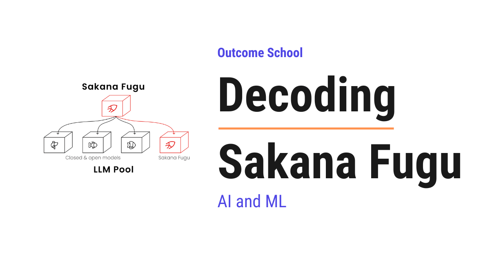

# What is Sakana Fugu? The Technical Report Explained

> Archived from <https://outcomeschool.com/blog/decoding-sakana-fugu> on 2026-11-25.

Sakana Fugu is a family of AI models that work like a conductor for a team of other AI models. A Fugu model reads our question, decides which powerful AI models should work on it, and combines their answers into one.

In this blog, we are going to learn about Sakana Fugu, a family of AI models that work like a conductor for a team of other AI models.

We will cover the following:
<ul><li>What is Sakana Fugu?</li><li>Why Fugu was needed</li><li>The big picture: what Fugu does</li><li>Collective Intelligence</li><li>The two Fugus - Fugu and Fugu-Ultra</li><li>How Fugu picks the right model - the lightweight selection head</li><li>Teaching Fugu who is best - supervised fine-tuning</li><li>Polishing Fugu on real tasks - evolutionary strategies</li><li>How Fugu-Ultra conducts an orchestra - the Conductor</li><li>Teaching Fugu-Ultra to conduct - GRPO</li><li>Stopping the agents from copying each other</li><li>How well does Fugu perform?</li><li>The clever strategies Fugu discovered on its own</li><li>Quick Summary</li></ul>
I am <strong>Amit Shekhar</strong>, Founder @ <a target="_blank" rel="noopener noreferrer" href="https://outcomeschool.com">Outcome School</a>, I have taught and mentored many developers, and their efforts landed them high-paying tech jobs, helped many tech companies in solving their unique problems, and created many open-source libraries being used by top companies. I am passionate about sharing knowledge through open-source, blogs, and videos.

I teach <a target="_blank" rel="noopener noreferrer" href="https://outcomeschool.com/program/ai-and-machine-learning">AI and Machine Learning</a> at Outcome School.

Let&#x27;s get started.
<h2 id="what-is-sakana-fugu">What is Sakana Fugu?</h2>
<strong>Sakana Fugu is a family of AI models. A Fugu model does not answer your question by itself. Instead, it reads your question and decides which other powerful AI models should work on it, how they should work together, and how to combine their answers into one final reply.</strong>

In simple words, Fugu is a conductor. A conductor does not play any instrument. The conductor reads the music, decides which musician should play, when, and how loud, and turns many players into one beautiful performance. Fugu does the same thing with AI models.

Fugu comes from Sakana AI, and the team describes it in the &quot;Sakana Fugu Technical Report&quot;. Sakana AI is a research lab in Tokyo. One of its founders, Llion Jones, is a co-author of the original &quot;Attention Is All You Need&quot; paper, the paper that introduced the <a target="_blank" rel="noopener noreferrer" href="decoding-transformer-architecture.md">Transformer</a>.

The paper calls models like Fugu <strong>orchestrator models</strong>. An <a target="_blank" rel="noopener noreferrer" href="ai-orchestration.md">orchestrator</a> is the one who arranges many parts so that they work together as one. So, the whole goal of Fugu is to take a team of strong AI models and make them act as a single, smarter system.
<h2 id="why-fugu-was-needed">Why Fugu was needed</h2>
The best way to learn this is by taking an example.

Today we have many powerful AI models, often called <strong>frontier models</strong>. Frontier just means they are at the leading edge, the most powerful and latest models available. We have GPT-5.5 from OpenAI, Claude Opus 4.8 from Anthropic, and Gemini 3.1 Pro from Google. Each one is very strong. But, here is the catch. No single model is the best at everything.

The paper observed clear specializations:
<ul><li>GPT models are very strong at math and at planning and combining ideas.</li><li>Claude Opus models are very strong at software engineering and at finding security bugs, which means debugging.</li><li>Gemini models are very strong at directly implementing known algorithms and at science like chemistry and biology.</li></ul>
So, if we use only one model, we get its strengths, but we are also stuck with its weaknesses.

Now, the question is: how do we get the strengths of all of them at the same time? Let&#x27;s build up the answer step by step.

<strong>Approach 1: Use one model for everything.</strong> This is the simplest approach. The issue with this approach is that we are stuck with one model&#x27;s weak areas. Let&#x27;s see how the next approach tries to solve this.

<strong>Approach 2: Build a fixed team by hand.</strong> We could write a fixed plan ourselves, for example, &quot;Model X always writes the code, then Model Y always reviews it.&quot; The issue with this approach is that it is rigid. We have to design and tune it ourselves, and the same fixed plan is used for every question, even when it does not fit the question. Let&#x27;s see how the next approach tries to solve this.

<strong>Approach 3: A simple router.</strong> We could train a small <a target="_blank" rel="noopener noreferrer" href="llm-routing.md">router</a> that looks at the question and sends it to one model. This is better, but it is still single-step. It picks one model once, it cannot change its mind partway through the task, and it cannot make two models work together. The issue with this approach is that it is too limited. Let&#x27;s see how Fugu solves this.

So, here comes Sakana Fugu to the rescue. Fugu is a <strong>learned orchestrator</strong>. It reads the question and builds a plan for that specific question - which models to involve, how they should talk to each other, and when to combine their answers. The plan is not fixed. It changes based on the question.
<h2 id="the-big-picture-what-fugu-does">The big picture: what Fugu does</h2>
Before going into the details, let&#x27;s see the simple input-to-output view.

You give Fugu a question. Fugu reads it, picks the right model or the right team of models from its pool, lets them work, and gives you back one final answer. From the outside, it feels like you are talking to a single model.

<pre><code class="code-highlight">                  +-----------------------+
   &quot;Write me      |    Fugu Orchestrator  |
    binary    --&gt; |  (reads the question, | --&gt; picks the right worker(s)
    search&quot;       |    builds a plan)     |
                  +-----------------------+
                       |       |       |
                       v       v       v
                   +------+ +------+ +------+
                   | GPT  | | Opus | |Gemini|   &lt;- pool of frontier workers
                   +------+ +------+ +------+
                       |       |       |
                       +-------+-------+
                               |
                               v
                          Final Answer
</code></pre>

Here, we can see that Fugu sits in the middle. The user talks only to Fugu. Behind the scenes, Fugu uses a pool of frontier models as workers and combines their work into one answer.

Now, let&#x27;s decode each piece one by one. The paper itself says that the complexity does not come from any single piece being hard. It comes from how the pieces are stacked together. So, if we understand each piece on its own, the whole system becomes simple.
<h2 id="collective-intelligence">Collective Intelligence</h2>
<strong>Collective intelligence is when a group of limited individuals, by working together, produces behavior that is smarter than any single member could be alone.</strong>

We see this everywhere. A single ant is simple, but an ant colony builds complex nests. A single person knows a little, but a good team solves big problems. Fugu brings this idea to AI models. Each frontier model is one expert. Fugu turns them into a team.

The paper makes a bigger point here. It treats orchestration as a <strong>new scaling axis</strong>. Until now, we made AI better mostly by training one bigger and more expensive model. Fugu says there is another way to get better: make many existing models cooperate well.

This brings real benefits:
<ul><li>When a new model is released, we just add it to the pool. We do not retrain anything.</li><li>We can remove a model, or favor one provider, or block a model for privacy or policy reasons, without retraining.</li></ul>
This flexibility matters in the real world too. A model can become unavailable for many reasons, such as access restrictions, outages, or price changes. Because Fugu&#x27;s pool of models is swappable, it can simply route around any model that becomes unavailable. The team keeps working even if one member leaves.
<h2 id="the-two-fugus---fugu-and-fugu-ultra">The two Fugus - Fugu and Fugu-Ultra</h2>
The paper releases two versions, built for two different needs. The trade-off is between <strong>quality</strong> and <strong>latency</strong>. Latency means the time you wait for an answer.
<ul><li><strong>Fugu</strong> balances quality with speed. For each input, it picks a single best worker model. So it is about as fast as just calling one model. It is meant for everyday use, like coding and chat.</li><li><strong>Fugu-Ultra</strong> aims for the highest quality on the hardest problems. It builds a plan that uses multiple models per input. This is slower, but it gives better answers. It is meant for the most complex tasks.</li></ul>
Let me tabulate the differences between Fugu and Fugu-Ultra for your better understanding so that you can decide which one to use based on your use case.
<table><thead><tr><th>Point</th><th>Fugu</th><th>Fugu-Ultra</th></tr></thead><tbody><tr><td>Goal</td><td>balance speed and quality</td><td>maximum quality</td></tr><tr><td>Models per input</td><td>one worker</td><td>many workers in a plan</td></tr><tr><td>Speed</td><td>fast, like one model</td><td>slower</td></tr><tr><td>Built on</td><td>Trinity</td><td>Conductor</td></tr><tr><td>Best for</td><td>everyday coding and chat</td><td>hardest multi-step problems</td></tr></tbody></table>
Here, <strong>Trinity</strong> and <strong>Conductor</strong> are two earlier research papers from Sakana AI. Fugu builds on Trinity, and Fugu-Ultra builds on Conductor. We will understand both as we decode each variant.
<h2 id="how-fugu-picks-the-right-model---the-lightweight-selection-head">How Fugu picks the right model - the lightweight selection head</h2>
Let&#x27;s first understand the fast variant, Fugu.

Fugu uses a normal <strong>language model</strong> as its backbone, which means its brain. A language model is an AI that reads text and predicts what comes next, word by word. It is <strong><a target="_blank" rel="noopener noreferrer" href="llm-pretraining.md">pre-trained</a></strong>, which means it has already learned from a huge amount of text before we use it. When you type a question, the language model reads it and forms a <strong>hidden state</strong>, which is simply a list of numbers that captures the meaning of what the model has read. We call it <code>h</code>.

Normally, a language model has an <strong>LM head</strong> that turns the hidden state into the next word. Fugu adds a second small head right next to it, called the <strong>lightweight selection head</strong>. This head takes the hidden state <code>h</code> and outputs <code>L</code> numbers called <a target="_blank" rel="noopener noreferrer" href="logits-in-machine-learning.md"><strong>logits</strong></a>, one score for each worker model in the pool. The model with the highest score is selected.

<pre><code class="code-highlight">  Question --&gt; [ Language Model backbone ] --&gt; hidden state h
                                                  |
                            +---------------------+---------------------+
                            |                                           |
                       [ LM Head ]                        [ Lightweight Selection Head ]
                    (writes normal text)                              |
                                                          L scores, one per worker model
                                                                      |
                                                          pick the highest -&gt; dispatch
</code></pre>

Here, we can see two heads reading the same hidden state. The LM head is the normal one that writes text. The selection head is the new one that scores the worker models.

Let&#x27;s define the symbols:
<ul><li><code>h</code> is the hidden state, the list of numbers that captures the meaning of the question.</li><li><code>L</code> is the number of worker models in the pool.</li><li><code>logits</code> are the raw scores, one per model, before turning them into probabilities.</li></ul>
Now, here is the key trick that makes Fugu fast. Fugu uses the logits, not generated text. It does not need to write out a full answer to make its decision. It computes the hidden state at an early position, applies the selection head, reads the scores, picks the highest, and immediately sends your question to the chosen worker. Because it skips the slow word-by-word writing, the decision is very fast. This is why Fugu has low latency.

This is also where Fugu differs from <strong>Trinity</strong>, the earlier Sakana model it builds on. Trinity also assigned a role to the chosen model, like Thinker, Worker, or Verifier. Fugu drops the roles and always uses the chosen model as a worker. Fewer choices means a smaller and faster decision, which is exactly what we want for everyday use.

One more thing to notice. To adapt its brain cheaply, Fugu does not retrain the whole model. Think of the model as having millions of tiny dials. Instead of changing all of them, Fugu changes only a small set of adjustment dials and leaves the rest fixed. This keeps training small and fast. The math trick that picks which small set of dials to turn is called SVD, which means Singular Value Decomposition, and it comes from an earlier Sakana paper called Transformer-squared. We do not need to understand the trick itself. We just need to remember that it lets Fugu adjust a few dials instead of all of them. The selection head itself is also kept small and simple.

<strong>Planning your move into AI?</strong>

No matter which tech domain you work in today, with your effort, you can transition to these roles:
<ul><li>AI Engineer</li><li>Forward Deployed Engineer</li><li>AI Agent Engineer</li><li>Harness Engineer</li><li>Voice AI Engineer</li><li>AI Architect</li><li>LLM Engineer</li><li>LLM Inference Engineer</li><li>Gen AI Engineer</li><li>MLOps Engineer</li><li>ML Engineer</li><li>Deep Learning Engineer</li></ul>
Our <a target="_blank" rel="noopener noreferrer" href="https://outcomeschool.com/program/ai-and-machine-learning">AI and Machine Learning Program</a> at Outcome School takes you there.
<h2 id="teaching-fugu-who-is-best---supervised-fine-tuning">Teaching Fugu who is best - supervised fine-tuning</h2>
Now, Fugu must learn which model is best for which kind of question. The paper trains it in two stages. The first stage is <strong><a target="_blank" rel="noopener noreferrer" href="how-does-fine-tuning-work.md">supervised fine-tuning</a></strong>, often called SFT.

To train Fugu in this stage, the Fugu team collects a big set of questions where the correct answer is already known. For each question, they run every worker model several times and check how well each one did. They give each model a <strong>reward</strong>, a score for how well it solved the question.

The best way to learn this is by taking an example.

Suppose we have a pool of 3 worker models. Call them GPT, Opus, and Gemini. We give them a math question. We run each one a few times and average the scores. The reward is between 0 and 1, where 1 means it solved the question perfectly. Say we get:
<ul><li>GPT: average reward 0.9</li><li>Opus: average reward 0.6</li><li>Gemini: average reward 0.3</li></ul>
So our score vector is <code>s = (0.9, 0.6, 0.3)</code>.

Now, the simple approach would be to just say &quot;GPT is the best, so the label is GPT.&quot; But this throws away useful information. It hides the fact that Opus was also quite good, and that Gemini was weak. So instead, the paper turns these scores into a <strong>soft target distribution</strong> using the <a target="_blank" rel="noopener noreferrer" href="softmax-function.md">softmax function</a>. Softmax is a simple function that takes any list of scores and turns them into probabilities, which are all positive, all add up to 1, and keep the bigger scores bigger. Do not worry, we will compute it with real numbers.

The formula is:

<pre><code class="code-highlight">p(j) = exp(r_j / T) / sum over all j&#x27; of exp(r_j&#x27; / T)
</code></pre>

Where:
<ul><li><code>p(j)</code> is the target probability for model <code>j</code>.</li><li><code>r_j</code> is the average reward of model <code>j</code>.</li><li><code>T</code> is the <a target="_blank" rel="noopener noreferrer" href="how-does-temperature-control-llm-output.md">temperature</a>, a knob that controls how sharp or how flat the result is.</li><li><code>exp(x)</code> means <code>e</code> raised to the power <code>x</code>.</li><li><code>sum over all j&#x27;</code> means we add up the term for every model.</li></ul>
Do not worry if this formula looks complex. We will break it down step by step with actual numbers. Let us use temperature <code>T = 1</code>, because dividing by 1 changes nothing.

Here, <code>e</code> is just a fixed number, about 2.718, that shows up everywhere in math. So <code>exp(0.9)</code> simply means 2.718 raised to the power 0.9. You do not need to compute this by hand. A calculator gives the value. What matters is the pattern: a bigger score gives a bigger <code>exp</code> value.

<strong>Step 1:</strong> Compute <code>exp(x)</code> for each score.
<ul><li><code>exp(0.9) = 2.460</code></li><li><code>exp(0.6) = 1.822</code></li><li><code>exp(0.3) = 1.350</code></li></ul>
<strong>Step 2:</strong> Add them up.
<ul><li>Sum = <code>2.460 + 1.822 + 1.350 = 5.632</code></li></ul>
<strong>Step 3:</strong> Divide each by the sum.
<ul><li><code>p(GPT) = 2.460 / 5.632 = 0.437</code></li><li><code>p(Opus) = 1.822 / 5.632 = 0.324</code></li><li><code>p(Gemini) = 1.350 / 5.632 = 0.240</code></li></ul>
So the soft target is <code>(0.437, 0.324, 0.240)</code>. This is a <strong>probability distribution</strong>, which is just a set of numbers that say how likely each option is and that add up to 1, like all probabilities should.

Let&#x27;s read this in plain words. The target says GPT is the best choice about 44% of the time, Opus about 32%, and Gemini about 24%. Notice that it did not say &quot;always GPT.&quot; It kept the fact that Opus is also a strong backup. That is the richer signal that helps Fugu make robust choices when several models are similarly good.

What does the temperature <code>T</code> do? A smaller <code>T</code> makes the distribution sharper, putting more weight on the best model. A larger <code>T</code> makes it flatter, making the models more equal. It lets us control how strongly Fugu favors the top model.

Now Fugu is trained to predict this target. Just like we turned the rewards into probabilities, Fugu&#x27;s own selection head scores are also passed through softmax, so Fugu also outputs a set of numbers that add up to 1, one for each model. We call this Fugu&#x27;s predicted distribution. Fugu&#x27;s predicted distribution is then compared to the soft target using <a target="_blank" rel="noopener noreferrer" href="kl-divergence.md"><strong>KL divergence</strong></a>, which measures how far apart two probability distributions are.

The training loss is:

<pre><code class="code-highlight">L_SFT = average over all questions of D_KL( p( . ) || pi( . | q ) )
</code></pre>

Where:
<ul><li><code>pi( . | q )</code> is Fugu&#x27;s own predicted distribution over the models for question <code>q</code>.</li><li><code>p( . )</code> is the soft target we just computed.</li><li>The dot inside <code>p( . )</code> just means the whole set of numbers, one for every model.</li><li><code>D_KL</code> is the KL divergence, the gap between the two distributions. The double bar <code>||</code> just separates the two distributions we are comparing, so <code>D_KL( p || pi )</code> reads as the gap between distribution <code>p</code> and distribution <code>pi</code>.</li><li>We average over all questions in the training set.</li></ul>
Let&#x27;s see KL divergence with numbers. Suppose right now Fugu predicts <code>(0.5, 0.3, 0.2)</code> for our question, while the target is <code>(0.437, 0.324, 0.240)</code>. The KL divergence is computed as:

<pre><code class="code-highlight">D_KL = sum over all j of p(j) * ln( p(j) / pi(j) )
</code></pre>

Here, <code>p(j)</code> is the target probability for model <code>j</code>, and <code>pi(j)</code> is the single probability Fugu gives to model <code>j</code>. This <code>pi</code> is just a name for Fugu&#x27;s prediction, not the number 3.14.
<ul><li>GPT term: <code>0.437 * ln(0.437 / 0.5) = 0.437 * ln(0.874) = 0.437 * (-0.135) = -0.059</code></li><li>Opus term: <code>0.324 * ln(0.324 / 0.3) = 0.324 * ln(1.080) = 0.324 * 0.077 = 0.025</code></li><li>Gemini term: <code>0.240 * ln(0.240 / 0.2) = 0.240 * ln(1.200) = 0.240 * 0.182 = 0.044</code></li></ul>
Add them: <code>-0.059 + 0.025 + 0.044 = 0.010</code>

So the KL divergence is about <code>0.010</code>, a small positive number. It is small because Fugu&#x27;s guess is already close to the target. Training nudges Fugu&#x27;s prediction toward <code>(0.437, 0.324, 0.240)</code>, which pushes the KL divergence toward 0. When the two distributions match exactly, the KL divergence is 0.

Here, <code>ln</code> is a standard math function on any calculator. You do not need to compute it by hand. We just plug the numbers in. The one thing to notice is that when the two numbers being compared are equal, <code>ln</code> of their ratio is 0, which is why a perfect match gives a KL divergence of 0. Remember, these are small numbers just for the sake of understanding. Real training uses a huge set of questions and many worker models.

To learn Fine-tuning, Logits and Cross-Entropy, and Supervised and Unsupervised Learning from the ground up, explore our <a target="_blank" rel="noopener noreferrer" href="https://outcomeschool.com/program/ai-and-machine-learning">AI and Machine Learning Program</a> at Outcome School.
<h2 id="polishing-fugu-on-real-tasks---evolutionary-strategies">Polishing Fugu on real tasks - evolutionary strategies</h2>
Stage 1 taught Fugu using single-step questions, where we can cleanly score each model. But real work is not single-step. Real coding happens over many turns - reading a code repository, editing files, running tools, reading the errors, and trying again. So Stage 2 trains Fugu on full, end-to-end tasks.

Here is the problem. Normally, AI models learn using a method called <strong><a target="_blank" rel="noopener noreferrer" href="math-behind-gradient-descent.md">gradient training</a></strong>. It needs a clear math signal at every small step that tells the model exactly which way to adjust itself. But in an end-to-end task, we only find out at the very end whether the task was completed. We get a single reward, 1 if done and 0 if not done. There is no clear step-by-step signal to follow through a long chain of tool calls and model handoffs. So normal gradient training does not fit well here.

So, here comes <strong>evolutionary strategies</strong> to the rescue. The paper uses a method called <strong>sep-CMA-ES</strong>. The idea is simple, and it copies how nature improves through evolution: try many small variations, keep the ones that perform best, and move toward them. No gradients are needed. We only need to measure how well each variation does.

Let me explain the idea with a tiny example. Imagine Fugu&#x27;s trained values are just a single number <code>theta</code>. In reality it is a long list of numbers, but one number is enough to see the idea.

<strong>Setup:</strong>
<ul><li>Current value, the parent: <code>theta = 0.0</code></li><li>Step size: <code>sigma = 1.0</code>, which controls how far we explore</li><li>We will try <code>4</code> variations, called the population</li></ul>
<strong>Step 1:</strong> Create variations. We add small random nudges <code>z</code> to the parent.
<ul><li><code>z1 = 0.5</code>, so candidate <code>theta1 = 0.0 + 1.0 * 0.5 = 0.5</code></li><li><code>z2 = -0.3</code>, so candidate <code>theta2 = -0.3</code></li><li><code>z3 = 1.0</code>, so candidate <code>theta3 = 1.0</code></li><li><code>z4 = -0.8</code>, so candidate <code>theta4 = -0.8</code></li></ul>
<strong>Step 2:</strong> Measure fitness. We run each candidate on the end-to-end tasks and record the fraction of tasks it completed. This is the fitness.
<ul><li><code>theta1 = 0.5</code> gives fitness <code>0.8</code></li><li><code>theta2 = -0.3</code> gives fitness <code>0.5</code></li><li><code>theta3 = 1.0</code> gives fitness <code>0.9</code></li><li><code>theta4 = -0.8</code> gives fitness <code>0.2</code></li></ul>
<strong>Step 3:</strong> Keep the best. We rank them and keep the top 2 winners: <code>theta3</code> with <code>0.9</code> and <code>theta1</code> with <code>0.8</code>. Their nudges were <code>z3 = 1.0</code> and <code>z1 = 0.5</code>.

<strong>Step 4:</strong> Move the parent toward the winners. We combine the winning nudges using weights that favor the better one. Say the weights are <code>0.7</code> for the best and <code>0.3</code> for the second best.
<ul><li>New <code>theta = 0.0 + 1.0 * (0.7 * 1.0 + 0.3 * 0.5) = 0.7 + 0.15 = 0.85</code></li></ul>
So the parent moved from <code>0.0</code> to <code>0.85</code>, toward the region that completed more tasks. This loop repeats for many generations, and Fugu slowly gets better at choosing models for real, multi-turn work.

The actual formulas from the paper are:

<pre><code class="code-highlight">theta_k   = theta_t + sigma_t * D_t * z_k,   with z_k drawn from a normal distribution
theta_next = theta_t + sigma_t * D_t * sum over j of ( w_j * z_j )
</code></pre>

Where:
<ul><li><code>theta_t</code> is the current parent at step <code>t</code>.</li><li><code>sigma_t</code> is the step size.</li><li><code>D_t</code> is a diagonal matrix that scales each direction on its own.</li><li><code>z_k</code> is a random nudge. It is drawn from a normal distribution, which just means the nudges are usually small and only rarely large.</li><li><code>w_j</code> are the weights for combining the best candidates.</li><li><code>z_j</code> is the nudge of the <code>j</code>-th best candidate.</li></ul>
Do not worry about the diagonal matrix <code>D_t</code>. It is just a way of letting each dial be explored by a different amount. The core idea is exactly the tiny example above: try variations, keep the best, and move toward them.

What does &quot;sep&quot; mean in sep-CMA-ES? It means &quot;separable.&quot; It tunes each value on its own, by keeping only the diagonal <code>D_t</code>, instead of tracking how every pair of values relates to each other. This makes it much cheaper and lets it handle a large number of values. This is the same evolutionary method used to train Trinity, the earlier model that Fugu&#x27;s fast variant builds on.

<strong>A quick note for you</strong>

No matter which tech domain you work in, get familiar with these topics:
<ul><li>LLM</li><li>RAG</li><li>MCP</li><li>Agent</li><li>Fine-tuning</li><li>Quantization</li></ul>
We put it all together in one video:

<a target="_blank" rel="noopener noreferrer" href="https://www.youtube.com/watch?v=lnfWvX66FUk">AI Engineering Explained: LLM, RAG, MCP, Agent, Fine-Tuning, and Quantization</a>

No need to stop reading - bookmark it and watch later when you get time. Future you will thank you.

Now, let&#x27;s get back to the topic.
<h2 id="how-fugu-ultra-conducts-an-orchestra---the-conductor">How Fugu-Ultra conducts an orchestra - the Conductor</h2>
Now, let&#x27;s move to Fugu-Ultra. It is built on the <strong>Conductor</strong> framework, another research paper from Sakana AI.

While Fugu picks one model per step, Fugu-Ultra goes further. It writes a full plan, called an <strong>agentic workflow</strong>, that puts several models to work together on one question. When a model is set loose to take actions on its own, like reading files, running code, and reacting to the results, we call it an <strong><a target="_blank" rel="noopener noreferrer" href="ai-agent.md">agent</a></strong>. Agentic just means it works in this active way.

What is an agentic workflow? It is a sequence of steps. Each step has three parts:
<ul><li>A <strong>subtask</strong>, which is a plain-language instruction, written by Fugu-Ultra, telling a worker what to do.</li><li>A <strong>worker id</strong>, which says which model should do that subtask.</li><li>An <strong>access list</strong>, which says which earlier results this worker is allowed to see.</li></ul>
So, Fugu-Ultra is not just choosing models. It is writing the instructions for each model, choosing who does what, and wiring up who can see whose work. Because it controls the access list, it can build many shapes of teamwork:
<ul><li>A simple chain, where one model works after another.</li><li>Best-of-N, where several models try the same thing and then one picks the best.</li><li>A tree, where several models work in parallel and then one combines their results.</li></ul>
Let&#x27;s see a tree with an example.

<pre><code class="code-highlight">        Subtask: &quot;answer this hard question&quot;
                   /              \
            (leaf)                  (leaf)
        Gemini attempt           GPT attempt
                   \              /
                    v            v
                Gemini aggregator
            (reads both through the access list,
             keeps the correct parts of each)
                        |
                        v
                   Final Answer
</code></pre>

Here, we can see two models attempt the question on their own at the leaves, and then a third model, the aggregator, combines their work into one answer.

This is a real example from the paper. For a hard trivia question, Fugu-Ultra built exactly this tree. It asked Gemini and GPT to each attempt the question on their own, then asked a second Gemini to read both attempts through the access list and combine them into one correct answer. Both leaf attempts were partly wrong, but the Gemini aggregator spotted the correct parts of each and produced a fully correct answer.

And here is the clever part. Fugu-Ultra chooses which model acts as the aggregator, based on the question. For the trivia question it used Gemini as the aggregator, because Gemini is strong at niche facts. For a hard math question it instead used GPT as the aggregator, because GPT is strong at math. Most older systems are forced to always use the same model as the final combiner, so they get stuck when that model is not the best one for the task. Fugu-Ultra avoids this by adapting on every question.
<h2 id="teaching-fugu-ultra-to-conduct---grpo">Teaching Fugu-Ultra to conduct - GRPO</h2>
How is Fugu-Ultra trained? With <strong>reinforcement learning</strong>. <a target="_blank" rel="noopener noreferrer" href="reinforcement-learning.md">Reinforcement learning</a> is a way of teaching by reward. The model tries something, gets a score for how well it did, and learns to do more of what earned a high score. The specific recipe used here is called <strong>GRPO</strong>, which means <a target="_blank" rel="noopener noreferrer" href="group-relative-policy-optimization-grpo.md">Group Relative Policy Optimization</a>. It comes from the DeepSeekMath paper.

First, let&#x27;s understand the reward. For each workflow Fugu-Ultra writes, it gets a reward <code>r</code>:
<ul><li><code>r = 0</code> if the workflow is malformed and cannot be read, which means the lists of subtasks, workers, and access lists are written in a broken format that the system cannot make sense of.</li><li><code>r = 1</code> if the workflow runs and the final answer is correct.</li><li><code>r = 0.5</code> if the workflow runs but the final answer is wrong.</li></ul>
So Fugu-Ultra is rewarded both for writing a valid plan and for getting the right answer.

Now, the GRPO idea. For one question, Fugu-Ultra writes a group of <code>G</code> different workflows. Each one is scored, then judged relative to the group. A workflow that is better than the group average gets pushed up. A workflow that is worse than the group average gets pushed down. There is no need for a separate &quot;judge&quot; network, which makes training simpler and cheaper.

The key formula is the <strong>advantage</strong>:

<pre><code class="code-highlight">A_i = ( r_i - mean(r_1, ..., r_G) ) / std(r_1, ..., r_G)
</code></pre>

Where:
<ul><li><code>A_i</code> is the advantage of workflow <code>i</code>, which is how much better or worse it is than the group.</li><li><code>r_i</code> is the reward of workflow <code>i</code>.</li><li><code>mean</code> is the average reward of the group.</li><li><code>std</code> is the standard deviation, which measures how spread out the rewards are.</li></ul>
Let me explain with numbers. Suppose for one question Fugu-Ultra writes <code>G = 4</code> workflows with these rewards:
<ul><li>Workflow 1: <code>r1 = 1.0</code>, valid and correct.</li><li>Workflow 2: <code>r2 = 0.5</code>, valid but wrong.</li><li>Workflow 3: <code>r3 = 0.5</code>, valid but wrong.</li><li>Workflow 4: <code>r4 = 0.0</code>, malformed.</li></ul>
<strong>Step 1:</strong> Compute the mean.
<ul><li>mean = <code>(1.0 + 0.5 + 0.5 + 0.0) / 4 = 2.0 / 4 = 0.5</code></li></ul>
<strong>Step 2:</strong> Compute the standard deviation. Standard deviation is just a way to measure how spread out a set of numbers is. We find how far each reward is from the average, square those gaps so they are all positive, average them, and take the square root. A bigger result means the rewards are more spread out.
<ul><li>Differences from the mean: <code>0.5, 0, 0, -0.5</code></li><li>Square them: <code>0.25, 0, 0, 0.25</code></li><li>Average of the squares: <code>(0.25 + 0 + 0 + 0.25) / 4 = 0.5 / 4 = 0.125</code></li><li>Standard deviation = <code>sqrt(0.125) = 0.354</code></li></ul>
<strong>Step 3:</strong> Compute the advantage of each.
<ul><li><code>A1 = (1.0 - 0.5) / 0.354 = 0.5 / 0.354 = +1.41</code></li><li><code>A2 = (0.5 - 0.5) / 0.354 = 0</code></li><li><code>A3 = (0.5 - 0.5) / 0.354 = 0</code></li><li><code>A4 = (0.0 - 0.5) / 0.354 = -1.41</code></li></ul>
We divide by the standard deviation so that the advantages are on a fair scale, no matter how spread out this particular group of rewards happened to be.

So workflow 1, which was correct, gets a positive advantage and is reinforced. Workflow 4, which was malformed, gets a negative advantage and is discouraged. The two middling ones are neutral. Over many questions, Fugu-Ultra learns to write workflows that look like the ones that worked.

Here, <code>sqrt</code> means square root. The full GRPO objective also has two more pieces: a clip that stops the update from changing the model too much in a single step, which is a safety limit, and a KL term that keeps the new model close to the original. The paper trained Fugu-Ultra without the KL term. These tiny numbers are just for the sake of understanding.

To master Reinforcement Learning, PPO, and GRPO in depth, check out our <a target="_blank" rel="noopener noreferrer" href="https://outcomeschool.com/program/ai-and-machine-learning">AI and Machine Learning Program</a> at Outcome School.
<h2 id="stopping-the-agents-from-copying-each-other">Stopping the agents from copying each other</h2>
When several models act as agents and can call <strong><a target="_blank" rel="noopener noreferrer" href="how-does-function-calling-work-in-llms.md">tools</a></strong>, which are outside helpers like running code, searching the web, or reading a file, at any time, two problems appear. The paper solves both.

<strong>Problem 1: Orchestration collapse.</strong> If every agent can see the full history of what the first agent did, then the first agent&#x27;s path becomes everyone&#x27;s path. The later agents just follow along and repeat the same work, instead of bringing their own fresh ideas. The team collapses into one opinion.

<strong>Solution: Intra-workflow isolation.</strong> Inside one workflow, each agent only sees other agents&#x27; work through the access list that Fugu-Ultra set. Otherwise, an agent sees only its own past actions. This gives each agent the freedom to solve its subtask in its own way.

<strong>Problem 2: Forgetting everything.</strong> But complete isolation is also bad. Over a long, multi-turn conversation, agents should remember what tools were already called, so they do not repeat the same calls and rediscover the same facts again and again.

<strong>Solution: Persistent shared memory.</strong> Across workflows, agents share a <a target="_blank" rel="noopener noreferrer" href="ai-agent-memory.md">memory</a> of past tool calls. So, within a single workflow they stay independent, but across the whole conversation they share useful background.

<pre><code class="code-highlight">   Workflow (one question)
   +-------------------------------------------+
   |  Agent A lane   Agent B lane   Agent C lane |
   |     |              |              |          |
   |  isolated      isolated      isolated        |   &lt;- inside a workflow:
   |  (see others only via the access list)       |      stay independent
   +-------------------------------------------+
                        |
                        v
            +---------------------------+
            |  Persistent shared memory  |   &lt;- across the conversation:
            |  (past tool calls, facts)  |      share useful background
            +---------------------------+
</code></pre>

Here, we can see the balance. Inside a single workflow, the agents work in separate lanes so they do not copy each other. Across the conversation, they share one memory so they do not redo work that was already done. This balance is what keeps the team both diverse and efficient.

If we want to go deep into AI Agents, Multi-Agent Systems, Tool use, and Memory in Agents - and build an AI Coding Agent from scratch - we cover all of it in our <a target="_blank" rel="noopener noreferrer" href="https://outcomeschool.com/program/ai-and-machine-learning">AI and Machine Learning Program</a> at Outcome School.
<h2 id="how-well-does-fugu-perform">How well does Fugu perform?</h2>
Now, let&#x27;s see the results. Both Fugu and Fugu-Ultra reach state-of-the-art performance, which means the best scores anyone has achieved so far, across a wide range of hard tests. These standard tests used to compare AI models are called benchmarks. In many cases, the Fugu models beat the very models that sit inside their own pool.

Here are a few rows from the paper&#x27;s results, with the best score in each row in bold.
<table><thead><tr><th>Benchmark</th><th>Fugu-Ultra</th><th>Fugu</th><th>Claude Opus 4.8</th><th>Gemini 3.1</th><th>GPT-5.5</th></tr></thead><tbody><tr><td>SWE Bench Pro (fixing real software bugs)</td><td><strong>73.7</strong></td><td>59.0</td><td>69.2</td><td>54.2</td><td>58.6</td></tr><tr><td>Terminal Bench 2.1 (using the terminal)</td><td><strong>82.1</strong></td><td>80.2</td><td>74.6</td><td>70.3</td><td>78.2</td></tr><tr><td>GPQA Diamond (hard science)</td><td><strong>95.5</strong></td><td>95.5</td><td>92.0</td><td>94.3</td><td>93.6</td></tr><tr><td>Humanity&#x27;s Last Exam (very hard reasoning)</td><td><strong>50.0</strong></td><td>47.2</td><td>49.8</td><td>44.4</td><td>41.4</td></tr></tbody></table>
Here, we can notice the most striking part. On many of these hard tests, Fugu-Ultra beats every model it uses. By combining them well, the team can be stronger than any single member. For example, on SWE Bench Pro, which is about fixing real software bugs, Fugu-Ultra scores 73.7, higher than Claude Opus 4.8 at 69.2, GPT-5.5 at 58.6, and Gemini 3.1 at 54.2.

It even beats some models that are not in its pool and are not publicly available. This supports the paper&#x27;s main claim: orchestration is a real way to gain capability, on top of just training bigger models.

The paper also tested Fugu on fun, hard tasks beyond standard benchmarks:
<ul><li><strong>Rubik&#x27;s cube solver.</strong> Each model had to write code that solves a cube. Fugu models wrote code that solved all 300 test cubes. Fugu-Ultra found the shortest solutions, with a mean of 19.72 moves, where the proven best possible is 20. Two of the three frontier models wrote code that crashed before solving even one cube.</li><li><strong>Blindfold chess.</strong> With no board shown, only moves given in text, the model had to track the whole game in its head. Fugu won all four games, including one against a strong chess engine, and made no blunders.</li><li><strong>Online stock trading.</strong> Over a 50-week simulation starting at 10,000 dollars, Fugu-Ultra grew it to 11,943 dollars, a gain of 19.43%, better than each individual model.</li></ul>
Fugu also did well on <a target="_blank" rel="noopener noreferrer" href="what-is-recursive-self-improvement-rsi.md">autonomous AI research</a>, on reading the order of classical Japanese handwritten letters, and on generating a working mechanical part in CAD. In each case, the orchestrated team did better than any single model alone.

<strong>Stay updated:</strong> Subscribe to our <a target="_blank" rel="noopener noreferrer" href="https://outcomeschool.substack.com/subscribe">newsletter</a> to get our latest AI and Machine Learning blogs straight to your inbox.
<h2 id="the-clever-strategies-fugu-discovered-on-its-own">The clever strategies Fugu discovered on its own</h2>
The interesting part is that these strategies were not programmed. They emerged on their own during training. The paper observed three of them.

<strong>Debate and aggregation.</strong> Fugu-Ultra builds a tree, has models attempt the problem independently, then has a chosen model combine the best parts. We saw this earlier when we decoded the Conductor.

<strong>Build and debug.</strong> In coding tasks, Fugu-Ultra often uses GPT as the builder, and then brings in Opus at key moments to find bugs and security holes, because Opus is strong at debugging. Then it hands the findings back. For example, while building a small package server, Opus caught several concrete risks that GPT had missed, and relaying those findings back let GPT finish the job correctly.

<strong>Bringing in a specialist.</strong> Fugu-Ultra pulls in a specific model only when a special skill is needed. For example, in a cryptanalysis task, it used Opus, which is strong at security, to start the attack, and then used GPT, which is strong at math, to re-derive the exact math the attack needed.

The lesson here is simple. Fugu learned the fine-grained strengths of each model and how to combine them, like a good manager who knows exactly which team member to call for which part of a job.
<h2 id="quick-summary">Quick Summary</h2>
Let&#x27;s recap what we have decoded, piece by piece:
<ul><li>Sakana Fugu is a family of orchestrator models that direct a team of frontier AI models instead of answering alone.</li><li>Fugu was needed because no single model is best at everything, and older fixed teams and simple routers were too rigid.</li><li>Collective intelligence means a well-coordinated team beats any single member, and orchestration is a new way to scale AI.</li><li>There are two variants: Fugu, which is fast and picks one worker per step, and Fugu-Ultra, which is high quality and uses many workers per question.</li><li>Fugu uses a lightweight selection head that reads a hidden state and scores each model, deciding without writing text, which makes it fast.</li><li>Fugu first learns who is best with supervised fine-tuning on a soft, softmax-based target, trained with KL divergence.</li><li>Fugu is then polished on real end-to-end tasks with evolutionary strategies, sep-CMA-ES, which need no gradients.</li><li>Fugu-Ultra writes full agentic workflows, with subtasks, worker ids, and access lists, built on the Conductor framework.</li><li>Fugu-Ultra is trained with GRPO, judging a group of workflows relative to each other, with a reward for valid and correct plans.</li><li>It keeps agents independent inside a workflow through isolation, while sharing memory across the whole conversation.</li><li>On many hard benchmarks, Fugu-Ultra beats every model in its own pool, and even some models outside it.</li><li>It discovered its own strategies: debate and aggregation, build and debug, and bringing in a specialist.</li></ul>
Now, we have decoded Sakana Fugu piece by piece and understood how a model can orchestrate a team of other models to achieve more than any single one of them alone.
<h2 id="frequently-asked-questions">Frequently Asked Questions</h2><h3 id="does-sakana-fugu-answer-questions-by-itself">Does Sakana Fugu answer questions by itself?</h3>
No. A Fugu model does not answer our question by itself. It reads the question and decides which other powerful AI models should work on it, how they should work together, and how to combine their answers into one final reply. From the outside, it feels like we are talking to a single model.
<h3 id="is-sakana-fugu-just-an-llm-router">Is Sakana Fugu just an LLM router?</h3>
No. A simple router picks one model once, cannot change its mind partway through the task, and cannot make two models work together. Fugu is a learned orchestrator that builds a plan for each specific question. Fugu-Ultra goes further and writes full agentic workflows that put several models to work together.
<h3 id="do-we-need-to-retrain-fugu-when-a-new-model-is-released">Do we need to retrain Fugu when a new model is released?</h3>
No. When a new model is released, we just add it to the pool. We can also remove a model, favor one provider, or block a model for privacy or policy reasons without retraining. This is one of the real benefits of treating orchestration as a new scaling axis.
<h3 id="can-a-team-of-models-beat-the-best-single-model">Can a team of models beat the best single model?</h3>
Yes. On many hard benchmarks, Fugu-Ultra beats every model it uses. For example, on SWE Bench Pro, Fugu-Ultra scores 73.7, higher than Claude Opus 4.8 at 69.2, GPT-5.5 at 58.6, and Gemini 3.1 at 54.2. By combining them well, the team becomes stronger than any single member.
<h3 id="what-happens-if-a-model-in-the-fugu-pool-becomes-unavailable">What happens if a model in the Fugu pool becomes unavailable?</h3>
Fugu can simply route around it. A model can become unavailable for many reasons, such as access restrictions, outages, or price changes. Because the pool of models is swappable, the team keeps working even if one member leaves.

That&#x27;s it for now.

Thanks

<strong>Amit Shekhar</strong> Founder @ <a target="_blank" rel="noopener noreferrer" href="https://outcomeschool.com">Outcome School</a>

You can connect with me on:
<ul><li><a target="_blank" rel="noopener noreferrer" href="https://x.com/amitiitbhu">X</a></li><li><a target="_blank" rel="noopener noreferrer" href="https://www.linkedin.com/in/amit-shekhar-iitbhu">LinkedIn</a></li><li><a target="_blank" rel="noopener noreferrer" href="https://github.com/amitshekhariitbhu">GitHub</a></li></ul>
Follow Outcome School on:
<ul><li><a target="_blank" rel="noopener noreferrer" href="https://x.com/outcome_school">X</a></li><li><a target="_blank" rel="noopener noreferrer" href="https://youtube.com/@OutcomeSchool">YouTube</a></li><li><a target="_blank" rel="noopener noreferrer" href="https://www.linkedin.com/company/outcomeschool">LinkedIn</a></li><li><a target="_blank" rel="noopener noreferrer" href="https://github.com/OutcomeSchool">GitHub</a></li></ul>
<a target="_blank" rel="noopener noreferrer" href="https://outcomeschool.com/blog"><strong>Read all of our high-quality blogs here.</strong></a>

