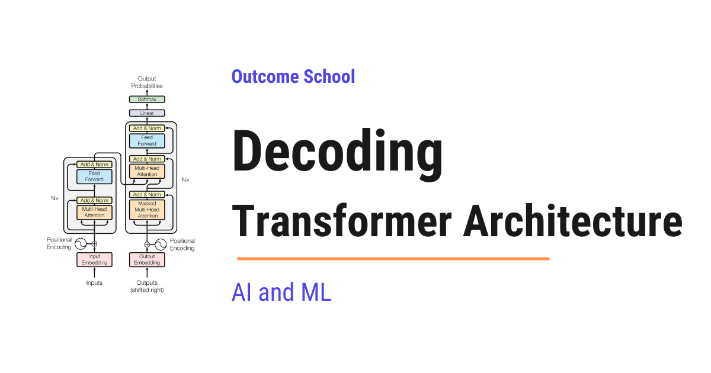

# How Does the Transformer Architecture Work?

> Archived from <https://outcomeschool.com/blog/decoding-transformer-architecture> on 2026-11-25.

The Transformer is the architecture behind every modern Large Language Model (LLM). It takes a sequence of tokens as input and produces a sequence of tokens as output, using attention to understand how the words relate to each other.

In this blog, we will learn about the Transformer architecture by decoding it piece by piece - understanding what each component does, how they work together, and why this architecture powers every modern <a target="_blank" rel="noopener noreferrer" href="large-language-model-llm.md">Large Language Model (LLM)</a>.

When we hear &quot;Transformer&quot;, it sounds complex. But do not worry. If we break it down into its individual parts, every single piece is simple. The complexity comes from how they are stacked together - not from any one piece being hard.

Our goal is to decode this architecture so clearly that by the end, we will be able to explain how a Transformer works to anyone.

We will cover the following:
<ul><li>Why the Transformer was needed</li><li>The two halves of the architecture</li><li>Tokenization, Embedding, and Positional Encoding</li><li>The Attention Mechanism and Multi-Head Attention</li><li>Feed-Forward Networks, Residual Connections, and Layer Normalization</li><li>How the Encoder and Decoder work</li><li>How data flows through the entire architecture</li><li>The three variants of the Transformer</li><li>Why the Transformer is so powerful</li></ul>
I am <strong>Amit Shekhar</strong>, Founder @ <a target="_blank" rel="noopener noreferrer" href="https://outcomeschool.com">Outcome School</a>, I have taught and mentored many developers, and their efforts landed them high-paying tech jobs, helped many tech companies in solving their unique problems, and created many open-source libraries being used by top companies. I am passionate about sharing knowledge through open-source, blogs, and videos.

I teach <a target="_blank" rel="noopener noreferrer" href="https://outcomeschool.com/program/ai-and-machine-learning">AI and Machine Learning</a> at Outcome School.

Let&#x27;s get started.
<h2 id="the-big-picture">The Big Picture</h2>
Before we go into the details, let&#x27;s understand the big picture.

A <strong>Transformer</strong> takes a sequence of tokens as input and produces a sequence of tokens as output. That is it. At a very high level, it is a tokens-in, tokens-out machine. And since tokens come from text and turn back into text, we can also think of it as a text-in, text-out machine.

For example, if we give it &quot;Translate: I love learning&quot; as input, it produces &quot;J&#x27;adore apprendre&quot; as output. If we give it &quot;What is the capital of France?&quot; as input, it produces &quot;The capital of France is Paris.&quot; as output.

But how does it do this? Let&#x27;s understand.
<h2 id="why-was-the-transformer-needed">Why Was the Transformer Needed?</h2>
Before the Transformer, models processed words <strong><a target="_blank" rel="noopener noreferrer" href="how-do-rnns-and-transformers-differ.md">one by one, in order</a></strong> - like reading a sentence from left to right, one word at a time.

This had two big problems:

<strong>Problem 1: Forgetting.</strong> As sentences got longer, the model would start forgetting earlier words. By the time it reached the 50th word, its memory of the 1st word was very weak.

<strong>Problem 2: Slowness.</strong> Because words were processed one after another, the 2nd word had to wait for the 1st word to finish, the 3rd word had to wait for the 2nd, and so on. This was very slow.

So, here comes the <strong>Transformer</strong> to the rescue. It processes all input tokens <strong>at the same time</strong> and lets every token look at every other token directly. Long-range connections are no longer a major problem. And because everything happens in parallel, training became much faster. We will see exactly how this works in the upcoming sections.

The Transformer was introduced in 2017 in the famous research paper &quot;Attention Is All You Need&quot; by researchers at Google. It changed everything.
<h2 id="the-architecture-has-two-halves">The Architecture Has Two Halves</h2>
The original Transformer has two main halves:
<ul><li><strong>The Encoder</strong> - this half reads and understands the input</li><li><strong>The Decoder</strong> - this half generates the output</li></ul>
Think of it like a conversation between a reader and a writer. The reader (encoder) reads a document carefully and creates detailed notes. The writer (decoder) uses those notes to write a new document. The reader focuses on understanding. The writer focuses on producing.

Now, let&#x27;s understand what happens inside each half. But before jumping into <a target="_blank" rel="noopener noreferrer" href="encoder-vs-decoder-in-transformers.md">the encoder and decoder</a>, we need to understand what happens before the input even reaches them.
<h2 id="decoding-step-1-turning-words-into-numbers">Decoding Step 1: Turning Words into Numbers</h2>
The model does not understand words. It only understands numbers. So, the very first step is to convert words into numbers.

This happens in two stages:

<strong><a target="_blank" rel="noopener noreferrer" href="https://www.youtube.com/watch?v=sK2s9I84EVI">Tokenization</a>:</strong> The input text is split into small pieces called <strong>tokens</strong>. A token can be a word, part of a word, or even a single character. For the sake of understanding, let&#x27;s treat each word as one token.

&quot;I love learning&quot; becomes three tokens: &quot;I&quot;, &quot;love&quot;, &quot;learning&quot;.

We have a detailed blog on <a target="_blank" rel="noopener noreferrer" href="tokenization-in-llms.md">Tokenization in LLMs</a> that explains this step by step.

<strong><a target="_blank" rel="noopener noreferrer" href="https://www.youtube.com/watch?v=LedXW6xl21s">Embedding</a>:</strong> Each token is then converted into a vector of numbers called an <strong>embedding</strong>. An embedding is like a digital fingerprint for a word. Words with similar meanings get similar fingerprints.

For example, &quot;happy&quot; and &quot;joyful&quot; would have very similar embeddings because they mean almost the same thing. But &quot;happy&quot; and &quot;car&quot; would have very different embeddings because they are unrelated.
<h2 id="decoding-step-2-adding-word-order">Decoding Step 2: Adding Word Order</h2>
But, here is the catch. The encoder processes all input tokens at the same time - not one by one. This is great for speed, but it means the model has no idea which word comes first, second, or third.

&quot;I love AI&quot; and &quot;AI love I&quot; would look the same to the model. But they mean very different things.

<strong>Positional Encoding</strong> solves this. It adds a vector of numbers to each embedding that represents the position of the word. The 1st word gets a different position signal than the 2nd word, and so on.

Think of it like seat numbers in a theater. Even if all the audience members arrive at the same time, their seat numbers tell us exactly where each person is supposed to sit. Positional encoding is the seat number for each word.

After this step, the positional encoding numbers are combined into the embedding itself through addition. So, each token now carries a single vector of numbers that encodes both what the word means and where it sits in the sentence.
<h2 id="decoding-step-3-the-attention-mechanism">Decoding Step 3: The Attention Mechanism</h2>
This is the heart of the Transformer. The <strong>attention mechanism</strong> is the single most important idea that makes everything work.

<strong>Attention</strong> allows each word to look at every other word in the sentence and decide how much focus to give to each one.

Let&#x27;s take the sentence: &quot;The cat sat on the mat because it was tired.&quot;

When the model processes the word &quot;it&quot;, it needs to figure out what &quot;it&quot; refers to. Is it the cat? Is it the mat? The attention mechanism helps the model focus more on &quot;cat&quot; and less on &quot;mat&quot; because &quot;cat&quot; is more relevant to &quot;it&quot; in this context.
<h3 id="how-attention-works">How Attention Works</h3>
Each word is converted into three things:
<ul><li><strong>Query (Q)</strong> - what this word is looking for</li><li><strong>Key (K)</strong> - what this word can offer</li><li><strong>Value (V)</strong> - the actual information this word carries</li></ul>
We have a detailed blog on the <a target="_blank" rel="noopener noreferrer" href="math-behind-attention-qkv.md">Math behind Attention - Q, K, and V</a> that explains how these are actually computed.

The process works like this:

First, each word uses its Query to compare with the Keys of all other words using a dot product. This produces <strong>attention scores</strong> - numbers that tell the model how relevant each pair of words is. Then, these scores are scaled down (divided by √dₖ) to keep them in a manageable range. We have a detailed blog on <a target="_blank" rel="noopener noreferrer" href="scaling-dot-product-attention.md">Scaling Dot Product Attention</a> that explains why this step is needed. After scaling, the scores are normalized using <a target="_blank" rel="noopener noreferrer" href="softmax-function.md"><strong>softmax</strong></a> so they become probabilities that add up to 1. Finally, the model collects a weighted mix of the Values based on these probabilities.

The result is that every word now carries information not just about itself, but about the words most relevant to it. The word &quot;it&quot; now carries a strong signal from &quot;cat&quot; because the attention mechanism figured out the connection.

In simple words, attention lets each token borrow useful information from other relevant tokens before moving to the next layer.

<strong>Planning your move into AI?</strong>

No matter which tech domain you work in today, with your effort, you can transition to these roles:
<ul><li>AI Engineer</li><li>Forward Deployed Engineer</li><li>AI Agent Engineer</li><li>Harness Engineer</li><li>Voice AI Engineer</li><li>AI Architect</li><li>LLM Engineer</li><li>LLM Inference Engineer</li><li>Gen AI Engineer</li><li>MLOps Engineer</li><li>ML Engineer</li><li>Deep Learning Engineer</li></ul>
Our <a target="_blank" rel="noopener noreferrer" href="https://outcomeschool.com/program/ai-and-machine-learning">AI and Machine Learning Program</a> at Outcome School takes you there.
<h3 id="multi-head-attention">Multi-Head Attention</h3>
The Transformer does not run attention just once. It runs it <strong>multiple times in parallel</strong> - each time from a different perspective. This is called <strong><a target="_blank" rel="noopener noreferrer" href="multi-head-attention-in-transformers.md">multi-head attention</a></strong>.

Think of it like a team of editors reviewing an article. One editor checks for grammar, another checks for factual accuracy, and another checks for flow. Each editor looks at the same text but focuses on something different. Together, they provide a complete review.

Each <strong>head</strong> in multi-head attention focuses on a different type of relationship between words. One head focuses on subject-verb connections. Another head focuses on which adjective describes which noun. The outputs of all heads are combined to give the model a rich understanding of the text.

Here is a simple visual of multi-head attention. All heads run <strong>in parallel</strong> on the same input, and their outputs are combined at the end:

<pre><code class="code-highlight">                Input
                  |
   -------------------------------
   |       |       |       |     |
 Head 1  Head 2  Head 3  ...  Head N    (all running in parallel)
   |       |       |       |     |
   -------------------------------
                  |
              Combined
                  |
                Output
</code></pre>

To learn Attention, Self-Attention, Multi-Head Attention, and Q/K/V Matrices in depth, check out our <a target="_blank" rel="noopener noreferrer" href="https://outcomeschool.com/program/ai-and-machine-learning">AI and Machine Learning Program</a> at Outcome School.
<h2 id="decoding-step-4-the-feed-forward-network">Decoding Step 4: The Feed-Forward Network</h2>
After the attention mechanism processes the words, the output passes through a <strong><a target="_blank" rel="noopener noreferrer" href="feed-forward-networks-in-llms.md">feed-forward network</a></strong>.

Think of it as a refinement step. If attention is about understanding relationships between words, the feed-forward network is about deepening the understanding of each word individually.

It takes the enriched representation from attention and processes it further - sharpening the signal and removing noise. Every word passes through the same feed-forward network independently.
<h2 id="decoding-step-5-residual-connections-and-layer-normalization">Decoding Step 5: Residual Connections and Layer Normalization</h2>
Inside each layer, there are two more important pieces that help the Transformer learn effectively. Let&#x27;s understand each of them.

<strong>Residual Connection (Skip Connection):</strong> After each sub-layer (attention or feed-forward network), the original input to that sub-layer is added back to the output. Think of it like taking notes in a class. Even after the teacher adds new information, we keep our original notes and combine the new information with them. This prevents the model from losing important information as data passes through many layers.

In simple words, the output of each sub-layer is: <strong>output = sub-layer(input) + input</strong>.

<strong><a target="_blank" rel="noopener noreferrer" href="batch-normalization-vs-layer-normalization.md">Layer Normalization</a>:</strong> After each residual connection, the numbers are normalized - adjusted so they stay in a stable range. This prevents the numbers from becoming too large or too small as they pass through many layers. It keeps the training process stable and smooth.

These two pieces are present in every single layer of both the encoder and decoder.

<strong>A quick note for you</strong>

No matter which tech domain you work in, get familiar with these topics:
<ul><li>LLM</li><li>RAG</li><li>MCP</li><li>Agent</li><li>Fine-tuning</li><li>Quantization</li></ul>
We put it all together in one video:

<a target="_blank" rel="noopener noreferrer" href="https://www.youtube.com/watch?v=lnfWvX66FUk">AI Engineering Explained: LLM, RAG, MCP, Agent, Fine-Tuning, and Quantization</a>

No need to stop reading - bookmark it and watch later when you get time. Future you will thank you.

Now, let&#x27;s get back to the topic.
<h2 id="decoding-step-6-stacking-multiple-layers">Decoding Step 6: Stacking Multiple Layers</h2>
Now, here comes the interesting part. So far, we have talked about one multi-head attention sub-layer and one feed-forward sub-layer. Together, these two sub-layers (along with their residual connections and layer normalization) form <strong>one layer</strong> of the Transformer. Think of one layer as a complete bundle: one multi-head attention sub-layer plus one feed-forward sub-layer.

The Transformer does not use just one such layer. It <strong>stacks multiple layers</strong> on top of each other, one after another. This is where the real power comes from.

Each of these layers is also called a <strong>Transformer block</strong>. So when we say &quot;the model has 96 layers&quot;, it means the model has 96 Transformer blocks stacked one after another. Each block has its own multi-head attention sub-layer and its own feed-forward sub-layer.

<strong>Note:</strong> This stacking is different from multi-head attention. Multi-head attention runs many attention heads <strong>in parallel</strong> inside a single attention sub-layer. Stacking layers, on the other hand, places full Transformer blocks <strong>one after another in sequence</strong>, so the output of one layer becomes the input of the next layer.

Here is a simple visual of stacked Transformer layers. Each layer is a complete block, and they are connected <strong>one after another in sequence</strong>:

<pre><code class="code-highlight">        Input
          |
  -----------------
  |   Layer 1     |    (multi-head attention + feed-forward)
  -----------------
          |
  -----------------
  |   Layer 2     |    (multi-head attention + feed-forward)
  -----------------
          |
         ...
          |
  -----------------
  |   Layer N     |    (multi-head attention + feed-forward)
  -----------------
          |
        Output
</code></pre>

The original Transformer uses 6 layers in both the encoder and decoder. Modern LLMs use even more - GPT-3 (175B) uses 96 layers.

Each layer builds on the understanding from the previous layer. Think of it like reading a book multiple times. The first read gives us a basic understanding. The second read reveals connections we missed. The third read gives us deeper insights. Each layer is like another read - the understanding gets richer and richer.

To master the Transformer Architecture, Feed-Forward Networks, and Layer Normalization, and build a Large Language Model (LLM) from scratch, check out our <a target="_blank" rel="noopener noreferrer" href="https://outcomeschool.com/program/ai-and-machine-learning">AI and Machine Learning Program</a> at Outcome School.
<h2 id="decoding-step-7-the-encoder-in-detail">Decoding Step 7: The Encoder in Detail</h2>
Now that we know the building blocks, let&#x27;s see how they come together inside the encoder.

The encoder&#x27;s job is to <strong>read and understand</strong> the input.

Each encoder layer has two components:
<ul><li><strong><a target="_blank" rel="noopener noreferrer" href="self-attention-in-transformers.md">Self-Attention</a></strong> - each word looks at all other words in the input to understand relationships</li><li><strong>Feed-Forward Network</strong> - each word&#x27;s representation is refined individually</li></ul>
Both components are followed by a residual connection and layer normalization.

Let&#x27;s see what happens when the sentence &quot;I love learning&quot; passes through the encoder.

In the <strong>first layer</strong>, the self-attention mechanism allows each word to look at every other word. The word &quot;love&quot; starts to notice that &quot;I&quot; is its subject and &quot;learning&quot; is its object. The feed-forward network then refines this understanding.

In the <strong>second layer</strong>, the connections become richer. Now &quot;love&quot; does not just know about &quot;I&quot; and &quot;learning&quot; individually - it starts to understand the combined meaning of &quot;I love learning&quot; as a complete thought.

By the <strong>sixth layer</strong>, each word carries a deep, context-aware representation. The word &quot;learning&quot; is no longer just a dictionary definition - it now encodes the fact that it is something &quot;I&quot; loves to do, in this specific sentence.

After all encoder layers, we have a rich understanding of the input. This understanding is then passed to the decoder.
<h2 id="decoding-step-8-the-decoder-in-detail">Decoding Step 8: The Decoder in Detail</h2>
The decoder&#x27;s job is to <strong>generate</strong> the output, one token at a time.

Each decoder layer has three components:
<ul><li>
<strong>Masked Self-Attention</strong> - each output word looks at all <strong>previous</strong> output words, but not future ones. This is because when generating text, future words do not exist yet. The word &quot;love&quot; can look at &quot;I&quot; but not at &quot;learning&quot; because &quot;learning&quot; has not been generated yet. This restriction is called <strong>causal masking</strong>. We have a detailed blog on <a target="_blank" rel="noopener noreferrer" href="causal-masking-in-attention.md">Causal Masking in Attention</a> that explains how this works.
</li><li>
<strong><a target="_blank" rel="noopener noreferrer" href="cross-attention-in-transformers.md">Cross-Attention</a></strong> - this is how the decoder connects to the encoder. Each output word looks at the encoder&#x27;s output to pull in relevant information from the input. Here, the <strong>Query</strong> comes from the decoder, while the <strong>Key</strong> and <strong>Value</strong> come from the encoder&#x27;s output. This is what makes it different from self-attention - and this is the bridge between understanding the input and generating the output.
</li><li>
<strong>Feed-Forward Network</strong> - the same refinement step as in the encoder.
</li></ul>
All three components are followed by a residual connection and layer normalization, just like in the encoder.
<h3 id="how-the-decoder-picks-the-next-word">How the Decoder Picks the Next Word</h3>
Now, the question is: after the output passes through all decoder layers, how does the decoder pick the actual next word? At this point, the output is still a vector of numbers - not a word.

So, the decoder passes these numbers through a <strong>linear layer</strong> that converts them into a score for every word in the vocabulary. If the vocabulary has 50,000 words, we get 50,000 scores.

Then, <strong>softmax</strong> converts these scores into probabilities - numbers between 0 and 1 that add up to 1. The model then picks the next word based on these probabilities. In practice, models use different strategies to pick the next word - like <strong><a target="_blank" rel="noopener noreferrer" href="how-does-temperature-control-llm-output.md">temperature</a></strong>, <strong><a target="_blank" rel="noopener noreferrer" href="how-do-top-k-and-top-p-sampling-work.md">top-k</a></strong>, and <strong><a target="_blank" rel="noopener noreferrer" href="how-do-top-k-and-top-p-sampling-work.md">top-p sampling</a></strong> - which control how creative or focused the output is. But for the sake of understanding, let&#x27;s say it picks the word with the highest probability.

For example, if the model is translating &quot;I love learning&quot; to French and it has already generated &quot;J&#x27;&quot;, the probabilities after the linear layer and softmax look like this:
<ul><li>&quot;adore&quot;: 0.72</li><li>&quot;aime&quot;: 0.15</li><li>&quot;mange&quot;: 0.01</li><li>... (50,000 words, most with very small probabilities)</li></ul>
The model picks &quot;adore&quot; because it has the highest probability. This is how the decoder decides which word to output next.

We have a complete program on Causal Masked Attention, Cross Attention, and Transformer Architecture - check out our <a target="_blank" rel="noopener noreferrer" href="https://outcomeschool.com/program/ai-and-machine-learning">AI and Machine Learning Program</a> at Outcome School.
<h2 id="decoding-step-9-the-complete-flow">Decoding Step 9: The Complete Flow</h2>
Now that we have learned about all the building blocks, let&#x27;s walk through the complete flow with a concrete example. The best way to learn this is by taking an example.

Let&#x27;s say we want to translate &quot;I love learning&quot; to French.
<h3 id="the-encoder-phase">The Encoder Phase</h3>
The English sentence &quot;I love learning&quot; goes through the following steps:

<strong>Tokenize:</strong> &quot;I love learning&quot; becomes three tokens: &quot;I&quot;, &quot;love&quot;, &quot;learning&quot;.

<strong>Embed:</strong> Each token is converted into a vector of numbers (an embedding).

<strong>Add position:</strong> Positional encoding is added so the model knows &quot;I&quot; is 1st, &quot;love&quot; is 2nd, and &quot;learning&quot; is 3rd.

<strong>Pass through 6 encoder layers:</strong> In each layer, self-attention lets every word look at every other word, and the feed-forward network refines the understanding. Residual connections and layer normalization keep things stable.

After all 6 layers, the encoder produces a rich representation of the input. Each word now carries deep contextual information. This representation is passed to the decoder.
<h3 id="the-decoder-phase">The Decoder Phase</h3>
The decoder generates the French translation one word at a time.

<strong>Generating &quot;J&#x27;&quot; (the 1st word):</strong>

The decoder starts with a special &quot;start&quot; token. Masked self-attention has nothing to look back at since this is the first token. Cross-attention looks at the encoder&#x27;s output to understand the English input. The output passes through the linear layer and softmax. The model picks &quot;J&#x27;&quot; as the most probable first word.

<strong>Generating &quot;adore&quot; (the 2nd word):</strong>

Now the decoder has [&quot;start&quot;, &quot;J&#x27;&quot;]. Masked self-attention looks at &quot;start&quot; and &quot;J&#x27;&quot; to understand what has been generated so far. Cross-attention looks at the encoder&#x27;s output again to pull in relevant information from the English input. The linear layer and softmax produce probabilities. The model picks &quot;adore&quot;.

<strong>Generating &quot;apprendre&quot; (the 3rd word):</strong>

Now the decoder has [&quot;start&quot;, &quot;J&#x27;&quot;, &quot;adore&quot;]. Masked self-attention looks at all three previous tokens. Cross-attention connects to the encoder&#x27;s output. The model picks &quot;apprendre&quot;.

<strong>Generating the &quot;end&quot; token:</strong>

The decoder generates a special &quot;end&quot; token, signaling that the translation is complete.

The final output: <strong>&quot;J&#x27;adore apprendre&quot;</strong> (which means &quot;I love learning&quot; in French).

This is how the Transformer works from start to finish.

<strong>Stay updated:</strong> Subscribe to our <a target="_blank" rel="noopener noreferrer" href="https://outcomeschool.substack.com/subscribe">newsletter</a> to get our latest AI and Machine Learning blogs straight to your inbox.
<h2 id="the-three-variants">The Three Variants</h2>
The original Transformer uses both an encoder and a decoder. But we do not always need both. This gives us three variants:

<strong>Encoder-Only (Example: BERT)</strong>

Uses only the encoder. The model reads and understands the input but does not generate new text. This is used for tasks like classifying emails as spam or not, understanding the sentiment of a review, or finding answers within a given text.

<strong>Decoder-Only (Example: GPT)</strong>

Uses only the decoder. The model generates text one token at a time. Each token can look at all previous tokens but not future ones. This is the variant behind most modern LLMs. It is used for generating text, answering questions, writing code, and having conversations.

<strong>Encoder-Decoder (Example: T5, the original Transformer)</strong>

Uses both parts. The encoder understands the input, and the decoder generates the output based on that understanding. This is used for translation, summarization, and other tasks where one text is transformed into another.

We can choose the right variant based on our use case.
<h2 id="why-the-transformer-is-so-powerful">Why the Transformer is So Powerful</h2>
Now that we have decoded the entire architecture, let&#x27;s understand why it changed everything:

<strong>Parallel processing:</strong> The encoder processes all input tokens at the same time instead of one by one. Even the decoder runs in parallel during training. This makes training much faster and allows models to learn from massive amounts of data.

<strong>No more long-range forgetting:</strong> Through attention, every word can directly look at every other word. The 1st word is just as accessible as the 1000th word, so the long-range memory problem of older models is largely solved.

<strong>Scalability:</strong> By adding more layers, more attention heads, and more data, the model keeps getting better. This is why we have <a target="_blank" rel="noopener noreferrer" href="evolution-of-llm-architecture.md">models with billions of parameters today</a>. Parameters are the numbers inside the model that it learns during training.

<strong>Versatility:</strong> The same architecture handles translation, question answering, text generation, code writing, summarization, and much more. One design, countless applications.

The Transformer is the single architecture behind the entire modern AI revolution. It enables us to do complex things very simply.
<h2 id="quick-summary">Quick Summary</h2>
Let&#x27;s recap what we have decoded:
<ul><li><strong>Tokenization and Embedding</strong> turn words into numbers that the model can work with.</li><li><strong>Positional Encoding</strong> adds word order information since all words are processed at the same time.</li><li><strong>Attention</strong> lets every word look at every other word and decide which ones to focus on. Multi-head attention does this from multiple perspectives.</li><li><strong>Feed-Forward Networks</strong> refine the understanding of each word individually.</li><li><strong>Residual Connections and Layer Normalization</strong> keep the numbers stable as data flows through many layers.</li><li><strong>The Encoder</strong> stacks these building blocks to read and understand the input.</li><li><strong>The Decoder</strong> adds cross-attention to connect to the encoder, and uses a linear layer + softmax to pick the next word.</li><li><strong>Three variants</strong> exist: encoder-only for understanding, decoder-only for generating, and encoder-decoder for transforming one text into another.</li></ul>
Now, we have decoded the Transformer architecture piece by piece and understood how it works.
<h2 id="frequently-asked-questions">Frequently Asked Questions</h2><h3 id="does-gpt-use-the-full-transformer-architecture">Does GPT use the full Transformer architecture?</h3>
No. GPT uses only the decoder half of the Transformer. It generates text one token at a time, and each token can look at all previous tokens but not future ones. This decoder-only variant is the one behind most modern LLMs.
<h3 id="is-multi-head-attention-the-same-as-stacking-layers">Is multi-head attention the same as stacking layers?</h3>
No. Multi-head attention runs many attention heads in parallel inside a single attention sub-layer. Stacking layers places full Transformer blocks one after another in sequence, so the output of one layer becomes the input of the next layer. Each block has its own multi-head attention and its own feed-forward sub-layer.
<h3 id="how-many-layers-does-a-transformer-have">How many layers does a Transformer have?</h3>
The original Transformer uses 6 layers in both the encoder and the decoder. Modern LLMs use even more layers. For example, GPT-3 with 175B parameters uses 96 layers, which means 96 Transformer blocks stacked one after another.
<h3 id="does-the-decoder-always-pick-the-word-with-the-highest-probability">Does the decoder always pick the word with the highest probability?</h3>
No. In practice, models use different strategies to pick the next word, like temperature, top-k, and top-p sampling. These strategies control how creative or focused the output is. Picking the highest-probability word is just the simplest way to understand how the decoder works.
<h3 id="why-can-a-decoder-not-look-at-future-words">Why can a decoder not look at future words?</h3>
A decoder cannot look at future words because, when generating text, future words do not exist yet. So each output word looks only at the previous output words. This restriction is called causal masking, and it is applied in the masked self-attention of every decoder layer.

That&#x27;s it for now.

Thanks

<strong>Amit Shekhar</strong> Founder @ <a target="_blank" rel="noopener noreferrer" href="https://outcomeschool.com">Outcome School</a>

You can connect with me on:
<ul><li><a target="_blank" rel="noopener noreferrer" href="https://x.com/amitiitbhu">X</a></li><li><a target="_blank" rel="noopener noreferrer" href="https://www.linkedin.com/in/amit-shekhar-iitbhu">LinkedIn</a></li><li><a target="_blank" rel="noopener noreferrer" href="https://github.com/amitshekhariitbhu">GitHub</a></li></ul>
Follow Outcome School on:
<ul><li><a target="_blank" rel="noopener noreferrer" href="https://x.com/outcome_school">X</a></li><li><a target="_blank" rel="noopener noreferrer" href="https://youtube.com/@OutcomeSchool">YouTube</a></li><li><a target="_blank" rel="noopener noreferrer" href="https://www.linkedin.com/company/outcomeschool">LinkedIn</a></li><li><a target="_blank" rel="noopener noreferrer" href="https://github.com/OutcomeSchool">GitHub</a></li></ul>
<a target="_blank" rel="noopener noreferrer" href="https://outcomeschool.com/blog"><strong>Read all of our high-quality blogs here.</strong></a>

