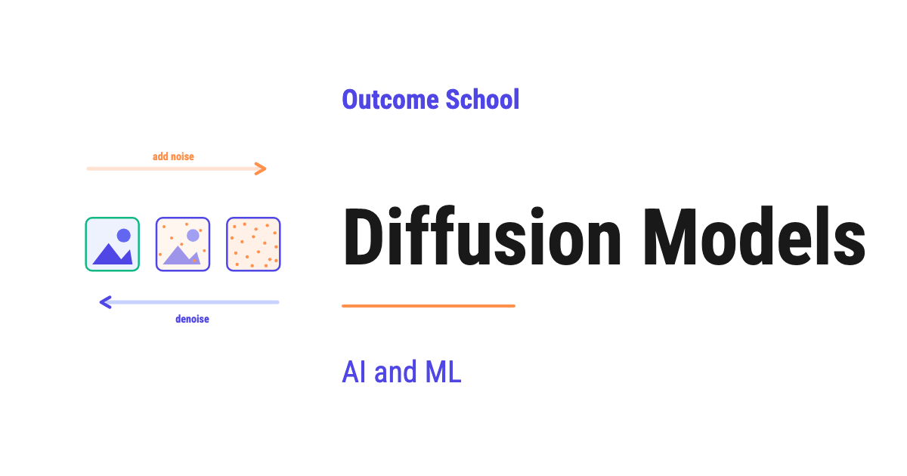

# What are Diffusion Models and How Do They Generate Images?

> Archived from <https://outcomeschool.com/blog/diffusion-models> on 2026-11-25.

A Diffusion Model is a type of AI model that creates new data, such as images, by starting from pure random noise and slowly cleaning it up step by step until a clear image appears.

In this blog, we will learn about Diffusion Models. We will understand what they are, why we need them, how they work step by step, and how they generate amazing images like the ones we see in tools such as DALL-E, Stable Diffusion, and Midjourney.

We will cover the following:
<ul><li>What is a Diffusion Model?</li><li>Why do we need Diffusion Models?</li><li>The two processes: Forward and Reverse</li><li>The Forward Process (adding noise)</li><li>The Reverse Process (removing noise)</li><li>A step-by-step example walk-through</li><li>How the model is trained</li><li>A simple code example</li><li>Conditional Diffusion (text to image)</li><li>Advantages of Diffusion Models</li><li>Where Diffusion Models are used</li></ul>
I am <strong>Amit Shekhar</strong>, Founder @ <a target="_blank" rel="noopener noreferrer" href="https://outcomeschool.com">Outcome School</a>, I have taught and mentored many developers, and their efforts landed them high-paying tech jobs, helped many tech companies in solving their unique problems, and created many open-source libraries being used by top companies. I am passionate about sharing knowledge through open-source, blogs, and videos.

I teach <a target="_blank" rel="noopener noreferrer" href="https://outcomeschool.com/program/ai-and-machine-learning">AI and Machine Learning</a> at Outcome School.

Let&#x27;s get started.
<h3 id="what-is-a-diffusion-model">What is a Diffusion Model?</h3>
<strong>A Diffusion Model is a type of AI model that learns to create new data, such as images, by starting from pure random noise and slowly cleaning it up step by step until a clear image appears.</strong>

In simple words, a Diffusion Model learns how to turn noise into something meaningful.

So, where does the name come from? The word <strong>diffusion</strong> means spreading out, like a drop of ink spreading slowly in water until it mixes everywhere. A Diffusion Model first spreads noise into an image until the image is destroyed, and then learns to reverse this spreading to bring the image back.

So, what is <strong>noise</strong>? Noise is just random dots, like the static we see on an old television screen when there is no signal. It carries no meaning. It is pure randomness.

Now, the magic is this: a Diffusion Model takes this meaningless noise and gradually transforms it into a beautiful, meaningful image, one small step at a time.

Let&#x27;s say we have a screen full of random dots. The Diffusion Model looks at it and removes a little bit of the randomness. Then it looks again and removes a little more. It keeps repeating this until a clear picture of, for example, a cat appears.

That is the core idea of a Diffusion Model.

Diffusion Models are one family inside the bigger world of Generative AI, and we have a detailed blog on <a target="_blank" rel="noopener noreferrer" href="what-is-generative-ai.md">What is Generative AI?</a> that explains the whole idea from the ground up.
<h3 id="why-do-we-need-diffusion-models">Why do we need Diffusion Models?</h3>
The best way to learn this is by understanding the problem.

We want computers to create new images, new art, new designs, and new pictures that have never existed before. This is called <strong>image generation</strong>.

So, the question is: how can a computer create a brand new image from scratch?

This is a very hard problem. An image is made of millions of pixels, and every pixel must have the right color and the right place. If even a few pixels are wrong, the image looks broken and unrealistic.

Before Diffusion Models, we used models called <strong>GANs</strong>, which stands for <a target="_blank" rel="noopener noreferrer" href="generative-adversarial-networks.md"><strong>Generative Adversarial Networks</strong></a>. GANs were powerful, but they were very hard to train. They were unstable, which means they often failed to learn properly, and sometimes they produced the same image again and again.

We needed a solution for that, and Diffusion Models were introduced to solve this problem.

Diffusion Models are stable to train, they produce very high quality and diverse images, and they have a simple core idea that is easy to understand. This is why Diffusion Models have become the most popular method for image generation today.
<h3 id="the-two-processes-forward-and-reverse">The two processes: Forward and Reverse</h3>
A Diffusion Model is built on two processes that are opposite to each other.
<ul><li><strong>Forward Process:</strong> We take a clean image and slowly add noise to it, step by step, until it becomes pure noise.</li><li><strong>Reverse Process:</strong> We take pure noise and slowly remove the noise, step by step, until it becomes a clean image.</li></ul>
We can visualize both processes on the same chain like below:

<pre><code class="code-highlight">             ADD NOISE   (forward, easy)   ---------&gt;

        +--------+--------+--------+-- ... --+--------+
        |  x_0   |  x_1   |  x_2   |         |  x_T   |
        +--------+--------+--------+-- ... --+--------+

          clean    little    more               pure
          image    noise     noise              noise

        &lt;---------   (reverse, hard)   REMOVE NOISE
</code></pre>

Here, we can see that the same chain runs in two opposite directions. Going left to right is the Forward Process, where we add a little noise at every step until the clean image <code>x_0</code> becomes pure noise <code>x_T</code>. Going right to left is the Reverse Process, where we remove a little noise at every step until the pure noise <code>x_T</code> becomes a clean image <code>x_0</code> again. The top arrow is easy and needs no learning. The bottom arrow is hard and is the part that the AI model must learn.

So, here is the key insight. The Forward Process is easy because adding noise is simple. We do not need any learning for it. We just keep adding random noise.

But the Reverse Process is the hard part. Removing noise to recover a real image is difficult. This is where the AI model comes into the picture. The model learns how to reverse the noise.

Let&#x27;s understand this with an analogy.

Suppose we have a clear glass of water, and we slowly add drops of ink to it. Drop by drop, the water becomes more and more cloudy, until it is completely dark. This is the Forward Process. Adding ink is easy.

Now, the Reverse Process is like cleaning the water drop by drop until it becomes perfectly clear again. This is very hard, and we need a skilled helper to do it. In a Diffusion Model, the AI model is that skilled helper.

So, the model spends all its effort learning the Reverse Process. The Forward Process is only used during training to teach the model what noise looks like at every step.
<h3 id="the-forward-process-adding-noise">The Forward Process (adding noise)</h3>
Now, let&#x27;s understand the Forward Process in detail.

We start with a real image. Let&#x27;s call it the image at time step <code>0</code>, written as <code>x_0</code>.

Then, we add a small amount of random noise to it. Now we have a slightly noisy image at step <code>1</code>, called <code>x_1</code>.

We add a little more noise. Now we have <code>x_2</code>, which is noisier.

We keep repeating this for many steps, usually around <code>1000</code> steps. At the final step, called <code>x_T</code>, the image is completely destroyed and becomes pure random noise.

So, the Forward Process looks like below:

<pre><code class="code-highlight">   x_0   -&gt;   x_1   -&gt;   x_2   -&gt;   ...   -&gt;   x_T

  clean      little     more                  pure
  image      noise      noise                 noise
</code></pre>

Here, we can see that we move from a clean image on the left to pure noise on the right, by adding a small amount of noise at every step.

A very important point to understand is that the amount of noise added at each step is small and controlled. We use a schedule that decides how much noise to add at every step. This is called the <strong>noise schedule</strong>.

The good thing about the Forward Process is that it needs no learning at all. It is just a simple, fixed mathematical process of adding random noise. The model does not even take part in the Forward Process.

<strong>Planning your move into AI?</strong>

No matter which tech domain you work in today, with your effort, you can transition to these roles:
<ul><li>AI Engineer</li><li>Forward Deployed Engineer</li><li>AI Agent Engineer</li><li>Harness Engineer</li><li>Voice AI Engineer</li><li>AI Architect</li><li>LLM Engineer</li><li>LLM Inference Engineer</li><li>Gen AI Engineer</li><li>MLOps Engineer</li><li>ML Engineer</li><li>Deep Learning Engineer</li></ul>
Our <a target="_blank" rel="noopener noreferrer" href="https://outcomeschool.com/program/ai-and-machine-learning">AI and Machine Learning Program</a> at Outcome School takes you there.
<h3 id="the-reverse-process-removing-noise">The Reverse Process (removing noise)</h3>
Now, let&#x27;s learn the Reverse Process, which is the heart of a Diffusion Model.

The Reverse Process does the exact opposite of the Forward Process. It starts from pure noise <code>x_T</code> and slowly removes the noise, step by step, until it reaches a clean image <code>x_0</code>.

So, the Reverse Process looks like below:

<pre><code class="code-highlight">   x_T   -&gt;   ...   -&gt;   x_2   -&gt;   x_1   -&gt;   x_0

  pure                  more       little     clean
  noise                 noise      noise      image
</code></pre>

Here, we can see that we move from pure noise on the left to a clean image on the right, by removing a small amount of noise at every step.

But here is the catch. Removing noise is very hard. We cannot do it with a simple fixed rule. We need a model that has learned what a real image looks like.

So, here comes the <strong>neural network</strong> to the rescue. A neural network is a model made of many connected layers that learns patterns from data.

The job of this neural network is simple to state. At every step, it looks at the noisy image and predicts the noise that was added. Once we know the noise, we can subtract it and get a cleaner image.

In simple words, the model is a <strong>noise predictor</strong>. We give it a noisy image, and it tells us, &quot;Here is the noise that is hiding inside this image.&quot; We remove that noise and move one step closer to a clean image.

The neural network used here is usually a special architecture called a <strong>U-Net</strong>. A U-Net is good at taking an image as input and producing an image as output of the same size, which is exactly what we need to predict noise.

To learn how neural networks work from the ground up, we have a complete program on Deep Learning - Neural Networks, Backpropagation, and Optimizers - check out our <a target="_blank" rel="noopener noreferrer" href="https://outcomeschool.com/program/ai-and-machine-learning">AI and Machine Learning Program</a> at Outcome School.
<h3 id="a-step-by-step-example-walk-through">A step-by-step example walk-through</h3>
Let&#x27;s take a small example to make this concrete.

Suppose we want to generate a picture of a cat. We do not start with a cat. We start with pure noise.

<strong>Step 1:</strong> We begin with a screen full of random noise. This is <code>x_T</code>. It looks like the static on an old television screen when there is no signal. There is no cat anywhere in it.

<strong>Step 2:</strong> We pass this noise to the trained neural network. The model predicts the noise hidden inside it. We subtract a part of that noise. Now we have <code>x_(T-1)</code>, which is very slightly less noisy.

<strong>Step 3:</strong> We pass <code>x_(T-1)</code> to the model again. It predicts the noise again. We subtract it again. Now we have <code>x_(T-2)</code>. A very faint shape starts to appear.

<strong>Step 4:</strong> We keep repeating this process again and again. With every step, the image becomes cleaner. Slowly, the rough outline of a cat appears. Then the ears appear. Then the eyes. Then the fur details.

<strong>Step 5:</strong> After all the steps are done, we reach <code>x_0</code>. Now we have a clear, sharp image of a cat that never existed before.

So, the journey looks like below:

<pre><code class="code-highlight">   Pure Noise   -&gt;   Faint Shape   -&gt;   Rough Cat   -&gt;   Clear Cat

      x_T               x_500             x_100             x_0
</code></pre>

Here, we can see that each step removes a little noise, and the cat slowly emerges out of the randomness. The model never draws the cat in one shot. It reveals the cat gradually, like cleaning a foggy mirror wipe by wipe.

<strong>A quick note for you</strong>

No matter which tech domain you work in, get familiar with these topics:
<ul><li>LLM</li><li>RAG</li><li>MCP</li><li>Agent</li><li>Fine-tuning</li><li>Quantization</li></ul>
We put it all together in one video:

<a target="_blank" rel="noopener noreferrer" href="https://www.youtube.com/watch?v=lnfWvX66FUk">AI Engineering Explained: LLM, RAG, MCP, Agent, Fine-Tuning, and Quantization</a>

No need to stop reading - bookmark it and watch later when you get time. Future you will thank you.

Now, let&#x27;s get back to the topic.
<h3 id="how-the-model-is-trained">How the model is trained</h3>
Now, the next big question is: how does the model learn to predict the noise?

This is where the Forward Process becomes useful during training.

Let&#x27;s understand the training in simple steps.

<strong>Step 1:</strong> We take a real image from our training data. Let&#x27;s say it is a real photo of a cat.

<strong>Step 2:</strong> We pick a random time step, for example step <code>400</code>. Then we add the exact amount of noise for step <code>400</code> to the image. Since we are the ones adding the noise, we know precisely what noise we added.

<strong>Step 3:</strong> We give this noisy image to the neural network and ask it to predict the noise.

<strong>Step 4:</strong> We compare the noise predicted by the model with the actual noise that we added. The difference between them is the <strong>error</strong>, also called the <strong>loss</strong>.

<strong>Step 5:</strong> We adjust the model so that next time its prediction is closer to the real noise. This adjustment is done using a method called <strong><a target="_blank" rel="noopener noreferrer" href="math-behind-backpropagation.md">backpropagation</a></strong>, which slowly improves the model.

We repeat these steps millions of times with millions of images and random time steps. Over time, the model becomes an expert at predicting the noise at any step.

So, the beauty of the training is this. We always know the correct answer, because we added the noise ourselves. This makes the training stable and reliable, which is the big advantage over GANs.

A newer way to train the same family of models skips predicting the noise and instead learns a straight path from noise to data. We have a detailed blog on <a target="_blank" rel="noopener noreferrer" href="flow-matching.md">how flow matching trains a generative model</a> that explains this step by step.
<h3 id="a-simple-code-example">A simple code example</h3>
Let&#x27;s see a simple code example to make the idea concrete.

First, let&#x27;s see how we add noise in the Forward Process, as below:

<pre><code class="code-highlight language-python">import torch

def add_noise(image, noise, alpha_bar_t):
    # alpha_bar_t controls how much original image remains
    noisy_image = (alpha_bar_t ** 0.5) * image + ((1 - alpha_bar_t) ** 0.5) * noise
    return noisy_image
</code></pre>

Here, we have a function that takes a clean <code>image</code>, some random <code>noise</code>, and a value <code>alpha_bar_t</code> that controls how much of the original image stays. When <code>alpha_bar_t</code> is close to <code>1</code>, the image stays mostly clean. When it is close to <code>0</code>, the image becomes mostly noise. So, this single line mixes the clean image and the noise in the right proportion for that time step.

Now, let&#x27;s see the training step where the model learns to predict the noise, as below:

<pre><code class="code-highlight language-python">def training_step(model, image):
    t = torch.randint(0, 1000, (1,))          # pick a random time step
    noise = torch.randn_like(image)           # create random noise
    noisy_image = add_noise(image, noise, alpha_bar[t])

    predicted_noise = model(noisy_image, t)   # model predicts the noise
    loss = ((noise - predicted_noise) ** 2).mean()   # compare with real noise
    return loss
</code></pre>

Here, we can see the full training logic. First, we pick a random time step <code>t</code>. Then, we create random <code>noise</code> and add it to the image to get a <code>noisy_image</code>. After that, the <code>model</code> predicts the noise from the noisy image. Finally, we compute the <code>loss</code>, which is the difference between the real noise and the predicted noise. We want this loss to become as small as possible.

Now, let&#x27;s see how we generate a new image in the Reverse Process, as below:

<pre><code class="code-highlight language-python">def generate(model):
    x = torch.randn(1, 3, 64, 64)             # start from pure noise
    for t in reversed(range(1000)):           # go from step 999 down to 0
        predicted_noise = model(x, t)         # predict the noise
        x = remove_noise(x, predicted_noise, t)   # subtract a part of it
    return x                                   # final clean image
</code></pre>

Here, we can see the generation logic. We start with pure random noise <code>x</code>. Then, we loop from the last step down to the first step. In every step, the <code>model</code> predicts the noise, and we remove a part of it using <code>remove_noise</code>. After the loop finishes, <code>x</code> becomes a clean, brand new image.

This is how, in code, we add noise, train the model, and generate new images.

<strong>Stay updated:</strong> Subscribe to our <a target="_blank" rel="noopener noreferrer" href="https://outcomeschool.substack.com/subscribe">newsletter</a> to get our latest AI and Machine Learning blogs straight to your inbox.
<h3 id="conditional-diffusion-text-to-image">Conditional Diffusion (text to image)</h3>
Till now, we have learned how a Diffusion Model generates a random image. But tools like DALL-E and Stable Diffusion do something more powerful. We type a sentence, and they create exactly that image.

So, now the question is: how does the model know what to draw?

This is where <strong>Conditional Diffusion</strong> comes into the picture.

In Conditional Diffusion, we give the model an extra input called a <strong>condition</strong>. The condition tells the model what we want. For text to image, the condition is our text prompt, for example &quot;a cat sitting on a red sofa&quot;.

So, at every step of the Reverse Process, the model does not only look at the noisy image. It also looks at the meaning of our text. This way, it removes the noise in a direction that matches our text.

The text is first converted into numbers that capture its meaning. This conversion is done by a text understanding model such as <strong>CLIP</strong>. These numbers are then fed into the U-Net at every step, so the noise removal stays guided by our words.

In simple words, the text acts like a guide. Without the text, the model would create any random image. With the text, the model creates the specific image that we asked for.

This is exactly how we type &quot;a cat sitting on a red sofa&quot; and get that exact image.
<h3 id="advantages-of-diffusion-models">Advantages of Diffusion Models</h3>
Now, let&#x27;s understand why Diffusion Models have become so popular.
<ul><li><strong>High quality:</strong> Diffusion Models produce very sharp, detailed, and realistic images.</li><li><strong>Stable training:</strong> Unlike GANs, Diffusion Models are stable to train because we always know the correct noise during training. The model rarely fails to learn.</li><li><strong>Diversity:</strong> Diffusion Models can produce a wide variety of different images. They do not get stuck producing the same image again and again.</li><li><strong>Flexible control:</strong> We can guide the generation using text, sketches, or other images. This gives us a lot of control over the final result.</li><li><strong>Simple core idea:</strong> The main idea, which is to add noise and then learn to remove it, is simple and easy to understand.</li></ul>
That&#x27;s the beauty of Diffusion Models.

To master Diffusion Models, and Variational Autoencoders (VAEs), we have a complete program - check out our <a target="_blank" rel="noopener noreferrer" href="https://outcomeschool.com/program/ai-and-machine-learning">AI and Machine Learning Program</a> at Outcome School.
<h3 id="where-diffusion-models-are-used">Where Diffusion Models are used</h3>
Now, let&#x27;s see where Diffusion Models are used in the real world.
<ul><li><strong>Text to image generation:</strong> Tools like DALL-E, Stable Diffusion, and Midjourney use Diffusion Models to create images from text prompts.</li><li><strong>Image editing:</strong> We can change a part of an image, remove an object, or fill in a missing area. This is called inpainting.</li><li><strong>Super resolution:</strong> We can take a low quality, blurry image and make it sharp and high resolution.</li><li><strong>Video generation:</strong> Newer models extend the same idea to create short videos from text.</li><li><strong>Audio generation:</strong> The same noise to signal idea is also used to generate music and speech.</li><li><strong>Science and medicine:</strong> Diffusion Models are used to design new molecules and to improve medical images.</li></ul>
Diffusion Models are the reason why we can now create stunning images just by typing a few words. The simple idea of adding noise and then learning to remove it has changed the way computers create art and content.

The same add-noise-then-remove-noise idea has now been carried over to text, where it powers a new kind of model. We have a blog on <a target="_blank" rel="noopener noreferrer" href="how-do-diffusion-language-models-dlms-work.md">Diffusion Language Models (DLMs)</a> that explains how this works for words.

This was all about Diffusion Models.

Now we must have understood what Diffusion Models are, why we need them, how they work step by step, and where they are used.
<h2 id="frequently-asked-questions">Frequently Asked Questions</h2><h3 id="are-diffusion-models-better-than-gans">Are Diffusion Models better than GANs?</h3>
Yes, for most image generation today. GANs were powerful but hard to train, unstable, and sometimes produced the same image again and again. Diffusion Models are stable to train because we always know the correct noise during training, and they produce very high quality and diverse images.
<h3 id="does-a-diffusion-model-create-an-image-in-one-step">Does a Diffusion Model create an image in one step?</h3>
No. A Diffusion Model never draws the image in one shot. It starts from pure noise and removes a little noise at every step, usually over around 1000 steps. The image is revealed gradually, like cleaning a foggy mirror wipe by wipe.
<h3 id="does-the-model-have-to-learn-the-forward-process">Does the model have to learn the Forward Process?</h3>
No. The Forward Process needs no learning at all. It is a simple, fixed mathematical process of adding random noise, controlled by a noise schedule. The model spends all its effort learning the Reverse Process, and the Forward Process is only used during training to create noisy images.
<h3 id="can-diffusion-models-generate-things-other-than-images">Can Diffusion Models generate things other than images?</h3>
Yes. Newer models extend the same idea to create short videos from text, and the same noise to signal idea is used to generate music and speech. Diffusion Models are also used to design new molecules and improve medical images. The idea has even been carried over to text through Diffusion Language Models.

That&#x27;s it for now.

Thanks

<strong>Amit Shekhar</strong> Founder @ <a target="_blank" rel="noopener noreferrer" href="https://outcomeschool.com">Outcome School</a>

You can connect with me on:
<ul><li><a target="_blank" rel="noopener noreferrer" href="https://x.com/amitiitbhu">X</a></li><li><a target="_blank" rel="noopener noreferrer" href="https://www.linkedin.com/in/amit-shekhar-iitbhu">LinkedIn</a></li><li><a target="_blank" rel="noopener noreferrer" href="https://github.com/amitshekhariitbhu">GitHub</a></li></ul>
Follow Outcome School on:
<ul><li><a target="_blank" rel="noopener noreferrer" href="https://x.com/outcome_school">X</a></li><li><a target="_blank" rel="noopener noreferrer" href="https://youtube.com/@OutcomeSchool">YouTube</a></li><li><a target="_blank" rel="noopener noreferrer" href="https://www.linkedin.com/company/outcomeschool">LinkedIn</a></li><li><a target="_blank" rel="noopener noreferrer" href="https://github.com/OutcomeSchool">GitHub</a></li></ul>
<a target="_blank" rel="noopener noreferrer" href="https://outcomeschool.com/blog"><strong>Read all of our high-quality blogs here.</strong></a>

