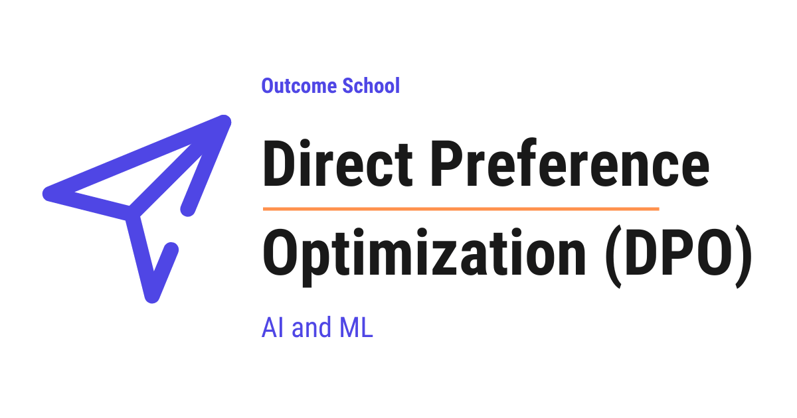

# What is Direct Preference Optimization (DPO) and How Does It Work?

> Archived from <https://outcomeschool.com/blog/direct-preference-optimization-dpo> on 2026-11-25.

Direct Preference Optimization (DPO) is a method to train a Large Language Model directly on human preference data, without using a separate reward model and without using reinforcement learning.

In this blog, we are going to learn about Direct Preference Optimization (DPO). We will also see how DPO works step-by-step and how it differs from RLHF (PPO).

We will cover the following:
<ul><li>What is RLHF and why do we need it?</li><li>The problem with RLHF.</li><li>What is Direct Preference Optimization (DPO)?</li><li>What is preference data?</li><li>The key idea behind DPO.</li><li>The DPO loss function in simple words.</li><li>How DPO works step-by-step.</li><li>DPO vs RLHF (PPO).</li><li>Advantages of DPO.</li><li>Disadvantages of DPO.</li></ul>
I am <strong>Amit Shekhar</strong>, Founder @ <a target="_blank" rel="noopener noreferrer" href="https://outcomeschool.com">Outcome School</a>, I have taught and mentored many developers, and their efforts landed them high-paying tech jobs, helped many tech companies in solving their unique problems, and created many open-source libraries being used by top companies. I am passionate about sharing knowledge through open-source, blogs, and videos.

I teach <a target="_blank" rel="noopener noreferrer" href="https://outcomeschool.com/program/ai-and-machine-learning">AI and Machine Learning</a> at Outcome School.

Let&#x27;s get started.

Before jumping into DPO, we must know a few basic concepts. Do not worry, we will learn about each of them in detail.
<h3 id="what-is-rlhf-and-why-do-we-need-it">What is RLHF and Why Do We Need It?</h3>
<strong>RLHF</strong> stands for <strong><a target="_blank" rel="noopener noreferrer" href="reinforcement-learning-from-human-feedback-rlhf.md">Reinforcement Learning from Human Feedback</a></strong>. It is a way of training a Large Language Model so that its responses match what humans actually prefer.

Let&#x27;s say we have a Large Language Model that has already been trained on a huge amount of text. The model can generate responses to any question. But, here is the catch. The responses are not always helpful, safe, or in the tone that humans like.

Let&#x27;s take an example. Suppose we ask the model: &quot;How do I learn to code?&quot; The model can give a very long, dry, and academic answer. But humans prefer a short, friendly, and step-by-step answer.

So, we need a way to teach the model what humans prefer. This is where RLHF comes into the picture.

In RLHF, humans look at different responses from the model and rank them. Then, a separate model called the <strong><a target="_blank" rel="noopener noreferrer" href="reward-model.md">reward model</a></strong> is trained on these rankings. After that, an algorithm like <strong><a target="_blank" rel="noopener noreferrer" href="proximal-policy-optimization-ppo.md">PPO (Proximal Policy Optimization)</a></strong> is used to update the Language Model so that it generates higher-scoring responses. During this update, we also keep a frozen copy of the original Language Model. This frozen copy is called the <strong>reference model</strong>, and it acts as a safety anchor so that the new model does not drift too far from what it already knew.

This full recipe comes from OpenAI&#x27;s InstructGPT paper, which itself built on the 2017 <a target="_blank" rel="noopener noreferrer" href="decoding-deep-rl-from-human-preferences.md">Deep RL from Human Preferences</a> paper. We have a detailed blog on <a target="_blank" rel="noopener noreferrer" href="decoding-instructgpt.md">Decoding InstructGPT</a> that covers that pipeline end to end.

This was about RLHF. Now, let&#x27;s see the problem with this approach.
<h3 id="the-problem-with-rlhf">The Problem with RLHF</h3>
RLHF works, but it is complex. Let&#x27;s see why.

First, we need to train a separate reward model. This reward model is another neural network that we must train, save, and run during training.

Then, we need to run a <a target="_blank" rel="noopener noreferrer" href="reinforcement-learning.md">reinforcement learning</a> algorithm like PPO. PPO is not easy to use. It needs careful tuning. The training can become unstable. The model can also start generating strange text if the reward model is not perfect.

On top of this, PPO also needs a <strong>value model</strong>, also called the <strong>critic</strong>. The value model predicts the expected reward at every step and helps PPO compute the advantage. The value model is almost the same size as the Language Model, so we are training two very large models at the same time. This makes the whole pipeline even more expensive.

So, the full RLHF pipeline has many moving parts: the base model, the reward model, the reference model, the value model, and the PPO algorithm. Each part can fail. Each part needs careful tuning. And that too, the whole process is slow and expensive.

For the sake of example, suppose we are trying to bake a cake. RLHF is like baking a cake using ten different machines, each with its own temperature setting. If any one machine fails, the whole cake is ruined. We need a simpler way.

What is the solution to this problem? Answer: <strong>Direct Preference Optimization (DPO)</strong>.

So, here comes DPO to the rescue.

To learn RLHF, Reinforcement Learning, check out our <a target="_blank" rel="noopener noreferrer" href="https://outcomeschool.com/program/ai-and-machine-learning">AI and Machine Learning Program</a> at Outcome School.
<h3 id="what-is-direct-preference-optimization-dpo">What is Direct Preference Optimization (DPO)?</h3>
<strong>Direct Preference Optimization</strong> is a method to train a Large Language Model directly on human preference data, without using a separate reward model and without using reinforcement learning.

Let&#x27;s decompose the name:

<strong>DPO = Direct + Preference + Optimization</strong>
<ul><li><strong>Direct</strong> means we go straight to training the model on preferences. No reward model in between.</li><li><strong>Preference</strong> is the human choice between two responses, telling us which one is better.</li><li><strong>Optimization</strong> means making the model better.</li></ul>
So, DPO is a method that makes the Language Model better by directly using human preferences, without any extra steps.

In simple words, DPO replaces the whole complex RLHF pipeline with a single, simple training step. It is like baking the cake using just one oven. It makes our life easy.

<strong>Planning your move into AI?</strong>

No matter which tech domain you work in today, with your effort, you can transition to these roles:
<ul><li>AI Engineer</li><li>Forward Deployed Engineer</li><li>AI Agent Engineer</li><li>Harness Engineer</li><li>Voice AI Engineer</li><li>AI Architect</li><li>LLM Engineer</li><li>LLM Inference Engineer</li><li>Gen AI Engineer</li><li>MLOps Engineer</li><li>ML Engineer</li><li>Deep Learning Engineer</li></ul>
Our <a target="_blank" rel="noopener noreferrer" href="https://outcomeschool.com/program/ai-and-machine-learning">AI and Machine Learning Program</a> at Outcome School takes you there.
<h3 id="what-is-preference-data">What is Preference Data?</h3>
Before we go deeper, we must understand what preference data is.

<strong>Preference data</strong> is a collection of examples, where each example has three parts:
<ul><li>A <strong>prompt</strong>, i.e., the question or instruction.</li><li>A <strong>chosen response</strong>, i.e., the response that humans preferred.</li><li>A <strong>rejected response</strong>, i.e., the response that humans did not prefer.</li></ul>
Let&#x27;s see an example.

<pre><code class="code-highlight">Prompt: How do I learn to code?

Chosen response: Start with one language like Python. Build small projects every day. Slowly take on bigger challenges. Stay consistent.

Rejected response: Coding is a vast field with many languages, frameworks, paradigms, and tools that one must learn over years of dedicated study.
</code></pre>

Here, we can see that humans preferred the chosen response because it is short, friendly, and gives clear steps. The rejected response is too academic and not very helpful.

This is the kind of data that DPO uses. We give DPO many such pairs, and DPO teaches the model to generate responses that look like the chosen ones and not like the rejected ones.

Now that we have understood preference data, it&#x27;s time to learn about the key idea behind DPO.
<h3 id="the-key-idea-behind-dpo">The Key Idea Behind DPO</h3>
The key idea behind DPO is very clever.

In RLHF, we first train a reward model. The reward model gives a score to any response. Then, we use this score to train the Language Model.

The authors of DPO noticed something important. They noticed that the Language Model itself can act as its own reward model. We do not need a separate reward model at all.

In simple words, the probabilities that the Language Model gives to different responses already tell us how much the model prefers each response. If we use these probabilities in a clever way, we can train the model directly on the preference data.

So, DPO removes the reward model from the picture. The model is its own reward model. The training becomes a single step.

Let&#x27;s take an example. Imagine asking a chef to make better dishes. With RLHF, we first hire a food critic, train the critic to score dishes, and then ask the chef to cook based on the critic&#x27;s scores. With DPO, we directly tell the chef: this dish is better, this one is worse, learn from these examples. There is no food critic in between. The chef learns directly from the comparison.

Now, let&#x27;s see how this works for our Language Model. Suppose we have a Language Model. For a given prompt, it assigns a higher probability to the rejected response than to the chosen response. This means the model prefers the rejected response, which is wrong. DPO will update the model so that the probability of the chosen response goes up and the probability of the rejected response goes down. After training, the model assigns a higher probability to the chosen response. Means, the model now agrees with human preferences.

This way, DPO turns the complex reinforcement learning problem into a simple <a target="_blank" rel="noopener noreferrer" href="supervised-vs-unsupervised-learning.md">supervised learning</a> problem. The problem is solved.

<strong>A quick note for you</strong>

No matter which tech domain you work in, get familiar with these topics:
<ul><li>LLM</li><li>RAG</li><li>MCP</li><li>Agent</li><li>Fine-tuning</li><li>Quantization</li></ul>
We put it all together in one video:

<a target="_blank" rel="noopener noreferrer" href="https://www.youtube.com/watch?v=lnfWvX66FUk">AI Engineering Explained: LLM, RAG, MCP, Agent, Fine-Tuning, and Quantization</a>

No need to stop reading - bookmark it and watch later when you get time. Future you will thank you.

Now, let&#x27;s get back to the topic.
<h3 id="the-dpo-loss-function-in-simple-words">The DPO Loss Function in Simple Words</h3>
The DPO loss function looks scary in math, but the idea is simple. Let&#x27;s understand it in plain words.

The DPO loss is as below:

<pre><code class="code-highlight">Loss = -log( sigmoid( beta * ( log_ratio_chosen - log_ratio_rejected ) ) )
</code></pre>

Here, we have used the following:
<ul><li><code>log_ratio_chosen</code> is the log of the ratio of the new model&#x27;s probability to the reference model&#x27;s probability for the chosen response.</li><li><code>log_ratio_rejected</code> is the log of the ratio of the new model&#x27;s probability to the reference model&#x27;s probability for the rejected response.</li><li><code>beta</code> is a small number that controls how much we are allowed to move away from the reference model. A common value is 0.1.</li><li><code>sigmoid</code> is a function that squashes any number into a value between 0 and 1.</li><li>The reference model is the original model before training. We keep a frozen copy of it.</li></ul>
In simple words, DPO says the following.

We want the new model to give a higher probability to the chosen response than to the rejected response. At the same time, we do not want the new model to move too far away from the reference model. The <code>beta</code> controls this balance.

If <code>beta</code> is small, the new model is allowed to change a lot. If <code>beta</code> is large, the new model is forced to stay close to the reference model.

<strong>Note:</strong> The reference model is the safety anchor. It plays a similar role to the reference model used in RLHF with PPO. The new model is not allowed to drift too far from it and forget what it already knows.

For the sake of understanding, let&#x27;s see what this loss does in practice. If the new model already strongly prefers the chosen response over the rejected response, the value inside <code>sigmoid</code> becomes large, <code>sigmoid</code> becomes close to 1, and the loss becomes close to 0. Means, the model is doing the right thing, so there is nothing to learn. But if the new model prefers the rejected response over the chosen response, the value inside <code>sigmoid</code> becomes negative, <code>sigmoid</code> becomes small, and the loss becomes large. The model then updates itself to fix this.

This is how DPO trains the model. It is just one loss function, and we minimize it like any normal supervised learning task.
<h3 id="how-dpo-works-step-by-step">How DPO Works Step-by-Step</h3>
Now, let&#x27;s see how DPO works step-by-step.

<strong>Step 1:</strong> Start with a <a target="_blank" rel="noopener noreferrer" href="llm-pretraining.md">pretrained Language Model</a>. This model has usually been <a target="_blank" rel="noopener noreferrer" href="how-does-fine-tuning-work.md">fine-tuned</a> on instructions also. We also keep a frozen copy of this model. This frozen copy is called the <strong>reference model</strong>.

<strong>Step 2:</strong> Collect preference data. Each example has a prompt, a chosen response, and a rejected response.

<strong>Step 3:</strong> For each example, compute the probabilities of the chosen response and the rejected response. Compute these probabilities using both the new model and the reference model.

<strong>Step 4:</strong> Use the DPO loss function to compute the loss. The loss is high when the new model does not prefer the chosen response enough over the rejected response, compared to the reference model.

<strong>Step 5:</strong> Update the new model by minimizing the loss. This is the same as any normal training step using <a target="_blank" rel="noopener noreferrer" href="math-behind-gradient-descent.md">gradient descent</a>, just like how we train any other neural network.

<strong>Step 6:</strong> Repeat Steps 3 to 5 for many examples and many <a target="_blank" rel="noopener noreferrer" href="epoch-batch-and-iteration.md">epochs</a>.

Once we&#x27;ve done that, the model is trained to follow human preferences. No reward model. No reinforcement learning. Just one simple training loop.

That&#x27;s the beauty of DPO. It takes a problem that used to need a full reinforcement learning setup and solves it with a single loss function.

This is how DPO improves the model in a very simple way.

If we want to go deep into Fine-tuning, Loss Functions, and Gradient Descent, check out our <a target="_blank" rel="noopener noreferrer" href="https://outcomeschool.com/program/ai-and-machine-learning">AI and Machine Learning Program</a> at Outcome School.
<h3 id="dpo-vs-rlhf-ppo">DPO vs RLHF (PPO)</h3>
Now that we have learned about DPO, it&#x27;s time to compare it with the RLHF approach.

Let me tabulate the differences between DPO and RLHF (PPO) for your better understanding.
<table><thead><tr><th>Aspect</th><th>DPO</th><th>RLHF (PPO)</th></tr></thead><tbody><tr><td>Reward model</td><td>Not needed</td><td>Needed</td></tr><tr><td>Value model (critic)</td><td>Not needed</td><td>Needed</td></tr><tr><td>Algorithm</td><td>Supervised learning</td><td>Reinforcement learning</td></tr><tr><td>Training stability</td><td>Stable</td><td>Can be unstable</td></tr><tr><td>Implementation</td><td>Simple</td><td>Complex</td></tr><tr><td>Compute cost</td><td>Lower</td><td>Higher</td></tr><tr><td>Hyperparameter tuning</td><td>Easy</td><td>Hard</td></tr><tr><td>Memory usage</td><td>Lower</td><td>Higher</td></tr><tr><td>Performance</td><td>Competitive in many cases</td><td>Strong, but harder to achieve</td></tr></tbody></table>
In simple words, DPO is simpler, faster, and more stable. RLHF can sometimes give better results, but it needs much more effort.

Based on our use case, if we want a simple and reliable way to train on preferences, DPO is the better choice. If we have the resources and need the absolute best performance on complex tasks, RLHF is still useful in certain settings.

Both methods have their place. But DPO has become very popular because of its simplicity.

<strong>Stay updated:</strong> Subscribe to our <a target="_blank" rel="noopener noreferrer" href="https://outcomeschool.substack.com/subscribe">newsletter</a> to get our latest AI and Machine Learning blogs straight to your inbox.
<h3 id="advantages-of-dpo">Advantages of DPO</h3><ul><li><strong>No reward model.</strong> We do not need to train a separate reward model. This saves time, compute, and memory.</li><li><strong>No reinforcement learning.</strong> DPO uses simple supervised learning. We do not need to deal with the complexity of PPO.</li><li><strong>Stable training.</strong> Since there is no reinforcement learning, the training is much more stable.</li><li><strong>Simple to implement.</strong> The DPO loss function can be implemented in a few lines of code.</li><li><strong>Lower compute cost.</strong> DPO needs less memory and less computation than RLHF.</li><li><strong>Competitive performance.</strong> In many cases, DPO matches or beats RLHF in terms of final model quality.</li></ul><h3 id="disadvantages-of-dpo">Disadvantages of DPO</h3><ul><li><strong>Needs paired data.</strong> DPO needs preference pairs (chosen and rejected). Collecting this data still requires human effort.</li><li><strong>Limited by data quality.</strong> If the preference data is noisy, the model can learn the wrong preferences.</li><li><strong>Hyperparameter sensitive.</strong> The value of <code>beta</code> affects performance and must be tuned carefully.</li><li><strong>Can overfit.</strong> Since DPO is supervised learning, it can overfit to the preference data, especially with small datasets.</li><li><strong>Less exploration.</strong> DPO does not <a target="_blank" rel="noopener noreferrer" href="exploration-vs-exploitation.md">explore new responses</a> like reinforcement learning does. It only learns from the data we give it.</li><li><strong>Needs a good starting model.</strong> DPO works best when the model has already been <a target="_blank" rel="noopener noreferrer" href="instruction-tuning.md">fine-tuned on instructions</a>. If the starting model is weak, DPO cannot fully fix it.</li></ul><h3 id="conclusion">Conclusion</h3>
Now, we have understood Direct Preference Optimization.

DPO is a simple and powerful method to train Large Language Models on human preferences. It removes the need for a separate reward model and reinforcement learning. The Language Model itself acts as its own reward model. The training becomes a single supervised learning step.

DPO has made it much easier to align Language Models with human preferences. Hence, it is one of the most important developments in modern AI training. Many state-of-the-art open-source Language Models today use DPO as part of their training.
<h2 id="frequently-asked-questions">Frequently Asked Questions</h2><h3 id="does-dpo-remove-the-need-for-human-preference-data">Does DPO remove the need for human preference data?</h3>
No. DPO removes the reward model and reinforcement learning, but it still needs preference pairs. Each example has a prompt, a chosen response, and a rejected response. Collecting this data still requires human effort, and if the data is noisy, the model can learn the wrong preferences.
<h3 id="why-does-dpo-need-a-reference-model">Why does DPO need a reference model?</h3>
The reference model is the safety anchor. It is a frozen copy of the original model, and it stops the new model from drifting too far and forgetting what it already knows. DPO compares the new model&#x27;s probabilities against the reference model&#x27;s probabilities for both the chosen and rejected responses.
<h3 id="what-value-of-beta-should-we-use-in-dpo">What value of beta should we use in DPO?</h3>
A common value of <code>beta</code> is 0.1. If <code>beta</code> is small, the new model is allowed to change a lot. If <code>beta</code> is large, the new model is forced to stay close to the reference model. Since <code>beta</code> affects performance, it must be tuned carefully.
<h3 id="can-we-apply-dpo-to-a-base-model-that-is-not-instruction-tuned">Can we apply DPO to a base model that is not instruction-tuned?</h3>
We can, but DPO works best when the model has already been fine-tuned on instructions. If the starting model is weak, DPO cannot fully fix it. DPO only learns from the preference data we give it, and it does not explore new responses like reinforcement learning does.
<h3 id="is-dpo-used-to-train-real-language-models">Is DPO used to train real language models?</h3>
Yes. Many state-of-the-art open-source Language Models today use DPO as part of their training. It became very popular because of its simplicity. It replaces the complex RLHF pipeline with a single loss function that we minimize like any normal supervised learning task.

That&#x27;s it for now.

Thanks

<strong>Amit Shekhar</strong> Founder @ <a target="_blank" rel="noopener noreferrer" href="https://outcomeschool.com">Outcome School</a>

You can connect with me on:
<ul><li><a target="_blank" rel="noopener noreferrer" href="https://x.com/amitiitbhu">X</a></li><li><a target="_blank" rel="noopener noreferrer" href="https://www.linkedin.com/in/amit-shekhar-iitbhu">LinkedIn</a></li><li><a target="_blank" rel="noopener noreferrer" href="https://github.com/amitshekhariitbhu">GitHub</a></li></ul>
Follow Outcome School on:
<ul><li><a target="_blank" rel="noopener noreferrer" href="https://x.com/outcome_school">X</a></li><li><a target="_blank" rel="noopener noreferrer" href="https://youtube.com/@OutcomeSchool">YouTube</a></li><li><a target="_blank" rel="noopener noreferrer" href="https://www.linkedin.com/company/outcomeschool">LinkedIn</a></li><li><a target="_blank" rel="noopener noreferrer" href="https://github.com/OutcomeSchool">GitHub</a></li></ul>
<a target="_blank" rel="noopener noreferrer" href="https://outcomeschool.com/blog"><strong>Read all of our high-quality blogs here.</strong></a>

