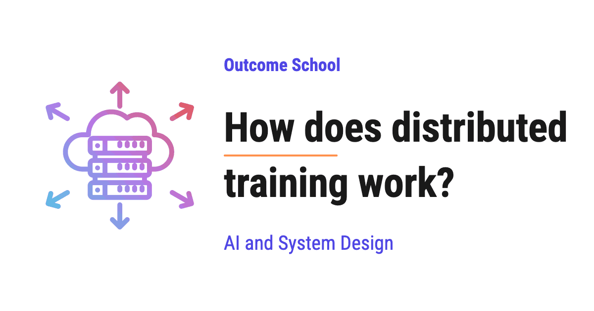

# How does distributed training work?

> Archived from <https://outcomeschool.com/blog/distributed-training> on 2026-11-25.

Distributed Training is the technique of training a single AI model on many machines at the same time, so that the work is shared and the training finishes much faster.

In this blog, we will learn about Distributed Training. We will also see why we need it, how data, model, pipeline, and tensor parallelism split the work across many machines, how the machines stay in sync, how all of them are combined, the common challenges, and where it is used in the real world.

We will cover the following:
<ul><li>What is Distributed Training?</li><li>Why do we need Distributed Training?</li><li>How training works on one machine</li><li>The two big problems: too much data and too big a model</li><li>Data Parallelism</li><li>How the machines stay in sync (gradient averaging)</li><li>The communication step (All-Reduce)</li><li>Model Parallelism</li><li>Pipeline Parallelism</li><li>Tensor Parallelism</li><li>Combining all of them (3D Parallelism)</li><li>A simple code example</li><li>Common challenges in Distributed Training</li><li>Real-World Applications</li></ul>
I am <strong>Amit Shekhar</strong>, Founder @ <a target="_blank" rel="noopener noreferrer" href="https://outcomeschool.com">Outcome School</a>, I have taught and mentored many developers, and their efforts landed them high-paying tech jobs, helped many tech companies in solving their unique problems, and created many open-source libraries being used by top companies. I am passionate about sharing knowledge through open-source, blogs, and videos.

I teach <a target="_blank" rel="noopener noreferrer" href="https://outcomeschool.com/program/ai-and-machine-learning">AI and Machine Learning</a> at Outcome School.

Let&#x27;s get started.
<h3 id="what-is-distributed-training">What is Distributed Training?</h3>
<strong>Distributed Training is the technique of training a single AI model using many machines at the same time, so that the work is shared and finished much faster.</strong>

In simple words, instead of one computer doing all the work, we split the work across many computers, and they all help train the same model together. In practice, each machine usually has several <a target="_blank" rel="noopener noreferrer" href="how-does-a-gpu-work-for-deep-learning.md">GPUs</a>, and the work is shared across all of them.

Let&#x27;s say we have to paint a very large wall. If one person paints it alone, it takes a whole day. But if ten people paint different parts of the wall at the same time, the job finishes in a fraction of the time. Distributed Training works on the same idea. Many machines do different parts of the same job together.
<h3 id="why-do-we-need-distributed-training">Why do we need Distributed Training?</h3>
The best way to learn this is by taking an example.

Suppose we want to train a <a target="_blank" rel="noopener noreferrer" href="large-language-model-llm.md">large language model</a>. Such a model can have hundreds of billions of parameters, and it learns from trillions of tokens. This is an enormous amount of work.

Now, let&#x27;s say we try to train it on a single powerful computer. We quickly run into two problems.

<strong>First problem (it takes too long):</strong> Going through trillions of tokens even once, on a single machine, could take many months or even years.

<strong>Second problem (it does not fit):</strong> A model with hundreds of billions of parameters needs a <a target="_blank" rel="noopener noreferrer" href="llm-gpu-memory.md">huge amount of memory</a>. A single machine does not have enough memory to hold the whole model.

So, here comes Distributed Training to the rescue.

By using many machines together, we solve both problems. The work finishes faster because many machines share the load. And the model fits because we can split it across the memory of many machines.

We have a detailed blog on <a target="_blank" rel="noopener noreferrer" href="llm-pretraining.md">Pretraining</a> that explains how an LLM learns from trillions of tokens step by step.
<h3 id="how-training-works-on-one-machine">How training works on one machine</h3>
Before we split the work, we must understand how training happens on a single machine.

A model learns in a repeating loop. Let&#x27;s understand the steps.

<strong>Step 1 (Forward pass):</strong> We feed some training data into the model, and the model produces an answer.

<strong>Step 2 (Calculate the loss):</strong> We compare the model&#x27;s answer with the correct answer. The difference between them is called the <strong>loss</strong>. A big loss means the model is very wrong.

<strong>Step 3 (Backward pass):</strong> The model <a target="_blank" rel="noopener noreferrer" href="math-behind-backpropagation.md">traces the loss backward</a> to figure out how much each number inside it contributed to the mistake. These correction amounts are called <strong>gradients</strong>. A gradient tells each number which way to move to reduce the mistake.

<strong>Step 4 (Update):</strong> We use the gradients to <a target="_blank" rel="noopener noreferrer" href="math-behind-gradient-descent.md">nudge every number inside the model a tiny bit in the better direction</a>.

We repeat this loop again and again, for many <a target="_blank" rel="noopener noreferrer" href="epoch-batch-and-iteration.md">batches</a> of data, until the model gets good.

We can picture this single-machine loop like below:

<pre><code class="language-text code-highlight">Data
  ↓
Forward pass
  ↓
Loss
  ↓
Backward pass (gradients)
  ↓
Update, then repeat with the next batch
</code></pre>

Here, we can see that one machine does every step by itself. The whole model and all the data sit on this one machine. Now, let&#x27;s see what happens when this one machine is not enough.
<h3 id="the-two-big-problems-too-much-data-and-too-big-a-model">The two big problems: too much data and too big a model</h3>
When training gets too heavy for one machine, there are two kinds of problems. We must understand both, because each one has a different solution.

<strong>Problem 1 (Too much data):</strong> The model fits on one machine, but there is so much data that going through it takes too long.

<strong>Problem 2 (Too big a model):</strong> The model itself is so large that it does not even fit in the memory of one machine.

These are two different problems, so they need two different ideas.
<ul><li>For too much data, we use <strong>Data Parallelism</strong>.</li><li>For too big a model, we use <strong>Model Parallelism</strong>.</li></ul>
We will learn about each of them in detail. Let&#x27;s start with Data Parallelism.
<h3 id="data-parallelism">Data Parallelism</h3>
<strong>Data Parallelism means we put a full copy of the model on every machine, and we give each machine a different slice of the data.</strong>

Let&#x27;s say we have four machines and a big pile of training data. We split the data into four slices. Machine 1 gets slice 1, machine 2 gets slice 2, and so on. Every machine holds an identical copy of the model.

We can picture it like below:

<pre><code class="language-text code-highlight">                    Full data
                        ↓
      +-----------+-----------+-----------+
      ↓           ↓           ↓           ↓
   Slice 1     Slice 2     Slice 3     Slice 4
      ↓           ↓           ↓           ↓
  Machine 1   Machine 2   Machine 3   Machine 4
 model copy  model copy  model copy  model copy
</code></pre>

Here, we can see that each machine has a full copy of the same model, but each one works on a different slice of the data. All four machines do their forward pass and backward pass at the same time. So we go through four slices in the time it used to take to go through one. This is how Data Parallelism makes training faster.

After each machine does its backward pass, every machine has its own gradients, computed from its own slice of data. These gradients are all different, because each machine saw different data. If we let each machine update its model with only its own gradients, the four model copies will slowly drift apart and become four different models. We do not want that. We want one single model.

So, how do we keep all the copies identical? Let&#x27;s see in the next section.
<h3 id="how-the-machines-stay-in-sync-gradient-averaging">How the machines stay in sync (gradient averaging)</h3>
To keep every model copy identical, the machines must agree on a single set of gradients before they update.

After every machine computes its own gradients, we <strong>average</strong> the gradients across all the machines. Then every machine uses this same averaged gradient to update its model.

Let&#x27;s say machine 1 found a gradient of 2, machine 2 found 4, machine 3 found 6, and machine 4 found 8 for a particular number in the model. We average them: (2 + 4 + 6 + 8) / 4 = 5. Now every machine uses 5 to update that number.

Because every machine starts with the same model and applies the same averaged update, all four copies stay identical after every step.

<strong>Planning your move into AI?</strong>

No matter which tech domain you work in today, with your effort, you can transition to these roles:
<ul><li>AI Engineer</li><li>Forward Deployed Engineer</li><li>AI Agent Engineer</li><li>Harness Engineer</li><li>Voice AI Engineer</li><li>AI Architect</li><li>LLM Engineer</li><li>LLM Inference Engineer</li><li>Gen AI Engineer</li><li>MLOps Engineer</li><li>ML Engineer</li><li>Deep Learning Engineer</li></ul>
Our <a target="_blank" rel="noopener noreferrer" href="https://outcomeschool.com/program/ai-and-machine-learning">AI and Machine Learning Program</a> at Outcome School takes you there.

We can picture the averaging like below:

<pre><code class="language-text code-highlight">Machine 1 gradient: 2
Machine 2 gradient: 4
Machine 3 gradient: 6
Machine 4 gradient: 8
          ↓
Average = (2 + 4 + 6 + 8) / 4 = 5
          ↓
Every machine updates with 5
</code></pre>

Here, we can see that the four different gradients are combined into one shared average, and then every machine applies that same average. This is what keeps all the model copies in sync. It is the same as if one machine had seen all four slices in one big batch.

Now, let&#x27;s understand how the machines share these gradients with each other.
<h3 id="the-communication-step-all-reduce">The communication step (All-Reduce)</h3>
The machines must talk to each other over a network to share gradients. This talking step is one of the most important parts of Distributed Training.

The operation used to combine the gradients from all machines and give every machine the final result is called <strong>All-Reduce</strong>.

Here, <strong>Reduce</strong> means to combine many values into one, for example by adding them or averaging them. <strong>All</strong> means the final combined result is sent back to all the machines, not just one.

So, All-Reduce means every machine sends its gradients in, the gradients get combined into one result, and that one result is handed back to every machine.

We can picture it like below:

<pre><code class="language-text code-highlight">Before All-Reduce:  M1 = 2   M2 = 4   M3 = 6   M4 = 8
                                ↓
                       Combine and average
                                ↓
After All-Reduce:   M1 = 5   M2 = 5   M3 = 5   M4 = 5
</code></pre>

Here, we can see that before All-Reduce, every machine holds a different gradient. After All-Reduce, every machine holds the same averaged value. This is the communication step that keeps the whole system in sync.

<strong>Note:</strong> This communication takes time. The machines must wait for each other and send data over the network. So a fast network connection between the machines is very important in Distributed Training. If the network is slow, the machines spend more time waiting than computing.

This is how the machines stay coordinated in Data Parallelism.

To master Gradient Descent, Backpropagation, and the Optimization and Scaling Techniques used to train large models, check out our <a target="_blank" rel="noopener noreferrer" href="https://outcomeschool.com/program/ai-and-machine-learning">AI and Machine Learning Program</a> at Outcome School.
<h3 id="model-parallelism">Model Parallelism</h3>
Data Parallelism solves the &quot;too much data&quot; problem. But it assumes the whole model fits on one machine. What if the model is so big that it does not even fit?

So, here comes <strong>Model Parallelism</strong> into the picture.

<strong>Model Parallelism means we split the model itself into pieces and put different pieces on different machines.</strong>

No single machine holds the whole model. Each machine holds only a part of it, and together they form the complete model.

Let&#x27;s say a model has four big layers stacked on top of each other, and the whole thing is too large for one machine. We put layer 1 on machine 1, layer 2 on machine 2, layer 3 on machine 3, and layer 4 on machine 4.

We can picture it like below:

<pre><code class="language-text code-highlight">+-----------------------+
| Machine 1: Layer 1    |
+-----------------------+
            ↓
+-----------------------+
| Machine 2: Layer 2    |
+-----------------------+
            ↓
+-----------------------+
| Machine 3: Layer 3    |
+-----------------------+
            ↓
+-----------------------+
| Machine 4: Layer 4    |
+-----------------------+
</code></pre>

Here, we can see that the model is cut into pieces, and each machine holds only one piece. The data flows from machine 1 to machine 2 to machine 3 to machine 4. The output of one machine becomes the input of the next.

So, Model Parallelism solves the &quot;too big a model&quot; problem. The model now fits because it is spread across the memory of many machines.

But there is a problem with this simple version. While machine 1 is working, machines 2, 3, and 4 are sitting idle, waiting for their input. When the work reaches machine 4, machines 1, 2, and 3 are idle. Most of the machines are doing nothing most of the time. This is very wasteful.

Let&#x27;s see how the next approach solves this issue.
<h3 id="pipeline-parallelism">Pipeline Parallelism</h3>
To fix the idle-machine problem, we use a better version of Model Parallelism called <strong>Pipeline Parallelism</strong>.

<strong>Pipeline Parallelism means we keep the model split across machines, but we also split the data into small chunks and keep them flowing through the machines like an assembly line, so no machine sits idle.</strong>

The best way to understand this is to think of a real assembly line in a factory. Suppose a car is built in four stages, one stage per worker. If only one car is on the line at a time, three workers are always idle. But if we keep feeding new cars onto the line, then while worker 1 starts car 2, worker 2 is working on car 1. Soon, all four workers are busy at the same time.

Pipeline Parallelism does exactly this. We split a big batch of data into small chunks, called <strong>micro-batches</strong>, and we keep feeding them into the pipeline one after another.

We can picture the busy pipeline over time like below:

<pre><code class="language-text code-highlight">   Time -&gt;     t1        t2        t3        t4

   Machine 1:  chunk1    chunk2    chunk3    chunk4
   Machine 2:  (idle)    chunk1    chunk2    chunk3
   Machine 3:  (idle)    (idle)    chunk1    chunk2
   Machine 4:  (idle)    (idle)    (idle)    chunk1
</code></pre>

Here, we can see that at the start, some machines are still idle because the pipeline is filling up. But by time t4, all the machines are busy on different chunks at the same time. This is how Pipeline Parallelism keeps the machines working instead of waiting.

<strong>Note:</strong> There is still a little idle time at the very start, while the pipeline fills, and at the very end, while it empties. We call this the <strong>pipeline bubble</strong>. We reduce this waste by using more, smaller micro-batches so the machines stay busy longer.

This is how Pipeline Parallelism makes Model Parallelism efficient.

<strong>A quick note for you</strong>

No matter which tech domain you work in, get familiar with these topics:
<ul><li>LLM</li><li>RAG</li><li>MCP</li><li>Agent</li><li>Fine-tuning</li><li>Quantization</li></ul>
We put it all together in one video:

<a target="_blank" rel="noopener noreferrer" href="https://www.youtube.com/watch?v=lnfWvX66FUk">AI Engineering Explained: LLM, RAG, MCP, Agent, Fine-Tuning, and Quantization</a>

No need to stop reading - bookmark it and watch later when you get time. Future you will thank you.

Now, let&#x27;s get back to the topic.
<h3 id="tensor-parallelism">Tensor Parallelism</h3>
There is one more kind of splitting we must know about, called <strong>Tensor Parallelism</strong>.

Pipeline Parallelism splits the model by putting different layers on different machines. But sometimes a single layer is itself too big to fit on one machine. So we need to split inside a single layer.

<strong>Tensor Parallelism means we split the math operation inside a single layer across several machines, and then combine their partial results.</strong>

Let&#x27;s say one layer has to do a <a target="_blank" rel="noopener noreferrer" href="matrix-multiplication-in-neural-networks.md">giant multiplication</a> that is too large for one machine. We cut that single big multiplication into smaller pieces. Each machine does one piece, and then we combine the pieces to get the full answer.

We can picture it like below:

<pre><code class="language-text code-highlight">          One big layer calculation
                      ↓
    +-----------------+-----------------+
    ↓                 ↓                 ↓
Machine 1         Machine 2         Machine 3
(part 1)          (part 2)          (part 3)
    ↓                 ↓                 ↓
    +-----------------+-----------------+
                      ↓
         Combine the partial results
</code></pre>

Here, we can see that one single calculation is shared across three machines, and their partial results are combined into the full answer. This lets us handle a layer that is far too big for any one machine.

The difference between the two is:
<ul><li><strong>Pipeline Parallelism</strong> splits the model between layers, putting different layers on different machines.</li><li><strong>Tensor Parallelism</strong> splits the work inside a single layer across machines.</li></ul>
This is how Tensor Parallelism handles a single layer that is too large.
<h3 id="combining-all-of-them-3d-parallelism">Combining all of them (3D Parallelism)</h3>
For the largest models, we do not pick just one technique. We combine all of them together. This combination is often called <strong>3D Parallelism</strong>, because we are splitting the work along three different directions at once.

Let&#x27;s understand the three directions in plain words:
<ul><li><strong>Data Parallelism</strong> splits the data across groups of machines.</li><li><strong>Pipeline Parallelism</strong> splits the model&#x27;s layers across machines.</li><li><strong>Tensor Parallelism</strong> splits the work inside each layer across machines.</li></ul>
We can picture how they stack together like below:

<pre><code class="language-text code-highlight">Data Parallelism
(many copies of the whole setup, each with different data)
        ↓
Within each copy: Pipeline Parallelism
(layers spread across machines)
        ↓
Within each layer: Tensor Parallelism
(one layer&#x27;s math split across machines)
</code></pre>

Here, we can see that the three techniques work at three different levels at the same time. Data Parallelism works at the outermost level across copies, Pipeline Parallelism works in the middle across layers, and Tensor Parallelism works at the innermost level inside a single layer. By combining all three, we can train models that no single technique could handle alone.

This is how many of the largest models are trained.

If we want to go deep into Large Language Models (LLMs), Model Development and Training, and how they scale, we can learn it from the ground up in our <a target="_blank" rel="noopener noreferrer" href="https://outcomeschool.com/program/ai-and-machine-learning">AI and Machine Learning Program</a> at Outcome School.
<h3 id="a-simple-code-example">A simple code example</h3>
Now, let&#x27;s see the code. We will use <a target="_blank" rel="noopener noreferrer" href="how-does-pytorch-work.md">PyTorch</a>, a popular library, and its <strong>Distributed Data Parallel</strong> feature, which handles Data Parallelism for us. Let&#x27;s see the code as below:

<pre><code class="code-highlight language-python">import torch
import torch.nn as nn
from torch.nn.parallel import DistributedDataParallel as DDP

# wrap our model so it can train across many machines
model = MyModel()
model = DDP(model)

# normal training loop, almost unchanged
for data, target in dataloader:
    output = model(data)          # forward pass
    loss = loss_function(output, target)  # calculate the loss
    loss.backward()               # backward pass, computes gradients
    optimizer.step()              # update the model
    optimizer.zero_grad()         # reset gradients for the next round
</code></pre>

Here, we have wrapped our model with <code>DDP</code>, and let me explain what each part does.
<ul><li><code>model = MyModel()</code> creates our normal model, just like single-machine training.</li><li><code>model = DDP(model)</code> wraps the model so that it can be trained across many machines.</li><li>The training loop looks almost exactly like a normal single-machine loop. We do the forward pass, calculate the loss, do the backward pass, and update.</li></ul>
When <code>loss.backward()</code> runs, <code>DDP</code> automatically performs the All-Reduce step behind the scenes. It averages the gradients across all the machines for us. We do not have to write the gradient-sharing code ourselves.

<strong>Note:</strong> Here, I have kept only the important lines of the code and removed other lines for brevity. A real setup also starts the process group with <code>torch.distributed.init_process_group</code>, launches one process per GPU, and gives each process its own slice of the data using a <code>DistributedSampler</code>.

<strong>Stay updated:</strong> Subscribe to our <a target="_blank" rel="noopener noreferrer" href="https://outcomeschool.substack.com/subscribe">newsletter</a> to get our latest AI and Machine Learning blogs straight to your inbox.
<h3 id="common-challenges-in-distributed-training">Common challenges in Distributed Training</h3>
Distributed Training brings its own challenges.
<ul><li><strong>Communication cost:</strong> The machines must constantly send gradients to each other. If the network is slow, the machines spend more time waiting than computing. A fast network is very important.</li><li><strong>Idle machines:</strong> In Model Parallelism, machines can sit idle waiting for their turn. Pipeline Parallelism reduces this, but some idle time, the pipeline bubble, still remains.</li><li><strong>Splitting the model correctly:</strong> When we split a model across machines, we must split it in a balanced way. If one machine gets a much bigger piece, the others will keep waiting for it.</li><li><strong>Failures:</strong> When we use thousands of machines, some of them will fail during a long training run. The system must save its progress regularly, so it can recover without starting over. Saving this progress is called <strong>checkpointing</strong>.</li></ul><h3 id="real-world-applications">Real-World Applications</h3>
Now, let&#x27;s discuss where Distributed Training is used in the real world. It is used to train almost every large AI model we use today.
<ul><li><strong>Large language models:</strong> LLMs are trained on thousands of GPUs using Distributed Training.</li><li><strong>Image and video generation:</strong> The models that <a target="_blank" rel="noopener noreferrer" href="diffusion-models.md">create images</a> and videos from text are huge, and they are trained across many machines.</li><li><strong>Speech recognition:</strong> Systems that turn speech into text are trained on enormous amounts of audio using distributed setups.</li><li><strong>Recommendation systems:</strong> The <a target="_blank" rel="noopener noreferrer" href="recommendation-system.md">systems that suggest videos, products, and posts</a> learn from massive amounts of user data, spread across many machines.</li><li><strong>Scientific research:</strong> Models that predict protein structures or simulate weather are trained using large distributed clusters.</li></ul>
Now we must have understood how Distributed Training works and how it lets many machines train one large model together.
<h2 id="frequently-asked-questions">Frequently Asked Questions</h2><h3 id="does-data-parallelism-work-when-the-model-does-not-fit-on-one-machine">Does Data Parallelism work when the model does not fit on one machine?</h3>
No. Data Parallelism puts a full copy of the model on every machine, so it assumes the whole model fits on one machine. When the model is too big for the memory of one machine, we use Model Parallelism instead, which splits the model itself into pieces and puts different pieces on different machines.
<h3 id="why-is-a-fast-network-so-important-in-distributed-training">Why is a fast network so important in Distributed Training?</h3>
A fast network is important because the machines must constantly send gradients to each other during the All-Reduce step, and they must wait for each other. If the network is slow, the machines spend more time waiting than computing.
<h3 id="what-is-the-pipeline-bubble">What is the pipeline bubble?</h3>
The pipeline bubble is the little idle time in Pipeline Parallelism at the very start, while the pipeline fills, and at the very end, while it empties. During this time, some machines are still idle. We reduce this waste by using more, smaller micro-batches so the machines stay busy longer.
<h3 id="what-happens-when-a-machine-fails-during-distributed-training">What happens when a machine fails during Distributed Training?</h3>
When we use thousands of machines, some of them will fail during a long training run. So the system saves its progress regularly, which is called checkpointing. Because of this saved progress, training can recover from a failure without starting over from the beginning.
<h3 id="do-we-have-to-write-the-gradient-sharing-code-ourselves-in-pytorch">Do we have to write the gradient-sharing code ourselves in PyTorch?</h3>
No. When we wrap our model with PyTorch&#x27;s Distributed Data Parallel (DDP), it automatically performs the All-Reduce step behind the scenes when <code>loss.backward()</code> runs. It averages the gradients across all the machines for us, so the training loop stays almost the same as a normal single-machine loop.

That&#x27;s it for now.

Thanks

<strong>Amit Shekhar</strong> Founder @ <a target="_blank" rel="noopener noreferrer" href="https://outcomeschool.com">Outcome School</a>

You can connect with me on:
<ul><li><a target="_blank" rel="noopener noreferrer" href="https://x.com/amitiitbhu">X</a></li><li><a target="_blank" rel="noopener noreferrer" href="https://www.linkedin.com/in/amit-shekhar-iitbhu">LinkedIn</a></li><li><a target="_blank" rel="noopener noreferrer" href="https://github.com/amitshekhariitbhu">GitHub</a></li></ul>
Follow Outcome School on:
<ul><li><a target="_blank" rel="noopener noreferrer" href="https://x.com/outcome_school">X</a></li><li><a target="_blank" rel="noopener noreferrer" href="https://youtube.com/@OutcomeSchool">YouTube</a></li><li><a target="_blank" rel="noopener noreferrer" href="https://www.linkedin.com/company/outcomeschool">LinkedIn</a></li><li><a target="_blank" rel="noopener noreferrer" href="http://github.com/OutcomeSchool">GitHub</a></li></ul>
<a target="_blank" rel="noopener noreferrer" href="https://outcomeschool.com/blog"><strong>Read all of our high-quality blogs here.</strong></a>

