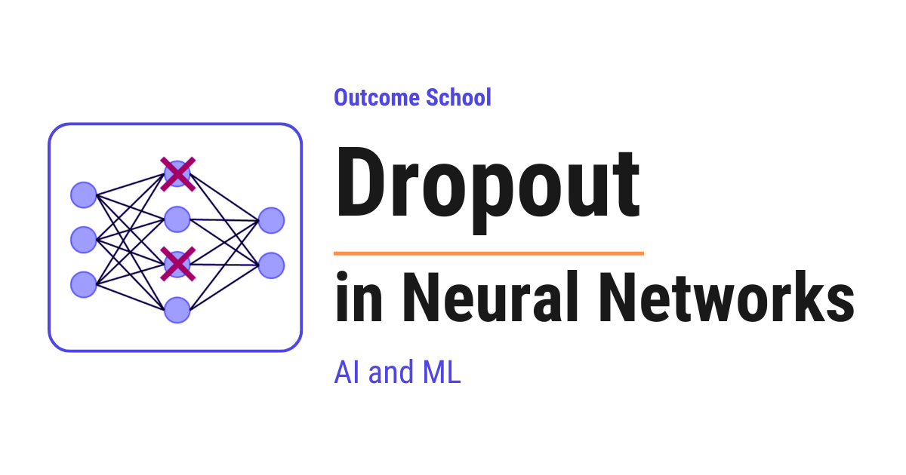

# What is Dropout in Neural Networks and How Does It Work?

> Archived from <https://outcomeschool.com/blog/dropout-in-neural-networks> on 2026-11-25.

Dropout is a technique where we randomly switch off some neurons in a neural network during training, so that the network does not depend too much on any single neuron and does not overfit.

In this blog, we will learn about Dropout in Neural Networks. We will understand what it is, the problem it solves, how it works step by step with a simple example, and where it is used.

We will cover the following:
<ul><li>What is Dropout?</li><li>The problem of Overfitting</li><li>Why do we need Dropout?</li><li>How does Dropout work?</li><li>A step-by-step example</li><li>Dropout during training vs testing</li><li>Dropout in code</li><li>Variants of Dropout</li><li>Advantages of Dropout</li><li>Where Dropout is used</li></ul>
I am <strong>Amit Shekhar</strong>, Founder @ <a target="_blank" rel="noopener noreferrer" href="https://outcomeschool.com">Outcome School</a>, I have taught and mentored many developers, and their efforts landed them high-paying tech jobs, helped many tech companies in solving their unique problems, and created many open-source libraries being used by top companies. I am passionate about sharing knowledge through open-source, blogs, and videos.

I teach <a target="_blank" rel="noopener noreferrer" href="https://outcomeschool.com/program/ai-and-machine-learning">AI and Machine Learning</a> at Outcome School.

Let&#x27;s get started.
<h3 id="what-is-dropout">What is Dropout?</h3>
<strong>Dropout is a technique where we randomly switch off some neurons in a <a target="_blank" rel="noopener noreferrer" href="neural-network.md">neural network</a> during training, so that the network does not depend too much on any single neuron.</strong>

Before we go deeper, let&#x27;s understand one word - <strong>neuron</strong>.

A neural network is made of small units called <strong>neurons</strong>. Each neuron takes some numbers as input, does a small calculation, and passes a number forward to the next neurons. Many neurons connected together form a neural network. The network learns patterns from data using these neurons.

Now, the word &quot;Dropout&quot; simply means to remove something temporarily.

So, in simple words, during training, we randomly pick some neurons and switch them off for that moment. A switched-off neuron sends nothing forward, as if it does not exist for that one step.

We do this randomly again and again during training. So, every training step uses a slightly different version of the network.

Do not worry, we will understand exactly why we do this and how it helps.
<h3 id="the-problem-of-overfitting">The problem of Overfitting</h3>
The best way to learn this is by taking an example.

Suppose we are preparing a student for a math exam.

Let&#x27;s say the student studies from only one practice book. The student reads the same book again and again. After some time, the student memorizes every single question and its answer from that book.

Now, in the practice book, the student scores 100 out of 100. The student looks perfect.

But, here is the catch. In the real exam, the questions are slightly different. And now the student fails, because the student only memorized the practice book and did not actually learn the concepts.

This problem is called <strong>Overfitting</strong>.

<strong>Overfitting happens when a model performs very well on the training data but performs poorly on new, unseen data.</strong>

In simple words, the model memorizes the training data instead of learning the general pattern.

We have a detailed blog on <a target="_blank" rel="noopener noreferrer" href="train-validation-test-split.md">why we split data into train, validation, and test sets</a> that explains how we catch this by checking the model on data it has never seen.

A neural network with many neurons is very powerful. So, it can easily memorize the training data. This is exactly the student who memorizes the practice book.

So, now we have a clear problem. We need a way to stop the network from memorizing and force it to actually learn the general pattern.
<h3 id="why-do-we-need-dropout">Why do we need Dropout?</h3>
Now, let&#x27;s understand the real reason behind Overfitting inside a neural network.

When we train a network normally, some neurons become very strong and the network starts depending heavily on them. These few neurons do most of the work, and the other neurons become lazy.

This is a problem. The network is now relying on a small group of neurons. This is called <strong>co-adaptation</strong>, which means a few neurons adapt together and start working as a fixed team. If this fixed team memorizes the training data, the whole network overfits.

So, how can we stop the network from relying on a fixed team of neurons? The answer is Dropout.

So, here comes Dropout to the rescue.

When we randomly switch off neurons during training, no neuron can be sure that its neighbors will be present. So, every neuron is forced to learn something useful on its own, instead of depending on a few strong neurons.

This breaks the fixed team. Every neuron must now pull its own weight. As a result, the network learns the general pattern instead of memorizing the training data.

This is how Dropout reduces Overfitting.

<strong>Planning your move into AI?</strong>

No matter which tech domain you work in today, with your effort, you can transition to these roles:
<ul><li>AI Engineer</li><li>Forward Deployed Engineer</li><li>AI Agent Engineer</li><li>Harness Engineer</li><li>Voice AI Engineer</li><li>AI Architect</li><li>LLM Engineer</li><li>LLM Inference Engineer</li><li>Gen AI Engineer</li><li>MLOps Engineer</li><li>ML Engineer</li><li>Deep Learning Engineer</li></ul>
Our <a target="_blank" rel="noopener noreferrer" href="https://outcomeschool.com/program/ai-and-machine-learning">AI and Machine Learning Program</a> at Outcome School takes you there.
<h3 id="how-does-dropout-work">How does Dropout work?</h3>
Now, it&#x27;s time to learn how Dropout actually works inside the network.

Dropout uses one important number called the <strong>dropout rate</strong>, written as <code>p</code>.

<strong>The dropout rate <code>p</code> is the probability that a neuron will be switched off during a training step.</strong>

For example, if <code>p = 0.5</code>, then every neuron has a 50% chance of being switched off in that step. If <code>p = 0.2</code>, then every neuron has a 20% chance of being switched off.

So, during each training step, the following happens.

<strong>Step 1:</strong> For every neuron in a Dropout layer, we flip a coin based on the dropout rate <code>p</code>. Based on this, we decide whether the neuron stays on or gets switched off.

<strong>Step 2:</strong> Every switched-off neuron outputs 0 for that step. It is as if the neuron is not there.

<strong>Step 3:</strong> The remaining neurons that stayed on pass their values forward as usual.

<strong>Step 4:</strong> The network learns from this thinner version of itself for that one step.

<strong>Step 5:</strong> In the next training step, we flip the coins again. So, a different random set of neurons gets switched off.

So, every training step trains a slightly different, thinner network. Over many steps, we are effectively training many different networks that all share the same weights.

Let&#x27;s picture this with a small network as below:

<pre><code class="code-highlight">   Without Dropout (all neurons active)

   Input        Hidden         Output

   (o) ──────►  (o) ─┐
                     ├──────►  (o)
   (o) ──────►  (o) ─┘

   With Dropout (one neuron switched off)

   Input          Hidden       Output

   (o) ─┐
        ├──────►  (o) ──────►  (o)
   (o) ─┘
                  (X)
</code></pre>

Here, we can see how the signal flows from the input neurons to the hidden neurons, and then to the output neuron. To keep the picture clean, we draw one line per neuron, but in a <a target="_blank" rel="noopener noreferrer" href="multilayer-perceptron-mlp.md">fully connected network</a> every input neuron actually connects to every hidden neuron, and every hidden neuron connects to the output. In the top network, &quot;Without Dropout&quot;, every neuron is active. In the bottom network, &quot;With Dropout&quot;, one hidden neuron is switched off, marked with <code>(X)</code>. A switched-off neuron sends nothing forward and receives nothing, so all of its connections are removed for that one training step. The network is now thinner, and the remaining neuron must do the work on its own.

This is a very powerful idea. It is like training a huge team of smaller networks and then combining their strength into one final network.

Let&#x27;s understand why this combining helps. Suppose we ask one person a tough question, the answer can be wrong. But if we ask many people and take the most common answer, the final answer is usually better. Dropout gives us this same benefit, because the final network behaves like many networks joined together.

To go deeper into Neural Networks, Dropout, and how Deep Learning models are trained, check out our <a target="_blank" rel="noopener noreferrer" href="https://outcomeschool.com/program/ai-and-machine-learning">AI and Machine Learning Program</a> at Outcome School.
<h3 id="a-step-by-step-example">A step-by-step example</h3>
Let&#x27;s take a small example to make this concrete.

Suppose a layer has 4 neurons. After their calculation, their output values are as below:

<pre><code class="code-highlight">Neuron 1: 2.0
Neuron 2: 4.0
Neuron 3: 6.0
Neuron 4: 8.0
</code></pre>

Now, let&#x27;s apply Dropout with a dropout rate <code>p = 0.5</code>. So, each neuron has a 50% chance of being switched off.

Suppose the random coin flips switch off Neuron 2 and Neuron 4. So, their outputs become 0.

<pre><code class="code-highlight">Neuron 1: 2.0
Neuron 2: 0.0   (dropped)
Neuron 3: 6.0
Neuron 4: 0.0   (dropped)
</code></pre>

Here, we can see that Neuron 2 and Neuron 4 are switched off. They send nothing forward. Only Neuron 1 and Neuron 3 are active for this step.

Now, there is one important detail. Since half the neurons are switched off, the total signal going forward has become smaller. We do not want the next layer to suddenly receive a weaker signal.

So, we scale up the values of the active neurons to balance this. We divide each active value by the keep probability, which is <code>1 - p</code>. Here, <code>1 - p = 1 - 0.5 = 0.5</code>.

So, we divide each active value by 0.5, which means we multiply it by 2.

<pre><code class="code-highlight">Neuron 1: 2.0 / 0.5 = 4.0
Neuron 2: 0.0
Neuron 3: 6.0 / 0.5 = 12.0
Neuron 4: 0.0
</code></pre>

Here, we can see that the active neurons are scaled up. This keeps the overall strength of the signal roughly the same as before.

This scaling trick is called <strong>inverted dropout</strong>, and this is the standard way Dropout is done today. The benefit is that we do all the adjustment during training, so we do not need to change anything during testing.

This is how Dropout works on a single layer for a single training step.

<strong>A quick note for you</strong>

No matter which tech domain you work in, get familiar with these topics:
<ul><li>LLM</li><li>RAG</li><li>MCP</li><li>Agent</li><li>Fine-tuning</li><li>Quantization</li></ul>
We put it all together in one video:

<a target="_blank" rel="noopener noreferrer" href="https://www.youtube.com/watch?v=lnfWvX66FUk">AI Engineering Explained: LLM, RAG, MCP, Agent, Fine-Tuning, and Quantization</a>

No need to stop reading - bookmark it and watch later when you get time. Future you will thank you.

Now, let&#x27;s get back to the topic.
<h3 id="dropout-during-training-vs-testing">Dropout during training vs testing</h3>
Now, this is a very important point, so let&#x27;s understand it carefully.

Dropout is only used during <strong>training</strong>. During <strong>testing</strong>, which means when we actually use the model to make predictions, we turn Dropout off.

Now, the question is: why do we turn it off during testing?

The answer is simple. During testing, we want the full power of the network. We want every neuron to participate so that we get a stable and reliable prediction. We do not want randomness in our final answer.

So, during testing, all neurons stay on. No neuron is switched off.

And because we already used inverted dropout during training, which scaled the values up, we do not need to do any extra adjustment during testing. The numbers already balance out.
<blockquote>
Dropout is on during training and off during testing.
</blockquote>
This is one of the most common mistakes beginners do. So, we must always remember to keep Dropout active only during training.
<h3 id="dropout-in-code">Dropout in code</h3>
The best way to understand this is by seeing it in code. Let&#x27;s see how we add Dropout in a neural network using <a target="_blank" rel="noopener noreferrer" href="how-does-pytorch-work.md">PyTorch</a> as below:

<pre><code class="code-highlight language-python">import torch
import torch.nn as nn

model = nn.Sequential(
    nn.Linear(784, 256),
    nn.ReLU(),
    nn.Dropout(p=0.5),   # drop 50% of neurons
    nn.Linear(256, 10)
)
</code></pre>

Here, we can see what is happening.
<ul><li><code>nn.Linear(784, 256)</code> is a normal layer with 256 neurons.</li><li><code>nn.ReLU()</code> is the activation that decides the output of the neurons.</li><li><code>nn.Dropout(p=0.5)</code> is the Dropout layer. It switches off 50% of the neurons during training.</li><li><code>nn.Linear(256, 10)</code> is the final layer that gives the output.</li></ul>
So, the Dropout layer simply sits between two layers and randomly switches off the neurons coming from the previous layer.

Now, there is one more important thing. We must tell PyTorch when we are training and when we are testing. We can do this as below:

<pre><code class="code-highlight language-python">model.train()   # Dropout is active
# ... run training here ...

model.eval()    # Dropout is turned off
# ... run testing here ...
</code></pre>

Here, we can see that <code>model.train()</code> keeps Dropout active, and <code>model.eval()</code> turns Dropout off. This is exactly the training versus testing behavior we discussed above.

<strong>Stay updated:</strong> Subscribe to our <a target="_blank" rel="noopener noreferrer" href="https://outcomeschool.substack.com/subscribe">newsletter</a> to get our latest AI and Machine Learning blogs straight to your inbox.
<h3 id="variants-of-dropout">Variants of Dropout</h3>
Now, let&#x27;s briefly learn about a few variants of Dropout. The basic idea stays the same, but each variant is designed for a different situation.
<ul><li><strong>Standard Dropout:</strong> This is the one we learned above. We randomly switch off individual neurons in a layer. This is used most of the time.</li><li><strong>Spatial Dropout:</strong> This is used in <a target="_blank" rel="noopener noreferrer" href="convolutional-neural-network-cnn.md">Convolutional Neural Networks</a>, which are networks used for images. Instead of switching off individual neurons, it switches off an entire group of related neurons at a time. This works better for image data.</li><li><strong>DropConnect:</strong> Instead of switching off neurons, it randomly switches off the connections between neurons. So, the neurons stay, but some links between them are removed.</li><li><strong>Recurrent Dropout:</strong> This is used in Recurrent Neural Networks, which are networks used for sequences like text and speech. It applies Dropout in a careful way so that it does not damage the memory of the sequence.</li></ul>
Do not worry if these variants feel new. The most important one to understand is Standard Dropout, and we have already learned it well.
<h3 id="advantages-of-dropout">Advantages of Dropout</h3>
Now, let&#x27;s list the main advantages of Dropout.
<ul><li><strong>Reduces overfitting:</strong> This is the main reason we use Dropout. It stops the network from memorizing the training data.</li><li><strong>No dependency on single neurons:</strong> Every neuron learns to be useful on its own, so the network does not rely on a fixed team of neurons.</li><li><strong>Acts like many models in one:</strong> Since every step trains a different thinner network, the final network behaves like a combination of many networks. This makes the predictions more robust.</li><li><strong>Very simple to use:</strong> We just add one Dropout layer. There is no complex math we need to write ourselves.</li><li><strong>Works with almost any network:</strong> We can use Dropout in many types of neural networks with very little effort.</li></ul>
That&#x27;s the beauty of Dropout. It solves a big problem with a very simple idea.

To master Dropout, Batch Normalization, and other Deep Learning building blocks in depth, check out our <a target="_blank" rel="noopener noreferrer" href="https://outcomeschool.com/program/ai-and-machine-learning">AI and Machine Learning Program</a> at Outcome School.
<h3 id="where-dropout-is-used">Where Dropout is used</h3>
Now, let&#x27;s see where Dropout is used.
<ul><li><strong>Image classification:</strong> Dropout is used in deep networks that classify images, to stop them from memorizing the training images.</li><li><strong>Natural Language Processing:</strong> Dropout is used in models that work with text, such as language models and translation models.</li><li><strong>Speech recognition:</strong> Dropout is used in models that convert speech into text.</li><li><strong>Almost every deep network:</strong> Whenever a network is large and has a risk of overfitting, Dropout is one of the first techniques we reach for.</li></ul>
One thing to remember is the choice of the dropout rate <code>p</code>. A common value is between 0.2 and 0.5. A very high value can switch off too many neurons and the network will not learn well. A very low value will not help much against overfitting. So, we pick the value based on our use case.

Dropout is not the only way to fight overfitting. We have a detailed blog on <a target="_blank" rel="noopener noreferrer" href="data-augmentation.md">Data Augmentation</a> that explains how creating new training examples from our existing data also helps.

This was all about Dropout in Neural Networks.

Now we must have understood what Dropout is, the problem of overfitting it solves, how it works step by step, and where it is used.
<h2 id="frequently-asked-questions">Frequently Asked Questions</h2><h3 id="what-dropout-rate-should-we-use">What dropout rate should we use?</h3>
A common value for the dropout rate <code>p</code> is between 0.2 and 0.5. A very high value can switch off too many neurons, and the network will not learn well. A very low value will not help much against overfitting. So we pick the value based on our use case.
<h3 id="does-a-dropped-neuron-stay-switched-off-for-the-rest-of-training">Does a dropped neuron stay switched off for the rest of training?</h3>
No. A neuron is switched off only for that one training step. In the next step, we flip the coins again, so a different random set of neurons gets switched off. This way, every step trains a slightly different, thinner network that shares the same weights.
<h3 id="do-we-need-to-scale-the-outputs-during-testing">Do we need to scale the outputs during testing?</h3>
No. With inverted dropout, we scale up the active neurons during training by dividing by the keep probability <code>1 - p</code>. Because all the adjustment happens during training, we do not need to change anything during testing. This is the standard way Dropout is done today.
<h3 id="what-happens-if-we-forget-to-call-modeleval-in-pytorch">What happens if we forget to call model.eval() in PyTorch?</h3>
Dropout stays active, so neurons keep getting switched off at random while we make predictions. During testing, we want every neuron to participate and we do not want randomness in our final answer. Calling <code>model.eval()</code> turns Dropout off, and forgetting it is one of the most common mistakes beginners make.
<h3 id="is-dropconnect-the-same-as-dropout">Is DropConnect the same as Dropout?</h3>
No. Dropout randomly switches off whole neurons. DropConnect keeps the neurons and instead randomly switches off the connections between them, so some links are removed. Both share the same basic idea of adding randomness during training.

That&#x27;s it for now.

Thanks

<strong>Amit Shekhar</strong> Founder @ <a target="_blank" rel="noopener noreferrer" href="https://outcomeschool.com">Outcome School</a>

You can connect with me on:
<ul><li><a target="_blank" rel="noopener noreferrer" href="https://x.com/amitiitbhu">X</a></li><li><a target="_blank" rel="noopener noreferrer" href="https://www.linkedin.com/in/amit-shekhar-iitbhu">LinkedIn</a></li><li><a target="_blank" rel="noopener noreferrer" href="https://github.com/amitshekhariitbhu">GitHub</a></li></ul>
Follow Outcome School on:
<ul><li><a target="_blank" rel="noopener noreferrer" href="https://x.com/outcome_school">X</a></li><li><a target="_blank" rel="noopener noreferrer" href="https://youtube.com/@OutcomeSchool">YouTube</a></li><li><a target="_blank" rel="noopener noreferrer" href="https://www.linkedin.com/company/outcomeschool">LinkedIn</a></li><li><a target="_blank" rel="noopener noreferrer" href="https://github.com/OutcomeSchool">GitHub</a></li></ul>
<a target="_blank" rel="noopener noreferrer" href="https://outcomeschool.com/blog"><strong>Read all of our high-quality blogs here.</strong></a>

