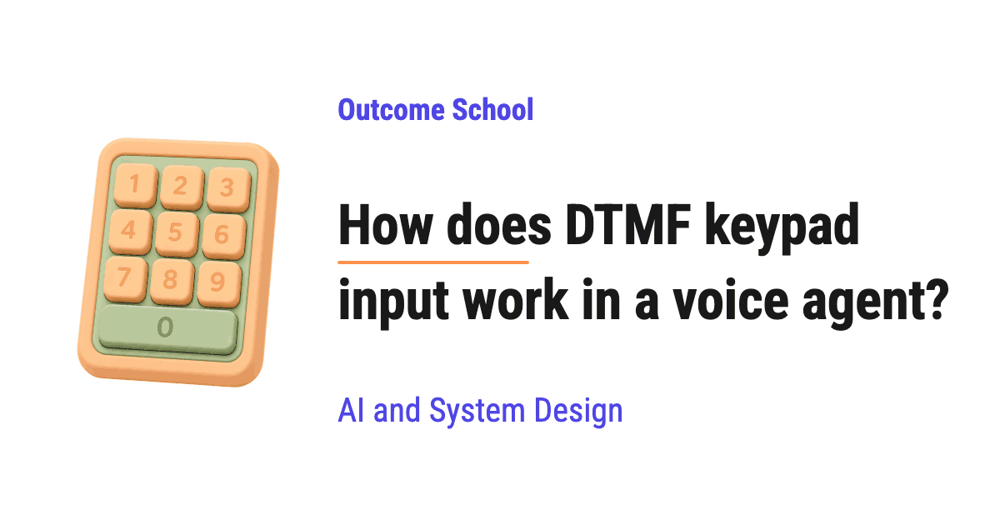

# How does DTMF keypad input work in a voice agent?

> Archived from <https://outcomeschool.com/blog/dtmf-in-voice-agents> on 2026-11-25.

DTMF keypad input works by turning every key we press on a phone into a short sound made of two tones, which the phone system or the voice agent detects and turns back into the exact digit, so that the agent can use it just like a spoken answer.

In this blog, we will learn about how DTMF keypad input works in a voice agent. We will also see what DTMF is, why every key is made of two tones, how those tones travel and get detected, how the agent collects the digits and passes them to the LLM, how it keeps sensitive digits private, and how the agent presses keys by itself.

We will cover the following:
<ul><li>What is DTMF?</li><li>Why does a voice agent need keypad input?</li><li>The keypad grid: two tones for every key</li><li>How DTMF travels over a phone call</li><li>How a voice agent detects the tones</li><li>Collecting the digits: terminator key and timeout</li><li>How the digits reach the LLM</li><li>Keeping sensitive digits away from the LLM</li><li>When the voice agent presses the keys</li></ul>
I am <strong>Amit Shekhar</strong>, Founder @ <a target="_blank" rel="noopener noreferrer" href="https://outcomeschool.com">Outcome School</a>, I have taught and mentored many developers, and their efforts landed them high-paying tech jobs, helped many tech companies in solving their unique problems, and created many open-source libraries being used by top companies. I am passionate about sharing knowledge through open-source, blogs, and videos.

I teach <a target="_blank" rel="noopener noreferrer" href="https://outcomeschool.com/program/ai-and-machine-learning">AI and Machine Learning</a> at Outcome School.

Let&#x27;s get started.
<h2 id="what-is-dtmf">What is DTMF?</h2>
We all have heard this on a phone call: &quot;Press 1 for billing. Press 2 for support.&quot; We press a key, we hear a short beep, and the system understands our choice.

That beep is DTMF.

<strong>DTMF stands for Dual-Tone Multi-Frequency. It is the system that a phone uses to send a pressed key as a sound made of two tones played at the same time.</strong>

Let&#x27;s decompose the name:
<ul><li><strong>Dual-Tone</strong>: every key makes two tones together, not one.</li><li><strong>Multi-Frequency</strong>: there is a fixed set of different pitches (frequencies), and each key uses its own pair from that set.</li></ul>
A frequency is simply how high or low a sound is. A low hum has a low frequency. A whistle has a high frequency. Frequency is measured in Hertz (Hz), which means the number of times the sound wave goes up and down in one second.

DTMF was developed by the Bell System and launched for the public in 1963 under the name &quot;Touch-Tone&quot;. It is still supported by phone networks today.
<h2 id="why-does-a-voice-agent-need-keypad-input">Why does a voice agent need keypad input?</h2>
A <a target="_blank" rel="noopener noreferrer" href="design-a-real-time-voice-ai-agent.md">voice agent</a> is a system built around an <a target="_blank" rel="noopener noreferrer" href="large-language-model-llm.md">LLM (Large Language Model)</a> that talks with us over a call. It listens to our voice, converts it into text using Speech-to-Text, sends that text to the LLM to decide what to say, and speaks the reply using Text-to-Speech.

So, the question is: if the agent can understand speech, why does it need the keypad at all?

The answer is that speech is not always the best way to give some kinds of input. Let&#x27;s see the cases:
<ul><li><strong>Long numbers</strong>: An account number like &quot;4 8 1 5 1 6 2 3 4 2&quot; is easy to type but <a target="_blank" rel="noopener noreferrer" href="structured-inputs-in-voice-agents.md">easy to mishear</a>. Speech-to-Text can confuse &quot;fifteen&quot; with &quot;fifty&quot;, or drop one digit in a noisy room.</li><li><strong>Private information</strong>: A PIN or the last four digits of a card must not be spoken out loud in a train or an office where others can hear.</li><li><strong>Noisy places</strong>: On a busy road, the microphone picks up traffic, and <a target="_blank" rel="noopener noreferrer" href="phone-audio-and-speech-recognition.md">speech recognition struggles</a>. A key press is much less affected by the noise around us.</li><li><strong>Accents and speech difficulties</strong>: Some callers find it easier to press a key than to say a word clearly enough for the system.</li><li><strong>Old phone menus</strong>: Many businesses already have menus built around &quot;Press 1, Press 2&quot;, and callers are used to them. A voice agent that replaces such a menu often keeps keypad input working.</li></ul>
A key press gives one exact digit, with no guessing. This is why a voice agent still needs keypad input even when it understands speech well.
<h2 id="the-keypad-grid-two-tones-for-every-key">The keypad grid: two tones for every key</h2>
Now, let&#x27;s understand how a key becomes a sound.

A phone keypad is a grid of 4 rows and 3 columns. The original DTMF design has one more column with the keys A, B, C, and D, which ordinary phones do not show, so the full grid is 4 rows and 4 columns.

Every row has its own low tone, and every column has its own high tone. When we press a key, the phone plays the low tone of its row and the high tone of its column at the same time.
<table><thead><tr><th>Row / Column</th><th>1209 Hz</th><th>1336 Hz</th><th>1477 Hz</th><th>1633 Hz</th></tr></thead><tbody><tr><td><strong>697 Hz</strong></td><td>1</td><td>2</td><td>3</td><td>A</td></tr><tr><td><strong>770 Hz</strong></td><td>4</td><td>5</td><td>6</td><td>B</td></tr><tr><td><strong>852 Hz</strong></td><td>7</td><td>8</td><td>9</td><td>C</td></tr><tr><td><strong>941 Hz</strong></td><td><code>*</code></td><td>0</td><td><code>#</code></td><td>D</td></tr></tbody></table>
Let&#x27;s take an example. Suppose we press the key 5.
<ul><li>The key 5 sits in the second row, so the phone plays the 770 Hz tone.</li><li>The key 5 sits in the second column, so the phone also plays the 1336 Hz tone.</li><li>Both tones play together, and we hear one short beep.</li></ul>
Similarly, pressing 9 plays 852 Hz and 1477 Hz together.

Now, the question is: why two tones? Why not one tone per key?

The answer is safety against mistakes. A human voice or music can easily produce one pure tone by accident.

But, it is very rare for normal speech to produce exactly one tone from the low group and exactly one tone from the high group, both at a steady loudness, at the same time.

The pitches are also chosen so that no DTMF tone is a simple multiple of another, which makes it even harder for a voice to produce a matching pair by accident. This is how the system avoids treating a word we say as a key press.

<strong>Planning your move into AI?</strong>

No matter which tech domain you work in today, with your effort, you can transition to these roles:
<ul><li>AI Engineer</li><li>Forward Deployed Engineer</li><li>AI Agent Engineer</li><li>Harness Engineer</li><li>Voice AI Engineer</li><li>AI Architect</li><li>LLM Engineer</li><li>LLM Inference Engineer</li><li>Gen AI Engineer</li><li>MLOps Engineer</li><li>ML Engineer</li><li>Deep Learning Engineer</li></ul>
Our <a target="_blank" rel="noopener noreferrer" href="https://outcomeschool.com/program/ai-and-machine-learning">AI and Machine Learning Program</a> at Outcome School takes you there.
<h2 id="how-dtmf-travels-over-a-phone-call">How DTMF travels over a phone call</h2>
Now that we know what the tones are, it&#x27;s time to learn how they reach the voice agent.

A voice agent usually connects to real phone calls through a <a target="_blank" rel="noopener noreferrer" href="phone-calls-in-voice-agents.md">telephony provider</a>, which is the service that links the phone network to our agent code. A key press can reach the agent in two main ways.

<strong>Way 1: In-band (inside the audio)</strong>

The beep travels inside the call audio, mixed with our voice. The agent receives the audio and has to listen for the two tones.

The issue with this approach is compression. Internet calls and mobile calls often squeeze the audio using a <a target="_blank" rel="noopener noreferrer" href="opus-codec.md">codec</a>, which is a method to make the audio smaller so that it uses less network data. Codecs are built to keep human speech clear, not to keep pure tones exact. Some codecs change the tones so much that the detector misses the key or reads the wrong one. Let&#x27;s see how the next approach solve this issue.

<strong>Way 2: Out-of-band (as a separate event)</strong>

Here, the phone system detects the key press close to the caller and sends it as a small message that says &quot;the key 5 was pressed, and it was held for this long&quot;. The audio is not needed to carry the beep at all.

On internet calls, the most common standard for this is RFC 4733, which sends key presses as special &quot;telephone-event&quot; packets alongside the <a target="_blank" rel="noopener noreferrer" href="sip-and-rtp.md">audio packets</a>.

The flow looks like below:

<pre><code class="code-highlight">Caller presses the key 5
         ↓
Phone system detects the key
         ↓
Sends event: digit = 5
         ↓
Telephony provider
         ↓
Voice agent receives &quot;5&quot;
</code></pre>

Out-of-band is much more reliable because the digit is no longer a sound that can get damaged. This is why most telephony providers deliver key presses to the agent as events.

For example, when a provider streams the call audio to our agent over a <a target="_blank" rel="noopener noreferrer" href="webrtc-vs-websocket-for-voice-ai.md">WebSocket</a>, which is a connection that stays open in both directions, it sends audio messages, and whenever the caller presses a key, it sends a separate message like below:

<pre><code class="code-highlight language-json">{ &quot;event&quot;: &quot;dtmf&quot;, &quot;dtmf&quot;: { &quot;digit&quot;: &quot;5&quot; } }
</code></pre>

Here, I have kept only the important fields and removed other fields for brevity. We can see that the agent does not need to listen for any beep. The provider tells the agent the exact digit.
<h2 id="how-a-voice-agent-detects-the-tones">How a voice agent detects the tones</h2>
But, sometimes the key presses arrive only inside the audio, for example when a call passes through an old network that does not send events, or when the agent receives only the raw audio of the call. In that case, the voice agent has to detect the tones by itself.

The best way to learn this is by taking an example.

Suppose the agent receives a <a target="_blank" rel="noopener noreferrer" href="audio-frames-and-chunk-sizes.md">small slice of audio</a>, around a few tens of milliseconds long. The agent wants to answer one question: &quot;Is there a DTMF key in this slice, and which one?&quot;

The detector does the following:

<strong>Step 1:</strong> It measures how strong each of the 8 DTMF frequencies (4 row tones and 4 column tones) is in the slice. A math method called the Goertzel algorithm is commonly used for this, because it checks only a few chosen frequencies instead of all of them, which makes it very fast.

<strong>Step 2:</strong> It picks the strongest tone from the low group and the strongest tone from the high group.

<strong>Step 3:</strong> It checks that these two tones are clearly stronger than everything else in the slice, and that their loudness is not too different from each other. This makes sure that noise or speech is not mistaken for a key.

<strong>Step 4:</strong> It checks that the same pair stays present for a minimum duration. A real key press lasts long enough, while a random sound from speech usually does not.

<strong>Step 5:</strong> It looks up the pair in the keypad grid. 770 Hz with 1336 Hz means the key 5.

Let&#x27;s see this with sample values for the sake of understanding:
<table><thead><tr><th>Frequency</th><th>Strength</th></tr></thead><tbody><tr><td>697 Hz</td><td>weak</td></tr><tr><td>770 Hz</td><td>strong</td></tr><tr><td>852 Hz</td><td>weak</td></tr><tr><td>941 Hz</td><td>weak</td></tr><tr><td>1209 Hz</td><td>weak</td></tr><tr><td>1336 Hz</td><td>strong</td></tr><tr><td>1477 Hz</td><td>weak</td></tr><tr><td>1633 Hz</td><td>weak</td></tr></tbody></table>
Here, we can see that 770 Hz is the strongest row tone and 1336 Hz is the strongest column tone. Both are clearly above the rest. So, the detector reports the key 5.

One more thing to notice: when the user holds the key for a long time, the tone stays on for many slices. The detector must report the key only once, when the tone starts, and then wait for the tone to stop. Otherwise, one press of 5 becomes &quot;5 5 5 5&quot;.

<strong>A quick note for you</strong>

No matter which tech domain you work in, get familiar with these topics:
<ul><li>LLM</li><li>RAG</li><li>MCP</li><li>Agent</li><li>Fine-tuning</li><li>Quantization</li></ul>
We put it all together in one video:

<a target="_blank" rel="noopener noreferrer" href="https://www.youtube.com/watch?v=lnfWvX66FUk">AI Engineering Explained: LLM, RAG, MCP, Agent, Fine-Tuning, and Quantization</a>

No need to stop reading - bookmark it and watch later when you get time. Future you will thank you.

Now, let&#x27;s get back to the topic.
<h2 id="collecting-the-digits-terminator-key-and-timeout">Collecting the digits: terminator key and timeout</h2>
Now, the agent knows each key the moment it is pressed. But, a single digit is often not the full answer. An account number can have 10 digits. A PIN often has 4.

So, how does the agent know when the user has finished typing? The answer is that it uses a few rules.
<ul><li><strong>Terminator key</strong>: The agent says, &quot;Enter your account number followed by the hash key.&quot; When the user presses <code>#</code>, the agent knows the input is complete.</li><li><strong>Fixed length</strong>: If the agent knows that the PIN is exactly 4 digits, it stops collecting after the 4th digit.</li><li><strong>Timeout</strong>: If the user stops pressing keys for a few seconds, the agent treats the input as complete and moves on.</li></ul>
Most agents use these together. Let&#x27;s say the agent asks for a 10-digit account number:
<ul><li>The user presses 4, 8, 1, 5 and then pauses for a long time. The timeout ends the input, and the agent can say, &quot;I got only 4 digits. Please enter the full account number.&quot;</li><li>The user presses all 10 digits and then <code>#</code>. The input is complete.</li><li>The user presses all 10 digits and forgets <code>#</code>. The agent stops at the 10th digit because it knows the length.</li></ul>
The <code>*</code> key often gets a special job too, like &quot;press star to start again&quot;, which clears the digits collected so far.

There is one more important behavior. When the user presses a key while the agent is still speaking, the agent must <a target="_blank" rel="noopener noreferrer" href="stopping-speech-on-interruption.md">stop speaking right away</a>, because the key press shows that the user already knows what to do. This is the same idea as <a target="_blank" rel="noopener noreferrer" href="what-is-barge-in-in-a-voice-ai-agent.md">barge-in</a>, where the user interrupts the agent by talking.
<h2 id="how-the-digits-reach-the-llm">How the digits reach the LLM</h2>
Now, we have the complete digits. The next big question is: how does the LLM know about them?

In this <a target="_blank" rel="noopener noreferrer" href="cascaded-vs-speech-to-speech.md">kind of voice agent</a>, the LLM works with text. So, the agent converts the collected digits into a short text message and adds it to the conversation, just like the written text of something the user said.

For example, the agent adds a line like below to the conversation:

<pre><code class="code-highlight">User (keypad): 4815162342
</code></pre>

Here, the label &quot;keypad&quot; tells the LLM that this came from key presses, not from speech. This matters because the LLM can trust a keypad input to be exact, while a spoken number can have errors.

Let&#x27;s see the full flow:

<pre><code class="code-highlight">User presses keys: 4 8 1 5 ... #
         ↓
Agent collects digits until #
         ↓
Agent builds text: &quot;User (keypad): 4815162342&quot;
         ↓
LLM reads the text and decides the next step
         ↓
LLM recommends a tool: look_up_account(&quot;4815162342&quot;)
         ↓
Agent runs the tool and gets the result
         ↓
Agent speaks the reply to the user
</code></pre>

Here, we can notice that the LLM does not run the tool itself. The LLM <a target="_blank" rel="noopener noreferrer" href="how-does-function-calling-work-in-llms.md">recommends the tool and its input</a>, and our agent code runs it. We have a detailed blog on <a target="_blank" rel="noopener noreferrer" href="slow-tool-calls-in-voice-agents.md">how a voice agent hides the delay of a slow tool call</a> that explains what the agent does while the tool runs.

A simple menu works the same way. If the agent says &quot;Press 1 for billing, press 2 for support&quot;, and the user presses 2, the agent can send &quot;User (keypad): 2&quot; to the LLM, and the LLM understands that the user wants support.

To learn Tool use in Agents, Agent Architecture, and how to Design a Real-Time Voice AI Agent, from the keypad events to the LLM, check out our <a target="_blank" rel="noopener noreferrer" href="https://outcomeschool.com/program/ai-and-machine-learning">AI and Machine Learning Program</a> at Outcome School.
<h2 id="keeping-sensitive-digits-away-from-the-llm">Keeping sensitive digits away from the LLM</h2>
Some digits are private, like a card number, a PIN, or a security code. We do not want these digits to be stored in the conversation history, written into logs, or sent to an LLM at all.

So, for sensitive input, the agent does not pass the digits to the LLM. Instead, the agent code collects the digits and sends them directly to the secure system that needs them, like the payment service. The LLM only gets a result, for example:

<pre><code class="code-highlight">System: the user entered the card number on the keypad, and it was verified
</code></pre>

Here, the LLM knows that the step is complete and can continue the conversation, but it never sees the actual digits. This keeps private data out of the model, the transcripts, and the logs. Many payment systems also need this kind of separation to follow card security rules.

This is the reason a voice agent often asks for card numbers and PINs through the keypad instead of speech. Spoken digits go through Speech-to-Text and become text in the transcript. Key presses can be routed around the LLM completely.

<strong>Stay updated:</strong> Subscribe to our <a target="_blank" rel="noopener noreferrer" href="https://outcomeschool.substack.com/subscribe">newsletter</a> to get our latest AI and Machine Learning blogs straight to your inbox.
<h2 id="when-the-voice-agent-presses-the-keys">When the voice agent presses the keys</h2>
Now, it&#x27;s time to learn about the opposite direction, where the agent presses the keys.

Sometimes, the voice agent itself calls another phone system. For example, an agent calls a company to check the status of an order, and the company&#x27;s phone system says, &quot;Press 3 for order status.&quot;

In this case, the agent must send DTMF. The LLM recommends which key to press, for example through a tool like <code>press_keys(&quot;3&quot;)</code>, and the agent code asks the telephony provider to send that key on the call. The provider then sends it either as tones in the audio or as an out-of-band event, exactly like a human pressing the key.

Now we must have understood how DTMF keypad input works in a voice agent, how the digits reach the LLM, and how sensitive digits stay away from it.
<h2 id="frequently-asked-questions">Frequently Asked Questions</h2><h3 id="what-happens-when-the-user-holds-a-dtmf-key-down-for-a-long-time">What happens when the user holds a DTMF key down for a long time?</h3>
The voice agent still counts it as one key press. When a key is held, the tone stays on for many slices of audio, so the detector reports the key only once, when the tone starts, and then waits for the tone to stop. Otherwise, one press of 5 would become &quot;5 5 5 5&quot;.
<h3 id="can-normal-speech-be-mistaken-for-a-dtmf-key-press">Can normal speech be mistaken for a DTMF key press?</h3>
Rarely. A voice can produce one pure tone by accident, but it is very rare for speech to produce exactly one tone from the low group and one from the high group, at a steady loudness, at the same time. The detector also checks that the pair is clearly stronger than everything else and lasts for a minimum duration.
<h3 id="what-are-the-a-b-c-and-d-keys-in-dtmf">What are the A, B, C, and D keys in DTMF?</h3>
They are the keys of a fourth column in the original DTMF design. This column uses the 1633 Hz high tone, so the full DTMF grid is 4 rows and 4 columns. Ordinary phones do not show these keys, so a normal phone keypad has only 4 rows and 3 columns.
<h3 id="why-do-audio-codecs-break-in-band-dtmf">Why do audio codecs break in-band DTMF?</h3>
Codecs squeeze the call audio so that it uses less network data, and they are built to keep human speech clear, not to keep pure tones exact. Some codecs change the tones so much that the detector misses the key or reads the wrong one. This is why most telephony providers send key presses as separate out-of-band events.

That&#x27;s it for now.

Thanks

<strong>Amit Shekhar</strong> Founder @ <a target="_blank" rel="noopener noreferrer" href="https://outcomeschool.com">Outcome School</a>

You can connect with me on:
<ul><li><a target="_blank" rel="noopener noreferrer" href="https://x.com/amitiitbhu">X</a></li><li><a target="_blank" rel="noopener noreferrer" href="https://www.linkedin.com/in/amit-shekhar-iitbhu">LinkedIn</a></li><li><a target="_blank" rel="noopener noreferrer" href="https://github.com/amitshekhariitbhu">GitHub</a></li></ul>
Follow Outcome School on:
<ul><li><a target="_blank" rel="noopener noreferrer" href="https://x.com/outcome_school">X</a></li><li><a target="_blank" rel="noopener noreferrer" href="https://youtube.com/@OutcomeSchool">YouTube</a></li><li><a target="_blank" rel="noopener noreferrer" href="https://www.linkedin.com/company/outcomeschool">LinkedIn</a></li><li><a target="_blank" rel="noopener noreferrer" href="http://github.com/OutcomeSchool">GitHub</a></li></ul>
<a target="_blank" rel="noopener noreferrer" href="https://outcomeschool.com/blog"><strong>Read all of our high-quality blogs here.</strong></a>

