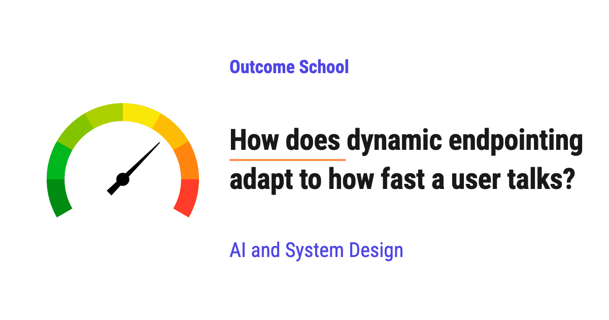

# How does dynamic endpointing adapt to how fast a user talks?

> Archived from <https://outcomeschool.com/blog/dynamic-endpointing> on 2026-11-25.

Dynamic endpointing adapts to how fast a user talks by learning the length of that user&#x27;s normal pauses and then changing how long the voice assistant waits in silence before it decides that the user has finished speaking. A fast talker gets a short wait, and a slow talker gets a long wait.

In this blog, we will learn about how dynamic endpointing adapts to how fast a user talks. We will also see what endpointing is, why a fixed silence timer fails for fast and slow talkers, how the system learns the pauses of a user and turns them into a waiting time, how the meaning of the sentence changes that waiting time, and where it works well and where it fails.

We will cover the following:
<ul><li>What is endpointing?</li><li>The problem with a fixed silence timer</li><li>What is dynamic endpointing?</li><li>How does the system measure how fast a user talks?</li><li>Turning pauses into a waiting time</li><li>A simple dynamic endpointer in code</li><li>A step-by-step walkthrough</li><li>Using the meaning of the sentence as well</li><li>Where it works well and where it fails</li></ul>
I am <strong>Amit Shekhar</strong>, Founder @ <a target="_blank" rel="noopener noreferrer" href="https://outcomeschool.com">Outcome School</a>, I have taught and mentored many developers, and their efforts landed them high-paying tech jobs, helped many tech companies in solving their unique problems, and created many open-source libraries being used by top companies. I am passionate about sharing knowledge through open-source, blogs, and videos.

I teach <a target="_blank" rel="noopener noreferrer" href="https://outcomeschool.com/program/ai-and-machine-learning">AI and Machine Learning</a> at Outcome School.

Let&#x27;s get started.
<h2 id="what-is-endpointing">What is endpointing?</h2>
When we talk to a voice assistant, the assistant has to answer one question again and again: &quot;Has the user finished speaking, or is the user only taking a short break?&quot;

<strong>Endpointing is the process of deciding the point in time where the user has finished speaking, so that the voice assistant can start its reply.</strong>

Once the system finds this end point, it sends what the user said to the LLM (Large Language Model), and the assistant prepares its reply.

A <strong>turn</strong> is one complete piece of speech by one speaker before the other speaker replies. So, <a target="_blank" rel="noopener noreferrer" href="endpointing-in-voice-agents.md">endpointing</a> means finding the end of the turn of the user.

Let&#x27;s say we are talking to a voice assistant like below:

&quot;Book a table for two... at 8 PM.&quot;

Here, there is a small silence after &quot;two&quot;. The assistant has to decide whether &quot;Book a table for two&quot; is the full request or whether more words are coming. If it decides too early, it cuts us off. If it decides too late, we sit in silence waiting for a reply.

Endpointing is a balance between two mistakes:
<ul><li><strong>Cutting the user off:</strong> The assistant replies while the user is still <a target="_blank" rel="noopener noreferrer" href="voice-agents-cutting-users-off.md">in the middle of a sentence</a>.</li><li><strong>Replying too slowly:</strong> The user has finished, but the assistant keeps waiting, and the conversation feels slow.</li></ul>
We have a detailed blog on <a target="_blank" rel="noopener noreferrer" href="voice-agent-latency-budget.md">how to build a latency budget for a voice AI agent</a> that explains how this wait fits with every other stage of the reply.
<h2 id="the-problem-with-a-fixed-silence-timer">The problem with a fixed silence timer</h2>
The simplest way to do endpointing is a fixed silence timer.

The system uses a component called a <strong>Voice Activity Detector</strong> (VAD). A VAD listens to the audio and tells us, for every small slice of time, whether someone is speaking or not. When the VAD says &quot;no speech&quot;, a timer starts. If the silence lasts longer than a fixed limit, for example, 800 milliseconds, the system decides that the user has finished.

But the following issues arise because people do not talk at the same speed.

Suppose we have two users, with numbers just for the sake of example:
<ul><li><strong>User A</strong> is a fast talker. The normal pauses between the words of User A are around 200 milliseconds.</li><li><strong>User B</strong> is a slow talker. The normal pauses between the words of User B are around 700 milliseconds, and sometimes 900 milliseconds when User B is thinking.</li></ul>
Now, let&#x27;s apply the same fixed limit of 800 milliseconds to both users.

For User A, the assistant waits 800 milliseconds after every request, even though a silence of 400 milliseconds is already very long for User A. The assistant feels slow to User A.

For User B, a normal <a target="_blank" rel="noopener noreferrer" href="long-pauses-in-voice-agents.md">thinking pause</a> of 900 milliseconds crosses the limit of 800 milliseconds. The assistant decides that User B has finished and replies in the middle of the sentence. User B gets cut off.

So, one fixed number cannot be right for both users. If we lower the limit, User B gets cut off more often. If we raise the limit, User A waits even longer. The issue with this approach is that it treats every user in the same way. Let&#x27;s see how the next approach solve this issue.
<h2 id="what-is-dynamic-endpointing">What is dynamic endpointing?</h2>
Here comes the dynamic endpointing into the picture.

<strong>Dynamic endpointing is a way of doing endpointing where the waiting time is not fixed. The system changes the waiting time based on how the current user is speaking and what the user has said so far.</strong>

The word <strong>dynamic</strong> means changing. In fixed endpointing, the waiting time is the same for everyone. In dynamic endpointing, the waiting time changes from user to user, and even from moment to moment for the same user.

The central idea is this: a silence is &quot;long&quot; or &quot;short&quot; only when compared with the normal pauses of that user. For User A, a silence of 500 milliseconds is very long. For User B, the same silence of 500 milliseconds is a normal pause between two words.

So, instead of asking &quot;Has the silence crossed 800 milliseconds?&quot;, the system asks &quot;Has the silence become much longer than the normal pauses of this user?&quot;

We will learn about the speed part first, and then the meaning part.
<h2 id="how-does-the-system-measure-how-fast-a-user-talks">How does the system measure how fast a user talks?</h2>
Before jumping into the waiting time, we must know how the system measures the speed of a user.

There are two common signals:
<ul><li><strong>Pause length:</strong> The length of the small silences between words while the user is still speaking.</li><li><strong>Speaking rate:</strong> How many words or syllables the user says in one second.</li></ul>
Both signals are connected. A fast talker says more words per second and leaves short pauses. A slow talker says fewer words per second and leaves longer pauses.

In this blog, we will focus on pause length, because it connects directly to the silence timer. The silence timer measures silence, and the pause length is also silence. So, we compare silence with silence. Speaking rate can be used in the same way: a higher speaking rate gives a shorter waiting time, and a lower speaking rate gives a longer waiting time.

The system collects pauses like below:
<ul><li>The VAD marks every slice of the audio as speech or no speech.</li><li>Every time the user stops for a short moment and then continues speaking, the system notes the length of that silence.</li><li>These are the <strong>in-sentence pauses</strong>. They are the pauses that did not end the turn, because the user continued speaking after them.</li></ul>
Here, we can notice that these pauses show what a normal &quot;I am not done yet&quot; pause looks like for this user.

The system keeps only the most recent pauses, for example, the last 5 pauses. This way, if the user speeds up or slows down during the conversation, the system follows that change.

<strong>Planning your move into AI?</strong>

No matter which tech domain you work in today, with your effort, you can transition to these roles:
<ul><li>AI Engineer</li><li>Forward Deployed Engineer</li><li>AI Agent Engineer</li><li>Harness Engineer</li><li>Voice AI Engineer</li><li>AI Architect</li><li>LLM Engineer</li><li>LLM Inference Engineer</li><li>Gen AI Engineer</li><li>MLOps Engineer</li><li>ML Engineer</li><li>Deep Learning Engineer</li></ul>
Our <a target="_blank" rel="noopener noreferrer" href="https://outcomeschool.com/program/ai-and-machine-learning">AI and Machine Learning Program</a> at Outcome School takes you there.
<h2 id="turning-pauses-into-a-waiting-time">Turning pauses into a waiting time</h2>
Now, we have a list of recent pauses for the user. Next, we need to turn this list into a waiting time.

We can do it in three steps.

<strong>Step 1:</strong> We find the average of the recent pauses. This is the normal pause of the user.

<strong>Step 2:</strong> We multiply the average by a number, for example, 2. This gives the waiting time. The idea is that the user has finished only when the silence is clearly longer than a normal pause, here, two times longer.

<strong>Step 3:</strong> We keep the waiting time inside a minimum and a maximum limit, for example, between 300 milliseconds and 2000 milliseconds.

The formula is as below:

<strong>waiting_time = clamp(average_pause * 2, 300, 2000)</strong>

Here, <code>clamp</code> means &quot;keep the value inside the limits&quot;. If the value is below 300, we use 300. If the value is above 2000, we use 2000. Otherwise, we use the value itself.

Why do we need these limits?
<ul><li>The <strong>minimum limit</strong> protects us from replying too fast. Even for a very fast talker, a silence of 100 milliseconds is too short to decide.</li><li>The <strong>maximum limit</strong> protects us from waiting forever. Even for a very slow talker, the assistant must reply at some point.</li></ul>
Instead of a simple average, some systems use a moving average that gives more weight to the most recent pauses, and some set the waiting time a little above the longest recent pause. The idea stays the same: the waiting time grows and shrinks with the normal pauses of the user.

There is one more question. What happens at the very start of the conversation, when the system has not seen any pause yet? The system starts with a default waiting time, for example, 800 milliseconds, and switches to the learned waiting time once it has collected a few pauses.
<h2 id="a-simple-dynamic-endpointer-in-code">A simple dynamic endpointer in code</h2>
Let&#x27;s see the code for a simple dynamic endpointer in Python. This is just for the sake of understanding, so it is kept small.

We can write the code as below:

<pre><code class="code-highlight language-python">from collections import deque

class DynamicEndpointer:
    def __init__(self):
        self.pauses = deque(maxlen=5)  # keep only the last 5 pauses
        self.default_wait = 800        # milliseconds
        self.multiplier = 2
        self.min_wait = 300
        self.max_wait = 2000

    def add_pause(self, pause_ms):
        # called when the user paused and then continued speaking
        self.pauses.append(pause_ms)

    def waiting_time(self):
        if len(self.pauses) &lt; 3:
            return self.default_wait  # not enough data yet
        average = sum(self.pauses) / len(self.pauses)
        wait = average * self.multiplier
        return max(self.min_wait, min(wait, self.max_wait))

    def is_turn_over(self, silence_ms):
        return silence_ms &gt;= self.waiting_time()
</code></pre>

Here, we have:
<ul><li><code>pauses</code> keeps the last 5 in-sentence pauses. When a sixth pause comes, the oldest one is removed automatically.</li><li><code>add_pause</code> is called every time the user stops for a short moment and then continues speaking.</li><li><code>waiting_time</code> returns the default of 800 milliseconds until we have at least 3 pauses. After that, it takes the average, multiplies it by 2, and keeps it between 300 and 2000.</li><li><code>is_turn_over</code> is called while the user is silent. It returns <code>True</code> when the current silence reaches the waiting time.</li></ul>
Now, let&#x27;s use it for User A and User B.

<pre><code class="code-highlight language-python">user_a = DynamicEndpointer()
for pause in [150, 200, 250]:
    user_a.add_pause(pause)
print(user_a.waiting_time())

user_b = DynamicEndpointer()
for pause in [500, 700, 900]:
    user_b.add_pause(pause)
print(user_b.waiting_time())
</code></pre>

It will print the following:

<pre><code class="code-highlight">400.0
1400.0
</code></pre>

Here, we can see that the fast talker, User A, gets a waiting time of 400 milliseconds, and the slow talker, User B, gets a waiting time of 1400 milliseconds. The same code gives two different waiting times because the two users talk at different speeds.

<strong>A quick note for you</strong>

No matter which tech domain you work in, get familiar with these topics:
<ul><li>LLM</li><li>RAG</li><li>MCP</li><li>Agent</li><li>Fine-tuning</li><li>Quantization</li></ul>
We put it all together in one video:

<a target="_blank" rel="noopener noreferrer" href="https://www.youtube.com/watch?v=lnfWvX66FUk">AI Engineering Explained: LLM, RAG, MCP, Agent, Fine-Tuning, and Quantization</a>

No need to stop reading - bookmark it and watch later when you get time. Future you will thank you.

Now, let&#x27;s get back to the topic.
<h2 id="a-step-by-step-walkthrough">A step-by-step walkthrough</h2>
Now, let&#x27;s see the values at each step.

For User A, the pauses are 150, 200, and 250 milliseconds.

<strong>Step 1:</strong> The average is (150 + 200 + 250) / 3 = 600 / 3 = 200 milliseconds.

<strong>Step 2:</strong> We multiply by 2. So, 200 * 2 = 400 milliseconds.

<strong>Step 3:</strong> 400 is between 300 and 2000, so the waiting time stays 400 milliseconds.

For User B, the pauses are 500, 700, and 900 milliseconds.

<strong>Step 1:</strong> The average is (500 + 700 + 900) / 3 = 2100 / 3 = 700 milliseconds.

<strong>Step 2:</strong> We multiply by 2. So, 700 * 2 = 1400 milliseconds.

<strong>Step 3:</strong> 1400 is between 300 and 2000, so the waiting time stays 1400 milliseconds.

Now, let&#x27;s see what happens when User B takes a thinking pause of 900 milliseconds. With the fixed timer, 900 is more than 800, so User B gets cut off. With dynamic endpointing, 900 is less than 1400, so the assistant keeps listening.

Let me tabulate the difference between the fixed timer and dynamic endpointing for both users for your better understanding.
<table><thead><tr><th>User</th><th>Normal pause</th><th>Fixed timer wait</th><th>Dynamic wait</th><th>Result with dynamic endpointing</th></tr></thead><tbody><tr><td>User A</td><td>200 ms</td><td>800 ms</td><td>400 ms</td><td>Reply comes 400 ms sooner</td></tr><tr><td>User B</td><td>700 ms</td><td>800 ms</td><td>1400 ms</td><td>No cut-off at a 900 ms pause</td></tr></tbody></table>
The flow of the whole system looks like the diagram below:

<pre><code class="code-highlight">+-----------------------------+
|  User speaks into the mic   |
+-----------------------------+
              ↓
+-----------------------------+
|  VAD marks speech / silence |
+-----------------------------+
              ↓
+-----------------------------+
|  Store in-sentence pauses   |
|  (last 5 pauses)            |
+-----------------------------+
              ↓
+-----------------------------+
|  wait = clamp(avg * 2,      |
|         300, 2000)          |
+-----------------------------+
              ↓
+-----------------------------+
|  Silence &gt;= wait?           |
|  Yes: turn is over, reply   |
|  No: keep listening         |
+-----------------------------+
</code></pre>

<strong>Stay updated:</strong> Subscribe to our <a target="_blank" rel="noopener noreferrer" href="https://outcomeschool.substack.com/subscribe">newsletter</a> to get our latest AI and Machine Learning blogs straight to your inbox.
<h2 id="using-the-meaning-of-the-sentence-as-well">Using the meaning of the sentence as well</h2>
So far, our system uses only the speed of the user. But speed alone is not enough.

Consider these two sentences, spoken by the same user with the same pause at the end:
<ul><li>&quot;What is the weather in Delhi?&quot;</li><li>&quot;What is the weather in...&quot;</li></ul>
The first sentence is complete. The second sentence is not complete. A good assistant must reply quickly to the first one and keep waiting for the second one, even if the silence is the same.

So, many systems also look at the words. A small model looks at what the user has said so far and gives a score: how likely it is that the user has finished the thought. This is often called a <a target="_blank" rel="noopener noreferrer" href="silence-vs-model-based-turn-detection.md"><strong>turn detection</strong></a> model or an <strong>end-of-turn</strong> model.

The system then combines both signals:
<ul><li>If the sentence looks complete, the system lowers the waiting time.</li><li>If the sentence looks incomplete, for example, it ends with &quot;and&quot;, &quot;to&quot;, &quot;the&quot;, or &quot;in&quot;, the system raises the waiting time.</li></ul>
We can add this to our formula, just for the sake of understanding, like below:
<ul><li>Sentence looks complete: <strong>waiting_time = clamp(average_pause * 1.5, 300, 2000)</strong></li><li>Sentence looks incomplete: <strong>waiting_time = clamp(average_pause * 3, 300, 2000)</strong></li></ul>
When the model is not sure, the system uses the normal multiplier of 2.

For User A, with an average pause of 200 milliseconds, a complete sentence gives 200 * 1.5 = 300 milliseconds, and an incomplete sentence gives 200 * 3 = 600 milliseconds.

For User B, with an average pause of 700 milliseconds, an incomplete sentence gives 700 * 3 = 2100 milliseconds. This is above the maximum limit, so the waiting time becomes 2000 milliseconds.

Some systems also listen to how the user says the words. The pattern of pitch, loudness, and rhythm in the voice is called <strong>prosody</strong>. For example, the pitch of the voice often falls at the end of a statement, and it often stays level when the user is going to continue. These sound patterns give one more hint about whether the user has finished.

This is how dynamic endpointing combines the speed of the user and the meaning of the words to decide the right waiting time.

To learn Multimodal AI, SLMs and Model Distillation, and how to Design a Real-Time Voice AI Agent, check out our <a target="_blank" rel="noopener noreferrer" href="https://outcomeschool.com/program/ai-and-machine-learning">AI and Machine Learning Program</a> at Outcome School.
<h2 id="where-it-works-well-and-where-it-fails">Where it works well and where it fails</h2>
Dynamic endpointing works well in the following cases:
<ul><li><strong>Fast talkers:</strong> They get quick replies, and the conversation feels natural.</li><li><strong>Slow talkers:</strong> People speaking in a second language and people who think while they speak get cut off less often.</li><li><strong>A change in speed during the conversation:</strong> Because the system keeps only the recent pauses, it follows the user when the user speeds up or slows down.</li></ul>
But it also fails in some cases:
<ul><li><strong>The start of the conversation:</strong> The system has no pauses yet, so it uses the default waiting time until it learns the pauses of the user.</li><li><strong>Noisy rooms:</strong> If the VAD treats background noise as speech, the pause lengths become wrong, and so the waiting time also becomes wrong.</li><li><strong>One very long thinking pause:</strong> A user who normally talks fast can suddenly stop for two seconds to think. The learned waiting time is short, so the assistant replies too early. The meaning of the sentence helps here, but it does not fix every case.</li></ul>
So, dynamic endpointing does not remove every mistake. But it reduces both kinds of mistakes for users who talk faster or slower than average, because it waits for each user in the way that user talks.

Now we must have understood how dynamic endpointing adapts to how fast a user talks, how it learns the pauses of a user, how it turns them into a waiting time, and how the meaning of the sentence improves that waiting time.
<h2 id="frequently-asked-questions">Frequently Asked Questions</h2><h3 id="what-does-dynamic-endpointing-do-at-the-start-of-a-conversation">What does dynamic endpointing do at the start of a conversation?</h3>
It uses a default waiting time, for example, 800 milliseconds. At the very start of the conversation, the system has not seen any pause yet, so it cannot learn a waiting time. Once it has collected a few in-sentence pauses, for example at least 3, it switches to the waiting time learned from the pauses of that user.
<h3 id="why-does-dynamic-endpointing-keep-only-the-most-recent-pauses">Why does dynamic endpointing keep only the most recent pauses?</h3>
Dynamic endpointing keeps only the most recent pauses, for example the last 5, so that it can follow the user when the user speeds up or slows down during the conversation. Older pauses are dropped, and the waiting time grows and shrinks with how the user is talking right now.
<h3 id="can-dynamic-endpointing-use-speaking-rate-instead-of-pause-length">Can dynamic endpointing use speaking rate instead of pause length?</h3>
Yes. Speaking rate, which is how many words or syllables the user says in one second, can be used in the same way. A higher speaking rate gives a shorter waiting time, and a lower speaking rate gives a longer waiting time. Pause length connects directly to the silence timer, because both measure silence, so we compare silence with silence.
<h3 id="does-background-noise-affect-dynamic-endpointing">Does background noise affect dynamic endpointing?</h3>
Yes. If the Voice Activity Detector treats background noise as speech, the measured pause lengths become wrong, and so the waiting time also becomes wrong. This is one of the cases where dynamic endpointing fails, along with the start of the conversation and one very long thinking pause from a user who normally talks fast.

That&#x27;s it for now.

Thanks

<strong>Amit Shekhar</strong> Founder @ <a target="_blank" rel="noopener noreferrer" href="https://outcomeschool.com">Outcome School</a>

You can connect with me on:
<ul><li><a target="_blank" rel="noopener noreferrer" href="https://x.com/amitiitbhu">X</a></li><li><a target="_blank" rel="noopener noreferrer" href="https://www.linkedin.com/in/amit-shekhar-iitbhu">LinkedIn</a></li><li><a target="_blank" rel="noopener noreferrer" href="https://github.com/amitshekhariitbhu">GitHub</a></li></ul>
Follow Outcome School on:
<ul><li><a target="_blank" rel="noopener noreferrer" href="https://x.com/outcome_school">X</a></li><li><a target="_blank" rel="noopener noreferrer" href="https://youtube.com/@OutcomeSchool">YouTube</a></li><li><a target="_blank" rel="noopener noreferrer" href="https://www.linkedin.com/company/outcomeschool">LinkedIn</a></li><li><a target="_blank" rel="noopener noreferrer" href="http://github.com/OutcomeSchool">GitHub</a></li></ul>
<a target="_blank" rel="noopener noreferrer" href="https://outcomeschool.com/blog"><strong>Read all of our high-quality blogs here.</strong></a>

